# 零基础模板化搭建 AI 微信聊天机器人

> 来源：[https://waytoagi.feishu.cn/docx/EOgXds6ybo6h29xqUFocGKMwndb](https://waytoagi.feishu.cn/docx/EOgXds6ybo6h29xqUFocGKMwndb)

# 1. 纯 GPT 大模型能力的微信聊天机器人搭建

## 技术组件的选用

先来说说这次我们都哪些技术组件或平台吧，大家先了解一下以便接下来可以更好的用于搭建自己的 AI 微信聊天机器人。

1.  极简未来（Link.AI）平台 - 用于创建维护自己的 AI 机器人

1.  1 x 腾讯云轻量应用服务器（其中包含：宝塔面板 + Docker 容器 + COW 技术组件）- 用于将上述的 AI 机器人与你指定的个人微信号绑定

1.  1 x 微信号 - 用于私聊和群聊发送消息，效果与真人使用微信交流一样

这里其实难度最大的是第二个，因为需要让技术小白拥有自己的第一台云上服务器，是不是想起来都有点激动，但又怕不懂？其实不用担心，服务器你可以类比成其实就一台放在云上的家里电脑，这台电脑可以用来运行各种软件，就像你家里的电脑一样，只不过你家里的电脑是你自己购买的，而云上的服务器是别人给你租的。

具体的每个相应的组件我先把介绍链接放在这里，大家可以在实战之前先预习一下（完全看不懂都没关系，大致有个概念就好）：

+   极简未来（Link.AI）平台 - https://link-ai.tech/portal

+   腾讯云轻量应用服务器 - https://cloud.tencent.com/product/lighthouse

+   宝塔面板 - https://www.bt.cn/

+   Docker 容器 - https://info.support.huawei.com/info-finder/encyclopedia/zh/Docker%E5%AE%B9%E5%99%A8.html

+   COW（Chatgpt-On-Wechat）组件 - https://docs.link-ai.tech/cow

## 开始搭建

### 1. 配置极简未来（Link.AI）平台

#### 基础教程

秉着有官方教程就用的原则，这里大家其实直接按照官方教程走就行了，说得挺详细了：

https://docs.link-ai.tech/platform/create-app

学习的补充：

https://docs.link-ai.tech/platform/quick-start

等大家看完这个教程后，我这里提几点：

1.  教程中的应用，其实就是让你创建一个具体的 AI 问答机器人应用；

1.  教程中的知识库，其实就是给绑定到指定问答机器人的资料数据集，让机器人可以直接基于这些内容作为背景去回答问题；

1.  知识库应用中的应用设定，其实就是给 AI 机器人的提示词内容或者人设，具体什么是提示词，可以看看这个教程 - https://waytoagi.feishu.cn/wiki/OqJQwzq2wi9EIOkFtFkclM24nSe；

1.  你创建成功的 AI 应用，就可以直接用于对接到之后的微信聊天机器人中，所以你需要记住这个应用的应用 ID，后面会用到，如下图所示：

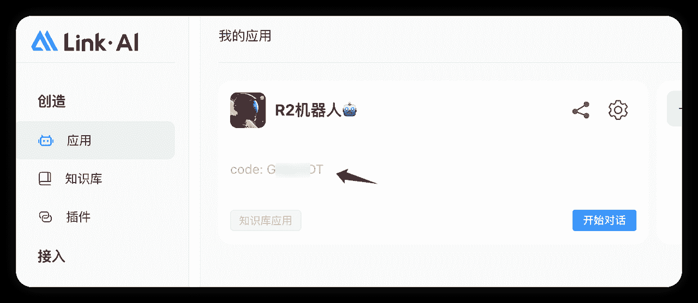

#### 生成 API Key 用于后续功能对接

为了对接到微信聊天机器人，我们还需要先生成一个 API Key，这个 API Key 就是也是我们之后对接微信机器人需要用到的，地址如下：

https://link-ai.tech/console/interface

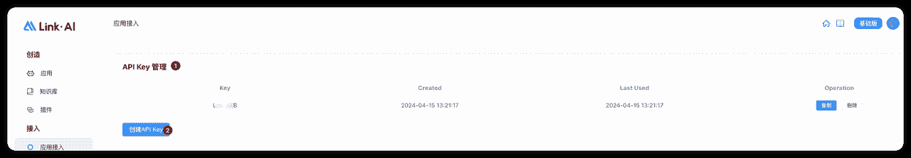

点击创建 API Key，然后记住这个 API Key，后面会用到。

#### 充点钱使用机器人（一点就够了）

其实机器人应用背后使用到的大模型等能力都是需要付费，先给你看看目前平台的计费规则：

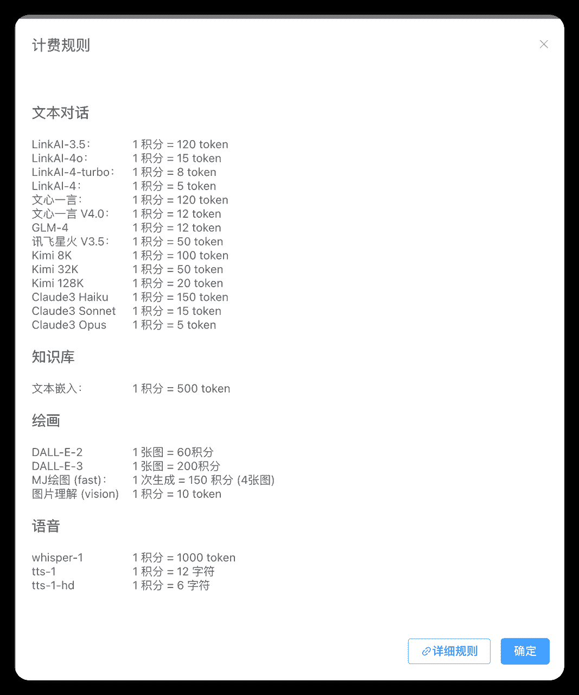

详细版的计费规则在这里 - https://docs.link-ai.tech/platform/funds/price

其实 AI 大模型相关的功能交互，主要都是用 Token 来作为单位的，不同的大模型能力，平台一积分能兑换到 Token 数是不同的，能力越强的大模型一积分所能兑换到的 Token 数就越少，像我日常使用的 GPT 3.5 能力的大模型，平均每次对话大概都会消耗不到 20 积分：

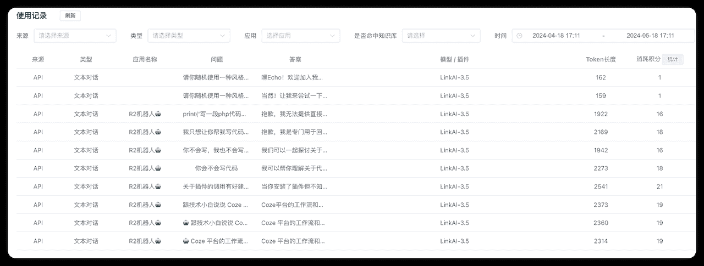

除了每天平台的签到可以免费领取 50 到几百的积分，而充值的话，目前是可以 19 元兑换 10000 积分，说实在的，我充了这个一次，已经够我使用好几个月了，所以大模型的使用成本其实不算高了...

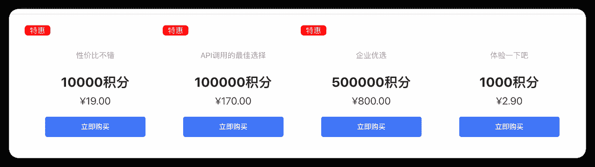

### 2. 配置腾讯云轻量应用服务器

在开始教程之前，记得根据以下链接注册一个腾讯云账号：

https://cloud.tencent.com/register

#### 购买并运行服务器

1.  注册成功后，接下来我们要购买服务器了，这里我选择的腾讯云的轻量应用服务器，腾讯云一直有一些服务器的购买优惠，你可以直接点击以下的链接进行查看，当然你也可以走标准的渠道去购买，这里主要是看大家比较多小白，先低成本试错也挺好的：

https://cloud.tencent.com/act/pro/bestselling

1.  根据以下流程链接进行新人优惠购买，实例套餐默认即可2核2G3M，这里82块钱一年的费用，真的很划算了，方便你快速试错。点击立即购买：

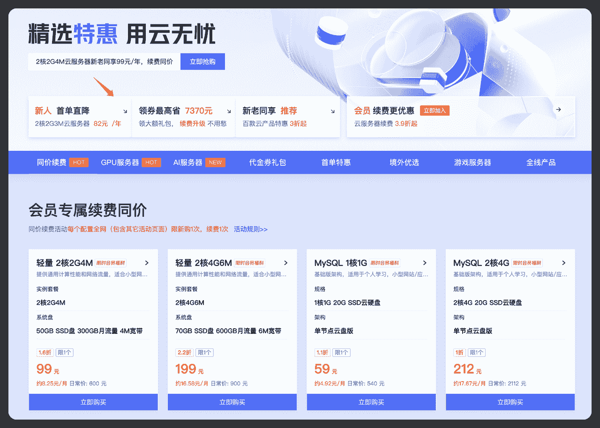

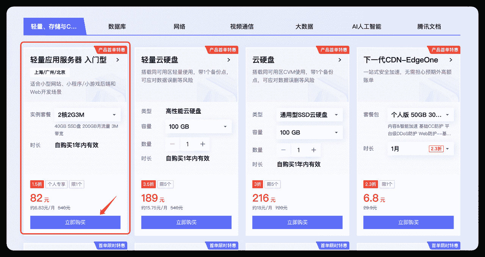

1.  根据以下图示选择好地域与镜像，镜像我们选择自带宝塔面板的 Linux 系统镜像，方便我们之后通过 Web UI 的管理界面管理服务器（最新的版本已经是 8.2.0 版本了，记得使用最新版）：

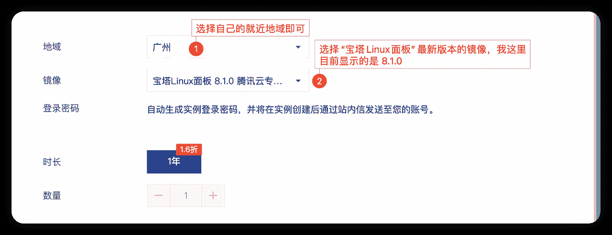

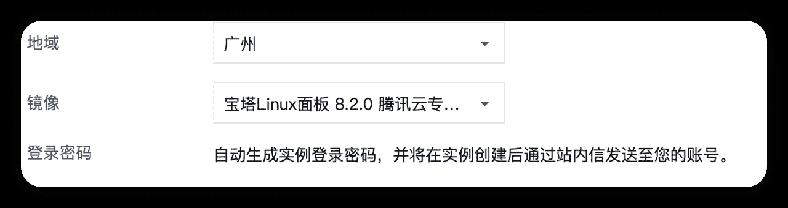

1.  服务器支付成功后，我们点击查看实例，就可以看到我们自己新买的服务器已经在运行中了！我们点击当前这个实例卡片进去看看：

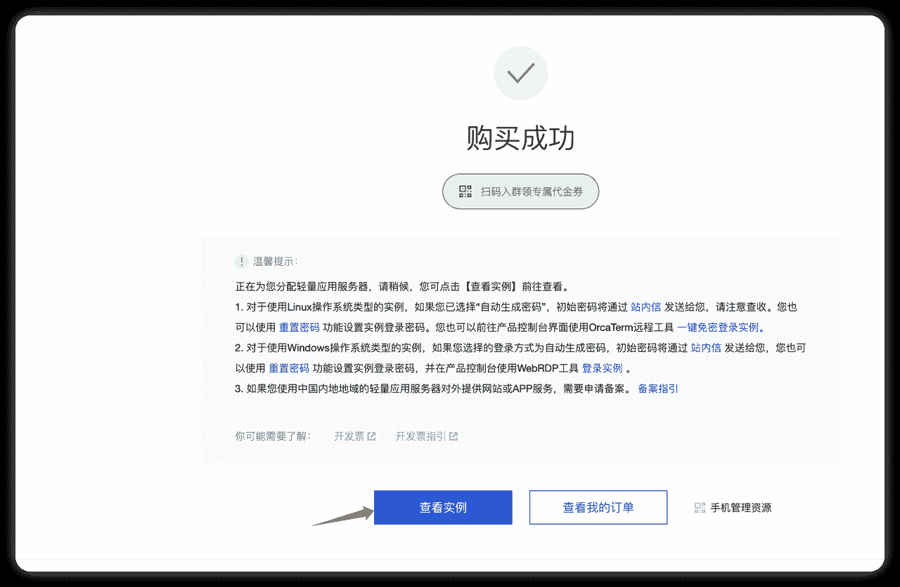

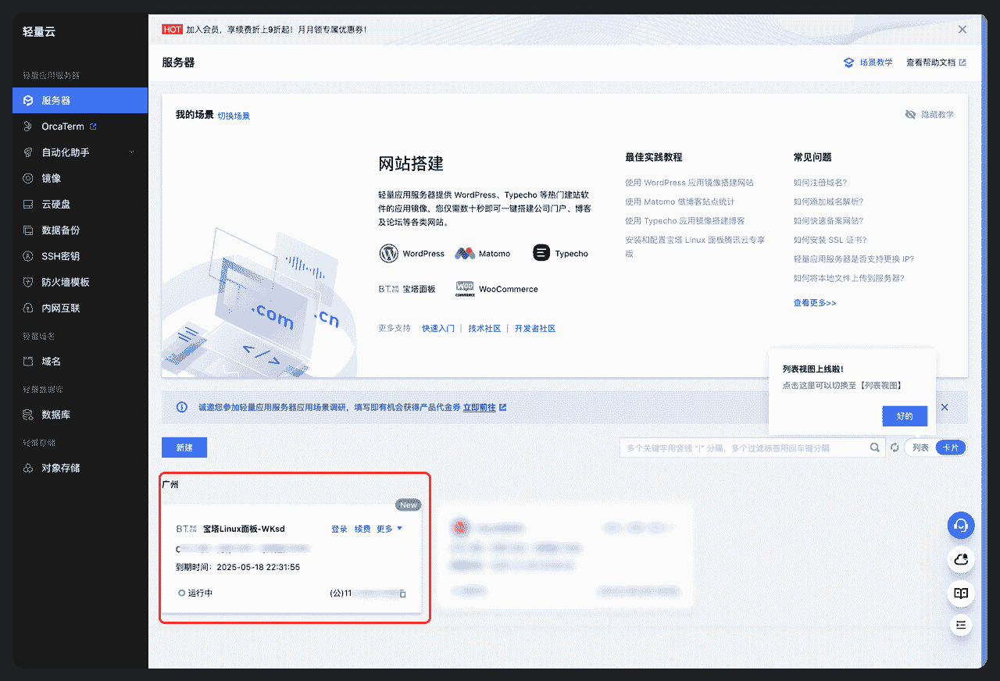

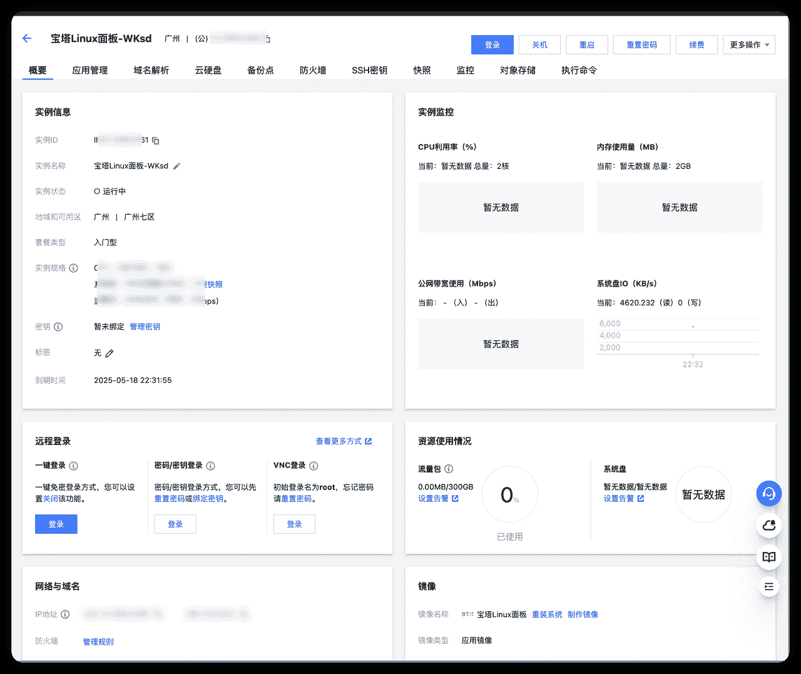

1.  从上图的案例详情可以看到，其对应的设置其实跟我们普通电脑的操作是相似的，大家可以先自己熟悉一下，然后再继续下面的教程。

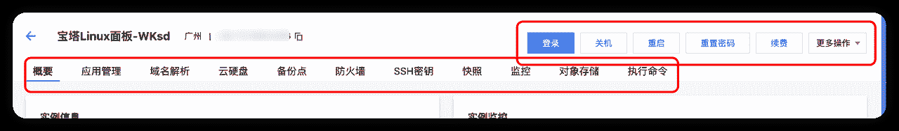

#### 获取宝塔的管理员用户名和密码

1.  我们需要获取到宝塔的管理员用户名和密码，才能通过 Web UI 来管理服务器。我们先按照以下图示来好好了解一下具体的宝塔服务内容：

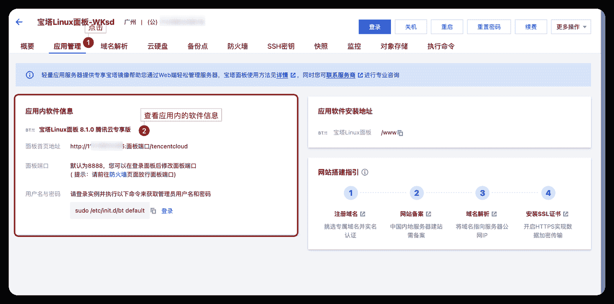

1.  这里的用户名与密码其实就是指宝塔服务的管理员用户名和密码，我们只需要按照说明去获取即可。图中显示我们需要登录到这个实例里，并执行一下命令sudo /etc/init.d/bt default来进行获取对应的用户名和密码（记得，看完第一次之后就好好保存起来），点击登录进去当前实例：

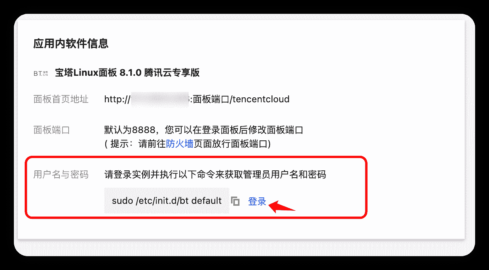

1.  看到什么不懂得弹窗，直接点解默认并下一步即可，过一会后，你就会进入到以下的命令行界面，这证明我们登录成功了。

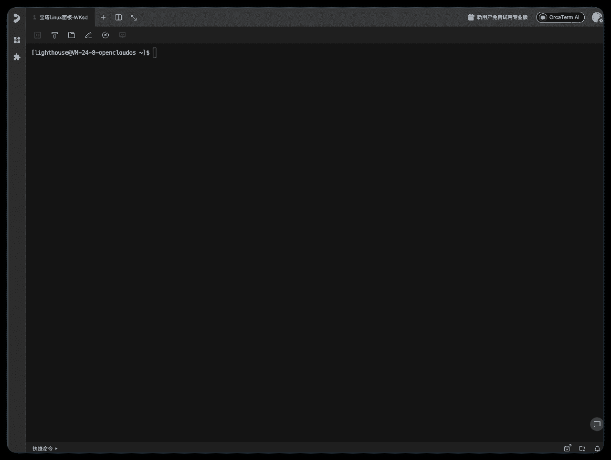

1.  根据上面的应用提示，我们直接在这个命令行界面输入以下命令来获取用户名和密码，记得把密码记下来，后面会用到：

```
sudo /etc/init.d/bt default
```

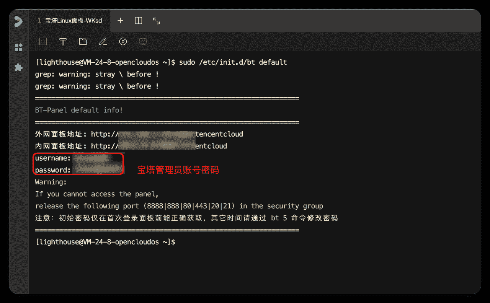

#### 开放宝塔服务访问

现在宝塔服务搭建好了，其管理员账号密码也拿到了，那我们该怎么访问具体的宝塔服务呢？其实不难，就是要开放这台服务器的防火墙策略了（出于安全考虑，云厂商默认都会将服务器实例的大部分服务端口禁用）！

1.  我们先回过头来看看刚刚获取宝塔管理员账号密码时，它还有一些信息输出了给我们，请记住这个宝塔的外网地址，等下我们开放防火墙后就可以进行访问了：

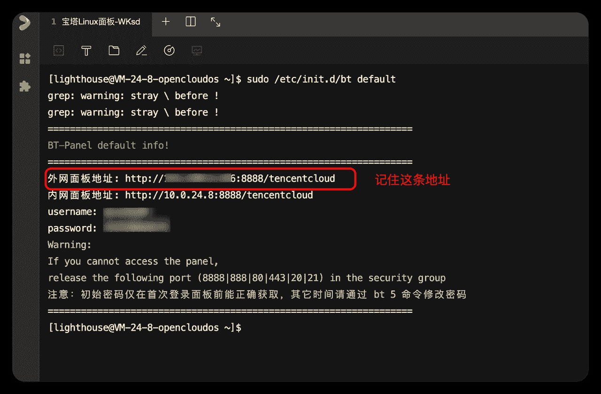

```
宝塔面板管理面板地址示例：
http://xxx.xxx.xxx.xxx:8888/tencentcloud
```

1.  从上图中可以看到，默认部署成功的服务器以及宝塔服务，它监听这8888端口作为自己的 Web UI 服务，我们需要将这个端口放行到公网上，这样才能让我们自己通过公网访问到宝塔服务。这句话对于小白来说可能有点难理解，我这里再给大家解释一下：

1.  什么是端口：
• 计算机和服务器像是邮局，有很多不同的邮筒（端口）。
• 每个邮筒（端口）用于不同的信件类型（服务）。
• 例如，邮筒 80 号常用于网页浏览，而 8888 号在这里用来访问宝塔服务。

1.  监听端口：
• 当我们说宝塔监听 8888 端口，意思是宝塔在这个邮筒里收发信息。
• 宝塔会通过 8888 端口接收你的指令，并返回结果。

1.  公网访问：
• 服务器默认会保护自己，不让外部随便访问。
• 要让你的电脑通过互联网访问服务器上的宝塔服务，需要告诉服务器“开放”8888 号邮筒。

1.  放行端口：
• 放行端口就像给邮筒一个“公开访问”的标志，允许互联网用户通过这个端口访问宝塔。
• 你需要在服务器的防火墙（保护罩）上设置规则，允许 8888 端口的连接。

1.  现在我们要在服务器的防火墙上设置规则，允许 8888 号端口的连接。点击防火墙标签，然后点击添加规则添加以下这条规则：

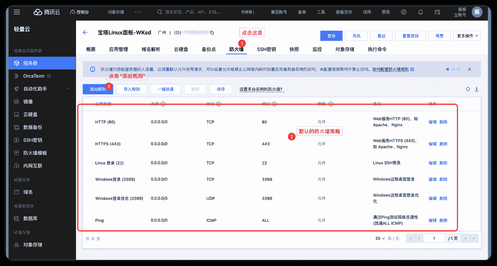

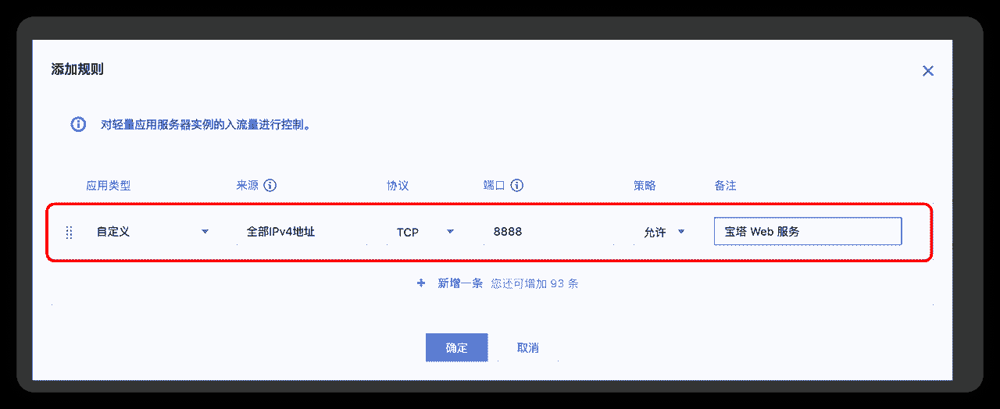

1.  防火墙规则添加成功后，我们就可以通过刚刚保存的公网地址访问到宝塔服务了，记得把刚刚获取到的宝塔管理员用户名和密码填入登录界面，就可以进入到宝塔的管理界面了：

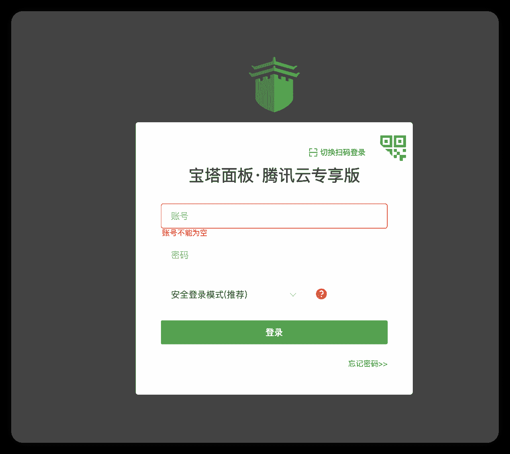

1.  首次登录，记得绑定一下宝塔账号（没有账号的先注册一个），以后登录会更加安全：

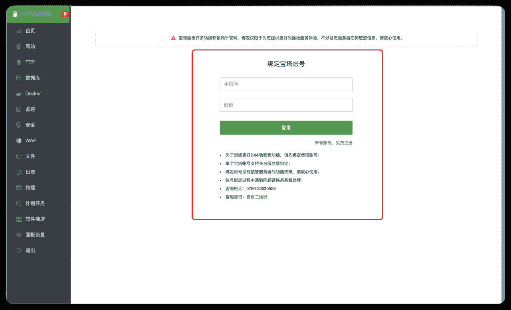

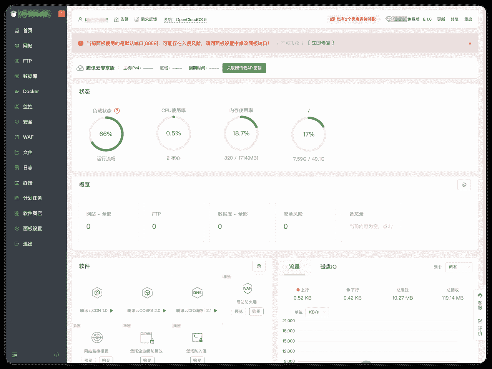

#### 安装 Docker 服务

宝塔服务搭建好了，我们需要安装 Docker 服务，这个 Docker 服务我们后面会用到，来运行 COW 组件。

1.  安装也很简单，在宝塔界面的左侧导航栏，点击Docker选项，然后会被告知还没有安装 Docker 服务，点击立即安装按钮即可，安装方式选择默认：

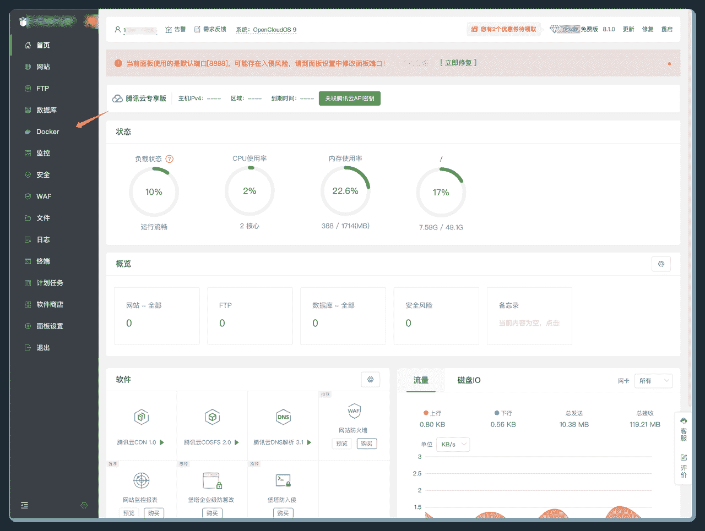

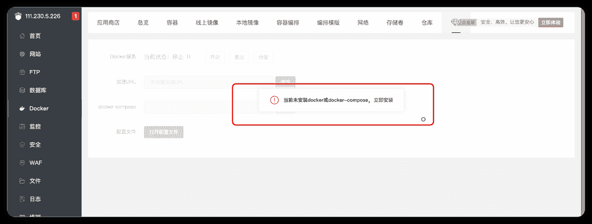

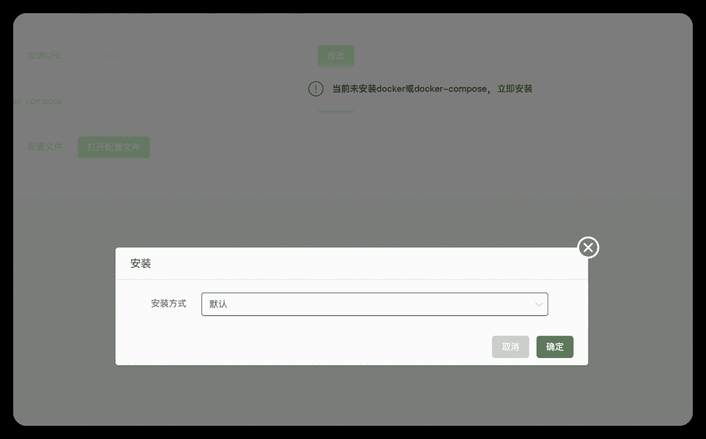

1.  等待期安装完成，安装完成后，对应的提示信息会显示安装成功：

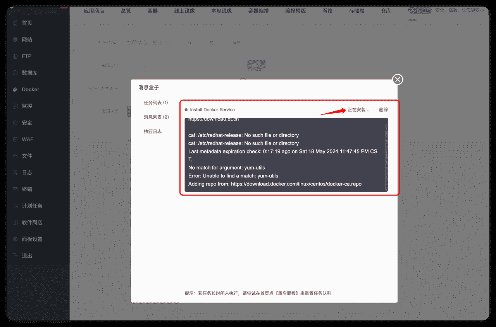

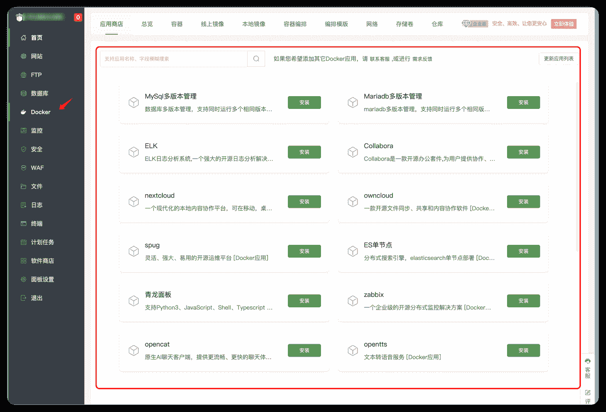

#### 更新 Docker 默认加速镜像 URL

1.  为了防止 Docker 镜像下载速度慢甚至下载不到的问题，我们需要更新 Docker 的默认加速镜像 URL，这里我们使用腾讯云的加速镜像 URL，具体操作如下：

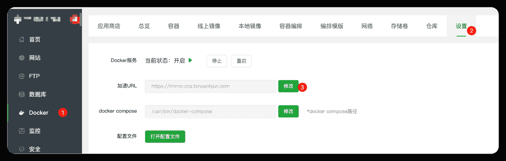

1.  点击修改后，会有一个弹窗出来，选择腾讯云镜像加速站，然后点击确认：

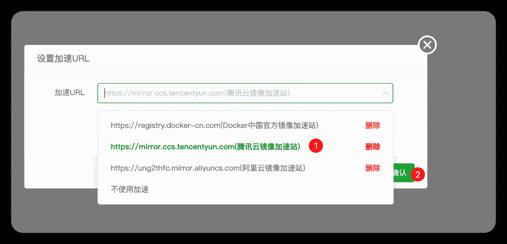

1.  最后，点击一下图下位置的重启按钮重启一下 Docker 服务，这样我们的 Docker 服务就更新成功了：

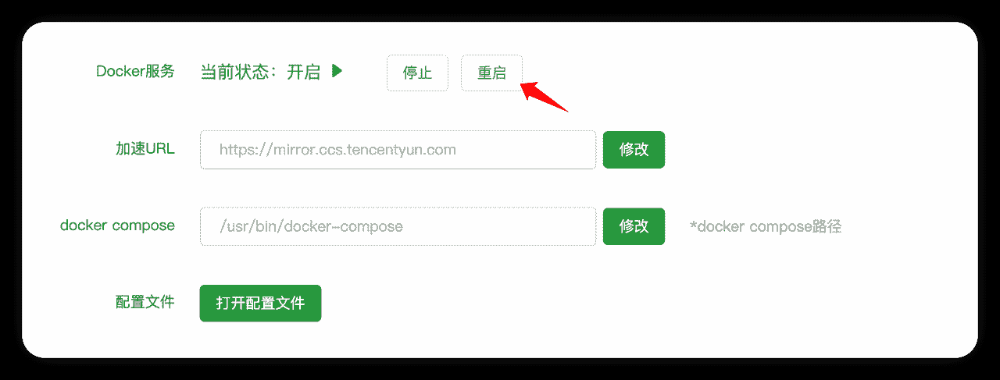

#### 配置部署 COW 组件

经过前面的各种准备工作，终于要进入最关键的一步了：让你的个人微信号与 AI 机器人实现无缝连接！

COW 全称 Chatgpt-on-wechat，可以在微信、飞书、钉钉等主流的社交平台上实现对接各种大模型的功能。我们要做的，就是在刚买的腾讯云服务器上通过 Docker 运行 COW，并将之前在极简未来平台创建的 API 信息填入其中，我们来具体说说。

使用 Docker 服务部署 COW 组件

宝塔面板的好处就是可以让技术小白以图形交互的方式运维服务器，在基于 Docker 的服务上部署具体应用服务就更简单了，但目前宝塔不支持直接以一个容器应用模板的方式部署 COW 组件，所以我们来手动配置部署一个容器编排模板。

1.  首先，根据下图所示，我们找到对应容器编排的位置点击添加：

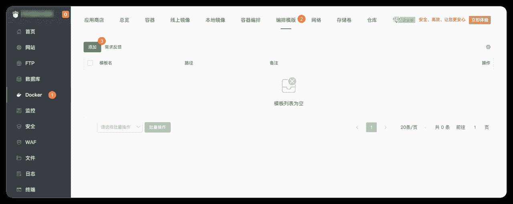

1.  然后我们根据极简未来关于部署 COW 组件的 Docker 部署方式，直接复制docker-compose.yml文件内容（就是容器编排的配置内容），我下面已经帮大家复制出来，你可以粘贴到 Compose 模板的编辑框中，然后命名一下模板，先不要添加：

```
version: &quot;2.0&quot;
services:
  my-ai-bot:
    image: andywuwu/chatgpt-on-wechat:1.6.8
    container_name: my-ai-bot
    security_opt:
      - seccomp:unconfined
    environment:
      TZ: &quot;Asia/Shanghai&quot;
      OPEN_AI_API_KEY: &quot;YOUR API KEY&quot;
      MODEL: &quot;gpt-3.5-turbo&quot;
      PROXY: &quot;&quot;
      SINGLE_CHAT_PREFIX: &#x27;[&quot;bot&quot;, &quot;@bot&quot;]&#x27;
      SINGLE_CHAT_REPLY_PREFIX: &#x27;&quot;[bot] &quot;&#x27;
      GROUP_CHAT_PREFIX: &#x27;[&quot;@bot&quot;]&#x27;
      GROUP_NAME_WHITE_LIST: &#x27;[&quot;ChatGPT测试群&quot;, &quot;ChatGPT测试群2&quot;]&#x27;
      IMAGE_CREATE_PREFIX: &#x27;[&quot;画&quot;, &quot;看&quot;, &quot;找&quot;]&#x27;
      CONVERSATION_MAX_TOKENS: 1000
      SPEECH_RECOGNITION: &quot;False&quot;
      CHARACTER_DESC: &quot;你是基于大语言模型的AI智能助手，旨在回答并解决人们的任何问题，并且可以使用多种语言与人交流。&quot;
      EXPIRES_IN_SECONDS: 3600
      USE_GLOBAL_PLUGIN_CONFIG: &quot;True&quot;
      USE_LINKAI: &quot;False&quot;
      LINKAI_API_KEY: &quot;&quot;
      LINKAI_APP_CODE: &quot;&quot;
```

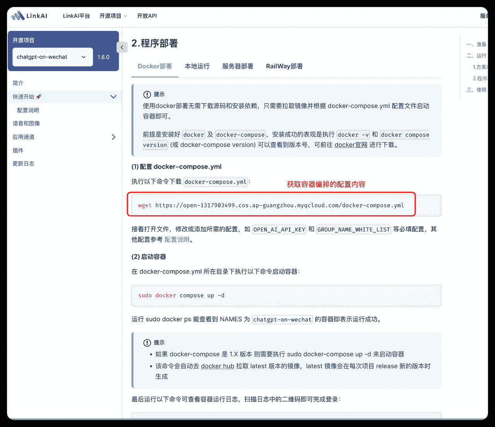

1.  重点来了，在刚刚复制的docker-compose.yml文件中，我们需要修改一下里面的具体配置来串联我们的微信号和平台上已创建好的 AI 机器人。这个配置的参考官方来源是这里：https://docs.link-ai.tech/cow/quick-start/config，当然我把主要的配置解释先给大家看一下：

```
# config.json文件内容示例
{
  &quot;open_ai_api_key&quot;: &quot;YOUR API KEY&quot;,                          # 填入上面创建的 OpenAI API KEY
  &quot;model&quot;: &quot;gpt-3.5-turbo&quot;,                                   # 模型名称。当use_azure_chatgpt为true时，其名称为Azure上model deployment名称
  &quot;proxy&quot;: &quot;&quot;,                                                # 代理客户端的ip和端口
  &quot;single_chat_prefix&quot;: [&quot;bot&quot;, &quot;@bot&quot;],                      # 私聊时文本需要包含该前缀才能触发机器人回复
  &quot;single_chat_reply_prefix&quot;: &quot;[bot] &quot;,                       # 私聊时自动回复的前缀，用于区分真人
  &quot;group_chat_prefix&quot;: [&quot;@bot&quot;],                              # 群聊时包含该前缀则会触发机器人回复
  &quot;group_name_white_list&quot;: [&quot;ChatGPT测试群&quot;, &quot;ChatGPT测试群2&quot;], # 开启自动回复的群名称列表
  &quot;group_chat_in_one_session&quot;: [&quot;ChatGPT测试群&quot;],              # 支持会话上下文共享的群名称
  &quot;image_create_prefix&quot;: [&quot;画&quot;, &quot;看&quot;, &quot;找&quot;],                   # 开启图片回复的前缀
  &quot;conversation_max_tokens&quot;: 1000,                            # 支持上下文记忆的最多字符数
  &quot;speech_recognition&quot;: false,                                # 是否开启语音识别
  &quot;group_speech_recognition&quot;: false,                          # 是否开启群组语音识别
  &quot;use_azure_chatgpt&quot;: false,                                 # 是否使用Azure ChatGPT service代替openai ChatGPT service. 当设置为true时需要设置 open_ai_api_base，如 https://xxx.openai.azure.com/
  &quot;azure_deployment_id&quot;: &quot;&quot;,                                  # 采用Azure ChatGPT时，模型部署名称
  &quot;character_desc&quot;: &quot;你是ChatGPT, 一个由OpenAI训练的大型语言模型, 你旨在回答并解决人们的任何问题，并且可以使用多种语言与人交流。&quot;,  # 人格描述
  # 订阅消息，公众号和企业微信channel中请填写，当被订阅时会自动回复，可使用特殊占位符。目前支持的占位符有{trigger_prefix}，在程序中它会自动替换成bot的触发词。
  &quot;subscribe_msg&quot;: &quot;感谢您的关注！\n这里是ChatGPT，可以自由对话。\n支持语音对话。\n支持图片输出，画字开头的消息将按要求创作图片。\n支持角色扮演和文字冒险等丰富插件。\n输入{trigger_prefix}#help 查看详细指令。&quot;
}
```

1.  从配置参数解释可以看到，其实配置里面的每个参考的名称的全大写描述，比如open_ai_api_key对应编排模板的OPEN_AI_API_KEY，model对应编排模板的MODEL，以此类推我们就可以在编排模板去配置具体的配置参数了。所以以下是我们最新的容器编排模板的配置参数（里面有'{{中文描述}}'的请大家替换为前面让大家预留好的对应值）：

```
version: &quot;3&quot;
services:
  my-ai-bot:
    image: andywuwu/chatgpt-on-wechat:1.6.8
    container_name: my-ai-bot
    security_opt:
      - seccomp:unconfined
    environment:
      TZ: &quot;Asia/Shanghai&quot;
      OPEN_AI_API_KEY: &quot;YOUR API KEY&quot;
      MODEL: &quot;gpt-3.5-turbo&quot;
      PROXY: &quot;&quot;
      SINGLE_CHAT_PREFIX: &#x27;[&quot;bot&quot;, &quot;@bot&quot;]&#x27;
      SINGLE_CHAT_REPLY_PREFIX: &#x27;&quot;[bot] &quot;&#x27;
      GROUP_CHAT_PREFIX: &#x27;[&quot;@bot&quot;]&#x27;
      GROUP_NAME_WHITE_LIST: &#x27;[&quot;ChatGPT测试群&quot;, &quot;ChatGPT测试群2&quot;]&#x27;
      IMAGE_CREATE_PREFIX: &#x27;[&quot;画&quot;, &quot;看&quot;, &quot;找&quot;]&#x27;
      CONVERSATION_MAX_TOKENS: 1000
      SPEECH_RECOGNITION: &quot;False&quot;
      CHARACTER_DESC: &quot;你是基于大语言模型的AI智能助手，旨在回答并解决人们的任何问题，并且可以使用多种语言与人交流。&quot;
      EXPIRES_IN_SECONDS: 3600
      USE_GLOBAL_PLUGIN_CONFIG: &quot;True&quot;
      USE_LINKAI: &quot;True&quot;
      LINKAI_API_KEY: &quot;{{极简平台生成的 API KEY}}&quot;
      LINKAI_APP_CODE: &quot;{{极简平台上你创建成功的 AI 应用的 APP CODE}}&quot;
```

这里要留意下，在私聊或者群上交流时，最好都是需要加上一些前缀才触发机器人回复，比如我这里配置的是["bot", "@bot"]，即对应的配置参数SINGLE_CHAT_PREFIX，你在私聊或者群里发消息，必须要包含bot或者@bot才会触发机器人回复。在群组里，对应配置参数是GROUP_CHAT_PREFIX，机器人只会回复群里包含@bot的消息。

还有这个参数GROUP_NAME_WHITE_LIST，它是用来配置哪些群组的消息需要自动回复的，比如我这里配置的是["ChatGPT测试群", "ChatGPT测试群2"]，即只有ChatGPT测试群和ChatGPT测试群2的群组消息才会自动回复。

所以假设我要对接的微信号的名称叫安仔机器人，我们就可以更新最终版的配置参数（GROUP_NAME_WHITE_LIST参数记得根据你要交互的群组进行具体修改），查看过没问题，就点击保存，这个编排模板就创建成功了，当然以后你的需求可能有所变化，你也可以继续修改这个模板，然后基于它来重新建立我们接下来的具体 COW 服务：

```
version: &quot;2.0&quot;
services:
  my-ai-bot:
    image: andywuwu/chatgpt-on-wechat:1.6.8
    container_name: my-ai-bot
    security_opt:
      - seccomp:unconfined
    environment:
      TZ: &quot;Asia/Shanghai&quot;
      OPEN_AI_API_KEY: &quot;YOUR API KEY&quot;
      MODEL: &quot;gpt-3.5-turbo&quot;
      PROXY: &quot;&quot;
      SINGLE_CHAT_PREFIX: &#x27;[&quot;安仔机器人&quot;, &quot;@安仔机器人&quot;]&#x27;
      SINGLE_CHAT_REPLY_PREFIX: &#x27;&quot;[安仔机器人] &quot;&#x27;
      GROUP_CHAT_PREFIX: &#x27;[&quot;@安仔机器人&quot;]&#x27;
      GROUP_NAME_WHITE_LIST: &#x27;[&quot;ChatGPT测试群&quot;, &quot;ChatGPT测试群2&quot;]&#x27;
      IMAGE_CREATE_PREFIX: &#x27;[&quot;画&quot;, &quot;看&quot;, &quot;找&quot;]&#x27;
      CONVERSATION_MAX_TOKENS: 1000
      SPEECH_RECOGNITION: &quot;False&quot;
      CHARACTER_DESC: &quot;你是基于大语言模型的AI智能助手，旨在回答并解决人们的任何问题，并且可以使用多种语言与人交流。&quot;
      EXPIRES_IN_SECONDS: 3600
      USE_GLOBAL_PLUGIN_CONFIG: &quot;True&quot;
      USE_LINKAI: &quot;True&quot;
      LINKAI_API_KEY: &quot;Link_111222333444555666777888&quot;
      LINKAI_APP_CODE: &quot;thisisademoappcode&quot;
```

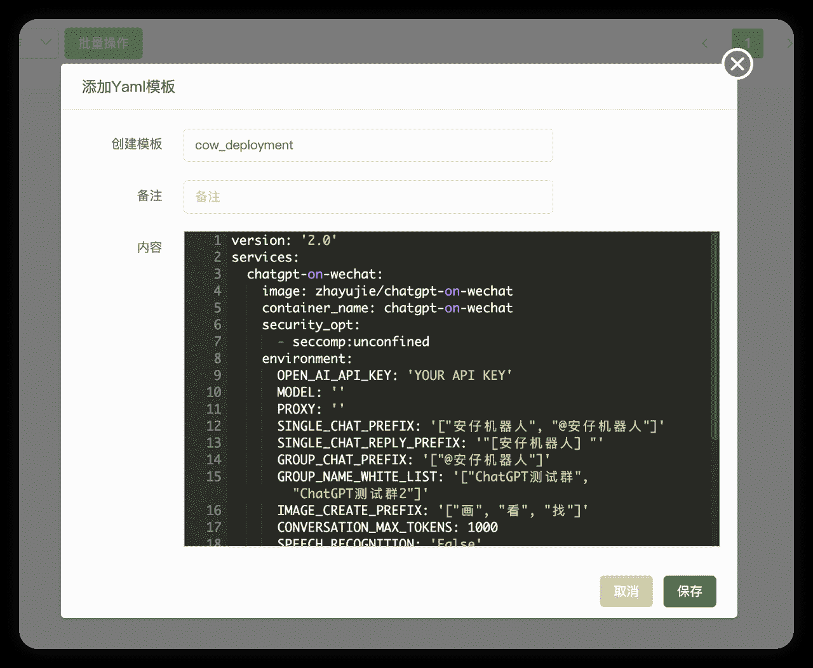

1.  现在我们就切换到容器编排界面，开始基于我们刚刚创建的模板进行真正的 COW 服务部署，点击添加后，部署会开始进行，可能需要等待一会时间：

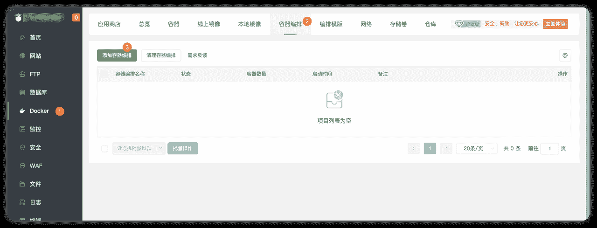

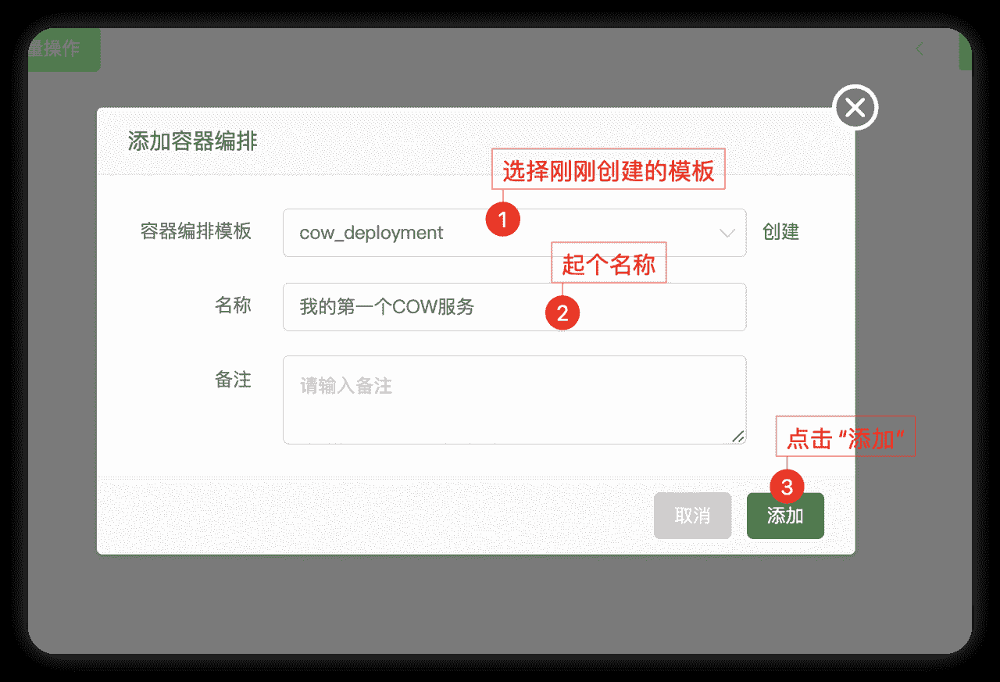

1.  等待一会后，我们会看到我们的 COW 服务就这样部署成功了！

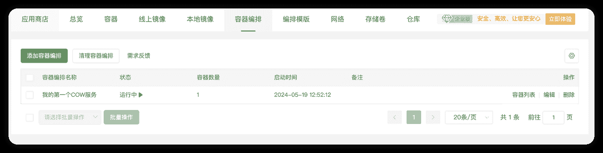

#### 登录微信绑定 COW 组件

最后一步，我们需要在微信客户端登录我们的微信号，然后绑定刚刚部署的 COW 组件，这样我们就可以在微信上和机器人进行无缝对接了。这里，我这边还是建议你使用一个闲置的微信号，毕竟这个方式是非官方的对接方式，可能会受到微信官方的限制。而且 COW 服务的机制其实就像你用手机上闲置的微信号，然后模拟扫你电脑上的电脑端微信二维码登录使用一样，COW 服务也会给你一个登录二维码，然后让你扫码登录。所以，你最好不要使用你日常使用的微信号，这样可能会造成一些不必要的麻烦。

1.  我们具体看看如何登录自己的闲置微信号到 COW 服务里面，首先按照图下所示找到我们刚刚部署成功的 COW 服务对应的容器，然后点击它的日志按钮，进入日志界面：

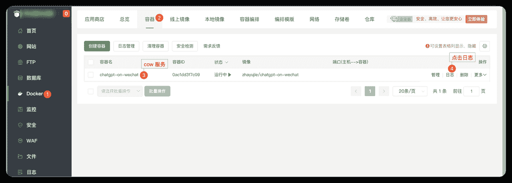

1.  按下图所示，我们先将日志输出的界面滚动到最下面的位置，之后你会看到一个二维码，这个就是要登录微信的二维码了，直接用你的闲置的微信号进行扫码登录即可，登录成功后，你的微信号和 COW 服务就绑定成功了！

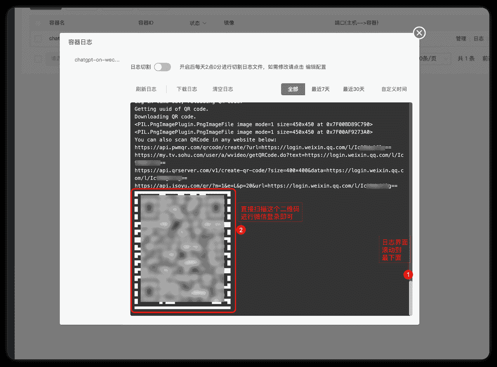

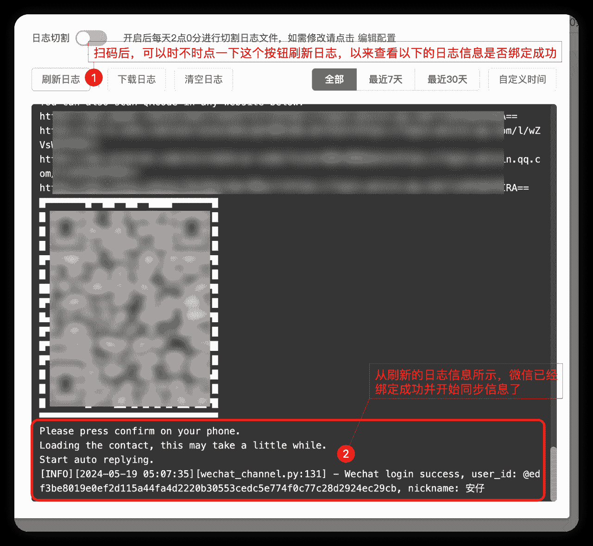

1.  当然如果你发现扫描二维码等出现一些不是上述预料到的情况，你可以退回到这个容器的配置那里，重启这个容器服务，然后再按照上述的步骤重新扫码登录，看看是否可以解决你的问题。

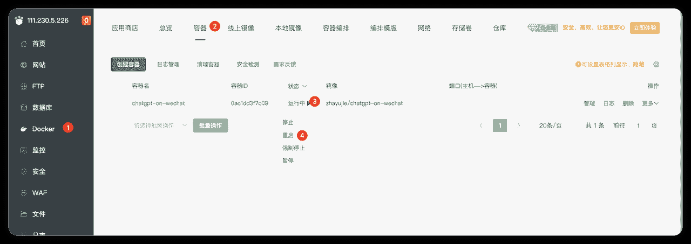

1.  当然，如果你想在之后使用过程中修改 COW 组件的配置，比如说修改机器人回复的前缀，或者开启语音识别等，你只需要进入对应的编排模板的配置界面，点击你的模板编辑，然后修改对应的配置参数，然后点击保存，然后回到容器编排界面重新部署新的容器编排即可，详情可看下图：

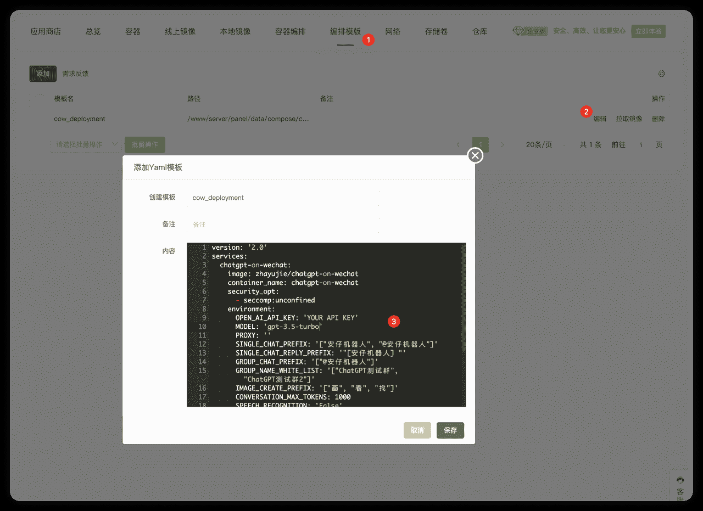

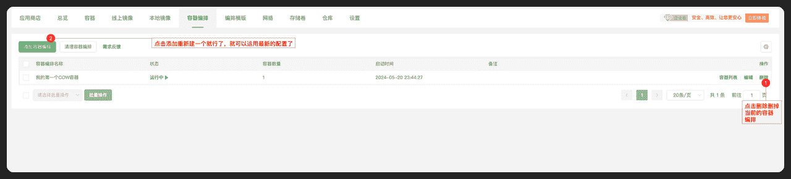

至此，我们就完成了 COW 组件的部署和微信号的绑定，我们可以开始愉快的和机器人微信号进行对话了！之后的交互结果就是上述的最终效果演示了，大家可以再回看一下。

> **注意：**

1.  使用新注册的微信账号会出现绑定不成功的情况，估计是微信官方对新注册账号的限制，所以可以先等待一周以后再试试，或者找一个已经闲置很久的微信号去代替。

1.  绑定后的微信号，其所在手机端不能登出，否则 COW 服务也会登出导致使用失败（相当于你的手机和电脑同时登录了同一个微信，但是当手机端的微信登出账号之后，电脑端的微信也会随之登出一样），所以建议大家开能否双开微信或者找一台闲置的手机来登录这个绑定 COW 服务的微信。

## 疑问解答

Q1: 为什么要使用腾讯云的轻量应用服务器？我家里的电脑不能用吗？

**A1:** 使用腾讯云的轻量应用服务器主要有几个好处：

+   服务器在云端，24/7 全天候运行，不需要担心家里电脑断电或断网。

+   服务器的配置和网络速度通常比家用电脑更好，运行更稳定。

+   通过云服务器，您可以随时随地访问和管理您的 AI 微信聊天机器人，而不受地理位置限制。

Q2: 宝塔面板和 Docker 是什么？为什么需要用它们？

**A2:** 宝塔面板是一个服务器管理工具，具有图形化界面，方便技术小白管理服务器。Docker 是一种容器技术，能够让你在隔离的环境中运行应用，确保应用在任何环境下都能稳定运行。使用宝塔面板和 Docker 可以简化服务器的管理和应用的部署，让整个过程更加简单和高效。

Q3: 什么是 API Key 和应用 ID？为什么需要它们？

**A3:** API Key 是一个独特的密钥，用于认证您的应用程序以访问某个平台的服务。应用 ID 是您在平台上创建的具体应用的标识。通过 API Key 和应用 ID，您可以将微信聊天机器人与极简未来平台上的 AI 应用关联起来，确保机器人能够正确调用您的 AI 服务。

Q4: 我不太明白“放行端口”是什么意思？

**A4:** 放行端口就是允许外部设备通过指定的端口访问您的服务器。就像给邮筒加一个标志，允许其他人通过这个邮筒收发邮件。通过放行特定端口（例如 8888 端口），您可以通过网络访问宝塔面板，管理和配置服务器上的各种服务。

Q5: 容器编排模板是做什么用的？

**A5:** 容器编排模板是一种配置文件，定义了如何在 Docker 中部署和管理多个容器。通过编排模板，您可以一键部署复杂的应用环境，而不需要手动配置每个容器的细节。本文中，我们通过容器编排模板配置了 COW 组件，使其能够与微信和极简未来平台进行交互。

Q6: 为什么需要使用 Docker 部署 COW 组件？

**A6:** Docker 提供了一种隔离的运行环境，可以确保应用程序在任何环境下都能稳定运行。通过 Docker 部署 COW 组件，可以简化安装和配置过程，确保每次部署的环境一致，并且容易管理和维护。

Q7: 为什么需要配置多个前缀来触发机器人回复？

**A7:** 配置多个前缀（如“bot”、“@bot”）可以确保只有在特定情况下机器人才会回复，避免在群聊或私聊中频繁干扰。这样可以提高机器人的响应准确性和用户体验。

Q8: 如果遇到扫码登录失败怎么办？

**A8:** 如果扫码登录失败，可以尝试以下步骤：

1.  重启 Docker 容器：在宝塔面板中找到对应的容器，点击“重启”。

1.  检查网络连接：确保您的服务器和微信客户端都能正常访问互联网。

1.  重新扫描二维码：等待容器重新启动后，重新扫描日志中生成的二维码。

Q9: 使用这个 AI 微信聊天机器人会不会很贵？

**A9:** 实际上不会。极简未来平台的收费是按使用量计算的，对于一般用户来说，费用相对低廉。充值一次少量费用，通常可以使用很长时间。同时，平台还提供每天签到免费领取积分的福利，进一步降低了使用成本。

Q10: 使用极简未来平台创建 AI 机器人的费用是多少？

**A10:** 极简未来平台的费用主要取决于使用的大模型和调用次数。具体费用是按照 Token 数量计算的，不同的大模型能力，所需的 Token 数不同。例如，使用 GPT-3.5 模型的每次对话大约消耗不到 20 积分。平台还提供了每天签到免费领取积分的福利，用户可以通过签到免费获得 50 到几百积分。除此之外，充值 19 元可以兑换 10000 积分，这些积分足够日常使用好几个月了。所以，实际使用成本并不高。

**Q11: 服务器的费用如何？**

**A11:** 腾讯云的轻量应用服务器价格非常划算，尤其是新用户优惠活动。例如，一个 2 核 2G3M 的服务器套餐一年只需 82 元，当然新用户优惠过后可能之后的续费费用会贵一点，100 多到几百一年不等。这使得即使是技术小白也能低成本试错，体验在云端部署和运行服务的乐趣。

Q12: 宝塔面板和 Docker 的使用费用如何？

**A12:** 宝塔面板有免费和付费版本，免费版已经提供了足够多的功能，完全可以满足本教程的需求。Docker 是开源免费的，使用 Docker 部署和管理应用不会产生额外费用。

Q13: 如果技术小白担心不会运维服务器和服务，该怎么办？

**A13:** 对于技术小白来说，运维服务器和服务可能看起来有些复杂，但以下几点可以帮助解决这个问题：

1.  **宝塔面板提供了图形化的管理界面**：操作简单直观，许多常见任务都可以通过点击按钮完成。

1.  **丰富的在线资源**：宝塔面板和 Docker 都有详细的官方文档和教程，您可以随时查阅。

1.  **极简未来平台的支持**：极简未来平台也提供了详细的操作指南和技术支持，遇到问题可以查阅官方文档或寻求帮助。

1.  **社群和论坛**：加入相关的技术社群或论坛，向有经验的用户请教，也是一个很好的学习途径。

1.  **定期备份和监控**：设置定期备份和监控，确保在出现问题时可以及时恢复。

Q14: 如果我之后遇到问题该怎么办？

**A14:** 如果遇到问题，可以采取以下几种方式来解决：

1.  **查阅官方文档和教程**：极简未来平台、宝塔面板和 Docker 都有详细的官方文档和教程，可以帮助解决大部分问题。

1.  **联系技术支持**：极简未来平台提供技术支持服务，可以联系平台的技术团队寻求帮助。

1.  **加入技术社群**：加入相关的技术社群，向有经验的用户请教，获取问题的解决方案。

1.  **在线论坛和社区**：在在线论坛和社区发布问题，寻求其他用户的帮助和建议。

Q15: 我担心运维时间长了会忘记操作步骤，有什么建议吗？

**A15:** 为了避免长时间不操作后忘记步骤，可以采取以下措施：

1.  **制作操作手册**：将每一步的操作记录下来，制作成操作手册，方便日后查阅。

1.  **定期操作**：定期登录服务器，进行简单的操作和维护，保持熟练度。

1.  **视频教程**：可以录制自己的操作视频，作为教程，日后查看时更直观。

1.  **自动化脚本**：对于一些常见的运维任务，可以编写自动化脚本，简化操作步骤。

# 2. 直接对接 Coze 平台 Bot 的微信聊天机器人搭建

这里我们首先了解下微信的几种不同功能和它们之间的差异。微信作为一个多功能的社交平台，提供了多种方式让用户进行交流和服务获取。以下是微信中几种主要功能的区别：

+   个人微信/微信群：个人微信和微信群是我们日常使用的聊天工具，用于与朋友、家人进行一对一或者一对多交流。然而，Coze AI 平台目前不支持直接与这两个进行功能对接。

+   微信公众号：微信公众号是一个信息发布和用户管理的平台，企业和个人可以通过它向关注者推送消息。Coze AI 平台支持与微信公众号的对接，使得 AI 机器人能够自动回复用户的消息。

+   微信服务号：微信服务号是公众号的一种，提供更丰富的服务功能，如在线支付、预约服务等。Coze AI 平台同样支持与微信服务号的对接，帮助企业提升服务效率。

+   微信客服：微信客服是企业与用户进行实时沟通的渠道。Coze AI 平台支持与微信客服的对接，使得 AI 机器人能够自动回答用户的咨询，提高客服响应速度。

所以到现研究了这么久，我却总是困惑，为什么就没有直接对上我们常用的个人微信和微信群聊天上呢？这才是我们日常更加常用的场景啊！这不，最近 Coze 的国内版终于正式发布了 API 接口功能，直接对接我们的个人微信甚至是微信群已经成为可能了！

所以今天我就来分享一下，如何使用 Coze AI 机器人对接上我的微信群，让它回复我甚至是群组小伙伴的信息，帮我们尤其是群主更好地解决一些社群运营上的问题吧！

对了，**这次教程的相关部署方法对接****国外版或国内版的 Coze 都是直**接适用的，唯一的前提是，对接国外版 Coze 平台需要你部署的服务支持黑魔法才行哦！

## 依赖工具

1.  安装了宝塔服务的轻量应用服务器 x 1（主要针对新手方便上手配置）

1.  设计好并授权发布到 API 功能的 Coze AI Bot x 1 （对接到我们作为机器人的微信号上）

1.  闲置并且已通过实名认证的微信号 x 1（作为机器人的微信号）

## 部署步骤

这次的步骤演示我会继续基于上一篇入门教程的部署服务进行进一步配置，所以如果你还没有看过上一篇教程，强烈建议先看一下。

### Coze 相关配置

#### 创建 Coze API 令牌

首先第一步我们肯定是要先**创建一个新的 API 令牌**，这个令牌就是我们后续用来对接到我们的服务上的凭证。记得自己保存好，不要泄露给别人。

1.  进入到 [Coze 平台](https://www.coze.cn/home)，点击左下角的扣子 API选项，进入到 API 管理页面：

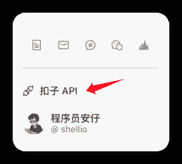

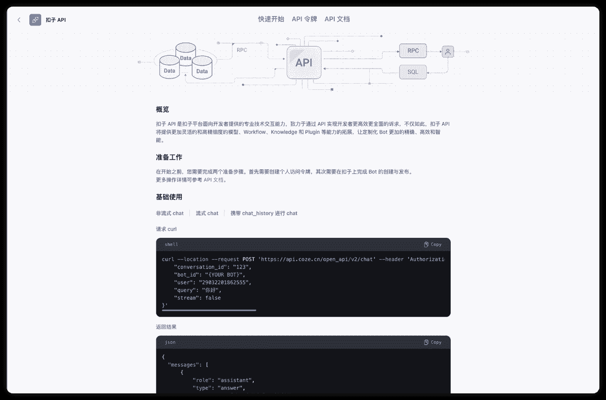

1.  点击API 令牌，然后跟着以下的图示创建你的第一个 API 令牌：

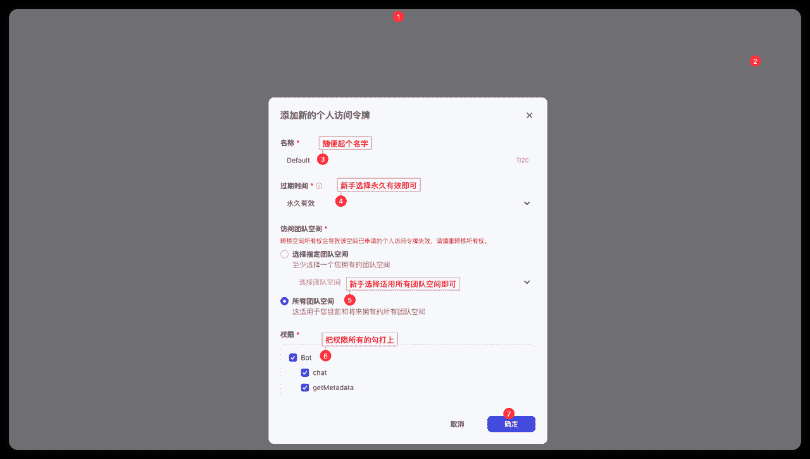

1.  创建成功后，你就可以看到你的 API 令牌，记得保存好，因为这个 API 令牌只会在创建成功后显示一次，之后就不再显示了：

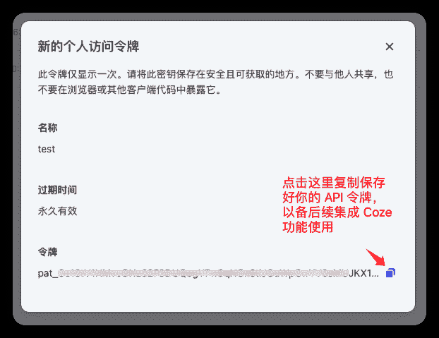

1.  至此，我们的 Coze 平台的 API 令牌已经创建成功了，接下来我们就可以继续进行下一步的配置了。

#### 记下 Coze AI Bot 的 Bot ID

接下来我们就要顺便去记一下我们想要对接的 Coze AI Bot 的 Bot ID，这个 Bot ID 是我们后续需要绑定我们微信机器人的唯一标识。这里我就拿我之前写的一个社群运营的 AI Bot 来做演示吧。

其实很简单，你只需要去到你要绑定的 AI Bot 的设计界面，它所在的那个链接里面，就有我们对应需要的 Bot ID 在，具体看下图：

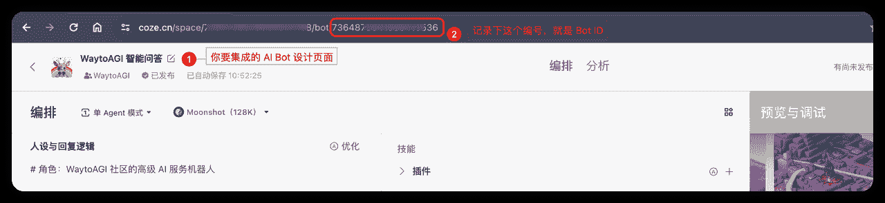

就这样，我们就可以记下我们的 Bot ID 了，我们继续下一步，我们需要将这个 Bot 发布到 Bot as API 上，不然我们是无法对接到我们的微信机器人上的：

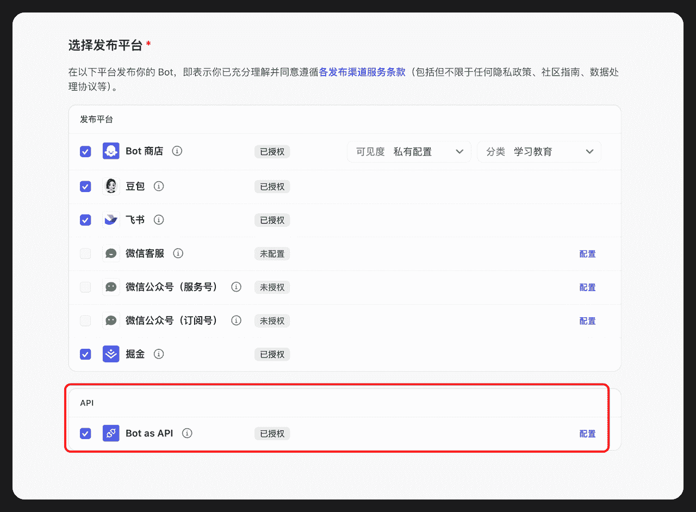

### 服务器相关配置

其实这篇教程是我社群上一个大神级好友小雨的启发，他其实也写了一篇类似的文章内容但他跟我讨论了下，要不我来出篇更喂饭级的教程，受他的启发，所以这篇内容就来了！

这个新的服务器配置其实也是整篇内容最复杂的地方，但是既然是喂饭级教程，我帮大家将很多代码相关的集成全部隐藏和优化掉了，你们接下来用的就是一些很简单的模板配置，只要基于上一篇教程的编排模板进行修改就可以切换对接上 Coze 了，是不是要感谢我一下哈哈！

接下来我们就开始配置我们的服务器环境吧！

1.  如果大家是按照我的上一篇教程来的，那么这次的配置就非常简单了，只需要修改一下我们的容器编排模板就可以了。最新的容器编排模板如下：

```
version: &quot;3&quot;
services:
  my-ai-bot:
    image: andywuwu/chatgpt-on-wechat:1.6.8
    container_name: my-ai-bot
    restart: always
    security_opt:
      - seccomp:unconfined
    environment:
      TZ: &quot;Asia/Shanghai&quot;
      OPEN_AI_API_KEY: &quot;pat_dfdsfsegkemgkesmgkmfgksdmgsgsgdg&quot; # 这里填写你的 Coze API 令牌
      MODEL: &quot;&quot; # 这里留空即可
      OPEN_AI_API_BASE: &quot;http://coze2openai:3000/v1&quot; # 这里直接用这个地址就可以了
      PROXY: &quot;&quot;
      SINGLE_CHAT_PREFIX: &#x27;[&quot;bot&quot;, &quot;@bot&quot;]&#x27;
      SINGLE_CHAT_REPLY_PREFIX: &#x27;&quot;[bot] &quot;&#x27;
      GROUP_CHAT_PREFIX: &#x27;[&quot;@bot&quot;]&#x27;
      GROUP_NAME_WHITE_LIST: &#x27;[&quot;ChatGPT测试群&quot;, &quot;ChatGPT测试群2&quot;]&#x27;
      IMAGE_CREATE_PREFIX: &#x27;[&quot;画&quot;, &quot;看&quot;, &quot;找&quot;]&#x27;
      CONVERSATION_MAX_TOKENS: 1000
      SPEECH_RECOGNITION: &quot;False&quot;
      CHARACTER_DESC: &quot;你是基于大语言模型的AI智能助手，旨在回答并解决人们的任何问题，并且可以使用多种语言与人交流。&quot;
      EXPIRES_IN_SECONDS: 3600
      USE_GLOBAL_PLUGIN_CONFIG: &quot;True&quot;
      USE_LINKAI: &quot;False&quot; # 这里取消使用 Link.AI 平台的服务
      LINKAI_API_KEY: &quot;&quot;
      LINKAI_APP_CODE: &quot;&quot;
  coze2openai:
    image: andywuwu/coze2openai:latest
    container_name: coze2openai
    restart: always
    environment:
      - BOT_ID=1111111111111 # 这里填写你的 Coze AI Bot 的 Bot ID
      - COZE_API_BASE=api.coze.cn # 国外版就填 &#x27;api.coze.com&#x27;，国内版就填 &#x27;api.coze.cn&#x27;
```

再给一个没有任何描述性的参考配置吧，方便新手小伙伴们直接参考使用：

```
version: &quot;3&quot;
services:
  my-ai-bot:
    image: andywuwu/chatgpt-on-wechat:1.6.8
    container_name: my-ai-bot
    restart: always
    security_opt:
      - seccomp:unconfined
    environment:
      TZ: &quot;Asia/Shanghai&quot;
      OPEN_AI_API_KEY: &quot;sfagfnofjidgjsignslasdsdaf&quot;
      MODEL: &quot;&quot;
      OPEN_AI_API_BASE: &quot;http://coze2openai:3000/v1&quot;
      PROXY: &quot;&quot;
      SINGLE_CHAT_PREFIX: &#x27;[&quot;bot&quot;, &quot;@bot&quot;]&#x27;
      SINGLE_CHAT_REPLY_PREFIX: &#x27;&quot;[bot] &quot;&#x27;
      GROUP_CHAT_PREFIX: &#x27;[&quot;@bot&quot;]&#x27;
      GROUP_NAME_WHITE_LIST: &#x27;[&quot;ChatGPT测试群&quot;, &quot;ChatGPT测试群2&quot;]&#x27;
      IMAGE_CREATE_PREFIX: &#x27;[&quot;画&quot;, &quot;看&quot;, &quot;找&quot;]&#x27;
      CONVERSATION_MAX_TOKENS: 1000
      SPEECH_RECOGNITION: &quot;False&quot;
      CHARACTER_DESC: &quot;你是基于大语言模型的AI智能助手，旨在回答并解决人们的任何问题，并且可以使用多种语言与人交流。&quot;
      EXPIRES_IN_SECONDS: 3600
      USE_GLOBAL_PLUGIN_CONFIG: &quot;True&quot;
      USE_LINKAI: &quot;False&quot;
      LINKAI_API_KEY: &quot;&quot;
      LINKAI_APP_CODE: &quot;&quot;
  coze2openai:
    image: andywuwu/coze2openai:latest
    container_name: coze2openai
    restart: always
    ports:
      - &quot;3000:3000&quot;
    environment:
      - BOT_ID=1111111111111111111
      - COZE_API_BASE=api.coze.cn
```

1.  如果之前没有容器编排模板的小伙伴，新建一个即可，新建和修改逻辑都是如下图类似的：

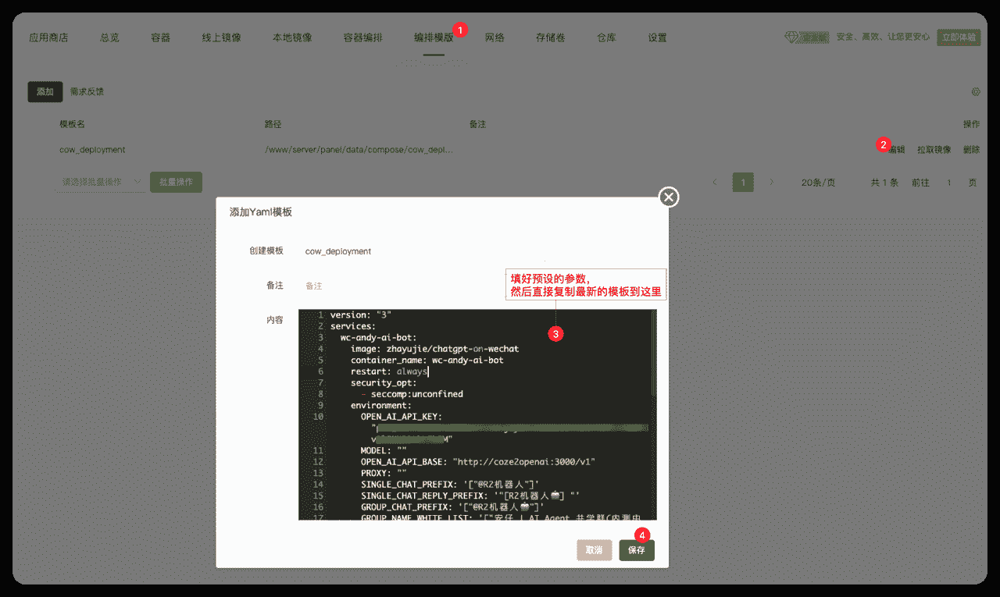

1.  记住，更新好后的编排模板，如果之前自己已经创建过相似的机器人容器编排服务，建议先删掉，以防同一个微信机器人的绑定有冲突，删除步骤如下：


1.  最后就是基于新的编排模板创建一个新的容器编排，然后启动服务即可：


1.  等服务启动成功后，我们就可以进入到 COW 服务扫码绑定我们的微信机器人了！这个具体步骤可以参考我上一篇入门教程：


1.  至此，我们的服务就已经部署成功了，接下来就可以在我们的微信群里面测试我们的 AI 机器人了！

### 来一起聊天吧

来，我们来看看 Coze AI Bot 在平台上和微信上的区别吧：

**Coze 平台端**


**微信端**


输出效果是一样的，但是在微信端的体验就更加贴近我们的日常使用了，我再也不用担心我妈妈不会用 Coze 平台或者豆包了，哈哈！

## 疑问解答

**Q1: 什么是 API 令牌？**

**A1:** API 令牌类似于你家门的钥匙，只有拥有这个钥匙的人才能进你的家。它用于认证程序，使其能够安全地访问和使用 Coze 平台的功能。每次你访问 Coze 的服务时，都需要提供这个令牌来证明你有权限。

Q2: 为什么需要用 Coze AI 机器人？

**A2:** Coze AI 机器人可以帮助你自动处理微信群中的常见问题，发送通知等，就像一个聪明的助手，节省你的时间和精力。举个例子，它可以在你忙的时候自动回复群里的问题，确保群成员得到及时回应。

Q3: 什么是轻量应用服务器？为什么需要它？

**A3:** 轻量应用服务器就像一台随时在线的高性能计算机，能够 24 小时不停地工作，确保你的 AI 机器人随时可用。相比家里的电脑，它更稳定，不会因为断电或网络问题而停机。

Q4: 什么是宝塔面板和 Docker？为什么需要它们？

**A4:** 宝塔面板是一个服务器管理工具，有直观的图形界面，让你可以方便地管理服务器。Docker 是一种容器技术，可以让你在独立的环境中运行应用，确保在任何环境下都能正常运行。使用宝塔面板和 Docker，你可以轻松地安装、配置和管理你的 AI 机器人。

**Q5: 什么是容器编排模板？**

**A5:** 容器编排模板是一种配置文件，定义了如何在 Docker 中部署和管理多个容器。就像一个食谱，按照这个模板操作，你可以轻松部署复杂的应用环境，而不需要逐个配置每个容器。

Q6: 我不太明白“放行端口”是什么意思？

**A6:** 放行端口就像是给你的房子安装一个门铃，让外面的人可以按门铃和你沟通。通过放行特定的端口（例如 8888 端口），你可以通过互联网访问宝塔面板，管理和配置服务器上的服务。

**Q7: 什么是 Bot ID？**

**A7:** Bot ID 是你在 Coze 平台上创建的 AI 机器人的唯一标识，就像每个人都有身份证号码一样。这个 ID 用于将你的微信号与特定的 AI 机器人关联起来，确保机器人可以正确响应微信上的请求。

Q8: 如果我的微信账号被封了怎么办？

**A8:** 如果你的微信账号因为使用机器人被封，可以尝试联系客服说明情况。为了避免这种情况，建议使用一个专门的微信号来作为机器人的账号，并遵守微信的使用规范。

Q9: 我需要一直让服务器开着吗？

**A9:** 是的，服务器需要一直开着，才能保证你的机器人随时在线，随时可以响应你的请求。就像你的路由器需要一直开着，才能确保你随时上网一样。

Q10: 我不懂编程，能配置好这个机器人吗？

**A10:** 完全可以！这篇教程就是为不懂编程的小伙伴准备的。只要按照教程一步一步操作，不需要编程知识也能配置好机器人。如果遇到问题，可以查阅教程或求助。

Q11: 配置过程中遇到问题怎么办？

**A11:** 如果在配置过程中遇到问题，可以检查每一步是否按照教程操作，特别是 API 令牌和 Bot ID 是否正确。如果仍然无法解决问题，可以到 Coze 平台的论坛或微信群求助，相信会有热心的伙伴愿意帮助你。

Q12: 为什么需要配置多个前缀来触发机器人回复？

**A12:** 配置多个前缀（如“bot”、“@bot”）可以确保机器人只在特定情况下回复，避免在群聊或私聊中频繁干扰。这种设置可以提高机器人的响应准确性和用户体验。

Q13: 如果遇到扫码登录失败怎么办？

**A13:** 如果扫码登录失败，可以尝试以下步骤：

1.  重启 Docker 容器：在宝塔面板中找到对应的容器，点击“重启”。

1.  重新扫描二维码：等待容器重新启动后，重新扫描日志中生成的二维码。

Q15: 使用腾讯云的轻量应用服务器的费用是多少？

**A15:** 腾讯云轻量应用服务器的价格非常划算，特别是新用户优惠活动。例如，一个 2 核 2G3M 的服务器套餐一年只需 82 元。这样，即使是技术小白也能低成本试错，体验在云端部署和运行服务的乐趣。

# 3. 添加各种自定义 COW 插件到微信机器人

在上一篇教程中，我们已经成功部署了一个基于 Coze 平台的 AI 微信聊天机器人，并且成功对接到了我们的微信群中。但是，除了机器人自带的功能之外，我们还可以通过添加 COW 的自定义插件来扩展机器人的功能，使其更加强大和智能。

> 注意：这里[主要借鉴](https://waytoagi.feishu.cn/wiki/NB3nwtUC0iDLYxkIkSYc0WRznGg#CoHQdezCCoJ0YtxraFtcCASfnQ1)了 WayToAGI 社区张梦飞老师的微信机器人的共学快闪内容，并且结合之后大家反馈的痛点，我对这个教程进行了一些优化和补充，希望能够帮助大家更容易、更快速地搭建和维护自己的 AI 微信聊天机器人，这里也特别感谢张梦飞老师的分享和借鉴的批准！

> 这是对应的原文链接，感兴趣的小伙伴可以去看看！

## 一些 COW 常用插件的介绍

### sum4all 插件

> 源码链接 - https://github.com/fatwang2/sum4all?tab=readme-ov-file

本项目为大模型内容总结服务，有微信插件、telegram 机器人 、iOS 快捷指令 三个版本，其中微信插件需要自行部署，需配合 chatgpt-on-wechat 项目，其他插件可点击链接自行体验。

+   支持联网搜索

+   支持多轮追问

+   支持文章链接总结，且支持发送到在线笔记

+   支持文件内容总结，包括 pdf、docx、markdown、txt、xls、csv、html、ppt

+   支持图片总结，包括 png、jpeg、jpg（最近好像不行，也可能是我的配置有误）

+   支持视频、播客内容总结，包括抖音、b 站、小红书、YouTube 等

+   支持多种内容总结服务，可自由组合

+   支持自定义 prompt

+   支持自定义搜索、追问提示词


### Apilot 插件

> 源码链接 - https://github.com/6vision/Apilot?tab=readme-ov-file

一个基于微信对话的实用工具集合，对话框发送“早报”、“摸鱼”、"微博热搜（已更新为"微博热榜）"、”任意星座名称”可以直接返回对应的内容！


+   快递查询格式：快递+快递编号。如：快递 YT2505082504474，如下图：


+   天气查询格式：城市+天气。如：成都天气。（支持 3400+城市天气，输入不正确或者查询失败返回北京天气）


+   热榜查询。支持：<微博/虎扑/知乎/哔哩哔哩/36 氪/抖音/少数派/IT 最新/IT 科技>


### timetask 插件

> 源码链接 - https://github.com/haikerapples/timetask/tree/master

一款支持自定义定时任务的 chatgpt-on-wechat 插件，支持自定义时间、轮询周期、自定义时间，包含动态添加任务、取消任务、查看任务列表等功能，一款定时任务系统的插件。

🎉 功能一：

支持用户设定时间，添加定时任务，定时自动发消息；

时间支持自定义

日期支持轮询，支持每天、每周、工作日、具体日期、cron 表达式等

**🎉** 功能二：

支持普通的提醒消息、及链接其他插件的拓展功能。比如早报、点歌、搜索、转发 GPT 等，理论上已安装的插件均可一键调度

🎉 功能三：

支持动态的取消定时任务、随时查看任务列表等

🎉 功能四：

无侵入性，原项目无需改造，安装插件即可使用


#### timetask 如何使用

可以直接参考梦飞的[教程](https://waytoagi.feishu.cn/wiki/NB3nwtUC0iDLYxkIkSYc0WRznGg#LT1CdgcvZoRbTKxml8hc1LY8nqh)，这里就不再赘述了。

## 部署 COW 插件

为了方便大家使用，我**已经将这些插件预先都整合到我的一个最新的 docker 容器中，**大家再也不需要一一个去人工修改代码或者安装部署对应的插件了，只需要按照下面的步骤，就可以直接是用到我们的 AI 微信聊天机器人上了！（当然，容器之后的版本更新我也会根据各方官方的源码版本直接升级维护，如大家有其他想要预装的 COW 插件，也可以私信我，我会尽量帮大家整合到容器中）

### 部署步骤

我们直接沿用上面部署好的 Coze 机器人的容器编排模板，然后我们只需要修改一下我们的容器编排模板，就可以直接使用我们的 AI 微信聊天机器人了！（修改的原理同样适用到 LinkAI 甚至是其他对接的智能体平台上）

永远记住一句话 - **在宝塔部****署容器服务****时，我们****新建****的编排模板都是为了让容器编排的****服务来选****择启动，从而间接跑起我们最终****的容器服****务，所以我们只需要****修改我们****的编**排模板，然后删掉当前对应正在运行的容器编排服务（有时只是删掉容器编排服务，宝塔的 bug 导致其下的容器没有被删除，记得也去容器页面看看，再清理一下）

1.  首先，我们需要修改我们的容器编排模板，将我们的 AI 微信聊天机器人的容器编排模板修改为下面的内容：

```
version: &quot;3&quot;
services:
  my-ai-bot:
    image: andywuwu/chatgpt-on-wechat:1.6.8 # 这个就是我预安装好各种 COW 插件的容器镜像
    container_name: my-ai-bot
    restart: always
    security_opt:
      - seccomp:unconfined
    volumes:
      - /data/config.json:/app/plugins/config.json
    environment:
      TZ: &quot;Asia/Shanghai&quot;
      OPEN_AI_API_KEY: &quot;pat_111111111111222222233333333&quot; # 记得改为自己的实际值
      MODEL: &quot;&quot;
      OPEN_AI_API_BASE: &quot;http://coze2openai:3000/v1&quot;
      PROXY: &quot;&quot;
      SINGLE_CHAT_PREFIX: &#x27;[&quot;@小安&quot;]&#x27;
      SINGLE_CHAT_REPLY_PREFIX: &#x27;&quot;[小安] &quot;&#x27;
      GROUP_CHAT_PREFIX: &#x27;[&quot;@小安&quot;]&#x27;
      GROUP_NAME_WHITE_LIST: &#x27;[&quot;安仔 | AI Agent 共学群&quot;,&quot;AI 机器人内部测试&quot;]&#x27;
      IMAGE_CREATE_PREFIX: &#x27;[&quot;画&quot;, &quot;看&quot;, &quot;找&quot;]&#x27;
      CONVERSATION_MAX_TOKENS: 1000
      SPEECH_RECOGNITION: &quot;False&quot;
      CHARACTER_DESC: &quot;你是ChatGPT, 一个由OpenAI训练的大型语言模型, 你旨在回答并解决人们的任何问题，并且可以使用多种语言与人交流。&quot;
      EXPIRES_IN_SECONDS: 3600
      USE_GLOBAL_PLUGIN_CONFIG: &quot;True&quot;
      USE_LINKAI: &quot;False&quot;
      LINKAI_API_KEY: &quot;&quot;
      LINKAI_APP_CODE: &quot;&quot;
  coze2openai:
    image: andywuwu/coze2openai:latest
    container_name: coze2openai
    restart: always
    environment:
      - BOT_ID=111111111111111111 # 记得改为自己的实际值
      - COZE_API_BASE=api.coze.cn # &#x27;api.coze.com&#x27; or &#x27;api.coze.cn&#x27;
      # - BOT_CONFIG=
```

1.  去 Github.com 网站注册一个账号（因为 sum4all 插件所在平台的注册目前只支持第三方 Github 的绑定注册了），注册地址如下：https://github.com/signup?source=header-home


1.  注册一个 sum4all 平台的账号，注册地址如下：https://pro.sum4all.site/login


1.  注册 sum4all 平台成功后，平台默认就已经帮你创建了一个 API 令牌和赠送了一些使用额度，你可以直接使用这个 API 令牌来绑定到我们的 AI 微信聊天机器人上，对应位置在这里：


1.  再注册一个 Apilot 平台的账号，注册地址如下：https://admin.alapi.cn/user/login


1.  注册成功的 Apilot 账号后，其默认的免费套餐应该已经够你个人每天的使用了，如有需要再充值换套餐就好：


1.  直接点击 Apilot 平台以下位置来复制保存好 Apilot 的 API 令牌，以备稍后用到：


1.  好了，平台端这边都搞好了。接下来我们就回到宝塔服务器这边了，我们需要一个全局的配置文件来随时修改我**们各个插件的启动配置，**这里我们需要在我们的服务器上创建一个config.json文件，然后将下面的内容复制到这个文件中，注意，这里面有两个值需要你更新覆盖的，那就是 sum4all 和 Apilot 的两个 API 令牌，请留意我#号提示的地方：

```
{
  &quot;godcmd&quot;: {
    &quot;password&quot;: &quot;123456&quot;,
    &quot;admin_users&quot;: []
  },
  &quot;banwords&quot;: {
    &quot;action&quot;: &quot;replace&quot;,
    &quot;reply_filter&quot;: true,
    &quot;reply_action&quot;: &quot;ignore&quot;
  },
  &quot;tool&quot;: {
    &quot;tools&quot;: [&quot;python&quot;, &quot;url-get&quot;, &quot;terminal&quot;, &quot;meteo-weather&quot;],
    &quot;kwargs&quot;: {
      &quot;top_k_results&quot;: 2,
      &quot;no_default&quot;: false,
      &quot;model_name&quot;: &quot;gpt-3.5-turbo&quot;
    }
  },
  &quot;linkai&quot;: {
    &quot;group_app_map&quot;: {
      &quot;测试群1&quot;: &quot;default&quot;,
      &quot;测试群2&quot;: &quot;Kv2fXJcH&quot;
    },
    &quot;midjourney&quot;: {
      &quot;enabled&quot;: true,
      &quot;auto_translate&quot;: true,
      &quot;img_proxy&quot;: true,
      &quot;max_tasks&quot;: 3,
      &quot;max_tasks_per_user&quot;: 1,
      &quot;use_image_create_prefix&quot;: true
    },
    &quot;summary&quot;: {
      &quot;enabled&quot;: true,
      &quot;group_enabled&quot;: true,
      &quot;max_file_size&quot;: 5000,
      &quot;type&quot;: [&quot;FILE&quot;, &quot;SHARING&quot;]
    }
  },
  &quot;hello&quot;: {
    &quot;group_welc_fixed_msg&quot;: {
      &quot;群聊1&quot;: &quot;群聊1的固定欢迎语&quot;,
      &quot;群聊2&quot;: &quot;群聊2的固定欢迎语&quot;
    },
    &quot;group_welc_prompt&quot;: &quot;请你随机使用一种风格说一句问候语来欢迎新用户\&quot;{nickname}\&quot;加入群聊。&quot;,
    &quot;group_exit_prompt&quot;: &quot;请你随机使用一种风格跟其他群用户说他违反规则\&quot;{nickname}\&quot;退出群聊。&quot;,
    &quot;patpat_prompt&quot;: &quot;请你随机使用一种风格介绍你自己，并告诉用户输入#help可以查看帮助信息。&quot;,
    &quot;use_character_desc&quot;: false
  },
  &quot;Apilot&quot;: {
    &quot;alapi_token&quot;: &quot;&quot;,  # 填入你的 Apilot 平台的 API 令牌
    &quot;morning_news_text_enabled&quot;: false
  },
  &quot;sum4all&quot;: {
    &quot;url_sum&quot;: {
      &quot;enabled&quot;: true,
      &quot;service&quot;: &quot;sum4all&quot;,
      &quot;group&quot;: true,
      &quot;qa_enabled&quot;: true,
      &quot;qa_prefix&quot;: &quot;问&quot;,
      &quot;prompt&quot;: &quot;你是一个新闻专家，我会给你发一些网页内容，请你用简单明了的语言做总结。格式如下：📌总结\n一句话讲清楚整篇文章的核心观点，控制在30字左右。\n\n💡要点\n用数字序号列出来3-5个文章的核心内容，尽量使用emoji让你的表达更生动&quot;
    },
    &quot;search_sum&quot;: {
      &quot;enabled&quot;: true,
      &quot;service&quot;: &quot;sum4all&quot;,
      &quot;search_service&quot;: &quot;duckduckgo&quot;,
      &quot;group&quot;: true,
      &quot;search_prefix&quot;: &quot;搜&quot;,
      &quot;prompt&quot;: &quot;你是一个信息检索专家，我会把我的问题和搜索结果发给你，请你根据问题，从搜索结果里找出能回答问题的相关内容，用简单明了的语言为我做回复，尽量使用emoji让你的表达更生动&quot;
    },
    &quot;file_sum&quot;: {
      &quot;enabled&quot;: true,
      &quot;service&quot;: &quot;sum4all&quot;,
      &quot;max_file_size&quot;: &quot;15000&quot;,
      &quot;group&quot;: true,
      &quot;qa_prefix&quot;: &quot;问&quot;,
      &quot;prompt&quot;: &quot;你是一个新闻专家，我会给你发一些网页内容，请你用简单明了的语言做总结。格式如下：📌总结\n一句话讲清楚整篇文章的核心观点，控制在30字左右。\n\n💡要点\n用数字序号列出来3-5个文章的核心内容，尽量使用emoji让你的表达更生动&quot;
    },
    &quot;image_sum&quot;: {
      &quot;enabled&quot;: true,
      &quot;service&quot;: &quot;sum4all&quot;,
      &quot;group&quot;: true,
      &quot;qa_prefix&quot;: &quot;问&quot;,
      &quot;prompt&quot;: &quot;先全局分析图片的主要内容，并按照逻辑分层次、段落，提炼出5个左右图片中的精华信息、关键要点，生动地向读者描述图片的主要内容。注意排版、换行、emoji、标签的合理搭配，清楚地展现图片讲了什么&quot;
    },
    &quot;note&quot;: {
      &quot;enabled&quot;: false,
      &quot;service&quot;: &quot;flomo&quot;,
      &quot;prefix&quot;: &quot;记&quot;
    },
    &quot;keys&quot;: {
      &quot;sum4all_key&quot;: &quot;&quot;,  # 填入你的 sum4all 平台的 API 令牌
      &quot;search1api_key&quot;: &quot;&quot;,
      &quot;gemini_key&quot;: &quot;&quot;,
      &quot;perplexity_key&quot;: &quot;&quot;,
      &quot;open_ai_api_key&quot;: &quot;&quot;,
      &quot;model&quot;: &quot;gpt-3.5-turbo&quot;,
      &quot;open_ai_api_base&quot;: &quot;https://api.openai.com/v1&quot;,
      &quot;xunfei_app_id&quot;: &quot;&quot;,
      &quot;xunfei_api_key&quot;: &quot;&quot;,
      &quot;xunfei_api_secret&quot;: &quot;&quot;,
      &quot;opensum_key&quot;: &quot;&quot;,
      &quot;bibigpt_key&quot;: &quot;&quot;,
      &quot;outputLanguage&quot;: &quot;zh-CN&quot;,
      &quot;flomo_key&quot;: &quot;&quot;
    }
  },
  &quot;timetask&quot;: {
    &quot;command_prefix&quot;: &quot;$time&quot;,
    &quot;debug&quot;: false,
    &quot;time_check_rate&quot;: 1,
    &quot;move_historyTask_time&quot;: &quot;04:00:00&quot;,
    &quot;is_open_route_everyReply&quot;: true,
    &quot;is_open_extension_function&quot;: true,
    &quot;is_need_title_whenNormalReply&quot;: true,
    &quot;is_need_currentTime_whenNormalReply&quot;: true,
    &quot;is_need_identifier_whenNormalReply&quot;: true,
    &quot;is_need_detailDeccription_whenNormalReply&quot;: true,
    &quot;extension_function&quot;: [
      {
        &quot;key_word&quot;: &quot;早报&quot;,
        &quot;func_command_prefix&quot;: &quot;$tool &quot;
      },
      {
        &quot;key_word&quot;: &quot;点歌&quot;,
        &quot;func_command_prefix&quot;: &quot;$&quot;
      },
      {
        &quot;key_word&quot;: &quot;搜索&quot;,
        &quot;func_command_prefix&quot;: &quot;$tool google &quot;
      },
      {
        &quot;key_word&quot;: &quot;GPT&quot;,
        &quot;func_command_prefix&quot;: &quot;GPT&quot;
      }
    ]
  }
}
```

最终修改完的参考格式如下，注意，是没有#号等相关描述提示的：

```
{
  &quot;godcmd&quot;: {
    &quot;password&quot;: &quot;123456&quot;,
    &quot;admin_users&quot;: []
  },
  &quot;banwords&quot;: {
    &quot;action&quot;: &quot;replace&quot;,
    &quot;reply_filter&quot;: true,
    &quot;reply_action&quot;: &quot;ignore&quot;
  },
  &quot;tool&quot;: {
    &quot;tools&quot;: [&quot;python&quot;, &quot;url-get&quot;, &quot;terminal&quot;, &quot;meteo-weather&quot;],
    &quot;kwargs&quot;: {
      &quot;top_k_results&quot;: 2,
      &quot;no_default&quot;: false,
      &quot;model_name&quot;: &quot;gpt-3.5-turbo&quot;
    }
  },
  &quot;linkai&quot;: {
    &quot;group_app_map&quot;: {
      &quot;测试群1&quot;: &quot;default&quot;,
      &quot;测试群2&quot;: &quot;Kv2fXJcH&quot;
    },
    &quot;midjourney&quot;: {
      &quot;enabled&quot;: true,
      &quot;auto_translate&quot;: true,
      &quot;img_proxy&quot;: true,
      &quot;max_tasks&quot;: 3,
      &quot;max_tasks_per_user&quot;: 1,
      &quot;use_image_create_prefix&quot;: true
    },
    &quot;summary&quot;: {
      &quot;enabled&quot;: true,
      &quot;group_enabled&quot;: true,
      &quot;max_file_size&quot;: 5000,
      &quot;type&quot;: [&quot;FILE&quot;, &quot;SHARING&quot;]
    }
  },
  &quot;hello&quot;: {
    &quot;group_welc_fixed_msg&quot;: {
      &quot;群聊1&quot;: &quot;群聊1的固定欢迎语&quot;,
      &quot;群聊2&quot;: &quot;群聊2的固定欢迎语&quot;
    },
    &quot;group_welc_prompt&quot;: &quot;请你随机使用一种风格说一句问候语来欢迎新用户\&quot;{nickname}\&quot;加入群聊。&quot;,
    &quot;group_exit_prompt&quot;: &quot;请你随机使用一种风格跟其他群用户说他违反规则\&quot;{nickname}\&quot;退出群聊。&quot;,
    &quot;patpat_prompt&quot;: &quot;请你随机使用一种风格介绍你自己，并告诉用户输入#help可以查看帮助信息。&quot;,
    &quot;use_character_desc&quot;: false
  },
  &quot;Apilot&quot;: {
    &quot;alapi_token&quot;: &quot;6vfdfaerfa09dasf&quot;,
    &quot;morning_news_text_enabled&quot;: false
  },
  &quot;sum4all&quot;: {
    &quot;url_sum&quot;: {
      &quot;enabled&quot;: true,
      &quot;service&quot;: &quot;sum4all&quot;,
      &quot;group&quot;: true,
      &quot;qa_enabled&quot;: true,
      &quot;qa_prefix&quot;: &quot;问&quot;,
      &quot;prompt&quot;: &quot;你是一个新闻专家，我会给你发一些网页内容，请你用简单明了的语言做总结。格式如下：📌总结\n一句话讲清楚整篇文章的核心观点，控制在30字左右。\n\n💡要点\n用数字序号列出来3-5个文章的核心内容，尽量使用emoji让你的表达更生动&quot;
    },
    &quot;search_sum&quot;: {
      &quot;enabled&quot;: true,
      &quot;service&quot;: &quot;sum4all&quot;,
      &quot;search_service&quot;: &quot;duckduckgo&quot;,
      &quot;group&quot;: true,
      &quot;search_prefix&quot;: &quot;搜&quot;,
      &quot;prompt&quot;: &quot;你是一个信息检索专家，我会把我的问题和搜索结果发给你，请你根据问题，从搜索结果里找出能回答问题的相关内容，用简单明了的语言为我做回复，尽量使用emoji让你的表达更生动&quot;
    },
    &quot;file_sum&quot;: {
      &quot;enabled&quot;: true,
      &quot;service&quot;: &quot;sum4all&quot;,
      &quot;max_file_size&quot;: &quot;15000&quot;,
      &quot;group&quot;: true,
      &quot;qa_prefix&quot;: &quot;问&quot;,
      &quot;prompt&quot;: &quot;你是一个新闻专家，我会给你发一些网页内容，请你用简单明了的语言做总结。格式如下：📌总结\n一句话讲清楚整篇文章的核心观点，控制在30字左右。\n\n💡要点\n用数字序号列出来3-5个文章的核心内容，尽量使用emoji让你的表达更生动&quot;
    },
    &quot;image_sum&quot;: {
      &quot;enabled&quot;: true,
      &quot;service&quot;: &quot;sum4all&quot;,
      &quot;group&quot;: true,
      &quot;qa_prefix&quot;: &quot;问&quot;,
      &quot;prompt&quot;: &quot;先全局分析图片的主要内容，并按照逻辑分层次、段落，提炼出5个左右图片中的精华信息、关键要点，生动地向读者描述图片的主要内容。注意排版、换行、emoji、标签的合理搭配，清楚地展现图片讲了什么&quot;
    },
    &quot;note&quot;: {
      &quot;enabled&quot;: false,
      &quot;service&quot;: &quot;flomo&quot;,
      &quot;prefix&quot;: &quot;记&quot;
    },
    &quot;keys&quot;: {
      &quot;sum4all_key&quot;: &quot;sk-111111111111122222222223333333&quot;,
      &quot;search1api_key&quot;: &quot;&quot;,
      &quot;gemini_key&quot;: &quot;&quot;,
      &quot;perplexity_key&quot;: &quot;&quot;,
      &quot;open_ai_api_key&quot;: &quot;&quot;,
      &quot;model&quot;: &quot;gpt-3.5-turbo&quot;,
      &quot;open_ai_api_base&quot;: &quot;https://api.openai.com/v1&quot;,
      &quot;xunfei_app_id&quot;: &quot;&quot;,
      &quot;xunfei_api_key&quot;: &quot;&quot;,
      &quot;xunfei_api_secret&quot;: &quot;&quot;,
      &quot;opensum_key&quot;: &quot;&quot;,
      &quot;bibigpt_key&quot;: &quot;&quot;,
      &quot;outputLanguage&quot;: &quot;zh-CN&quot;,
      &quot;flomo_key&quot;: &quot;&quot;
    }
  },
  &quot;timetask&quot;: {
    &quot;command_prefix&quot;: &quot;$time&quot;,
    &quot;debug&quot;: false,
    &quot;time_check_rate&quot;: 1,
    &quot;move_historyTask_time&quot;: &quot;04:00:00&quot;,
    &quot;is_open_route_everyReply&quot;: true,
    &quot;is_open_extension_function&quot;: true,
    &quot;is_need_title_whenNormalReply&quot;: true,
    &quot;is_need_currentTime_whenNormalReply&quot;: true,
    &quot;is_need_identifier_whenNormalReply&quot;: true,
    &quot;is_need_detailDeccription_whenNormalReply&quot;: true,
    &quot;extension_function&quot;: [
      {
        &quot;key_word&quot;: &quot;早报&quot;,
        &quot;func_command_prefix&quot;: &quot;$tool &quot;
      },
      {
        &quot;key_word&quot;: &quot;点歌&quot;,
        &quot;func_command_prefix&quot;: &quot;$&quot;
      },
      {
        &quot;key_word&quot;: &quot;搜索&quot;,
        &quot;func_command_prefix&quot;: &quot;$tool google &quot;
      },
      {
        &quot;key_word&quot;: &quot;GPT&quot;,
        &quot;func_command_prefix&quot;: &quot;GPT&quot;
      }
    ]
  }
}
```

1.  好了，接下来就是要把这个文件按照以下方式来创建了：


1.  就这样，我们就可以重新删掉之前正在跑的机器人服务，重新使用新的编排模板来跑我们的微信机器人了！

1.  对了，如果之后在运行过程中，你需要修改config.json文件里面的配置，你可以随时在刚刚那个文件位置进行内容修改，修改保存后，只需要去到容器板块中对应在跑的机器人服务点击重启就可以了，这样服务就可以使用你最新的插件配置，不需要再删除重建了！


对了，如果有兴趣和安仔一起学习 AI Agent 技术的话，可以加我的个人微信号：Andywuwu07，或者扫我以下二维码，备注：AI机器人学习，免费拉你进入我们的 AI Agent 共学群，我们一起学习，一起进步！

