# Coze 复刻：吴恩达开源的 AI 翻译项目，简单几步提升 AI 翻译质量

> 来源：[https://waytoagi.feishu.cn/docx/Z9jddxs94owjtsxmPXVcd9iBnFe](https://waytoagi.feishu.cn/docx/Z9jddxs94owjtsxmPXVcd9iBnFe)

# 概述

翻译，是沟通不同语言文化的桥梁，但是传统的人工翻译费时费力还费钱，质量参差不齐。近年来，随着人工智能技术的飞速发展，AI 翻译逐渐走进了我们的生活。但是，你可能会问，AI 翻译的质量真的有那么好吗？有没有什么方法可以让 AI 翻译的效果更上一层楼呢？普通人又能不能免费享受到高质量的 AI 翻译服务甚至是自动实现一个出来呢？

最近，AI 界的大神吴恩达就开源了一个基于 AI 原理的翻译项目，项目地址是 https://github.com/a**ndrewyng/tra****nslation-ag**ent 。这个项目虽然是纯代码实现，但是其背后的设计原理非常值得我们借鉴。最关键的是，通过该项目所采用的反思优化机制，可以显著提升 AI 翻译的质量，效果非常惊艳！

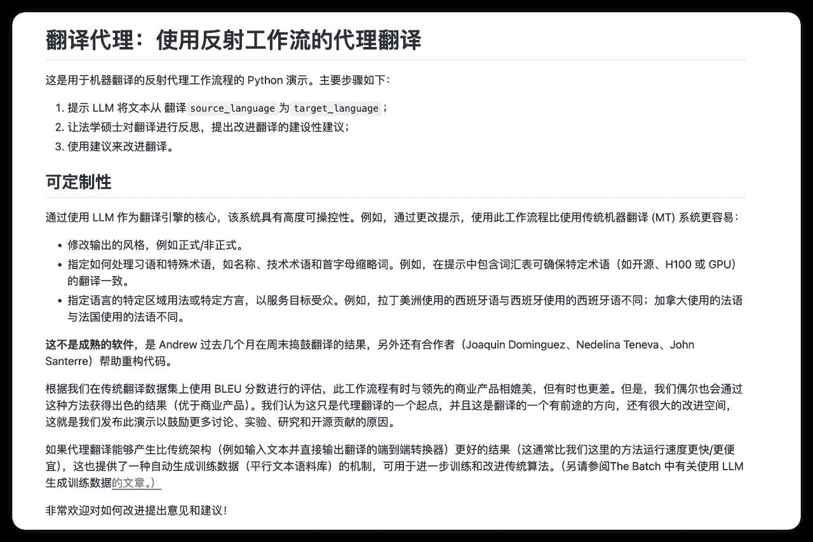

但是，作为一个普通用户，面对一堆代码，你可能会感到望而生畏，无从下手。这时候，Coze 平台就成了我们的救星！没错，我们可以在 Coze 上尝试复刻吴恩达的这个项目，而且只需要跟着教程简单操作，就可以打造出一个属于自己的高质量 AI 翻译助手，退一万步说，即使你不想自己来实现这个 AI Bot，你也可以直接使用我在 Coze 上已经发布好的翻译器 Bot 就好了，哈哈...

接下来，就让我们一起来剖析一下，如何在 Coze 上复刻吴恩达的 AI 翻译项目，打造一个高质量的翻译助手。

首先，我们来了解一下吴恩达这个 AI 翻译项目的核心流程和原理。整个流程可以分为三个步骤：

1.  **初始翻译**

1.  **识别可优化点**

1.  **对初始结果进行优化**

听起来是不是很简单？但是简单的背后，蕴藏着大学问！

先说**初始翻译**，这一步其实就是用现有的 AI 翻译模型，对源语言文本进行一次翻译，得到一个初始的目标语言文本。这个结果一般来说质量已经不错了，但是其实还有不少的提升空间。

接下来是**识别可优化点**，这一步至关重要！通过 AI 模型分析初始翻译结果，找出其中值得改进的地方，比如用词不当、语序不自然、语义不够准确等等。找出这些“短板”，为下一步优化打下基础。

如果你了解过吴恩达教授之前总结出来的 AI Agent 四种设计模式的话，你会发现这个项目其实是一个典型的“反思优化（Reflection）”模式。也就是说，通过对初始结果的反思和优化，可以让 AI 模型不断提升自身的能力，实现更高质量的翻译，这里顺便列出一下吴恩达总结的四种设计模式：

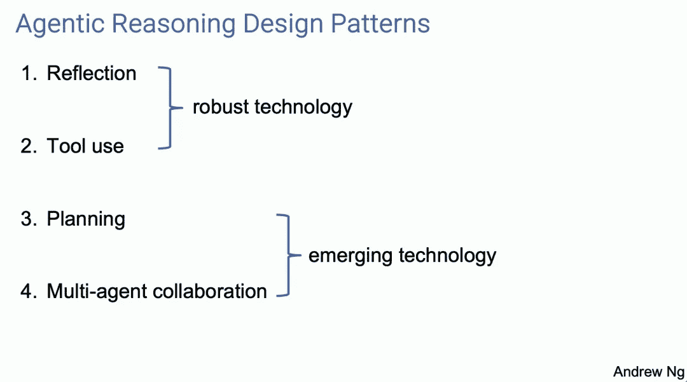

1.  反思优化（Reflection）：通过对自身的反思和优化。

1.  **使用工具（Tool use）**：通过使用外部工具和资源。

1.  **计划（Planning）**：通过预先制定好 Agent 的实现计划。

1.  **多 Agent 合作（Multi-**agent collaboration）：通过多个 Agent 之间的合作来实现目标。

有兴趣更深一步了解这个设计模式的小伙伴可以看看以下的文章：

https://waytoagi.feishu.cn/wiki/SPNqwJkmQiyVfGkS8zocMSZcnYd

最后一步，**对初始结果进行优化**。我们再次调用 AI 模型，针对前一步识别出的可优化点，对初始翻译进行修修补补，润色打磨，让翻译变得更加流畅、准确、地道！

当然，除了这个反思优化的核心机制，**吴恩达的**项**目还引入了一**些其他创新点，比如分块处理和语言习惯指定。

**分块处理**就是将长文本拆分成若干个小块，分别进行翻译和优化，这样不仅可以提高处理效率，更重要的是可以让模型在局部文本上进行更精细的优化，翻译质量可以进一步提升。

而**语言习惯指定**，则是让模型根据目标语言的国别和地区，生成更符合当地语言习惯的翻译，比如对于英语翻译，可以指定是美式英语还是英式英语。这种对目标语言文化习惯的考虑，可以让翻译结果更加贴合目标读者，减少文化隔阂，是一个很贴心的设计。

讲完了吴恩达项目的原理，接下来我们就来手把手教你如何在 Coze 上复刻这个项目吧！

# 复刻步骤

首先，我们在 Coze 上新建一个工作流，逐步导入吴恩达项目的核心流程。整个工作流分为若干个节点，每个节点完成一个特定的任务。通过将这些节点组合起来，就形成了一个完整的翻译流程。

我们先来看看导入后的整体工作流，以及它的测试效果。我们可以看到，工作流被分为了初始翻译、反思优化、结果输出几个主要部分，每一部分都对应了若干个节点。当我们运行测试的时候，可以清晰地看到每个节点的执行过程和结果。

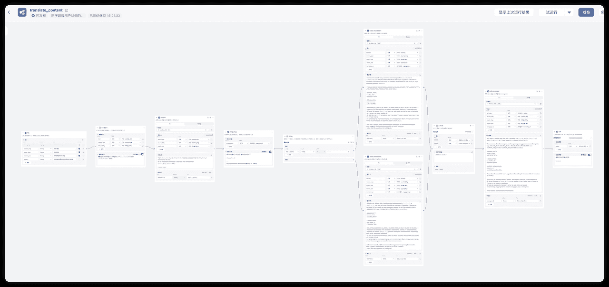

给大家展示一下测试的效果，我们输入一段英**文，让工作流自动翻译成中文。这样一对比，优化后的翻译**感觉就好多了，语句通顺了很多，用词也更加准确贴切，整体的翻译质量有了不少的提升。

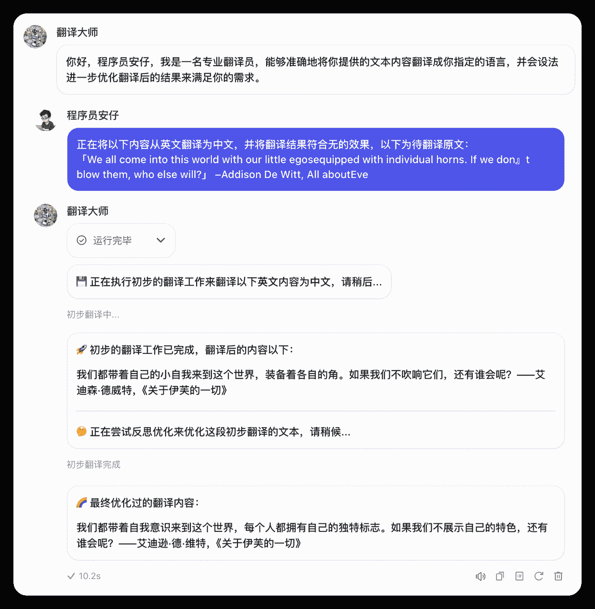

接下来，我就对每个节点的配置做一个核心讲解，让大家学会如何根据自己的需求来定制翻译流程。

1.  首先是开始节点，在这里我们需要选择翻译的源语言和目标语言，比如英语到中文。我们还可以设置一些其他参数，比如翻译的语言特色等，这个参数会影响翻译的效果和效率，不过我将其作为可选选项，建议根据实际情况进行调整。

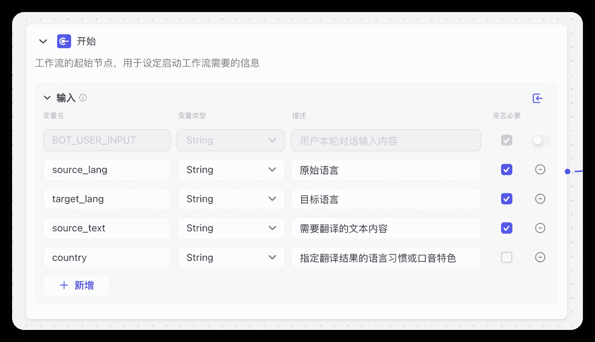

1.  接下来是初步的翻译大模型节点，这里我们需要选择一个大模型，来对源语言文本进行初始翻译，这样才好对比并且以此作为进一步的反思优化。Coze 平台提供了多种 AI 大模型选择，这里我直接选了MiniMax，然后提示词我们就直接参考吴恩达教授的相关内容即可。

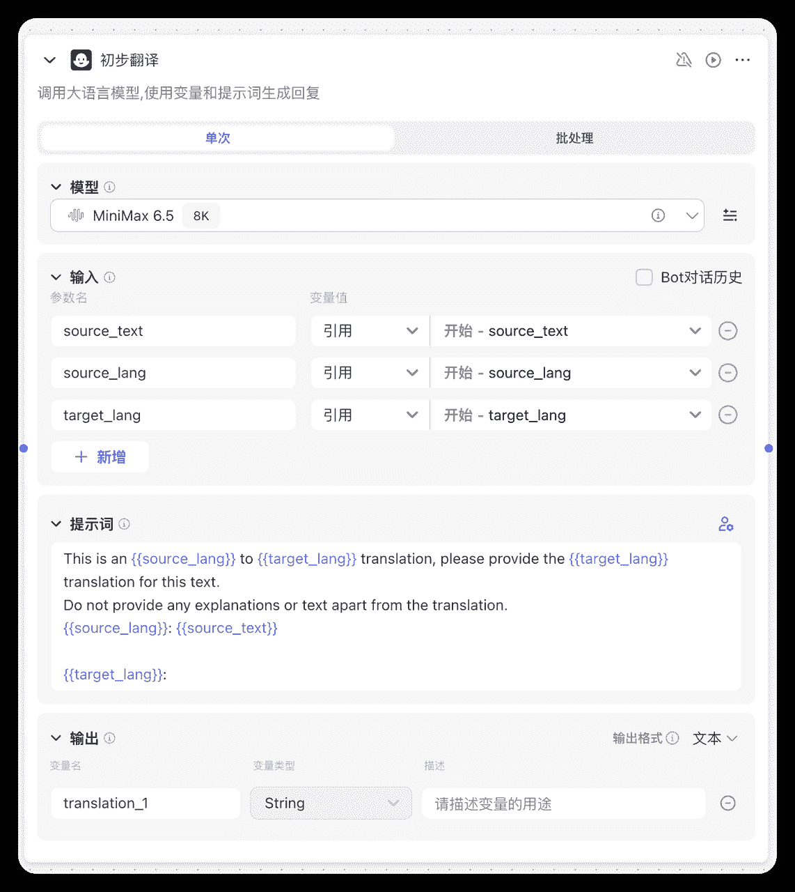

提示词：

```
This is an {{source_lang}} to {{target_lang}} translation, please provide the {{target_lang}} translation for this text.
Do not provide any explanations or text apart from the translation.
{{source_lang}}: {{source_text}}

{{target_lang}}:
```

1.  接下来就是选择器节点，因为我们需要判断用户填写的要求中有没有需要特别的语言翻译特色或者口音，如下图：

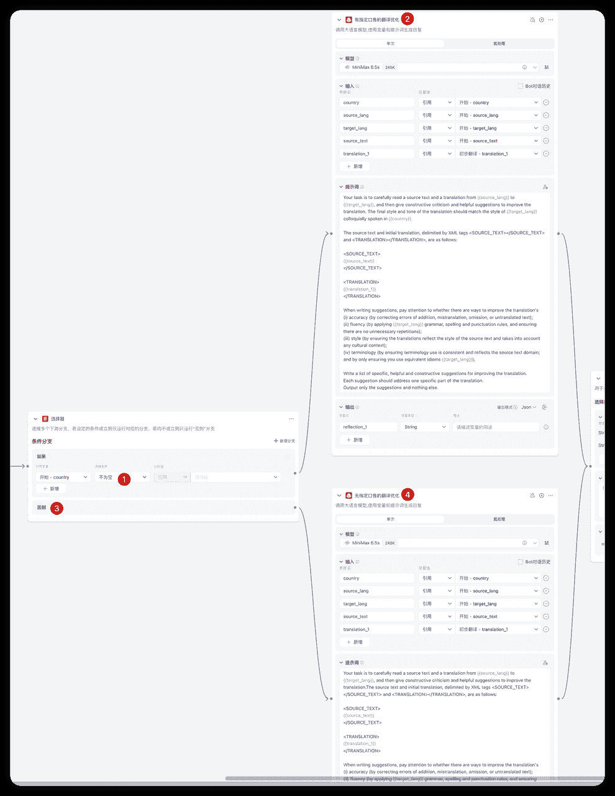

1.  然后就是核心的反思优化的大模型节点，这里我们需要配置反思优化的提示词，告诉模型应该如何去思考和优化翻译结果，并将这些建议都提出来。提示词的设计非常关键，直接决定了反思优化的效果。我们可以继续参考项目给出的示例提示词，也可以根据自己的经验和需求进行改进。这里我就先参考示例提示词进行填写，具体分为两个提示词，如下：

没有语言翻译特色的反思优化的提示词：

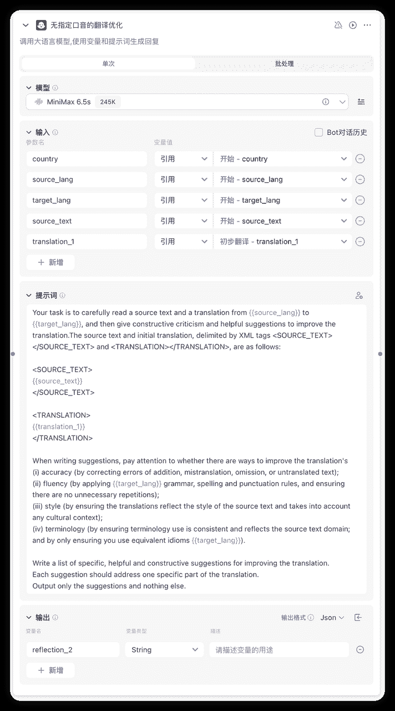

```
Your task is to carefully read a source text and a translation from {{source_lang}} to {{target_lang}}, and then give constructive criticism and helpful suggestions to improve the translation.The source text and initial translation, delimited by XML tags &lt;SOURCE_TEXT&gt;&lt;/SOURCE_TEXT&gt; and &lt;TRANSLATION&gt;&lt;/TRANSLATION&gt;, are as follows:


&lt;SOURCE_TEXT&gt;
{{source_text}}
&lt;/SOURCE_TEXT&gt;


&lt;TRANSLATION&gt;
{{translation_1}}
&lt;/TRANSLATION&gt;


When writing suggestions, pay attention to whether there are ways to improve the translation&#x27;s
(i) accuracy (by correcting errors of addition, mistranslation, omission, or untranslated text);
(ii) fluency (by applying {{target_lang}} grammar, spelling and punctuation rules, and ensuring there are no unnecessary repetitions);
(iii) style (by ensuring the translations reflect the style of the source text and takes into account any cultural context);
(iv) terminology (by ensuring terminology use is consistent and reflects the source text domain; and by only ensuring you use equivalent idioms {{target_lang}}).


Write a list of specific, helpful and constructive suggestions for improving the translation.
Each suggestion should address one specific part of the translation.
Output only the suggestions and nothing else.
```

有语言翻译特色的反思优化的提示词：

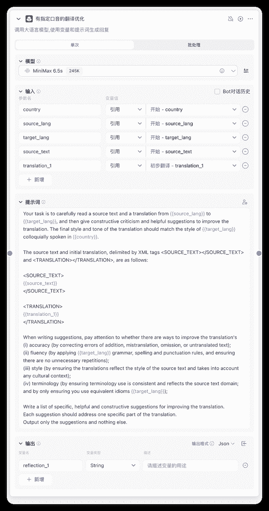

```
Your task is to carefully read a source text and a translation from {{source_lang}} to {{target_lang}}, and then give constructive criticism and helpful suggestions to improve the translation. The final style and tone of the translation should match the style of {{target_lang}} colloquially spoken in {{country}}.


The source text and initial translation, delimited by XML tags &lt;SOURCE_TEXT&gt;&lt;/SOURCE_TEXT&gt; and &lt;TRANSLATION&gt;&lt;/TRANSLATION&gt;, are as follows:


&lt;SOURCE_TEXT&gt;
{{source_text}}
&lt;/SOURCE_TEXT&gt;


&lt;TRANSLATION&gt;
{{translation_1}}
&lt;/TRANSLATION&gt;


When writing suggestions, pay attention to whether there are ways to improve the translation&#x27;s
(i) accuracy (by correcting errors of addition, mistranslation, omission, or untranslated text);
(ii) fluency (by applying {{target_lang}} grammar, spelling and punctuation rules, and ensuring there are no unnecessary repetitions);
(iii) style (by ensuring the translations reflect the style of the source text and takes into account any cultural context);
(iv) terminology (by ensuring terminology use is consistent and reflects the source text domain; and by only ensuring you use equivalent idioms {{target_lang}});


Write a list of specific, helpful and constructive suggestions for improving the translation.
Each suggestion should address one specific part of the translation.
Output only the suggestions and nothing else.
```

1.  接下来就是结合反思优化的建议后再翻译的大模型节点了，这里其实就是结合上述的反思优化的建议，再结合初始翻译的结果再次进行翻译，以此获得更好的翻译结果，如下图：

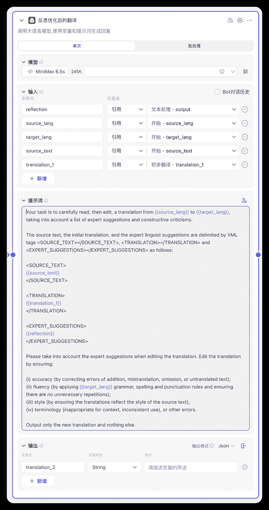

相关提示词：

```
Your task is to carefully read, then edit, a translation from {{source_lang}} to {{target_lang}}, taking into account a list of expert suggestions and constructive criticisms.


The source text, the initial translation, and the expert linguist suggestions are delimited by XML tags &lt;SOURCE_TEXT&gt;&lt;/SOURCE_TEXT&gt;, &lt;TRANSLATION&gt;&lt;/TRANSLATION&gt; and &lt;EXPERT_SUGGESTIONS&gt;&lt;/EXPERT_SUGGESTIONS&gt; as follows:


&lt;SOURCE_TEXT&gt;
{{source_text}}
&lt;/SOURCE_TEXT&gt;


&lt;TRANSLATION&gt;
{{translation_1}}
&lt;/TRANSLATION&gt;


&lt;EXPERT_SUGGESTIONS&gt;
{{reflection}}
&lt;/EXPERT_SUGGESTIONS&gt;


Please take into account the expert suggestions when editing the translation. Edit the translation by ensuring:


(i) accuracy (by correcting errors of addition, mistranslation, omission, or untranslated text);
(ii) fluency (by applying {{target_lang}} grammar, spelling and punctuation rules and ensuring there are no unnecessary repetitions);
(iii) style (by ensuring the translations reflect the style of the source text);
(iv) terminology (inappropriate for context, inconsistent use), or other errors.


Output only the new translation and nothing else.
```

1.  最后我们就可以将优化过的翻译结果输出给结束节点了，这里我们可以选择输出的方式了，这里我选择了自定义的内容输出 + 流式传输来输出翻译后的结果，如下图：

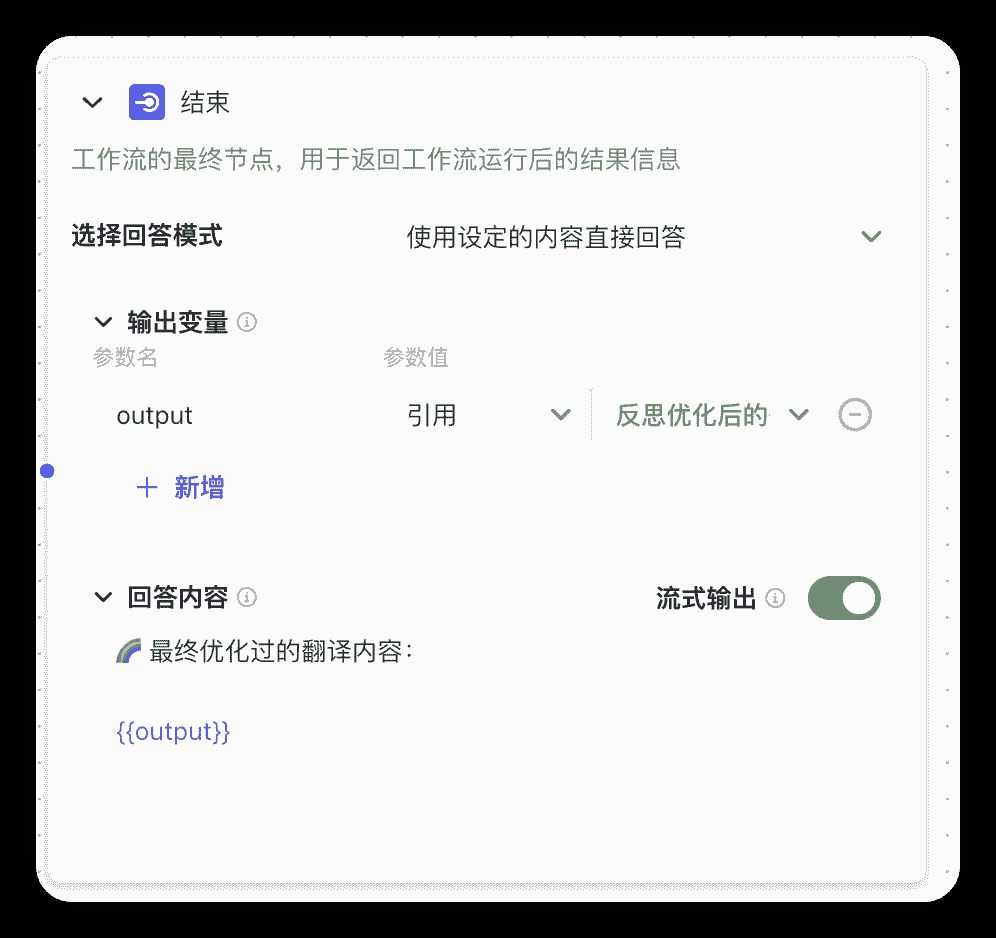

讲到**这里，相信大家对如何在 Coze 上复刻**吴恩达的 AI 翻译项目已经有了一个比较全面的了解。虽然整个过程涉及到不少配置和调试，但是在 Coze 的帮助下，一切都变得简单易行了。即使是零基础的小白，只要肯花点时间，也完全可以搭建出一个强大的 AI 翻译助手！

当然，这里还有个功能是还没有复刻的，那就是分块处理，这个功能其实也是非常重要的，因为对于长文本的翻译，分块处理可以提高处理效率，更重要的是可以让模型在局部文本上进行更精细的优化，翻译质量可以进一步提升。这个进阶的功能，我就留到下次再和大家分享了，或者等你们熟悉了 Coze 平台后，自己去尝试实现也是可以的。

在这里，我们要感谢吴恩达等大牛无私的开源精神，正是他们的慷慨分享，让我们能够站在巨人的肩膀上，去探索 AI 技术的无限可能。同时也要感谢 Coze 平台为我们提供了一个如此易用的工具，让我们可以轻松实现创意！

未来，AI 必将深刻改变我们的生活和工作方式，而掌握 AI 技能，必将让我们在这个大变革的时代抓住先机。我真诚地希望，这篇文章能够成为你迈向 AI 时代的第一步。

> 如果真想使用对应的这个 Coze Bot，地址是这个，有什么好的建议可以进去发帖告诉我吧~

> https://www.coze.cn/store/bot/7388436874651631655?panel=1&bid=6d28ft7os3g1k