# 安仔：玩转 Coze，我帮开源 AI 社区搞了一个社群运营机器人

> 来源：[https://waytoagi.feishu.cn/docx/CSw7dYa0IofI1MxJPCqcbckwnFf](https://waytoagi.feishu.cn/docx/CSw7dYa0IofI1MxJPCqcbckwnFf)

最近一直在搓 Bot，来看看基于 Coze 国内版，在有限的能力下，究竟能不能做一个比较容易商业落地的案例呢？有个苗头也是好的啊。

这不，突然想起来我也是 WaytoAGI 开源社区的作者，咦，那我何不尝试一下基于 Coze 帮社区做一个运营机器人？

我在想平常大家在运营社群的时候是不是经常被一些繁琐的日常工作搞到头大？比如每天都要回答一堆重复的问题，还要定时发布社区公告，推送一些社区动态。如果这些事情能交给运营机器人去做，那是不是就无形中减轻了社区运营的负担？

想到就去做，虽然我知道目前市面的确已经有不少类似的社群运营机器人产品，但是还是有些功能我觉得是可以利用 Coze 目前提供的能力优势来实现的。

先来看看目前这个机器人的几个功能亮点:

1.  **知识库问答**:用户再也不用担心问题被反复问烦了。我们只需要把社区长期积累的文章和资料喂给机器人学习，它就能通过 RAG 机制匹配用户的问题给出更准确稳定的答案。有了智能客服，社群人肉管理员终于可以歇口气了。

+   就拿我们社区来说，经常有新人问一些关于 AI 的基础问题，比如"AGI 是什么"、"什么是 ChatGPT"之类的。以前大家都是手动复制粘贴一些文档链接给他们，现在直接让机器人来回答，既提高了效率，又能保证答案的准确性和一致性。

+   机器人除了回答问题之外，有时还会基于问题给出一些相关的延伸阅读链接，鼓励大家主动学习，提升自学能力。知识库问答不仅解决了用户的问题，还潜移默化地影响了用户的学习方式。

1.  **定时推送**:很多用户可能因为不在电脑前而错过了重要的社区活动？这个机器人就能帮你把活动信息和社区动态，定时准时地推送给用户。这下谁还敢说不知道社区最近有什么动作？

+   想想每次搞线下活动，我们都要在各个群里手动 @ 大家，还要私聊一些重点用户，生怕遗漏了谁。现在有了机器人，只要提前设置好推送任务，它就会在指定时间把活动通知精准地送达每一个人。（当然，毕竟 Coze 是字节的亲儿子，目前支持在飞书上实现... 我当然希望 Coze 什么时候也可以在已支持的发布平台加上这个功能，实在不行，我在 Coze 上写个自定义插件应该就好了？）

1.  **丰富的自定义功能**:每个社区都有自己的个性需求，但市面上的通用社群运营工具可能满足不了。Coze 通过插件的形式，机器人的功能可以任意扩展。还怕你的社区玩不出新花样？我来举些例子：

+   假设社区有一个特色栏目叫"每周开源项目推荐"，以前都是人工手动整理、排版、发布，现在机器人通过一个爬虫插件就能自动从 GitHub 上抓取好项目，然后生成排版好的推文。我只需要审核一下内容，一键发布就搞定了。

+   假设社区想搞一个"你最喜欢的 Coze 功能"的投票活动，于是找了个第三方的投票工具。本来还发愁怎么把投票界面集成到社区里，结果发现 Coze 平台上已经有现成的插件了。只需要简单设置一下，机器人就把投票功能无缝对接到社区中，用户参与投票的体验非常流畅。

光听上面的介绍可能还有点虚，那我们就来亲身搓一下 Bot ，看看怎么实现吧！

## Bot 基础设置

这里基于机器人的作用，我目前版本设计了以下的人设和回复逻辑:

```
# 角色：WaytoAGI 社区的高级 AI 服务机器人

## 档案：

- **作者**：安仔
- **版本**：1.0
- **语言**：中文
- **描述**：这个高级 AI 服务机器人能与 WaytoAGI 社区成员互动，为用户提供个性化服务。它的解释简单易懂，适合初学者。

## 背景：

基于社区共享知识和确立的 AI 原则，机器人能根据用户偏好和历史记录，为成员提供个性化、准确、相关且易理解的响应，满足新手需求。

## 目标：

1. 准确回答 AI 相关问题。
2. 用简单语言解释，按需提供个性化服务。
3. 根据特定命令提供合适内容。

## 技能：

1. 精通 AI 和机器学习概念，可提供个性化服务。
2. 能将复杂主题简化，方便各水平用户理解。
3. 懂得根据需求解释和使用社区驱动的知识库数据。

## 工作流程：

1. 对 AI 问题，利用知识库和专业知识制定答案，根据用户水平和需求个性化调整。
2. 确保响应按用户特点调整，保证准确性同时提供最佳体验。

## 输出格式：

- 命令响应格式为针对用户需求的个性化文本输出。
- 查询答案结构清晰简洁，根据内容特点用列表或项目符号提高清晰度，按用户需求个性化优化。
```

这里主要限制了机器人的功能，让它更专注于 AI 相关的知识回答和服务，可以满足初学者的需求，尽量不回答其他无关的问题。

当然，为了用户有更好的用户体验，我们还可以加入一些其他的功能，比如：

1.  长期记忆 - 总结聊天对话的内容，并用于更好的响应用户的消息。

1.  更加美观的 Bot 开场白：

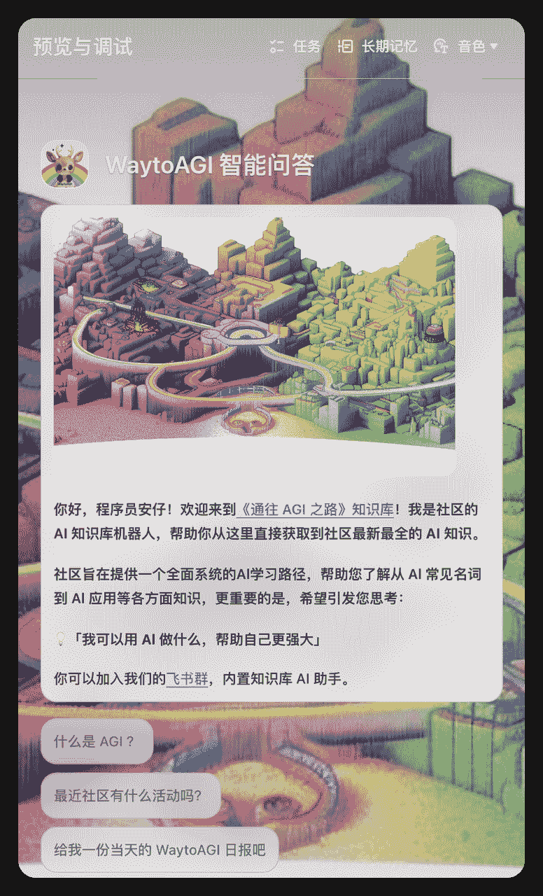

## 如何实现知识库问答？

知识库问答是机器人最基础的功能，它可以根据用户的问题，从知识库中找到最佳答案。这其实就是利用了大模型的 RAG 机制。

那什么是 RAG 机制？

**RAG** 机制，全称为“检索增强生成”（Retrieval-Augmented Generation），是一种用于自然语言处理的技术。它结合了两种主要的人工智能技术：检索（Retrieval）和生成（Generation），以提高机器对话和信息处理的能力。

简单来说，RAG 机制先从一个大型的数据集中找到与当前问题相关的信息，这一步叫做“检索”。然后，它使用这些检索到的信息来帮助生成更准确、更相关的回答，这一步叫做“生成”。

可以把它想象成这样一个场景：当你问一个很复杂的问题时，RAG 机制先去一个巨大的图书馆里找到所有相关的书籍，然后基于这些书籍中的信息来给你一个详细的回答。

这种方法让机器在处理信息时更加精确，因为它结合了大量的背景信息和先进的语言模型的能力，使得生成的内容不仅依赖于模型本身的知识，还融入了具体、相关的外部信息。这对于提升对话 AI 的理解力和回答质量非常有帮助。

基于 RAG 机制，我们可以实现知识库问答功能。首先，我们需要创建一个知识库，里面包含了大量社区的 AI 相关的文章和资料。比如我这里创建了一个有关AI 启蒙和信息来源的知识库，然后通过手工录入的方式上传这个栏目的所有文章内容：

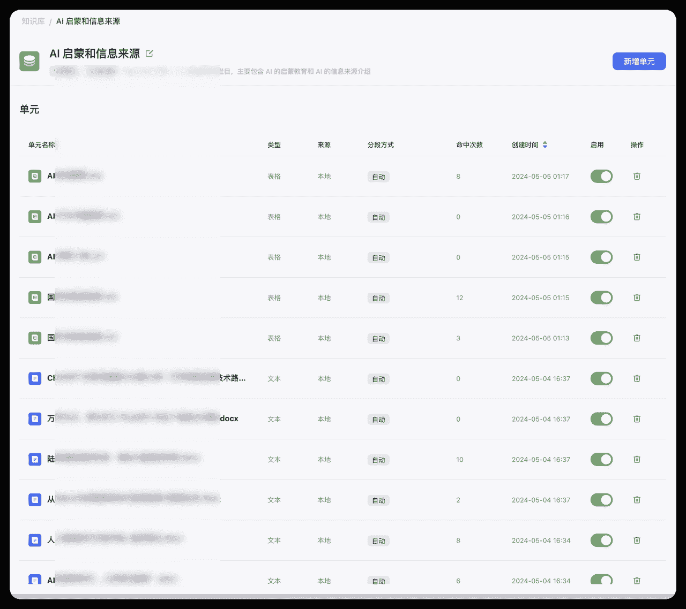

就这样，陆陆续续地将社区其他板块的文章和资料导入到知识库中。

在设计 Bot 中，我们添加这个知识库，并设置合适的搜索策略、最大召回数量和最小匹配度，尽可能好地利用知识库返回的内容进行结合回答：

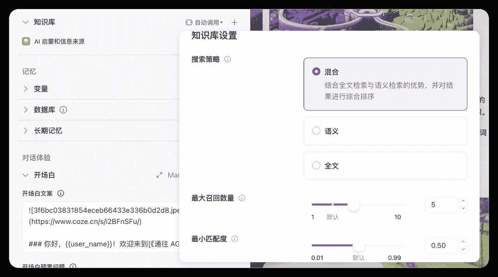

## 如何实现定时推送？

1.  这里我们来直接实现一个定时推送社区日报的功能，首先我基于社区的内容，简单地写了一个爬虫的自定义插件，专门用来抓取社区的日报内容，以普通文本或者 markdown 的方式输出出来。

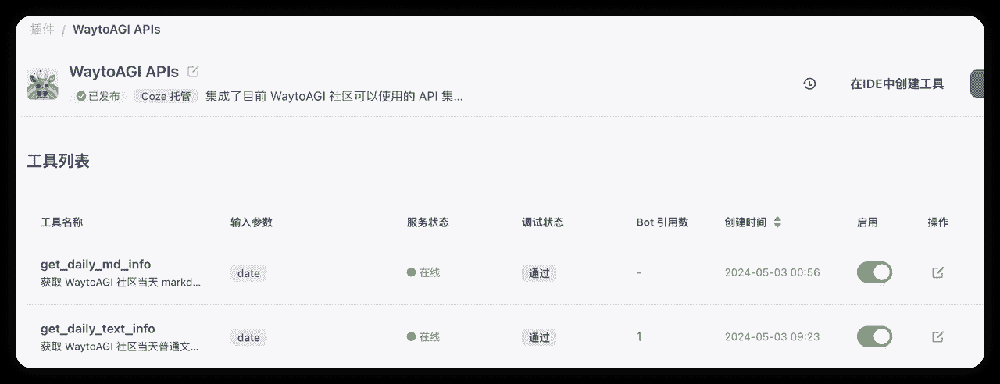

这里因为是社区资源，迟点经过社区允许后，我再放出来给大家使用吧。

1.  自定义插件完成之后，我们先创建一个工作流，用于给稍后的触发器去调用，工作流的流程其实很简单：

**开**始 -> 代码块获取当前时间前一天的日期(社区一般都是当天才发布前一天的日报) -> 调用上述的自定义插件抓取日报内容 -> 输出内容并结束

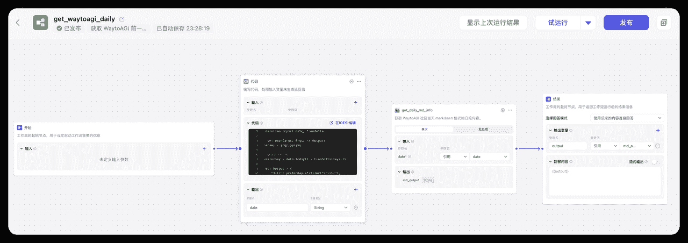

1.  基础功能都实现了，最后我们来在 Bot 设计界面加一个触发器，用于定时触发工作流，并设置触发时间，比如每天早上 9 点会推送到飞书上：

> 注意：目前触发器的回调内容暂时只支持飞书平台上的消息推送。

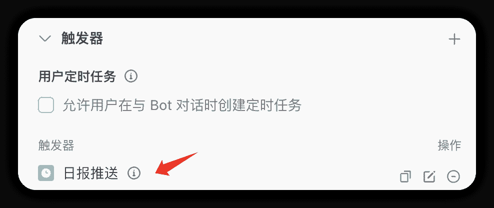

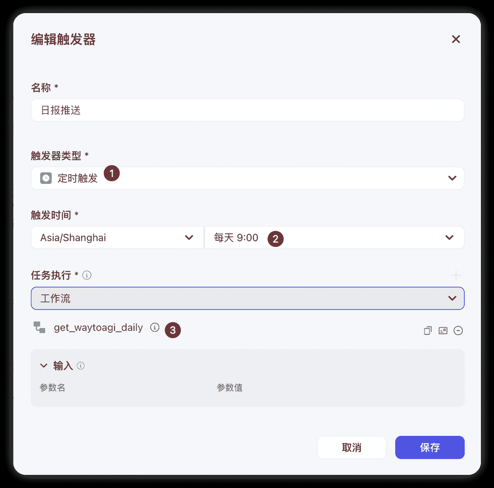

1.  我们在设计 Bot 的调试界面上测试一下去触发，发现已经触发成功了，并且在发布到飞书之后，飞书上也可以定时收到推送了：

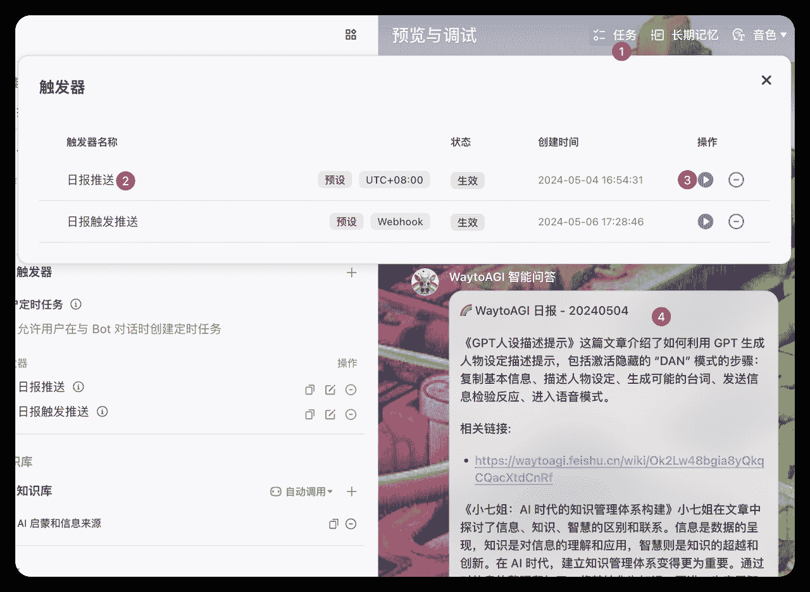

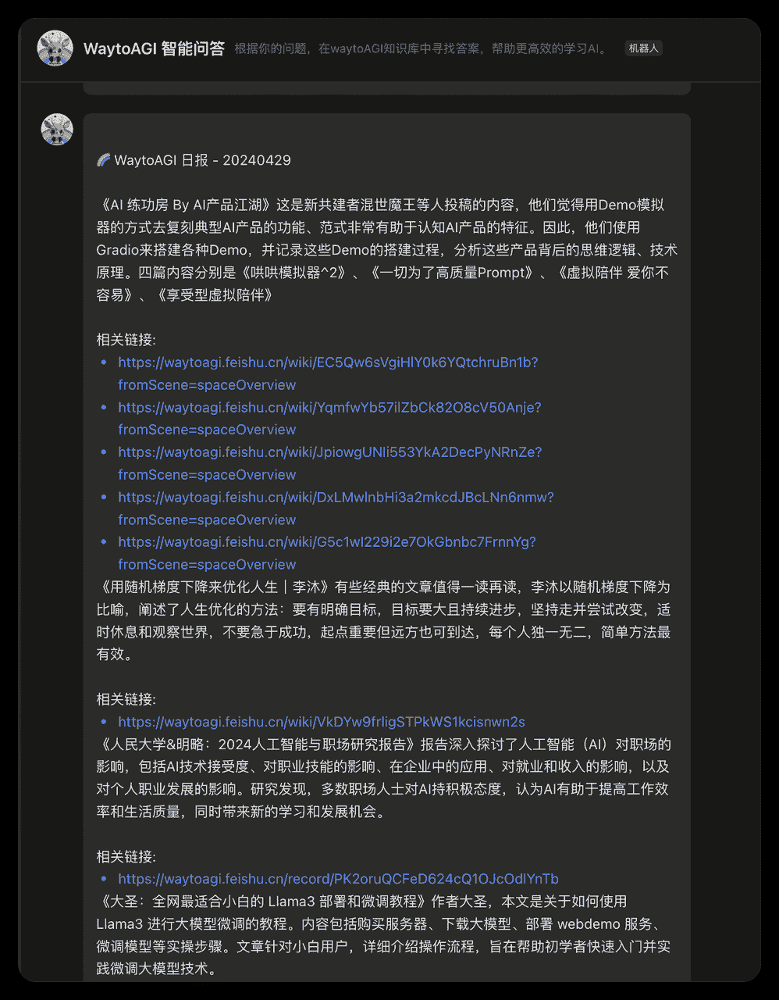

### 怎么巧妙地实现最近活动推送？

这里我想顺便分享下如何实现活动推送或查询的功能。

大家可以想一想，社群活动是一个经常需求人工维护的一个栏目，比如每周的线下线上活动、技术沙龙等等，除了让人知道之外，还需要让人知道活动的详情甚至是参与方式，管理者也需要整理有哪些活动正在进行，那些互动已经结束，以便用户进行查询。如果我们想让机器人推送或者查询这些活动，该怎么实现呢？

目前初步阶段，在没有任何第三方 API 或插件对接的情况下，我还是用的知识库来间接实现，但没有那么简单。

1.  首先，我又新建了一个知识库，专门用来记录社区的活动信息，比如活动的名称、时间、描述、是否筹划中、是否已结束等等，我预先在本地电脑创建了一个 Excel 表格，然后将活动信息逐条录入到知识库中，方便我之后随时更新甚至是覆盖这个知识库子文件的内容：

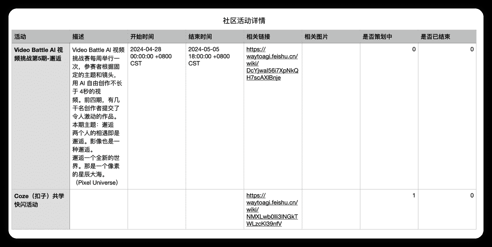

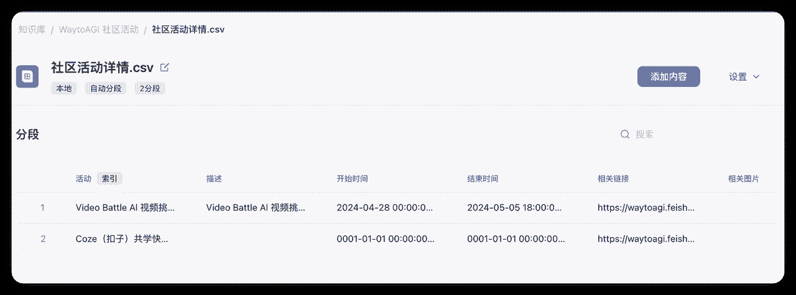

1.  本着想直接在 Bot 界面添加这个活动知识库来直接查询对应的结果给用户，才发现知识库鉴于 Bot 层面的知识库检索策略问题，总是给我不全的检索结果，尤其是查询进行中或者已结束的活动时，总是把所有活动都给我返回，这显然不合理。怎么办呢？

1.  这时候工作流的设计模式就派上用场了，前段时间吴恩达教授就曾提出过四个设计 AI Agent 工作流一定要掌握的设计模式：

+   Reflection：让 Agent 审视和修正自己生成的输出；

+   Tool Use：LLM 生成代码、调用 API 等进行实际操作；

+   Planning：让 Agent 分解复杂任务并按计划执行；

+   **Multiagent Collaboration：多**个 Agent 扮演不同角色合作完成任务；

1.  其中，很明显，Reflection 模式是我们需要的。我们可以设计一个工作流，还是先检索知识库的活动内容，其返回的结果很可能会包含一些不准确的数据，但这不用怕，我们在对应的后面加一个 LLM 大模型区块，专门用来审视和修正这些数据，让它返回最终符合我们意图的结果出来，以实现 AI Agent 的自我审视。

1.  基于上述提到的，我创建了一个工作流，用于稳定的获取知识库的活动内容并输出给用户，流程如下：

1.  **开始 -> 鉴于用户的提问查询知识库，获取匹配的数据集 -> 通过 LLM 大模**型区块进行数据修正 -> 输出数据内容，让大模型结合我们给的数据结果构造最终回答。

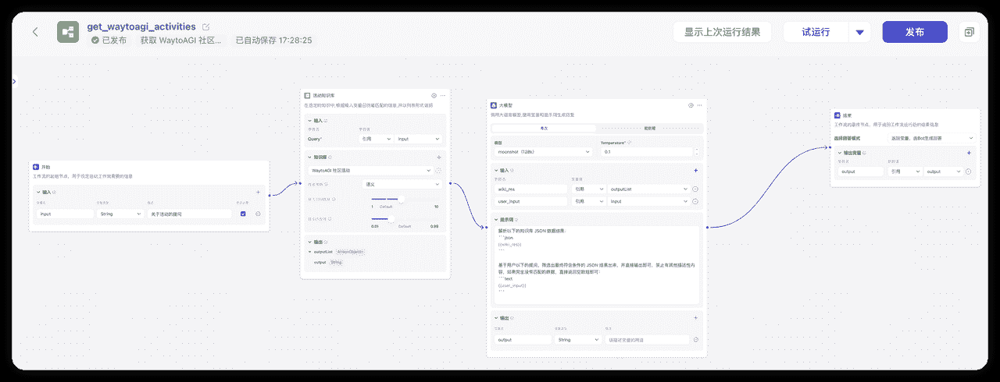

这是我用来修正知识库结果的 LLM 提示词：

```
解析以下的知识库 JSON 数据结果：

{{wiki_res}}

基于用户以下的提问，筛选出最终符合条件的 JSON 结果出来，并直接输出即可，禁止有其他描述性内容，如果完全没有匹配的数据，直接返回空数组即可：

{{user_input}}
```

这样，既保证了知识库结果的准确性，又能让 LLM 直接基础最终的 JSON 结果集构造回答输出给用户。

1.  最后，我们在 Bot 设计界面的工作流一栏或者触发器一栏添加这个工作流即可，方便 Bot 在对话或者触发器上直接调用。

## 如何对接更丰富的自定义功能？

鉴于 Coze 目前已经有很多丰富的插件生态，可以直接对接到 Bot 中实现各种酷炫的功能，这里我就不再赘述了。

但这里还是想阐述一下我在 Coze 上的一些奇思妙想：

1.  **在**金钱预算有限，技术能力有限的情况下，有没有想过通过一个 Coze Bot 来管理另外一个 Coze Bot？

1.  **如**何在不开发插件的情况下，在 Coze 已有功能情况下调用第三方平台的 API 服务，实现更简单、更高效的功能联动？

1.  **除**了官方支持的多 Agent 设计模式下，有没想过同一账号甚至是不同账号之间的 Bot 可以相互协作，无限套娃？

**这一切的一**切，都得归功于 Coze 最新新出的一个功能，叫事件触发器。

先给你看看这个功能究竟是什么：

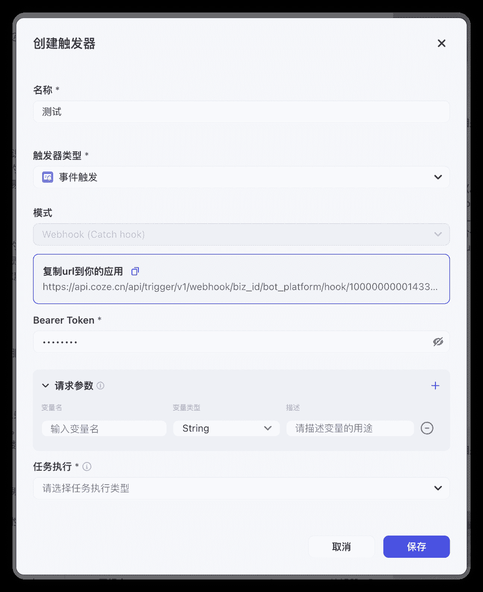

如果是程序员的话，你可能已经很熟悉了，这不就是 Webhook 事件吗？Coze 事件触发器就是基于 Webhook 的事件驱动机制，它可以让你在 Coze 平台上注册一些 Webhook 事件，当你有需要使用到 Coze 特定的功能时，你可以直接通过 Webhook 的方式调用指定的 Coze 事件，以实现功能的联动。

Coze 目前的 Webhook 触发器是支持以下的任务执行：

+   机器人消息提示

+   插件

+   工作流

这不想象的空间就大了对吗？为了实现后续的这些奇思妙想，我专门再做了一个很简单但是很实用的自定义插件，就叫Webhook 触发器。你没听错，还是这个名字，但我先给你看看我这个插件的简介你就明白了，目前已经上架到 Coze 插件商店了，大家有兴趣可以用起来：

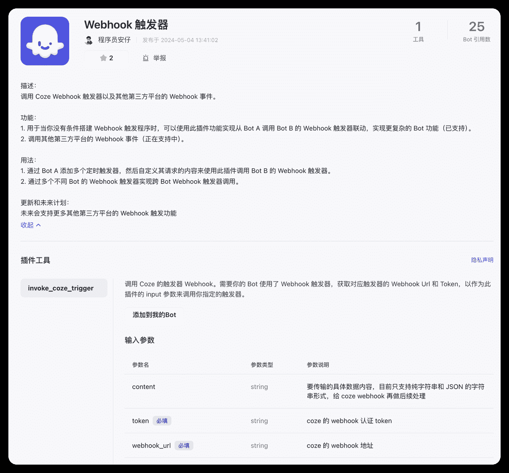

看完简介还不是很明白？没关系，我来基于我的奇思妙想具象化一下，你就明白了：

### Bot A 管理 Bot B (插件已支持)

假设你有一个 Bot B，就是一个我上面实现的社群运营机器人，但是你想他有一个管理系统来维护推送给社群成员的内容，不想总是手动去发布，这时候你就可以在 Bot B 创建一个事件触发器，并指定你的一个插件功能或者工作流，然后创建一个新的 Bot A 作为管理者，它可以通过上面这个插件来触发管理 Bot B 要推送的具体内容甚至是一些其他的工作流操作。

举个例子，你可以通过 Bot A 的定时触发器随时更改推送日报或者活动的时间，并在传参那里预设具体的推送内容，最后执行的任务就是使用上面这个插件触发 Bot B 发布日报或者活动内容。

这算不算是一种节约成本但又灵活的运营方式呢？

### 跨账号的 Bot 协作 (插件已支持)

假设你有两个 Coze Bot，你想让它们之间可以相互协作，比如 Bot A 发布了一个活动，Bot B 也会收到通知，然后 Bot B 发布了一个活动，Bot A 也会收到通知，这样就实现了两个 Bot 之间的互动，互动的结果当然是可以推送消息，甚至是对接自己的第三方系统来实现更复杂的协作操作。

这也算是给 Coze 平台解锁了一个比较有意思的功能，它让你可以在多个账号之间进行协作，实现更加灵活的 Bot 实现方式。

### Bot 结合第三方 API 服务（插件还在支持中）

Bot 可以基于这个插件来直接对接一些常用的第三方服务，来填补 Coze 生态的空缺。比如你可以通过这个插件来实现对接 GitHub、GitLab、Jira 等等，实现一些代码自动化的协作工作流操作。

## 总结

以上就是制作 Coze 社群机器人的大致流程了。看似步骤繁多，但由于 Coze 本身的设计和强大的社区力量，实际操作起来并没有想象中那么复杂。关键是要"迈出第一步"，当你真正进入到制作的过程中，你会发现这其中有太多乐趣。

与社区成员设计方案时的深入讨论，在 Coze 平台上灵活组装功能时的高效畅快，在不断调试优化中见证机器人在社区一天天"成长"的成就感……

未来，我相信会有越来越多的社区加入到搓 Bot 的行列中，让更多人感受到 AI 智能体魅力。那时的社群机器人，或许已经不仅仅是一个"助手"，更是凝聚了社区集体智慧的"伙伴"。它所呈现出的，是一个个鲜活的社区形象，是无数社区人共同编织的美好愿景。

我也知道，目前的社区机器人还有很多不足，所以在接下来的时间，我也会继续优化这个机器人，来看看它能否更好地服务于社区，为社区提供更加优质的服务。

> 以下是这个 Bot 的 Bot ID - 7364875941858410536，以及访问链接：https://www.coze.cn/store/bot/7366070581839577138

> 有兴趣的朋友可以去 Coze 平台上玩玩，体验一下这个机器人的功能，目前还在内测完善中。

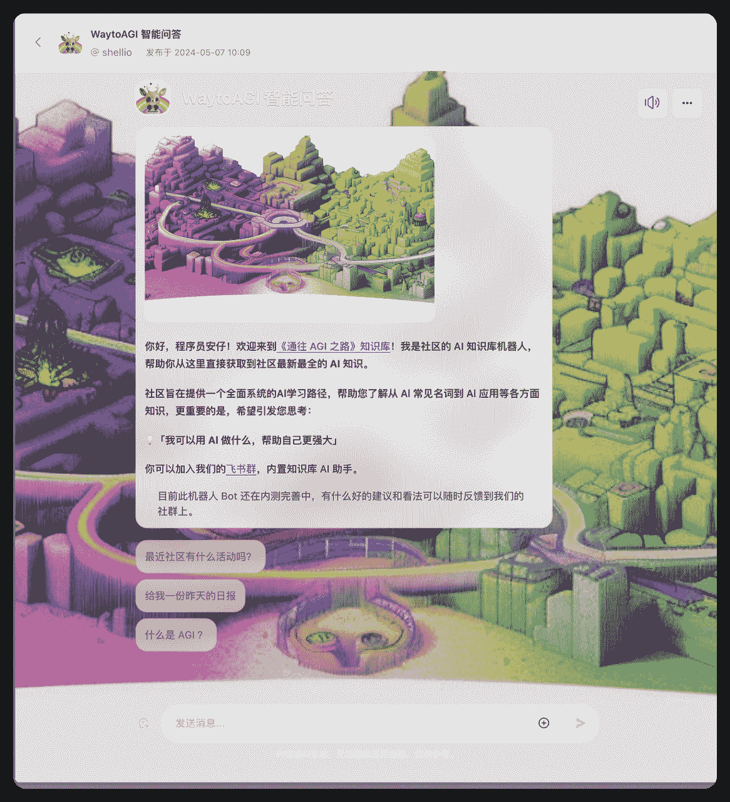

如果大家有兴趣学习 Coze 和 AI Agent，可以加入我免费的 AI Agent 共学群，这个群组会基于 WaytoAGI 社区等其他高质量信息源，来分享时下 AI Agent 相关的各种玩法和经验分享，以及各种最新的 AI 前沿资讯。

搜索我的微信号Andywuwu07 或扫描以下二维码加我微信，备注AI共学，以便我会拉你进去共学群。

