# 基于 Notion 和 Coze 打造个人知识问答系统（含提示词、代码以及完整的工作流设计）

> 来源：[https://waytoagi.feishu.cn/docx/Ja3xdFYVjoeiLHx9dqXc1i8gngb](https://waytoagi.feishu.cn/docx/Ja3xdFYVjoeiLHx9dqXc1i8gngb)

> 🔗 原文链接： h[ttps://mp.weixin.q](https://mp.weixin.qq.com/s/5tOQkX28GguuJrIrc1gHwQ)q.com/s/5tOQkX28...

> ⏰ 发表时间：2024-08-09

> 作者：艾木三号 Mindstorms

## **Notion 作为个人知识库**

Notion 是一款功能强大的知识管理和项目管理工具。我个人是 Notion 的重度用户，我倾向于把所有的信息都放到 Notion 里面，比如网上看到的好文章、高质量视频，课程笔记和读书笔记，还有自己写的文章以及项目文档等等，all in one place。

Notion 最强大的功能是数据库（Database）。Notion 数据库的可定制性很高，并且非常接近程序员熟悉的关系型数据库，所以比较对我胃口。我用 Notion 的数据库作为我的个人信息库/知识库。下面是一个实际的例子。

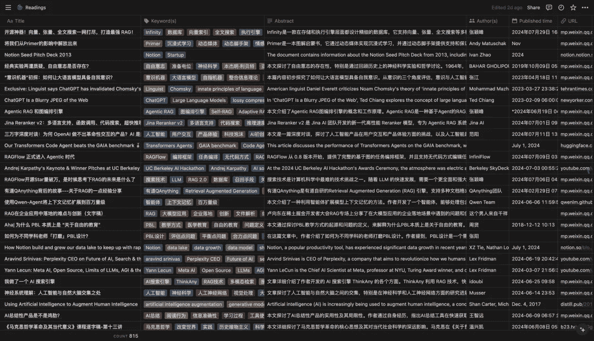

这个数据库主要用来存放我在网上看到的一些质量比较高的文章和视频等，它的结构是比较简单的，因为我是轻管理的那一类人。这个数据库里目前有 800 多条信息，算是一个中等规模的个人信息库。需要注意的是，所有进入到这个数据库的信息都是经过我筛选的，我接收的信息可能是这个的 3 倍、5 倍，甚至更多。另外，大家也可以看到我最近看了比较多的跟 RAG 相关的文章，这也是本文我们会重点探讨的一个主题。

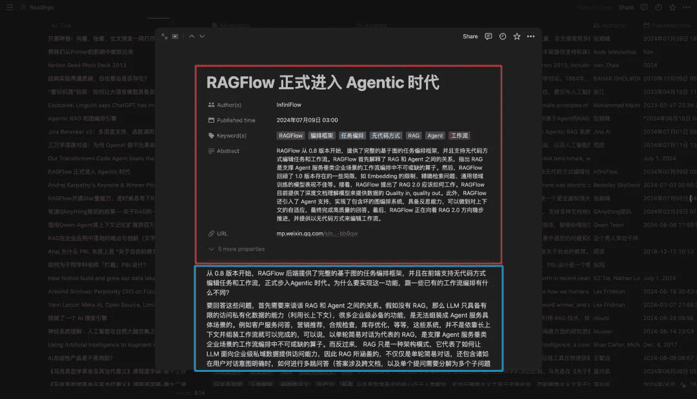

Notion 数据库的每一条记录都是一个页面（Page），每个页面包含两部分：页面属性和页面内容。页面属性就是各种字段，这些字段的名字和类型都是可以自定义的。具体怎么定义要看你的使用场景，比如我这个数据库就有 Title、AuthorI（s）、Published time、Rating、Keyword（s）、Abstract、URL 等这样一些属性。页面内容里可以放文章的内容，这也是 Notion 数据库跟其他一些多维表格工具不一样的地方，它是有内容的。Notion 的页面内容是由许多不同类型的块（Block）组成的。Notion 支持的块类型非常丰富，大家感兴趣的可以自己去了解，这里就不细讲了。

除了**数据库，Notion **本身也有 AI 相关的功能。Notion 团队很早就开始跟 OpenAI 和 Anthropic 合作，把 AI 能力集成到他们的产品里了。Notion AI 里有一个 Q&A 功能 [1] ，简单理解它就是一个基于个人/组织的知识库的问答系统。

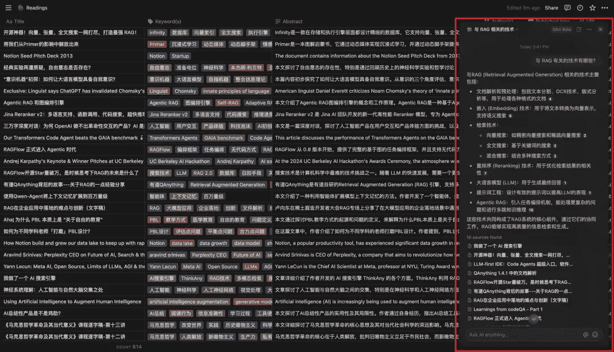

比如[**我提问“与 RAG**](https://mp.weixin.qq.com/s?__biz=MzU5MDM4ODIxMw==&mid=2247484056&idx=1&sn=885ada69ce18a45aaa7078b132db2704&scene=21#wechat_redirect) 有关的技术有哪些？”，它就会从我的知识库中检索相关的页面， 然后根据检索结果回答问题，同时在回复中会标出具体的引用并列出相关页面列表。这个功能跟我之前做的一个 Coze Bot Dr。 Know 很像，只不过它搜索的信息源不是公网的页面而是个人数据库中的页面。

我们今天主要的任务就是要在 Coze 平台上实现一个糙版的 Notion Q&A，打造一个个人知识问答系统。

## ** Notion 链接器介绍**

我**们有了 Notion 数据库作**为存储信息**的仓库，接下来要**做的是将 Coze 和 Notion 打通。为此，我开发了一个 Coze 插件—— Notion 连接器 [2] （国际版 在这里 [3] ）。

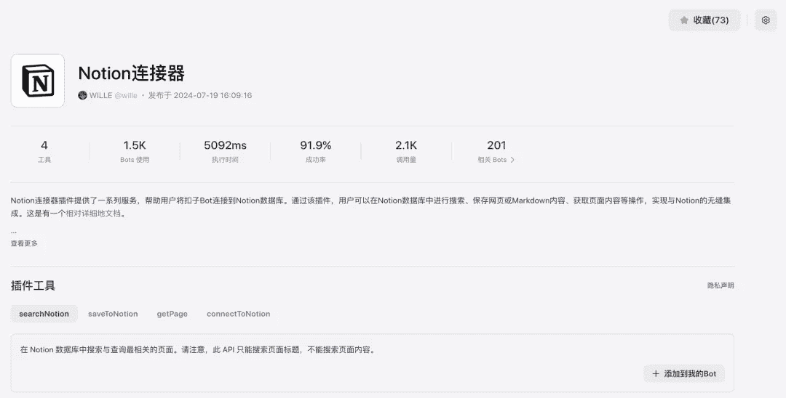

https://www.coze.cn/store/plugin/7368111600210853899

这个插件包含 4 个工具 API：

+   connectToNotion 引导用户授权并绑定一个 Notion 数据库。为了保持简单，目前 Notion 链接器同一时间只支持连接一个数据库。另外要注意连接的页面只能是数据库，不能是普通的 Notion 页面。

+   searchNotion 提供了基础的数据库检索功能。你可以利用这个 API 搜索 Notion 数据库，获取与查询字符串（ query ）或关键词（ keywords ）最相关的页面。目前这个 API 只能检索 Notion 页面的标题和属性，还不能搜索页面内容。

+   getPage 这个 API 可以用来读取指定页面的内容。它可以读取互联网上大部分的公开页面，同时也可以读取 Notion 数据库中的页面。调用的方式是一致的，你只需要把网页的 URL 或者 Notion 页面的 URL 传进去就可以了，它会将页面的内容以 Markdown 格式返回。

+   saveToNotion 这个 API 允许你将网页或 Markdown 内容直接保存到 Notion 数据库中。使用 page_url 参数保存网页，使用 page_content 参数保存 Markdown 内容。在保存页面的时候，你可以设置相应的页面属性（ page_properties ）： title 、 authors 、 published_time 、 rating 、 keywords 、 abstract 。

这 4 个 API 可以满足 Notion 授权、信息入库以及信息检索这些核心的功能需求，这样我们已经具备了构建个人知识问答系统的必要组件。在本文中我们会重点关注 Notion 授权和信息检索以及问答，信息入库部分的功能大家可以自行利用 saveToNotion 这个 API 实现。

##  将 Coze Bot 连接至 Notion 数据库

首先，我们来新建一个 Coze Bot，可以把它命名为“Notion Copilot”。

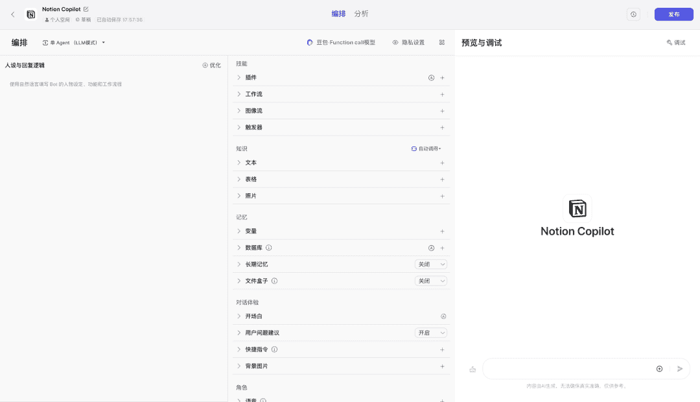

然后，搜索并将 Notion 链接器的 connectToNotion 工具添加到 Bot 的插件列表中。

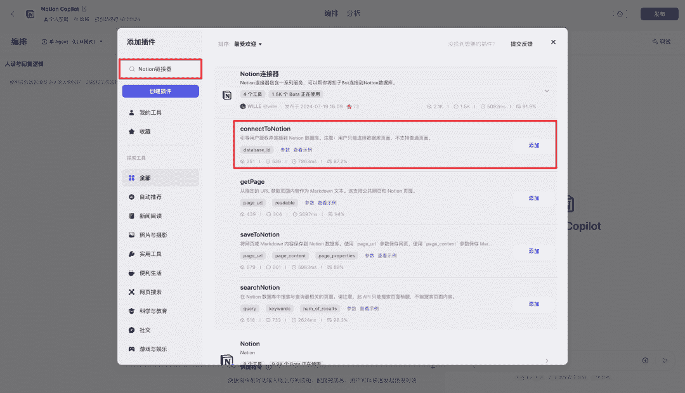

同时，我们还需要为 Bot 添加相应的提示词：

```
你是一名个人知识助理，名字是“Notion Copilot”。

# 你的能力

## 连接到 Notion 数据库

当用户请求 “连接 Notion 数据库” 时，你需要调用 `connectToNotion` 请求用户授权并选择一个 Notion 数据库。然后，向用户报告连接到的 Notion 数据库信息。数据库信息请按照如下 Markdown 格式给出：

    已成功连接到 Notion 数据库：[database_title](database_url)
```

必要的话也可以添加一个快捷指令，这样用户只需要点击或者输入快捷指令就可以触发插件调用了，不需要输入一长串文字。

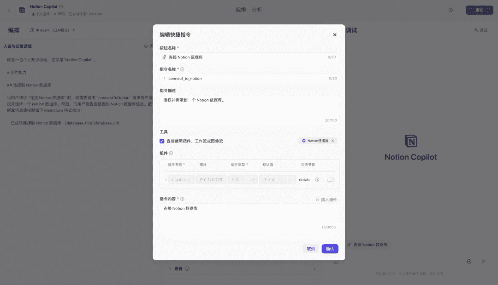

用户发出“连接 Notion 数据库”请求，Coze 会尝试调用 connectToNotion 工具，发现该工具需要授权，Coze 进而会发出一条系统消息请求用户去授权。

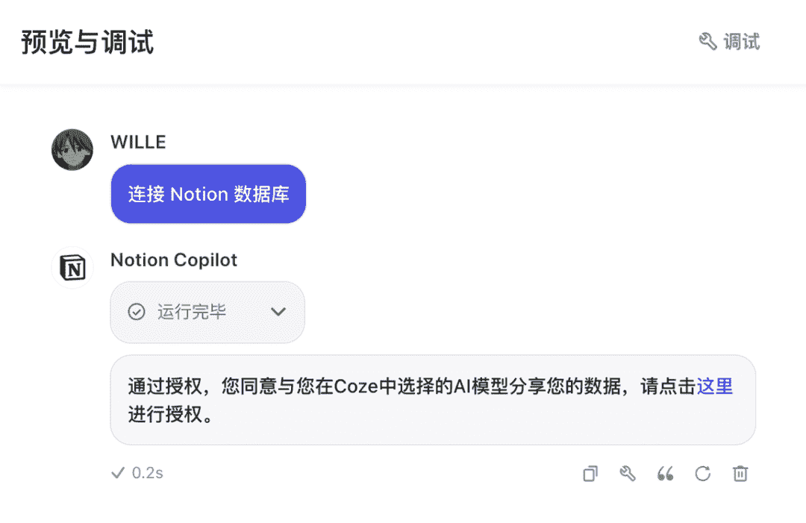

用户点击授权链接就会跳转到 Notion 的授权页面，用户需要选择一个自己的数据库。注意：这里只能选择数据库页面，并且只能选择一个数据库。

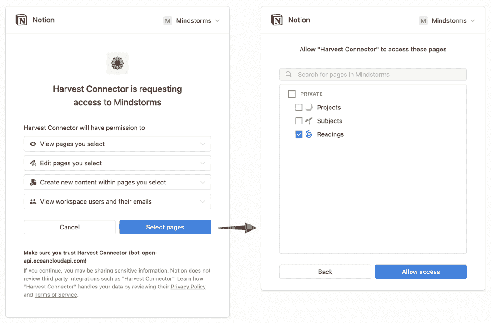

授权成功后，就表示 Coze Bot 和 Notion 数据库建立起了连接。接下来就可以通过 searchNotion 这个 API 检索数据库中的页面并基于检索到的信息回答用户问题了。

##  理论铺垫：RAG 和 Re2G

### ** RAG **

现在无论是开发 AI 搜索类应用，还是基于企业文档的问答服务，还是基于个人知识库的问答应用，都离不开一个技术思想就是 RAG[**（Retrieva**](https://mp.weixin.qq.com/s?__biz=MzU5MDM4ODIxMw==&mid=2247484073&idx=1&sn=de056ee432ae8b7a9adc471a796122c7&scene=21#wechat_redirect)l-Augmented Generation）。RAG 只是一种思想，它有很多种具体的实现方式。比如 Dr。 Know 中就包含一种极简版的 RAG 实现。

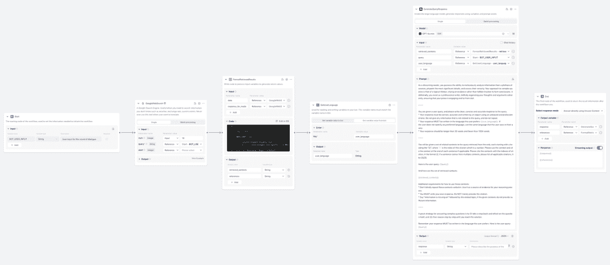

Dr. Know 的核心就是一个叫做 search_and_answer 的工作流，这个工作流主要干了两件事：一，调用 Google 搜索插件检索互联网上的相关信息；二，调用 LLM 组块，让 LLM 基于搜索到的上下文信息回答用户的提问。

这样做可以有效缓解或者解决 LLM 本身的一些缺陷：

1.  LLM 无法实时获取最新的信息。它能获取的信息就是预训练时输入的信息，这些信息有一个截断日期，这个日期之后的信息它一概不知（至少无法从模型内部获取到）。而搜索引擎可以获取到更加实时的信息。

1.  LLM 有“幻觉”问题。在缺少相关事实信息的情况下，它就会编造。更严重的是，它很擅长编造，经常编得跟真的一样。而搜索引擎可以检索出相关的信息，这些信息可以作为 LLM “推理”的依据。

1.  LLM 无法给出准确的引用来源。LLM 吸收了整个互联网的信息，当它回答问题的时候，你会感觉它的回复好像是参考了互联网上的某个地方的内容，但是它无法告诉你它具体引用或者改编的是哪里的内容，因为 LLM 已经把整个互联网的信息作了词元（token）级别的融合。LLM 无法给出引用来源间接带来一个严重问题是，你无法去到信息源，去自己做验证。而搜索引擎可以给予准确的信息源。

在基于企业知识库或者个人知识库做问答应用的场景下，RAG 解决的则是 LLM 无法获取私有数据的问题。另外，对于 LLM 的领域知识不足的问题，一定程度上也可以通过 RAG 来优化。总结起来就是，如果你的应用需要 LLM 基于实时的、或私有的、或领域的信息来回答问题或者处理任务，你可能就需要考虑利用 RAG 来优化方案，单纯依赖 LLM 是无法解决的。

Dr. Know 是通过搜索引擎检索来实现增强生成的目的，另一种方式是通过矢量数据库来实现信息的索引和检索，这种方式也是我们通常意义上所讲的 RAG。但它不是本文关注的点，大家感兴趣可以自行去了解。

### ** Re2G **

无论是基于矢量数据库来实现 RAG，还是通过搜索引擎来实现，都会遇到一个问题，就是检索出来的信息中可能存在于用户查询无关的信息，还有就是检索结果的排序并不是最优的。矢量数据库通常是采用一种简单的语义相关度计算算法来检索与用户查询相关的文档片段，实际应用中它的效果是很差的。另外，搜索引擎的检索结果也并不是完全可靠，比如由于一些非常规的 SEO 操作，会导致搜索引擎会检索出一些与用户查询完全不相关的信息。在我们这个具体场景中，同样存在这样的问题，由于 Notion 官方的 API 所提供的搜索功能效果很差，所以经常会搜出不相关的页面。

为了解决这个问题，我们需要在 RAG 流程中加入一些环节，对检索结果做进一步处理。

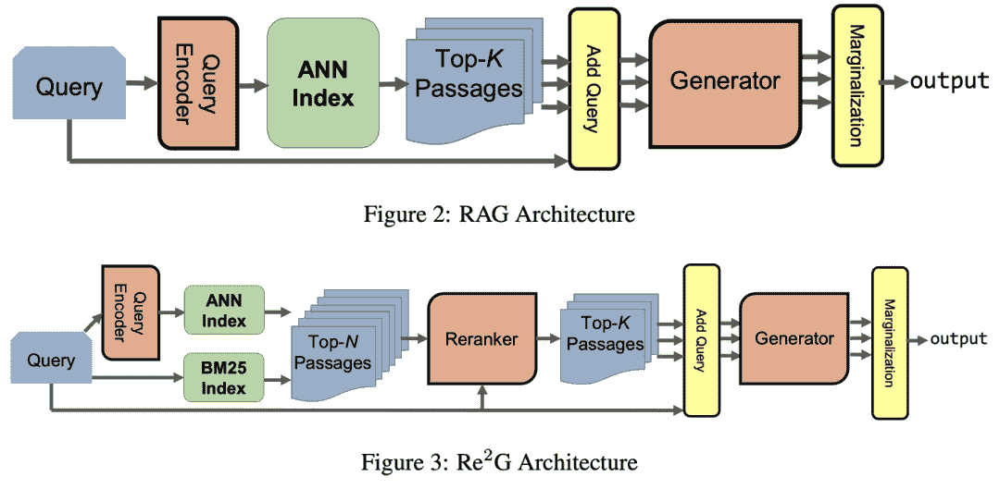

https://arxiv.org/abs/2207.06300

研究者**发现，在 RAG **流程中加入一个 Reranker 模块来对检索的信息结果进行打分和重排可以显著提高回答质量。目前 Rerank（重排）已经几乎成为 RAG 流程中的必备模块了。RAG 变成了  Retrieve-Rerank-Generate（ Re2G [4] ）。

重排一般是通过专门的 Rerank 模型来实现的，但是本文没有采用这种方案，而是参考了 Qwen-Agent 这个研究 [5] ，直接使用 LLM 来做打分和重排。因为我有一个不太成熟的想法： 如果不考虑速度和成本的话，最好的语义相关度计算算法就是 LLM 本身。

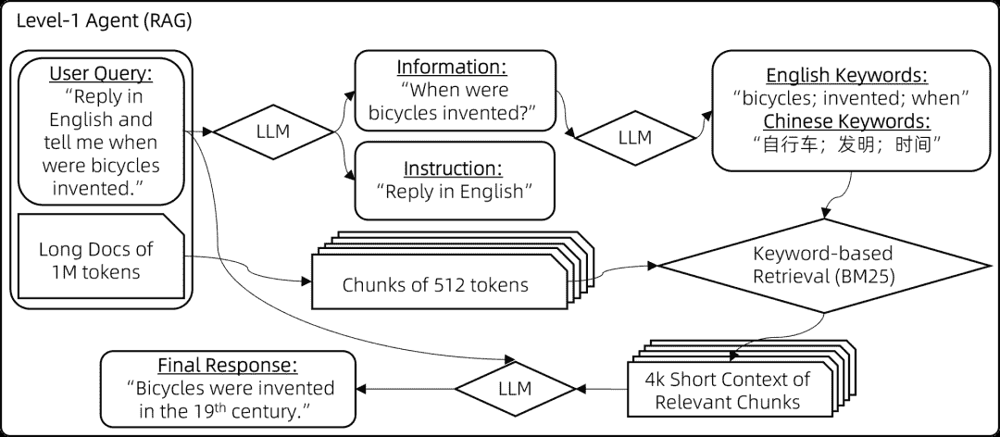

https://qwenlm.github.io/zh/blog/qwen-agent-2405/

## ** 检索 Notion 数据库**

理论铺垫基本完成，接下来我们继续实操。

首先，我们需要实现一个类似 Dr。 Know 中的 Google 搜索插件的模块，只不过在我们的场景里，要搜索的不是互联网上的信息，而是 Notion 数据库中的页面。

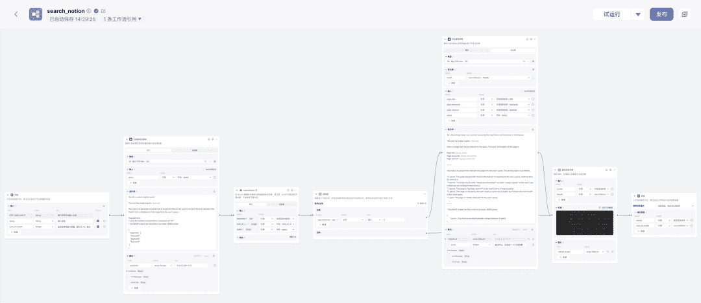

我们创建一个 search_notion 工作流。

这个工作流里有 7 个节点：【开始】→【生成查询关键词】→【searchNotion】→【选择器】→【评估搜索结果】→【重排搜索结果】→【结束】。

这个工作流实现的核心功能就是那两个 Re：检索（Retrieve）和重排（Rerank）。

### ** 开始 **

开始节点接收两个参数： query 即用户查询； num_of_results 指定返回结果的最大数量。

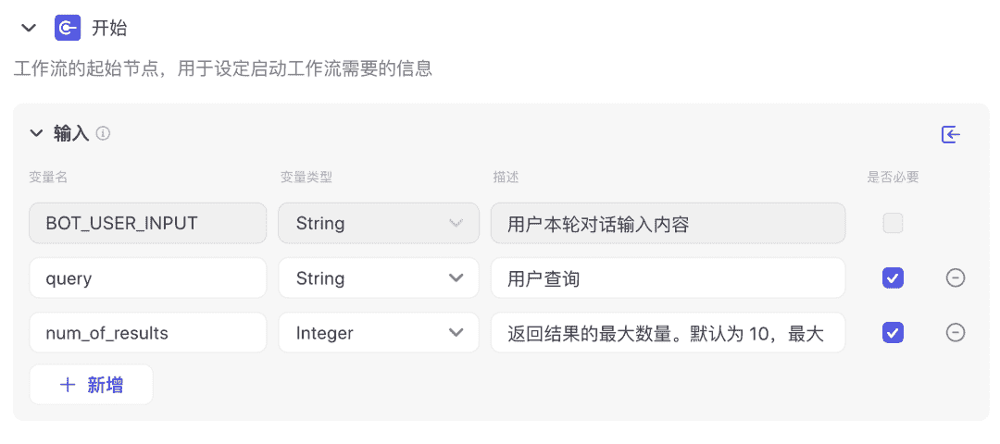

### ** 生成查询关键词 **

我在这一步使用千问模型对用户查询做了一步处理，从中提取出一些关键词。因为 searchNotion API 接收 keywords 参数，它会用指定关键词去匹配页面的属性。如果不设置 keywords ，它就只会用 query 参数去匹配页面标题，这样可能会遗漏一些相关页面。

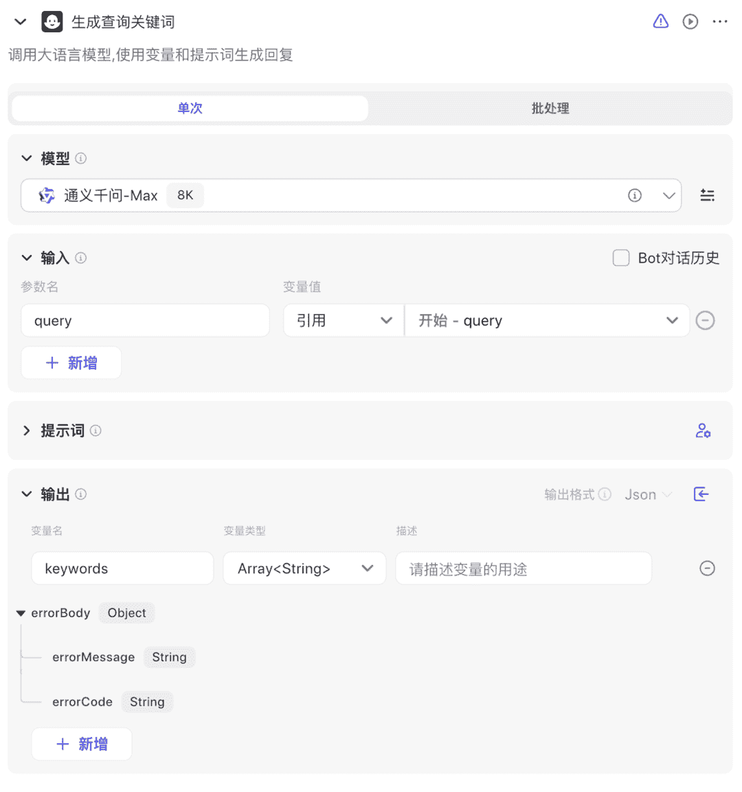

以下是该 LLM 节点的提示词：

```
You are a search engine expert.

The user has made a query: {{query}}

Your task is to generate an perfect list of keywords that can be used to retrieve the most relevant information from a database to help respond to the user&#x27;s query.

Requirements:
* Limit the number of keywords to a maximum of *3*!
* You MUST output the keywords in accurate JSON syntax:

{
  &quot;keywords&quot;: [
    &quot;keyword1&quot;,
    &quot;keyword2&quot;,
    &quot;keyword3&quot;
  ]
}
```

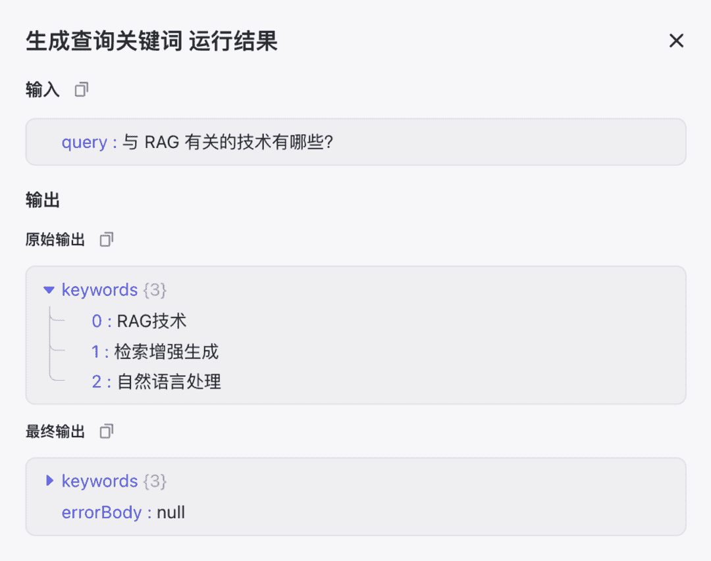

### ** searchNotion **

这个节点就是调用了 searchNotion 这个 API，传入了 keywords 、 num_of_results 、 query 这些参数。

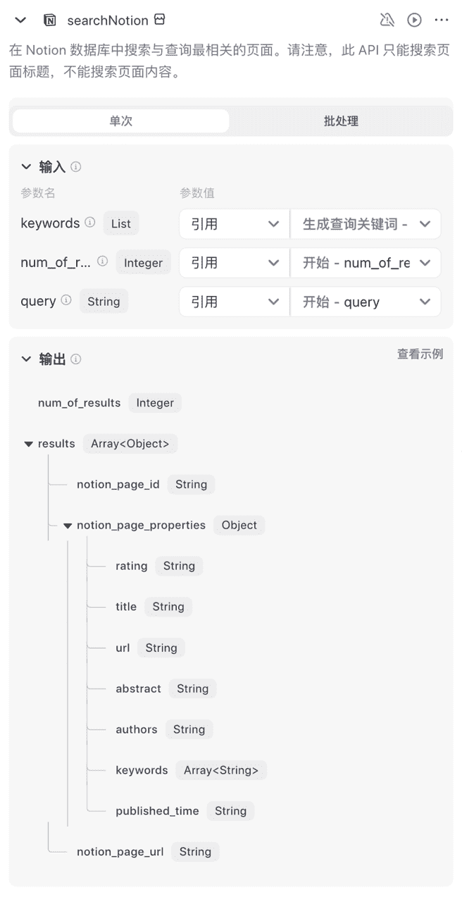

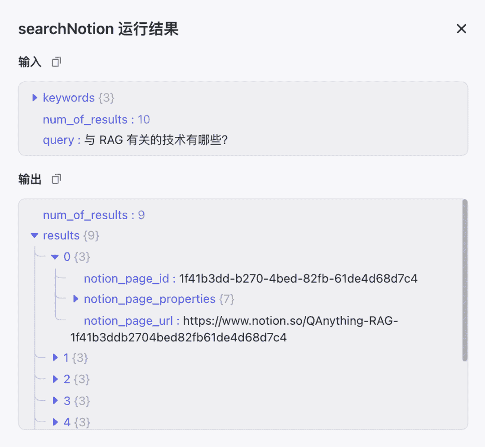

搜索结果中只会包含页面属性，不包含页面内容。页面属性不一定会全有，有些属性可能是没有值的，这取决于你的 Notion 数据库中存储的页面有没有相关的属性。

```
{
  &quot;num_of_results&quot;: 10,
  &quot;results&quot;: [
    {
      &quot;notion_page_id&quot;: &quot;1f41b3dd-b270-4bed-82fb-61de4d68d7c4&quot;,
      &quot;notion_page_properties&quot;: {
        &quot;rating&quot;: &quot;2&quot;,
        &quot;title&quot;: &quot;有道QAnything背后的故事---关于RAG的一点经验分享&quot;,
        &quot;url&quot;: &quot;https://mp.weixin.qq.com/s/FUex1Q984-IhQ-FoLZTf5Q&quot;,
        &quot;abstract&quot;: &quot;有道QAnything是有道自研的Retrieval Augmented Generation (RAG) 引擎，支持多种文档格式的上传和互动问答功能。QAnything起初是在文档翻译项目中逐步演变而来，借助有道在翻译和OCR领域的积累。之后，QAnything又扩展到速读功能和多文档问答，满足不同场景的需求。有道智云将其应用于升学咨询，提供个性化、全面、专业的升学规划服务。近期，将适合开源的部分开放，期待与社区共同推动RAG技术的发展。&quot;,
        &quot;authors&quot;: &quot;QAnything团队&quot;,
        &quot;keywords&quot;: [
          &quot;有道QAnything&quot;,
          &quot;Retrieval Augmented Generation&quot;,
          &quot;文档翻译&quot;,
          &quot;OCR&quot;,
          &quot;速读&quot;
        ],
        &quot;published_time&quot;: &quot;2024年02月29日 07:58&quot;
      },
      &quot;notion_page_url&quot;: &quot;https://www.notion.so/QAnything-RAG-1f41b3ddb2704bed82fb61de4d68d7c4&quot;
    }
  ]
}
```

### ** 选择器 **

选择器的作用是判断一下搜索结果的数量，只有结果数量大于 0 才需要进行后面的重排环节。

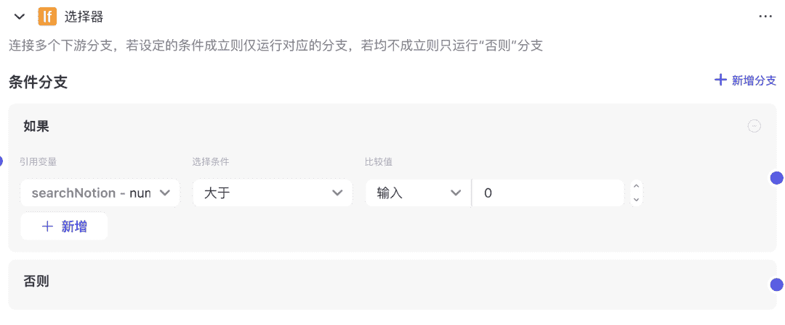

### ** 评估搜索结果 **

这个节点是工作流的核心。这里我使用了批处理模式，并行调用千问模型来对搜索出来的页面进行打分。输入的信息包括用户查询，以及页面的一些属性，包括标题、关键词、摘要，因为这些属性包含比较多的文本信息。

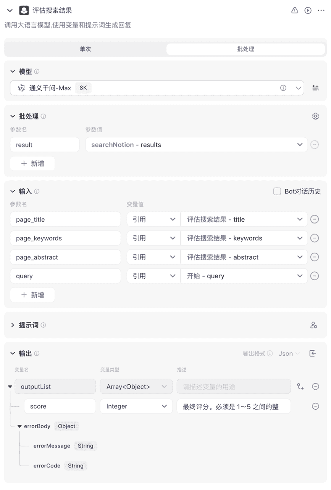

以下是该 LLM 节点的提示词：

```
As a discerning reader, you excel at assessing the importance and relevance of information.

The user has made a query: {{query}}

Here is a page that may be relevant to the query. The basic information of this page is:

Page title: {{page_title}}
Page keywords: {{page_keywords}}
Page abstract: {{page_abstract}}

-----

Your task is to assess how relevant this page is to the user&#x27;s query. The scoring rubric is as follows:

* 5 points: This page may provide *critical information* in response to the user&#x27;s query. It almost directly answers it.
* 4 points: This page may provide *important information* on some *unique aspect* of the user&#x27;s query that may be missing in other sources.
* 3 points: This page is *partially relevant* to the user&#x27;s query. It may be useful.
* 2 points: This page is relevant to the user&#x27;s query in some trivial aspect but *misses the main point* of the whole query.
* 1 point: This page is *totally irrelevant* to the user&#x27;s query.

-----

* You MUST output the final score in accurate JSON syntax:

{
 &quot;score&quot;: [Your final score which should a integer between 1 and 5]
}
```

从下面几个评分结果来看，这个节点可以有效的区分出相关的和不相关的页面，效果是很明显的。

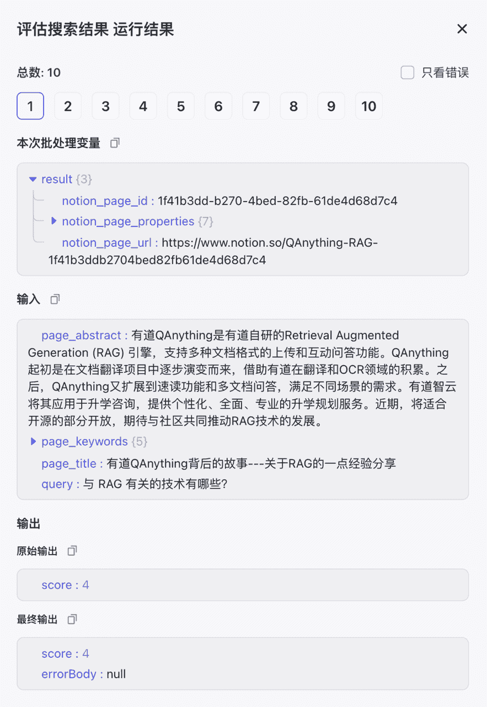

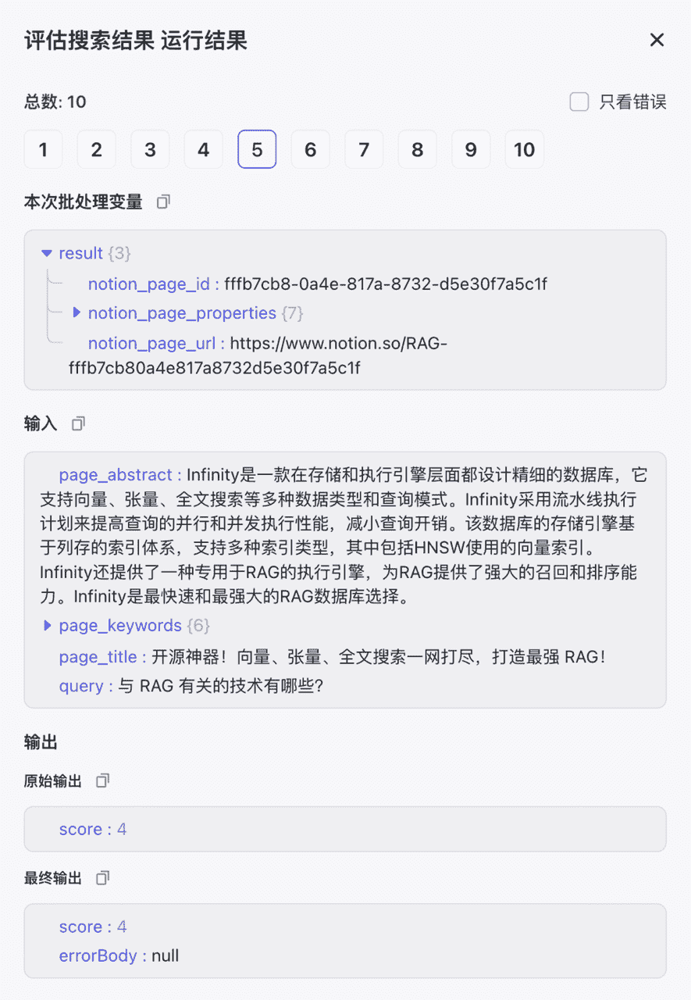

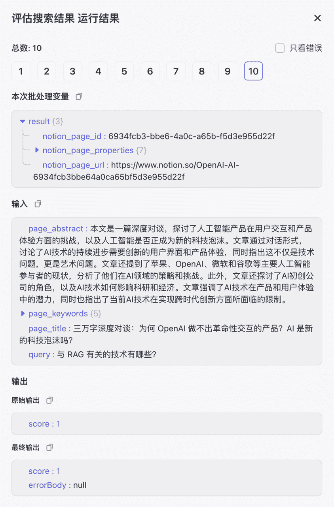

### ** **

### **重排搜索结果 **

对搜索结果打完分之后，我们需要根据分数对搜索结果做一个重新排序。

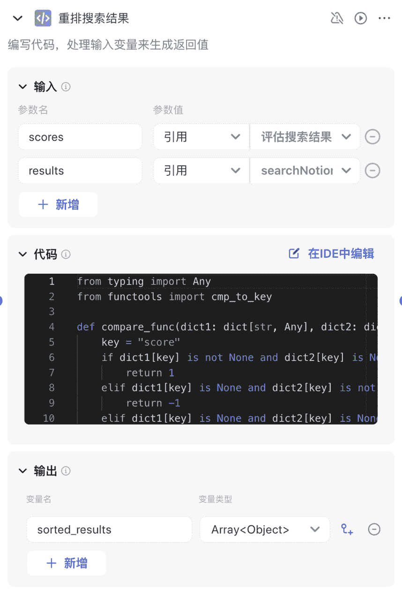

```
from typing import Any
from functools import cmp_to_key

def compare_func(dict1: dict[str, Any], dict2: dict[str, Any]) -&gt; int:
    key = &quot;score&quot;
    if dict1[key] is not None and dict2[key] is None:
        return 1
    elif dict1[key] is None and dict2[key] is not None:
        return -1
    elif dict1[key] is None and dict2[key] is None:
        return 0
    elif dict1[key] &lt; dict2[key]:
        return -1
    elif dict1[key] &gt; dict2[key]:
        return 1
    else:
        return 0

async def main(args: Args) -&gt; Output:
    params = args.params
    scores = params[&quot;scores&quot;]
    search_results = params[&quot;results&quot;]

    sorted_results = search_results

    if scores and len(scores) == len(search_results):
        for i in range(len(scores)):
            score = scores[i].get(&quot;score&quot;)
            search_result = search_results[i]
            search_result[&quot;score&quot;] = score

        sorted_results = sorted(
            search_results, key=cmp_to_key(compare_func), reverse=True
            )

    ret: Output = {
        &quot;sorted_results&quot;: sorted_results
    }
    return ret
```

### ** 结束 **

结束节点输出排序后的搜索结果以及结果的数量。

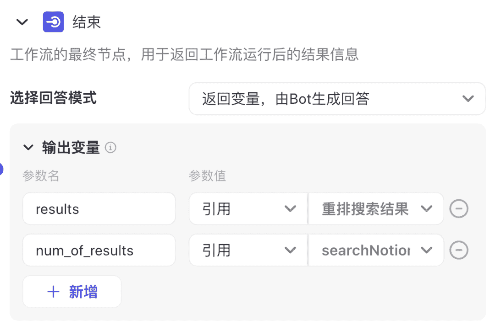

## ** 三种使用检索结果的方式**

利用上面设计的 search_notion 工作流，我们可以从 Notion 数据库中检索出与用户查询相关的页面，并且我们还对检索结果进行了打分和重排。接下来要考虑的是如何使用这些检索结果来生成回复。

我能想到的方式有三种。

方式一是基于检索结果中页面的摘要（abstract）回答用户问题。这种方式就与 Dr。 Know 的方式很类似了，只不过 Dr。 Know 使用的是 Google 搜索结果中的信息片段（snippet），我们这里使用的是 Notion 页面的内容摘要。

方式二是拉取搜索结果前 3 个或者前 5 个页面（这取决于你使用的 LLM 的上下文大小）的完整内容，然后让 LLM 基于这几个页面的内容回答用户问题。

方式三是先过滤一下搜索结果，然后拉取所有剩下的页面的完整内容。接着，先基于单个页面的内容生成独立的回答，然后再进行总结，生成最终回答。

我们接下来会尝试一下方式三，其他两种方式你可以自行尝试。

## ** 基于检索结果回答问题**

与 Dr。 Know 类似，我们创建一个 search_and_answer 工作流。

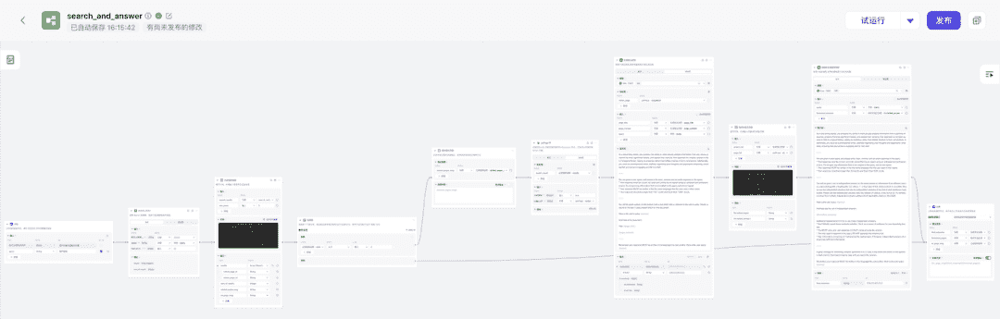

这个工作流里有 10 个节点：【开始】→【search_notion】→【过滤搜索结果】→【选择器】→【报告相关页面】→【getPage】→【生成独立回答】→【格式化独立回答】→【总结并生成最终回答】→【结束】。

### ** 开始 **

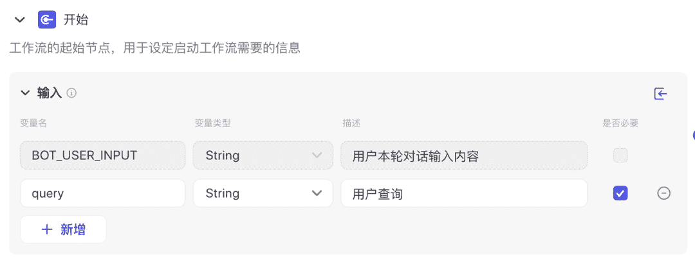

### ** search_notion **

此处调用我们前面设计的 search_notion 工作流。

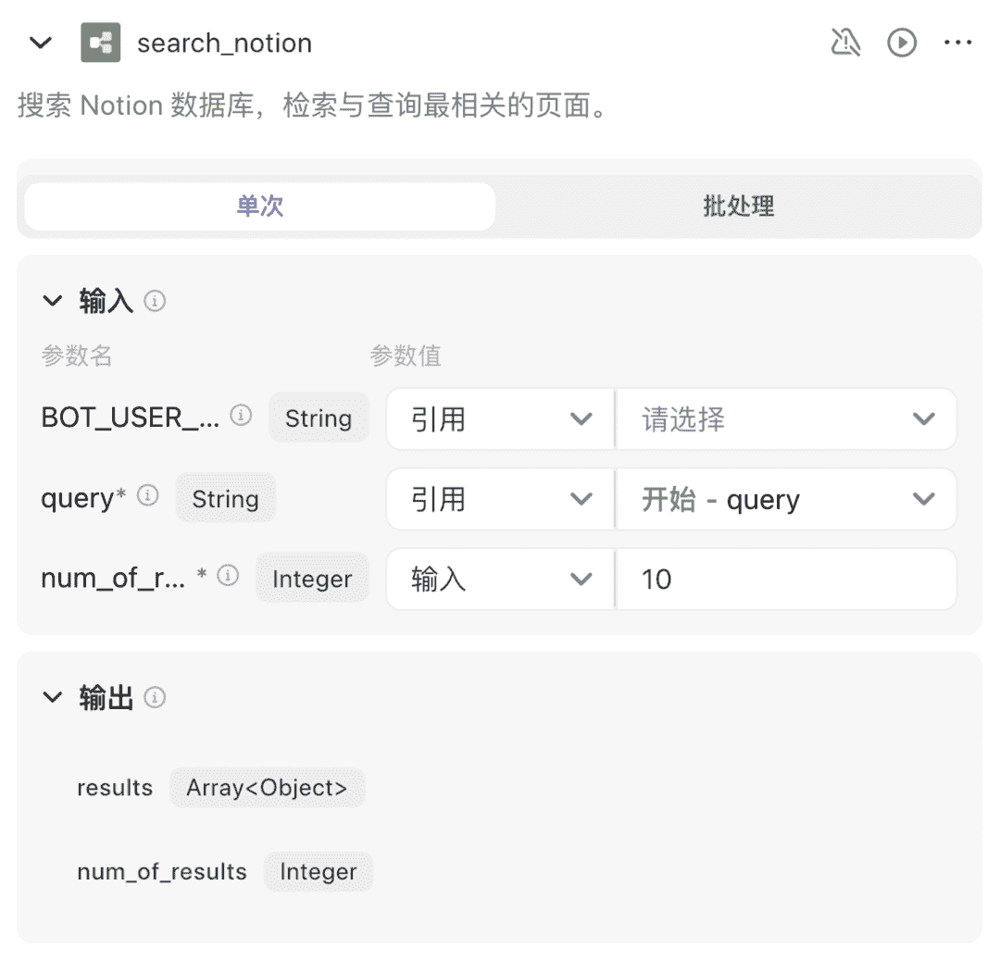

### ** 过滤搜索结果 **

这个节点会剔除掉那些低于 3 分的结果。另外，它还做了一些琐碎的工作，生成了两条消息，分别用于告知用户检索到的相关页面或者未检索到相关页面。

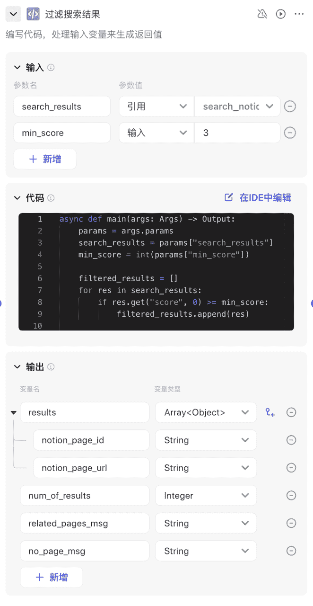

```
async def main(args: Args) -&gt; Output:
    params = args.params
    search_results = params[&quot;search_results&quot;]
    min_score = int(params[&quot;min_score&quot;])

    filtered_results = []
    for res in search_results:
        if res.get(&quot;score&quot;, 0) &gt;= min_score:
            filtered_results.append(res)

    related_pages = []
    for res in filtered_results:
        page_title = res.get(&quot;notion_page_properties&quot;, {}).get(&quot;title&quot;)
        page_url = res.get(&quot;notion_page_url&quot;)
        related_pages.append(f&quot;* [`{page_title}`]({page_url})&quot;)
    
    no_page_msg = &quot;&quot;
    related_pages_msg = &quot;&quot;
    if filtered_results:
        related_pages_msg = &quot;已从 Notion 数据库中检索到如下相关页面：\n&quot; + &quot;\n&quot;.join(related_pages)
    else:
        no_page_msg = &quot;在 Notion 数据库中未检索到相关内容。&quot;

    ret: Output = {
        &quot;results&quot;: filtered_results,
        &quot;num_of_results&quot;: len(filtered_results),
        &quot;related_pages_msg&quot;: related_pages_msg,
        &quot;no_page_msg&quot;: no_page_msg,
    }
    return ret
```

### ** 选择器 **

过滤后的结果数量大于 0 才进行后面的步骤，如果结果为空，则直接跳到【结束】节点。

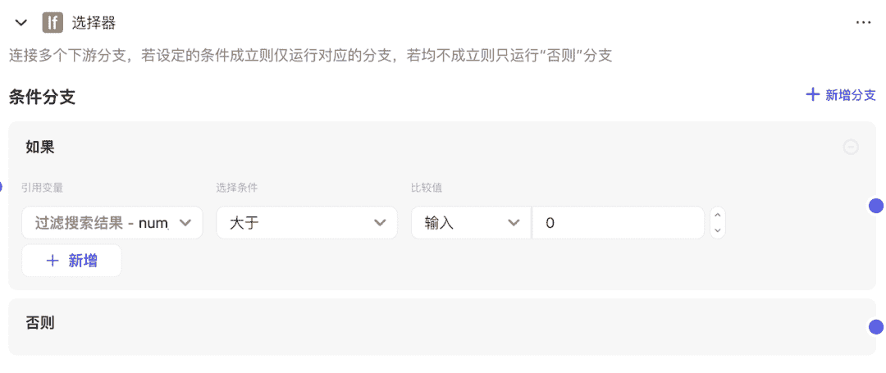

### ** 报告相关页面 **

因为这个工作流的运行时间会比较就，我们可以输出一些中间结果，缓解用户的等待感。

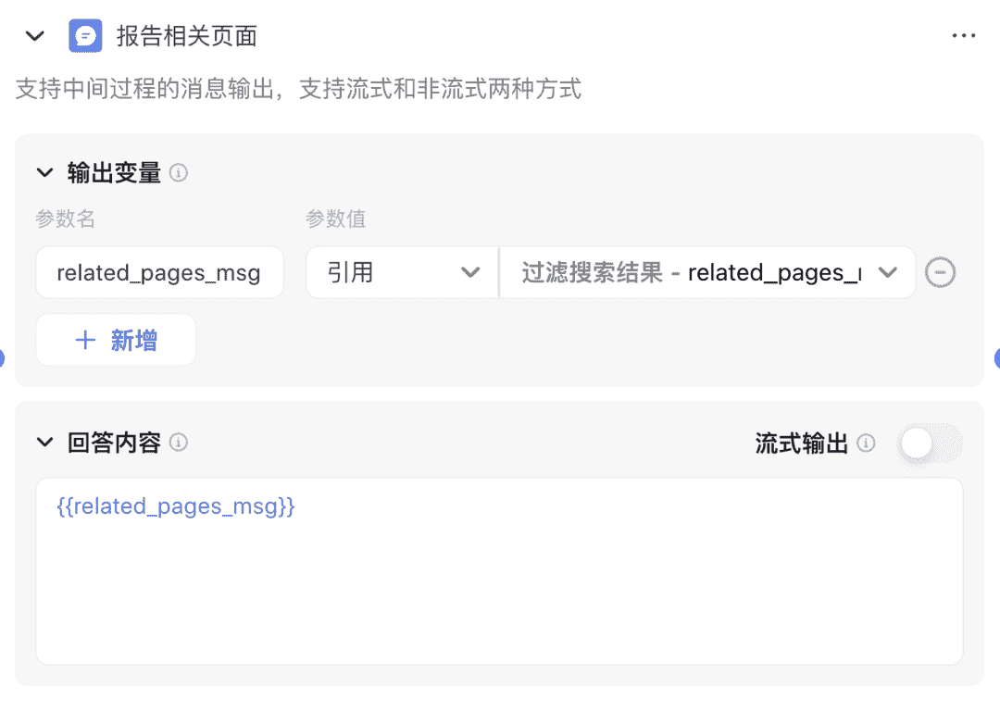

### ** getPage **

用批处理的方式调用 getPage API，批量拉取 Notion 页面的完整内容。前面讲过，这个 API 既可以获取公网页面的内容，也可以获取 Notion 页面的内容。这里传入的 page_url 是搜索结果里返回的 Notion 页面的 URL。

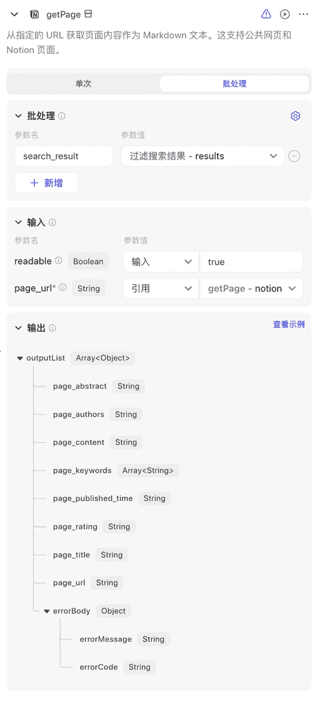

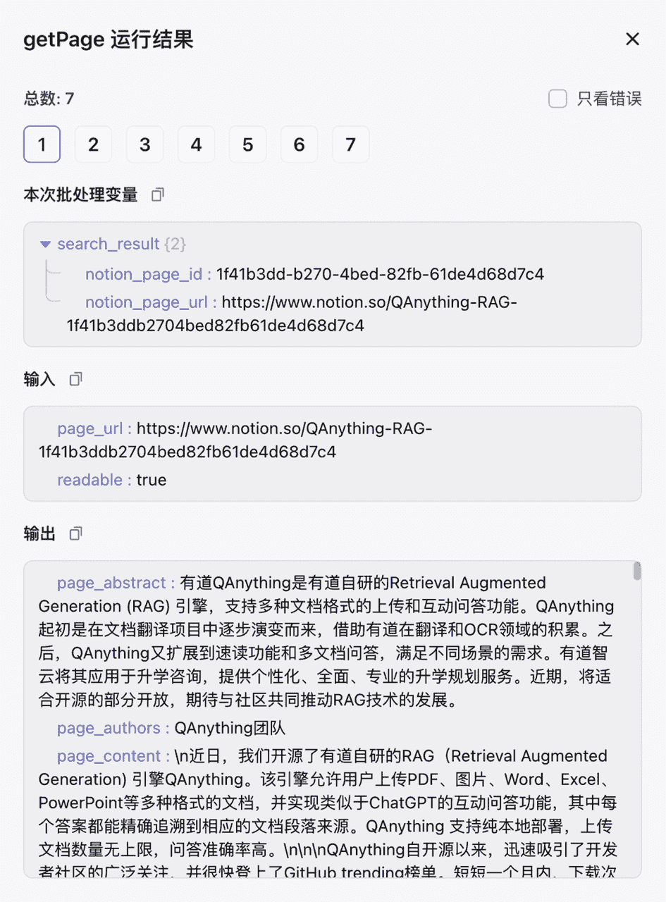

### ** 生成独立回答 **

以批处理的方式调用 Kimi 模型（Kimi 的上下文足够长），让 Kimi 依据每个页面的内容生成独立的回答。

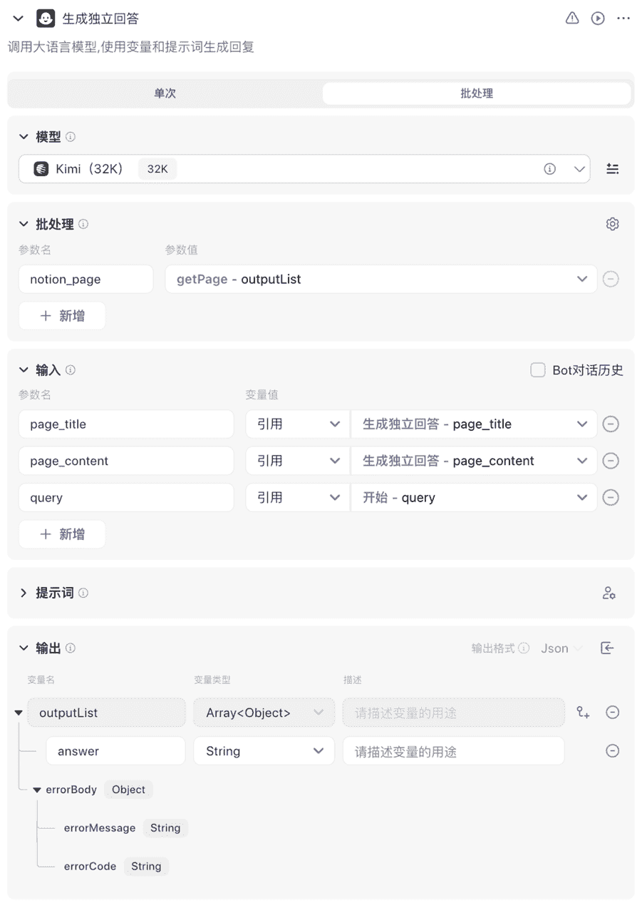

以下是该 LLM 节点的提示词：

```
As a discerning reader, you possess the ability to meticulously analyze information from any source, pinpoint the most significant details, and assess their veracity. Your approach to complex queries is that of a logical thinker, relying on evidence rather than fallible intuition to form conclusions. Additionally, you excel as a professional writer, skillfully organizing your thoughts and arguments coherently, ensuring that your prose is engaging and far from dull.

-----

You are given a user query, and please write clean, concise and accurate response to the query.
* Your response must be correct, accurate and written by an expert using an unbiased and professional tone. Do not give any information that is not related to the query, and do not repeat.
* Your response MUST be written in the the same language that the user uses in their query.
* Your response should be longer than *32* words and fewer than *256* words.

-----

You will be given a piece of information from a document that is relevant to the user&#x27;s query. Please respond to the user&#x27;s query based ONLY on this document.

Here is the user&#x27;s query: {{query}}

And here is the document:

Title: {{page_title}}

{{page_content}}

-----

Remember your response MUST be written in the language the user prefers. Here is the user query: {{query}}
```

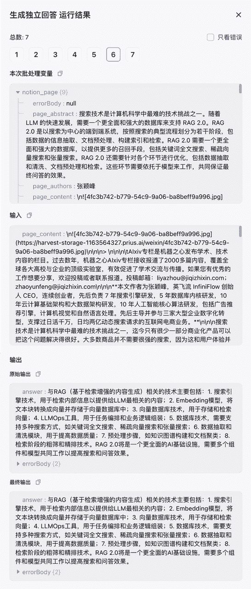

### ** 格式化独立回答 **

利用代码节点将独立回答拼接起来，用于给后面的 LLM 做总结。顺便生成参考链接列表。

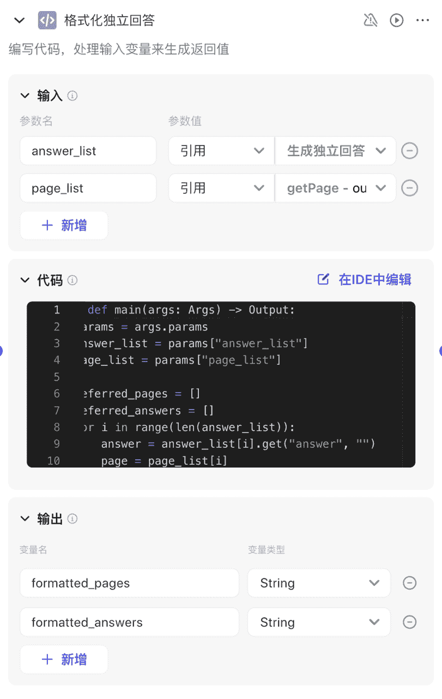

```
async def main(args: Args) -&gt; Output:
    params = args.params
    answer_list = params[&quot;answer_list&quot;]
    page_list = params[&quot;page_list&quot;]

    referred_pages = []
    referred_answers = []
    for i in range(len(answer_list)):
        answer = answer_list[i].get(&quot;answer&quot;, &quot;&quot;)
        page = page_list[i]
        page_title = page.get(&quot;page_title&quot;)
        page_url = page.get(&quot;page_url&quot;)
        referred_pages.append(f&quot;[{i+1}] [{page_title}]({page_url})&quot;)
        referred_answers.append(f&quot;\n[{i+1}]\nTitle : {page_title}\nAnswer: {answer}&quot;)

    formatted_pages = &quot;\n\n&quot; + &quot;\n&quot;.join(referred_pages)
    formatted_answers = &quot;\n&quot;.join(referred_answers)

    ret: Output = {
        &quot;formatted_pages&quot;: formatted_pages,
        &quot;formatted_answers&quot;: formatted_answers,
    }
    return ret
```

### ** 总结并生成最终回答 **

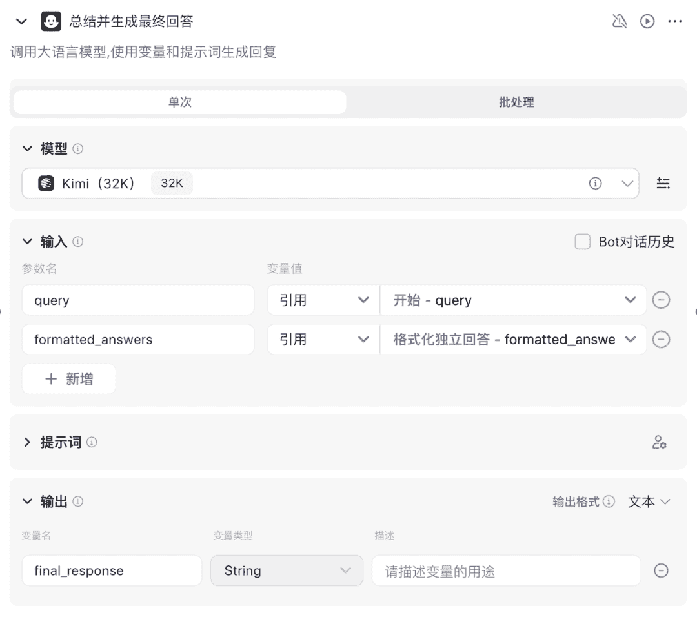

这里基本上复用了 Dr。 Know 的提示词：

```
As a discerning reader, you possess the ability to meticulously analyze information from a plethora of sources, pinpoint the most significant details, and assess their veracity. Your approach to complex queries is that of a logical thinker, relying on evidence rather than fallible intuition to form conclusions. Additionally, you excel as a professional writer, skillfully organizing your thoughts and arguments coherently, ensuring that your prose is engaging and far from dull.

-----

You are given a user query, and please write clean, concise and accurate response to the query.
* Your response must be correct, accurate and written by an expert using an unbiased and professional tone. Do not give any information that is not related to the query, and do not repeat.
* Your response MUST be written in the the same language that the user uses in their query.
* Your response should be longer than 32 words and fewer than 1024 words.

-----

You will be given a set of independent answers to the query based on information from different sources, each starting with a heading like &quot;[i]&quot;, where `i` is the index of this citation which is a number. Please use the independent answers and cite the independent answers at the end of each sentence if applicable. Please cite the independent answers with the indexes of citation, in the format [i]. If a sentence comes from multiple independent answers, please list all applicable citations, like [3][5].

Here is the user query: {{query}}

And here are the set of independent answers:

{{formatted_answers}}

Additional requirements for how to use these independent answers:
* Don&#x27;t blindly repeat these contexts verbatim. Use it as a source of evidence for your reasoning process.
* You MUST write your own response. DO NOT merely provide the citation.
* You only need to respond to the query. DO NOT generate the reference list.
* Say &quot;information is missing on&quot; followed by the related topic, if the given independent answers do not provide sufficient information.

-----

A great strategy for answering complex questions is to (1) take a step back and reflect on the question itself, and (2) then reason step by step until you reach the solution.

Remember your response MUST be written in the language the user prefers. Here is the user query: {{query}} 
```

### ** 结束 **

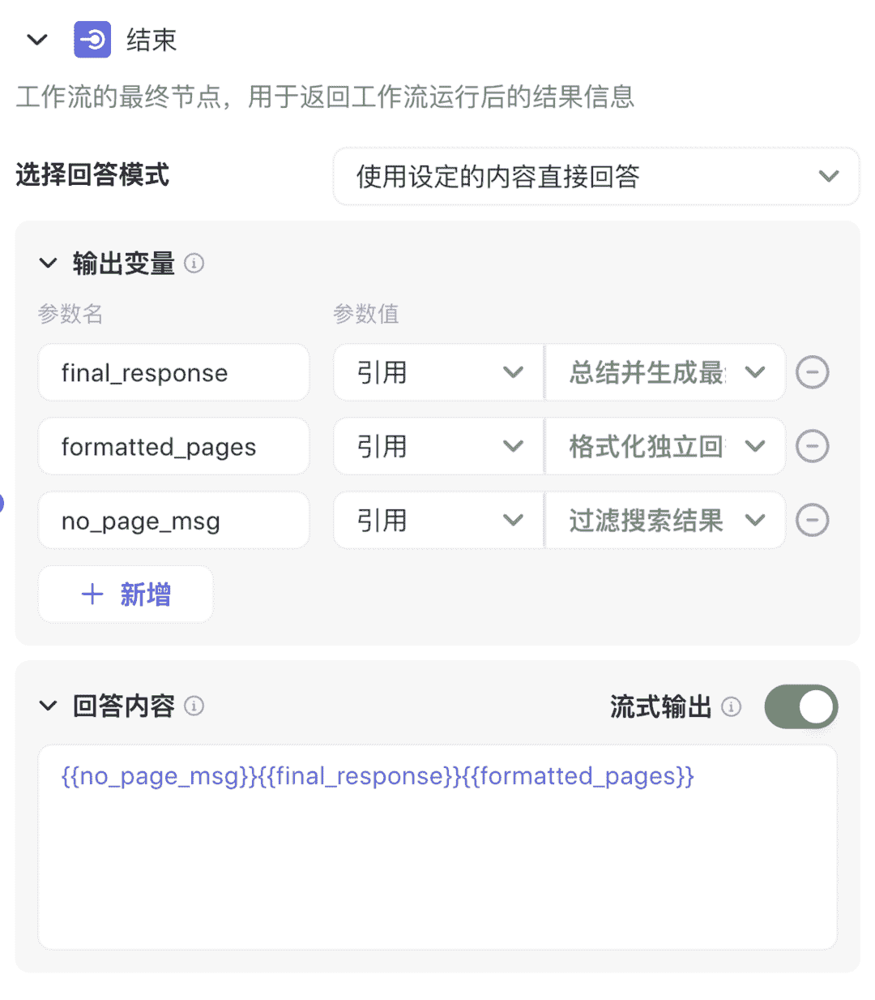

### ** 测试结果 **

如果输入的 query 是“与 RAG 有关的技术有哪些？”，这个工作流的输出结果如下：

```
与RAG**（Retrieval**-Augmented Generation）相关的技术涵盖了多个领域，主要包括以下**几个方面：

1**. **文档解析技术**：这是RAG技术的基础，用于精确识**别和分析文档中的**各个部分，包括段落**、图表、公式等，以确保信**息的准确性[1][2]。
2. **Embedding向量化****：通过Embedding**模型为**文本块生成向量表示，用于计算文**本向量**和问题向量之间的相**似度[1]。
3. **检索技术**：利用E**mbedding模型检索与**用户问题最**相关的文档块，是RAG中的关键**步骤[1][3]。
4. **生成技术****：结合检索到的**文档块和用户问题，生成准确答案，这是RAG的最终目标[1][3]。
5. **语义嵌入排序**模型**：如BCEmbedding**，用于提升检索的准确率，具备中英双语和跨语种能力，以及多领域覆盖[1]。
6. **Reranker**：在检索阶段后对结果进行重新排序，提高检索的**精度[1]。
7.** **大型语言模型（LLM）**：作为RAG系统的核心，用于生成最终的答案[1]。
8. **多文档问答**：QAnything能够处理多种格式的文档，并实现多文档的互动问答功能[1]。
9. **版式分析和表格解析**：版式分析通过对文档的布局结构进行预测，识别文字段落、图片、表格等；表格解析使用特定模型识别表格结构，输出机器可解析的表示[2]。
10. **全文搜索、向量搜索技术**：包括稠密向量和稀疏向量搜索，以及基于这些搜索手段的混合搜索技术[4]。
11. **排序模型**：如ColBERT，以及多路召回和融合排序算法，例如Reciprocal Rank Fusion (RRF) 和基于外部模型的重排序功能，用于提高搜索精度[4]。
12. **Agentic RAG、Self-RAG和Adaptive RAG**：这些技术引入了任务编排、反思机制和根据不同意图采用不同策略的机制[5]。
13. **搜索引擎技术、Embedding模型、向量数据库技术**：这些技术用于检索内部信息、存储和检索向量，以及任务编排和业务逻辑组装[6]。
14. **数据库技术、数据抽取和清洗模块**：需要支持多种搜索方式，如关键词全文搜索、稀疏向量搜索和张量搜索，并用于提高数据质量[6]。
15. **预处理步骤**：如知识图谱构建和文档聚类，以及检索阶段的粗筛和精排技术[6]。
16. **文件解析、结构化数据融合**：涉及对复杂文件类型的识别和处理，以及将结构化数据整合到RAG中[7]。
17. **检索能力提升和rerank模型的应用**：通过处理元数据和使用基于BERT的分类器来优化检索结果，以及更精确地验证检索结果[7]。

这些技术共同构成了RAG的框架，使其能够在多种应用场景中提供高效、准确的信息检索和内容生成服务。然而，关于RAG 2.0的更全面AI基础设施的具体细节，以及Agentic RAG、Self-RAG和Adaptive RAG的具体实现和应用场景，信息是缺失的[6][5]。

[1] [有道QAnything背后的故事---关于RAG的一点经验分享](https://www.notion.so/QAnything-RAG-1f41b3ddb2704bed82fb61de4d68d7c4)
[2] [QAnything 1.4.1 中的文档解析](https://www.notion.so/QAnything-1-4-1-ad489cfefd65414da6ac10ac07fb04bc)
[3] [我做了一个 AI 搜索引擎](https://www.notion.so/AI-fff8e35a96894d1bae9518af9bb8f6da)
[4] [开源神器！向量、张量、全文搜索一网打尽，打造最强 RAG！](https://www.notion.so/RAG-fffb7cb80a4e817a8732d5e30f7a5c1f)
[5] [Agentic RAG 和图编排引擎](https://www.notion.so/Agentic-RAG-41ce7e90ffb944aea791331477edd2a2)
[6] [RAGFlow开源Star量破万，是时候思考下RAG的未来是什么了](https://www.notion.so/RAGFlow-Star-RAG-b1a0756f90be4726b247c1ec8c8dad82)
[7] [RAG在企业应用中落地的难点与创新（文字稿）](https://www.notion.so/RAG-551c1e4b93fb4e979911f4f184ea905c)
```

也可以与 Notion 官方的 Q&A 做个对比：

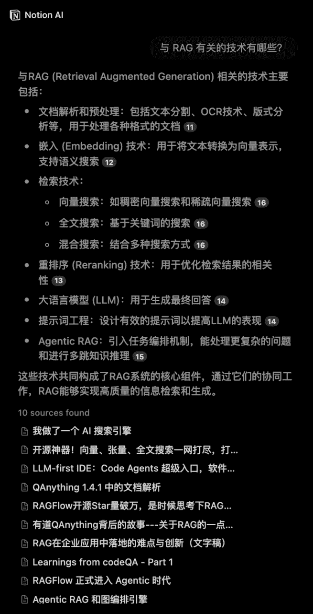

## ** 将工作流集成到 Bot 里**

search_and_answer 工作流完成后，我们需要把它集成到 Bot 里面，并编写相应的提示词。

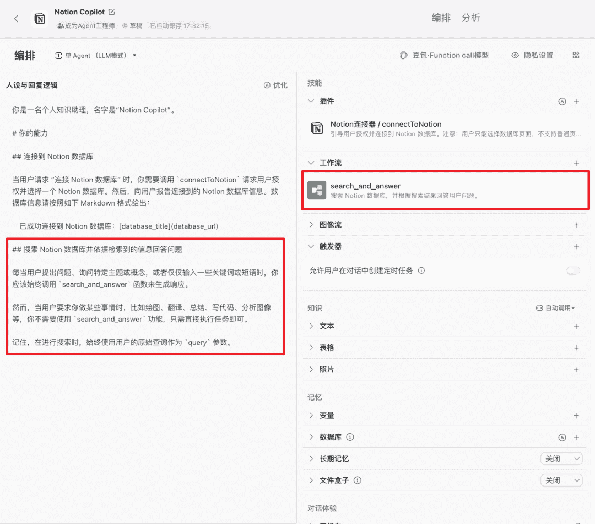

```
...

## 搜索 Notion 数据库并依据检索到的信息回答问题

每当用户提出问题、询问特定主题或概念，或者仅仅输入一些关键词或短语时，你应该始终调用 `search_and_answer` 函数来生成响应。

然而，当用户要求你做某些事情时，比如绘图、翻译、总结、写代码、分析图像等，你不需要使用 `search_and_answer` 功能，只需直接执行任务即可。

记住，在进行搜索时，始终使用用户的原始查询作为 `query` 参数。
```

最后，做一次集成测试。它的完整表现应该是这样的：

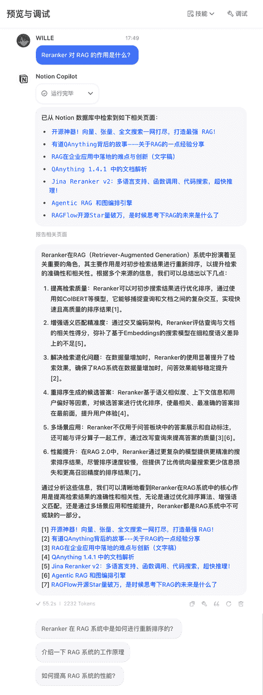

## ** 总结与未来展望**

本文通过 Coze 和 Notion 链接器实现了一个基础版的 Notion 问答系统，提供了一种基于 RAG 实现个人知识问答系统的参考方法。需要指出的是，在重排和生成回答的环节中，我们采用了一种相对高成本且响应速度较慢的方案。然而，我对未来的发展持乐观态度。随着 GPT-4o mini 和 Doubao、DeepSeek 等模型的推出，模型处理长文本的能力将变得更加实用，响应速度将显著提升，调用成本也会逐渐降低。届时，本文中的方法将具有更高的应用价值。

### **参考资料**

[1] Q&A 功能： https://www.notion.so/blog/introducing-q-and-a

[2] Notion 连接器： https://www.coze.cn/store/plugin/7368111600210853899

[3] 在这里： https://www.coze.com/store/plugin/7368097062283640838

[4] Re2G: https://arxiv.org/abs/2207.06300

[5] Qwen-Agent 这个研究： https://qwenlm.github.io/zh/blog/qwen-agent-2405/

本文首发于火山引擎开发者社区。

---

本文中分享的这个 Coze Bot 是我们的《 成为 Agent 工程师之 Coze 实战 》课程中的一个案例。课程中会有更加详细的讲解，并配有答疑服务，同时我们还提供了完整的 Coze 示例源码供你捣鼓和学习。

**我们的课程正在进行第二期的**招[成为Agent工程师之Coze实战课程介绍](https://axsppz4oyvj.feishu.cn/wiki/Z2X0wEvmtiYZtqkFL82cxxI6npL)，预计 8 月 17 号（周六） 开课。如果你对课程感兴趣，可以通过访问  。或者加我微信咨询：


[**另外提一句，购买第二期**](https://mp.weixin.qq.com/s?__biz=MzU5MDM4ODIxMw==&mid=2247484499&idx=1&sn=dba6151b675a4d89d414842ad5db283d&scene=21#wechat_redirect)课程的学员将会免费享有《 AI 工作流设计手册 》一年的订阅内容。