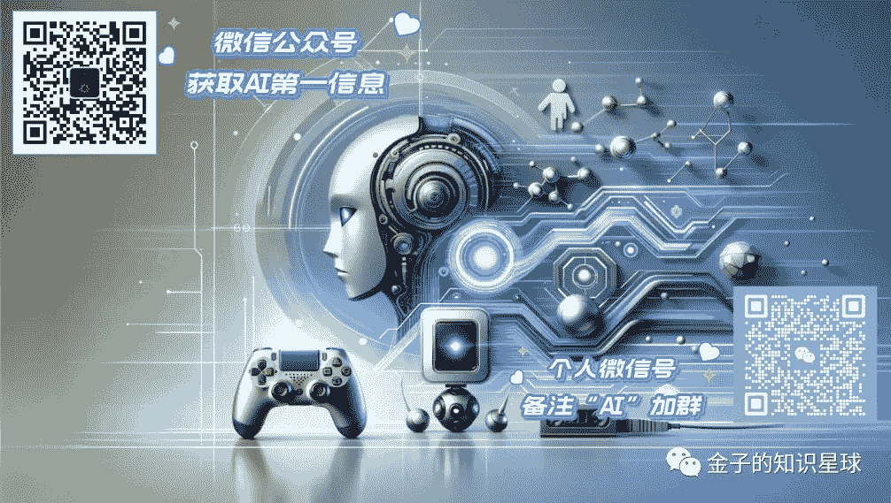

# 老金- AI Agent

> 来源：[https://waytoagi.feishu.cn/docx/SXDodYcbRogn2QxbWPWc8HTQnag](https://waytoagi.feishu.cn/docx/SXDodYcbRogn2QxbWPWc8HTQnag)

# 🙏 愿景和目标

> 个人学习资料库，持续更新。

> 希望让更多人因 AI 而强大。

> 不定期**免费**直播教学，**微信群**里提前通知。

# ✍️ 个人简介

> AIGC研究者，游戏制作人。

> 深耕研发音舞游戏赛道10余年。

> 研发上线过《劲舞时代》、 《心动劲舞团》、《AU Beat》、《Party Masters》等多个产品，市场包含中国、越南、印尼、马来西亚、新加坡、菲律宾等多国。

# 📅项目链接说明

> LLM研究：[1、LLM研究](https://tffyvtlai4.feishu.cn/wiki/Xmpow8kzUiBNgOkGFO2cXocunqO)

> 微信机器人：[2、微信机器人（※ 表示重要）](https://tffyvtlai4.feishu.cn/wiki/GM6UwJ8vAijs0ukyPPxc8Ly2nGb)

> Midjourney使用说明：[Midjourney](https://tffyvtlai4.feishu.cn/wiki/N2M5w91RnivqsvkOnM4cbaMgnHf)

# 🔖  声明

> 开源不易，打工社畜牛马，工作日没时间进行任何答疑。

> 如有问题，请**自行查找知识库**，或**进交流群询问**，会的人有空时会帮忙答复。

> 不接受私聊询问，消息量特别大不说，根本回不过来，望谅解。

# 👬 联系方式

