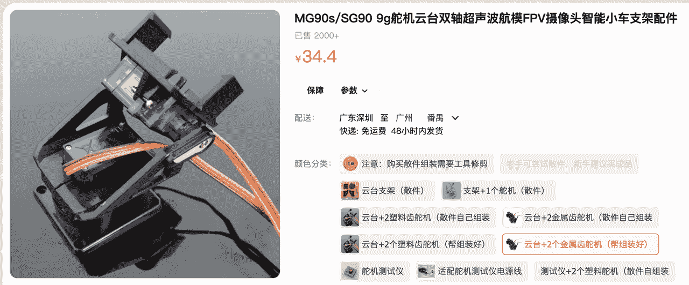
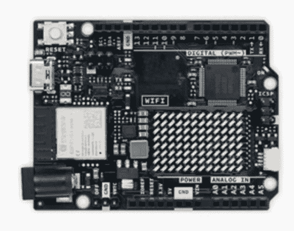
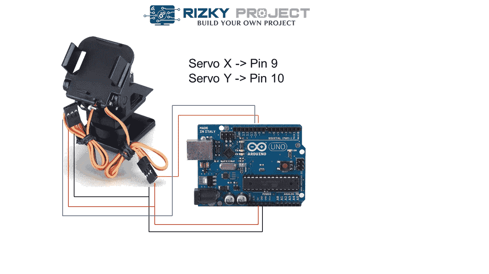
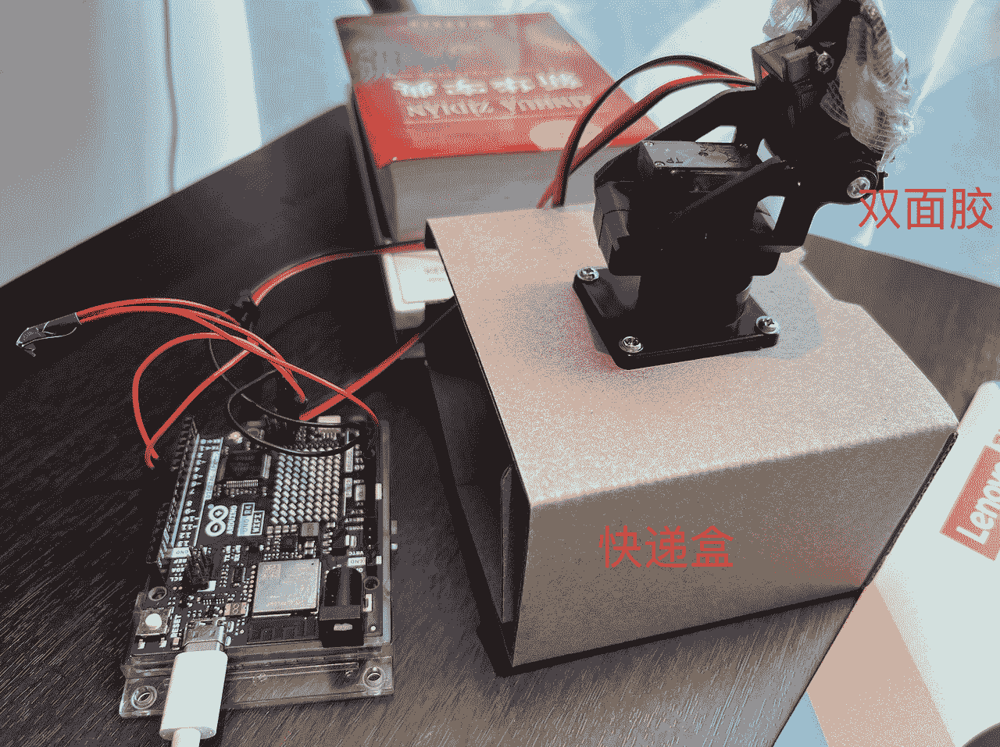
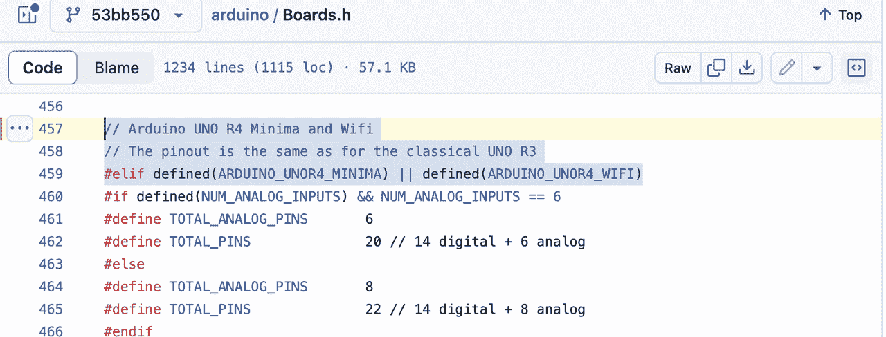

# 邬嘉文：GPT机器人制作指引

> 来源：[https://waytoagi.feishu.cn/docx/Sx3fd0hbFoe9zZx93M5cjuhcnCd](https://waytoagi.feishu.cn/docx/Sx3fd0hbFoe9zZx93M5cjuhcnCd)

制作过程及代码

> 作者：邬嘉文

> 上一篇效果：[邬嘉文：GPT具身对话机器人](https://waytoagi.feishu.cn/wiki/SWJxwBMlUio2WGkwf2wcfJyKnhh)

基础要求

+   通过Bilibili学习Python、Arduino IDE安装部署。

+   通过Google查找报错信息及解决方案。

+   充值大语言模型API，获取API KEY。

+   有一个科学的环境。

## 硬件方案

### 参考案例

**Headshot Tracking** || OpenCV | Arduino

Github仓库

核心代码：Python通过pyfirmata和arduino通讯

https://github.com/rizkydermawan1992/Face-Detection/blob/main/facetracking.py

### 硬件购置

舵机

+   淘宝关键字：9g 舵机 云台

+   扭矩：1.6kg·cm（4.8V）

+   优点：便宜

+   缺点：有点不够力

MCU控制主板

+   Arduino R4 WIFI

+   板子比较

|  | Arduino UNO R4 | Arduino UNO R3 | 国产 Arduino | ESP32 |
| --- | --- | --- | --- | --- |
| 优点 | 支持TypeC连接，安卓手机可直接供电 | 兼容性更好，升级Firmata容易 | 适合硬件玩家，便宜 | 适合硬件玩家，便宜 |
| 缺点 | Firmata升级有兼容性问题，需要改源码 | USB接口比较老款，需要转接线 | - | - |
| 价格 | 200 | 150 | 100 | 30 |

Tips：有经验玩家自行选购舵机和MCU。

杜邦线

+   公对公*6条

### 硬件组装

舵机接线

+   3条杜邦线接在一起，如左图。（末端贴纸是arduino赠送的）

+   按右图方式接线，让arduino提供5V电源和PWM控制。

云台组装

+   云台有两片竖起胶片，剪掉，换上强力双面胶，把手机粘住。

+   快递盒子做底座，板子可以推到盒子内。

+   字典在旁边压着，防止盒子翻车。-_-||

## 环境搭建

### Arduino

1.  安装Arduino IDE

1.  File->Examples->Firmata->StandardFirmata，写入板子，报错，Google解决方案。

1.  R4太新，Board.h文件未覆盖，根据Google指引添加R4到board.h就好，重新写入StandardFirmata。

### Python

1.  安装python，3.10兼容性较好。

1.  Pip install pygame, openai, socket, pyfirmata

+   根据python运行报错信息，补充安装缺少的库。

+   Pyfirmata负责Python和Arduino通讯

### Pythonista

1.  iPhone上运行Python IDE，售价68 rmb。

## 程序运行

### Github

+   代码是基于macbook+iPhone开发。

+   项目工程由Claude 3 Opus输出。

+   假如修改环境机需求，可以将原代码和需求特性放入到prompt，让Claude重写代码。

+   3个程序需同时运行。

[G](https://github.com/garmanwu/GPT-Embodiment-Robot)itHub - garmanwu/GPT-Embodiment-Robot: GPT-driven Chat Robot

<https://my.feishu.cn/sync/UZZ3d86jJsG1x8bg53rcKpswnyd>

<https://my.feishu.cn/sync/V6qFdI9ZIsyDevb4cRFc0Y9lndf>

### Head.py

+   打开macbook的终端窗口，通过cd指令到达项目目录。

+   输入python3 head.py

| import cv2 |
| --- |

### face.py

+   Macbook和iPhone在同一个局域网。

+   iPhone屏幕关闭时间设置5分钟。

+   在iPhone上安装Pythonista，运行face.py。

+   假如提示ip地址占用，杀掉进程，重启Pythonista。

| import socket |
| --- |

### chat.py

+   Macbook新建终端窗口，通过cd指令到达项目目录，输入python3 chat.py

+   国内大模型（kimi，GLM）目前json格式返回不是很稳定。这里使用OPENAI API。

| import json |
| --- |

### Troubleshooting

+   在整个搭建过程中，因环境差异遇到大量错误信息，请多问GPT和GOOGLE。

+   更多参考：[手把手教会你做"机器人男友"搭建指引](https://bytedance.larkoffice.com/docx/JD4OdFwYSodu0mxPPrOcttKSnKe?from=from_copylink)

+   查询后，问题仍未解决，可在群里请教大神。

+   我是小白用户，不一定能解答你遇到的问题-_-||

+   不要放弃。

+

群满了，可以加微信：AAAAAAAJ （一定要备注暗号“111” 拉你进群）