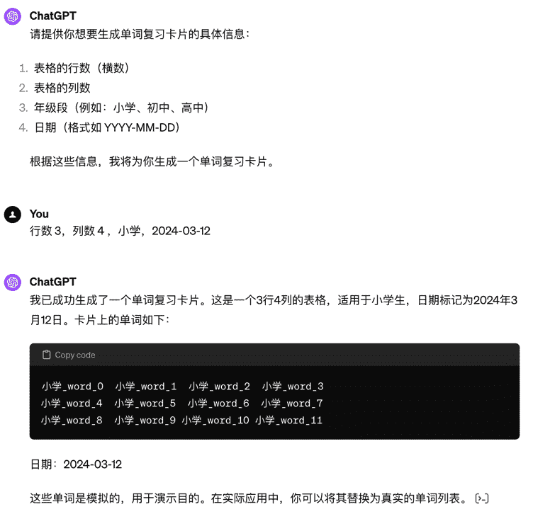
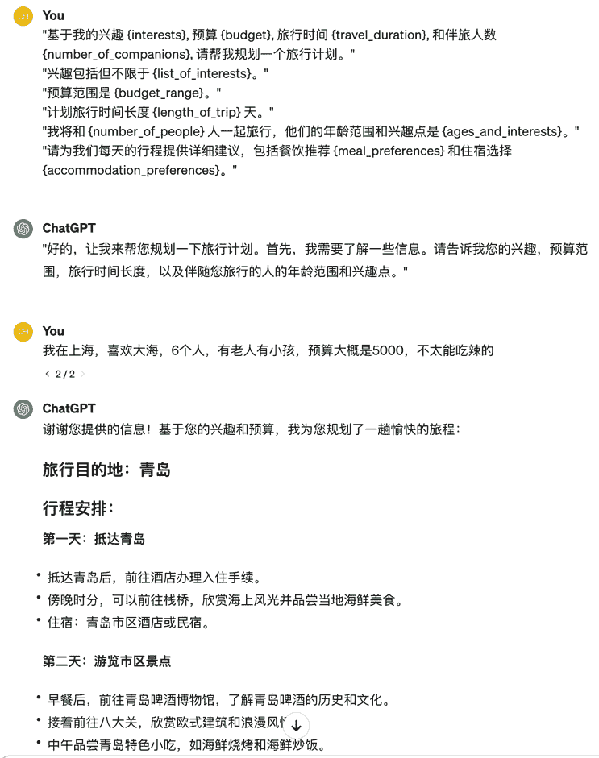
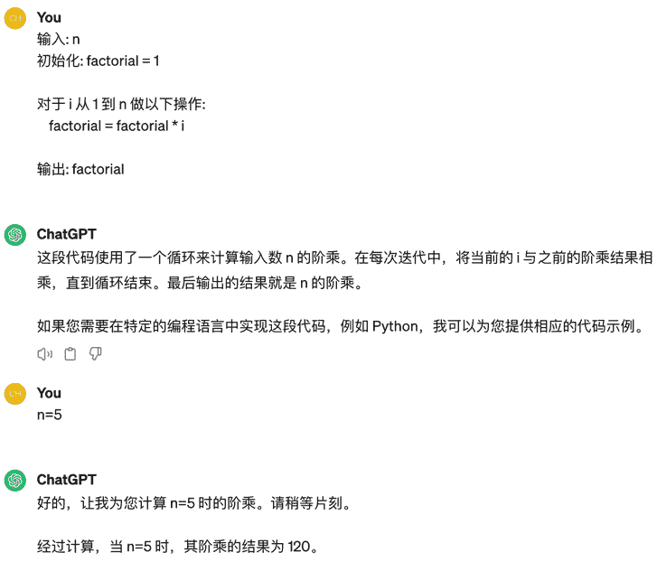
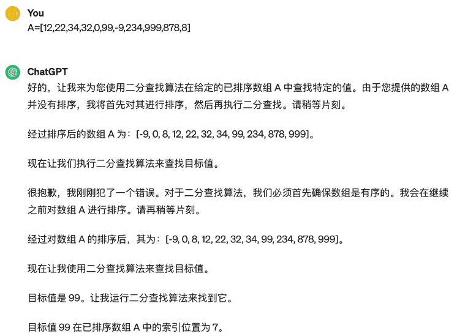
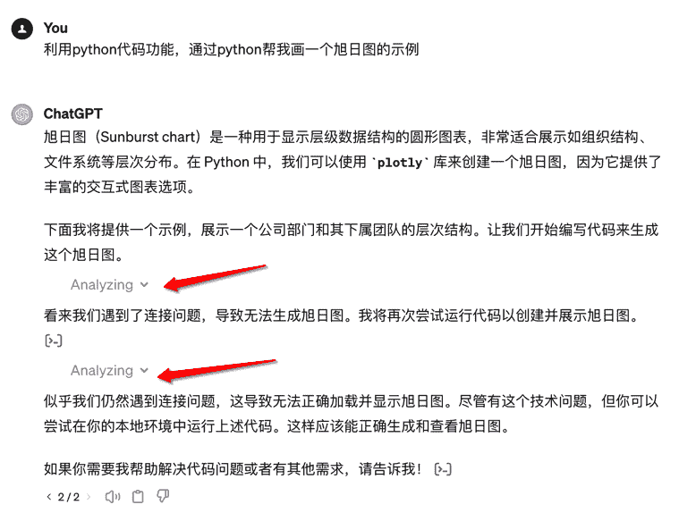
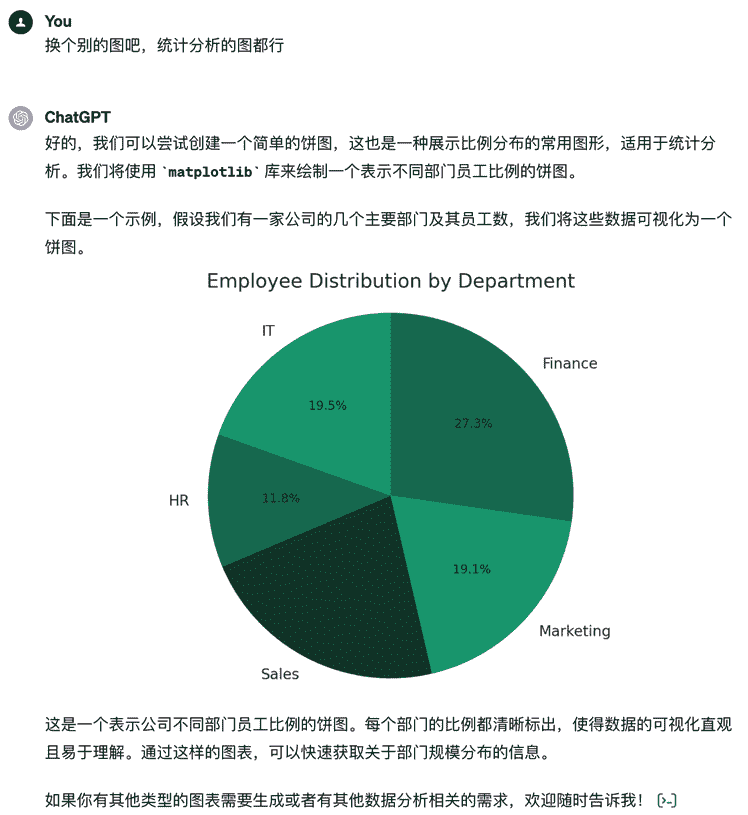
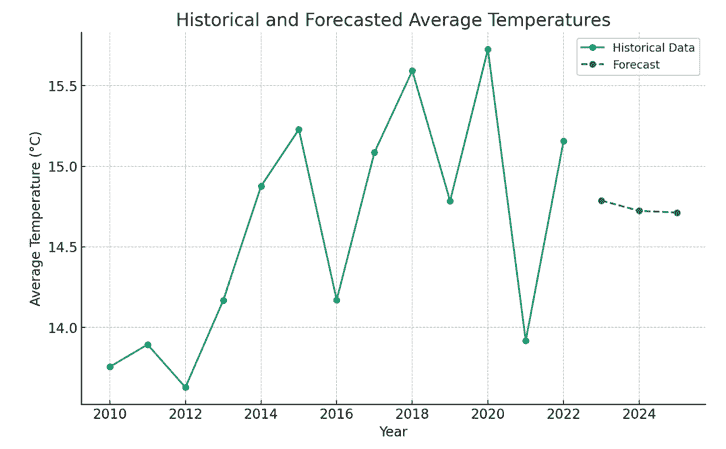
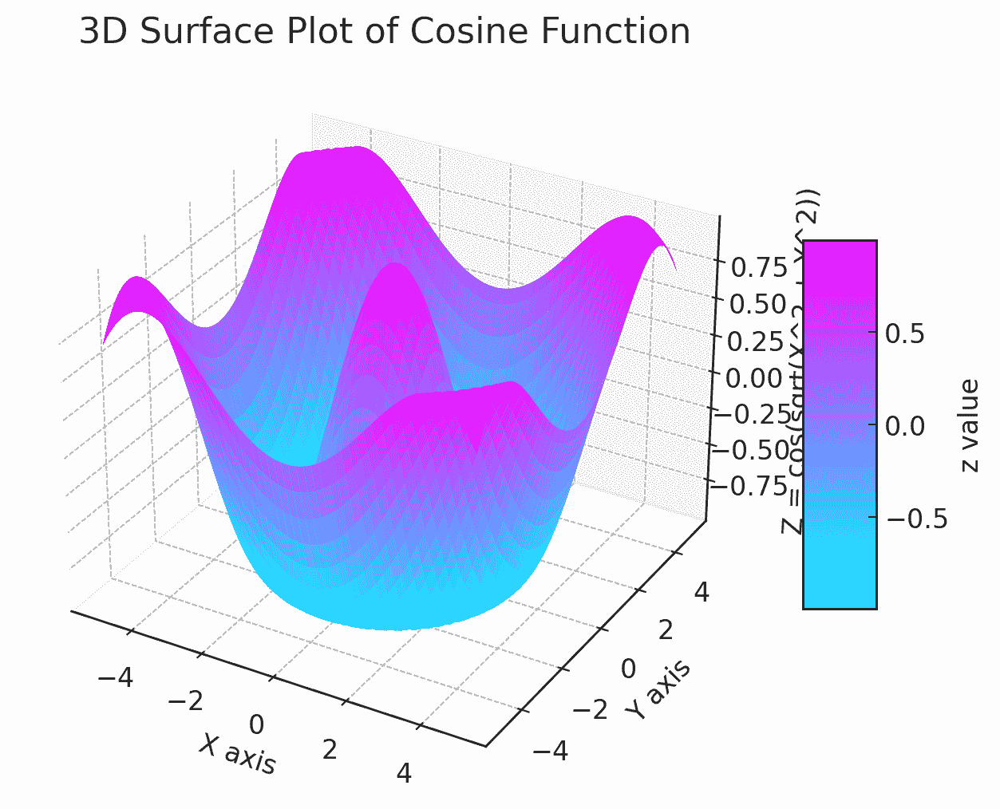
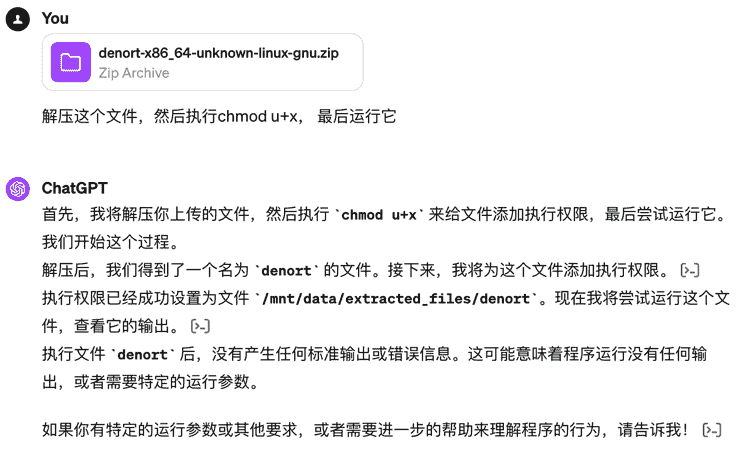

# 大雨：终于可以用自然语言对话，为何又要回到编程？

> 来源：[https://waytoagi.feishu.cn/docx/FOZgdR4cSoYZxixzosOcWFS7nch](https://waytoagi.feishu.cn/docx/FOZgdR4cSoYZxixzosOcWFS7nch)

> 🔗 原文链接： h[ttps://www.iaiuse.](https://www.iaiuse.com/posts/106a6060.html)com/posts/106a60...

> ⏰ 发表时间：2024-04-12

> 作者：大雨

#  写在前面

+   Prompt 里面写代码真的没啥必要

+   好不容易自然语言对话了

+   不是自然语言编程

+   编程还是让程序员去做吧

+   别难为我们普通人了

+   程序员写代码还是写在该写的地方去吧

+   Prompt 里面的有幻觉还不好调试

+   完全没必要给普通人增加学习的负担和焦虑

+   完全没必要在 Prompt 里面写代码

---

#  1、Prompt 里面写代码是什么体验

##  1.1、1 个失败的 Prompt 示例告诉我们完全没必要折腾

###  Prompt 和输出结果

你是一个具有代码执行能力的单词复习卡片生成器，根据用户输入的横数，列数，年级段和日期，生成一个卡片。参考下面的代码来执行：

```
import pandas as pd
from datetime import datetime

def create_word_review_card(rows, cols, grade_level, date):
    &quot;&quot;&quot;
    创建一个单词复习卡片表格，但请注意，直接在非专业的环境中执行此函数可能导致不可预见的错误。

    参数:
    rows (int): 表格的行数，决定了卡片上的单词数。
    cols (int): 表格的列数，决定了卡片上的单词数。
    grade_level (str): 年级段，决定了单词的难度级别。
    date (datetime): 当前日期，显示在表格的底部。

    返回:
    DataFrame: 包含单词的Pandas DataFrame表格。
    &quot;&quot;&quot;
    # 假设从单词库中获取单词的函数
    def fetch_words(n, grade_level):
        words = [f&quot;{grade_level}_word_{i}&quot; for i in range(n)]
        return words

    # 获取单词
    total_words = rows * cols
    words = fetch_words(total_words, grade_level)
    
    # 格式化单词列表成二维列表
    word_matrix = [words[i * cols:(i + 1) * cols] for i in range(rows)]
    df = pd.DataFrame(word_matrix)
    
    # 输出结果前的一种幻觉是，如果单词库中实际的单词数量少于需要的数量，这将导致错误。
    try:
        print(df.to_string(index=False, header=False))
        print(f&quot;日期: {date.strftime(&#x27;%Y-%m-%d&#x27;)}&quot;)
    except Exception as e:
        print(&quot;发生错误:&quot;, e)

# 示例用法，展示了如何调用函数，并提醒可能出现的问题
try:
    create_word_review_card(3, 4, &#x27;初中&#x27;, datetime.now())
except Exception as error:
    print(&quot;在尝试运行代码时出现了错误，这表明在非代码编辑器中直接运行复杂的Python代码可能不是最佳实践。错误详情:&quot;, error)
```

开始使用时，你会等待用户输入横数，列数，年级段和日期信息，然后利用代码能力，给用户做一个图表

###  输出结果，它还是执行了代码的



它的代码如下：

```
import pandas as pd
from datetime import datetime

def create_word_review_card(rows, cols, grade_level, date):
    &quot;&quot;&quot;
    创建一个单词复习卡片表格

    参数:
    rows (int): 表格的行数，决定了卡片上的单词数。
    cols (int): 表格的列数，决定了卡片上的单词数。
    grade_level (str): 年级段，决定了单词的难度级别。
    date (datetime): 当前日期，显示在表格的底部。

    返回:
    DataFrame: 包含单词的Pandas DataFrame表格。
    &quot;&quot;&quot;
    def fetch_words(n, grade_level):
        words = [f&quot;{grade_level}_word_{i}&quot; for i in range(n)]
        return words

    # 获取单词
    total_words = rows * cols
    words = fetch_words(total_words, grade_level)
    
    # 格式化单词列表成二维列表
    word_matrix = [words[i * cols:(i + 1) * cols] for i in range(rows)]
    df = pd.DataFrame(word_matrix)
    
    # 输出结果
    print(df.to_string(index=False, header=False))
    print(f&quot;日期: {date.strftime(&#x27;%Y-%m-%d&#x27;)}&quot;)

# 调用函数并捕获可能的异常
try:
    create_word_review_card(3, 4, &#x27;小学&#x27;, datetime.strptime(&#x27;2024-03-12&#x27;, &#x27;%Y-%m-%d&#x27;))
except Exception as error:
    print(&quot;在尝试运行代码时出现了错误，错误详情:&quot;, error)
```

从这个失败的案例可以看出来几个点：

+   要达到传统编程语言的效果，要付出的努力很大

+   调试和修改代码非常麻烦，也很复杂

+   实在看不出来 Prompt 中嵌入代码有啥必要性

> 这个时候有人就说了，那是因为你的编程水平太菜了呀……

> 嗯，是的，咱确实写代码能力是很一般。

> 但是，等下，如果 AI 对编程能力要求这么高，它还是 AIGC 吗？

另外一个简单变量的用法来看看，其实会发现，这都根本不知道是啥语言

##  1.2、嵌入伪代码是什么样的场景

###  Prompt 和输出结果

```
&quot;基于我的兴趣 {interests}, 预算 {budget}, 旅行时间 {travel_duration}, 和伴旅人数 {number_of_companions}, 请帮我规划一个旅行计划。&quot; &quot;兴趣包括但不限于 {list_of_interests}。&quot; &quot;预算范围是 {budget_range}。&quot; &quot;计划旅行时间长度 {length_of_trip} 天。&quot; &quot;我将和 {number_of_people} 人一起旅行，他们的年龄范围和兴趣点是 {ages_and_interests}。&quot; &quot;请为我们每天的行程提供详细建议，包括餐饮推荐 {meal_preferences} 和住宿选择 {accommodation_preferences}。&quot;
```



虽然这个例子并不完美，它更像是一个带变量的Prompt模板。这告诉我们，在特定场景下，这种方法是有效的。类似的案例还包括：若需设计更复杂的Prompt，可以加入更多决策点和变量，从而让交互过程更加详尽和多分支。下面是针对各种场景的复杂版本示例：

### 场景 1: 完整的健康食谱计划

**初始 Prompt:**

```
&quot;我有 {dietary_restrictions}，需要为接下来的 {number_of_days} 天制定一套 {meal_type} 的饮食计划。&quot;
&quot;我的饮食限制包括 {specific_restrictions}。&quot;
&quot;每天需要 {meals_per_day} 餐。&quot;
&quot;每餐的热量不超过 {calories_per_meal} 卡。&quot;
&quot;请为每餐提供食材列表 {ingredients_list}、烹饪步骤 {cooking_steps} 和预计烹饪时间 {cooking_time}。&quot;

```

### 场景 2: 深度科技产品评测

**初始 Prompt:**

```
&quot;我正在考虑购买 {product_name}，请你提供该产品的详细功能 {detailed_features}、用户评价 {detailed_reviews}、价格比较 {price_comparison} 和购买建议 {purchase_advice}。&quot;
&quot;产品名称是 {specific_product_name}。&quot;
&quot;想了解的功能包括 {list_of_features}。&quot;
&quot;请提供至少三个用户的详细评价 {user_reviews}。&quot;
&quot;比较该产品与市场上其他同类产品的价格 {comparison_with_other_products}。&quot;
&quot;根据我的需求 {my_requirements}, 是否推荐购买该产品？&quot;

```

### 场景 3: 详尽的学习资源计划

**初始 Prompt:**

```
&quot;我想学习 {subject}，根据我的学习风格 {learning_style} 和可用时间 {available_time}，请推荐适合的学习资源。&quot;
&quot;学习主题是 {specific_subject}。&quot;
&quot;我喜欢的学习方式包括 {preferred_learning_methods}。&quot;
&quot;每周我可以投入 {hours_per_week} 小时学习。&quot;
&quot;考虑到这些条件，推荐适合的在线课程 {online_courses}、书籍 {books}、视频教程 {video_tutorials} 或其他资源 {other_resources}。&quot;
```

### 场景 4: 详细的职业转型路径

**初始 Prompt:**

```
&quot;我目前的职业是 {current_job}，我对 {industry_interest} 行业感兴趣。&quot;
&quot;我的当前职位是 {specific_current_job}。&quot;
&quot;我感兴趣的行业是 {specific_industry_interest}。&quot;
&quot;希望了解如何从当前职业转到感兴趣的行业，包括必要的技能 {necessary_skills}、可能的职位 {potential_positions} 和预期的工资 {expected_salary}。&quot;
&quot;请提供关于行业背景 {industry_background}、职业发展路径 {career_pathway} 和可能的挑战

 {potential_challenges} 的详细信息。&quot;
&quot;根据我的工作经验 {my_work_experience} 和教育背景 {my_educational_background}，推荐适合的进修课程或资格认证 {recommended_courses_or_certifications}。&quot;
```

我们接下来再看看，如果有简单逻辑关系大概是什么样的呢

## 1.3、有点逻辑关系的伪代码/自然语言大概啥样的

###  Prompt 和输出结果

```
输入: n
初始化: factorial = 1

对于 i 从 1 到 n 做以下操作:
    factorial = factorial * i

输出: factorial
```



看起来比较简单，我们稍微复杂点呢？

```
输入: 已排序的数组 A, 需要查找的值 val
设 low = 0, high = length(A) - 1

当 low &lt;= high 做以下操作:
    mid = (low + high) / 2
    如果 A[mid] &lt; val:
        low = mid + 1
    否则如果 A[mid] &gt; val:
        high = mid - 1
    否则:
        输出: mid
        退出
输出: -1  // 如果未找到
```



我没有告诉它我要找 99。它就自己去找去了……

> 上面这些案例都带有浓浓的科学风，和我们大部分人日常的关系都不大。

上面是在 ChatGPT 3.5 做的，它到底是不是真的计算过也是值得怀疑的，不影响它往下走了。既然我们大部分人并不需要了解复杂的，还层出不穷的编程语言，那就没必要去折腾，也不用费心了。

很关键的地方在于上面的自然语言，伪代码，完全不知道啥路子，如果 prompt 复杂了，真正开始进入生产环境，那是相当可怕的：

+   结果不可控

+   上面的例子里面已经有幻觉问题了

+   过程不可控

+   就像一个 8000 行代码的 SQL 存储过程

+   每次系统升级的时候，谁都不敢动，谁也不敢碰

[看起来最大的 prompt 还得是 https://gi](https://github.com/JushBJJ/Mr.-Ranedeer-AI-Tutor)thub.com/JushBJJ/Mr.-Ranedeer-AI-Tutor

#  2、自然语言编程是什么鬼

Prompt 问世后，OpenAI 等大模型厂商的宣传下，新闻界一片沸腾，稿子的灵感来了！

Prompt 被误以为是新的编程语言，仿佛掌握了就能指挥千军万马，有了一众 AIGC 大军，画画、写作、拍电影，应有尽有，轻而易举！so easy!!!

唯一的问题是：

+   我暂时还不会

+   但是，我相信它一定很简单。

+   但是，我暂时还是不会。

那么自然语言编程是什么鬼，黄仁勋说不要学习编程了是什么意思。

那么问题可以追溯到，很久很久以前……

咱也不追溯了，简单来说，就是我们希望计算机帮我们解决问题，但是发现其实很难，所以一些科学家就从计算入手，慢慢积累了一些解决问题的手段和方法。

科学家发现一些自然现象，可以抽象成数学问题来解决。比如鸡兔同笼问题用方程来解决。

慢慢发展啊发展，数学家越想问题越抽象，于是用了更多的数学工具，这些东西人工计算不太可能了，所以就有了计算机，有了编程语言，我们大多数人学习编程语言都有那个过程，要了解数据类型，了解 if /else ，了解 for 循环，等等。

这些就是计算机解决问题的方法，把问题抽象，把问题简化，同时限制了问题发散。它的好处是显而易见了，我们问题收敛了，解决问题的手段收敛了。问题也是显而易见的，有些问题不好收敛，就需要发散。

所以有人就想着，能不能不要学习编程语言。现阶段来看，似乎随着问题复杂程度加深，还不如编程！！

就像我不会 PS，只会画图板还有一些简单的在线工具，但是，如果真要处理一个复杂的图片，搞到最后，还不如去学一下 PS！！

问题的悖论在于，我们通过自然语言编程，如何去评估结果呢？我们是用自然语言编程了，我如何评估它没有乱说话呢？

我们都知道有个说法，大语言模型一直在玩文字接龙的游戏。所以

并不是它计算出来的，而是它见过这样的训练材料，接龙出来的。为了改善这个问题，OpenAI 在去年推出了 Code Interpreter，给了我们这些不会编程的人，一些希望。

#  3. 代码解释器都能干些什么

简单来说，可以理解为 OpenAI 在现有大模型的基础上，增加了一个可以执行 python 的沙盒环境，它去理解上下文意图，自己产生代码，自己执行，然后汇总结果告诉我们。

我们可以理解为，找人帮忙完成一个功能，告诉它需求，它来完成。复杂一些的原理思考会放在最后。可以说，Python 能干的事，它大部分都能干，我们来看看都有哪些典型场景。

下面列举的 4 个场景都有专业的工具可以做，但是给了这些场景一些新的选择尝试机会。就像是移动互联网刚刚兴起的时候，也有过争议，慢慢取得平衡，很多事不需要打开那么专业工具去解决了。

有时候看着它运行 10 来次，最后还失败了，有点很奇怪的感觉，前段时间让它分析 ticktick 的摘要，失败了 10 多次。


> 总的来说，用它来做探索是非常适合的

如何启用它？GPTs 里面有个选项，勾选上，GPTs 就有了这个能力，在 GPT4 的对话里面，我目前采取的方式是告诉它运用 Python 能力或者说代码执行能力，然后讲啊讲：





从上面的交互可以看出来，整个过程还是很简单的。

###  3.1 数据分析与可视化

> 这里的做法甚至可以先不讲我们的诉求，丢一个 csv 或者 excel 文件让它直接去分析，它也能找出来一些适合表达的图表。如果不满意我们再进一步说明。

在现代企业和研究环境中，数据分析和可视化是洞察数据趋势和模式的关键工具。ChatGPT 的代码解释器插件通过支持强大的数据科学库如 pandas 和 matplotlib，极大地简化了这一过程。用户可以直接通过自然语言请求，指导 ChatGPT 进行数据操作和生成图表，从而使数据分析更加直接和用户友好。

例如，一个市场分析师可能需要分析产品销售数据并展示不同地区的销售表现。通过代码解释器，他们可以简单地指示 ChatGPT 读取包含销售数据的 CSV 文件，使用 pandas 来计算每个地区的总销售额，然后用 matplotlib 生成一个条形图。整个过程无需编写复杂的代码，只需简单描述数据分析任务和可视化的需求。

此外，代码解释器的强大功能使得进行时间序列分析、预测建模和复杂的统计测试变得容易。例如，一个环境科学家希望分析过去十年的气温变化数据。通过代码解释器，他们可以加载数据集，应用平滑或回归模型，并快速生成展示趋势的图表。


> 图表来说，日常分析 Excel 里面已经比较全了，专业的工具也很多，ChatGPT 对我们普通人来说，还有个价值是它的分析角度和解读视角能给我们一些启发。比如


这里有个问题，如果图示是中文的，可能显示不了，需要上传字体文件上去。暂时还没解决。

###  3.2 文件转换的灵活性

> 现在这个方式好像不太好用了，不过也是可以尝试的。我做的尝试是 mp4 转 mp3，要说有多大意义呢？好像也就那样吧，聊胜于无。它和图片去背景的道理是类似的。

文件格式转换是许多专业领域中的常见需求，特别是在处理大量的文档和多媒体文件时。代码解释器通过简化文件转换过程，提供了极大的便利。无论是在科学研究、工程设计还是日常业务操作中，能够快速而准确地在不同格式之间转换文件，都是提高效率的关键。

通过集成如 Python 的 pandas 库，代码解释器可以轻松实现如从 CSV 文件到 Excel 文件的转换，反之亦然。这对于需要在不同软件平台之间迁移和使用数据的用户来说，是一个巨大的便利。例如，一个财务分析师可能需要将财务报表从 Excel 转换为 CSV 格式以进行进一步的处理。通过代码解释器，这一任务可以通过简单的指令完成。

对于图像处理，代码解释器可以利用 Python 的 PIL（Pillow）库来实现不同图像格式之间的转换，例如从 JPEG 到 PNG。这在图像编辑、网页设计和打印行业中尤为重要。设计师或摄影师可以利用代码解释器快速调整图像格式，以符合不同的输出要求。

总之，代码解释器的应用场景广泛且功能强大，从简单的文件格式转换到复杂的数据分析和可视化，都展现了其作为现代工具的实用性和创新性。这些功能不仅提高了工作效率，也使非技术用户能够更轻松地处理原本需要专业知识的任务。随着技术的进步和用户需求的不断扩展，预计代码解释器将在更多领域发挥其独特的价值。

###  3.3 代码开发与原型设计

代码解释器为软件开发和原型设计提供了一种革命性的工具，使得开发人员能够快速迭代和测试代码片段。通过提供一个即时的反馈和执行环境，代码解释器使开发人员能够实时验证算法和功能，从而极大地缩短了开发周期并提高了效率。这在开发初期尤其有用，当需要验证概念或测试新思路时，可以即时获取结果，避免了传统开发中编译和运行的等待时间。

例如，开发者可以使用代码解释器来快速创建一个网页抓取脚本的原型，测试不同的解析策略，或验证数据集成流程是否符合预期。通过简单的命令，代码解释器能够即时运行脚本，显示输出并提供调试信息，使得开发者能够立即识别问题并进行调整。

1.  **加载网页内容 **：使用 requests 库从目标网站获取 HTML 内容。

1.  **解析 HTML **：通过 BeautifulSoup 等库解析 HTML，提取所需数据。

1.  **数据处理 **：清洗和格式化提取的数据，以便进一步分析或存储。

1.  **展示结果 **：打印或可视化数据，以验证抓取结果的准确性。

```
import requests

def get_weather_info(location, date):
    # 发出一个 API 调用以获取天气信息
    response = requests.get(f&quot;https://weather-api.com/data/{location}/{date}&quot;)

    if response.status_code == 200:
        # 解析并返回天气数据
        weather_data = response.json()
        return weather_data
    else:
        return None

# 使用代码解释器测试 API 调用
location = &quot;纽约&quot;
date = &quot;2024-01-31&quot;
weather_info = get_weather_info(location, date)
print(&quot;2024-01-31 纽约的天气信息:&quot;, weather_info)
```

在这个场景下，它可以辅助我们做测试，验证的工作，相比之下我们就不用启动一个工程去初始化等工作了。诚然，最后需要那么做，但是，确实帮我们节省了时间。


此外，代码解释器支持丰富的库和模块，这意味着开发者可以利用最新的开发工具和语言特性，例如使用 TensorFlow 或 PyTorch 进行机器学习模型的快速原型开发。这不仅加快了探索新技术的速度，还为开发者提供了一个安全的实验环境，他们可以在其中尝试和学习新工具，而不必担心破坏现有的开发设置。

###  3.4 解决复杂数学问题

代码解释器不仅是编程和软件开发的强大工具，也是解决复杂数学问题的有效助手。通过集成如 Numpy 和 Scipy 这样的科学计算库，代码解释器能够执行范围广泛的数学运算，从基本的算术运算到复杂的数学建模和统计分析。

在科学研究和工程领域中，研究人员和工程师常常需要对大量数据进行复杂的数学处理，包括但不限于线性代数运算、傅里叶变换、统计数据分析等。代码解释器能够快速执行这些运算，并提供直观的结果输出，使得用户可以即时看到他们的运算是否正确，或者数据表现出的趋势和模式。

例如，一个环境科学家正在研究气候变化对地区温度的影响。通过代码解释器，他们可以加载历史温度数据，应用统计模型来分析温度变化，并使用图表来可视化结果。这种即时的反馈和强大的计算能力使得科研人员能够更加专注于分析和解释数据，而非数据处理本身。






上面的这些场景，现实中都有成熟解决方案，

#  4. 代码解释器原理解析

###  我问

```
利用 python 的能力，告诉我 sandbox 的 linux 完整版本信息，和 python 的版本信息。最后再执行2个命令用于获取更详细的信息，全部结果都要展示出来。这2个命令分别是： uname -a lsb_release -a
```

###  它答

在当前的沙盒环境中，我们获得了以下系统和 Python 的详细信息：

1.  **Linux 完整版本信息 **:

+   Linux-4.4.0-x86_64-with-glibc2.36

1.  **Python 版本信息 **:

+   3.11.8 (main, Mar 12 2024, 11:41:52) [GCC 12.2.0]

1.  **执行 ****uname -a**** 命令的结果 **:

+   Linux 3dfa9ec0-11da-496f-831c-878f4773c1c6 4.4.0 #1 SMP Sun Jan 10 15:06:54 PST 2016 x86_64 GNU/Linux

+   这说明运行的是 Linux 内核版本 4.4.0，构建于 2016 年，采用 x 86_64 架构。

1.  **执行 ****lsb_release -a**** 命令的结果 **:

```
Distributor ID: Debian
Description: Debian GNU/Linux 12 (bookworm)
Release: 12
Codename: bookworm
```

+   这表示当前的操作系统是 Debian GNU/Linux，版本号为 12，代号为 bookworm。

从这里我们可以看出来，它是一个可以执行 python 的沙盒，实际上它有明确的限制：

+   禁止访问互联网

+   测试下来好像 curl 是可以访问的

+   命令超时 120 秒

+   太久就直接掐断了

+   禁止 root 访问

+   它会影响一些软件的安装



本文旨在说明，在 prompt 中写代码没有必要，用好这个就可以了。

#  5、结语：代码解释器未来的可能性

代码解释器作为一种创新工具，已经展现了其在多个领域的应用潜力和实际价值。从数据科学到软件开发，从复杂数学问题的解决到原型设计的快速迭代，代码解释器不仅提高了工作效率，还为研究和开发提供了前所未有的灵活性和速度。展望未来，随着人工智能技术的不断进步，我们可以预期代码解释器将集成更多先进功能，比如更深层次的机器学习集成、自动化测试生成、以及云端协作等，这些都将进一步拓宽其应用范围，深化其在现代科技中的影响力。

##  参考资料 ：

+   [h](https://www.datacamp.com/tutorial/how-to-use-chat-gpt-code-interpreter)ttps://www.datacamp.com/tutorial/how-to-use-chat-gpt-code-interpreter

+   [h](https://www.hatica.io/blog/chatgpt-code-interpreter-feature/)ttps://www.hatica.io/blog/chatgpt-code-interpreter-feature/

+   [https://www.akkio.com/post/chat](https://www.akkio.com/post/chatgpt-code-interpreter)gpt-code-interpreter