# 大雨：简单易懂的向量数据库解析：你需要了解的一切

> 来源：[https://waytoagi.feishu.cn/docx/B5nhdKEDwog6FcxcMcKcMkJ4n9b](https://waytoagi.feishu.cn/docx/B5nhdKEDwog6FcxcMcKcMkJ4n9b)

> 🔗 原文链接： h[ttps://www.iaiuse.](https://www.iaiuse.com/posts/4fe1f28c.html)com/posts/4fe1f2...

> ⏰ 发表时间：2024-03-21

#  写在前面

+   听说在油管上用了有版权的音乐

+   所有收益都归原作者所有

+   谷歌咋知道的呢？

+   听说谷歌新闻的关联关系是靠余弦定理

+   新闻？文字？

+   余弦定理？三角函数那个余弦定理？

+   我要静静，都是些什么呀！

+   AI 真的有智能吗？

+   要不然它咋理解我的情绪，开心=高兴？

+   这不废话吗？但是在关系数据库里面可不容易

+   数据库？数据库是什么鬼？

+   关系数据库？还有非关系数据库吗？

+   咋还有搞个向量数据库？和 AI 有啥关系？

+   没听说过

本文尝试从这些角度来解答，我们常常听到的向量化（Emabedding），向量数据库到底是个什么？文章很长，要一顿饭的功夫。某种程度上来说，OpenAI 的向量维度选择要优于竞争对手。

#  1 向量数据库要解决什么问题呢？

##  1.1 从 Excel 表格搜索开始了解如何匹配

假设我们有一个关于电影评论的 Excel 表格，表格中包含以下几列：

1.  **电影名称 **：电影的标题。

1.  **评论 **：关于电影的评论文本。

1.  **评分 **：电影的评分，例如 1 到 5。

表格数据示例如下：

| 电影名称 | 评论 | 评分 |
| --- | --- | --- |
| 星球大战 | 一个非常棒的科幻片，令人兴奋。 | 5 |
| 哈利波特 | 魔法世界真是神奇，完全被吸引了。 | 4 |
| 复仇者联盟 | 超级英雄们的绝佳表现，情节紧张刺激。 | 5 |
| 泰坦尼克号 | 浪漫而悲伤的故事，音乐非常动人。 | 4 |
| 环太平洋 | 巨大的机器人非常酷，但剧情有些薄弱。 | 3 |

###  传统的搜索原理：单词匹配

在 Excel 中，如果用户想找到包含“酷”的评论，他们可能会使用 Excel 的“查找”功能，输入“酷”并执行查找操作。这将直接导航到“环太平洋”的评论中，因为它字面上包含这个词。

###  广泛的用途和使用场景

+   **文本数据管理 **：在个人和商业环境中管理文档、客户反馈、项目说明等。

+   **简单的数据筛选 **：快速查找包含特定关键词的行或记录，适用于小规模数据集。

###  场景中的局限性

1.  **语义搜索的缺失 **：如果用户想找到表达“精彩”或“激动人心”的评论，但没有明确使用这些词，则传统搜索无法返回如“星球大战”的相关结果。

1.  **非结构化数据处理不足 **：对于图像、音频和视频等非文本内容，传统 Excel 工具无法进行有效的内容搜索。

随着 IT 技术的发展，特别是个人领域的需求多样化促使技术的演进，我们来看下下面几个需求。

##  1.2 传统搜索不好解决的问题，以电影网站为例

###  语义搜索，如果让系统理解我们的输入

**案例 **：电影网站用户希望找到类似于他们最喜欢的电影的其他电影，输入“电影像《星球大战》一样令人兴奋”。传统关系数据库或 Excel 基于字面匹配搜索，无法理解“令人兴奋”这一抽象概念，也无法捕捉到与《星球大战》相似的电影风格或主题，因此难以返回相关的搜索结果。

###  对非结构化数据（图/音等）进行相似性搜索

**案例 **：用户上传一张电影《银翼杀手》的电影海报，希望找到具有相似视觉风格的电影。在传统关系数据库或 Excel 中，图像、音频和视频数据无法有效索引或搜索，因为这些工具需要明确的文本描述或关键字。用户无法通过上传图像来检索相似内容，因为这些平台无法解析和理解非结构化数据的内容。

好的，我们可以使用更日常生活中的比喻和简单的语言来解释这些复杂的技术问题，让熟悉 Excel 但不一定了解复杂数据库技术的普通用户能够理解。

###  推荐引擎，根据喜好推荐

**现有的通用做法 **：

想象一下，你在 Excel 中有一个巨大的表格，这个表格记录了许多用户对电影的评分。如果你想找出哪些电影可能会被某个用户喜欢，你可能会尝试找出给类似电影打过高分的其他用户，然后看看这些用户还喜欢哪些电影。

+   **基于用户的做法 **：就像找出有着相似口味的朋友圈，如果他们喜欢某个电影，那么这个电影可能也会被推荐给你。

+   **基于物品的做法 **：就像比较两部电影是否类似，如果你喜欢了一部电影，系统会推荐与它相似的其他电影。

**局限性 **：

1.  **信息太少的问题 **：如果新加入的电影或用户数据很少，就像你试图根据只有一两个点评的电影来推断，这样做通常很难准确推断。

1.  **处理大量数据的效率问题 **：如果你试图在包含成千上万行数据的 Excel 表中手动查找这些相似项，你会发现这是非常耗时且效率低下的。

1.  **无法捕捉更深层次特征 **：这种方法只能看到表面，比如评分相似，而无法深入理解更复杂的个人喜好，就像只根据电影的类型和评分来推荐，而忽略了电影的情感深度或特定主题。

###  重复数据删除和记录匹配

**现有的通用做法 **：

在 Excel 中，如果你想找出重复的电影记录，你可能会设置一些规则来检查电影的名称、导演和发行年份等。如果所有这些信息都匹配，你可能会决定这两条记录是重复的，并删除一个。

+   **完全匹配 **：如果每个细节都一样，就认为是重复的。

+   **模糊匹配 **：即便不是字对字完全相同，但非常接近，也可能会被认为是重复的。

**局限性 **：

1.  **需要人工设置和检查规则 **：就像你需要不断检查和更新你的过滤规则一样，这需要大量的人工操作。

1.  **低效率 **：在大数据集中手动寻找和比较可能的重复项，就像在一本厚厚的电话簿中查找和比较每一个号码一样耗时。

1.  **可能的错误 **：简单的规则可能会漏掉一些重复（如拼写错误或使用不同的别名），或者错误地标记不是重复的条目，就像错误地认为两个仅仅名字相似的人是同一个人。

###  数据质检的现有通用做法和局限性

**现有的通用做法 **：

想象一下，在 Excel 中管理一个大型的电影评分表，你需要监控这些评分以识别不寻常或异常的行为，可能表明有欺诈行为或机器人自动操作。你可能会尝试通过设定一些规则来筛选出异常的情况，比如：

+   **设置阈值 **：如果一个新用户在非常短的时间内对多部电影进行了高分评价，可能会被标记为异常。

+   **检查一致性 **：如果某个用户的评分模式与大多数用户显著不同，比如他们只给某类型电影打低分，这也可能被视为异常。

**局限性 **：

1.  **静态规则的局限性 **：在 Excel 中，这些规则是静态的，意味着你必须手动定义什么样的行为被认为是异常的。这些规则可能不会随着数据的变化而更新，导致一些新的欺诈行为无法被检测到。

1.  **手动监控的低效率 **：使用 Excel 监控复杂或大规模数据集涉及大量的手动工作，例如定期查看和分析数据，这不仅效率低，还可能由于人为疏忽导致漏检。

1.  **误报和漏报 **：依赖简单规则可能导致高误报率（错误地标记正常行为为异常）和高漏报率（未能检测实际的异常行为）。例如，一个真实的狂热电影爱好者可能会因为频繁的高分评价而被错误地标记为机器人。

##  1.3 向量如何解决这些问题

###  一个电影的搜索的示例

从上面几个示例中，我们可以看出来，传统的文本匹配发展遇到了瓶颈。于是人们找到了向量化的处理办法。简单来说，向量把一个词通过多个维度来框定，这里的维度可以简单理解为属性。比如说，一部电影，它有悬疑度、科幻元素、冒险感、激动程度、浪漫度等。这些属性，我们就称它为维度，在每个维度上的坐标就是它在这个维度上的值，通常是一个浮点数（小数）来表示。

1.  **星球大战 **:

+   向量： [0.8， 0.9， 0.7， 0.8， 0.2， 0.1， 0.2， 0.5， 0.4， 0.3]

+   解释： 高度科幻（0.9），较高冒险感（0.8），较激动（0.7）。

1.  **泰坦尼克号 **:

+   向量： [0.1， 0.1， 0.2， 0.3， 0.9， 0.8， 0.2， 0.7， 0.6， 0.1]

+   解释： 高浪漫度（0.9），较高悲剧感（0.8）。

1.  **侏罗纪公园 **:

+   向量： [0.7， 0.8， 0.6， 0.8， 0.3， 0.1， 0.7， 0.4， 0.2， 0.5]

+   解释： 高冒险感（0.8），较高科幻元素（0.7）。

这里的向量我们简单来理解，就是这个电影在不同维度 （属性）上的相对强弱。为了方便理解，这里用了 10 个维度（属性）来描述一部电影。分别是

+   **悬疑度 **：电影中悬疑或惊悚元素的程度。

+   **科幻元素 **：电影中科幻内容的丰富程度。

+   **冒险感 **：电影中冒险元素的强度。

+   **激动程度 **：观看电影时带来的紧张感或兴奋感。

+   **浪漫度 **：电影中浪漫内容的比重。

+   **悲剧感 **：电影中悲剧或悲伤情感的强度。

+   **动作感 **：电影中动作场面的多少和强度。

+   **喜剧感 **：电影中幽默或喜剧元素的比重。

+   **历史元素 **：电影中是否包含历史背景或内容。

+   **音乐美感 **：电影音乐或声音设计的艺术性和吸引力。

###  语义搜索的实现

当用户输入“激动人心的科幻冒险”时，这个查询同样可以转换成一个向量，例如 [0， 0.9， 0.7， 0.8， 0， 0， 0， 0， 0， 0]，这表示用户对科幻（0.9）、冒险（0.7）和激动（0.8）的高度偏好。

搜索算法将计算用户查询向量与数据库中每部电影向量之间的相似度（通常使用余弦相似度）。在这个例子中，星球大战的向量与用户查询的相似度最高，因此系统会推荐《星球大战》。

###  用简单坐标轴来理解一下这个过程

下面是一个表格，显示了三部电影在 10 个不同维度上的向量表示。这个表格可以帮助我们更直观地理解每部电影的特征如何在这些维度上被量化。

| 电影 | 悬疑度 | 科幻元素 | 冒险感 | 激动程度 | 浪漫度 | 悲剧感 | 动作感 | 喜剧感 | 历史元素 | 音乐美感 |
| --- | --- | --- | --- | --- | --- | --- | --- | --- | --- | --- |
| 星球大战 | 0.8 | 0.9 | 0.7 | 0.8 | 0.2 | 0.1 | 0.2 | 0.5 | 0.4 | 0.3 |
| 泰坦尼克号 | 0.1 | 0.1 | 0.2 | 0.3 | 0.9 | 0.8 | 0.2 | 0.7 | 0.6 | 0.1 |
| 侏罗纪公园 | 0.7 | 0.8 | 0.6 | 0.8 | 0.3 | 0.1 | 0.7 | 0.4 | 0.2 | 0.5 |

这个表格展示了每部电影在各个维度上的得分，可以帮助系统理解用户的查询和电影内容之间的语义关系，并据此推荐匹配度高的电影。这种多维度的数值表示方式允许系统超越传统的关键词匹配，进行基于内容深度理解的语义搜索。

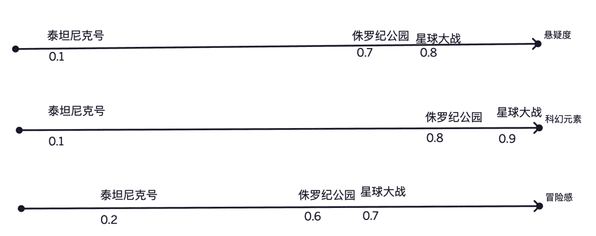

从这里我们可以看到，一个词在一个维度上，有它自己的位置，如果再来一个电影，悬疑度是《侏罗纪公园》和《星球大战》之间，就可以用类似 0.75 来表示。

> 绘图工具是 https://polypad.amplify.com/p ，画点简单的还行，但是不好操作，后面二维就用 python 弄了

###  开始立起来了，1 维到 3 维

我们先把悬疑度和科幻元素这 2 个维度弄个交集，就出现了下面这个图

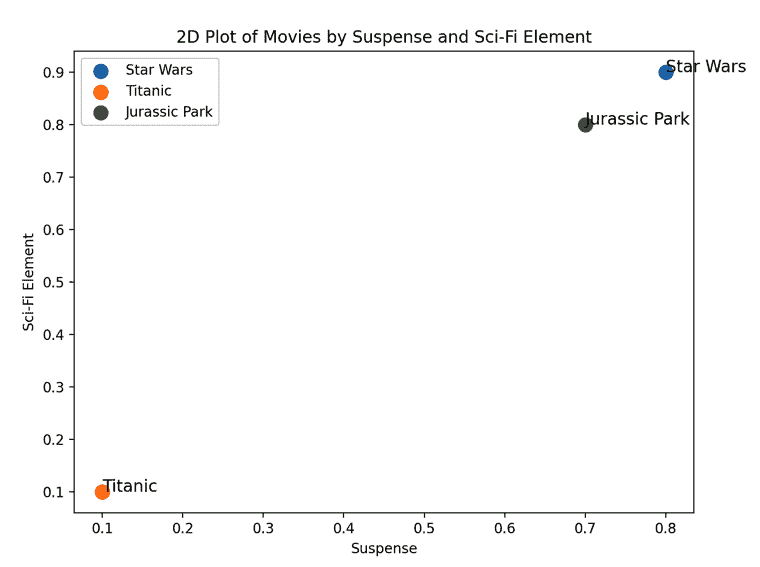

一时没找到特别合适的展示二维效果的工具，让 gpt 写了个代码。

```
import matplotlib.pyplot as plt
from mpl_toolkits.mplot3d import Axes3D
&#x27;&#x27;&#x27; 这里是为了获取系统字体，要不然中文不显示
from matplotlib.font_manager import FontManager

import subprocess

mpl_fonts = set(f.name for f in FontManager().ttflist)

print(&#x27;all font list get from matplotlib.font_manager:&#x27;)
for f in sorted(mpl_fonts):
    print(&#x27;\t&#x27; + f)
&#x27;&#x27;&#x27;
plt.rc(&quot;font&quot;,family=&#x27;Songti SC&#x27;,weight=&quot;bold&quot;)


movies = {
    &quot;星球大战&quot;: [0.8, 0.9, 0.7, 0.8, 0.2, 0.1, 0.2, 0.5, 0.4, 0.3],
    &quot;泰坦尼克号&quot;: [0.1, 0.1, 0.2, 0.3, 0.9, 0.8, 0.2, 0.7, 0.6, 0.1],
    &quot;侏罗纪公园&quot;: [0.7, 0.8, 0.6, 0.8, 0.3, 0.1, 0.7, 0.4, 0.2, 0.5]
}


fig, ax = plt.subplots(figsize=(8, 6))


for movie, vector in movies.items():
    ax.scatter(vector[0], vector[1], label=movie, s=100)
    ax.text(vector[0], vector[1], &#x27;%s&#x27; % (movie), size=12, zorder=1, color=&#x27;k&#x27;)

ax.set_xlabel(&#x27;悬疑度&#x27;)
ax.set_ylabel(&#x27;科幻元素&#x27;)
ax.set_title(&#x27;2D Plot of Movies by 悬疑度 and S科幻元素&#x27;)
ax.legend()

plt.show()


fig_3d = plt.figure(figsize=(10, 8))
ax_3d = fig_3d.add_subplot(111, projection=&#x27;3d&#x27;)


for movie, vector in movies.items():
    ax_3d.scatter(vector[0], vector[1], vector[2], label=movie, s=100)
    ax_3d.text(vector[0], vector[1], vector[2], &#x27;%s&#x27; % (movie), size=12, zorder=1, color=&#x27;k&#x27;)

ax_3d.set_xlabel(&#x27;悬疑度&#x27;)
ax_3d.set_ylabel(&#x27;科幻元素&#x27;)
ax_3d.set_zlabel(&#x27;冒险感&#x27;)
ax_3d.set_title(&#x27;3D Plot of Movies by 悬疑度, 科幻元素, and 冒险感&#x27;)
ax_3d.legend()

plt.show()
```

| 2 维度 | 3 维 |
| --- | --- |
|  |  |

老实说呢，维度超过 3 维，普通人已经不好想象了，这个时候只能借助复杂的数学公式来做，理解上还可以通过降维的方式来，比如投影之类的方法。

这些是数据在向量的存储形式，如果要去查询是什么样的方法呢？

###  好了，我要开始查询了

当用户输入“激动人心的科幻冒险”时，这个查询同样可以转换成一个向量，例如 [0， 0.9， 0.7， 0.8， 0， 0， 0， 0， 0， 0]，这表示用户对科幻（0.9）、冒险（0.7）和激动（0.8）的高度偏好。

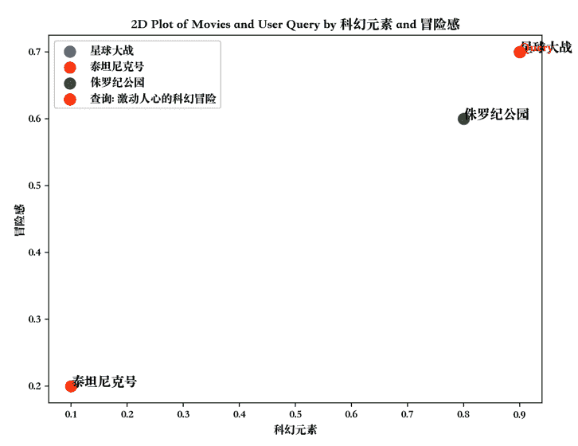

```
import matplotlib.pyplot as plt
from mpl_toolkits.mplot3d import Axes3D

plt.rc(&quot;font&quot;,family=&#x27;Songti SC&#x27;,weight=&quot;bold&quot;)


movies = {
    &quot;星球大战&quot;: [0.8, 0.9, 0.7, 0.8, 0.2, 0.1, 0.2, 0.5, 0.4, 0.3],
    &quot;泰坦尼克号&quot;: [0.1, 0.1, 0.2, 0.3, 0.9, 0.8, 0.2, 0.7, 0.6, 0.1],
    &quot;侏罗纪公园&quot;: [0.7, 0.8, 0.6, 0.8, 0.3, 0.1, 0.7, 0.4, 0.2, 0.5]
}

 


query_vector = [0, 0.9, 0.7, 0.8, 0, 0, 0, 0, 0, 0]  


fig, ax = plt.subplots(figsize=(8, 6))


for movie, vector in movies.items():
    ax.scatter(vector[1], vector[2], label=movie, s=100)  
    ax.text(vector[1], vector[2], &#x27;%s&#x27; % (movie), size=12, zorder=1, color=&#x27;k&#x27;)


ax.scatter(query_vector[1], query_vector[2], label=&#x27;查询: 激动人心的科幻冒险&#x27;, color=&#x27;red&#x27;, s=100)
ax.text(query_vector[1], query_vector[2], &#x27;Query&#x27;, size=12, zorder=1, color=&#x27;red&#x27;)

ax.set_xlabel(&#x27;科幻元素&#x27;)
ax.set_ylabel(&#x27;冒险感&#x27;)
ax.set_title(&#x27;2D Plot of Movies and User Query by 科幻元素 and 冒险感&#x27;)
ax.legend()

plt.show()
```

这里简单展示了一个向量的结构，数据如何存储，如何查询的过程，实际的向量结构会复杂很多。简单来说，数据的存储和检索和传统 Excel，关系数据库有很大的不同。向量数据库存放的是一个词在不同维度上的相对位置。

比如说，短毛猫（假如有这么个物种），这个词，它是猫科动物，是生物，是短毛的，温顺的（假如）。这样一来，就有非常多的维度可以去描述它。我们搜索的时候，也许是搜索 “温顺的动物”。

这里例子里面，我们看到了文字转换成向量的结果，它是咋转换的呢？

##  1.4 向量的位置是个啥意思

前面我们看到一个示例

> 激动人心的科幻冒险 => [0， 0.9， 0.7， 0.8， 0， 0， 0， 0， 0， 0]

这里，它把这句话里面的几个关键词，激动人心，科幻，冒险，分别对应了前面用来描述电影的 10 个维度。也就是科幻（0.9）、冒险（0.7）和激动（0.8）。

这里的 0.9 表示这个词在向量存储中的相对位置，它取决于我们预先训练好的模型有哪些信息，我们知道谷歌开源了一个 word2vec 的工具，字面理解就是把文本转换成向量，问题是转换的时候，它有一个基础的模型。它才能把一个新的内容插入其中。

我们很容易就能得出的结论是，如果有 3 个人，A，B，C，他们分别用了 wiki 的数据，百度百科的数据，和百度贴吧的数据去训练模型。他们 3 个人最后训练的结果中，对于相同的词，很有可能位置是不同的。

比如前面说的《泰坦尼克号》，在他们 3 个人的训练级中，位置很有可能是完全不同的。比如说 wiki 中关于电影有 500 个维度。其中一个维度关于科幻元素，有 988 个元素，《泰坦尼克号》的位置是 0.076。在百度百科中可能就不一样了。

从这里往外推，同样的词，在 GPT 3.5 和 GPT 4 的位置很有可能也是不同的。

> 一般来说，在一个维度上，一个词的位置，从插入的时候就确定了，是一个固定的浮点数，新插入的数据，用一个新的浮点数来表示相对位置。

下面是 openai 官网示例返回的 embeddings 结果。

```
{
  &quot;object&quot;: &quot;list&quot;,
  &quot;data&quot;: [
    {
      &quot;object&quot;: &quot;embedding&quot;,
      &quot;index&quot;: 0,
      &quot;embedding&quot;: [
        -0.006929283495992422,
        -0.005336422007530928,
        ... (omitted for spacing)
        -4.547132266452536e-05,
        -0.024047505110502243
      ],
    }
  ],
  &quot;model&quot;: &quot;text-embedding-3-small&quot;,
  &quot;usage&quot;: {
    &quot;prompt_tokens&quot;: 5,
    &quot;total_tokens&quot;: 5
  }
}
```

##  1.5 向量的维度选择决定了模型的质量

###  向量维度的重要性

1.  **信息捕捉能力 **： 向量的维度数（即向量的长度）决定了它能够捕捉多少信息。更高的维度通常能够捕捉更细微的数据差异。在 NLP 中，每个维度都可以被视为捕捉文本数据中某种语言或语义特征的通道。

1.  **避免信息丢失 **： 维度越多，模型在转化数据为向量时越能保留原始数据的信息。低维向量可能无法维持所有重要的信息，这可能导致性能下降。

1.  **计算复杂度 **： 然而，维度的增加也带来了更高的计算复杂度和存储需求。这就需要在模型的性能和计算效率之间找到平衡。

###  维度尽量独立是说什么

在向量空间模型中，每个维度通常代表数据的一个特定属性或特征，这些属性应尽可能地独立和不相关，以便更有效地捕捉数据的多样性和复杂性。

选取这些维度时，重要的是确保它们尽可能独立和不相关。例如，导演的知名度和电影预算虽然可能有一定关联（知名导演可能会有更高的预算），但它们描述的是两个不同的方面，应尽可能独立处理。

独立的维度有助于：

+   **降低冗余 **：如果多个维度高度相关，它们可能在分析中提供重复的信息，从而降低模型效率。

+   **提高解释性 **：每个独立维度都清楚地代表一个特定的特性，这有助于解释模型的行为和预测。

+   **增强模型性能 **：独立的维度可以帮助模型更好地理解数据的多样性，从而改进学习和预测的准确性。

通过确保向量中的每个维度尽可能独立，你可以构建一个强大且有效的数据表示，无论是用于推荐系统、分类任务还是其他机器学习应用。

下面有几个例子可以用来说明冗余维度的示例，方面我们理解独立性：

在电影推荐系统中，选取彼此相近或相关的维度可以作为反面教材。以下是一些具体例子：

1.  **观众评分和观众喜欢的百分比 **：

+   这两个维度可能非常相近，因为如果一个电影获得了高评分，很可能也会有高比例的观众表示喜欢。使用这两个维度可能会导致数据分析中出现重复的信息，使得模型难以区分这两者的独立影响。

1.  **票房收入和观众出勤率 **：

+   票房收入和观众出勤率通常是正相关的，因为更多的观众出席通常意味着更高的票房。如果将这两个维度同时用作特征，可能不会为模型提供额外的有益信息，反而增加了处理数据的复杂性。

1.  **导演的知名度和导演的奖项数量 **：

+   一个导演的知名度很可能与他们获得的奖项数量正相关。这两个维度很可能传达相似的信息，导致模型效率降低和可能的数据冗余。

1.  **发行年份和电影技术质量 **：

+   如果“电影技术质量”被量化为采用当代技术和特效的程度，那么它可能与发行年份相关，因为较新的电影可能采用更先进的技术。这种情况下，这两个维度可能重叠，不应同时使用。

###  处理维度相关性的策略

在发现维度高度相关时，可以采用以下策略来处理：

+   **特征选择 **：通过统计测试（如皮尔森相关系数检测）来识别高度相关的特征，并从模型中移除一些。

+   **特征抽取 **：使用主成分分析（PCA）等方法将相关特征合并成少数几个独立的特征。

+   **正则化技术 **：在模型训练过程中应用正则化方法（如 L1、L2 正则化），可以减少冗余特征的影响。

通过这些方式，可以优化特征集，避免由于维度相近导致的问题，从而提高模型的准确性和解释性。这在任何数据驱动的系统中都是至关重要的，尤其是在依赖精确特征工程的推荐系统中。

前面的内容视图用科普的视角解释向量和向量数据库，和要解决的问题。下面我们开始进入向量数据库的正题。

#  2 向量数据库现状

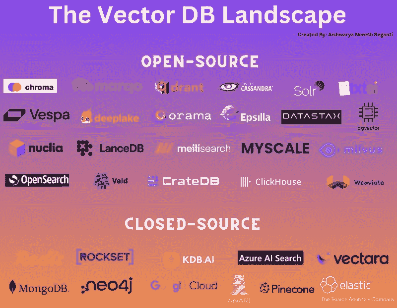

图片来源 A ishwarya Naresh Reganti

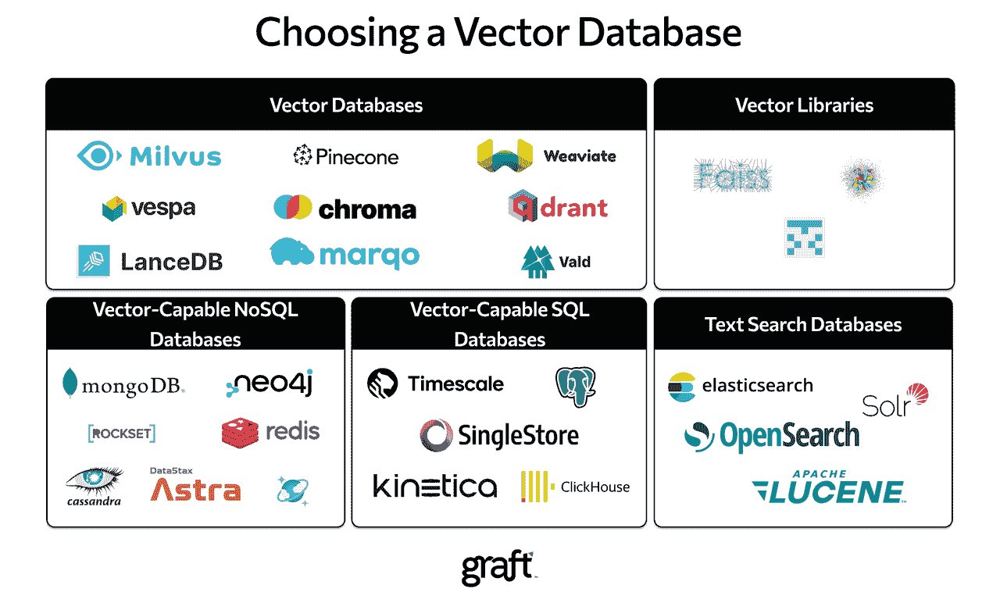

从上面这个图可以看出来，向量数据库发展已经非常长时间了。有很多开源的，也有很多闭源的。也可以看出来，mangoDb，Postgre 这样的关系数据库，No SQL 数据库也加入其中，从侧面说明了这个市场很大。

向量数据库是一种特殊的数据库，它以多维向量的形式保存信息，代表某些特征或质量。

根据数据的复杂性和详细程度，每个向量的维数可能相差很大，从几维到几千维不等。这些数据可能包括文本、图像、音频和视频，通过机器学习模型、单词嵌入或特征提取技术等各种流程转化为向量。

向量数据库的主要优势在于，它能够根据数据的向量接近度或相似度，快速、精确地定位和检索数据。这样就可以根据语义或上下文的相关性进行搜索，而不是像传统数据库那样仅仅依靠精确匹配或设定标准。

例如，使用向量数据库，您可以

+   根据旋律和节奏搜索能与特定曲调产生共鸣的歌曲。

+   发现在主题和观点上与另一篇特定文章一致的文章。

+   找出与某种设备的特性和评论相匹配的小工具。

那么它和我们传统的关系数据库有什么样的不同呢？数据是如何存储的呢？

#  3 向量数据库如何工作呢

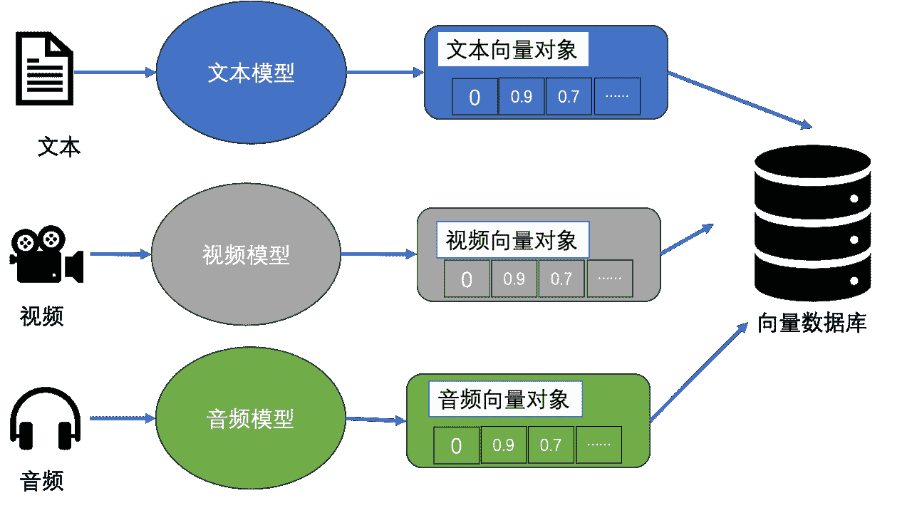

上图简单展示了向量数据库的存储过程，如果是文本，通过模型转换成向量对象，对象存入数据库中。再去使用它。

传统数据库以表格形式存储单词和数字等简单数据。而向量数据库处理的是称为向量的复杂数据，并使用独特的方法进行搜索。

常规数据库搜索精确匹配的数据，而向量数据库则使用特定的相似性度量来寻找最接近的匹配。

> 这里是非常大的不同，传统数据库查询“开心“，能匹配到信息中包含“开心“这 2 个字的内容，向量数据库可能可以查到 “开心”，“快乐”，“愉快”，“跳起来了”等信息的内容。

向量数据库使用特殊的搜索技术，即近似近邻（ANN）搜索，其中包括散列搜索和基于图的搜索等方法。

要真正理解向量数据库的工作原理，以及它与 SQL 等传统关系数据库的不同之处，我们必须首先理解嵌入的概念。

文本、图像和音频等非结构化数据缺乏预定义格式，给传统数据库带来了挑战。为了在人工智能和机器学习应用中利用这些数据，需要使用嵌入技术将其转换为数字表示。

嵌入就像给每个项目（无论是文字、图像还是其他东西）赋予一个独特的代码，以捕捉其含义或本质。这种代码可以帮助计算机以更高效、更有意义的方式理解和比较这些项目。把它想象成把一本复杂的书变成一个简短的摘要，但仍能抓住要点。

这种嵌入过程通常是通过一种为完成任务而设计的特殊神经网络来实现的。例如，单词嵌入将单词转换为向量，使含义相似的单词在向量空间中更为接近。

通过这种转换，算法可以了解项目之间的关系和相似性。

从本质上讲，嵌入就像一座桥梁，将非数字数据转换成机器学习模型可以处理的形式，使它们能够更有效地辨别数据中的模式和关系。

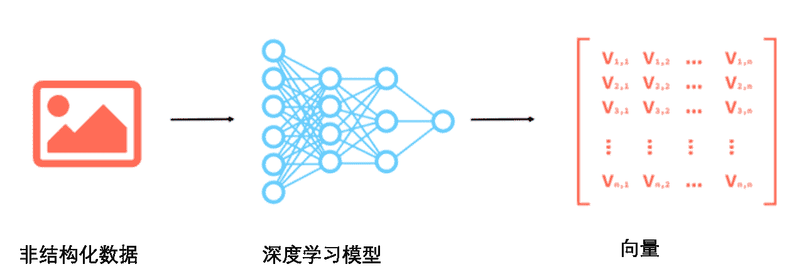

[Embed](https://medium.com/geekculture/vector-databases-taking-data-revolution-to-the-next-level-4a0faa437b2c)dings 使用深度学习模型将非结构化数据转换为向量 （ 图片来源 ）

前面关于电影的场景，传统关系数据库不好解决的问题，也正是向量数据库发挥的地方。

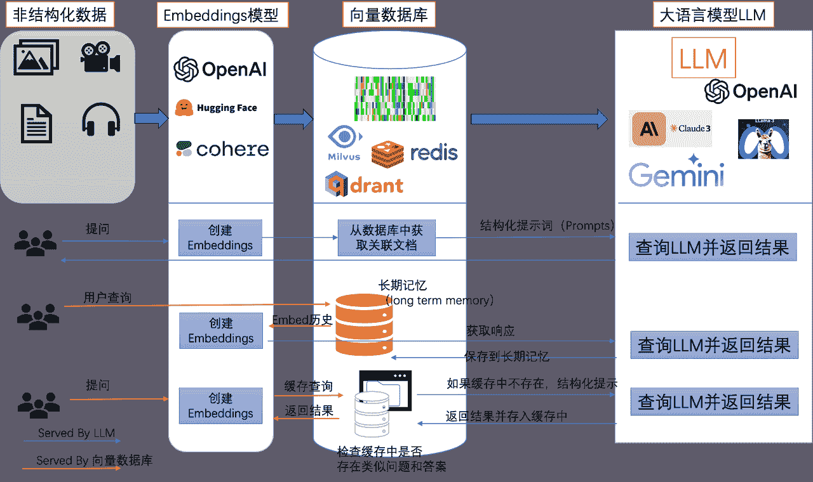

图片来源 [Use-cases of vector database](https://images.datacamp.com/image/upload/v1694511771/image5_fd4c7efb1b.png) in LLM applications

上面这个图，要翻译然后又拼回去确实有点费劲，实在不想动了，它展示了一种在[ LLM 应用中使用向量数据库的场景。不过发现](https://translatepic.com/)了一个神奇的网址，居然能翻译图片 TranslatePic - Free online image translator

简单来说：

+   用户提问

+   向量转换

+   查询向量数据库

+   形成结构化提示词

+   返回查询结果

#  4 优秀向量数据库的标准（翻译的）

向量数据库已成为一种强大的工具，可用于浏览图像、视频和文本等非结构化数据的广阔领域，而无需严重依赖人工生成的标签或标记。当它们的功能与先进的机器学习模型相结合时，有可能给从电子商务到制药等众多领域带来革命性的变化。以下是向量数据库改变游戏规则的一些突出特点：

###  4.1 可扩展性和适应性

强大的向量数据库可确保随着数据的增长（达到数百万甚至数十亿元素），能够毫不费力地在多个节点上进行扩展。最好的向量数据库具有适应性，允许用户根据插入率、查询率和底层硬件的变化调整系统。

##  4.2 多用户支持和数据隐私

容纳多个用户是数据库的标准要求。然而，仅仅为每个用户创建一个新的向量数据库并不高效。向量数据库优先考虑数据隔离，确保对一个数据集所做的任何更改都不会被其他数据集看到，除非所有者有意共享。这不仅支持多租户，还能确保数据的隐私和安全。

##  4.3 全面的 API 接口支持

真正有效的数据库会提供一整套应用程序接口和 SDK。这可确保系统能与各种应用进行交互，并能得到有效管理。领先的向量数据库（如 Pinecone）提供各种编程语言（如 Python、Node、Go 和 Java）的 SDK，确保开发和管理的灵活性。

##  4.4 方便用户的界面

向量数据库中的用户友好界面发挥着至关重要的作用，可以减少与新技术相关的陡峭学习曲线。这些界面提供了直观的概览、简便的导航，并使用户可以访问那些可能被忽略的功能。

#  5 2024 年向量数据库介绍

让我们来探索 13 个向量数据库（商业和开源）的细节，它们目前正在塑造人工智能的格局。

###  1) [Milvus](https://milvus.io/)

Milvus 是一个高度灵活、可靠、快速的云原生开源向量数据库。它为嵌入式相似性搜索和人工智能应用提供动力，并致力于让每个组织都能访问向量数据库。Milvus 可以存储、索引和管理由深度神经网络和其他机器学习（ML）模型生成的十亿多个嵌入向量。这种规模对于处理大量非结构化数据至关重要，可帮助企业分析这些数据并采取行动，从而提供更好的服务、减少欺诈、避免停机并更快地做出决策。

Milvus 是 LF 人工智能与数据基金会的一个分级项目。

####  **GitHub Stars **: [25k](https://github.com/milvus-io/milvus)

####  **架构**

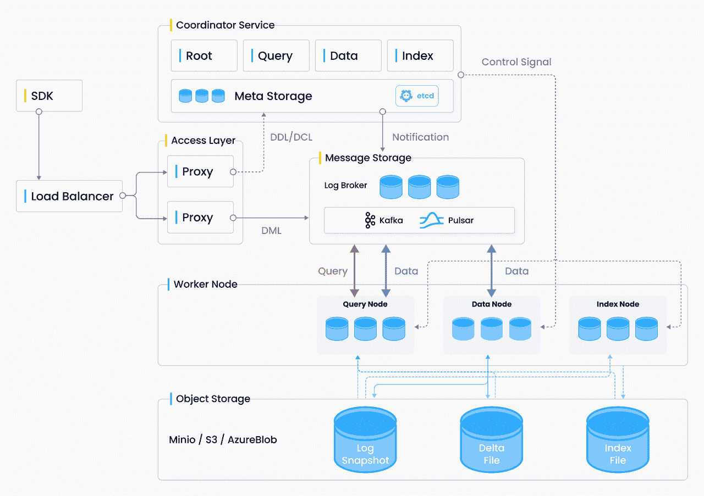

###  2) [Qdrant](https://qdrant.tech/)

Qdrant 引擎是一个开源向量搜索数据库。它以 API 服务的形式部署，提供最近的高维向量搜索。有了 Qdrant，嵌入式或神经网络编码器就能转化为成熟的应用程序，用于匹配、搜索、推荐等。

####  **GitHub Stars: **[**16k**](https://github.com/qdrant/qdrant)

####  **架构**

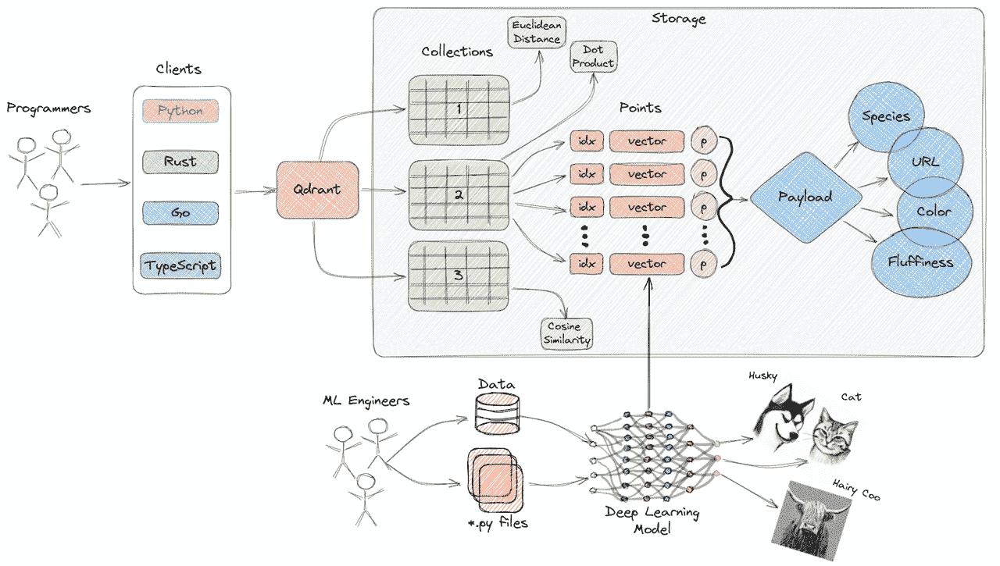

###  3) [Pinecone](https://www.g2.com/products/pinecone/reviews)

Pinecone 是一个完全可管理的向量数据库，可轻松将向量搜索添加到生产应用程序中。它结合了最先进的向量搜索库、过滤等高级功能以及分布式基础架构，可在任何规模下提供高性能和高可靠性。无需再为向量搜索进行基准测试和算法调整，或构建和维护基础架构。

####  **GitHub Stars: N/A **

####  **架构**

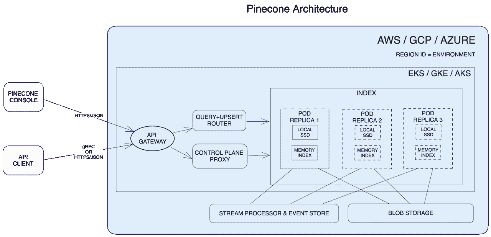

####  Review 评论

> “多亏了 Pinecone 向量数据库，我们可以在不出汗的情况下，在 100 多亿条记录上运行我们的高性能应用程序”。Gong 公司首席研发官 Ohad Parush

###  4) [Supabase](https://supabase.com/)

Supabase 是一个可管理的 Postgresql 解决方案，使用 pgvector 扩展实现存储嵌入。

Supabase 是新加坡同名公司推出的 Firebase 开源替代产品。每个 Supabase 项目都是一个专用的 PostgreSQL 数据库。Supabase 还为任何文件类型提供了一个具有无限扩展性的开源对象存储空间。支持开源身份验证，每个 Supabase 项目都配有完整的用户管理系统，无需任何额外工具即可运行。

####  **GitHub Stars: **[**63k**](https://github.com/supabase/supabase)

####  **架构**

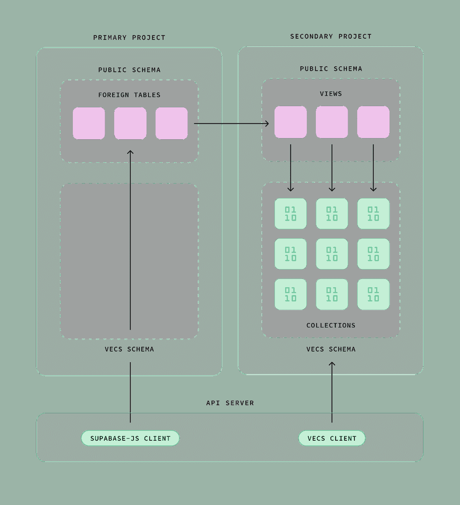

####  **评论**

> “Supabase 的定价慷慨得令人难以置信，他们为爱好者和业余爱好者提供了一套令人惊叹的工具，而不用担心月底的账单会出人意料”。Josh C. 开发人员

###  5) [Weaviate](https://weaviate.io/)

Weaviate 是一个开源向量数据库，用于存储来自 ML 模型的数据对象和向量嵌入，可扩展至数十亿个数据对象，由阿姆斯特丹的同名公司提供。用户可以索引数十亿个数据对象进行搜索，并结合多种搜索技术（如基于关键字的搜索和向量搜索）提供搜索体验。

对于托管的 Weaviate，用户从免费开始，为存储和查询的向量维数付费。升级到 Weaviate 的无限容量计划，起价为每 100 万向量维 0.05 美元，并随着用户需求的增长而扩展。

####  **GitHub Stars: **[9k](https://github.com/weaviate/weaviate)

####  **架构**

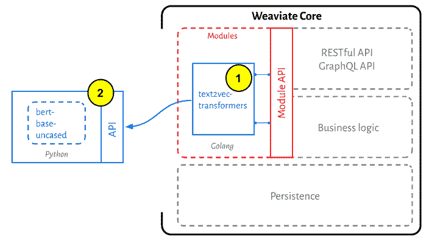

####  Review

> “为研究团队提供高质量的搜索能力/法律文件中的语义搜索”。阿列克谢

###  **6) **[Chroma](https://www.trychroma.com/)

Chroma 是开源嵌入式数据库。Chroma 使知识、事实和技能可插入 LLMs 中，从而轻松构建 LLM 应用程序。它在 Apache 2.0 许可下免费使用。

####  **GitHub Stars: **[**11k**](https://github.com/chroma-core/chroma)

####  **架构**

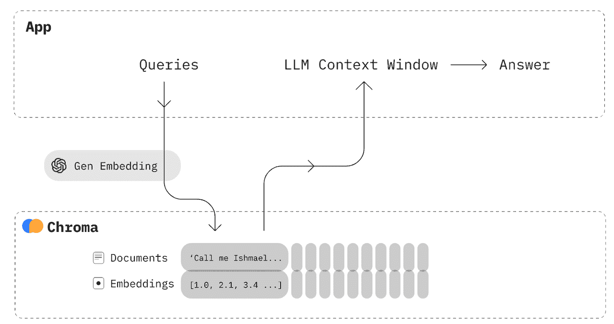

###  7) [Vald](https://vald.vdaas.org/)

Vald 是一个高度可扩展的分布式快速近似近邻密集向量搜索引擎。它基于云原生架构设计和实现。它使用最快的 ANN 算法 NGT 来搜索邻居。

Vald 具有自动向量索引和索引备份功能，以及水平缩放功能，可从数十亿个特征向量数据中进行搜索。Vald 易于使用，功能丰富，可根据需要高度定制。通常，图形在索引过程中需要锁定，这会导致世界停止。

但 Vald 使用分布式索引图，因此在索引过程中仍可继续工作。Vald 实现了自己的高度可定制的入口/出口过滤器。可根据 gRPC 接口进行配置。可根据需求对内存和 CPU 进行水平扩展。Vald 支持使用对象存储或持久卷自动备份功能，从而实现灾难恢复。

####  **GitHub Stars: **[1.4k](https://github.com/vdaas/vald)

####  架构

###  8) [KX - KDB.AI](https://kx.com/products/kdb-ai/)

KDB.AI 是一个功能强大的基于知识的向量数据库和搜索引擎，通过为人工智能应用提供高级搜索、推荐和个性化功能，允许开发人员构建可扩展、可靠和实时的应用。

####  GitHub Stars: N/A

####  **架构**

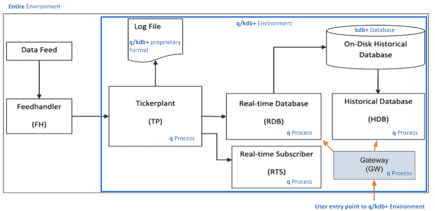

####  Review

> 它是一个非常强大、灵活和高性能的系统。它实际上是一种编程语言，同时也有一个数据库，这带来了极大的灵活性。q 语言提供了非常简洁的方法来表达相对复杂的操作。Jonny P.

###  9) [Vespa](https://vespa.ai/)

在线将人工智能应用于您的数据。规模不限，性能无与伦比。

您需要将同一项目上的向量、元数据和内容放在同一节点上，在那里运行推理以实现可扩展的性能，并在各节点间无缝扩展，以处理任何数量的数据和流量。Vespa 为您完成所有这些工作，因此您可以专注于构建您的应用程序。

Vespa 是一个功能齐全的搜索引擎和向量数据库。它支持向量搜索（ANN）、词法搜索和结构化数据搜索，所有这些都可以在同一个查询中完成。集成的机器学习模型推理可让您应用人工智能实时了解数据。

推荐、个性化和定位涉及对内容项目的推荐模型进行评估，以选择最佳模型。Vespa 可让您构建在线应用程序，通常将快速向量搜索和过滤与对项目的机器学习模型评估相结合。

####  **GitHub Stars: **[5.1k](https://github.com/vespa-engine/vespa)

####  **架构**

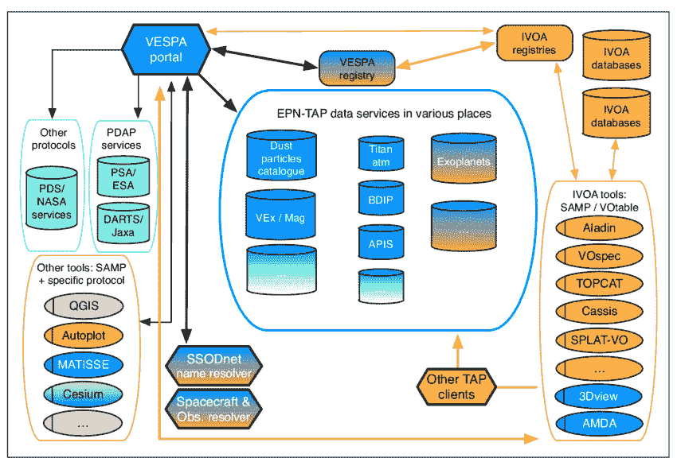

###  10) [SingleStore](https://www.singlestore.com/)

SingleStoreDB 是一种高性能、可扩展的现代 SQL DBMS 和云服务，支持多种数据模型，包括结构化数据、基于 JSON 的半结构化数据、时间序列、全文、空间、键值和向量数据。我们的向量数据库子系统于 2017 年首次推出，随后又进行了增强，可以使用 SQL 进行极快的最近邻搜索，轻松找到语义相似的对象。此外，所谓的 “元数据过滤”（被 SVDB 提供商标榜为优点）在 SingleStoreDB 中以比它们更强大、更通用的形式提供，只需使用 SQL 过滤器、连接和所有其他 SQL 功能即可。

####  **GitHub Stars: N/A

####  **架构**

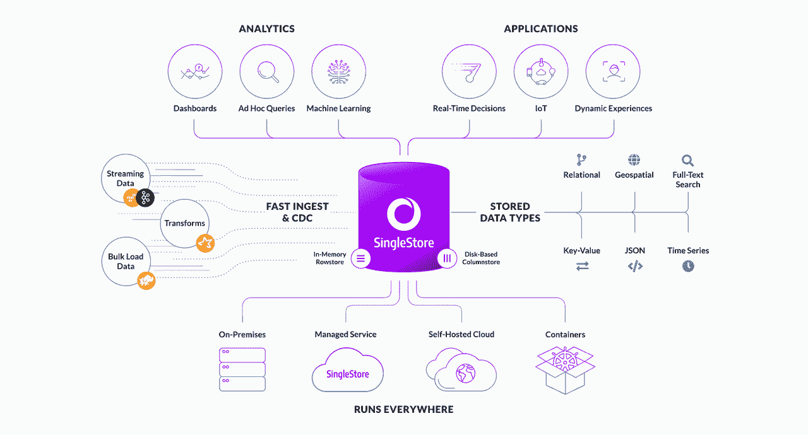

####  Review

> “自从改用 SingleStore 后，我再也不用担心或头疼数据源宕机、应用程序接口宕机或必须重新收集数据的问题了。SingleStore 解决了所有让我彻夜难眠的痛点。Guy Warner，MonitorBase 首席技术官

###  11) [LanceDB](https://lancedb.com/)

LanceDB 是一个用于向量搜索的开源数据库，采用持久存储，大大简化了嵌入的检索、过滤和管理。

LanceDB 的主要功能包括

+   生产规模的向量搜索，无需管理服务器。

+   存储、查询和过滤向量、元数据和多模态数据（文本、图像、视频、点云等）。

+   支持向量相似性搜索、全文搜索和 SQL。

+   支持本地 Python 和 Javascript/Typescript。

+   零拷贝、自动版本管理，无需额外基础设施即可管理数据版本。

+   与 LangChain 🦜️🔗、LlamaIndex 🦙 、Apache-Arrow、Pandas、Polars、DuckDB 等生态系统的集成正在进行中。

####   **GitHub Stars: **[2.1k](https://github.com/lancedb/lancedb/stargazers)

###  12) [Marqo](https://www.marqo.ai/)

端到端的多模式向量搜索引擎。通过单一易用的应用程序接口存储和查询文本、图像和代码等非结构化数据。

基于张量的搜索和分析引擎，可与您的应用程序、网站和工作流程无缝集成。Marqo 是一个多功能、强大的搜索和分析引擎，可集成到任何网站或应用程序中。由于具有水平可扩展性，即使有数百万文档，Marqo 也能提供快如闪电的查询时间。Marqo 可帮助您配置 CLIP 等深度学习模型，从图像中提取语义。它可以无缝处理图像到图像、图像到文本以及文本到图像的搜索和分析。Marqo 以完全无模式的方式调整和存储数据。它将张量搜索与提供高效预过滤的查询 DSL 相结合。通过张量搜索，您可以超越关键字匹配，根据文本、图像和其他非结构化数据的含义进行搜索。成为部落的一员，帮助我们彻底改变搜索的未来。无论您是贡献者、用户，还是对 Marqo 有任何疑问，我们都将竭诚为您服务。

####  **GitHub Stars: **[3.9k](https://github.com/marqo-ai/marqo)

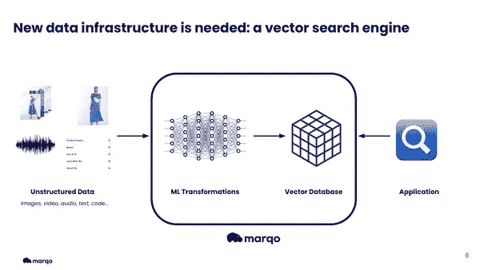

**Features 特点**

+   嵌入式存储在内存中的 HNSW 索引中，实现了最先进的搜索速度

+   利用横向索引分片，将规模扩大到亿级文档索引

+   异步和非阻塞数据上传和搜索

+   使用来自 PyTorch、Huggingface、OpenAI 等公司的最新机器学习模型

+   从预先配置的模型开始，或自带模型

+   内置 ONNX 支持和转换功能，可实现更快的推理和更高的吞吐量

+   CPU and GPU support 支持 CPU 和 GPU

###  13) Deep Lake By Activeloop

Deep Lake 是一个人工智能数据库，由一种针对深度学习和基于大型语言模型 （LLM） 的应用进行了优化的存储格式提供支持。

####  **GitHub Stars: **[7.4k](https://github.com/activeloopai/deeplake/)

可用于

1.  在构建 LLM 应用程序时存储数据和向量

1.  在训练深度学习模型时管理数据集

Deep Lake 简化了基于 LLM 的企业级产品的部署，它提供所有数据类型（嵌入、音频、文本、视频、图像、PDF、注释等）的存储、查询和向量搜索、大规模训练模型时的数据流、数据版本和沿袭，以及与 LangChain、LlamaIndex、Weights & Biases 等流行工具的集成。Deep Lake 可处理任何规模的数据，它是无服务器的，可让您将所有数据存储在自己的云中，并存储在一个地方。英特尔、空中客车、Matterport、ZERO Systems、红十字会、耶鲁大学和牛津大学都在使用 Deep Lake。

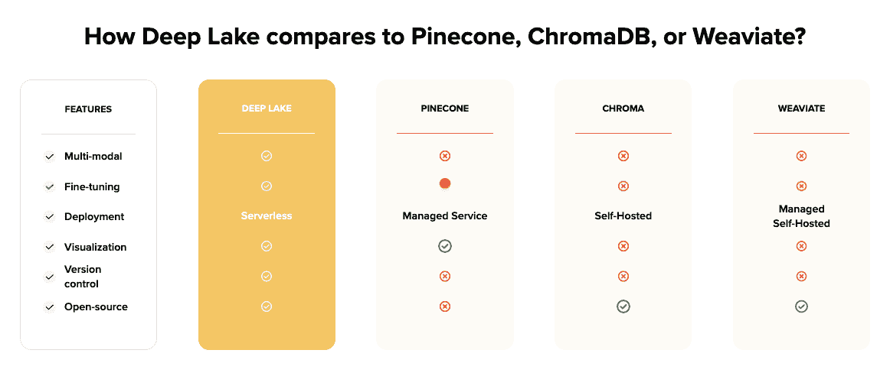

Deep Lake 与其他向量数据库的比较

#  6 人工智能的崛起和向量数据库的影响

向量数据库专门用于存储高维向量，从而实现快速准确的相似性搜索。由于人工智能模型，尤其是自然语言处理和计算机视觉领域的人工智能模型，会生成并处理这些向量，因此对高效存储和检索系统的需求变得至关重要。这就是向量数据库发挥作用的地方，它为这些人工智能驱动的应用提供了高度优化的环境。

像 GPT-3 这样的大型语言模型（LLMs）的出现就是人工智能与向量数据库之间关系的一个典型例子。

这些模型旨在通过处理海量数据，将其转化为高维向量，从而理解并生成类似人类的文本。A

基于 GPT-3 和类似模型构建的应用在很大程度上依赖于向量数据库来有效地管理和查询这些向量。这种依赖的原因在于这些模型所处理的数据量和复杂性。例如，GPT-3 有 1750 亿个参数，产生了大量向量化数据，传统数据库很难有效处理这些数据。

#  7 延展阅读

##  7.1 关系数据库的的产生和背景

在计算机早期发展阶段，数据管理面临着诸多挑战。那时，网络技术尚未广泛应用，大多数文件，如员工信息表，仅存储于本地。例如，A 电脑上的文件被编辑后，拷贝至 B 电脑时，文件版本间很容易出现不一致，这不仅造成了数据冗余，也增加了管理的复杂性。随着网络技术的发展，虽然文件可以通过网络被多端访问，但这也带来了新问题，如多人同时编辑同一文件时可能引发的冲突。

面对网络时代数据管理的这些挑战，Edgar F。 Codd 在 1970 年提出了革命性的关系模型，此模型通过表格的形式组织数据，其中的数据和关系均在表中定义，大大减少了数据的冗余，并提高了数据管理的独立性。为了适配多种开发语言如 C、C++、Pascal 等，同时简化数据访问和查询过程，引入了结构化查询语言（SQL）。这种语言简化了数据操作，提高了维护效率和系统的可扩展性。

从关系数据库的引入到今天，尽管数据库技术经历了多次升级和演化，其核心架构仍然保持稳定，对信息化的推动作用巨大。如今，Oracle、MySQL、PostgreSQL、SQLite 等数据库系统已成为信息管理系统中不可或缺的组成部分，它们的广泛应用证明了关系数据库模型的持久影响力和实用价值。

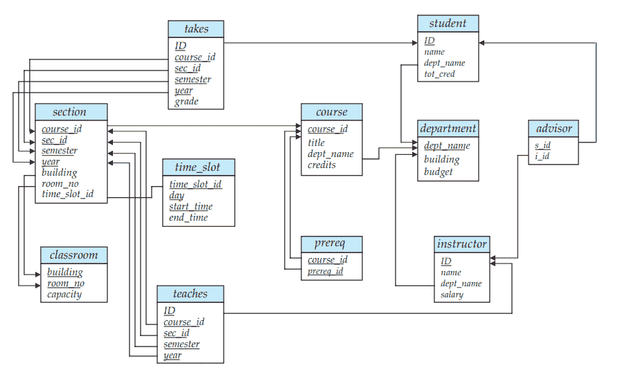

图片来源[ 关系数据库](https://taogenjia.com/img/database-system-2-realtional-database/database-system-2-relational-model-1-database-schema-diagram.png)图

还有一个很大的原因是关系数据库首先解决的是 to B 的需求，to B 的需求特点是可以有用 > 有趣

##  7.2 关系数据库发展的困境

在数字信息时代的初期，关系数据库像一本精心组织的账本，帮助我们管理从银行账户到图书馆藏书的各种信息。然而，随着互联网的飞速发展，数据量急剧膨胀，传统的关系数据库面临了新的挑战。想象一下，一个超级市场在节假日促销期间，成千上万的顾客同时结账，每一笔交易都要记录更新。关系数据库需要通过复杂的表结构进行大量数据的查询和交叉检查，这在处理巨大的、快速变化的数据流时，往往会显得力不从心。

正是在这样的背景下，NoSQL（Not Only SQL）数据库应运而生，它不完全依赖传统的表结构，而是采用更灵活的数据存储方式。例如，一个社交网络应用，用户的动态、评论和点赞等信息，快速地增加和变化，NoSQL 能够更自由地处理这些非结构化的数据。而且，NoSQL 数据库在设计上就考虑了横向扩展的可能，即通过增加更多服务器来处理更多数据，从而有效应对大规模数据集的挑战。

NoSQL 的这种灵活性和扩展性使其成为大数据和实时 Web 应用的理想选择。在讨论 NoSQL 数据库的具体类型和应用前，让我们先深入了解一下 NoSQL 数据库的几种主要形式，包括键值存储、文档存储、列存储和图数据库，以及它们如何解决传统关系数据库在现代应用场景中遇到的问题。

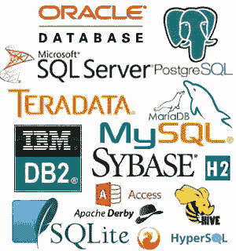

---

在企业对企业（B 2 B）的场景中，关系数据库通常表现得非常出色，因为这些环境中的数据需求往往是结构化且预定义的。例如，一个企业资源规划（ERP）系统或客户关系管理（CRM）系统，其操作和数据处理需求相对固定，涉及清晰定义的交易记录、客户资料和财务报表等。这些系统的数据模式稳定，变化频率低，关系数据库通过其严格的数学规范（如 ACID 原则：原子性、一致性、隔离性、持久性）确保了数据的准确性和可靠性。

然而，当转向面向消费者（B 2 C）的场景时，情况则大为不同。在这些场景中，用户生成的数据量庞大且多变，如社交媒体平台、电子商务网站和在线内容服务。用户的行为多样且不可预测，他们可能在任何时间进行评论、上传内容或进行交易，这些动作产生的数据既非结构化又随机。在这种环境下，关系数据库受到其固有结构的限制，如需求个性化和数据模式的频繁变动，难以灵活应对。

随着系统规模的扩大和用户行为的多样化，传统关系数据库在处理个性化和高度动态的数据需求时面临挑战。这种“熵增”现象——即系统的无序度和复杂性随时间增加——导致了对数据管理方法的重新思考。关系数据库通过其固定的模式和严格的事务规则，虽然能够保证数据一致性和可靠性，但也限制了处理速度和扩展性。

这正是 NoSQL 数据库成为一些 B 2 C 场景中首选技术的原因。NoSQL 通过提供灵活的数据模型、快速的查询性能和易于水平扩展的架构，能够有效应对用户行为的多样性和大规模数据处理的需求。例如，文档存储数据库可以按需存储和检索各种格式的用户数据，而列存储数据库则优化了大规模数据分析查询的性能，使其特别适用于个性化广告和实时推荐系统等应用。

总之，随着商业环境的演变和技术的进步，数据管理系统的选择越来越多地依赖于具体的应用场景和需求。对于那些需要高度结构化和规范化数据处理的 B 2 B 环境，关系数据库依旧是可靠的选择。但在需要处理大量、多变且个性化的消费者数据的 B 2 C 场景中，NoSQL 提供了一个更加灵活和高效的解决方案。

关系数据库重点要解决的是一致性，银行转账是非常典型的场景，A 转 B，首先要扣除 A 的余额，然后，给 B 的余额加上。这里如果 A 扣除了，B 没加上是非常可怕的。

相对来说，对于大部分情况来说，内容更重要

##  7.3、NoSQL 的发展和变化

简单来说，比如一条微博信息，它有内容主体，也有点赞数，内容主体所有人看到都一样，但是点赞数，就可以不一样，只要最后一致就可以了。

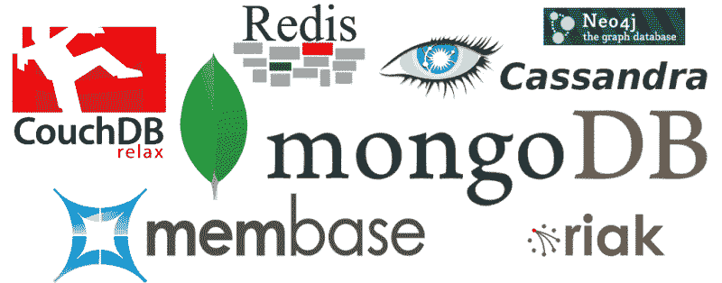

###  NoSQL 数据库产生的背景

随着 21 世纪初互联网技术的快速发展和大数据时代的到来，传统的关系数据库开始显露出处理能力的不足。尤其在社交网络、电子商务和云计算等领域，数据不仅体量巨大，而且更新速度极快，关系数据库在处理这些海量、非结构化的数据时往往力不从心。例如，像淘宝这样的电商平台在大促期间，可能需要处理数亿级的用户访问和交易数据，关系数据库的固定模式和扩展性限制就会成为瓶颈。因此，NoSQL 数据库应运而生，旨在提供更为灵活和高效的数据管理方案，以适应 Web 2.0 时代的需求。

###  NoSQL 解决的问题

**NoSQ**L 数据库主要解决了三大类问题：首先是 扩展性 ，通过**简化设计**和支持分布式架构，NoSQL 使得数据库的横向扩展更为简单**和成本效**益高；其次是 灵活性 ，NoSQL 通常不需固定数据模式，支持更自由的数据类型和结构，适合动态或不规则数据处理；最后是 高性能 ，特别是在处理大量并发读写操作时，如键值存储就可以提供极快的数据访问速度，这对于像微博这样的社交平台在高峰期维持服务是至关重要的。

###  NoSQL 的理论基础

梗概： 不同于关系数据库的统一理论基础，NoSQL 数据库的理论基础涵盖了多种技术和概念，主要包括键值存储、文档存储、列存储和图数据库等模型。每种模型都有其独特的理论和技术侧重点。例如，键值存储简化了数据交互，极大地提升了性能；文档存储和列存储优化了对动态数据的处理；而图数据库则利用图论来高效管理复杂的数据关系，适合社交网络中的朋友关系和推荐系统。

#  8 参考资料

+   [https://actalyst.medium.com/optimize-llm-enterprise-applic](https://actalyst.medium.com/optimize-llm-enterprise-applications-through-embeddings-and-chunking-strategy-1bbdb03bedae)ations-through-embeddings-and-chunking-strategy-1bbdb03bedae

+   [https://arxiv.org](https://arxiv.org/pdf/2307.03172.pdf)/pdf/2307.03172.pdf_

+   [https://community.openai.com/t/the-](https://community.openai.com/t/the-length-of-the-embedding-contents/111471)length-of-the-embedding-contents/111471_

+   [h](https://www.datacamp.com/blog/the-top-5-vector-databases)ttps://www.datacamp.com/blog/the-top-5-vector-databases

+   [h](https://www.graft.com/blog/top-vector-databases-for-ai-projects)ttps://www.graft.com/blog/top-vector-databases-for-ai-projects

+   [h](https://medium.com/@manansuri/a-dummys-guide-to-word2vec-456444f3c673)ttps://medium.com/@manansuri/a-dummys-guide-to-word2vec-456444f3c673