# 【 2050】当科技遇上自愿者，一场跨界的思想碰撞盛宴！

> 来源：[https://waytoagi.feishu.cn/docx/FvZUd4tE1owO2mxRhYMcmagJnr6](https://waytoagi.feishu.cn/docx/FvZUd4tE1owO2mxRhYMcmagJnr6)

> 🔗 原文链接： h[ttps://www.iaiuse.](https://www.iaiuse.com/posts/334ee88f.html)com/posts/334ee8...

> ⏰ 发表时间：2024-05-1

> 作者：大雨

#  写在前面

据说 2017 年，阿里云奠基人王坚博士看到一组数据，全球 35 岁以下人口占比有 50%。同时根据他的经验，大部分的机会给了成功人士，于是就想着办这样一个年青的人聚会，直到 2050 年。而对于年青人而不是年轻人，一个非常好的榜样是 52 岁学开飞机，拿着自拍杆追日出。显然，如果 30 岁就开始养生，恐怕不太适合。而第一次看到介绍文章时，一度以为 自愿者 是笔误，自愿者也就是自己愿意来的人，这非常 2050 。

#  初遇 2050，火箭机器狗和马

在杭州的云栖小镇上，每年 4 月的最后一个周末都会举行一个年青人的聚会，发起人是阿里云的奠基人—工程院院士王坚博士。

今年的活动上，见到了真正点过火，13 米高的火箭。见到机器人，机器狗列队，还有真正的马，甚至还在纠结为了迎接马的到来，打算要放弃卡丁车（轻、强动力）。

活动里有真正硬核科学，有院士，教授，青年学者，有带着小朋友横渡英吉利海峡的自愿者，也有 AI+即兴剧这样的跨界娱乐天花板。当然，同一个会场里有人在讨论学术问题，有人在旁边打牌，也是很和谐的。

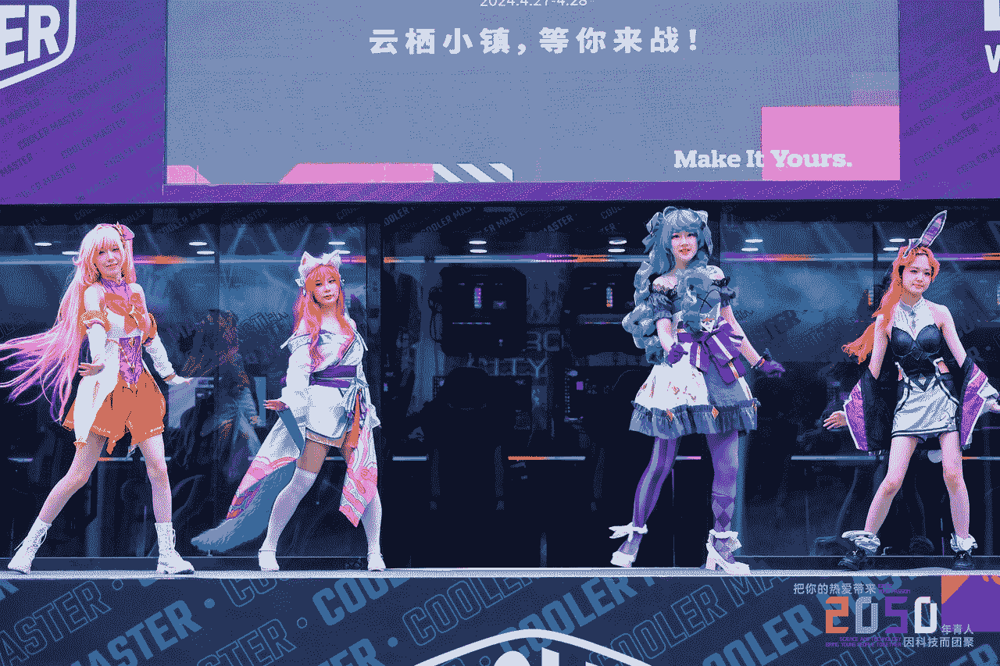

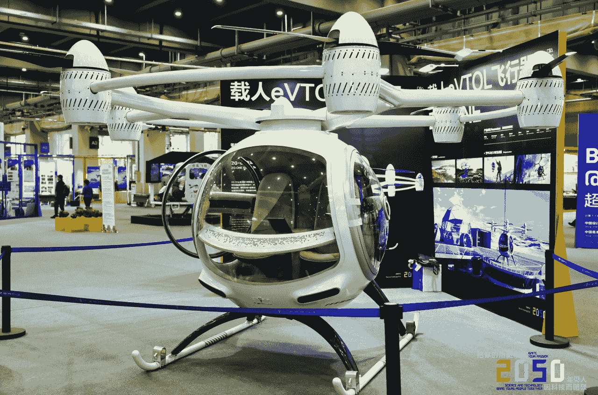

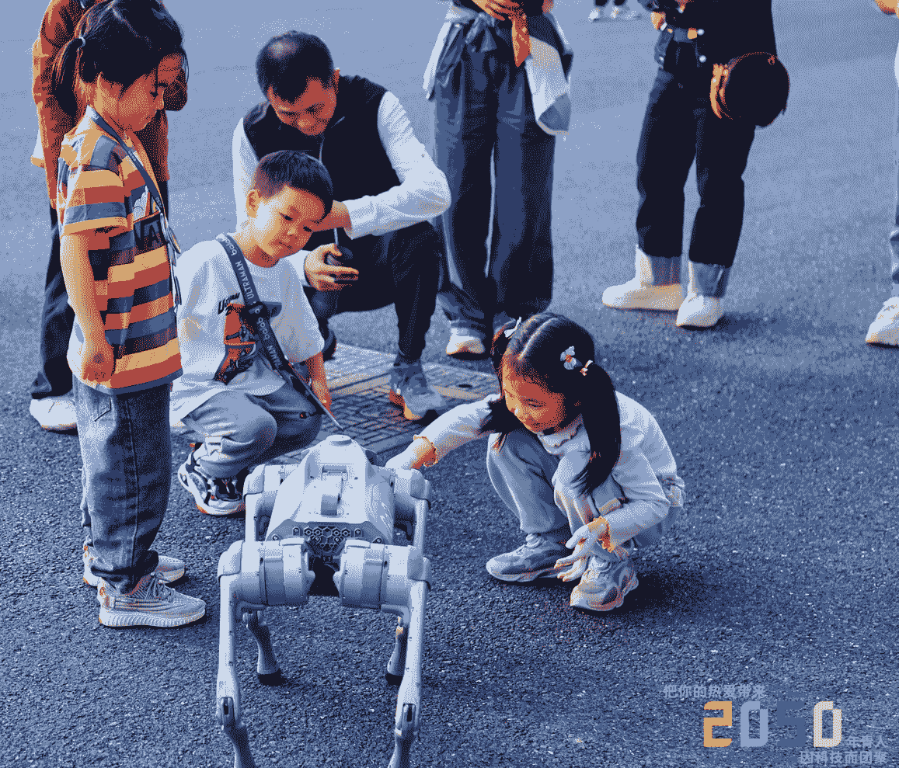

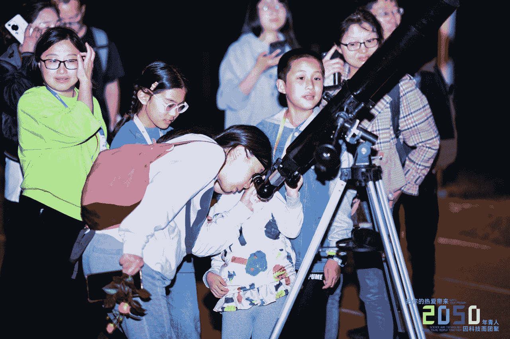

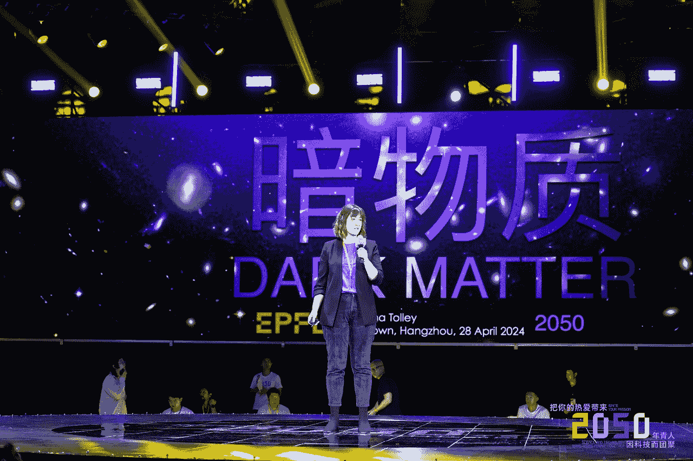

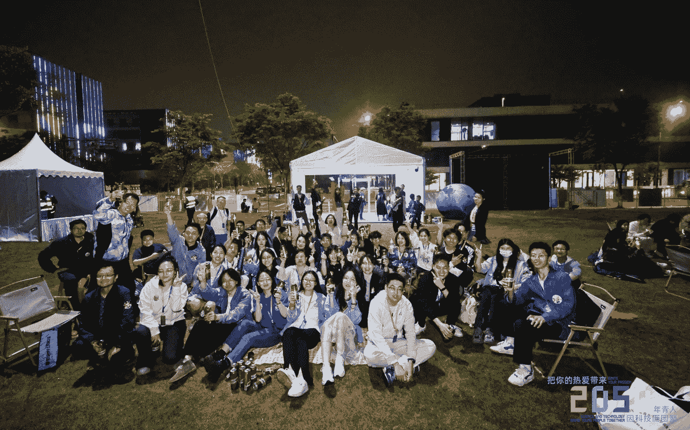

# 离谱是 2050 的主旋律

+   今年的时间是 4.26-4.28，但是，看起来，准确活动安排直到 25 号还在调整。

+   现场有水喝吗？好像没看到啊！

+   现场有吃的？有的，但是，要排队很久，一度以为是为了鼓励大家做筷子，顺便搭配点吃的！

##  创作营在哪里？在哪里？

24 号下午有彩排，报名是用石墨文档做的，几乎没人参加，但是毕竟参加这么”高大上”的活动，为了确保，23 号下午翘班偷偷过来了。经历了 N 个工作人员指引 + N 个保洁 + N 个保安 + 手机导航，从沟里爬了出来。下面是记录的整个过程，当然，也可以说，还不是怪你自己嘛！这就有点 2050 了。

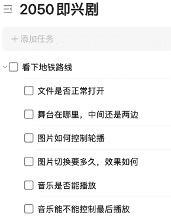

去之前想着，总有个办公室吧，多少总有个指引的牌子吧，为了提高效率，用清单做了要确认的内容。出了地铁，先直奔 360 屏幕所在地吧。不让进，需要施工证。那好吧，记得有人提过一个地方叫创作营。不管 3721，先群里问下位置。没人回，先自己找吧。

+   问了保安 A，不知道。

+   下楼问保安 B，不知道。但是说让问游客中心。

+   游客中心的人也不知道。

+   门口有个保洁 A，不知道。

+   这个时候，群里有人发了定位叫”2050 博悟馆”，顺便问了一下保安 C，让翻过去。

+   自己开定位，同时问路边闲聊的保安 D 和保安 E，让上草地（就是那个坡）

+   这个时候有点累了，顶着太阳，能咋整，上去呗，上台阶碰到保洁 B，让去左转。

+   但是看样子不像，没听她的，往右走了。总算看到一个路下去了。

+   这个时候出现一个尴尬的事，定位看起来博悟馆在左边 100 米，路边的保洁 C 让去右边大马路

+   没办法，继续选择不听她的。（看真是不听话，既然不听咋还问人家呢，真是的）

+   好吧，终于到了博悟馆，elfe 没接电话，老朋友菜菜来接。

+   结果菜菜走得急，没带电梯卡，她也上不去了，她内心可能有一万个问号，你这是来干啥来了？

+   总算上来了。现场忙忙碌碌的自愿者。

+   坐菜菜旁边看她干活。

+   总算见到了 elfe，10 年老朋友见到了。

+   Elfe 给了我一张施工证，也给了我一个电话。

+   又折返回云栖厅，但是实在不想翻上去了

+   问了门口的保安 F，给指了一条路，但是不对。

+   不管如何，问了保安 G，保安 H…… ，总算进入了云栖厅

> 这可以算得上是非常典型的”知识的诅咒”案例，对于去过创作营的小伙伴来说，这是很自然的事，也很清楚 2050 博悟管=创作营。不过后来去找小蓝姐姐的时候，这个等号又有点不笃定了。

很大的概率是，加入活动时间太晚，而创作营的感觉是，它一定是非常醒目的所在，哪怕是临时场所，总归有个牌子吧，显然，既然临时，那就临时到底了，谁去整这玩意呀。后来知道 2050 有每个月恳谈会的机制，对于大家来说，这件事是很自然而然的。

【办法建议】要不然就干脆在 2050 官网加个常驻机构导航？

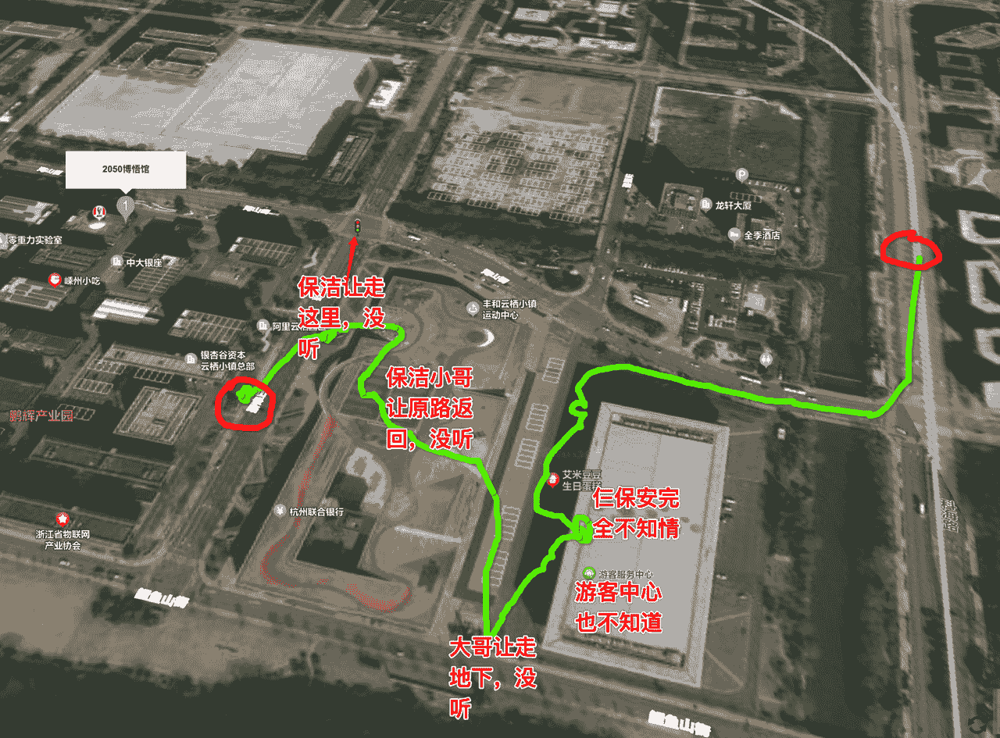

ps： 其实有张非常精美的图，但是当时确实没找到。尴尬，先自己动手，再丰衣足食……

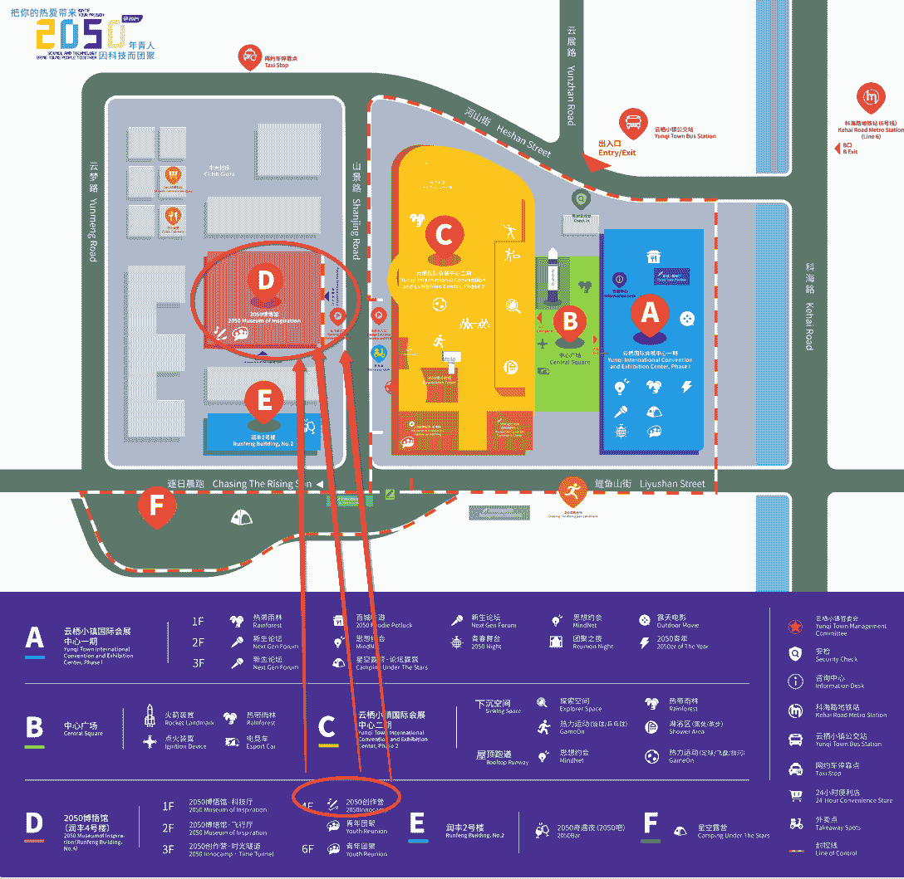

##  360 度屏幕尺寸到底是多少

27 号的即兴剧活动，希望传递 AI 的能力，和离谱村，关键词学社的结合，需要把作品投到屏幕上。于是开始了屏幕尺寸的迷惑之旅。

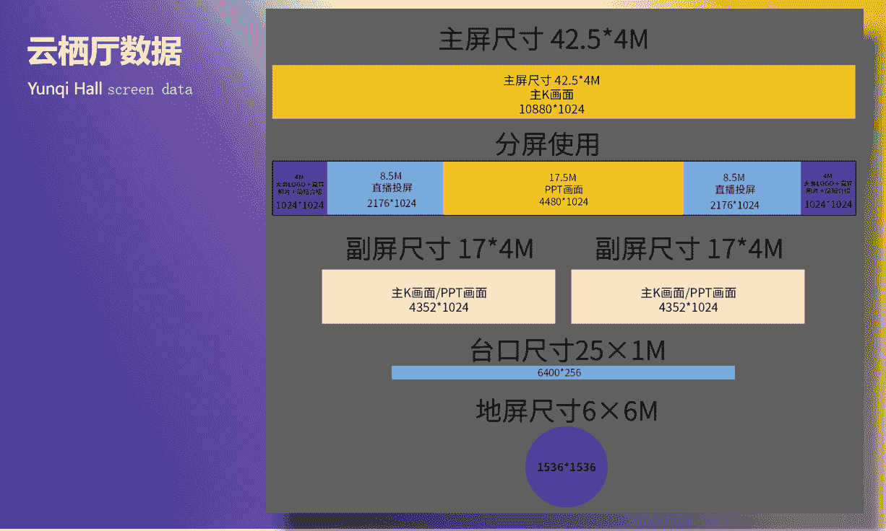

###  屏幕是一个环形

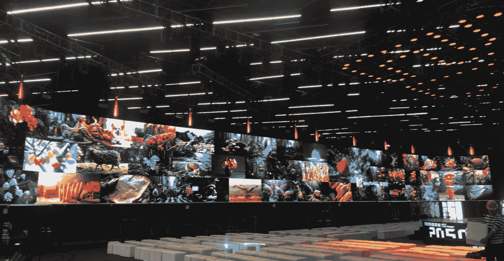

所以需要一个比较长的文件，尺寸大概是 10880 x1024。不太确定上下放几张合适，放多了看不清，放少了有些单调。比较保险的办法是找其他人的图来参考，历史图或者已经做好的图。给了一张图。嗯，一张图。群里喊了一声谁能帮忙做图（小伙伴太给力了）。 陈慧凌 和 綾波レイ 一个人做离谱村，一个人做关键词学社。22 号做的，计划 24 号去现场看下效果。结果说 23 号截止收图了，那 23 号去呗。

这里还有个插曲，22 号之前已经加了现场很多 工作人员 联系方式，试图从中找出来， 官方 的标准对接人。这…… 好像…… 不容易。拉着 AJ 开了几个视频会议，内心开始慢慢放弃了这种沟通方式，微信是不可能微信的，永远都不可能微信。强烈感觉到必须去现场。

到了这里，心理始终有个潜意识，2050 是一个 官方 的活动， 正规 的活动，也就是说啥就是啥，咱也不能拖后腿不是。因为各种设备并没有到位，现场说实话还是比较混乱的。明显能看到各种脚手架裸露在外面。

> 23 号主要的工作是： 认个门。

###  到底是几张图，一张还是几张

终于从 elfe 那里知道了真正能弄清楚的人了，就是现场的老师，应该是请的舞台团队，从这里也终于搞清楚了，屏幕是环形的，实际上一个矩形，4 个角是弧形的。而我们的初步设计是前后左右 4 张图。说到这里不得不感慨一下，小伙伴真是太高效了，我们计划 4 张图，后来加到 6 张，和三思开会以后，觉得不用那么多，确实不知道图是咋回事，现场对了几次尺寸，每次都能学到一个新的知识点……

###  24 号总算搞清楚了

+   无法播放 ppt

+   因为需要非常宽的 ppt

+   无法用浏览器现场生图

+   因为浏览器尺寸无法扩展到他们的设备

+   如果做视频要做很宽的视频，短期不现实

+   不过后来看到了一些视频，包括菜菜的视频，也许是重复的？

+   现场设备无法全屏播放单个图片文件

+   因为服务器打不开 3w 多像素的图片

+   所以推荐拆分成 4 张图

+   除了舞台的老师，几乎所有人都没弄清楚具体尺寸

+   其他人大部分是重复，而我们是不重复，尽量显示更多的内容

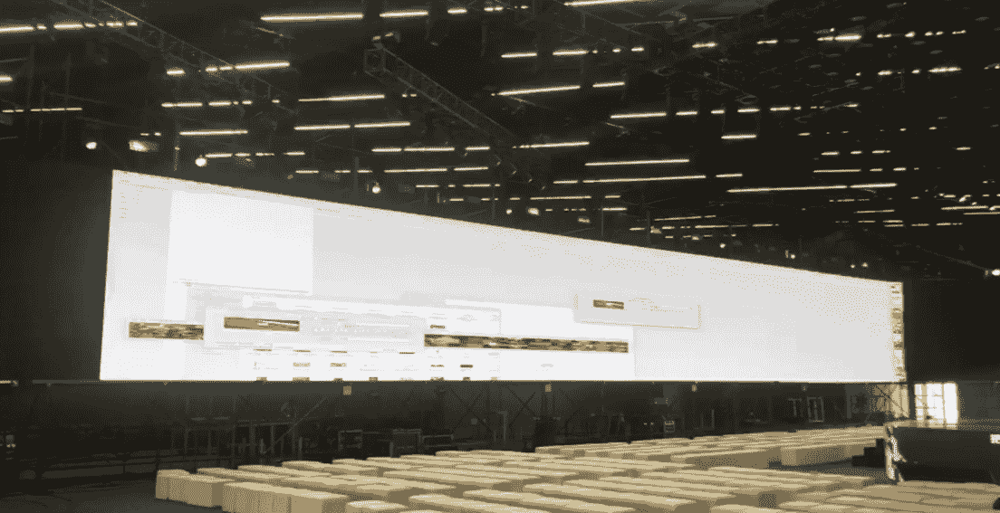

用带的 mac 做尝试，这件事就只能放弃了。

其实现在都没弄清楚屏幕尺寸是啥样的，频繁的电话回忆，三思说懂了，那就好办了，据说那个晚上三思和 AJ 在用 Figma 边画图边聊天，完美诠释了 waytoagi 的优良传统。

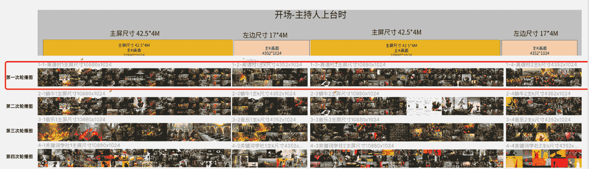

【办法建议】不太确定明年的 2050 舞台是否类似，投屏是否类似，以一个外行人的角度来看，也许可以尝试，针对不同情况的内容可以出一些示例，并把实际效果拍个几分钟的视频，如果有可能的话，还可以针对一般设计师的习惯，给一些样例？

##  西部村民在哪里

为了确保 waytoagi 社群几个活动顺利开展，25 号的时候，几个场地都去了一遍，给小伙伴拍视频，检查插座，投影和音响设备。最后来到了探索空间，然后就迷路了。elfe 给了一张地图，实在没分清楚东南西北，最后还自作聪明跟进地图上的卫生间定位，还是没定位成功。

+   没理解西部村民是个啥，最后找到的时候发现它上面贴了一张小纸条，已经快要掉了

+   开始定位舞台，发现有好几个舞台
好在 elfe 视频电话给解决了。杀鸡用了牛刀。

+

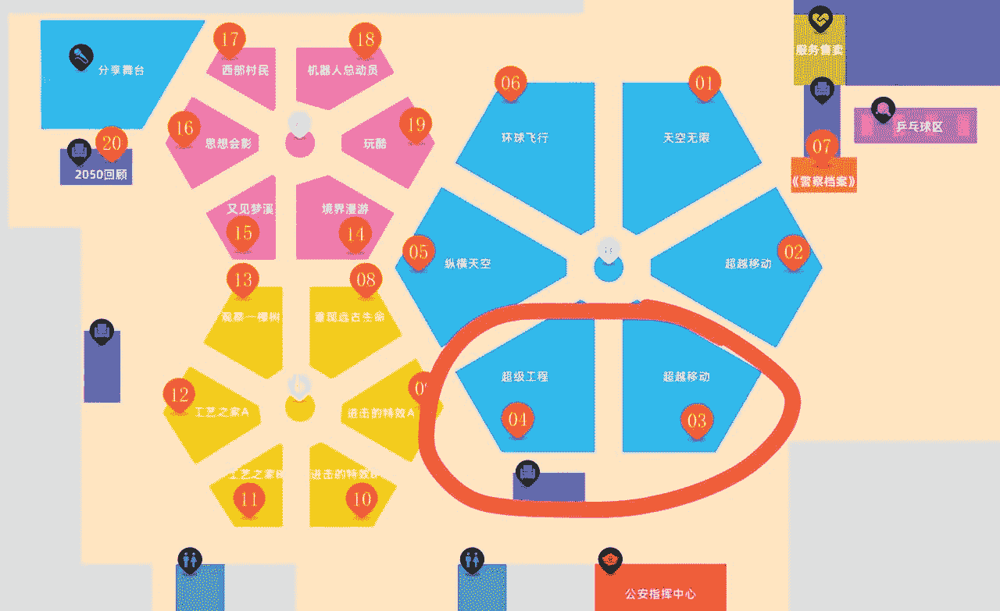

【办法建议】图上放一个大门的标记？可能会好点。这个问题只对装饰的志愿者有困扰，参与的人应该还好，反正闲逛呗？

#  既然这么离谱，你还来干什么呀

这个嘛，咱也是个离谱的人呀。对于 2050，唯一限制，就是不能让公司知道，溜出去摸鱼了。

##  AHAKA 的故事

2050 很有意思的地方在于，对于我这样的 i 人来说，非常好体现了 No Push 的精神。在 10 年前的 AHA 大会上，广川带着大家玩起了毛利舞。2050 开始的时候第一时间联系了他，时间抽不开。

Elfe 知道后，把歌词找出来了（这种脑洞估计也就 elfe 能有了），把回忆也找回来了。

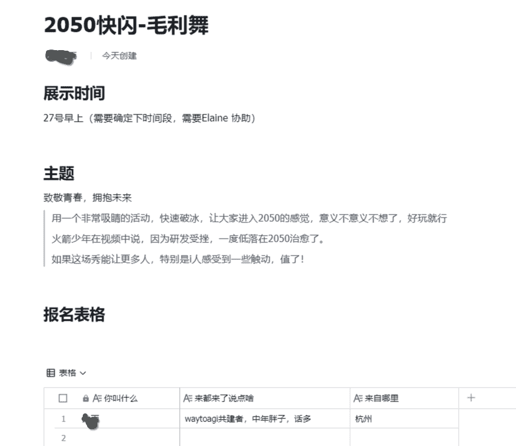

2050 开始前 2 周，心里有一些想法，朋友帮忙梳理出来”成就他人”的使命，认真想来，”脸皮薄”并不是阻碍自己的理由，如果能让另外一个 i 人有所触动，所以，Why Not。

于是在群里简单说了说，内心甚至有点期待没啥人响应，瑞龙和 Elaine 马上响应了，Elaine 的支持特别有力量。

[真正推动想要尝试的是](https://zmtv.cztv.com/vplay/10055595.html?invitationCode=545K0F&zgltv=2&stitle=6aKE6KeBMjA1MCAg5qWa6b6Z6aOe77ya6YCg54Gr566t55qE5Lq6&sdesc=5q+V5Lia5LqO5YyX6Iiq6aOe6KGM5Zmo6K6+6K6h5LiT5Lia55qE5Y2a5aOr5qWa6b6Z6aOe77yM5bim552A5LiA5Liq5Y+q5pyJMTDkuKrkurrnmoTlm6LpmJ/vvIzlrozmiJDkuobkuK3lm73nrKzkuIDkuKrlj6/lm57mlLbngavnrq3ljp/lnovmnLrnmoTnoJTliLblkozmlbDnmb7mrKHpo57ooYzor5XpqozjgILlnKjmraTmnJ/pl7Tku5bku6zpga3pgYfov4foibDpmr7jgIHlpLHotKXlkozotKjnlpHvvIzkvZzkuLoyMDUw55qE6Ieq5oS/6ICF77yM5qWa6b6Z6aOe5Zyo5aSn5Lya5LiK6YGH5Yiw5LqG5ZKM6Ieq5bex5b+X5ZCM6YGT5ZCI55qE5bm06Z2S5Lq677yM6K6p5LuW5pS26I635LqG5pSv5oyB5ZKM6IKv5a6a77yM5Z2a5a6a5LqG6Ieq5bex55qE6Iiq56m66L+95qKm6Lev44CC&spic=aHR0cHM6Ly9pMDUuY3p0di5jb20vY3p0di92bXMvMjAyNC8wNC8xNi83YmQ3Y2E1OGMyMDQ3YzRhYzBjOGNjZGM0ZTA4NDU5MS8xMV82NDBfMzYwLmpwZw==)龙飞的故事（ 楚龙飞：造火箭的人 ），关于火箭少年在 2050 “治愈“的故事。我想，如果能在 2050 留下一些多样性的尝试，或许会有下一个火箭少年的故事，或者触动另外一个如我这般的 i 人，也是好的。（哎唷喂，还上价值了呀，这显然是给自己找的台阶）。真正的“火箭少年“在这里。

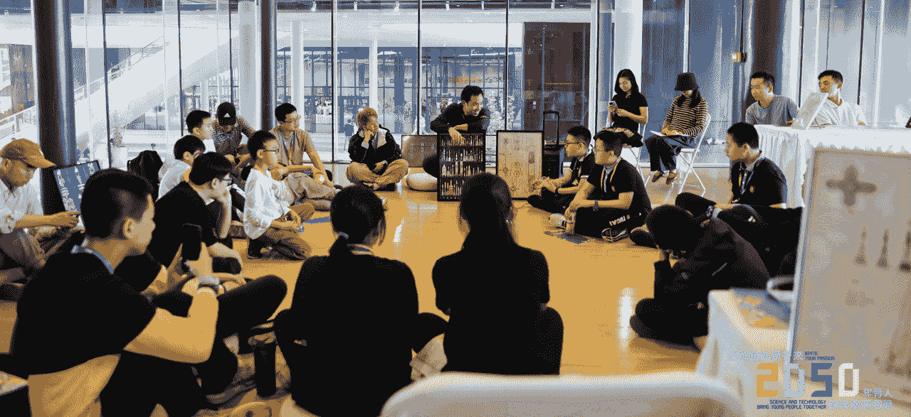

但是真要迈出这一步并不容易，给自己留了 2 个口子，词要重新写，把它寄托在大脑洞的 elfe，如果她说时间，这件事自然而然也就不用开始了。

大家都在弄海报摇人，海报简单一点用 mj 也能弄，毕竟要有点心理建设，所以，把它寄托多年老朋友—视觉达人菜菜身上，她正好给龙飞做了海报。elfe 泼了一盆冷水，菜菜那几天实在太忙了。

26 号开始活动，24 号见到菜菜。

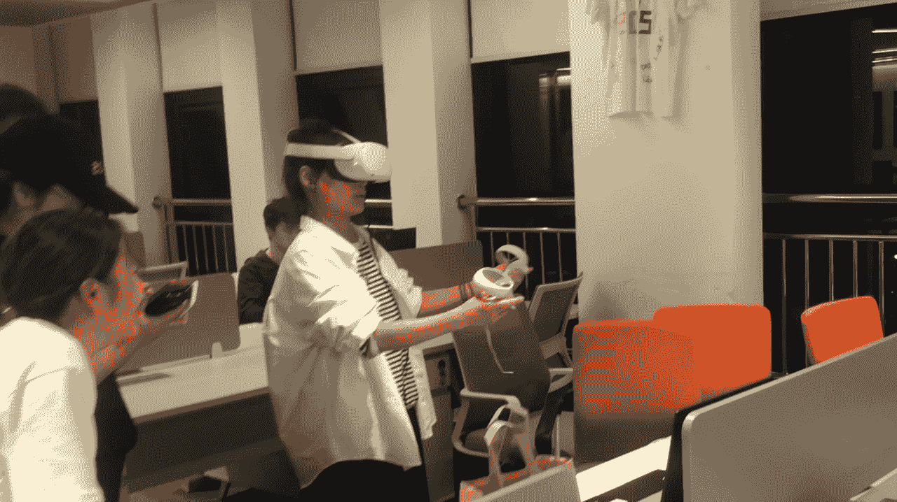

显然，这个时候真让菜菜帮忙，有点说不过去了，心理暗喜，这事可以消停了。

菜菜忙完叫了一声，Elaine 听到了，你就是 XX 啊，AHAK 又启动了。刘军已经在节目单上把它弄上去了。

2050 参与的第 5 个“节目“，正式启动了。大概就是债多了不愁的心态。这件事一开始就没想做，一直也没告诉 AJ，waytoagi 的小伙伴基本都不知道。

4 月 23 号深夜，火速建群，在飞书写好流程，趁着夜深人静，发了群二维码，人数很快满，当务之急需要确认几件事：

+   词要重新写，我得背下来

+   动作要重新编排一下，我得记住教大家

4.25 号从创作营回来，群里依然只有 elfe，elaine，aj ，菜菜和拆封几个”壮丁”，4.26 号凌晨，开始在各个群里拉人。人数很快就快满 100。

鼓动瑞龙帮忙写了词。一件事了了，心理压力小了很多，这里感谢瑞龙。

傍晚时分，召集大家一起排练，奇迹发生了。waytoagi 的小伙伴给了莫大的勇气。低头喊出第一句，来都来了，玩点嗨的呀。从不好意思，慢慢打开了，大家开始加入进来，此时此刻，如果上点价值的话，大概就是 AJ 的那句，”Do It First”。当我开始展示时，小伙伴发现，这动作不就是朝阳大妈公园里面的动作嘛！so what，一起共创呀。

歌词不够好，一起改呗！

动作不够好，一起共创呗！

[🎦 点击观看视频](https://img.iaiuse.com/2024/05/08/307b226e02b26079e1919794ff47c63d.mp4)

视频由 https://melobytes.com/ 处理。

这件事最终因为个人原因没能呈现，Elaine 和刘军都给了很大的包容，也体现了 2050 非常大的容错性，这也是 2050 很大的魅力。你想来，可以，你想整点事，可以，摇不到人，也没事。

非常感谢 waytoagi 小伙伴们的支持，瑾兮又瑜，露西，小田，镜臣……。娜娜还主动请缨帮忙改词。慧凌总是第一个跳出来支持，还有许多认不过来的小伙伴，都非常感谢。

##  青春舞台

在准备即兴剧的过程中，AHAK 的过程中，有次深夜，群里突然冒出一句话话来。夜半时分，莫名燃起了该死的胜负欲。虽然唱歌一般，可以让更多人了解 WayToAGI 的活动也是好的呀。虽然，说是只有 4 个名额。

从截图的时间可以看出来，正好是摸鱼结束准备收拾东西开溜的时间点，确实有点冲动了。

挑战开始了，和 AHAKA 类似的，这件事一度是想放弃的，所以 AJ 并不知道，和 WayToAGI 的小伙伴也没说。

难在只在 KTV 对着字幕能吼两嗓子，现场没有提词器，不光记不住词，也记不住调，23 号趁着人少，手机静音播放，勉强能跟上，多少有点信心了。

24 号排练的时候，前面加了一段话：

“大家好，我是来着 WayToAGI 的 xx，感谢王坚博士，感谢 2050，让我这个 i 人勇敢站上舞台，就让我来给 i 人打个样，唱成哪样算哪样，青年就是玩！WayToAGI 的小伙伴在哪里”。

念完这段发现手机没开始播放，节奏全乱套了。只能尴尬的说，老师能重新播放一下不，还好当时现场几乎没人。

后来尝试了几次，基本上，节奏都没跟上，这……

中场休息的时候，一位志愿者，弹着吉他，唱着流利的英文歌。真好听

> 咋说呢，脸皮厚，还得头皮硬呀。

网上搜了搜，如何掌握节奏，标题是 10 分钟掌握，点进去都要训练好几个月，放弃了。

针对这种情况，GPT 老师也很无奈。最后就靠着开俩窗口，一个播放伴奏，一个静音播放视频。大概练习了几十次，26 号上午才发现，给舞台老师的版本其实还有两段，这事给闹的。……

26 号晚上正式上台的时候，手机飞行模式，本地播放，但是，念完前面那段话的时候，节奏还是乱了，手机基本没用上，靠着感觉强撑着唱完了。最后社群的活动也没顾得上介绍。

非常感谢志良，他的介绍让我的紧张得到了很大的缓解。

deadline 固然是生产力，不过接受音乐，但是，第二天才正式开始填石墨文档，虽然填表的时候，有个选项，24 号是否参加彩排，最后的结果，倒是便宜了我这个新手——一有空就上去吼几嗓子。

【一些思考】常态化的活动可以沉淀为工具，提高效率，新的活动可以是各种临时的文档，石墨，飞书，钉钉，腾讯文档都可以。这次青春舞台有些信息收集是可以考虑固化下来的，从旁观者的角度来看，如果最终的产出物是一份时间表，从填报开始就可以固化下来，需要的设备，需要配合的部分都可以固化下来。

当然，这里的问题可能在于，青春舞台本身也是魔幻的，每年可能都不一样。硬件不同，流程不同，呈现效果也不一样。

##  AI+即兴戏剧

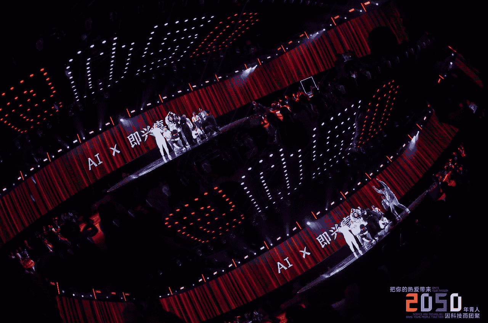

WayToAGI 离谱村视频比赛活动结束的时候，AJ 告诉大家要参加 2050 的事，大概想了几个活动：

+   AI 绘画现场 prompt Battle

+   AI 硬件组装机器人火火兔

+   AI 开发搭建机器人

+   AI 视频视频征集和播放

+   离谱村：海报和现场捏村民写 bot

+   AI 大模型：一起写 prompt

+   AI 玄学：摆摊测验

+   想起来了 10 多年前的 AHA，它是敏捷社群举办的活动，但是严格限制敏捷议题，最后只留下了一个敏捷相关话题。在这次活动上认识了 Elfe（南瓜博士），还有即兴剧的卢正一老师，其中的 Yes And 让人印象深刻，借着 2050 活动，想着能不能跳出 AI 看 AI 呢？抱着试试看的态度联系了卢正一老师，经过多年的积累，他已然成为商业培训大咖了。

+

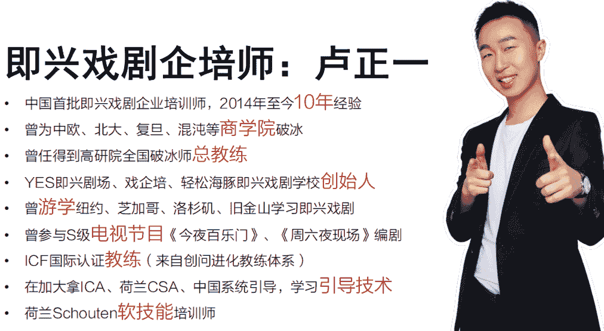

> 2050 的所有自愿者，不论商业大咖还是两院院士，都没有出场费，还得自己掏钱买票，这这个非常奇特的设定，一度有非常大的精神内耗，正一老师提供了极大的支持，但是心理还是不太能过去。后来 Elfe 转了王坚博士的话。”这些人真要请，你请得起嘛”。慢慢释然了，唯有全力以赴了。

###  4 月 4 日联系卢正一老师

AJ 和正一老师都是业界大佬，对于是否能成功连接，心理还是很忐忑的。先给 AJ 看了正一老师的一些上课视频，非常感兴趣。然后试着联系正一老师。2050 和 waytoagi 的精神深深吸引了老师。正一老师也是 AI 的深度爱好者，这太惊奇了。

我当时的情况是 2050 不熟（现在也不熟），AJ 和正一老师都是大忙人，想着能连接这件事就好了。

> 毕竟最大的困扰是，老板不知道我在做这些事。所以，建立连接，就悄悄躲幕后支持就好了。后面事情的发展远远超出了最初的设想。

确定正一老师 26 和 28 有时间，27 要去客户现场。

第一次电话会议，主动介绍了两位，然后发现，这种情况下，让他们自我介绍更好，不得不重新让他俩自我介绍。一方面即兴剧，远远不止”Yes And”。正一老师提到我们可以让其中一个小伙伴表演一棵树，另外一个人表演树上的包子，还有人表演包子里面的馅……

AJ 了麦佬风格的图，正一老师倒是没抗拒，咱是着实给吓到了…… ，展示了离谱村作品。基本考虑 28 号上午的时间了。

凌晨 3 点，AJ 发了 27 号青春舞台的照片，如果能在这里表演是非常好的。

早上 9 点左右，正一老师告诉我们，客户可以改期到 26 号，这样的话，27 号他就能来杭州，在青春舞台展示 AI+即兴剧了。

下午 15 点，客户有情况无法改期了，27 号错过了。当时我也不知道咋就冒出来一句，说不定后面又可以了呢，结果真的可以的了。

拉 Elfe 入群，确认闭幕式时间，确认我们 28 号的行程，个人出发是希望能展示更完整一些，Elfe 对 27 号无法成行有些遗憾，那可是 1500 人的场哦。别的不敢说，Elfe 的脑洞那是相当大的。

Elfe 还给出了这样的扑克牌惯蛋，这可太有文化了，文化人打牌，那还是打牌不。

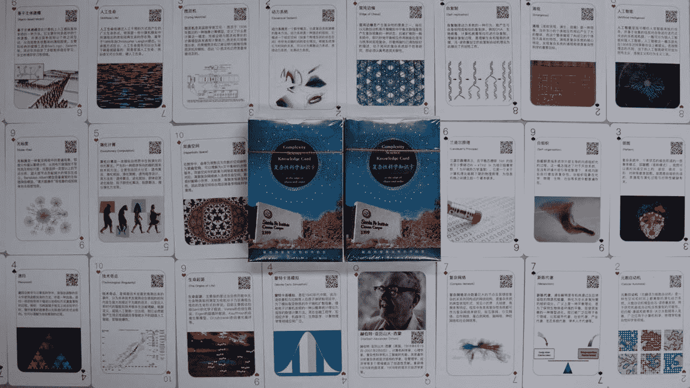

AJ 要去公海，消失 5 天时间无法联系，开始创建飞书文档，找老师要海报。

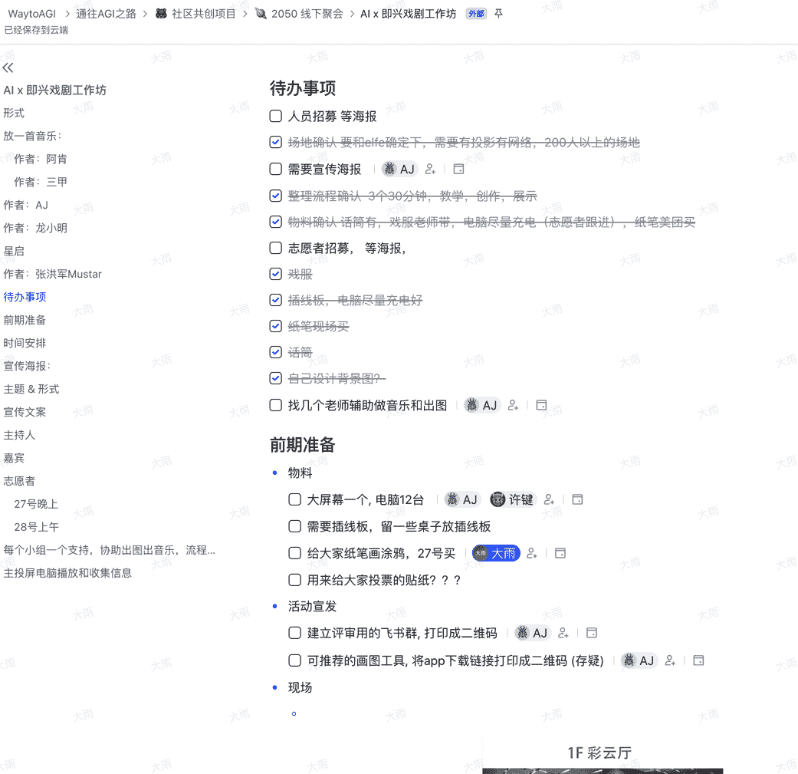

经过梳理，最想确定下来的是表演过程，只有清楚了舞台展现形式，才能更好配合。经过后面的几次会议，发现好玩最重要，一切随性，随缘，放松。

今天至少确定下来，场地是室内而不是草地，人数想象成是 300 人，其中 80 人上台表演，剩下的围观。80 人分 10 组，一组 8 人，出 3 张图，上台表演。

这个时候，大概的流程是：

> 学习半小时，小组创作半小时，上台展示一组 5 分钟，8 组 40 分钟，串场 1 小时。每组 3 张背景图。大家用纸笔涂鸦，画故事板，然后用 AI 实现投影上去，演员靠涂鸦演绎故事。

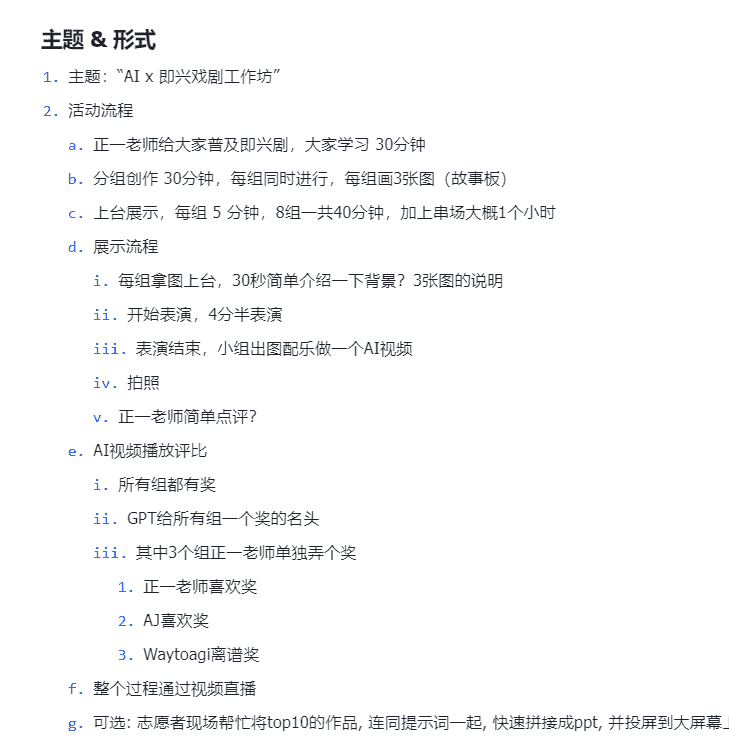

探讨评奖的事，想象中是 8 个组，每个组表演结束以后，在组长背后贴个小星星，到时候数个数，增强一些趣味性，评奖的目的是为了好玩，奖的名词可以是 GPT 生成的，奖状也可以是 MJ 生成。主打就是离谱+好玩。最后都没顾得上这个环节。后面一段时间都在跟进 27 号晚上的屏幕尺寸了。

和 Elfe 确定可以考虑 3 楼，时间按昨天的算法，差不多 2 个半小时—3 个小时。倒推就是 12 点 45 开始，建议是 12 点 45 开始，12 点半开始进人。

这个时候有几个顾虑，2050 对 AI+即兴剧不了解，即兴剧对 2050+AI 不了解，AI 对 2050+即兴剧不了解，真是绕。

考虑是在海报上放一些二维码，让各方面的人都能了解到。因为场地的考虑，大家想着 30 人也行。我稍微保持了一点倔强，按 80 人准备，30 人保底，人少就探索深入一些。大家认可。

关于志愿者，正一老师一直独行天下，几百人的场也是一个人 hold，所以志愿者就是 AI 技术支持了。此时 AJ 还在海上，后面的脑洞还没有出现，所以想着一个组一个人支持出图出音乐，留一个人投屏就好了。

开始确认物料的问题，比如是否需要戏剧幕布？算起来好像也没啥物料，唯一想到的就是贴纸，最终也没用上。

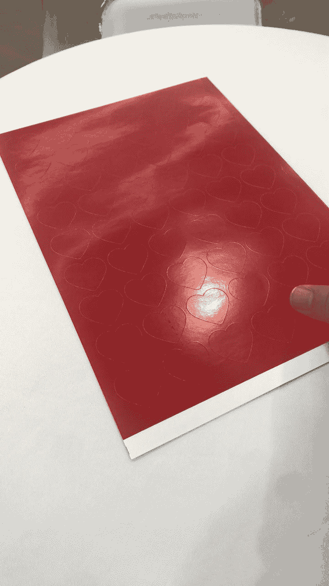

超越开始加入，也能帮忙做海报，此时还不知道 AJ 已经带着小伙伴默默干了很多活了，WayToAGI 的整体 VI 也在迭代中。大海的那头，终于飘来了 AJ 的声音。

Elfe 这个时候帮忙说了下 2050 奇葩的规定，大家都要自己买 pass 卡，心理释然了很多。

AJ 开始构思文案和海报。第一次几个有趣的灵魂开始脑爆了。

流程开始调整：

1.  有即兴喜剧的老师先给大家讲规则

1.  然后大家上台即兴表演，大家上台用肢体语言描述一个场景或剧情（可能会比较离谱，比如表演了一个包子，一棵树，一只猫）

1.  有了这个画面之后这组同学下台开始做这个画面的剧情创作（可以用 midreal 快速写出来），用 AI 绘画快速展示，suno/udio 提取其中的关键词/剧本写一个 AI 音乐。

1.  最后再返场展示

同时，AJ 说有个写 AI 小说的小伙伴聊，当时没在意，后面有惊喜。我的注意力在那个飞书文档的待办事项，再来点意外脑爆，确实很脑爆。

也在这个时候发现正一老师的 AI 也玩得溜。

也是今天开始，群里开始进人了。

> 本来打算用戏服，但是可能会因为戏服限制发挥，综合考虑不用戏服了。

2050 官网蜂巢发起活动。各个海报让三思开始连轴转。AJ 在一个学校尝试了一下，效果非常好，并承诺给这个活动拉来至少 20 个人，因为这个时候即兴剧的群里还不到 40 个人。

Stuart 实在太给力，早就准备好了志愿者，要多少就摇来多少。先拉来被 Stuart 称为最给力志愿者王贝，这个时候还没有想要表演形式，志愿者也不好定人数。这段时间讨论最多的还是流程。到了晚上 21 点，志愿者全部到位。当时想着一个人机动，10 个人就够了。

Elfe 确认 27 号晚上我们能有 5 分钟时间表演。具体多长时间要看 rundown 安排。虽然有专业队操刀，还是紧跟着专业队软磨硬泡。

> 因为 23-25 号这几天都泡在现场，直接把时间要到了 10 分钟。

AJ 和三思开始奋斗海报了。

大家继续讨论即兴剧 28 号的流程，避免因为时间太长大家不来，所以建议时间缩短到 90 分钟，如果玩嗨了，时间延长一些，后面就是闭幕式了。

凌晨 3 点 33，三思发出了海报。可怜的孩子。

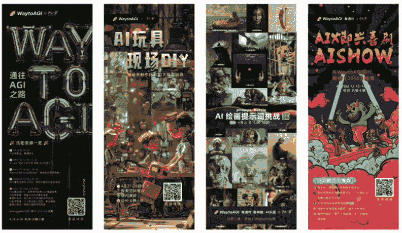

这个时候，如果提点意见是不是太没人性了？嗯，是的，于是，提了一个小小的意见。为什么有人会提小小的意见呢？因为，离谱村视频比赛最后阶段了，还在抽玲珑猫的卡。

5 点 03 分，aj 发出了所有的海报。

9 点 44 分，elfe 说了海报的要求，因为是做易拉宝，另外还会放海报大道，2050 统一印刷，所以……，还得改。

11 点 54 分，aj 说醒了，接着改。另外有张海报的某个元素需要调整。

Stuart 开始宣发。

凌晨大家还在为离谱村视频决赛冲刺，凌晨 4 点多，元子和 AJ 还非常兴奋讨论剧情，大家基本上就开着会议，啥也听不见了。

今天决赛，AJ 元气满满主持。

另外一边，2050 的快闪活动需要几个介绍人信息，Stuart 和我一起收集信息。快闪活动据说是在院士面前讲的。

青春舞台需要我们填时，需要找志良，但是他太忙了，一直没能很深入对接。

凌晨的时候搞定了 AI 绘图帐号的问题。

三思加入对接群，准备做 27 号晚上的图，这个时候关于尺寸的漫漫征途，变得具体而又形象了起来。思路有了，离谱村生物和关键词学社。进入第一个群，环屏技术对接群。

这个时候志愿者群里面 陈慧凌 和 綾波レイ 帮忙出了一套，当时想着 27 号才用，应该不着急吧，结果说 23 号就截止了，得了，明天去现场看看吧。

但是还是不放心，各个群都看了一遍，好像也没有太多有价值的信息，晚上和志良通了电话，但是也没有确切的信息。不过知道了一个知识点，灯光是编程控制，而且事先编程，如果需要灯光的话，就得代替正一老师走一遍，这个时候内心已经脑部了很多场景和画面了。硬着头皮上吧！

早上拉着正一老师和 Aj 开了个小会，有了蜗牛的故事。电话里：

+   我是一只蜗牛

+   我是蜗牛背上的房子

+   我是房子里面的大象

+   蜗牛跑得很快

+   超过了一辆跑车

+   我是牦牛交警

正一老师给自己封了个“离谱村的脑浆搅拌官”，绝了！

AJ 很快就给出了 AI 音乐。正好 27 号晚上能用上。

[🎧 点击收听音频](https://img.iaiuse.com/2024/05/12/%E8%B6%85%E9%80%9F%E8%9C%97%E7%89%9B2050.mp3)

基本上，表演形式确定下来了，大家心理也算是”对齐”了。

27 号晚上上台需要人，正一老师希望 AJ 和我都上去，还是希望多给小伙伴一些参与感。招募 6 个小伙伴，因为要上台，发起投票的时候还担心大家不好意思，把自己拍第一个，结果，秒抢呀！

白天公司事情有点多，断断续续摸鱼，本来计划下午去现场也没去成，微信找了几个人都不对，最终都没有确定下来尺寸。

下午 17 点 32，AJ 表示搞清楚了，要重新出图。

晚上 Elfe 和 AJ 直播，引起了非常大的反响，胡凯翔还做非常详细的攻略！

AJ 把图出完了，下午去现场开始对接，列了要对接的几件事，重点还是图片展示效果，实际看到才踏实。其中的波折就看上面的内容吧。确定了音乐可以单独一个一个控制音乐的老师，重点还是图片。虽然小伙伴昨天熬夜弄了图片，现场对下来并不是那么回事。

好在总算是找到了真正对接的老师。放的时候正好志良也在，给了一些修改意见，不能放二维码，不能放 logo，图片也要精良一些。

拉着三思开会，老实说，我已经听懵，三思表示听懂了……

图的问题和小蓝姐姐对清楚了，也搞清楚了舞台老师的工作模式，万事俱备，只缺新图了。期间还有 4 图–>6 图–>2 图–>又 6 图，这样的过程。

需要志愿者帮忙跟进舞台，和正一老师打配合。小霞手速快，上台的小伙伴换成路西。

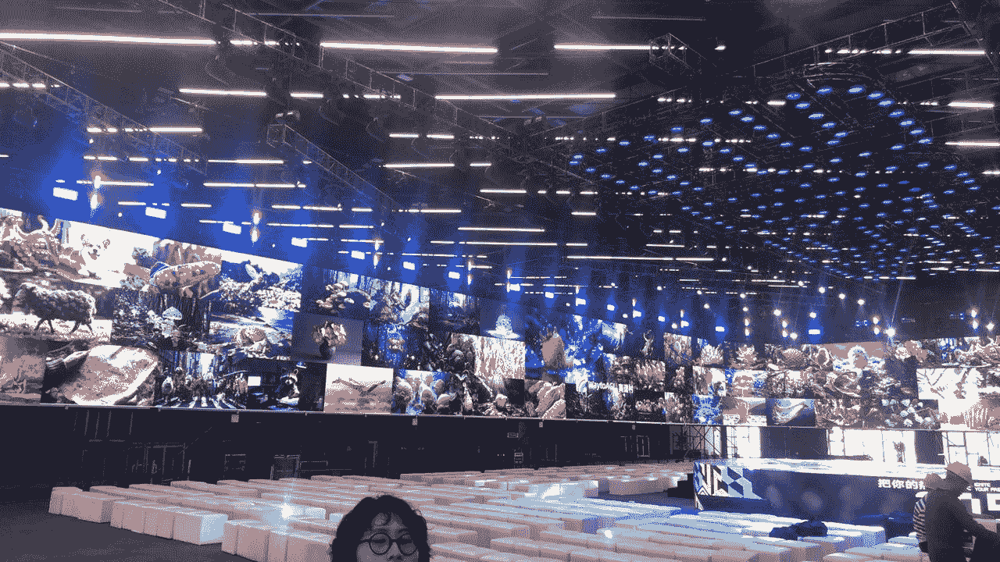

继续摸鱼溜出来，不得不说三思和 AJ 太严谨了，图片命名特别规范，舞台老师一看就明白了。

现场分别放了 4 个场景，每个场景都是满满的图。虽然觉得哪里不对，但是没想明白，正一老师点出了主题，离谱村的震撼犹如一道美食，需要层层递进，让大家慢慢感受。

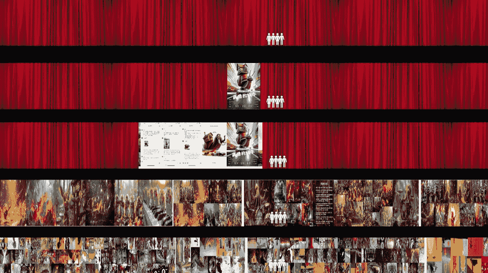

又是一个不眠之夜。AJ 又来活了。

记者密度太高了

###  4 月 26 日团聚

带着 AJ 快速找舞台老师把最终版图片放进去。

快速带小霞和舞台老师认识，交代流程，和正一老师确定好，何时切画面。

###  4 月 27 日青春舞台亮相

小伙伴们中午就彩排过，流程都熟悉了。

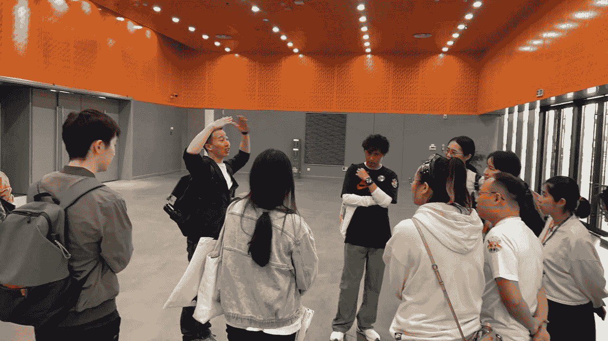

晚上，开始了全场轰动的呈现。

###  4 月 28 日即兴剧工作坊正式开始

大家对工作坊正式的时间一直有不同的想法，时长也有不同的看法。

关于时长：

+   超过 1 个半小时，可能打消一些人的想法，从而错过

+   太短对现场的节奏把控就更难。

+   12 点大家可能都还在吃饭
最后结果是：

+   13 点正式开始

+   12:45 开始签到

+   预计 14:30 结束

+   实际完成接近 15:30 了

+

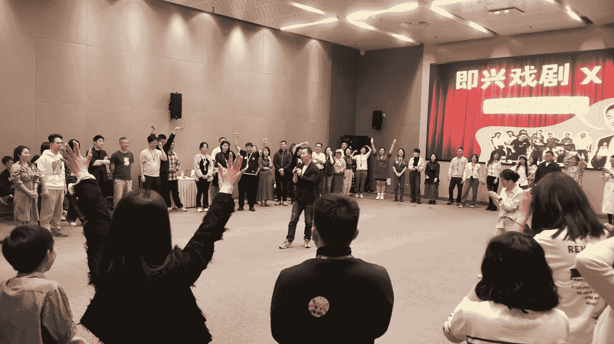

最终的呈现效果，不能说完美，也真的是完美。正一老师的控场能力惊艳了所有人。300 来人的场，玩嗨了！

> 一个小插曲，2050 的小册子上写的是 12 点开始，易拉宝海报是 12 点 45 开始。后来现场也确实有人 12 点过来问，不知道后来她有没有人来。

为了让大家对时间理解一致，正一老师编辑一段文字，，还好有 stuart 在，早上 9 点多少，超越和 stuart 一起帮忙贴在门口。

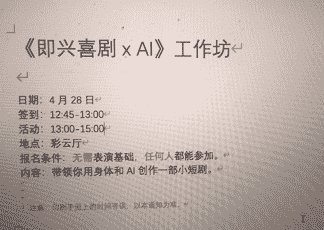

因为一些原因，28 号到的时候已经接近 11 点，还好 Stuart 把 Prompt Battle 的电脑和各种物料带过来，又忙着去撤展了。我守着一堆电脑有些着急。心理还是想着，8 个组，一个组 10 个人，每个组配一个志愿者帮忙过流程，已经如何出图。

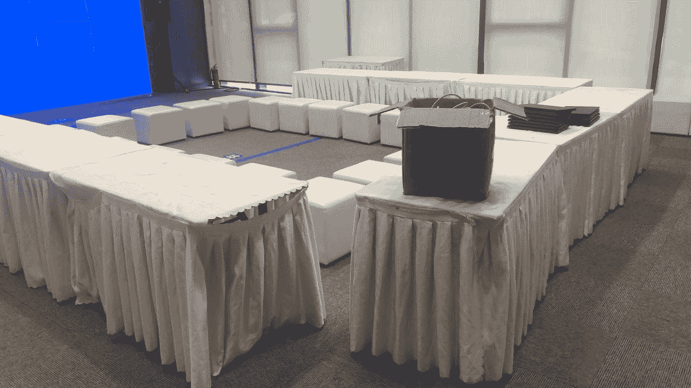

> 可能个人有些老派思想，每次和正一老师还有 AJ 开会，不超过 5 分钟，脑浆就不够用了，他俩肆意搅拌，我认真听讲。也因此担心几百人的参与体验如何。

承载了那么多人的努力，说起来太希望这件事做好了。

11 点多志愿者小伙伴陆陆续续来帮忙，最担心的流程问题，前一天已经彩排过了，电脑只有 9 台，暂时就按 8 组来准备，一台用来投屏。为了简化过程，每个人认领一台电脑，负责电脑有电，有网，能上 YC（YC 赞助了很多帐号）。

脑子里面快速过了一遍：

+   所有志愿者都知道流程，流程就 ok 了

+   一共 11 台电脑，2 台有故障，一人认领一台，随身带着，这个也 ok 了

+

+

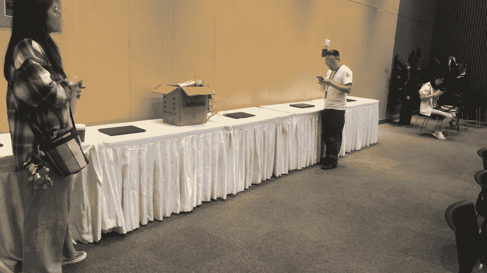

12 点多，人开始陆陆续续进场，人数远超预期，最初的想法是 8 个组表演，其他人观摩，志愿者小伙伴等着看看能干点啥，正一老师说，接下来交给他就好了，带着超越开始热场，所有人席地而坐，围成小圈开始开始彼此熟悉。这个时候，远远不是 80 个人，我的脑子里还想着电脑的事，有点魔怔的，一方面很多人带了电脑，只是出图的话，手机完全可以完成。

**神奇的规则：**

一开始老师带着我们做了一个小游戏，当老师说 Hello，大家就跟着喊 Hi，老师说 Hi，大家就说 Hello。这个事大家都没放在心上，就这么喊呗。

后来才知道，这个是一个非常神奇的“工具“，当全程陷入疯狂的创作中，想要拉回注意力时，不用喊”大家停一下，看我”。而是说”Hello”，有人开始附和“Hi”，注意力又拉回来了。

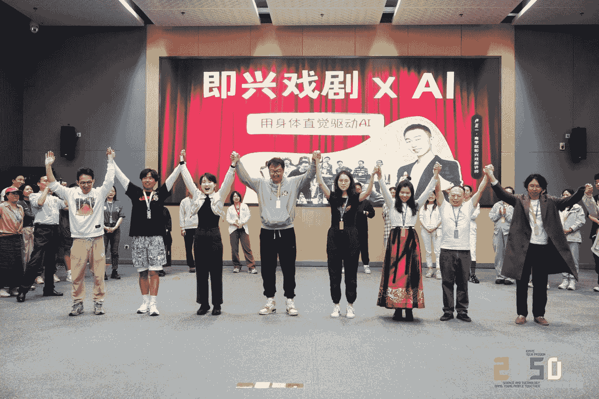

**开始分组：**

所有人围成一个大圈，按月份的顺序分成小圈，人数相当，一个组 10 多个人

热场小游戏：

所有人有 4 个状态，蛋，小鸡，恐龙，天使。初始情况下，大家都是蛋，通过和相同基本的小伙伴石头剪刀布，赢的人升级为小鸡，小鸡和小鸡可以石头箭刀布，赢的人升级为恐龙，输的人退回蛋的状态，最后是天使，天使可以决定升到天堂，也就是大屏幕底下，不玩了，也可以继续玩。

很快整个场子陷入了：

+   我是小鸡，你是什么

+   我是小鸡

+   石头剪刀布

> 很重要的一点，配合 4 个形态，都相应的身体姿态，一圈下来，身体就打开了。

场子完全热起来了，”Hello”，“Hi”……

**开始练习：**

让 27 号青春舞台的小伙伴开始展示，一个人一句话，一个人一句动作，不得不说，小伙伴们太“离谱“了，有人是一阵风，有人是一条马路。基本的原则是，后面那个人要接着前面的人剧情走，也就是所谓”Yes And”。

我们小组分别尝试了恐怖片，科幻片，喜剧片，第一个故事还有点没打开，后面直接玩嗨了。

“Hello”, “Hi”

这个时候我们还只是在玩海报。所有人通过人体构建一个海报。接下来开始真正的创作。一个几分钟的故事。需要海报需要故事情节。

这个时候，发现在 AJ 旁边有一个非常帅气声音还非常好听的小伙，给大家展示了一个 AI 工具，它可以快速帮我们生成一个完整的故事。中间还能提供一个故事分支的选择。

10 天以后，在整理 2050 记录的时候，才知道这个小伙居然是 midreal。 Ai 的创始人，翻看历史聊天记录发现，第一次参加 waytoagi 线下活动的时候，一个长发飘逸略带腼腆的小伙子，短短几个月，居然褪变成如此大咖。

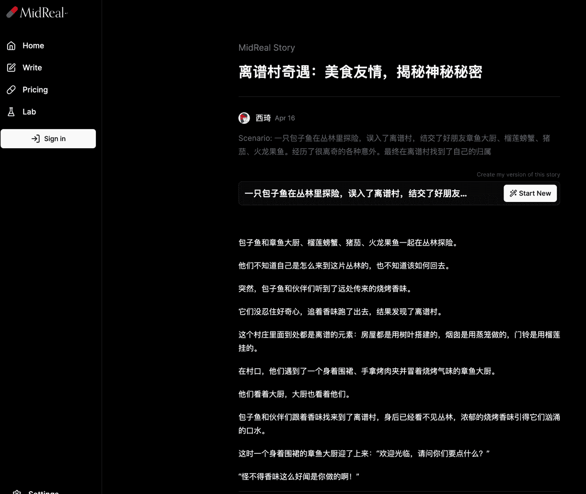

AJ 快速在飞书建立了文档 [AI 即兴喜剧 ](https://waytoagi.feishu.cn/wiki/RrCYwEMioisgiBkjx7TcoXlAnhg)，大家把作品发布到里面。

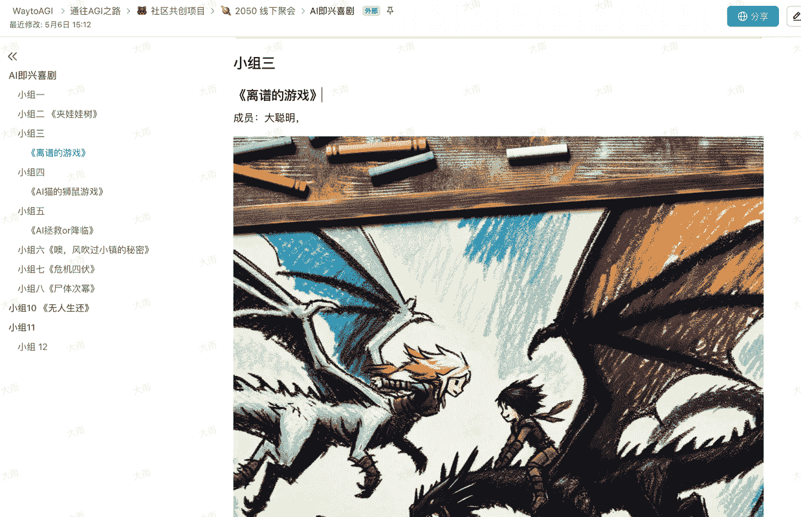

**开始展示：**

我们组展示的是<无人生还》，一艘船在海上航行，前有伪装成小岛的海妖，后有巨型章鱼捣乱，2 个船员还为救生艇大打出手，最后各种状况下，只剩下一片木板飘在海上。不得不说，小伙伴太给力了，短短几分钟搞出了那么多图，飞书的小美女还用 suno 弄了一首歌，大家都在感慨，卷起来了卷起来了。waytoagi 的人传人现象。

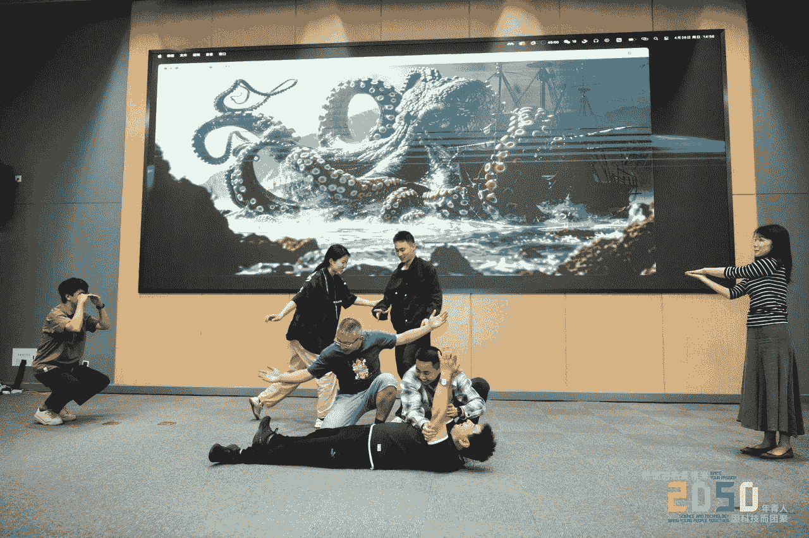

还有好多小朋友也参与了进来，非常嗨。

但是可爱的志愿者小伙伴我却没照顾好，AJ 看着志愿者们站着不能参与有些心疼，让大家进组玩，组里都有一个志愿者，每个组都确认了一下。

AJ 呢？AJ 在管投影的事，带动大家推进，默默在兜底。

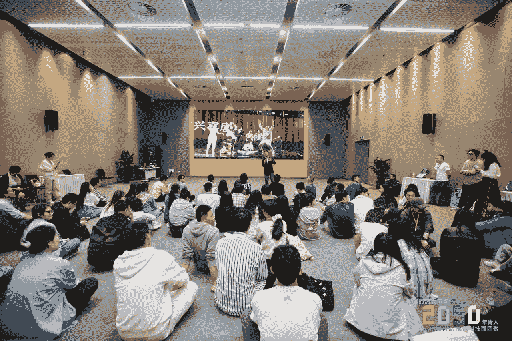

> 27 号上台的小伙伴也不是最初定的 6 人，而是 10 来个小伙伴，28 号的流程和前面讨论的也有很大出入，几乎所有人都上场了，不得不说，AJ 和正一老师的脑洞真大，还能兜底。一开始担心流程出纰漏，影响现场效果的担心，纯粹是多余。

##  遗憾的 2050

一开始组织活动的时候，Elfe 就以过来人的身份提醒我们，别搞那么多，要多一些时间去玩，她召集了 70+场活动，显然是不可能有时间参加的，看着我们热火朝天，时不时提醒我们悠着点。

比较感兴趣的是复杂科学和亲子教育，加了几个群就没顾上了。凯翔整理了一份攻略。不过即使参加，错过也是常态。

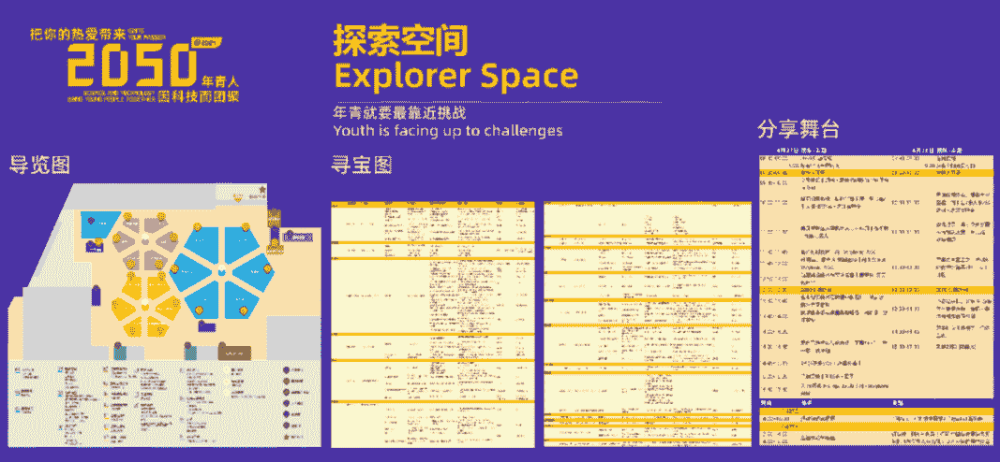

这个还只是一个探索空间，类似的还有 9 个。显然，不错过是不可能的，走马观花都不可能。明年再说吧。

说完在 2050 的经历，说说眼中的 2050。

#  自愿不是志愿，奇葩的 2050

##  神奇的缘分，所有的遇见都是久别重逢

24 号彩排的时候一个自愿者和舞台老师对 ppt。讲的是关于带领 10 多少小朋友横渡英吉利海峡的故事，打算等他们谈完交流下加个联系方式，结果一个电话错过了。神奇的是，27 号下午带猫叔去云栖厅坐着等社群大部队，好巧不巧，正好是这位自愿者分享，正好 ppt 上放出了他的微信号。

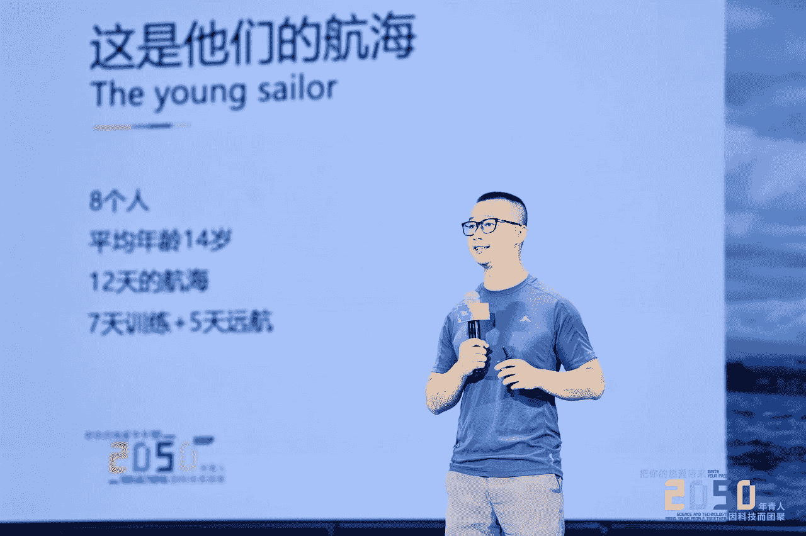

还有老朋友菜菜，好几年没见了，这次 elfe 拉到召集人群的时候发现她也在，刚开始并没有想着如此深度参与，就潜水不说话，后来想着要找人做海报，又不能惊动 waytoagi 小伙伴，只能找菜菜（大美女来着，要联系方式留言哦）了。后来发现拆封也在，还有几个十多年没见的老朋友。

##  平易近人是什么体验

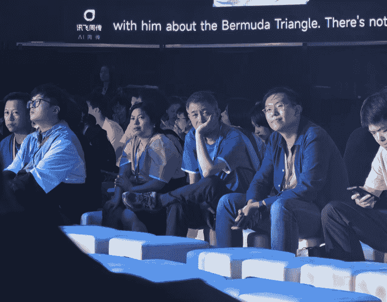

26 号晚上打算排列 AHAKA 的时候，看到王坚博士一波又一波的朋友。

28 号下午闭幕式的时候，远远看到博士一个人慢慢从后面走进来，找个空位坐下，仅此而已，毫无排场。

记得以前报道中，博士曾经也是西二旗站的常客，背着双肩包？那段时间也一直复兴门，西二旗来回倒腾。后来看到阿里年会视频，落泪的博士，和眼前略显拘谨的模样，亲和力。给人很安心，很踏实，很有安全感，深深感受到无形的力量。

做了会思想斗争，跑去合影，博士略带腼腆，轻轻说，先听完。实在有点不好意思。

闭幕式的时候，一位自愿者说 2050 是精心准备，一丝不苟的盛会，王坚博士却说它是糊里糊涂的开始。然后它说改变很难，用了一个很小的例子，我们的屏幕虽然是 360 度环屏，但是实际上镜头只有一个方向，也就是说，台上的演讲者只能对着一个方向，他在投屏上才是正脸，有一部分观众只能看到他的背面，而这还是一个小孩子指出来的。

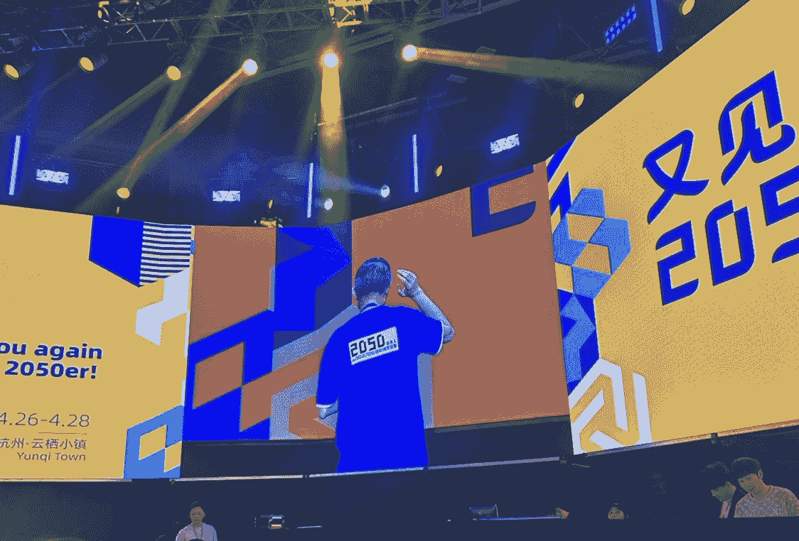

博士就故意背对镜头开始他的发言。真是一个可爱又认真的“年青人”呀！

##  2050 一定要有学术积累吗？

诚然，2050 有很多学界大咖，这并不重要，它只是提供了一个舞台，我们相信，随着越来越多的年青人，自愿者参与进来，会给 2050 留下更多的足迹，也会有更多有意思的活动在它这里沉淀。

有逐日晨跑，虽然是第一次参加 2050，我相信逐日晨跑也许只是一时兴起，渐渐成了固定项目。拔河又何尝不是呢？哪个“正经“节目，拔河还拔那么多次的呢！

说到拔河，非常对不住哲哥，完全没顾上，摇人在 2050 是个大难题。

如果你突然想到一个点子，想要召集一群人一起来做思想碰撞，当然可以，振臂一呼，有人来听你扯淡，也是很好的。

##  No Push 和容错

我想，我对 2050 的理解自然会有偏差，不知道现在有多少人能完全讲清楚哈是 2050。博士创立之初也许定下了基本的规则，然后自然衍生了出来。

2050 的 No Push 是我给它取的名字，所有的活动，你想发起就发起了，只要有人来就可以，搞着搞着不想搞了，撂挑子，也行，看你心情。

第一次我说弄 AHAKA 有点没底，Elfe 直接告诉我，现在不做就不做了，刚开始还觉得有些不太好的感觉，后来慢慢发现，这是非常难得的，最终因为各种原因放弃 AHAKA，放了 100 多个人鸽子，并没有人指责，也不用承担什么样的精神内耗。今年做不好，明天继续呗。

这也可以说是容错，听志良说想做青春舞台的主持人，问王坚博士可以吗？回答是，Why Not？

这段话有我演绎的成分，大概意思就是，2050 给了大家极大的包容性。我想，如果能确保安全，去支个摊，讨论一下煎饼的 18 种做法也是可以的。

##  所以什么是 2050 呢？

这就是 2050，大家都来了，你来吗？

可能更有意思的策略是今年深度参与一个，同时多玩几个，明年再换，错过是正常的，上百场活动，哪里都参加得过来呢？

年青因年青而相聚，你足够优秀吗？你足够帅气吗？你足够好玩吗？你足够爱自己吗？想啥呢，来就是了，你想发起一个“扯淡”的思想碰撞？你想参加一个”离谱”的活动？岁月荏苒，时光飞逝，在人生的道路上，去看看呗。

#  什么是 WayToAGI

2023 年 4 月 26 日，WayToAGI 诞生，2024 年的 2050 年，它的生日庆典。

WaytoAGI 是由一群热爱 AI 的专家和爱好者共同建设的开源知识库，在没有任何推广的情况下，一年的时间已经有超过 70 万用户和超千万次的访问量。是很多 AI 爱好者知识的源头。社群的 Solgan 是让更多的人因 AI 而强大，有很多学社和共学共建的活动。Waytoagi 就是通往 agi 之路，打开 “waytoagi.com” 就可以找到社群了，欢迎来玩。