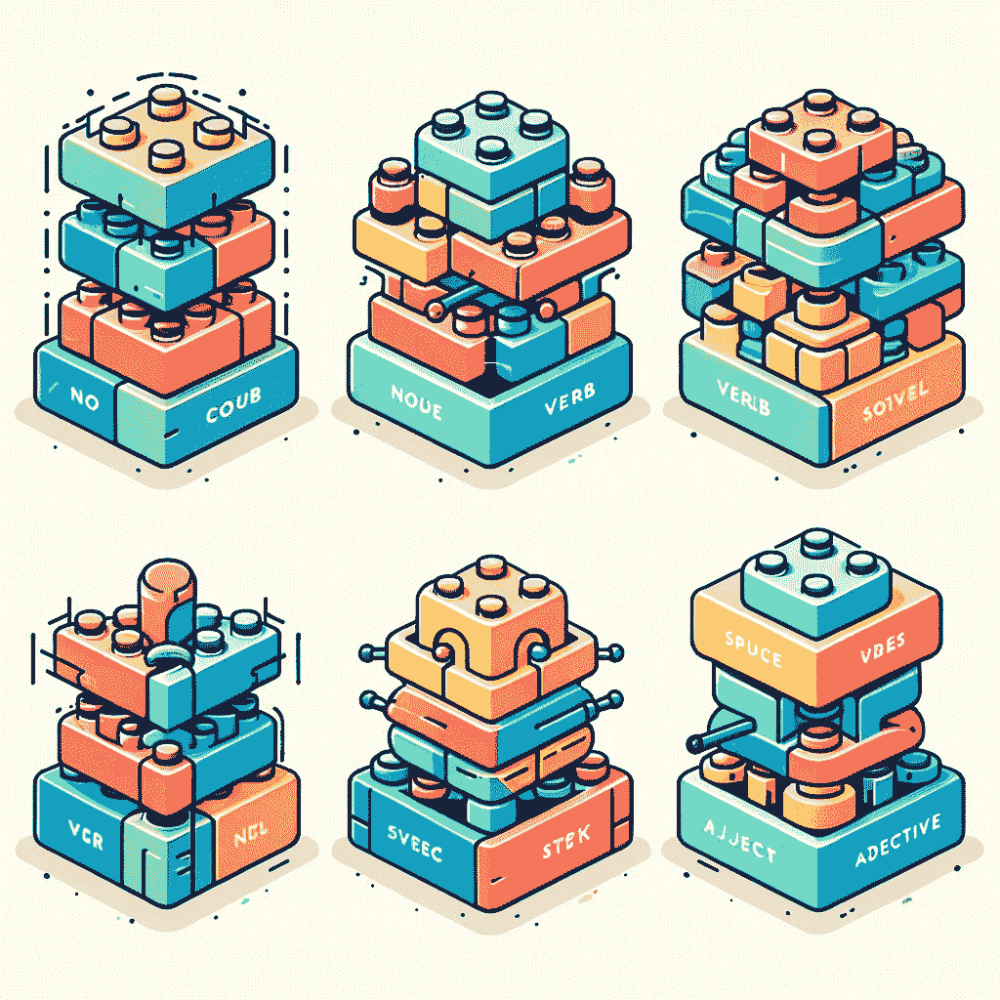
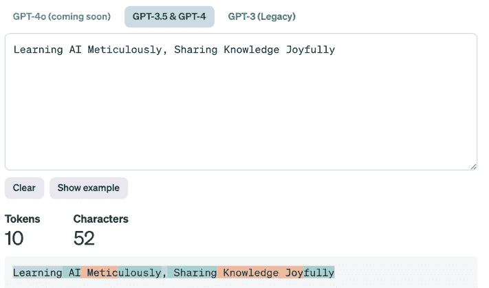
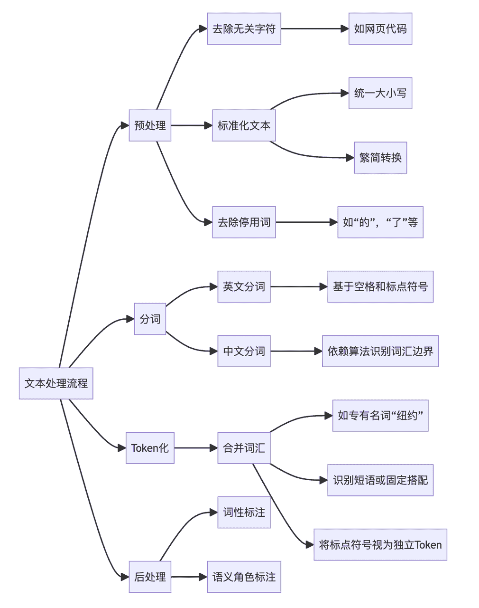
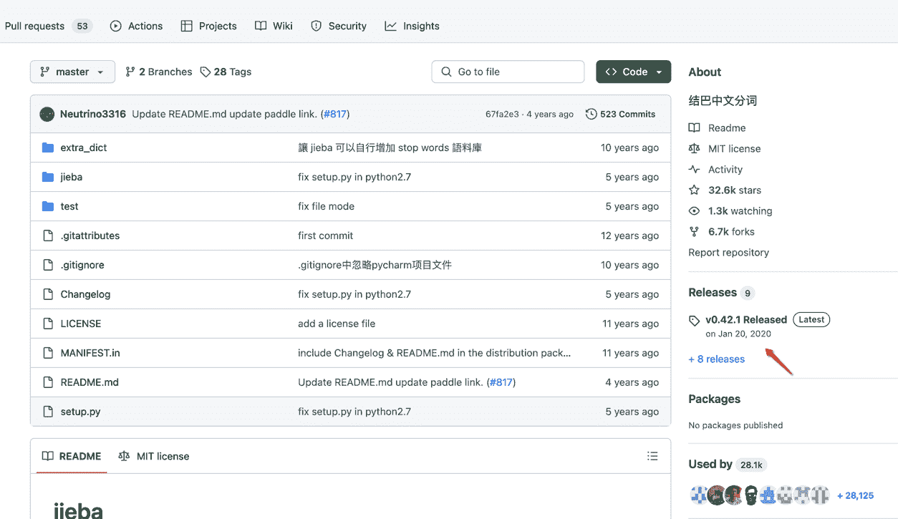
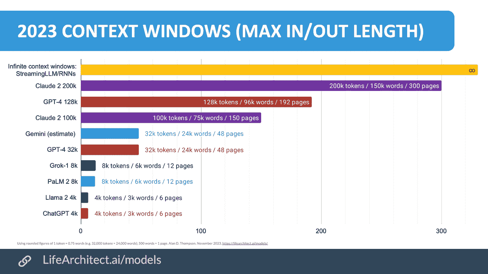
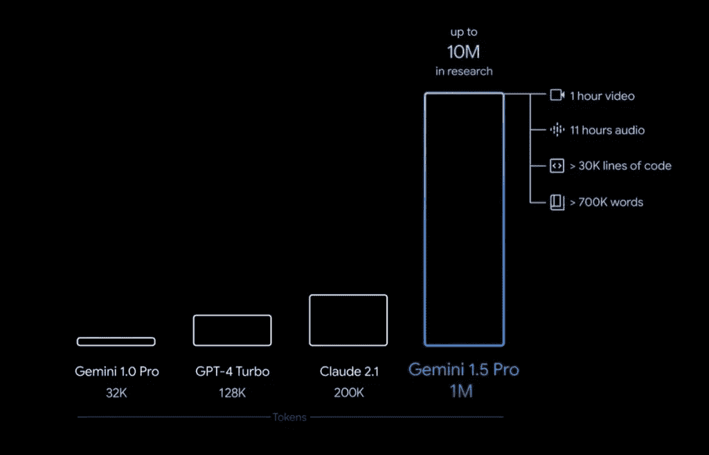
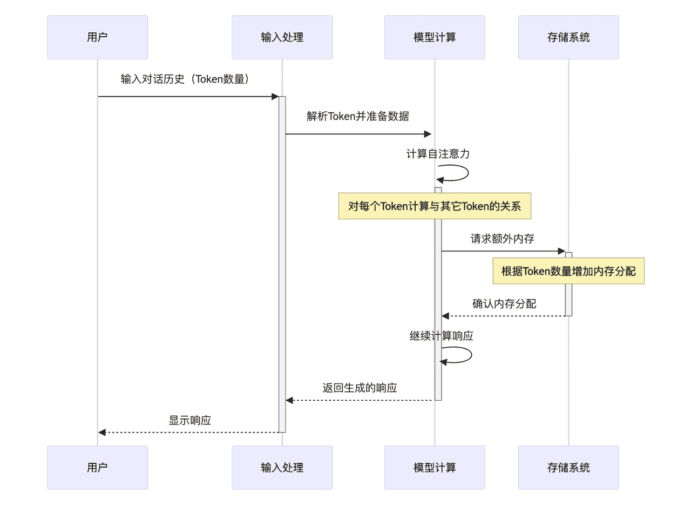
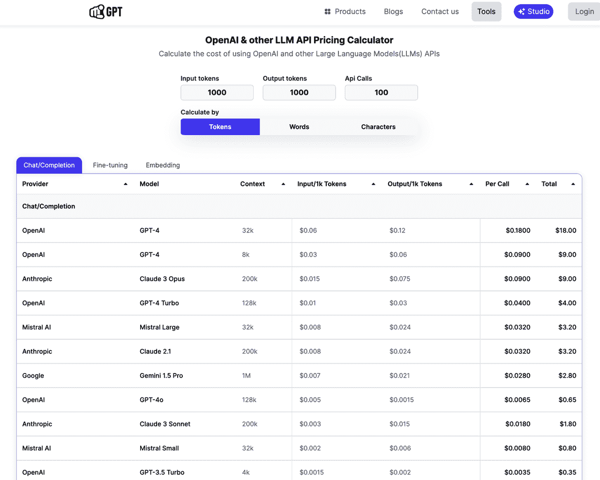
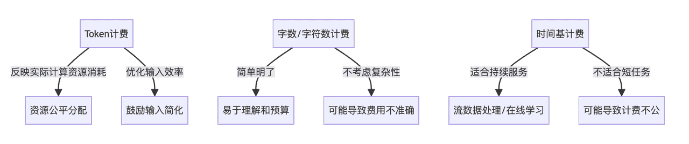
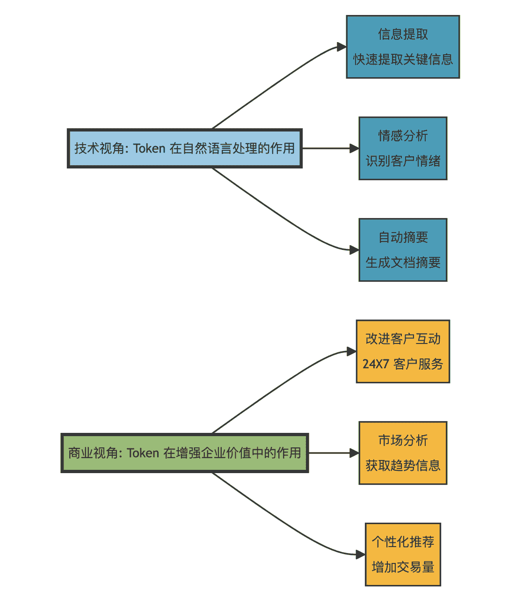

# 【Token趣闻】AI收费为何要按Token计费？一探究竟！

> 来源：[https://waytoagi.feishu.cn/docx/XT9ZdQAtGoelAFxDKqpckE9pnXd](https://waytoagi.feishu.cn/docx/XT9ZdQAtGoelAFxDKqpckE9pnXd)

> 🔗 原文链接： h[ttps://www.iaiuse.](https://www.iaiuse.com/posts/28b56853.html)com/posts/28b568...

> ⏰ 发表时间：2024-06-08

> 作者：大雨

#  写在前面

+   听说 AI 是按 Token 算钱的？

+   这个用起来很费 Token

+   电脑一晚上没关，耗了很多 Token，是不是感觉一套房子没了？

+   为啥要用 Token 来计费呢？

+   听说 Token 是双向收费的

+   问 AI 问题收费，回答也收费，这有点过分吧

+   那AI还不可劲说废话呀！

+   Token 是单词还是字母呢？

+   汉字怎么计费呢

+   阿拉伯语怎么计费呢

+   Token 在企业信息化过程中有何不同意义呢？

+   传统的信息化弄个架构搞搞数据库

+   AI 的应用为啥会有 Token 的问题？

本文尝试从这些角度来解答，我们常常听到的 Token 到底是个什么？文章很长，且看吧。

> 计算机发展历史上，常常会出现一些很唬人的名词，后来慢慢走入普通人的生活，也就固化下来了，提示词的 Prompt 就是一个典范，Token 当然也是，目前看起来，它毕竟还是出圈了。

> 那它是 OpenAI 公司提出来，业内一众公司一致觉得是非常好的计费方式？还是有别的原因呢？

> 我们先从它的来历说起

在企业环境中，使用 AI 技术帮助降本增效，了解 Token 会帮我们更好理解 AI 在企业中落地。通俗一些理解它是积木，通过搭建积木来完成我们需要的应用，从而提高效率。



#  Token 基础

##  **Token 基本概念**

我们先来看一下， OpenAI 官方关于 Token 的描述：

+   1 token ~= 4 个英文字符

+   1 token ~= ¾ 单词

+   100 tokens ~= 75 单词
或

+   1-2 个句子 ~= 30 个Token

+   1 段落 ~= 100 tokens

+   1,500 单词 ~= 2048 tokens

看完啥感觉，懵逼了不？这和孔乙己知道茴有几种写法有啥区别？来来来，感受一下它是咋回事：

Learning AI Meticulously, Sharing Knowledge Joyfully

猜猜这句话有几个 Token？6 个单词，那就是 6 个 Token 吧？可惜，它不是！



在 ChatGPT 4 里面，它是 10 个 Token，从色块来看，标点符号单独算了， Joyfully 被拆分成 Joy 和 fully 。

###  从代码到对话：引入 Token 的必要性

计算机的核心语言是由 0 和 1 组成的二进制代码，这是所有程序和数据最基本的表现形式。无论是我们使用的 Python、Java 等高级编程语言，还是各种多媒体文件，如图片和视频，都会被转换为这种机器语言。在传统的计算机科学中，专家们尽最大努力将现实世界的复杂性抽象化，通过定义明确的数据类型如字符串（一系列文字）和整数（数字）来处理信息。这种方法在处理数学计算或数据库查询等结构化数据时非常有效。

然而，随着技术的发展和人们的需求增加，我们希望计算机不仅能处理数值和代码，还能理解和处理自然语言，即我们人类的日常语言。这就引入了自然语言处理（NLP，Natural Language Processing）的领域，它旨在让计算机理解、解释和生成人类语言。

考虑到自然语言的特点，包括其多样性、语境依赖性以及模糊性，我们面临的不再是简单的 1+1=2 这类问题。我们现在要解决的是如何让计算机理解诸如 “今天是星期五，周末去哪玩呢？待在家里学 AI 如何？” 这样的语句，并进一步分析其情绪或将其翻译成其他语言。在这种场景下，传统的数据类型不再足够使用。

**这就是为什么我们**需要引入 Token 的概念。 Token 化 是将复杂的文本数据分解成更小、更易于计算机处理的单元，如单词、短语或标点符号。这样，计算机就可以更有效地进行语言处理，从文本中提取意义，而不仅仅是计算字符数。

> **从确定性到模糊性 **：传统编程处理的是明确且可预测的数据，而 NLP 涉及解读多义词和语境相关的语言。

> **从结构化到非结构化 **：与结构化的数据库或算法相比，NLP 处理的是流畅、自由形式的自然语言文本。

###  什么是 Token？为什么需要将文本转换成 Token？

想象一下，这波生成式 AI 中，一个非常典型的应用场景便是快速总结，我们不需要逐字逐句，就能快速了解关键信息。Token 在这个过程中举足轻重，帮计算机”理解”和处理大量文本。

**Token 是什么？**

在自然语言处理中，Token 通常指的是文本中的有意义的片段。这些片段可以是单词、短语或标点符号。就如上面图中的案例。

**为什么转换为 Token？**

将文本转换成 Token，有点像将复杂的商业报告分解成关键部分或将邮件内容拆解为要点。这种分解使计算机能够更有效地处理和分析语言，从而执行如搜索关键信息、自动翻译或情感分析等任务。

例如，有人在美团开了连锁店，希望分析客户评价来改善产品（改善？姑且算吧），将评价内容分解为 Token 可以帮助识别常见的问题或差评的点。

看起来 Token 就是单词，实际情况呢？

###  Token 和字符、单词的区别与联系。

|  | 定义 | 特点 | 示例 |
| --- | --- | --- | --- |
| 字符 | 构成文本的基础元素` | 不一定独立表达完整意义，与其他字符组合可形成词汇。 | happy |
| 单词 | 由字符构成，能够表达一定意义的耽误 | 是传达信息的基本单位，比单个字符表达的信息更丰富。 | I’m happy |
| Token | 通常对应单词，但是更灵活，可能是短语，标点，还有可能是词根，前缀等， | Token的定义取决于其用途，例如文本分析、机器翻译等。 | I ， &#x27;m , happy |

看到这里，我们大概有点感觉出来了，这事很大程度上靠的是人们对语言本身的理解。

尽管字符、单词和 Token 在技术上可能有所不同，但它们在文本处理中是密切相关的。字符是构建单词的基础，而单词又是形成 Token 的元素。在实际应用中，Token 的识别和使用依赖于对字符和单词的理解。

例如，如果我们要分析一篇关于市场趋势的报告，通过 Token 化，我们可以快速识别关键词（如“增长”、“风险”、“机会”等），帮助高管快速把握报告的核心内容。

总的来说，Token 是帮助计算机处理和“理解”文本的一种方法，它使得自动化处理文本成为可能，从而支持企业在数据驱动的决策过程中更有效地使用语言信息。

那么 Token 是如何生成又是如何处理的呢？这就需要跳出传统的编程思维来看了。

##  **Token 生成与处理**

###  Token 是如何生成的？文本转换成 Token 的具体流程。



不同模型在处理的时候，步骤会有差异，为了方便理解，给出了这样几个步骤，在企业信息化沉淀的数据价值挖掘上，我们需要考虑到，数据价值的优先级，结合数据处理的成本，作出合适的评判。

举例来说

#### Token 生成

#### 预处理

好的，这里有一段示例文本，其中混合了中文、英文和数字，同时也包含了一些需要预处理的元素：

```
在2024年，AI技术快速發展。例如，OpenAI 发布了GPT-4o模型，这个模型不仅性能强大，而且在处理&lt;code&gt;自然语言&lt;/code&gt;方面具有突破性的进展。但是，我们需要去除一些常用但无信息量的停用词，比如“的”，“了”等等。关于这些技术的详情，请访问我们的官网
```

1.  **去除多余的字符 **：

+   移除网页代码标签如 <code> 和 </code> ，这些通常在文本中不包含有用信息。

1.  **标准化文本 **：

+   将所有英文字符转换为小写，以消除大小写的差异，例如“OpenAI”变为“openai”。

+   繁体字转换为简体字，如果文本中含有繁体字，如将“發展”转换为“发展”。

1.  **去除停用词 **：

+   识别并去除常用的但通常不携带重要信息的词汇，如“的”，“了”等。

经过这些预处理步骤后，文本将更加规范化，便于进一步的分词和 Token 化处理，提升后续分析任务的准确性和效率。

```
在2024年，AI技术快速发展。例如，OpenAI 发布GPT-4o模型，这个模型不仅性能强大，而且在处理自然语言方面具有突破性进展。但是，我们需要去除一些常用但无信息量停用词，比如“”，“”等等。关于这些技术详情，请访问我们官网
```

#### 分词

**分词 **，顾名思义就是把一个句子中的词给分出来，方便进一步处理。我们现在手里拿着一串珠子，

找到合适的位置裁开。

那么如何分词呢？我们容易想到的方案，就是拿一本词语字典对照着来。这也是历史上曾经被使用过的方式。分好以后大概是这样的：

```
在 / 2024 / 年 / ， / AI / 技术 / 快速 / 发展 / 。 / 例如 / ， / OpenAI / 发布 / GPT-4o / 模型 / ， / 这个 / 模型 / 不仅 / 性能 / 强大 / ， / 而且 / 在 / 处理 / 自然语言 / 方面 / 具有 / 突破性 / 进展 / 。 / 但是 / ， / 我们 / 需要 / 去除 / 一些 / 常用 / 但 / 无 / 信息量 / 停用词 / ， / 比如 / “ ” / ， / “ ” / 等等 / 。 / 关于 / 这些 / 技术 / 详情 / ， / 请 / 访问 / 我们 / 官网
```

当然，实际应该过程中，分词有很多的内容。大的来说有几个方案：

1.  **确定单词的边界 **：

+   对于英语等使用空格分隔的语言，这相对简单，就像读英文时，我们可以很容易地通过空格知道一个单词结束和另一个开始的地方。

+   对于中文这样的语言，事情就复杂多了，因为中文写作是连续的，没有明显的间隔。这时，我们需要通过其他方法来确定哪些字应该组成一个有意义的词组。

1.  **使用词典和规则 **：

+   **基于词典的方法 **：就像查字典一样，我们通过一个大列表（词典）来查找和匹配文本中的词汇。这种方法简单但有局限，因为新词或罕见词可能不在词典中。

+   **基于规则的方法 **：这种方法使用特定的规则来判断字和字之间的关系，比如语法和上下文信息，来确定它们是否应该组成一个词。

1.  **统计和学习方法 **：

+   使用统计数据来学习哪些字或字母通常会在一起出现。这种方法通过分析大量的文本数据，学习并预测单词的边界。

1.  **混合方法 **：

+   实际应用中，通常会将上述几种方法结合起来，以提高分词的准确性和适用性。

**简单来说 **：

+   **英文 **：基于空格和标点符号分词。

+   **中文 **：使用算法识别词汇边界。



中文分词的优秀组件—结巴分词，不过也已经 4 年没有更新了。

> 传统的分词逻辑，对词在具体语境中的含义，上下文的情况考虑并不多。下面看个例子

```
你为/何总/打call
你/为何/总打call
```

何总 是个人， 为何 是一个词。这个美妙的歧义着实美妙！

分词以后，就开始做 Token 化的工作了。

#### Token 化

Token 化是处理文本数据的一个关键步骤，它在分词的基础上进一步细化和处理文本单元，以更好地适应后续的处理和分析需求。下面我们将使用您提供的文本来具体说明 Token 化的过程。

1.  **合并专有名词和特定短语 **：

+   将“OpenAI”和“GPT-4 o”视为单独的 Token，因为它们是专有名词，具有独立的意义。

+   “自然语言”作为一个固定搭配和专业术语，也应该被视为一个整体 Token。

1.  **标点符号作为独立 Token **：

+   标点符号如逗号（，）、句号（。）和引号（“ ”）等应被视为独立的 Token，因为它们在文本中扮演语法和结构的角色。

1.  **处理引用标记 **：

+   将空引号中的空格（如“ ”中的空格）视为错误或无意义的 Token 并去除。

**Token 化后的结果**

```
在 / 2024 / 年 / ， / AI / 技术 / 快速 / 发展 / 。 / 例如 / ， / OpenAI / 发布 / GPT-4o / 模型 / ， / 这个 / 模型 / 不仅 / 性能 / 强大 / ， / 而且 / 在 / 处理 / 自然语言 / 方面 / 具有 / 突破性 / 进展 / 。 / 但是 / ， / 我们 / 需要 / 去除 / 一些 / 常用 / 但 / 无 / 信息量 / 停用词 / ， / 比如 / ， / 等等 / 。 / 关于 / 这些 / 技术 / 详情 / ， / 请 / 访问 / 我们 / 官网
```

这个处理结果更紧凑、更有意义，并且更适合用于后续的 NLP 任务，如文本分析、情感分析等。通过合理的 Token 化，我们能够更有效地捕捉文本的语义和结构特点，为深入的文本理解和分析提供基础。

> 值得注意的是，Token 化和向量化紧密联系但又不同，向量化是把这些内容转换成数值，后面会提到。

### 词汇表在 Token 生成中的作用

经过前面的分析，我们知道了在 Token 生成的过程中，词汇表有很大的作用。

**边界识别 **、 **一致性保证 **、 **信息压缩 **、 **提高处理速度 **、 **语义维护 **：

通过维护和更新词汇表，可以持续优化Token生成过程，适应语言的变化和新词的出现，从而提升整个系统的适应性和精度。

###  特殊字符（如标点符号、空格）的处理。

在Token生成过程中，特殊字符的处理是一个需要特别注意的问题。特殊字符如标点符号和空格在文本中常承载着结构和语义上的重要功能：

1.  **标点符号 **：标点符号通常用来表示句子的结构，如句末的句号（。）、逗号（，）用于分隔列表项或从句，或引号（“”）用于标出直接引语等。在Token化时，标点通常被视为独立的Token，因为它们可以影响到句子的语气和结构，有时甚至能改变句子的意义。

1.  **空格 **：在英文和其他使用拉丁字母的语言中，空格是用来分隔单词的主要手段。在Token化过程中，空格本身通常不被保留为Token，但它的存在对于确定单词边界是至关重要的。然而，在某些格式化文本中，空格可能也用于视觉美观，这种情况下需要根据上下文来决定处理方式。

1.  **特殊格式字符 **：如制表符（Tab）、换行符（\n）等在文本中也起到了格式控制的作用。这些字符在某些情况下可能需要被忽略或特殊处理，例如在处理纯文本文件时。

正确处理这些特殊字符是确保文本正确Token化的关键部分，它们的处理策略直接影响到后续的文本分析和应用的效果。在设计NLP系统时，需要仔细考虑这些字符的处理逻辑，以适应不同的应用需求和数据特点。

从上面的内容，我们也能知道不同语言，在处理 Token 上会有一些差异，这些差异帮我们更好理解

##  **Token 的多样性与适应性**

###  不同语言的 Token 化方法

不同语言的结构和语法差异要求 Token 化方法必须具有高度的适应性和灵活性。例如：

+   **英语和其他西欧语言 **：这些语言通常使用空格作为单词之间的分隔符，使得 Token 化相对直接。例如，句子 “The quick brown fox” 可以简单地按空格分割成 “The”, “quick”, “brown”, “fox”。

+   **中文、日语和韩语 **：这些语言没有明显的词与词之间的分隔符，因此 Token 化更为复杂。中文可能需要依赖词典或基于统计的模型来识别哪些字符组合在一起形成有意义的词汇。例如，”快速发展”需被整体识别为一个单独的 Token 而不是分开的”快速”和”发展”。

+   **阿拉伯语和希伯来语 **：这些从右向左书写的语言在 Token 化时不仅要考虑文字的书写方向，还需处理连写字母的问题，这对 Token 化算法提出了特殊要求。

了解这些差异有助于全球业务中更好地处理多语言数据，优化多语言用户界面和内容创建，提升用户体验和市场扩展。

###  Token 的大小和粒度是如何确定的？

Token 的大小和粒度取决于应用的具体需求和预期的处理深度：

+   **细粒度 Token **：通常用于需要深度语言理解的场景，如情感分析或语义搜索。例如，将复合词进一步分解，可以帮助模型更细致地捕捉语言的微妙意义变化。

+   **粗粒度 Token **：适用于需要快速处理大量文本数据的场景，如文档分类或初步的关键词提取。粗粒度 Token 化减少了处理的复杂性和计算需求。

确定 Token 的粒度通常涉及到在处理速度和语义精度之间做出权衡。高管了解这一点有助于在实施 AI 项目时作出更明智的决策，如何选择合适的技术和工具以满足业务的实际需要。

> 理解不同语言的 Token 化方法和 Token 的大小与粒度的确定原则，可以帮助您：

1.  **更好地评估 AI 项目 **：了解 Token 化的复杂性和挑战有助于在购买或开发相关 AI 解决方案时做出更为信息化的决策。

1.  **优化全球运营 **：适应多语言环境的 Token 化能力是全球化业务成功的关键，有助于改进跨文化通信和用户互动。

1.  **提升数据处理效率 **：选择合适的 Token 粒度可以在满足业务需求的同时优化数据处理效率和成本。

那么，Token 对模型有什么样的影响呢？

#  Token 与 AI 模型性能

Token 的策略一定程度上会影响大模型的上下文空间。我们和 AI 对话，有数个来回，如果这些内容太多，AI 会忘记前面的内容。这就可以理解为上下限制。下面是去年的大语言模型上下文限制。



src:[ https://s10251.pcdn.co/pdf/2023-Alan-](https://s10251.pcdn.co/pdf/2023-Alan-D-Thompson-2023-Context-Windows-Rev-0.pdf)D-Thompson-2023-Context-Windows-Rev-0.pdf

这是去年的数据了，下面是 Gemini 的图。



src：[ https://beebom.com/gemi](https://beebom.com/gemini-1-5-pro-announced/)ni-1-5-pro-announced/

国内的 kimi 能处理 100M 的 pdf 文件，上下文的空间大小，已经成了营销的重要立足点。那么它有什么影响呢？

> 从目前 scalling law 语境下，不同的 Token 策略，还是属于底层算法雕花的范畴，也就是说 Token 策略的调整优化，完全比不上多买点显卡有效。

##  **Token 对模型性能的影响**



###  Token 数量如何影响模型的计算复杂度和内存占用？

在生成式AI模型中，如GPT-4或其他基于Transformer的模型，Token的数量直接关联到模型处理的计算复杂度和内存占用。每增加一个Token，模型必须处理更多的数据点，这不仅增加了训练和推理时的计算负担，也增加了内存的需求。例如，在训练一个语言模型时，模型需要存储和计算每个Token与其他所有Token之间的关系，这在模型的自注意力机制中尤为明显。

**案例说明 **： 考虑一个生成式聊天机器人项目，如果输入的对话历史过长（即Token数量多），则模型在生成响应时可能会变慢，且消耗的计算资源更多。例如，对话历史包含数千个Token可能导致处理速度明显下降，尤其是在资源有限的设备上。

一个比较直观的认识，这些大模型公司之所以不扩大容量，显然有它现实理由。更大是不是代表着好呢？

###  更多的 Token 是否代表更好的模型性能？

并非更多的Token总是意味着更好的模型性能。在生成式AI中，合适的Token数量可以帮助模型更准确地捕捉和理解上下文，从而提高生成内容的相关性和准确性。然而，过多的Token可能会引入无关信息，降低模型的效率和输出质量。

**案例说明 **： 在生成市场报告的 AI 系统中，精确的 Token 划分能够确保重要信息被突出处理，而不是淹没在大量不必要的细节中。例如，系统需要从大量的财经新闻中生成简洁的概要，过多的 Token 可能会导致生成的报告杂乱无章，难以捕捉核心信息。

> 当下大模型公司大文件的处理，在工程上很有可能会采用类似云盘的策略，A 上传了一个文件，B 上传的时候，它根本不会再解析了，用 A 当时的解析结果就可以了。随着内容越来越多，也就形成了自己的产品优势。

##  **优化 Token 使用**

###  如何在 Token 数量和模型性能之间找到平衡点？

> 这里的 Token 策略，主要是针对我们普通使用者使用 Prompt 的策略，通过策略让结果更符合我们预期。

找到Token数量与模型性能之间的最佳平衡点，是确保生成式AI模型既高效又准确的关键。这通常需要通过试验和错误来调整，以及使用先进的模型调优技术。

**案例说明 **： 在自动内容生成系统中，如何平衡Token的使用是一个典型的挑战。系统可能需要从长篇全文中提取关键信息生成摘要。在这种情况下，选择适当数量的Token以保留足够的信息量，同时避免过度复杂的模型结构是至关重要的。

###  Token 和上下文窗口的关系及其对文本生成质量的影响。

在生成式AI中，Token和上下文窗口的设置直接影响到生成文本的连贯性和逻辑性。上下文窗口越大，模型在生成文本时能考虑的历史信息就越多，从而能生成更加连贯和自然的文本。

**案例说明 **： 假设使用一个AI模型来生成技术博客文章。如果上下文窗口设置得太小，模型可能无法有效链接文章的各个部分，导致生成的内容出现逻辑断裂。通过优化Token使用和调整上下文窗口的大小，可以显著提高文章的质量和可读性。

接下来进入我们开始提到的话题，对于应用系统来说，我们希望系统的用户体验好，但是也得考虑成本。

#  Token 的商业应用与计费模型

先看一个表格，看一下目前大模型的计费情况



src： [h](https://yourgpt.ai/tools/openai-and-other-llm-api-pricing-calculator)ttps://yourgpt.ai/tools/openai-and-other-llm-api-pricing-calculator

一般来说，我们使用大语言模型可以分为网页上对话和通过 API 调用，网页上使用 OpenAI 基本上算是定了规范，20 美元一个月。但是通过 API 调用可就不是了，哗啦啦是很平常的。

> 猫抓老鼠的游戏，即使 ChatGPT Plus 了，也还是有 3 个小时内回合数的限制。很多人尝试使用类似爬虫的方式，通过 Web 使用 ChatGPT，而不用 API，这类开源代码基本都被干掉了！

> 曾经，电信的计费逻辑是时长，遥想也是个暴利阶段，后来才有了包月的机制，现如今的 Token 计费方式也有异曲同工之妙。

##  **Token 计费逻辑**

###  为什么使用 Token 计费？其合理性和商业模型。

Token 计费模型在 AI 服务，尤其是在使用如 OpenAI 等提供的语言模型服务中非常常见。该计费模式基于用户对服务的具体使用量，即每个请求中所处理的 Token 数量进行收费。

**合理性 **：

Token 计费模型的合理性在于它能够较精确地反映用户对资源的实际消耗。每个 Token 代表了模型需要处理的一个单位信息，更多的 Token 意味着更多的计算资源消耗。因此，这种计费方式可以确保用户根据其实际使用量付费，同时激励用户优化其输入，避免不必要的浪费。

**商业模型 **：

从商业角度看，Token 计费模型为 AI 服务提供商提供了一个灵活且公平的计费框架。它允许服务提供商根据系统负载和运营成本设置不同的定价级别，从而可以吸引不同需求的用户，支持从小型开发者到大型企业的多样化客户基础。

###  Token 计费与其他计费方式的比较（如字数、字符数、时间）

与其他常见的计费模式相比，Token 计费有其独特的优势和局限：

+   **字数和字符数计费 **：这些计费方式简单明了，容易理解和预算。然而，它们通常不考虑处理的复杂性和计算资源的实际使用。例如，处理一个包含简单词汇的长句可能比处理一个技术术语更简单，但按字数计算费用可能更高。

+   **时间基计费 **：以时间为基础的计费模型（如按分钟或小时计费）适用于持续服务，如流数据处理或在线学习。但对于基于请求的短任务，这种模型可能导致计费不公或不精确。



Token 计费提供了一个更细致地度量，可以更公平地反映使用者对资源的实际消耗。

> 大模型公司的成本我们粗略看包括

1.  研发成本（人力+实验

1.  训练成本（计算资源+数据处理）

1.  部署成本（基础设施+存储成本）

1.  维护更新成本

1.  伦理合规成本（数据安全，数据合规）
这些成本都要通过 Token 来承载看起来不太现实，实际情况只能业内人士评估了。可能是目前阶段最合适的评估手段了。

##  **Token 计费的实际影响**

###  不同计费方式对用户和开发者的影响。

Token 计费模型对用户意味着需要更仔细地管理其 API 请求，以控制成本。开发者需要设计高效的查询，减少冗余的 Token 使用，从而最大化每个请求的价值。这种计费方式鼓励开发者优化数据输入和处理流程，但也可能增加开发的复杂性和前期的优化工作。

对于提供商而言，Token 计费可以帮助平衡服务器负载，预测收入，优化资源配置。它还可以作为产品优化和定价策略调整的反馈机制，帮助提供商更好地满足市场需求。

###  如何优化 Token 使用以降低成本？

优化 Token 使用是控制成本的关键。这可以通过以下方法实现：

+   **精简输入数据 **：在发送请求前，剔除不必要的文本和冗余数据，只保留关键信息。

+   **使用高效的查询设计 **：设计经过良好构思的查询，避免过于复杂或深入的连锁请求。

+   **利用缓存策略 **：对常见的或重复的请求使用缓存结果，减少对后端服务的查询。

+   **监控和分析 **：定期分析 Token 消耗数据，找出优化点，调整策略以减少浪费。

通过这些方法，不仅可以减少成本，还可以提高系统的响应速度和用户满意度，从而在竞争激烈的市场中获得优势。

#  Token 的商业价值与应用案例

##  **Token 在业务中的实际应用**

在企业运营中，Token 化技术的应用可以显著提升数据处理效率和决策质量。对于非技术的企业高管来说，了解 Token 的应用可以帮助他们更好地评估技术投资和推动业务创新。



###  技术视角：Token 在自然语言处理的作用

Token 化是将复杂文本数据分解成易于管理的单元的技术过程，使 AI 系统能够进行有效的数据分析和处理。这一过程在自然语言处理（NLP）中尤为关键，它使得机器能够“理解”人类语言，执行如下任务：

+   **信息提取 **：Token 化帮助从大量文本中快速提取关键信息，如从法律文件中抽取相关条款。

+   **情感分析 **：通过分析客户反馈的 Token，企业可以识别客户的情绪倾向，从而调整产品或服务。

+   **自动摘要 **：Token 化技术能自动生成文档摘要，提高知识工作者的工作效率。

###  商业视角：Token 在增强企业价值中的作用

从商业角度看，Token 不仅提高操作效率，还可以开启新的业务模式和收入渠道：

+   **改进客户互动 **：利用 Token 化的聊天机器人可以提供 24 X7 的客户服务，提升客户满意度并降低服务成本。

+   **市场分析 **：Token 化处理可以帮助企业从市场报告中快速获取趋势信息，指导战略决策。

+   **个性化推荐 **：在电商平台中，Token 化技术可以分析用户的购买历史和浏览行为，提供个性化的商品推荐，增加交易量。

##  **实际案例分析**

###  客户服务机器人

一个典型的应用是客户服务机器人。例如，一家大型电信公司部署了基于 Token 化的客户服务机器人来处理用户查询，如账单问题、服务中断等。机器人通过分析用户的问题（已 Token 化），快速提供正确的答案或将问题转给适当的服务部门。

###  内容推荐系统

在媒体和娱乐行业，内容推荐系统利用 Token 化技术分析用户的观看或阅读习惯，从而推荐用户可能感兴趣的新电影、书籍或文章。例如，Netflix 的推荐系统就分析用户之前观看的节目的描述 Token，来预测用户可能喜欢的其他节目。

#  Token 的商业价值与应用展望

在企业应用中，理解和有效使用 Token 是推动 AI 项目成功的关键。把握 Token 的商业价值和挑战对于制定战略和驾驭技术创新尤为重要。

##  **Token 的商业应用**

###  技术视角：Token 的作用

Token 在自然语言处理（NLP）中的应用使得文本信息能够被 AI 系统有效处理。简而言之，Token 化是将大段的文本分解成小块处理单元的过程，这些处理单元（Token）为机器学习模型提供了操作的基础。

+   **数据处理 **：在处理客户查询、分析市场反馈或管理大量文档时，Token 化使得这些复杂的文本数据变得易于管理和分析。

+   **效率提升 **：通过 Token 化，AI 模型可以快速识别关键信息，从而加速决策过程，提升业务响应速度。

###  商业视角：Token 的经济价值

从商业角度看，Token 不仅仅是技术实现的组成部分，它直接关联到提升操作效率、增强客户体验和开拓新的商业模式。

+   **客户服务优化 **：Token 化使得客户服务自动化变得可能，通过自动响应系统快速准确地处理客户请求，极大地提升了客户满意度和品牌忠诚度。

+   **个性化营销 **：利用 Token 化分析用户行为和偏好，使企业能够提供高度个性化的营销内容，增加销售转化率。

##  **Token 的未来展望与挑战**

###  未来发展方向

随着 AI 技术的进步，Token 的应用预计将变得更加智能化和多样化：

+   **跨模态应用 **：Token 技术将不仅限于文本处理，未来将扩展到视频、音频等多媒体内容的分析中，支持更广泛的应用场景。

+   **智能优化 **：Token 生成和处理方法将更加智能，例如，通过 AI 自动调整 Token 的粒度和数量，以适应不同的业务需求。

###  商业挑战与机遇

+   **数据安全与隐私 **：在 Token 化处理中确保数据安全和用户隐私是未来的主要挑战，尤其是在处理敏感信息时。

+   **技术整合 **：如何将 Token 技术与现有的 IT 系统和业务流程无缝集成，是实现技术转化的关键。

+   **公平性和可解释性 **：确保通过 Token 化得到的 AI 决策是公平和透明的，增强所有利益相关者的信任。

#  结语

写这篇文章的时候，林淼给了当前的新方向， https://arxiv.org/abs/2104.12369 ，从华为盘古模型的实践来看，中文领域的 Token 发展会偏向去工程化，还有待进一步观察。

在写这篇文章之前，对 Token 的理解仅限于一个汉字等于 1 个 Token 的模糊了解，也会把 Token 和向量化等同起来。在向量化之前，还有 Token 的工作。更好迎接 AI，更好拥抱变化，现有企业应用系统中的数据如何更好使用？可以从这里开始了！