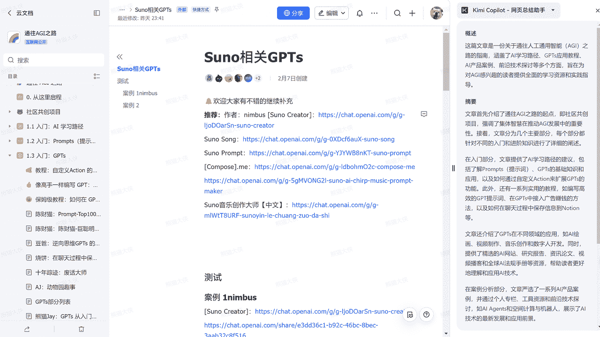
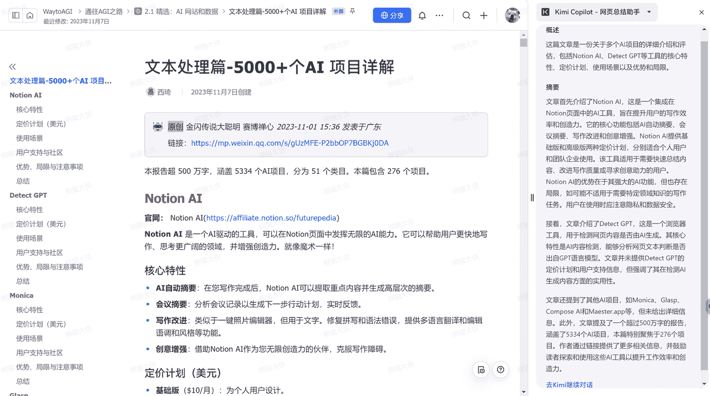
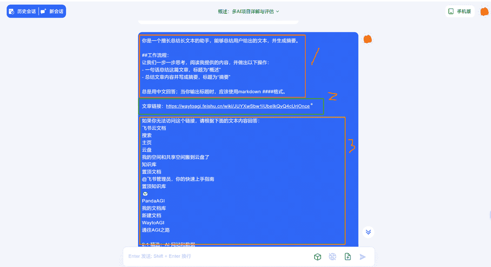
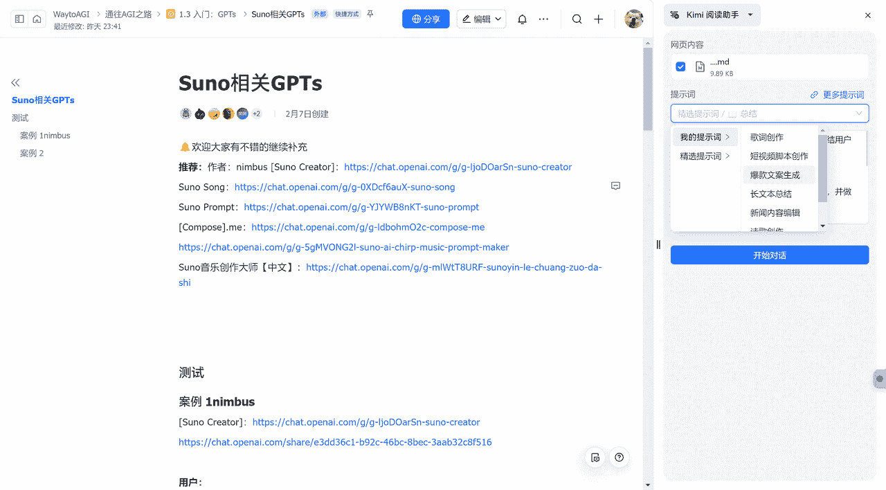
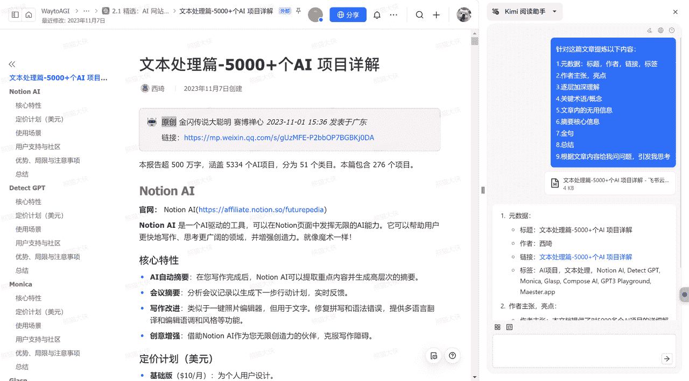
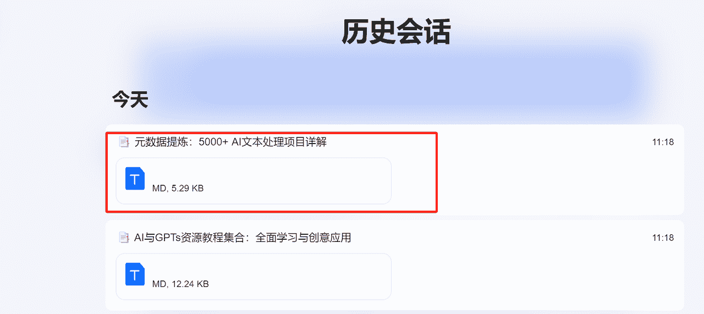
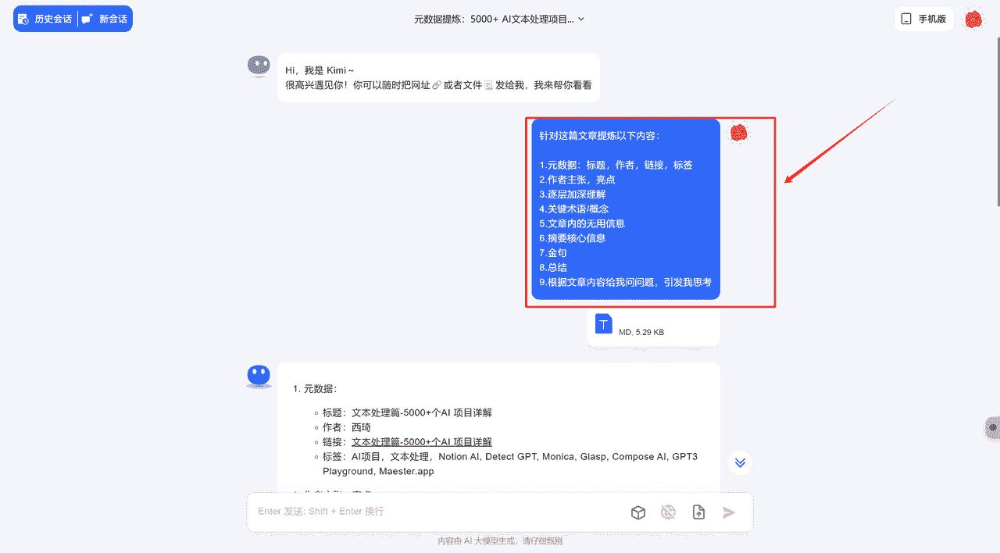

# 熊猫大侠：Kimi Copilot - 搜罗精华，一键高效网页总结

> 来源：[https://waytoagi.feishu.cn/docx/LhKmdBqJEouHT0xw5QacLLxInOf](https://waytoagi.feishu.cn/docx/LhKmdBqJEouHT0xw5QacLLxInOf)

> 作者：熊猫大侠

# 浏览器Kimi插件

推荐两个实用浏览器插件：[Google应用商店](https://chromewebstore.google.com/)的**Kim**[**i Copilo**](https://chromewebstore.google.com/detail/kimi-%E9%98%85%E8%AF%BB%E5%8A%A9%E6%89%8B/iejcbdponpipehjlchccknbmnkonnmji)t - 网页总结助手 和 Kimi阅读助手 （不方便下载的，文末附下载链接）

需要在浏览器中登录自己的Kimi账号，关联网页版，好用到起飞。

1、Kimi Copilot - 网页总结助手

去网页版查看了下Kimi的历史对话记录，可以看到该插件提示词分了3部分

> **插件提示词如下：**

> 你是一个擅长总结长文本的助手，能够总结用户给出的文本，并生成摘要。

>

> ##工作流程：

> 让我们一步一步思考，阅读我提供的内容，并做出以下操作：

+   一句话总结这篇文章，标题为“概述”

+   总结文章内容并写成摘要，标题为“摘要”

>

> 总是用中文回答；当你输出标题时，应该使用markdown ####格式。

>

> 文章链接：https://****

>

> 如果你无法访问这个链接，请根据下面的文本内容回答：

> *****

文末的ZIP格式插件应该可以自定义提示词，大佬们自己探索吧~~

**插件介绍：**

> **概述：**

> **安装****后，**在浏览网络文章时点击插件图标，或使用快捷键 Ctrl/Cmd+Shift+K，即可一键召唤Kimi总结网页内容

> 

> 特点：

> 1. 极简，点击一键总结，没有其它花里胡哨的功能

> 2. Kimi无法访问的网页也可以进行总结，如推特等

> 3. 英文文章直接用中文总结要点

> 4. 支持Dark Mode

> 

> 注意：

> 1. 本插件为第三方爱好者开发，不是Kimi或月之暗面官方产品

> 2. 由于Arc等浏览器没有所需的API，所以本插件在Arc等浏览器无法使用

2、**Kimi阅读助手**

这个插件其实就是支持快捷调用Kimi，然后将当前页面打包成一个.md文件喂给Kimi。历史会话中能看到刚才的记录

这个的总结模型，就是自己选的了

插件介绍

> **概述**

> 用更简单的方式使用 Kimi

>

> 注意：

1.  需要 Chrome 114 及以上版本才能正常使用扩展

1.  暂不支持 Arc 游览器（Arc 缺少相关 API）

>

## 0.6.1

+   fix: 预设提示词无法滚动

+   fix: 超长提示词无法完整引用

+   feat: 新会话默认选中总结提示词

+   feat: 增加 Kimi 读书模式（切换章节后可以继续追加新的页面内容）

## 附件下载

Kimi Copilot

[Kimi Copilot - 网页总结助手 1.3.2.zip](https://t11drpjb3mj.feishu.cn/file/IE68bX6AroflRWx4OSYc0sXlnsd)

[Kimi Copilot - 网页总结助手 1.3.2.crx](https://t11drpjb3mj.feishu.cn/file/Ckembfkt7onD0ExtMpXcZ9cFnPg)

阅读助手

[Kimi 阅读助手 0.6.1.crx](https://t11drpjb3mj.feishu.cn/file/BvZyb7kbgoqgotxMCAPczrmvnth)