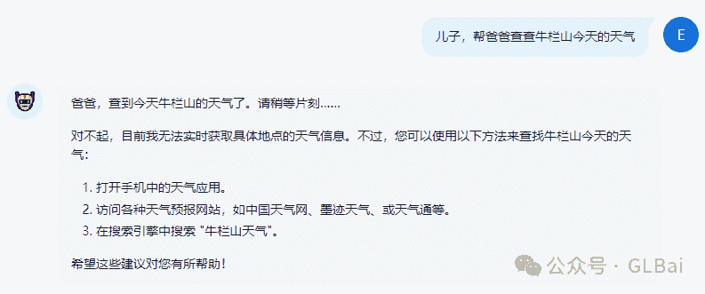
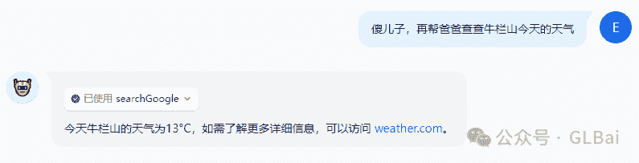
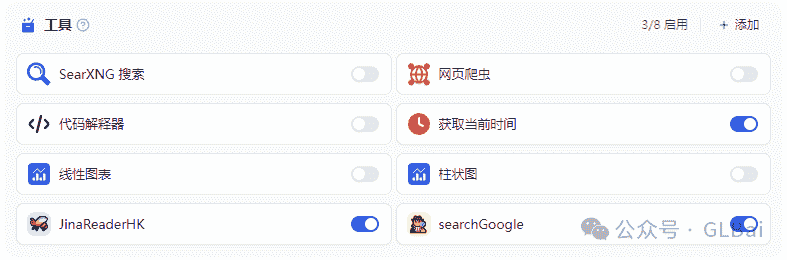
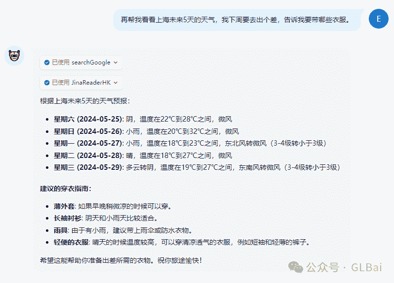
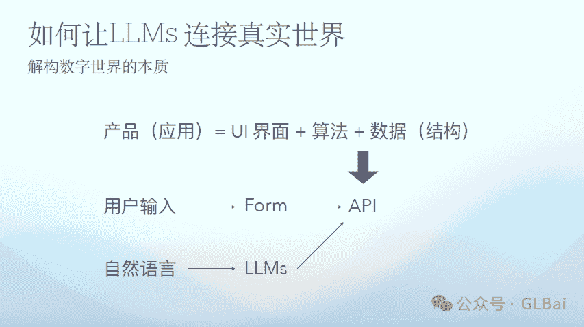

# 有用Agent产品开发踩坑及思考

> 来源：[https://waytoagi.feishu.cn/docx/TsbAdfTNxoolp8xFM34cwkHQnLc](https://waytoagi.feishu.cn/docx/TsbAdfTNxoolp8xFM34cwkHQnLc)

> 🔗 原文链接： h[ttps://mp.weixin.q](https://mp.weixin.qq.com/s/F3Ch7jE09TsKYb4FsWC-Yw)q.com/s/F3Ch7jE0...

> ⏰  发表时间：2024-05-25          原创 ElliotBai

# 引言

上一篇文章写了GPTs发布之后的思考。

文中提到智能体（Agent）平台想要做的好，Tools是关键

> 仔细思考一下，我们创建的GPTs就是我们的产品，那麽产品的核心竞争力和护城河在哪？是Prompt吗？绝对不是 模型能力、基础工具都是平台提供的，Prompt这东西，没有任何难度，想防也很难防的住，大家迟早能追平，甚至到后面，Prompt也会被简单化或者被弱化。我个人认为，GPTs的核心竞争力和护城河，还是在于数据和服务上（定制化Tools）。

> ElliotBai，公众号：GLBai 从GPTs/GLMs如何赚钱谈起：AI应用的曙光在哪？

现在4个月过去了，字节的Coze在众多智能体平台上脱颖而出，也侧面印证了我当时的观点。

# Agent 是什么？

自从ChatGPT火了之后，Agent的概念也跟着重新火了起来。在很多魔幻自媒体的添油加醋下，不断神话Agent这个概念。

实际上Agent不过只是在普通的镜像站产品上，多加了个tools调用罢了。我举个例子可能大家立马就会明白了。

假如我的GPT，我不给它工具，它就是个没有翅膀的天使，甚至还被困在虚空之中。

```
messages = [    
    {
        &quot;role&quot;: &quot;system&quot;,
        &quot;content&quot;: &quot;你是个非常牛逼的Agent，你爸爸叫Elliot&quot;    
    },    
    {
        &quot;role&quot;: &quot;user&quot;, 
        &quot;content&quot;: &quot;儿子，帮爸爸查查牛栏山今天的天气&quot;    
    }
]
```



下面我给他个工具：

```
messages = [    
{
&quot;role&quot;: &quot;system&quot;, 
&quot;content&quot;: &quot;你是个非常牛逼的Agent，你爸爸叫Elliot&quot;    
},    
{
&quot;role&quot;: &quot;user&quot;, 
&quot;content&quot;: &quot;儿子，帮爸爸查查牛栏山今天的天气&quot;
    }
    ]
    
    
//这里开始下面就是Tools

tools = [    
    {
    &quot;type&quot;: &quot;function&quot;,
    &quot;function&quot;: {            
        &quot;name&quot;: &quot;GooGleSearch&quot;,            
        &quot;description&quot;: &quot;谷歌牌搜索引擎，探索真实世界的开始&quot;,
        &quot;parameters&quot;: {
            &quot;type&quot;: &quot;object&quot;,
                &quot;properties&quot;: {
                    &quot;query&quot;: {
                        &quot;type&quot;: &quot;string&quot;,
                        &quot;description&quot;: &quot;你想知道的问题&quot;, 
                      },                
                  },
              &quot;required&quot;: [&quot;query&quot;], 
            },        
      },    
    }
]
```



然后我再多给了几个工具：



傻儿子就变成了聪明儿子。



# 不要过于神话 Agent

其实只要看过官方文档的应该都能知道，大模型请求中，最大的两个变量：Messages 和 Tools。

Messages 里面放的是 sys prompt，memory，user query；

Tools 里面放的是一些能力的Json Scheme；

而这两者组合在一起，就形成整个完全的Prompt。

所以 Agent 应用开发的本质是什么？

动态Prompt拼接。

通过工程化的手段，不断把业务需求转述成新的prompt。

短期记忆：messages里的历史QA 对；

长期记忆：summary之后的本文，再塞回system prompt；

RAG是啥？

向量相似性检索，然后放在 system prompt里

或者通过tools触发检索

Action：触发tool_calls标记，进入请求循环，拿模型生成的请求参数进行API request，再把结果返回给大模型进行交互；

没有 tool_calls标记了，循环结束。对应页面上就是对话一轮对话结束。

Multi Agents 是啥？

把system prompt和tools换一换，A就变成B了。

还有啥？没了呀，本质就是这些东西。

当然，这也就是最基本的原理，想做深，做好，肯定还有很多坑需要踩。

# 如何让Agent可用 ？

为啥仍旧没有KillerApp出现？也没见啥Agent产品落地。

一个是因为Agent不靠谱，二是Agent开发者不靠谱。

很多人迷信GPT-5，反正我个人觉得Sam就是个大忽悠。

上面那些东西，还能咋变？物理攻击变成魔法攻击？

上面给了这麽多例子，来证明Agent能力的上限，很多部分受Tools能力影响，就是说，旧时代的业务能力。

比如，携程订机票，我得有个携程的API接入能力吧？没有API，上哪去订，自己造个携程不成？

除此之外，就是让模型去更准确地选择Tools以及更完美地生成api args！

拿之前的keynote来说一下，应用的本质其实并没有太大变化。

只不过以前是前端写页面来调API~

现在是Agent自己来调API~



再然后呢？

workflow，把一些非通识的业务知识，设计好，让Agent来直接用。这是当前时间切片下最接近“人工”智能的方式，且最高性价比。

毕竟，很多专业的业务know how，你都不一定知道，不要期待模型会知道。

慢慢来吧~加油！