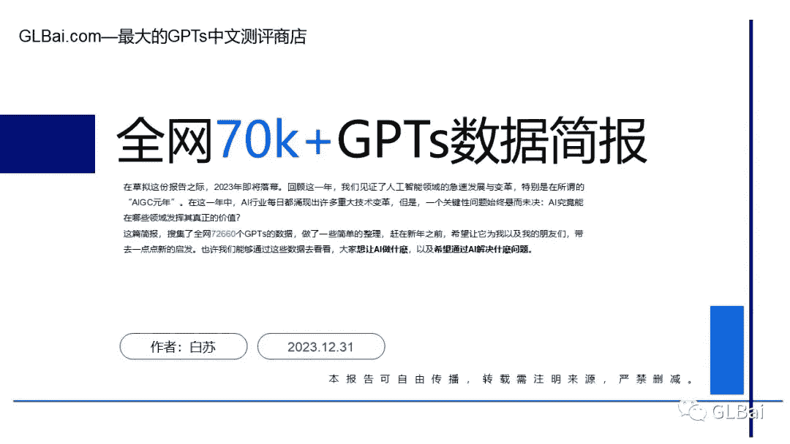
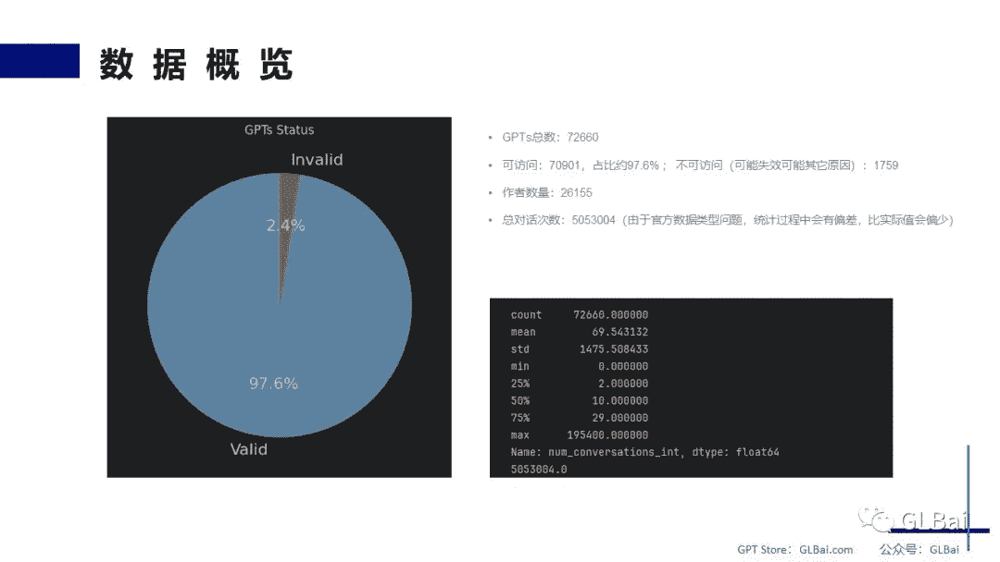
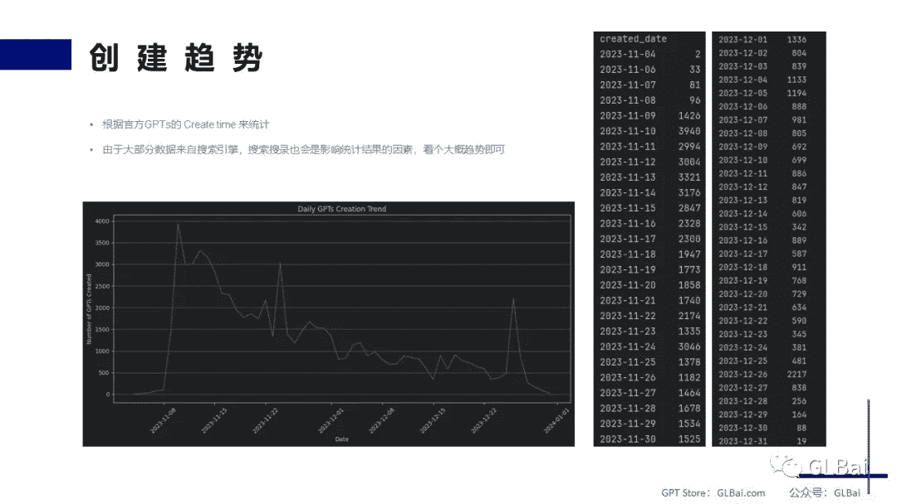
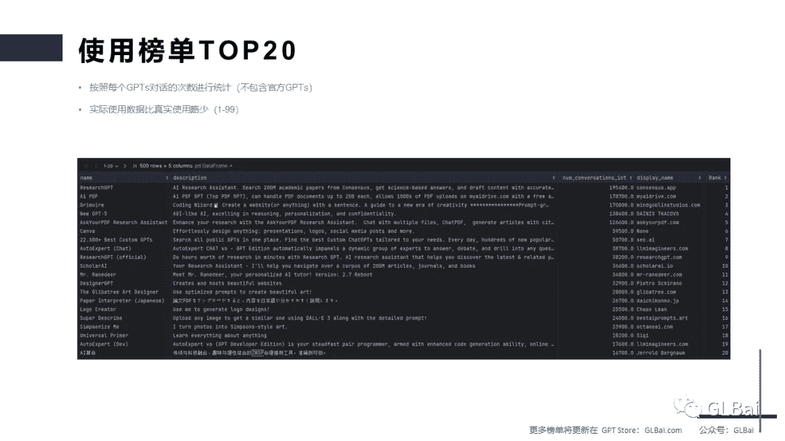
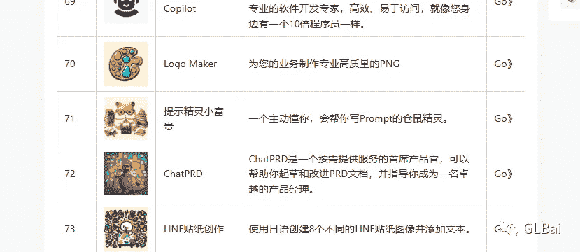
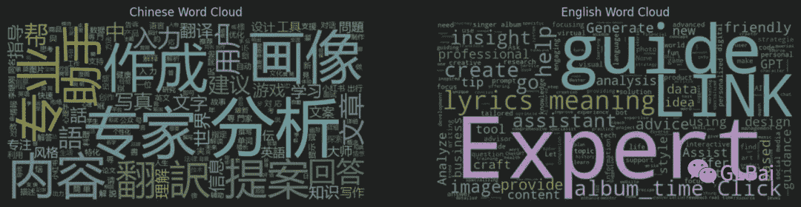
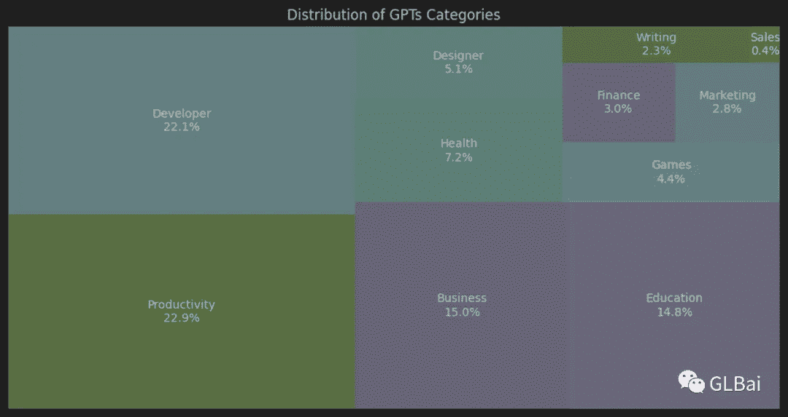

# 全网70,000+ GPTs分析：榜首使用量突破19万次，AI交互的新纪元

> 来源：[https://waytoagi.feishu.cn/docx/TxtodUC08otgVzxCujRcUKGPnse](https://waytoagi.feishu.cn/docx/TxtodUC08otgVzxCujRcUKGPnse)

> 🔗 原文链接： h[ttps://mp.weixin.q](https://mp.weixin.qq.com/s/SaCIDKn8om0Ex_eCetxjCA)q.com/s/SaCIDKn8...

> ⏰ 发表时间：2024-01-01     原创 ElliotBai

从11月份OpenAI宣布开放GPTs到现在还不到2个月时间，GPTs的全网创建数量已经接近100K+。

BeBeGPT Store作为最大的中文GPTs商店，不仅在GPTs的收集数量上名列前茅，同时利用大语言模型技术，全程依靠 Coding + AI 实现全站自动化更新运营，相比同类网站而言，提供更为全面的 GPTs 中文翻译、分类、AI测评，能够帮助用户更快地找到目标GPTs，也能依靠AI测评内容提供辅助判断。

在2023年的最后一天，为了给大家送上一份新年礼物，对BeBeGPTs目前的72660个GPTs数据进行了一遍清洗和更新，统计了所有已收集GPTs的对话次数数据，为AI行业的奋斗者们提供一份参加数据。

**PDF文件回复‘ ****gpts ****’即可获取。**

在本次的数据简报中，主要从三个维度进行了简单的分析：创建趋势、使用次数以及创作者相关的数据。实际上由于官方没有给出全量的GPTs目录，所有数据都是通过搜索引擎更新过来的，所以最终的统计结果只能作为参考。

# **概览**

在参与统计的72660个GPTs中，失效的数量为1759个。这其中大部分的原因可能是作者关闭了外部访问导致。

而这70K+GPTs的创作者，也达到了26155名之多。

考虑到有共用账号的情况，实际的创作者应该在这个数量之上。

# **趋势**

GPTs对外正式发布的时间大概是10号？

10号这天的创建数量是最多的，达到了3940个，随后便一路下滑，中间倒是有两波崛起，不过很短暂。

这里到后面数量变少，一方面可能是搜索引擎搜录的问题（有个时间差，不过OpenAI的站点应该隔天甚至当天就会被搜录，也有可能是我的程序没有爬到），另外一方面的话，的确脑子会用完的啊。

# **榜单**

按照对话次数统计了TOP100的榜单，对应的链接已经发布在BeBeGPTs上，点原文链接即可访问，或者记住同名网址：glbai.com。

TOP100的榜单中，中文GPTs7个（也有可能更多但是作者直接出海了），其中就有我们好朋友陈财猫的提示词系列--提示精灵小富贵，目前排名71，非常好用。

# **词云**

把名字和描述都捞出来分词做了一个词频统计，不过有几个小问题。一个是日本语跟中文有些共用词，导致没法完全拆出中文GPTs，另外一个是分词的时候停用词（哪些不参与统计的词）没有完整的表，只能一个个手动加，改。最后得出了如下的结果。

实际上很多GPTs作者在创建GPTs的时候并没有很好的去写描述，导致其实很难直接通过名称和描述知道这到底是干嘛的。

# **分类**

目前所有的分类数据都是让GPT来分的，由于并发上不去，目前只分了3W+。

另外当初设计分类表的时候，没有想到后面会有这麽多的GPTs被创建出来，其实类目不够多，不够细了，后面有时间再重新分一波吧。

原先觉得对跟钱关系最大的Sales类目，数据少的可怜。不知道是销售不擅长AI呢，还是AI替代不了销售，值得研究研究SaleGPTs是否值得做？

如果你有哪些其它方面数据想知道的，也可以留言。