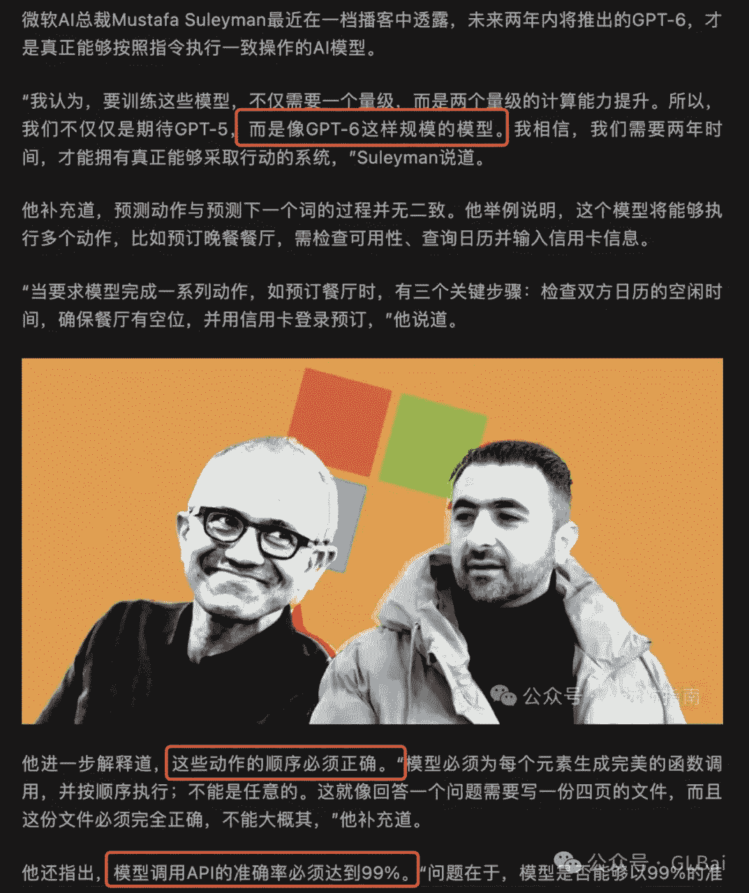
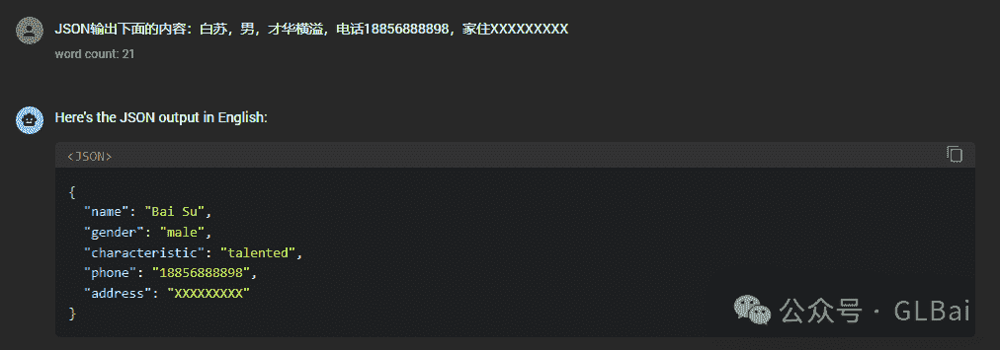
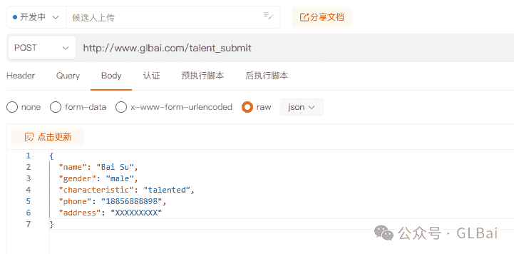
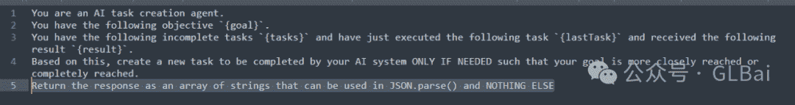
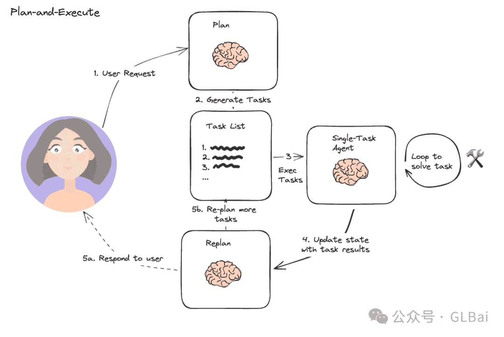

# AI Agent产品经理血泪史（一）：一年来我摸过的那些石头【Tools篇】

> 来源：[https://waytoagi.feishu.cn/docx/DlnjdtXE0osBHbxbq1jcMWhqndf](https://waytoagi.feishu.cn/docx/DlnjdtXE0osBHbxbq1jcMWhqndf)

> 🔗 原文链接： h[ttps://mp.weixin.q](https://mp.weixin.qq.com/s/0EhccjaO-8Oero9cPzI-rw)q.com/s/0EhccjaO...

> ⏰ 发表时间：2024-07-20     作者：  GLBai

这一系列文章其实3个月前就在准备了，结果新工作太忙，卷忘记了。

前几天刚好看到一篇关于GPT-6的报道，才想起来还有这麽回事情，于是赶紧把草稿捞出来改改交个任务。

至于为什麽贴这张图，以及为什麽血泪史从Tools开篇。

那是因为你看，即使到了GPT-6的时代，Tools仍然是AI Agent落地的基石。正如图中所示，即使AI模型不断进化，物理攻击还是物理攻击，Tools还是Tools，没有变成魔法攻击。



## 01 - 前言：从接口请求说起

如果从技术层面来看这个世界，其实并没有那麽科幻。 大模型也是如此，GPT-5, GPT-6同样如此。

在传统互联网时代，所有功能背后都是一个个接口。

+

```
入参 → 请求 → 返回结果
```

然后再通过UI和前端，把这些零散的接口包装成一个功能呈现在用户面前。

例如登录页面:

+   用户输入：用户名、密码

+   后台请求：验证接口

+   返回结果：成功/失败

正确就返回Yes，登录成功；不正确就返回No，告诉你账号或密码不正确

大模型的出现，让这套交互发生了些许的变化

Agent 可以直接拿着你的数据去请求登录（例子就不考虑数据安全问题了）

但背后的那个登录接口还是登录接口

AI Agent的出现并没有改变这个本质，它只是将人工编写的规则替换为了AI的决策。

Tools就是在这个过程中，帮助AI Agent生成正确API请求参数的关键。

## 02 - 起源：大模型的魅力，其实并不是因为它是个吐字机。

### 而是可以通过它，把这个世界连接到一起。

当我第一次知道 ChatGPT 的时候，我刚好在解一个难题：

> 如何快速地从一堆非结构化数据中，抽取出结构化的候选人信息，然后提交到系统里。

用户输入的数据其实是千奇百怪的，没有什麽固定规则，可能这样：

“白苏，男，才华横溢，电话18856888898，家住XXXXXXXXX”

也可能直接就是一坨文本，我曾尝试了很多种解法，都挺难。

最后写了一大段正则。

后来我知道了GPT，再然后，我的道心就崩了。

毕竟一个prompt就抹掉了我个把月的努力。



更让我崩溃的是，我发现，这个输出，直接可以作为我系统中上传候选人的入参，这不就，自动化了么????

上传候选人接口（API）如下：



这个事情我可以描述地再具体一点：

很多人应该都用过寄快递的软件，输入地址的时候，复制一坨文本进去，它能自动帮你填好。如果识别不出来，你就得一个一个空地去填写。

通过大模型自动化之后，我只需要给一个文本框，你输入一坨文本进来，我自动给你提交。

那个时候还是22年底，没有Function Calling 更没有Tools，Sam也还没有给大家演示ChatGPT帮你点外卖。

## 03 - 探索：JSON Output 让大模型窥见真实的世界

去年同期有个段子，说GPT-4能自己越狱。

这事情当时被那些自媒体们越传越邪乎，但事实上，这事光靠大模型自己，是不现实的。

因为它，真的没有办法直接触碰到真实世界，毕竟大模型连现在是何年何月何日都不知道。

接着上面的例子讲

其实只要能够让大模型按照我们想要的定义输出结构化的信息，我们就可以去做很多有趣的事情。

JSON就是一个非常不错的选择

我们基于这个思路也做了很多的探索，比如：

1、无模板的Excel导入

改变传统的数据导入方式，再也不用写复杂的业务逻辑了。 只需要一个Prompt去读取想要的数据列就可以

2、AI审核员

在原先人审的环节前加一个AI审，给一些knowhow和fewshot，输出yes和no还是很简单的。

3、分类器

分类器的场景很多。 以前搞个分类，大小得训练个模型吧，那个年代可真是算法的黄金年代啊。

嗯，现在一个prompt就搞定了。

4、其它一些业务场景落地

好用，真的太好用了！

但那个时候的大模型，还太不成熟了，上面的路子能通，但走起来磕磕碰碰。

## 04 - 救星：Function Calling 以及 Tools 的到来

### 为何抛弃 Json Output？

在 OpenAI 的 Function Calling 到来之前，其实很多人都意识到了需要这样一个东西，因为Action是Agent 不可或缺的一环。

但那会 OpenAI 还在很努力地做自己的Plugin商店（后来死了），国内模型厂家还在起名字。

有些大神也通过这种方式在做一些牛逼的实现

Langchain 早期Agent的实现，以及它的Output parse；

AutoGPT 的爆火，Planning & Execute 的实现以及后面的Baby AGI；

….还有很多

但是Json Output天然存在很多缺陷：

1、JSON的格式其实是非常标准的，但凡输出一个错的token，就异常了；

2、那会模型的上下文还很短，整个窗口才4096，GPT-4是8K和32K，但是太贵啊；

3、模型其实是很难在单个请求里去完成多个复杂任务的，即使到今天也很难；

4、大模型真的废话很多，你必须不断强调：“不要讲废话”；

5、工程化复杂，维护成本高

…..还有一箩筐理由

下面这个图是AutoGPT当时的Prompt，这句话必不可少



在OpenAI的0613版本中，更新了Function Calling的功能。

那天晚上，我激动地一晚上没睡，连夜改需求，优雅，实在是太优雅了。

Function Calling实现的方式，让所有LLMs应用开发的难度大大降低：

1、Prompt维护成本降低，System Prompt 和 Function 解耦；

2、热插拔，你可以通过JSON Scheme的方式快速创建一个工具，比如Search，谁都能用，插上就行；

3、工程和业务解耦，以前通过Json Output来实现，还得针对不同的业务流程来设计流程图，工程得判断哪个节点用哪个prompt模板，然后下一个节点是啥；

**现在，只要一个循环！**

只要Function Calling存在，继续

**否则结束**

大模型真正改变应用开发的范式，是从0613这里开始的。

后面 OpenAI 又把 Function Calling 升级成了 Tools，也就是1106版本，原因不详。

Tools 和 Function Calling 只是写法上有所差异，Tools 更高一级，Function Calling 同级的还有OpenAI 自己封装的工具 Code - Interpreter 和 File - Search （RAG）。

个人猜测是为了推它自己的GPTs，毕竟没有场景的话，很难留住用户。这部分可以看我以前的文章。

1106版本的升级，也带来新的功能，Tools可以并行调用。

但是1106版本估计也是为了配合DevDay的仓促之作，不管是3.5还是4，在Tools上都有很多异常的问题，直到后面的0125版本里面才得到改善。

# 05 - 提升：从Tools上让你的 Agent 更可控

上面讲到了4种实现Function Calling的方式：

**Json Output： **通过Prompt的方式让模型输出JSON格式内容

优劣势：Prompt 麻烦，输出不稳定，串业务成本高

**Json Mode： **官方Josn Output，1106与Tools同期推出

优劣势 ：JSON格式稳定，但实际上它与Tools的适用场景是不同的，JSON mode是为了输出JSON 存在的，而Tools 是为了 Call API存在的

Function Calling 和 Tools 就不再赘述

但是从可控的角度来说，还是会推荐 Function Calling 和 Tools来实现。

1、 放弃 JSON mode：

随着模型能力提升，模型能够准确地输出JSON，但是它还是会出错，不能保证100%正确；

模型厂家对Function Calling是有微调优化的，也有说法是专门的MOE专家，但是无从验证；

**2、降低** System prompt 依赖， 化繁为简

S yste m prompt 里面写的东西太多了，你不能保证模型能很好地遵循它；

能在Tools里面去写的东西，尽量写在Tools里面

3、API Response 增强 Prompt：

其实所有输入给模型的内容，都可以算作是Pormpt。同理，Tools 调用的结果也就是API Response 也会被返回给到模型。

可以在这一步增加一些给大模型的约束和提示，这里的准确率非常高，毛估估95%以上。

4、尽量让模型做选择，而不是填空

把确定的答案做成选项给到模型，比如用Enum的方式。

一方面减少token的输出，提高速度；

另一方面，准确率高

5、利用Tools来做Route，构建Multi Agent

一个不行就上两，两个不行就上四。

术业有专攻，Agent的世界也一样。

# 06 - 未来：Tools 如何推动 Agent 走向智能

我跟小伙伴们一路关注着OpenAI各个版本模型能力的迭代，把模型能力摸的一清二楚。虽然官方没有任何明确的说明，但是从各版本模型迭代的路线来推断，Tools大概率是 OpenAI 押注AGI的方式。

开头的报道截图其实也能够证明这点。

可能有很多人对 AI Agent 的认知是从 Plan-and-Execute 开始的，比较有名的可能就是当时的AutoGPT，BabyAGI，以及国内一个项目Xagent。

我不否认Plan Agent是一种解决问题的方式，但它绝对不是AI Agent该有的智能。

这里就不展开去聊Plan Agent了，毕竟去年那些Plan Agent项目至今都很难有落地的。

而 Tools 则是给了一种全新的解题思路。而开发者也只需要关注两个事情：

1、选到合适的工具；

2、填写准确（优秀）的参数；

所有事情的优化，都可以从这两个方面下手。

把业务上的 knowhow ，快速地转化为 Agent 的知识，提升它在上面两个事情的准确率，把精力放在这个事情上，而不是在工程化上。



Sam 虽然是个忽悠大王，但是有些话缺不无道理。

有些模型迭代能去解决的问题，不要花太多精力去做，也许你哼哧哼哧搞几个月，还没上线下个版本模型就解决了。