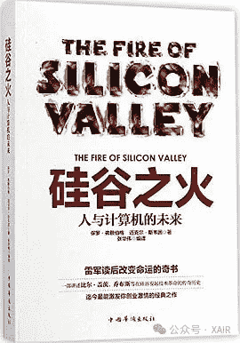
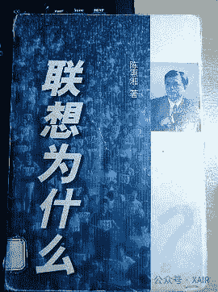
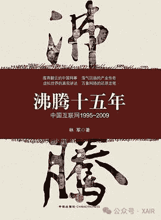

# AI 市场与 AI 产品经理分析——2024 是否是 AI 应用创业的好机会

> 来源：[https://waytoagi.feishu.cn/docx/C6eadxfnVocp0fxxJSOcG0G6nmh](https://waytoagi.feishu.cn/docx/C6eadxfnVocp0fxxJSOcG0G6nmh)

> 🔗 原文链接： h[ttps://mp.weixin.q](https://mp.weixin.qq.com/s/F19sN-6-gPzUdnLEvE-OQw)q.com/s/F19sN-6-...

> ⏰ 发表时间：2024-05-11

> 作者：Xie，XAIR

这是一个普通创业者与打工人写的文章（全文 4360 字），10 年是一个周期，希望能为您带来一点思考启发。

# 第一部分 AI 市场与 AI 产品经理

基于大家对 AI 很重要的这一共识，当前有两个场景：

1、企业（包括传统企业和互联网企业）如何实现 AI 转型或用好 AI

2、产品经理如何转型 AI 产品经理

本文希望从个人真实经历出发，探讨当下的 AI 市场与 AI 产品经理那些事。

## 一、AI 市场（分为创业市场和就业市场）

### **1、AI 创业市场 **

一方面，是行业大佬做出预判，这是一波比移动互联网更大的红利。

另一方面，很多观点在碰撞。我个人认同傅盛和朱啸虎两位老总的观点（两位老总在去年这个时候有一些观点碰撞，今年达成了和解），详见《 傅盛朱啸虎一年再辩 AI 大模型一年之变 》。

个人总结：

1）当前 OpenAI 虽然估值高但还没盈利，是否会成为泡沫是一个可讨论的话题。

个人看法：就看 GPT5 什么时候出来了，大模型创业可能会成为泡沫，但 AI 应用不会，还是认可这是堪比移动互联网的红利。

2）小参数大模型开始盛行，苹果等公司也专注小参数，为了在手机端即可跑模型应用，对开发者是利好。

3）2024 下半年会有一批有代表性的 AI 应用跑出来。

个人看法：仅针对 agent 智能体来说的话，个人看好在社交和游戏中的应用，传统游戏如诸神、赛马娘等，带有模拟经营和养成的属性，玩家是上帝视角，但不是真养成，之前的可能性都是预设好的。而 agent 智能体能实现模拟现实的养成，不同角色在游戏中恋爱结婚生子，每个家庭再养育出不同属性的新角色，此时一个游戏就是一个虚拟世界。

有没有一种可能， 我们其实就是造物者创作的一个个智能体 ？

再推荐由前 PDD 与前今夜酒店特价的两位老师主理的《AI 炼金术》，新一期播客中也聊到了 AI 产品与创业，里面几个观点很有意思：

1）站在 AI 很重要的角度，AI 创业没有蓝海，都是红海；

2）先考虑这个市场有多少肉，再考虑这个市场有多少狼抢；

3）现在看起来过了一段红利期，更大时间跨度下，还有更多**的红利（举**了之前做今夜酒店的例子，当时 获客成本 涨到 4 块多就觉得这波红利已经过去了，营销成本投不下手，现在 10 年后 回头看当时还正是最好的时候）

**4）AI+**SaaS 的优势体现在不是售卖软件，而是应该售卖最终的 交付成果 ；

5）挑一个你喜欢的和你擅长的事做。

这几个观点和我准备写的这篇文章的观点不谋而合，起到互相支撑的作用，刚好放在前面分享。

### **2、AI 就业市场 **

基于我之前也实操了一些 AI 落地项目（后面分享），我实际聊了一些 AI 企业的就业机会，谈谈个人的想法。

1）鱼龙混杂，求职者要做好信息甄别。即使面试通过拿到 offer，除了看 boss 直聘的招聘评价，一定要提前收集其他信息，如在脉脉上搜一下这家公司靠不靠谱；

2）一些公司实际上没搞懂用 AI 能为自己企业带来什么价值，只是处于焦虑或跟风心态要做 AI，这部分企业可以聊，但要求求职者要有咨询和商业化的思维，能帮公司厘清业务增长机会；

3）不同公司对 AI 产品经理的定位不同，所以招聘市场上对 AI 产品经理的岗位职责和任职要求也不同，慢慢会统一标准，这也是产品经理转型的机会。

4）有行业沉淀和认知的产品经理转型会更有机会，类似之前的“互联网+”，目前应用层的机会在“AI+行业”，只懂 AI 或只懂行业是不够的。还有就是业务创新，找到细分的场景痛点并完成 PMF 验证，海外有很多优秀案例。

## 二、AI 产品经理

个人做了一下划分，仅供娱乐和参考。

1）入门级

能通过 WaytoAGI 等开源网站或一些课程了解 AI 的概念，使用 AI 产品并尝试动手实践应用搭建（ 对应的画像可能是喜欢听小宇宙 APP 的播客或浏览 AI 相关的文章哈哈）；

以前互联网刚兴起的时候，部分用谷歌的人会比用百度的有优越感，现在可能用 AI 搜索的更有优越感（当然我感觉都没啥好优越的，都是工具，关键还是看能用工具产出什么）。

2）研究级

我理解这里有两个路径，一个是技术研究路径，一个是商业化研究路径；对应传统互联网**偏功能实现的产品**经理和偏商业运营的产品经理，当然最好是同一个人，我一直的理念是 产品运营不分家 （产品即运营）。

这个阶段对应的画像可能是对某一领域有认知，可以根据需求场景选择解决方案，或利用 Hugging face 等工具手搓出一些 AI 应用来验证想法；

3）落地应用

这一阶段我理解的画像就是有一些成功落地应用的案例，如产生商业化价值。

对应传统互联网 PM 也有三个层级：

1）负责功能模块与执行细节；

2）负责整体系统与产品架构；

3）熟悉行业竞争格局与商业运营策略；

总结来说，对 AI 产品经理要求懂得技术框架，不一定要了解技术细节，而是对技术边界有认知，最好能知道一些优化手段和新技术的发展。

AI 说白了也是工具和手段，我认为产品经理要关注的还是场景、痛点、价值。

举一些我们之前做的落地案例（我个人也是在 2017 年开始关注机器学习，还报了风变的 Python 课程，不过当时没有深入研究）。

案例一：录播课编程作业的自动批改

**场景 **：在班主任日常工作中，批改作业占据了 50%以上的时间。

这里的作业不是简单的选择题（有标准答案），而是包含创意创作和问答题，如孩子拖动编程积木来实现一个作品，还有孩子自己根据人物讲一个故事。

**目标 **：扩大班主任的服务半径，提高对学生和家长的服务效率。

**痛点 **：现有的作业批改方式无法统一标准，对于问答题和创作题的评分存在主观性，影响了教学质量和效率。

**原理 **：利用 BERT 机器学习模型（准确来说是 BERT 的变种），结合老师的批注（正样本和负样本），实现作业的自动和标准化批改。

**期望结果 **：理解和模拟老师的评分逻辑，减轻老师的工作负担。

**落地结果 **：自动批改节省班主任 50%以上的时间，服务半径从 50 人扩大到 200 人。

案例二：智慧安检标签在关务风控平台的应用

**场景 **：海关在对申报货物查验时，需要保证单货一致（所有关务风险，如夹藏、瞒报、违禁品等，都可以理解为单货不符）

**痛点 **：客户通过顺丰申报的品名，不一定是真实品名，存在顺丰货物被海关查验导致整车被扣的风险。

**解决方案 **：推动关务部门与 AIOT 部门的跨部门合作，应用 AIOT 的智慧安检判图标签（如是否含有液体或粉末）与货物品名对应的标签比对（如衣服对应的是常规标签），再输出是否有风险的结论给中转场人员（开箱查验）。

**落地结果 **：风控识别开箱复核有效率提升，成功识别重大货物风险。

以上都是我们在实操中遇到的案例，在顺丰还有其他一些实践，如需要根据客户申报的品名准确归类到大陆海关商编（10 位），在输入足够的情况下算法是可以归类到 10 位，但会要求客户下单补充更多信息（提高下单门槛），权衡的一个做法是先归类到 6 位商编（国际通用的分类），再根据历史库归类到 10 位商编。

这里个人总结是在一些大公司或甲方公司的 AI 部门，会有更好的商业化落地方案。

原因可能是有数据才有 AI，这里大公司本身有自己的一方数据，在目前大家重新对数据资产有新的认知时，一手数据就是资源，而公开市场上的数据已经有大模型提供基础能力了。

最后说一点感性的认知和个人经历吧，供同行交流参考。

# 第二部分 2024 年是否是 AI 应用创业的好机会

我有时会想，如果穿越回 2014 年，我 22 岁毕业时，还是否会选择创业？

2014 年，国家提倡大众创业、万众创新，正是移动互联网的红利时代。

我在深圳的咖啡馆，能遇到很多聊项目的创业者和投资人。

我也参与了移动互联网创业，和朋友做了一款帮人养成好习惯的 APP，积累了百万用户，拿了一些投资。

从大学做交友网站开始，认识了很多牛人，小红书、快看漫画、礼物说、兼职猫等，第一批移动应用创业者或运营负责人，都成了各自领域的佼佼者。

而我们的创业项目由于对商业化思考较浅，且好习惯这个概念较泛（且养成好习惯比较反人性），在当时工具+社区的模式中没有很好的商业化落地，最终项目折戟。

那时候我机缘巧合，通过紫牛创业营了解到傅盛**总，也看了傅盛总**的一些文章和演讲（关于 傅盛认知三部曲 ），于是抱着试一试的心态给傅盛总发了邮件，希望去猎豹移动学习怎么做产品和微创新。

而傅总也真的回我邮件并让我约 hr 面试了，今天还是很感谢傅总当年的点拨和引荐。

后来从北京回到深圳，加入了一家编程教育初创公司，也经历了公司从 100 多人到 2000 多人的快速发展；当时教育行业的核心逻辑从服务效果交付，卷到了各种投流获客，获客成本 CAC 的上升导致 ROI 惨不忍睹（分直播课和录播课，电销和社群营销）。

然后双减政策来了，广告金主中就看不到教育企业的影子了。

再后来加入某家大厂做跨境物流业务，一晃已毕业 10 年。

2024 年，在我个人生活发生转变的同时，时代的浪潮也从移动互联网应用转为了 AI 应用。

一方面，是行业大佬做出预判，这是一波比移动互联网更大的红利。

另一方面，个人面临就业或创业的选择，毕业生难找工作，大厂降本增效或海外驻点，此时选择变得尤为重要。

对行业和趋势的判断，也成为人生十字路口选择中要往哪个方向走的信标。

回到一开始的问题：如果穿越回 2014 年，我是否还会选择创业？

答案肯定是会的，只是如果真能带着 2024 的认知回去，那就是穿越爽文了。

从务实的角度来看，以你相信什么，想成为什么去预判未来 10 年，是可以实现的。

举几个例子：

雷军在上大学时看了《 **硅谷之火 **》这本书，才塑造了现在的雷总。

傅盛在上大学时看了《 **联想为什么 **》，以及后续他在采访中提到的经历，才塑造了现在的傅总。

**而我们 90** 后这一代，也有很多影响很深的书和产品，书籍如林军的《 沸腾十五年 》，产品如人人网、微博、微信、陌陌等。

（图源：豆瓣读书）

那 00 后这一代呢，目前已越来越多 00 后创业当老板或加入创业公司。

如 B 站 UP 主 **大狸子切切里 **，一个 00 后的女生，视频风格没有很严肃的测评，从零开始商业化做大还没影响观众缘，最新一期视频展示了公司的 500 平工作室设计建造模拟经营，成为年轻人梦寐以求投简历的公司。

还有我之前在编程猫认识的第一批管培实习生，也已经在行业大牛（ jia yangqing）创立的 AI 创业公司中担任产品负责人了。

他们让我看到了另一种可能性，当然大环境还是年轻人难就业，或者去到一些不靠谱的公司，每天被 PUA 的情况更多。

只是在 **信心比黄金更重要 **的当下，我们需要看到这样的“幸存者偏差”。

李一舟在一期播客中提到，我们每个人内心都有点羞耻（也许叫坦诚更合适）的想法，我明明是个 A，怎么活成这个 B 样了呢？

之前还看了胡延瑞胡总的文章《 **大厂产品经理并非产品经理 **》，很多观点也很认同。

产品经理最初的梦想是改变世界，怎么就慢慢躺平了呢？

比认知更重要的，还是 **心力 **（心性、心态），这个和 AI 产品经理社群团长 hanniman 的观点也一致。

在红利来临的时代，我们能否不躺平，而是拥抱变化，持续学习？

文章开头提到的观点： **挑一个你喜欢的和你擅长的事做 **。

我个人也在组建深圳 AI 教育落地实践的线下社群，对这方面有想法的小伙伴可以加我微信 1525816070（请备注来历）

本公众号也会持续更新社群探讨落地的干货（尽量去水分）

重磅推荐：对人类未来感兴趣的大佬，可以关注本公众号的原创文章，描述了一个 人的社会地位由贡献值来决定的未来社会 。

人的社会地位由贡献值来决定的社会《人人做好事的世界会更好吗》

致谢：成长路上给予我点拨的各位大佬，以及 hanniman 对本文的指导。

推荐 hanniman 大佬的 AI 产品经理大本营，感兴趣的可阅读精华文章

[https://mp.weixin.qq.com/s/um](https://mp.weixin.qq.com/s?__biz=MjM5NzA5OTAwMA==&mid=2650008347&idx=1&sn=30acf2954630d3784b043855fd3ca285&scene=21#wechat_redirect)RC9xMtXxBKSNqFKEoVDQ

（如果觉得本文对你有所收获的话，请帮忙点赞或转发，感谢阅读）