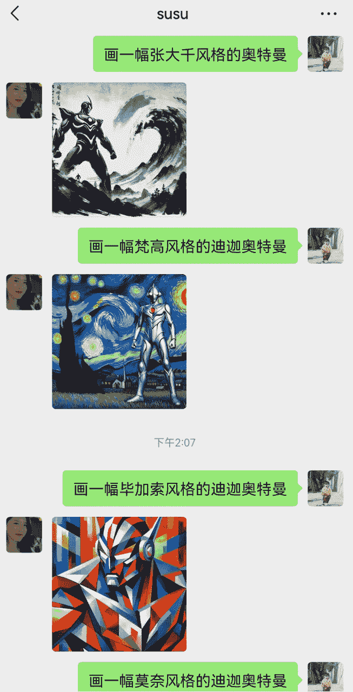
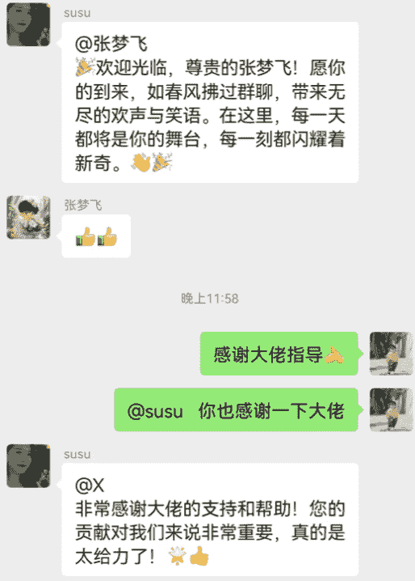
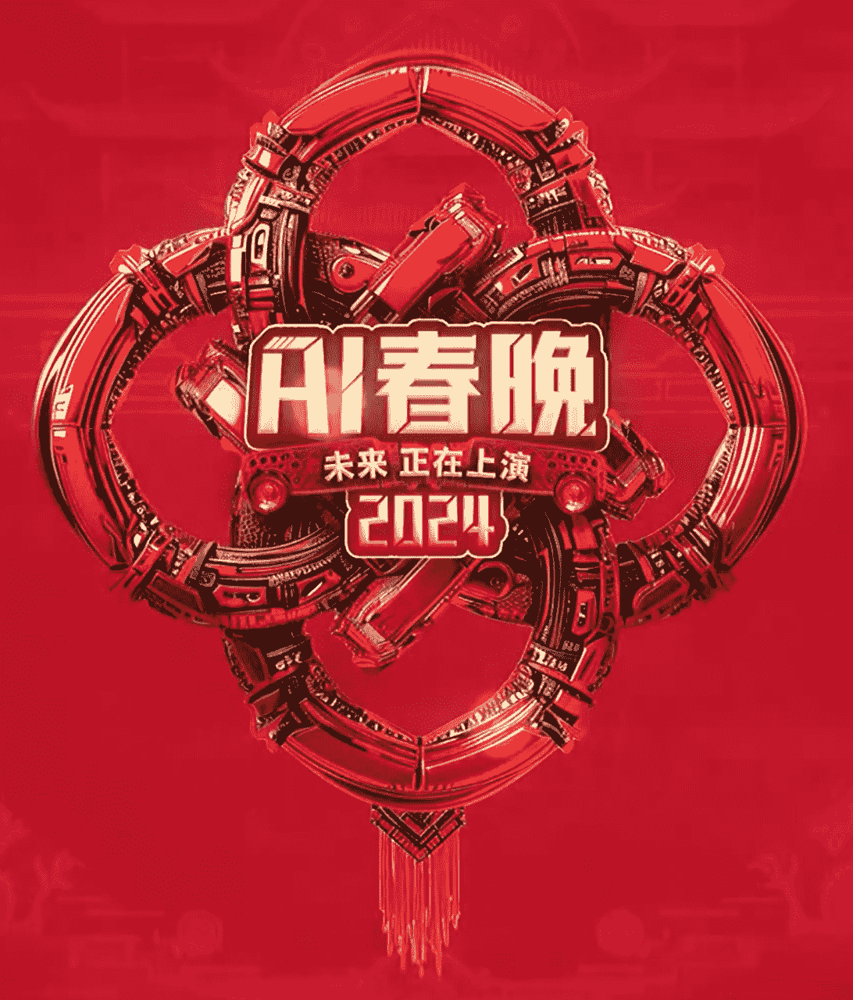
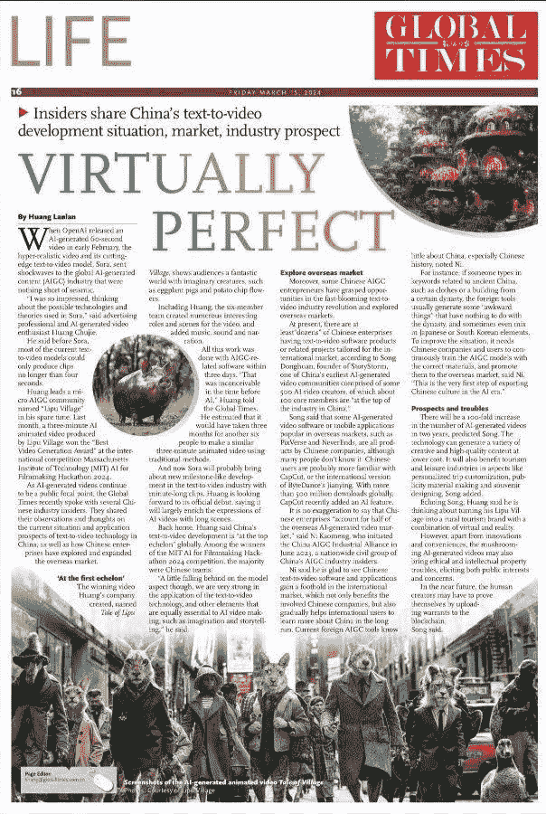
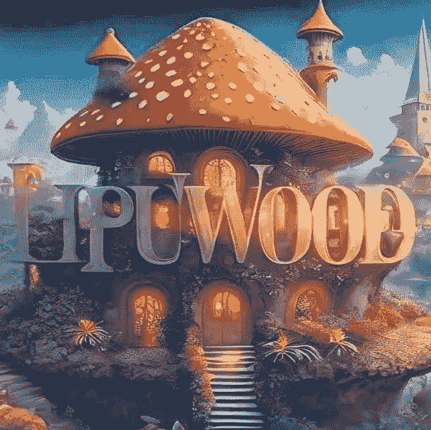
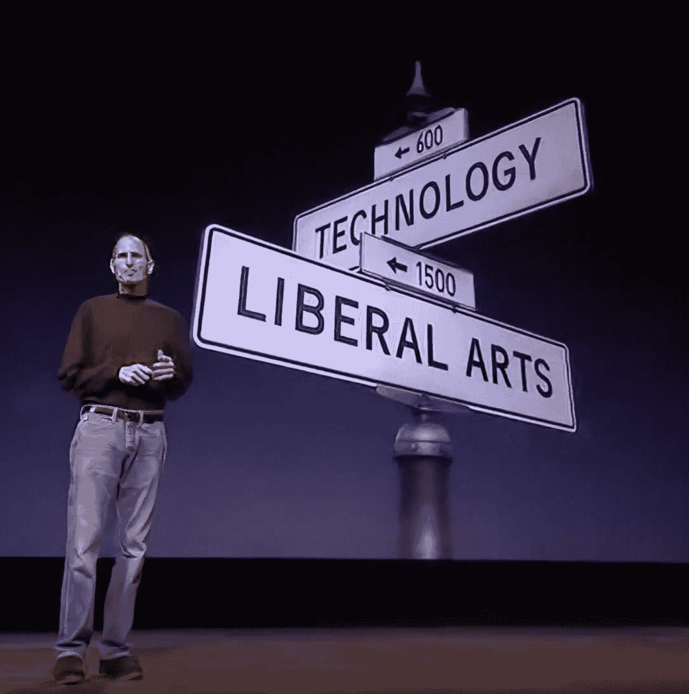
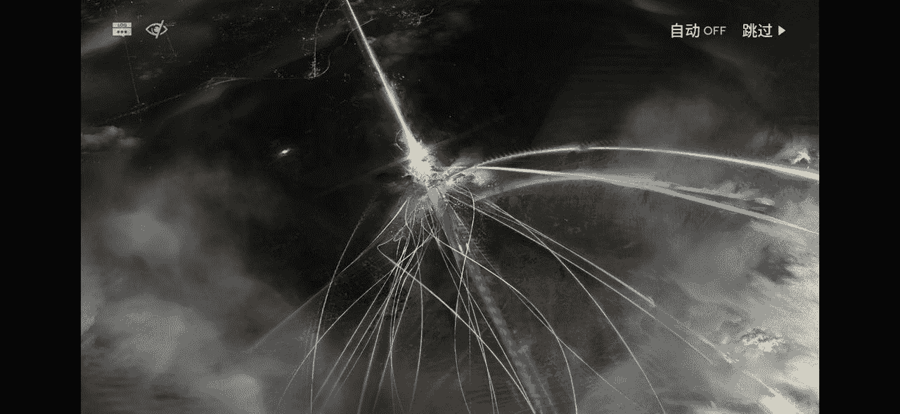
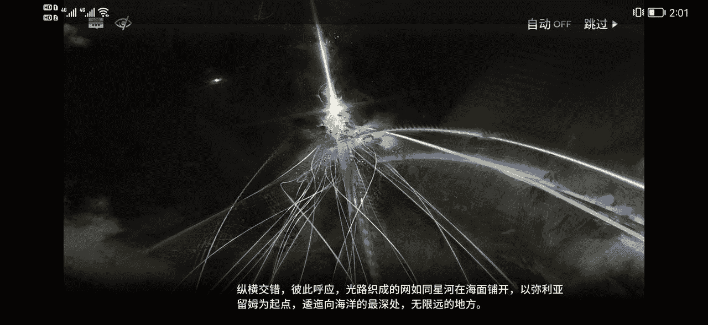

# 观点：热爱与行动是通往 AGI 之路

> 来源：[https://waytoagi.feishu.cn/docx/DbGYdfaypoBQhBxvIuEcvJrtnuh](https://waytoagi.feishu.cn/docx/DbGYdfaypoBQhBxvIuEcvJrtnuh)

作者：Allen

更新日志：补充对共创模式的思考，删减部分内容。

更新：端午假期实践了三篇教程。个人感觉难度按从低到高排序。

1、[Stuart：【入门级】教你用最简单的方式搭建微信机器人](https://waytoagi.feishu.cn/wiki/QWQ0w1QOZiNZz9kreQecY4hYn4c) （入门级网速好的话，一个小时能搞定）

2、[张梦飞：【知识库】FastGPT+OneAPI+COW带有知识库的机器人完整教程](https://waytoagi.feishu.cn/wiki/XnvIwd8NkiDefHkmbobcCfsBnKg)

3、[张梦飞 ：【保姆级教程】这可能是你在地球上能白嫖到的，能力最强的超级微信机器人！一步一图，小白友好](https://waytoagi.feishu.cn/wiki/YeBiwZx2TiyNLMk8pdjcmdQfnjd)

写在前面：关于加强写作能力的训练，我准备调整一下工作流，先把初稿发在飞书上（可能是原来 2 篇或 3 篇的集合，有一些不方便说的也先发在初稿，后续在删），获取大家反馈后再拆分细化。

自我介绍：Allen，一个小镇青年，我们都是 WaytoAGI 共创者。

## **第一部分    宝藏社区**

### **一、什么是 WaytoAGI？**

WaytoAGI 是一个公益开源社区，努力做最好的中文 AI 知识库。借用群友“千钟”的话“特别喜欢 waytoAGI 坦诚、无私、热情、互助的 wiki 和社区氛围”。

从用户体验路径看，社区针对小白有小白教程，针对实践需求有共创项目和共创比赛，完成了小白从“AI 看客”到“AI 玩家”的进化闭环。

最近参加社区举办的 Agent 共学小组 coze 搭建比赛讲座，强烈感受到社区氛围的与众不同。具体来说会议的每个人基本都是夸夸高手，能发现每个作品的闪光点；即使小白问了一个很简单的问题，也不会被鄙视，而是会被耐心解答，或者引导在知识库中搜索查询。

这种自发互助的氛围，给我一种早期互联网 BBS 的感受。雷军在 2022 年的一次演讲中回忆称，他在 1996 年辞去金山软件的职务后，开始频繁地参与 BBS 论坛，并在那个时期认识了马化腾和丁磊。后来我翻到了潘乱老师对 WaytoAGI 的访谈，里面也谈到了一样的观点，在 20 年前刚好是 Web 2.0 出来的时候，Web 2.0 所强调的去中心化、开放、共享，让大家回到了早期互联网那种很有激情的感觉。

最新一期的 coze 搭建比赛，有参与的同学说比上班更有意思，大家都愿意付出时间精力玩到一起。在 coze 搭建比赛之前，WaytoAGI 还进行了很多共创项目，比如孵化了【AI 春晚】。

在距离除夕只有 30 天的情况下，由 300 多位小伙伴共创，超过 10 万观看。在一场由 WaytoAGI 组织的线下演讲活动中，小伙子“电子酒”提出了“不如用 AI 创办一场春节联欢晚会”的想法。

大家在杭州西湖边上的明月楼竹林间进行了深入的探讨。第二天就立马行动起来，用飞书文档搭建了整个目录。所有的节目都是 AI 工具制作的，用了 30 天的时间，40 个节目，300 多人参与共创，最终达到 AI 春晚 150 万的曝光。

第二个出圈的共创项目是【离谱村】。

一部完全由 AI 制作完成的短片《离谱村的故事》获得了 MIT 电影黑客松的 Best Video 第一名，并登上环球时报。

在六一儿童节，“离谱村”AI 动画短片系列第三集《奥运前夜》在广州广播电视台获得推荐。前一段时间 Sora 非常火，很多人忙着用 Sora 概念搞钱，而动手实践 AI 视频的小伙伴们沉浸于离谱村的创作。大家好像打了鸡血一样，用 AI 工具搭建自己的“离谱”想法。

写到这里，再次被震撼了，同时也在思考一个问题。

### 二、为什么是 WaytoAGI？

为什么一群更多是业余时间兼职的人能迸发出那么大的能量？在乱翻书的访谈中，AJ 和 Roger 给出的答案是热情和自驱。

首先是热情的驱使，因为初心是好的，在热情的驱使下，当你真正认可一个理念，可以感染到更多的同行者加入。有句话说你是什么样的人，就会吸引什么样的人。科技发展的最终目的是让人更好地成为人。

有人拿 WaytoAGI 和李一舟进行对比，不可否认两者都面向 AI 小白群体。李一舟选择的是内容商业化，他在一期节目中提到对于人生的财富机会（卖课赚一个亿），“对普通人来说是愿意一直穷还是愿意赚到钱被人骂个两年？对于 99%人来说，他一定能接受你随便骂，反正钱我挣着了”

WaytoAGI 选择的是内容开源，让我们看到了开头的“坦诚、无私、热情、互助”精神。当然我觉得两者没有可比性。

这是理想主义和商业化的区别，正如罗永浩在《一个理想主义者的创业故事》中提到的：“如果我们成功，很大程度上这是正派、体面、原则性和理想主义的成功，因为价值观方面的原因，我们得到了太多不合一般商业逻辑的支持和帮助。如果我们失败，可以肯定，这是商业能力上的不成熟，跟我们没有采取流氓手段获益没有任何关系，更谈不上理想主义的情怀和失败”

我在上篇文章中提到了一个人是否厉害与个人成就没有直接关系。举个例子如果有一天你去钓鱼遇到一个老人，和他聊天之后发现他的认知很厉害，对你很有启发；那他就很厉害，与他一生取得多大成就无关。

张津剑老师也说过类似的例子，他看到道士年轻就给人打上“水平不行”的标签；小道士说“你的世界明明是一个 4K 的高清电影，你的每一个 tag 就是一个弹幕。你为什么给你的世界打这么多弹幕呢？你的弹幕多到你都看不见这个世界了”。

开源精神一直存在，感谢 AJ 和 Roger 的心血投入，聚集了优秀的知识共创者，如大聪明、Stuart、大圣、熊猫大侠、张梦飞等，从而聚集了更多有趣有料的年轻人。

## **第二部分    对个人的启示**

提问是锻炼思考最有效的方式。这里思考几个问题：

### 一、为什么大厂也在搞各种内部创新项目，而完全没有这种氛围？

1、大厂的整个逻辑还是注重 ROI 和价值产出。

然而价值是多元的，只需要换一个角度去解读，伟大的就会显得渺小，丑陋的就会显得美丽。

2、个人兴趣和工作的区别。从“**自我决定理论”**要培养习惯爱好需要动力、行动、反馈。

+   动力（动机）：首先聚到一起参加比赛的，都是对 AI 感兴趣的人，愿意动手尝试。

+   行动：尝试搭建一个 bot 的过程中，也是做出改变的行为。

+   反馈：bot 成功搭建的成就感，以及同伴给予的正反馈也很重要。

最后是社区的力量。

"独行者快，众行者远"，就像一个人开始跑步可能难坚持，如果跑道上一群人跑则能跑的更远。

### 二、AI 的下一站，能否有趣又有用？

百姓网创始人王建硕老师说：要研究 AI，而不是研究 AI 新闻。而卡兹克也谈到“现在的 AI，在我看来，他很难算一个单独的行业。不是 AI+行业，而是行业+AI。行业一定是在前的”，不管 AI 是不是一个行业，研究 AI 是一个机会，一个为个人生活或事业提供助力的机会。

1、为什么要关注并研究 AI，每个人有自己的答案。

问这个问题的除了我们自己，可能包括我们的朋友、家人、老板等。借用 KOL 的话来回答也是一种思路。

O**penA**I 的首席执行官 Sam Altman：“随着 AI 技术的发展和应用，它正在以前所未有的速度重塑我们的世界，并催生所谓的“超级个体”，即那些能够在经济和社会领域产生巨大影响力的个人或小型团队。AI 可以处理大量数据，执行复杂任务，甚至在某些领域超越人类的能力，这意味着即使是规模较小的团队，只要能够充分利用 AI 的力量，也有可能创造出巨大的价值。”

心资本合伙人吴炳见：“中国成功的很多公司，比如字节、拼多多、米哈游，都有一个共同特点——他们都不是靠第一个产品成功的，都是靠第二个或者更往后的产品成功的。看清当下，抓住当下。浪潮来的时候，关键是要站在海里，且早早学会游泳，早早习惯海水的味道。” 在岸上看 6 个月，和在水里泡 6 个月，体感是完全不一样的。

做 AI 出海的应该都知道 Prisma 这家公司，名不见经传好几年，增加了 AI 做头像功能之后，日收入超过 10 万美金。经常被 KOL 拿来举例子——匹配到自己发现的细分市场，几千万美金就赚到手了。实际上 Prisma 已经在 AI 图像领域做了很长时间，之前也推出过多款应用。

2、不谈时代红利，就在自己公司苟着，也需要掌握 AI 吗？

首先现在互联网大厂降本增效是否苟得住是一个问题，而且降本增效必然导致个人工作量的增加，那应用 AI 提效也是让自己增加竞争力和早下班的一种方式。再借用徐文浩老师在“Always Hands On”中提到的：

“帮朋友公司面试过各种大厂出来的 leader。如果要给一个结论的话，就是在完全只管带团队，hands-off 一两年之后，大量的所谓大厂 leader 对于一个需要探索创新的技术或者业务基本提供不了价值。还在大厂的时候其实体会不到危机感。因为在大厂内部完全可以依赖自己作为一个老员工的信息优势和工作惯性显得还不错。但是实际上，对于业务的帮助和找我奶奶去管那个业务并没有什么区别。

出现 AGI 这样重大的技术变革之时，每天都在一线**动手才是**唯一可行的道路”。简单总结就是“躬身入局”。（上面提到的吴炳见和徐文浩老师都有公众号，分别是【AI 大航海】和【AI 炼金术】，都是优质信息源）

**3、共创模式的优点和挑战**

共创概念最近也很火。

我让Kimi大模型列了一下共创模式的优点：多元化视角、增强参与感、共享资源、快速迭代、增强创新等。

而共创模式的挑战包括协调复杂、知识产权保护、利益分配、责任归属与质量控制。

个人感受共创就是我们大学时候的三下乡、支教或创业比赛，洋气一点的像SIFE、AIESEC和JA等公益组织。

大家为了一个共同目标努力，比如大学参加的创业比赛或社团活动，都是志同道合的人玩到一起。

在还没有成立公司或接到第一笔订单之前，有必要考虑谁当CEO/CTO/COO，股份利润如何分配，要不要留期权池这些问题吗？

大家的动力就看这件事足够有趣，能够run起来就行；拿到成果后想的第一件事是吃宵夜庆祝。

### **三、对普通人的启示**

**1、第一个选择——AI ****转型**

现在创投圈流传这样的说法，“十个 AI 应用里面，五个办公 Agent，三个 AIGC”，

目前看产品拉不开根本差距，核心是对行业的理解和做好靠谱交付。

上次说到对标移动互联网，目前做Agent的公司类似之前专门做APP的公司。

和我专门做Agent的朋友聊了下，这里还存在比做APP更大的机会，就是行业加AI。

行业玩家如喜茶和金蝶，都制定了AI战略或成立了AI部门。

喜茶拥有过亿的私域用户数据，AI可以在新零售门店管理、营销销售、客户服务发挥应用；

金蝶则是传统SaaS软件拓展新的AI业务，属于新零售+AI与SaaS+AI。

2、第二个选择——在生活中应用 AI

比如在 WaytoAGI 学习 Agent 知识后，搭建一个 bot 帮我们的工作或学习提效。

比如应用AI养成自驱自律的习惯，拥抱变化，持续学习，自我进化与迭代。

比如培养下一代的可以用 AI 来辅助教育，毕竟孩子的未来是无限的。

如郝景芳老师所说：

> “每个孩子是生下来就自带大模型的，他们天然有超强的数据处理能力。家庭教育是让孩子的大模型‘本地化’。

> 我们对孩子的教育，就是一种大模型的微调。我们要做的是顺势而为，让孩子的先天大模型发挥最好的作用”。

对 AI 家庭教育感兴趣，也可以在 WaytoAGI 找到 MQ 老师交流。最后初稿写的有点长了，祝愿 WaytoAGI 越来越好，也希望大家注意身体健康，多早起少熬夜。

世界是参差的，不变的是人的奋斗。

感恩与你们在科技与人文的十字路口相遇。

### 参考链接：

1、154.对话 WaytoAGI ：一起摇滚，一起共创！

2、华为“天才少年”演讲实录：AI Agent 的下一站，是有趣又有用（这篇文章给我很大自信，原来天才少年和我思考的问题差不多，比如思考快与慢系统一和系统二与大模型的关系，哈哈哈）

---

还有强烈建议发起剧本共创，有人对科幻感兴趣的可以联系我，一起完善我们的第一篇科幻剧本。

微信1525816070（添加请备注来意）

## 附：剧本共创：科幻主题（是不是还可以有玄幻、仙侠、都市、恋爱主题）

### RP 世界

已有世界观设定，缺少人设高手与剧情高手。

世界观设定：一场涉及经济、法律、统治、伦理道德的思想实验。

未来都市，随着 AI 技术的发展，人们开始思考如何重构社会层级。学者 RP 提出，人的社会地位不由财富多少决定，而取决于人在社会上做出的贡献，通过训练一套 AI 大模型，将人在社会中的所作所为换算为 RP 值，由此 RP 值可取代货币体系，人们工作换取 RP，而消费和贸易都使用 RP；至 AI 历 X 年后，世界步入 RP 时代。

#### **第一章     笔记**

RP 系统设计笔记：

第一层：账本

具体问题：人工智能训练数据的版权问题；创造有价值数据的人们是否应该得到某种形式的经济补偿，因为他们的数据被利用了。

笔记注释：应该有某种动力激励人类继续创造，背后能有一套经济模式来确认创造者的利益得到体现。

我们渴望创造，我们渴望证明自己的价值，我们希望以各种方式来获取认同和地位。

如何更进一步，在这套系统中倡导人类社会的真善美，赞扬并鼓励做好事的人？

第二层：数据

具体问题：假设一个老人摔倒在地上昏迷不醒，而只有你在旁边；如果你去把老人扶起来，老人醒来后可能会指认你为撞倒他的凶手，你将承担扶老人之后的一系列后果。你是否会选择扶起老人，还是事先考虑自证的证据？

笔记注释：用数据量化人们的行为，需要有配套的天眼监控系统，并平衡人类数据采集的记忆与隐私问题。

第三层：安全

具体问题：如何减少重大犯罪的发生？避免某些失控个体对集体利益造成巨大破坏？

笔记注释：杀伤性武器的管控是必要的，避免无差别攻击人类的犯罪。

#### **第二章     演讲**

AI 历 01 年，10 月 25 日下午，冯平（英文名 Rainbow Prism，简称 RP）正在著名的诺德大学演讲。

AI 声音朗读：“当提倡结果导向时，确实强调行为的结果和后果。然而，在法律决策中纯粹以结果为导向而忽视主观意图可能引发一些问题，以下是一个例子来说明：

假设有两个人分别做出了相同的误杀行为，即无意中导致他人死亡。根据法律，故意杀人会被判处更严厉的刑罚，而无意杀人则通常会受到较轻的刑罚。

在这个情景中，我们考虑下面两种不同的情况：

情景一：A 是一名医生，在做手术时由于操作失误造成病人死亡。尽管 A 没有故意杀害病人，但他在行为过程中可能存在医疗事故或失职的责任。

情景二：B 是一个普通市民，在驾车时因未注意到路况而发生交通事故导致他人死亡。B 并没有故意要伤害他人，仅仅是由于粗心或不慎造成了不可预料的悲剧。

如果法律只关注行为结果而不考虑主观意图，那么对于上述两种情况可能会得出相同的判决。这将导致不公平和不合理的结果。因为 A 作为医生应该对其职业能力和操作负有更高程度的责任，并且需要遵循特定的专业规范与标准；而 B 则只是交通参与者，并不能被要求具备类似医生那样高度专业知识和技能。

因此，在这种情况下，考虑主观意图可以帮助法律系统区分两个案例，并对每个案例进行适当审查与量刑。这样才能确保对于不同背景、动机以及责任程度的个体给出公正合理的判决。”

磁性男低音：“以上案例是我和 AI 助理对话后收集的一个案例”

RP 博士说道。“对于这个案例，我更感兴趣的是，情景一中的医生，是故意的，还是不小心的？”

这里他引用了中文互联网上的一个梗《故意的还是不小心的》，引来部分学生会意大笑。

活跃气氛后，RP 博士继续说道：

“情景一中，A 作为医生，如果失误杀人或故意杀人，得到的判决会不一样吗，法律判决中如何区分失误还是故意呢？”

“我喜欢的一部电影《烈日灼心》中有这样一段台词‘我认为法律是人类发明过的最好的东西。人是神性和动物性的总和，他有你想象不到的好，更有你想象不到的恶。

没有对错，这就是人。所以说法律特别可爱，它不管你能好到哪儿，就限制你不能恶到没边儿。它清楚每个人心里都有那么点儿脏事儿，想想可以，但做出来不行。

法律更像是人性的低保，是一种强制性的修养’；

没错，人类发明了法律，那人类能否发明一个更完善的法律系统？

如果人类有一个法律系统的大模型，为了实现人类的公平正义，设计这个系统需要具备哪些条件？这正是我的团队的研究方向。”

RP 博士在会场播放了一个视频，现场继续 AI 视频朗读：

“如果人类拥有一个法律系统的大规模模型，可以在某种程度上解决法律判决中的问题。然而，设计这样一个系统需要满足以下条件才能实现公平正义：

1.  全面而准确的数据：系统需要建立在全面、准确且可靠的数据基础上，包括过去的案例数据、法律条文和相关司法解释等。只有这样，才能使模型具备充分的权威性和有效性。

1.  多因素考量：为了实现公正和合理的判决结果，模型应该同时考虑多个因素，如行为结果、主观意图、个体责任、动机、背景等。通过综合各种因素评估案件，可以更好地反映个案特征和复杂性。

1.  适应能力与灵活性：法律是不断发展变化的，在新情况下可能会涉及到之前未曾存在过的情形。因此，系统需要具备适应新情况并灵活调整判决标准和参数的能力。这样才能保持与社会进步和价值观演变同步。

1.  非歧视性与公平性：设计模型时必须避免潜在或明显的偏见和歧视。它应该平等对待所有人，并在考量审查标准时不偏向于特定群体或利益。

1.  可解释与透明度：模型需要具备可解释性，即它能够详细说明其判断依据和推理过程。这样一来，当模型作出判决时，相关方可以理解并验证其合理性，并有信心相信其公正性。

1.  人类监督与干预：尽管是由模型生成判决结果，但仍需人类专家监督和介入，以确保最终判决符合法律道义，并纠正任何潜在缺陷或偏差。

1.  法治原则指导：设计模型时必须始终以法治原则为指导，并符合基本人权、平等待遇和社会公正等价值观念。

要注意的是，在制定这样一个系统时还需要充分考虑伦理问题、隐私保护以及非技术因素（如政策制定）。此外，在引入这个系统之前还要进行广泛讨论和深入研究，以防止潜在风险和误用。”

个人写的短篇 RP 世界-人人做好事的世界会更好吗（被科幻世界编辑评价为更像世界观设定而不是小说剧本，参与共创的小伙伴可以不要受限哈，达者为师，期待你的参与）

（方舟的美术风格还是牛）

还有对明日方舟感兴趣的，也可以一起捏一个凯尔希的 bot 哈哈哈哈哈