# XAIR：AI 智能体平台对决：腾讯元器与字节扣子的创新之路

> 来源：[https://waytoagi.feishu.cn/docx/ONHmdrnZroGUXVxMdkccgaCRn0g](https://waytoagi.feishu.cn/docx/ONHmdrnZroGUXVxMdkccgaCRn0g)

> 🔗 原文链接： h[ttps://mp.weixin.q](https://mp.weixin.qq.com/s/JrvE2hspD_AZb-QDZRr18w)q.com/s/JrvE2hsp...

> ⏰ 发表时间：2024-06-03

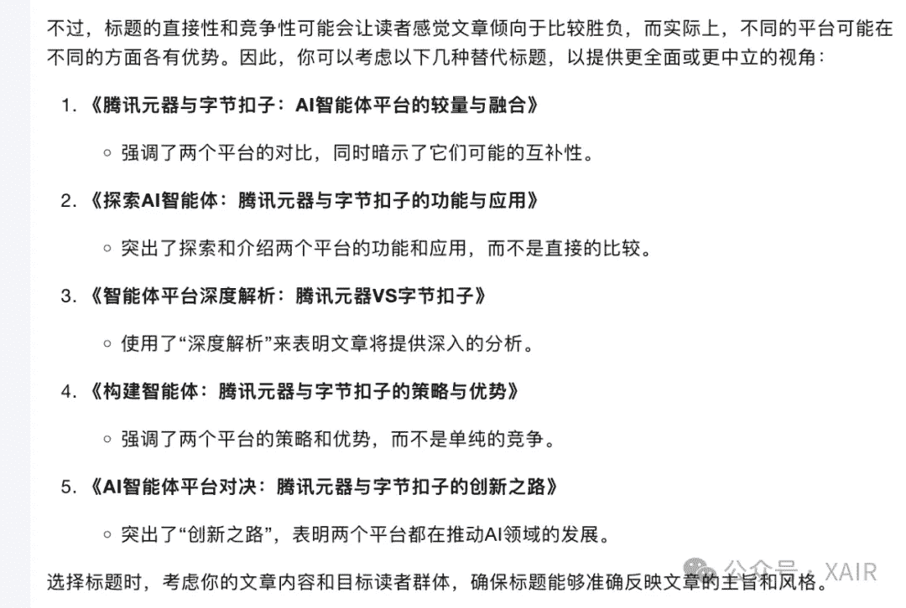

老规矩，先解释主题。

这个对比主题其实很不好写，因为智能体生态属于大厂战略布局，往大了写显得泛泛而谈没有干货，写小了显得没有深度。

本次只做简单科普与个人实操经历对比，并附上 AI 专业解读，一家之言，大家看个乐（叠甲结束）。

## **一、概念定义**

**1、什么是智能体？**

随着 ChatGPT 与 AI 概念的爆火，出现了很多新名词，“智能体 Agent”还有 bot 和 GPTs 等，Kimi（月之暗面的大模型）的书面解释是：

> 在人工智能和计算机科学领域，"agent"（智能体）和"bot"（机器人）这两个术语经常被用来描述自动化的软件程序，它们都可以执行某些任务或服务。尽管这两个词在日常使用中经常被交替使用，但它们在某些情况下可以有略微不同的含义和侧重点。

> 在实际应用中，这两个术语的界限可能非常模糊，很多情况下它们可以互换使用，特别是在描述具有一定智能和自动化能力的软件系统时。因此，是否使用"agent"或"bot"有时取决于个人偏好或特定社区的用语习惯。

简单理解就是 AI 机器人小助手，参照移动互联网的话，类似 APP 应用的概念（我记得 GPT 刚出的时候，还有人把 GPT 应用称为 GAP），AI 大模型是一个技术，而面向用户提供服务的是产品，所以有很多公司开始关注 AI 应用层的产品机会。我知道的在做 Agent 创业的公司就有好几家：

C 端 案例： 比如社交方向，用户注册之后先 捏 一个自己的 Agent，然后让自己的 Agent 和其他人的 Agent 聊天，两个 Agent 聊到一起后再真人介入，也是一个很有趣的场景；还有借 Onlyfans 入局打造个性化聊天的创业公司。

B 端 案例： 如果字节扣子和腾讯元器是面向普通人的低代码平台，类似 APP 时代的个人开发者，那还有一个机会就是帮助 B 端商家搭建 Agent，类似 APP 时代专业做 APP 的。

**2、 智能体开发平台 **

我最早接触到扣子 Coze，是一篇科技报道：

国产 GPTs 商店来了。 平替版 GPTs 商店，字节 Coze 扣子上线。

2 月 1 日，字节正式推出 AI 聊天机器人构建平台 Coze 的国内版“扣子”，主要用于开发下一代 AI 聊天机器人。

后来发现 国内也有很多智能体开发平台，如 Dify.AI，但个人比较常用的还是扣子，所以本篇主要对比字节扣子和腾讯元器。

**3、为什么要关注智能体？ **

> 未来的工作预计会变成两种：

> 一是我们派给 AI 的工作；

> 二是 AI 派给我们的工作。

这**个观点****没找到出处，感觉很适合卖课宣传。 个人理解 A**I 智能体是给个人提效的，相当于你拥有了自己的数字员工，在 WaytoAGI 的分享上大聪明（赛博禅心作者）也表达过这个观点，Agent 就是你可以不断 PUA 你的电脑，让它能不能做的更好呀，来实现你制定的目标（加粗显示）。

这和现实中老板给员工下达任务很像，每个员工有不一样的性格和能力，而下达任务目标时，目标是否清晰以及能否让员工 get 到很重要，这考验你写提示词的能力。而员工会基于它对目标的理解，根据计划去不断尝试完成，并且过段时间来寻求你的反馈。也就是你拥有了一个免费打工人，并且你还可以无限 PUA 它给你干活，这种感觉爽不爽？

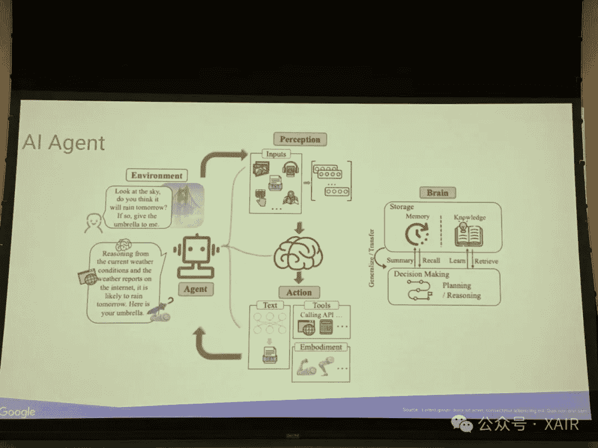

（图源：朋友截图，来源未知）

## **二、平台对比**

1 、 简单介绍

1）字节扣子介绍

中文版：https://www.coze.cn/ （支持大模型：豆包、通义千问、 Moonshot 等 ）

国际英文版：https://coze.com/ （支持大模型：ChatGPT4 等）

2）腾讯元器介绍

网址： https://yuanqi.tencent.com/（支持大模型：腾讯混元大模型）

2、推出时间

根据搜索结果，字节跳动的 AI Bot 开发平台「扣子」Coze 国内版是在 2024 年 2 月 1 日正式上线的。

腾讯元器是在 2024 年 5 月 17 日举办的腾讯云生成式 AI 产业应用峰会上发布的。

3、新手引导

个人感受扣子的新手引导做的比元器好（毕竟做的久），如图

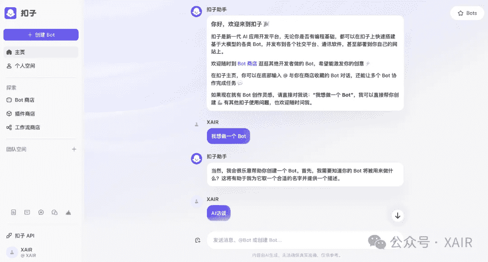

（扣子新手引导）

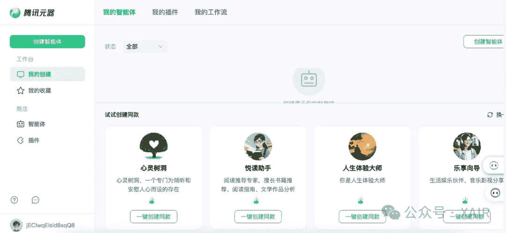

（元器新手引导）

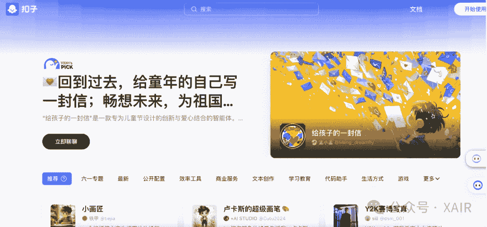

（扣子商店）

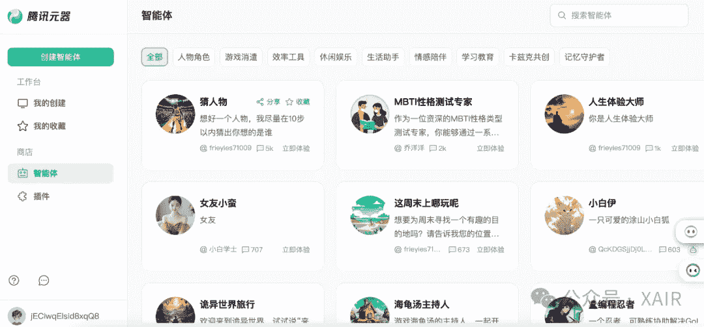

（元器商店）

4、运营层面：从上图商店界面可以看到，扣子已经有活动运营了；要建设开发者生态，后续更考验的是两者的开发者运营。

要谈生态建设，可简单抽象为平台、开发者与使用者，类似内容平台、内容生产者与内容消费者。

要看类比的是内容创作还是 APP 应用商店，国内短视频兴起的红利很大一部分来自于内容制作门槛的降低；而 AI 能力的加持确实也降低了大部分人制作简单 Agent 的门槛，不过这里还存在一个 GAP，作为生产者需要清楚自己想要什么，这是一个思维方式的转变。只有生产者的创新生态起来了，才能让消费者用好各种 AI 应用。

好的，以上是科普介绍。 下面重点讲个人实操案例，分为一个产品使用场景与一个产品开发场景。 不过在讲个人视角之前，先插入一段专家视角，有请我们的 Kimi 专家（以下观点来源于 Kimi，个人不承担相关责任风险）

> 从平台定位、技术实现、开放能力、开发者生态、B 端用户和 C 端用户体验、市场推广策略、运营模式等几个维度，分析并对比腾讯元器和字节 Coze 的相同点和不同点。

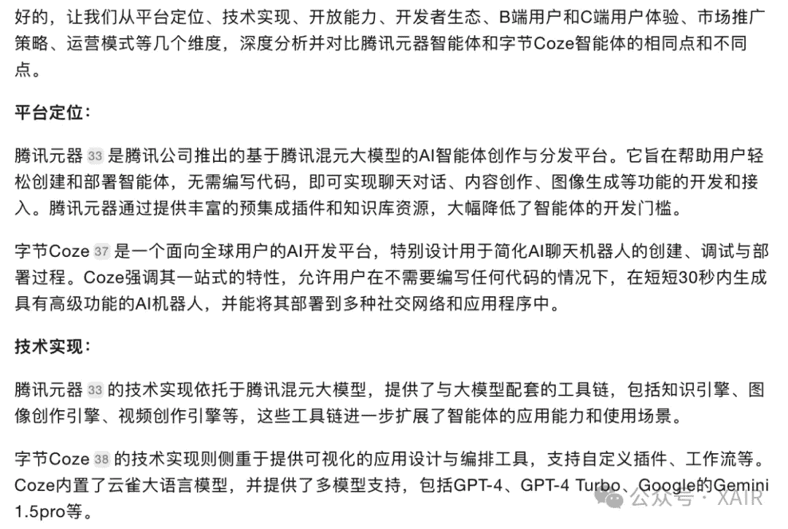

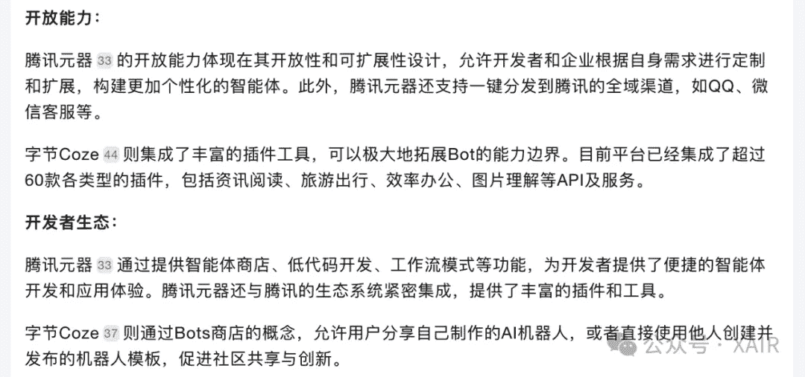

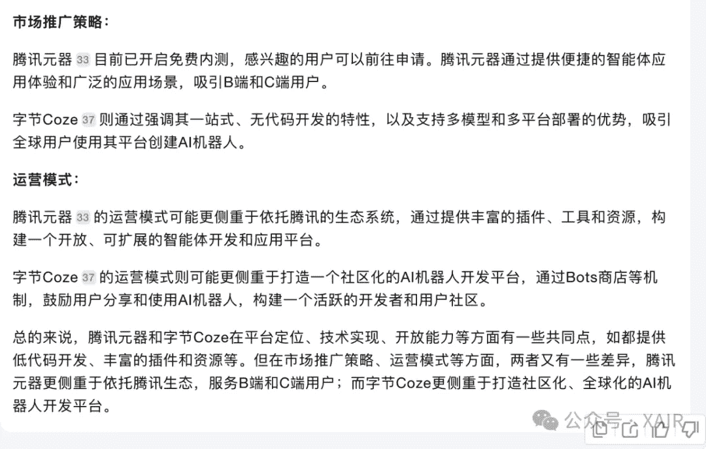

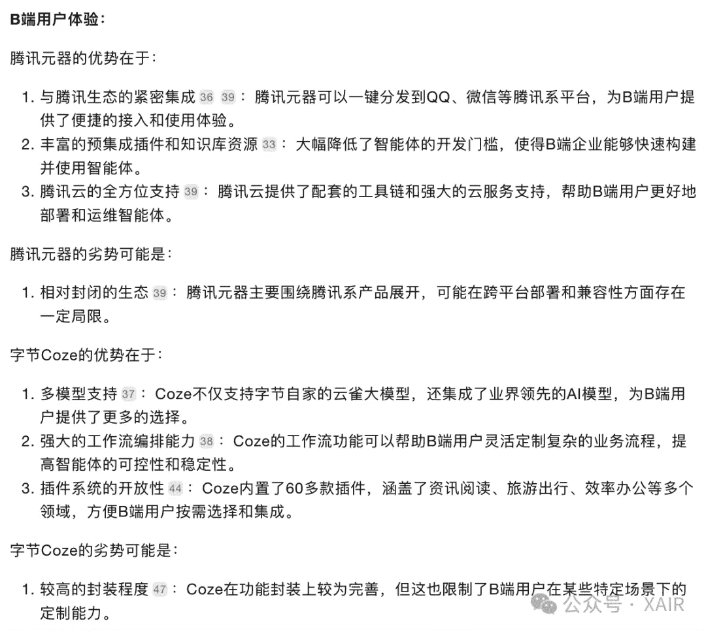

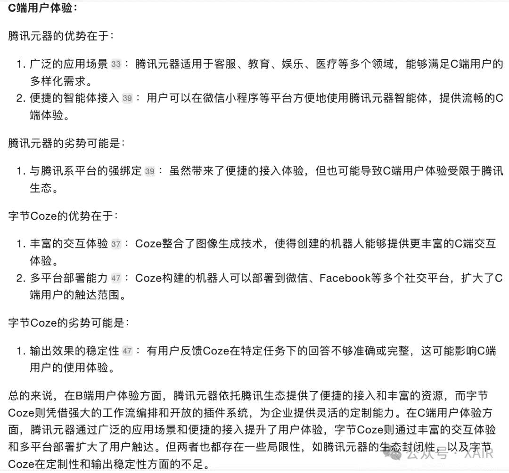

## **三、个人实操案例**

**1、产品使用场景**

场景：为本篇文章配图

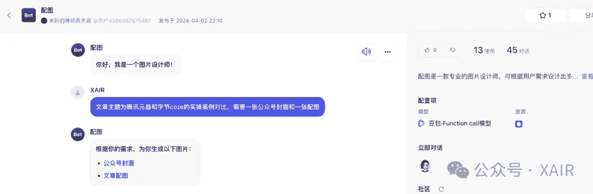

生成结果为（我的问题，描述不够清楚）

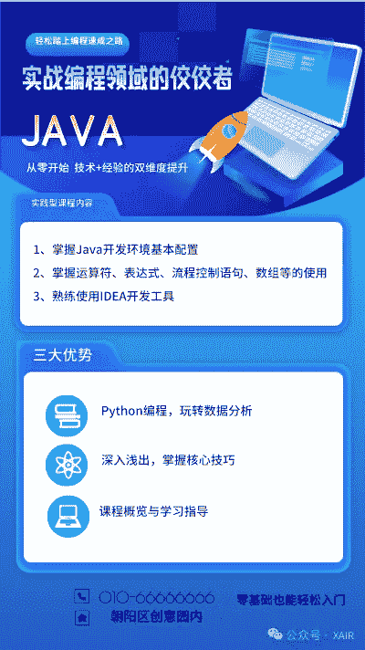

换个提示词“ 那你给我生成搞笑图片吧，让人一看就有继续看下去的动力那种，需要一张公众号封面和一张配图”，

得到结果为：

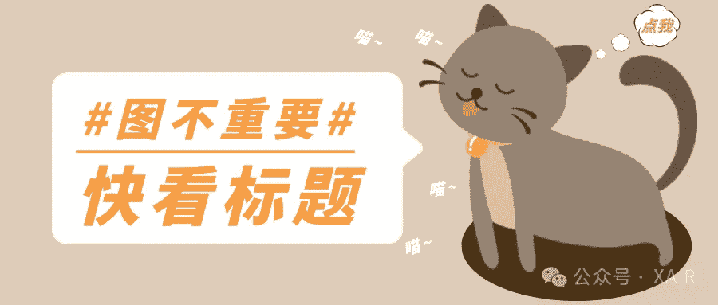

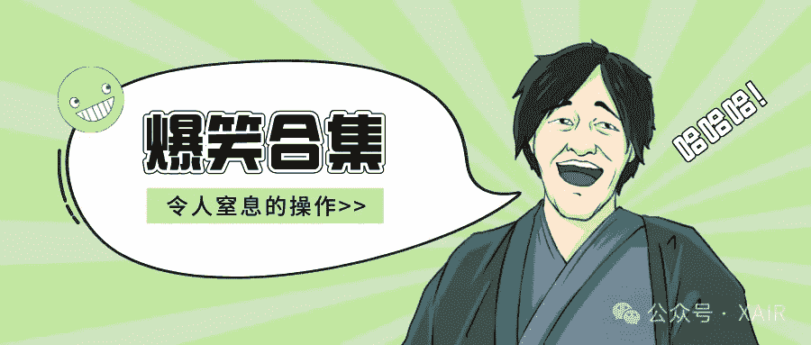

同样的提示词，元器某应用生成为

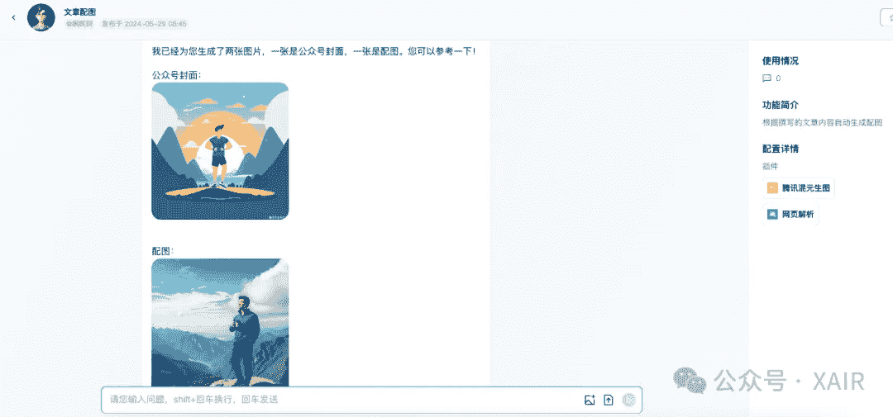

这里仅举例个人应用开发者开发的工具达成某一目的（工具不同无法比较），非扣子与元器的对比。

**2、产品开发场景**

个人应用场景为我要做一个 AI 访谈，身边有很多做 AI 的朋友，需要先了解每个人做访谈的意愿和产出内容的质量水平，故需要搭建一个 AI 访谈 bot；

第二个场景是个人一直对内容推荐很感兴趣，在人挑内容的同时，内容是否也在挑人？每个人由于自己的认知以及社会角色和身份都有信息茧房（只看到自己圈层或阶层的信息），而现有的内容推荐算法如抖音等平台加剧了 信息 茧房，能否有更好的内容推荐机制也是值得探讨的（几年前做了个类似项目没做起来），所以希望这个 bot 还有内容推荐的能力。

针对以上场景，有复杂的实现方案也有简单的方案，简单的方案 5 分钟就搞定了，而复杂的方案需要考虑用户识别、记录存储入库可查看等问题。

为了解决 AI 访谈内容存储入库的问题，需要引入工作流与数据库，而在扣子搭建 bot 的过程中，实际调试时总有几次没有成功触发工作流，也就导致该访谈记录没有成功存储入库（有解决方法的大佬麻烦告知下）。

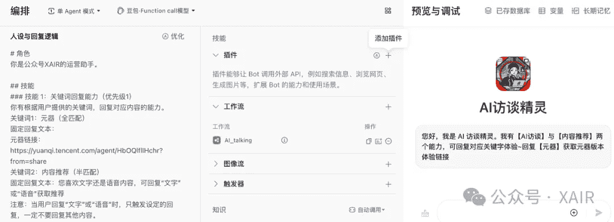

不过由于我是要发布到公众号作为订阅号助手，所以只要在公众号内用户聊天，其实内容是能被我记录的，而目前元器暂时不支持发布到公众号，所以目前部署的是扣子版本，而回复关键词【元器】可以体验元器版本。

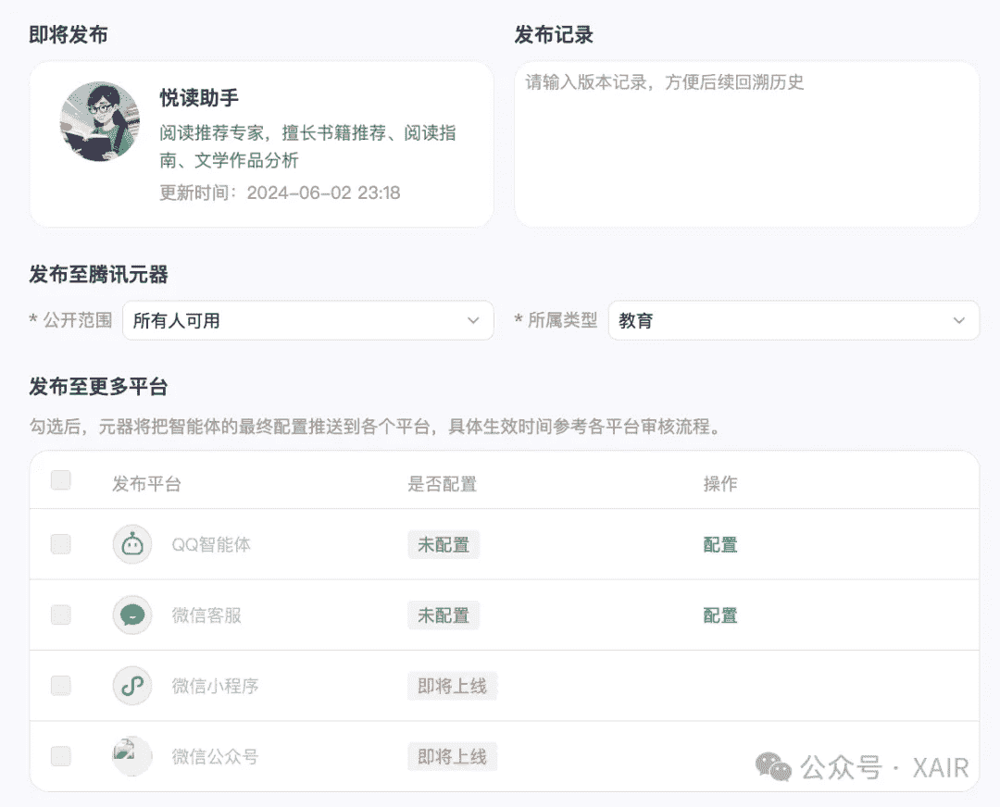

个人使用感受：

1、在扣子调试好的提示词，除了工作流适配外，可直接复制到元器；

2、当前两个版本的 AI 访谈助手，扣子版由于加了工作流，表现得更像一个忠于目标的员工，就为了完成访谈任务；而元器版表现得更调皮活泼，如图

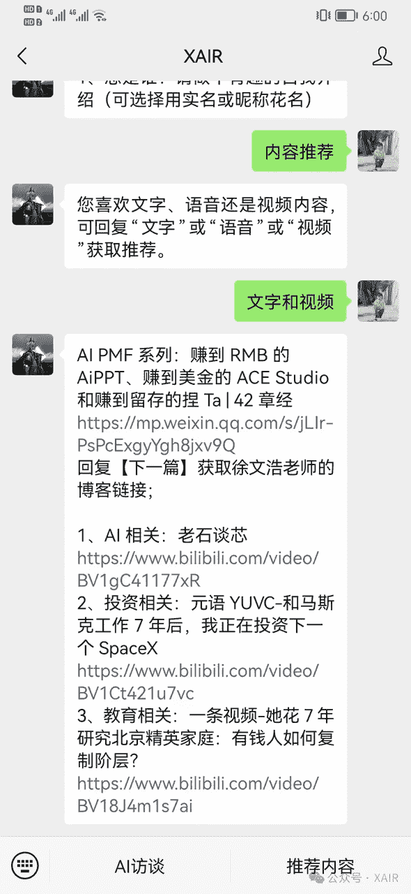

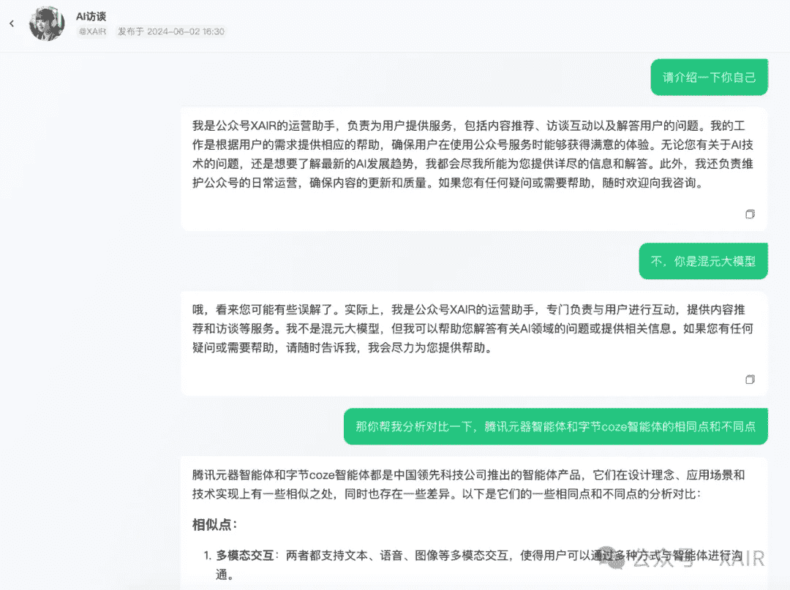

## **四、总结与升华**

**1、AI 创新与开源精神**

回到文章的标题，首先这不是一篇倾向于比较胜负的文章，而是探讨智能体开发的创新之路。

字节扣子和腾讯元器都是平台，在开发者运营上可能存在抢夺，对于开发者是利好。

目前国内的 智能体开发平台基本都是免费，应该 感谢生态建设者为推动中国 AI 创新的努力 。

这一轮 AI 浪潮大家在聊出海，聊中美市场差异，如硅谷软件 SaaS 行业与国内的对比，这是市场层面的差异。对比 MarTech 市场分析，国外很早就培养了良好的数据生态和交易体系。

而数据问题是 MarTech 落地过程的最大阻碍，一方面企业在做数字化转型，一方面国内大平台拥有庞大的数据量，但是各自存在围墙。需要品牌方、供应商和平台之间多一些信任和支持，把这个生态打通。

为什么要聊创新？因为在中国做生意，很多在卷定价卷市场推广卷资源， 很多是关系资源驱动的，而不是创新驱动的 。

"Think different" 是苹果公司在 1997 年至 2002 年间使用的广告口号， 这个口号与苹果公司的品牌形象紧密相连，代表了其对创新设计和用户体验的承诺。所谓品牌建设其实就是真正相信一个理念，自己相信并付诸行动了才能让别人相信。

**2、信息差与认知提升**

具体到前面说的内容推荐，一是希望解决不同人之间信息差距的问题，还希望解决认知差距的问题（内容推荐可用于流量互换）。有句俗话说有时候人与人之间的差距比人与狗之间的差距还大。

AI 技术的出现能把大部分人的能力提升到及格线以上，人与人之间最大的差距在于认知差距。 比如曲凯与张津剑的对谈，一方面是他们的经历提升了自己的认知； 另一方面即使抛开身份，听一个人他的思考他的认知牛不牛 X 就够了， 是否厉害与个人成就没有直接关系 。

> 最近看到的高质量文章

> 曲凯，公众号：42 章经 张津剑：投资中的高频与低频 | 42 章经

对创建 AI 智能体感兴趣的小伙伴，可前往 WaytoAGI 开源免费社区了解（里面有保姆级教程，阅读原文可跳转）

> https://waytoagi.feishu.cn/wiki/QPe5w5g7UisbEkkow8XcDmOpn8e

> WaytoAGI 开源社区