# 机器之心的进化 / 理解 AI 驱动的软件 2.0 智能革命

> 来源：[https://waytoagi.feishu.cn/docx/S7zXdCG8foivLGxaUBKcbxsSnfh](https://waytoagi.feishu.cn/docx/S7zXdCG8foivLGxaUBKcbxsSnfh)

> 🔗 原文链接： h[ttps://mp.weixin.q](https://mp.weixin.qq.com/s?__biz=MzA5Mzk3OTc3OQ==&mid=2453336199&idx=1&sn=0be6e966eecb42e946adac3642cf7aaf&chksm=879bc56bb0ec4c7d6c4ab50a4b3bd4d0604cf4958b2acac334509b9c891ba6538ecb29cb7f60&scene=21#wechat_redirect)q.com/s?__biz=Mz...

> ⏰ 发表时间：2022-11-10

> 原创 JEDI LU ，INDIGO 的数字镜像

就在过去几个月里，因为美联储的加息，科技公司的资本狂欢宣告结束，美国上市的 SaaS 公司股价基本都跌去了 70%，裁员与紧缩是必要选项。但正当市场一片哀嚎的时候， Dall-E 2 发布了，紧接着就是一大批炫酷的 AI 公司登场。这些事件在风投界引发了一股风潮，我们看到那些兜售着基于生成式 AI（ Generative AI ）产品的公司，估值达到了数十亿美元，虽然收入还不到百万美元，也没有经过验证的商业模式。不久前，同样的故事在 Web 3 上也发生过！感觉我们又将进入一个全新的繁荣时代， 但人工智能这次真的能带动科技产业复苏么 ？

本文将带你领略一次人工智能领域波澜壮阔的发展史，从关键人物推动的学术进展、算法和理念的**涌现、公司和产品**的进步、还有脑科学对神经网络的迭代影响，这四个维度来深刻理解“ 机器之心的进化 ”。先忘掉那些花里胡哨的图片生产应用，我们一起来学点接近 AI 本质的东西。全文共分为六个章节：

1.  **AI 进化史 **- 前神经网络时代、Machine Learning 的跃迁、开启潘多拉的魔盒

1.  **软件 2.0 的崛起 **- 软件范式的转移和演化、Software 2.0 与 Bug 2.0

1.  **面向智能的架构 **- Infrastructure 3.0、如何组装智能、智能架构的先锋

1.  **一统江湖的模型 **- Tran sformer 的诞生、基础模型、AI 江湖的新机会

1.  **现实世界的 AI **- 自动驾驶新前沿、机器人与智能代理

1.  **AI 进化的未来 **- 透视神经网络、千脑理论、人工智能何时能通用？

文章较长，累计 22800 字，请留出一小时左右的阅读时间，欢迎先收藏再阅读！ 文中每一个链接和引用都是有价值的，特别 作 为衍生阅读推荐给大家。

---

阅读之前先插播一段 Elon Musk 和 Jack Ma 在 WAIC 2019 关于人工智能的对谈的经典老视频，全程注意 Elon Ma 的表情❓❓ 大家觉得机器智能能否超过人类么？ 带着这个问题来阅读，相信看完就会有系统性的答案！

本文在无特别指明的情况下，为了书写简洁，在同一个段落中重复词汇大量出现时，会用 AI（ Artifical Intelligence ）来代表 人工智能，用 ML（ Machine Learning ）来代表机器学习，DL（ Deep Learning ）来代表深度学习，以及各种英文缩写来优先表达。

# 01 AI 进化史

> 对于机器是否真能 "知道"、"思考 "等问题，我们很难严谨的定义这些。我们对人类心理过程的理解，或许只比鱼对游泳的理解更好一点。

> John McCarthy

早在 **1945 年 **， Alan Turing 就已经在考虑如何用计算机来模拟**人脑了。他**设计了 ACE（ Automatic Computing Engine - 自动计算引擎）来模拟大脑工作。 在给一位同事的信中写道 ："与计算的实际应用相比，我对制作大脑运作的模型可能更感兴趣 ...... 尽管大脑运作机制是通过轴突和树突的生长来计算的复杂神经元回路，但我们还是可以在 ACE 中制作一个模型，允许这种可能性的存在，ACE 的实际构造并没有改变，它只是记住了数据 ......" 这就是 机器智能 的起源，至少那时在英国都这样定义。

## 1.1 前神经网络时代

**神经网络 **是以模仿人脑中的 **神经元 的 **运作为 **模型 **的计算机系统。

**AI 是伴**随着神经网络的发展而出现的。 1956 年，美国心理学家 Frank Rosenblatt 实现了一个早期的神经网络演示 - 感知器模型（ Perceptron Model ），该网络通过监督 Learning 的方法将简单的图像分类，如三角形和正方形。这是一台只有八个模拟神经元的计算机，这些神经元由马达和转盘制成，与 400 个光探测器连接。

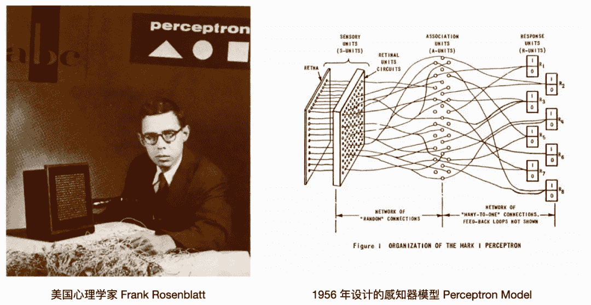

配图 01：Frank Rosenblatt & Perceptron Model

I**BM 的 **Georgetown 实验室在**这些研**究的基础上，实现了最早的机器语言翻译系统，可以在英语和俄语之间互译。 1956 年的夏天，在 Dartmouth College 的一次会议上， AI 被定义为计算机科学的一个研究领域， Marvin Minsky （明斯基）， John McCarthy （麦卡锡）， Claude Shannon （香农）， 还有 Nathaniel Rochester （罗切斯特）组织了这次会议，他们后来被称为 AI 的 "奠基人"。

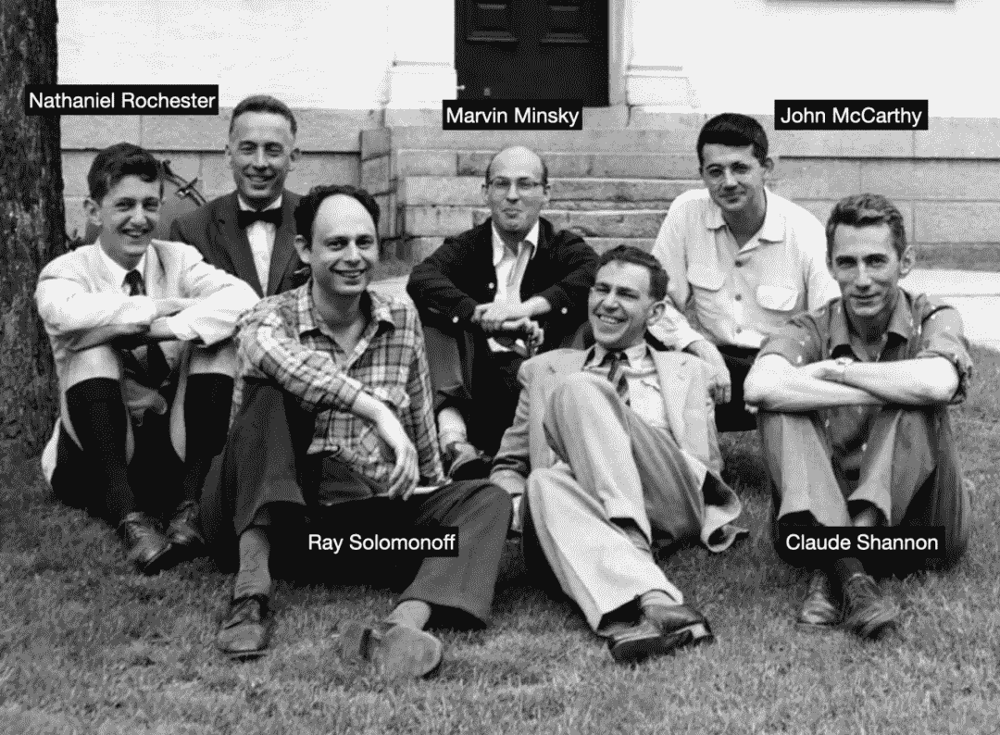

配图 02： Participants of the 1956 Dartmouth Summer Research Project on AI

DARPA **在这个“黄金**”时期，将大部分资金投入到** AI 领域 ，**就在十年后他们还发明了 ARPANET （互联网的前身）。早期**的 A**I **先驱们试图**教计**算机做**模仿**人类的复杂心理**任务，他们将其分成**五个子**领域： 推理 、 知识表述 、 规划 、 自然语言处理 （ NLP ）和 感知 ，这些听起来很笼统的术语一直沿用至今。

**从专家系统到机器学习**

**1966 **年， Marvin Minsky 和 Seymour Papert 在《 感知器：计算几何学导论 》一书中阐述了因为硬件的限制，只有几层的神经网络仅能执行最基本的计算，一下子浇灭了这条路线上研发的热情，AI 领域迎来了第一次泡沫破灭。这些先驱们怎么也没想到，计算机的速度能够在随后的几十年里指数级增长，提升了上亿倍。

在上世纪八十年代，随着电脑性能的提升，新计算机语言 Prolog & Li**sp 的流**行，可以用复杂的程序结构，例如条件循环来实现逻辑，这时的人工智能就是 专家系统 （ Expert System ）， iRobot 公司绝对是那个时代明星；但短暂的繁荣之后，硬件存储空间的限制，还有专家系统无法解决具体的、难以计算的逻辑问题，人工智能再一次陷入窘境。

> 我怀疑任何非常类似于形式逻辑的东西能否成为人类推理的良好模型。

> Marvin Minsky

直到 IBM 深蓝在 **1997 ****年战胜了国**际象棋冠军卡斯帕罗夫后，新的基于 概率推论 （ Probabilistic Reasoning ）思路开始被广泛应用在 AI 领域，随后 IBM Watson 的项目使用这种方法在电视游戏节目《 Jeopardy 》中经常击败参赛的人类。

概率推论就是典型的 **机器学习 **（ Machine Learning ）。今天的大多数 AI 系统都是由 ML 驱动的，其中预测模型是根据历史数**据训练的**，并用于对未来的预测。这是 AI 领域的第一次范式转变，算法不指定如何解决一个任务，而是根据数据来诱导它，动态的达成目标。因为有了 ML，才有了 大数据 （ Big Data ）这个概念。

## 1.2 Machine Learning 的跃迁

Machine Learning 算法一般通过分析数据和推断模型来建立参数，或者通过与环境互动，获得反馈来学习。人类可以注释这些数据，也可以不注释，环境可以是模拟的，也可以是真实世界。

**Deep Learning**

Deep Learning 是一种 Machine** Lear****ning **算法，它使用多层神经网络和反向传播（ Backpropagation ）技术来训**练神经网络。**该领域是几乎是由 Geoffrey Hinton 开创的，早在 1986 年，Hinton 与他的同事一起发表了关于深度神经网络（DNNs - Deep Neural Networks ）的开创性论文，这篇文章引入了 反向传播 的概念，这是一种调整权重的算法，每当你改变权重时，神经网络就会比以前更快接近正确的输出，可以轻松的实现多层的神经网络，突破了 1966 年 Minsky 写的 感知器局限 的魔咒。

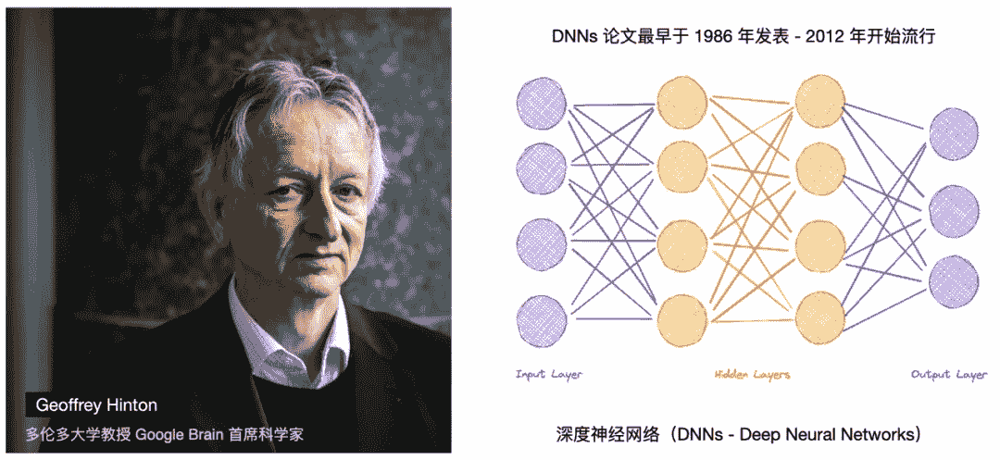

配图 03：Geoffrey Hinton & Deep Neural Networks

**Deep Le**arning 在 2012 年 才真正兴起，当时 Hinton 和他在多伦多的两个学生表明，使用反向传播训练的深度神经网络在图像识别方面击败了最先进的系统，几乎将以前的错误率减半。由于他的工作和对该领域的贡献，Hinton 的名字几乎成为 Deep Learning 的代名词。

**数据是新的石油**

Deep Learning 是一个革命性的领域，但为了让它按预期工作，需要数据。而最重要的数据集之一，就是由 李飞飞 创建的 ImageNet 。曾任斯坦福大学人工智能实验室主任，同时也是谷歌云 AI/ML 首席科学家的李飞飞，早在 2009 年就看出数据对 Machine Learning 算法的发展至关重要，同年在计算机视觉和模式识别（ CVPR ）上发表了相关论文。

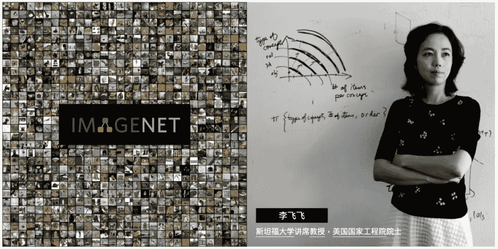

配图 04：FeiFei Li & ImageNet

该数据集对研究人员非常有用，正因为如此，它变得越来越有名，为最重要的年度 DL 竞赛提供了基准。仅仅七年时间，ImageNet 让获胜算法对图像中的物体进行分类的准确率从 72% 提高到了 98%，超过了人类的平均能力。

ImageNet 成为 DL 革命的首选数据集，更确切地说，是由 Hinton 领导的 AlexNet 卷积神经网络（CNN - Convolution Neural Networks ）的数据集。ImageNet 不仅引领了 DL 的革命，也为其他数据集开创了先例。自其创建以来，数十种新的数据集被引入，数据更丰富，分类更精确。

**神经网络大爆发**

**在 Dee**p Learning 理论和数据集的加持下， 2012 年以来深度神经网络算法开始大爆发，卷积神经网络（CNN）、递归神经网络（RNN - Recurrent Neural Network ）和长短期记忆网络（LSTM - Long Short-Term Memory ）等等，每一种都有不同的特性。例如，递归神经网络是较高层的神经元直接连接到较低层的神经元。

来自日本的计算机研究员福岛邦彦（ Kunihiko Fukushima ）根据人脑中视觉的运作方式，创建了一个人工神经网络模型。该架构是基于人脑中两种类型的神经元细胞，称为简单细胞和复杂细胞。它们存在于初级视觉皮层中，是大脑中处理视觉信息的部分。简单细胞负责检测局部特征，如边缘；复杂细胞汇集了简单细胞在一个区域内产生的结果。例如，一个简单细胞可能检测到一个椅子的边缘，复杂细胞汇总信息产生结果，通知下一个更高层次的简单细胞，这样逐级识别得到完整结果。

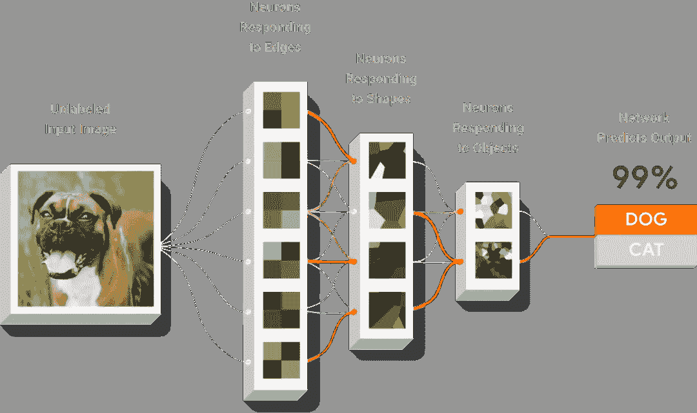

配图 05：深度神经网络如何识别物体（ TensorFlow ）

CN**N 的结构是基于这两类细胞的级联**模型，主要用于模式识别任务。它在计算上比大多数其他架构更有效、更快速，在许多应用中，包括自然语言处理和图像识别，已经被用来击败大多数其他算法。 我们每次对大脑的工作机制的认知多一点，神经网络的算法和模型也会前进一步 ！

## 1.3 开启潘多拉的魔盒

从 2012 到现在，深度神经网络的使用呈爆炸式增长，进展惊人。 现在 Machine Learning 领域的大部分研究都集中在 Deep Learning 方面，就像进入了潘多拉的魔盒被开启了的时代。

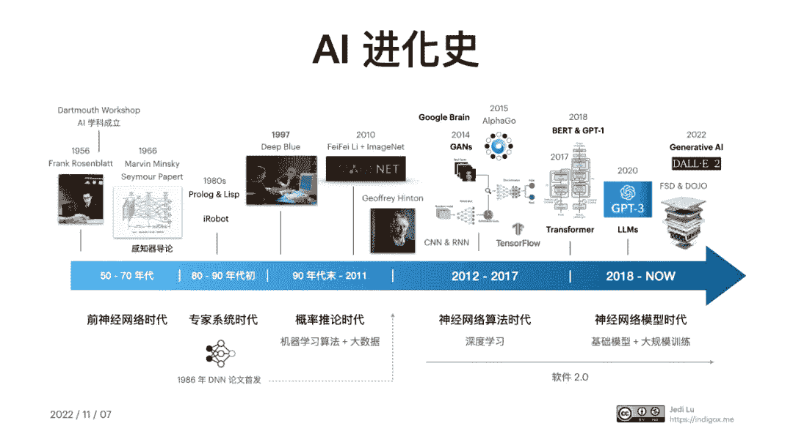

配图 06：AI 进化史

**GAN**

生成对抗网络（GAN - Generative Adver**sarial **Network ） 是 Deep Learning 领域里面另一个重要的里程碑，诞生于 2014 年 ，它可以帮助神经网络用更少的数据进行学习，生成更多的合成图像，然后用来识别和创建更好的神经网络。GANs 的创造者 Ian Goodfellow 是在蒙特利尔的一个酒吧里想出这个主意的，它由两个神经网络玩着猫捉老鼠的游戏，一个创造出看起来像真实图像的假图像，而另一个则决定它们是否是真的。

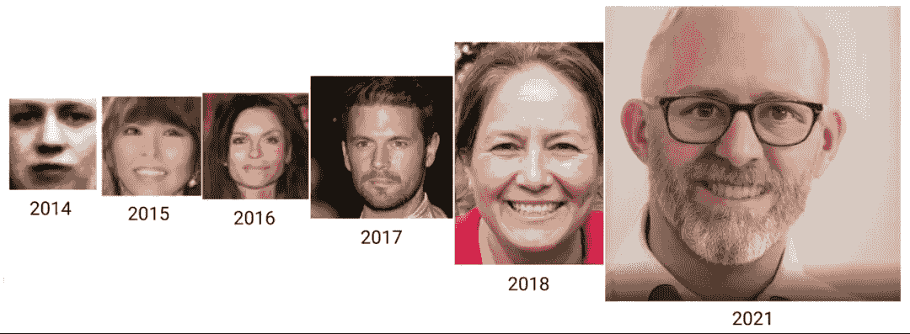

配图 07：GANs 模拟生产人像的进化

GANs 将有助于创建图像，还可以创建现实世界的软件模拟，Nvidia 就大量采用这种技术来增强他的 现实模拟系统 ，开发人员可以在那里训练和测试其他类型的软件。你可以用一个神经网络来“压缩”图像，另一个神经网络来生成原始视频或图像，而不是直接压缩数据，Demis Hassabis 在他的一篇论文中就提到了人类大脑“海马体”的记忆回放也是类似的机制。

**大规模神经网络**

> 大脑的工作方式肯定不是靠某人用规则来编程。

> Geoffrey Hinton

大规模神经网络的竞赛从成立于 **2011 年 **的 Google Brain 开始，现在属于 Google Research。他们推动了 TensorFlow 语言的开发，提出了万能模型 Transformer 的技术方案并在其基础上开发了 BERT ，我们在第四章中将详细讨论这些。

DeepMind 是这个时代的传奇之一， 在 **2014 **年被 Google 以 5.25 **亿美元收购的 。它专注游**戏算法，其使命是 "解决智能问题"，然后用这种智能来 "解决其他一切问题"！DeepMind 的团队开发了一种新的算法 Deep Q-Network （DQN），它可以从经验中学习。 2015 年 10 月  AlphaGo 项目首次在围棋中击败人类冠军李世石；之后的 AlphaGo Zero 用新的可以自我博弈的改进算法让人类在围棋领域再也无法翻盘。

另一个传奇 OpenAI ，它是一个由 **Elon Musk **， Sam Altman ， Peter Thiel ， 还有 Reid Hoffman 在 **2015 **年共同出资十亿美金创立的科研机构，其主要的竞争对手就是 D**eepMind**。OpenAI** 的使命是** 通用人工智能 （AGI – Artificial General Intelligence ），即一种高度自主且在大多数具有经济价值的工作上超越人类的系统。 2020 年推出的 GPT-3 是目前最好的自然语言生成工具（NLP - Natural Language Processing ）之一，通过它的 API 可以实现自然语言同步翻译、对话、撰写文案，甚至是代码（ Codex ），以及现在最流行的生成图像（ DALL·E ）。

Gartner AI HypeCycle

Gartner 的技术炒作周期（HypeCycle）很值得一看，这是他**们 2022 **年最新的关于 AI 领域下各个技术发展的成熟度预估，可以快速了解 AI 进化史 这一章中不同技术的发展阶段。

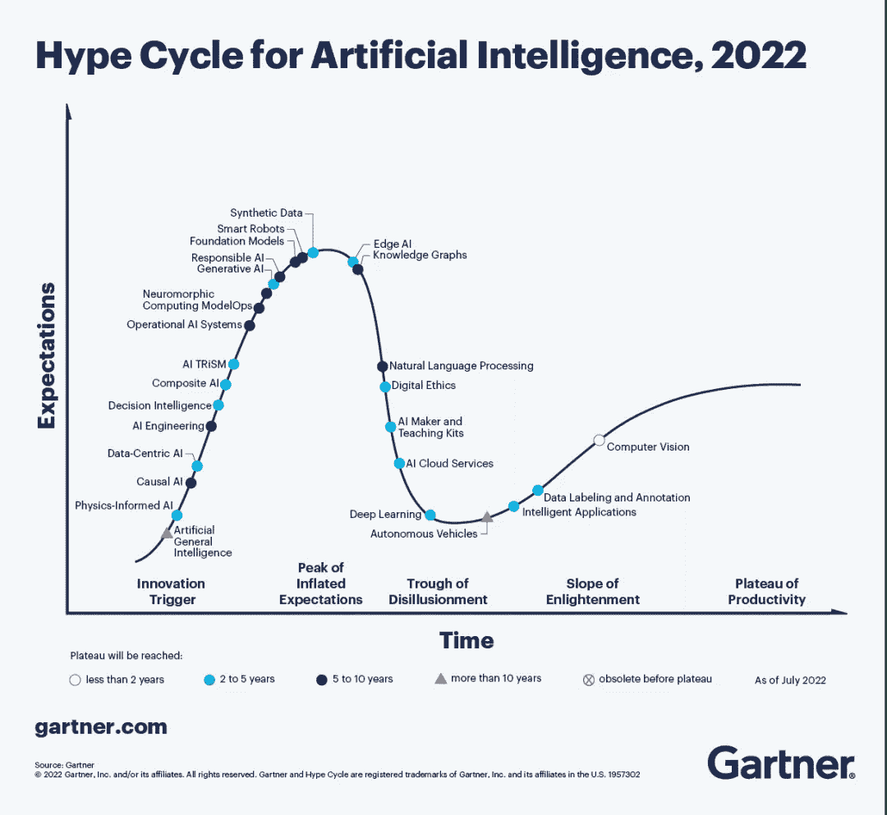

配图 08： Gartner AI HypeCycle 2022

---

神经网络，这个在上世纪 60 年代碰到的挫折，**然后在 2****012 年之后**却迎来了新生。 反向传播 花了这么长时间才被开发出来的原因之一就是该功能需要计算机进行 乘法矩阵运算 。在上世纪 70 年代末，世界上最强的的超级电脑之一 Cray-1 ，**每秒浮点运算速度 50 MFLOP，现在衡量 GPU 算**力的单位是 TFLOP（Trillion FLOPs ），Nvidia 用于数据中心的最新 GPU Nvidia Volta 的性能可以达到 125 TFLOP，单枚芯片的速度就比五十年前世界上最快的电脑强大 250 万倍。 技术的进步是多维度的，一些生不逢时的理论或者方法，在另一些技术条件达成时，就能融合出巨大的能量。

# 02 软件 2.0 的崛起

> 未来的计算机语言将更多地关注目标，而不是由程序员来考虑实现的过程。

> Marvin Minsky

Software 2.0 概念的最早提出人是 Andrej Karpathy ，这位从小随家庭从捷克移民来加拿大的天才少年在多伦多大学师从 Geoffrey Hinton，然后在斯坦福李飞飞团队获得博士学位，主要研究 NLP 和计算机视觉，同时作为创始团队成员加入了 OpenAI ，Deep Learning 的关键人物和历史节点都被他点亮。在 2017 年被 Elon Musk 挖墙脚到了 Tesla 负责自动驾驶研发，然后就有了重构的 FSD（ Full Self-Driving ）。

按照 Andrej Karpathy 的定义 - “软件 2.0 使用更抽象、对人类不友好的语言生成，比如神经网络的权重。没人参与编写这些代码，一个典型的神经网络可能有数百万个权重，用权重直接编码比较困难”。Andrej 说他以前试过，这几乎不是人类能干的事儿 。。

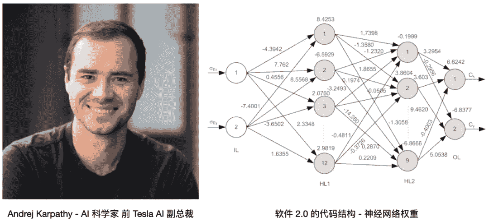

配图 09：Andrej Karpathy 和神经网络权重

## 2.1 范式转移

在创建深度神经网络时，程序员只写几行代码，让神经网络自己学习，计算权重，形成网络连接，而不是手写代码。这种软件开发的新范式始于第一个 Machine Learning 语言 TensorFlow ，我们也把这种新的编码方式被称为软件 2.0。在 Deep Learning 兴起之前，大多数人工智能程序是用 Python 和 JavaScript 等编程语言手写的。 人类编写了每一行代码，也决定了程序的所有规则 。

配图 10：How does Machine Learning work？(  TensorFlow )

相比之下，随着 Deep Learning 技术的出现，程序员利用这些新方式，给程序指定目标。如赢得围棋比赛，或通过提供适当输入和输出的数据，如向算法提供具有 "SPAM” 特征的邮件和其他没有"SPAM” 特征的邮件。编写一个粗略的代码骨架（一个神经网络架构），确定一个程序空间的可搜索子集，并使用我们所能提供的算力在这个空间中搜索，形成一个有效的程序路径。在神经网络里，我们一步步地限制搜索范围到连续的子集上，搜索过程通过反向传播和随机梯度下降（ Stochastic Gradient Descent ）而变得十分高效。

**神经网络不仅仅**是另一个**分类器，它代表**着我们开发软件的 范式开始转移 ，它是 软件 2.0 。

软件 1.0 人们编写代码，编译后生成可以执行的二进制文件；但在软件 2.0 中人们提供数据和神经网络框架，通过训练将数据编译成二进制的神经网络。在当今大多数实**际应用中，神经网**络结构和训练系统日益标准**化为一种商品，因**此大多数软件 2.0 的开发都由模型设计实施和数据清理标记两部分组成。这从根本上改变了我们在软件开发迭代上的范式，团队也会因此分成了两个部分： 2.0 程序员 负责模型和数据，而那些 1.0 程序员 则负责维护和迭代运转模型和数据的基础设施、分析工具以及可视化界面。

Marc Andreessen 的经典文章标题《 Why Software Is Eating the World 》现在可以改成这样：“软件（1.0）正在吞噬世界，而现在人工智能（2.0）正在吞噬软件！

## 2.2 软件的演化

软件从 1.0 发展到软件 2.0，经过了一个叫做“数据产品”的中间态。当顶级软件公司在了解大数据的商业潜力后，并开始使用 Machine Learning 构建数据产品时，这种状态就出现了。下图来自 Ahmad Mustapha 的一篇文章《 The Rise of Software 2.0 》很好地呈现了这个过渡。

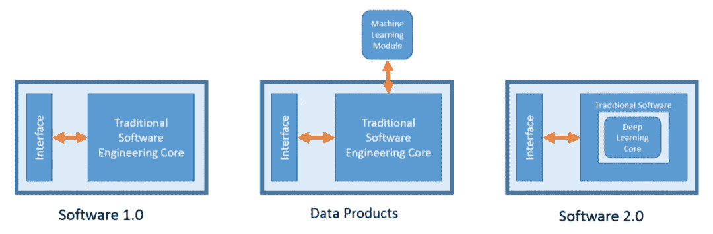

配图 11：软件产品演化的三种状态

这个中间态也叫 **大数据 **和 **算法推荐 **。在现实生活中，这样的产品可以是 Amazon 的商品推荐，它们可以预测客户会感兴趣什么，可以是 Facebook 好友推荐，还可以是 Netflix 电影推荐或 Tiktok 的短视频推荐。还有呢？Waze 的路由算法、Airbnb 背后的排名算法等等，总之琳琅满目。

数据**产品有几个重要特点：**1、它们都不是软件的主要功能，通常是为了增加体验，达成更好的用户活跃以及销售目标；2、能够随着数据的增加而进化；3、大部分都是基于传统 ML 实现的，最重要的一点 数据产品是可解释的 。

但有些行业正在改变， **Machine ****Learn**ing 是主体 。当我们放弃通过编写明确的代码来解决复杂问题时，这个到 2.0 技术栈 的转变就发生了，在过去几年中，很多领域都在突飞猛进。 语音识别 曾经涉及大量的预处理、高斯混合模型和隐式 Markov 模型，但今天几乎完全被神经网络替代了。早在 1985 年，知名信息论和语言识别专家 Fred Jelinek 就有一句经常被引用的段子：“ 每当我解雇一个语言学家，我们的语音识别系统的性能就会得到提高 ”。

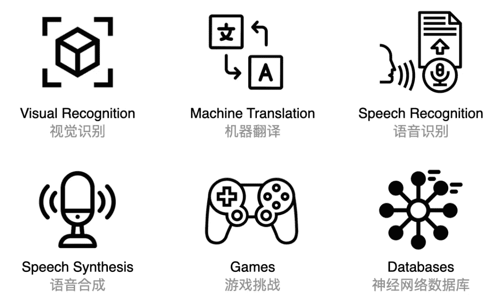

配图 12：图解软件 2.0 的代表应用

除了大家熟悉的图像语音识别、语音合成、机器翻译、游戏挑战之外，AI 在很多传统系统也看到了早期的转型迹象。例如 The Case for Learned Index Structures 用神经网络取代了数据管理系统的核心组件，在速度上比 B-Trees 缓存优化达快 70%，同时节省了一个数量级的内存。

所以，软件 2.0 的范式具备了这几**个新特征：1、 D**e**ep Learning ****是主体 ，所有的功**能都是围绕神经网络的输入输出构建的，例如语音识别、自动驾驶；2、 可解释性并不重要 ，一个好的大数据推荐广告可以告诉客户用户看到这条广告的理由，但你没法从神经网络中找到规则，至少目前不行；3、 高研发投入与低开发投入 ，现在大量的成功都来自大学和科技公司的研究部门， 论文绝对比应用多 。。

## 2.3 软件 2.0 的优势

为什么我们应该倾向于将复杂的程序移植到软件 2.0 中？Andrej Karpathy 在《 Softwar**e 2.0 》中给出了一**个简单的答案： 它们在实践中表现得更好 ！

**容易被写入芯片**

由于神经网络的指令集相对较小，主要是矩阵乘法（ Matrix Multiplication ）和阈值判断（ Thresholding at Zero ），因此把它们写入芯片要容易得多，例如使用定制的 ASIC、神经形态芯片等等（ Alan Turing 在设计 ACE 时就这样考虑了）。例如，小而廉价的芯片可以带有一个预先训练好的卷积网络，它们可以识别语音、合成音频、处理视觉信号。当我们周围充斥着低能耗的智能时，世界将会因此而大不同（好坏皆可）。

**非常敏捷**

敏捷开发意味着灵活高效。 如果你有一段 C++ 代码，有人希望你把它的速度提高一倍，那么你需要系统性的调优甚至是重写。 然而，在软件 2.0 中，我们在网络中删除一半的通道，重新训练，然后就可以了 。 .  它的运行速度正好提升两倍，只是输出更差一些，这就像魔法。 相反，如果你有更多的数据或算力，通过添加更多的通道和再次训练，你的程序就能工作得更好。

**模块可以融合成一个最佳的整体**

做过软件开发的同学都知道，程序模块通常利用公共函数、 API 或远程调用来通讯。 然而，如果让两个原本分开训练的软件 2.0 模块进行互动，我们可以很容易地通过整体进行反向传播来实现。 想象一下，如果你的浏览器能够自动整合改进低层次的系统指令，来提升网页加载效率，这将是一件令人惊奇的事情。 但在软件 2.0 中，这是默认行为。

**它做得比你好**

最后，也是最重要的一点，神经网络比你能想到的任何有价值的垂直领域的代码都要好，目前至少在图像、视频、声音、语音相关的任何东西上，比你写的代码要好。

## 2.4 Bug 2.0

对于传统软件，即软件 1.0，大多数程序都通过源代码保存，这些代码可能少至数千行，多至上亿行。据说，谷歌的整个代码库大约有 20 亿行代码。无论代码有多少，传统的软件工程实践表明，使用封装和模块化设计，有助于创建可维护的代码，很容易隔离 Bug 来进行修改。

但**在新的范式**中，**程序被存储**在内存中，作为神经网络架构的权重，程序员编写的代码很少。软件 2.0 带来了两个新问题： 不可解释 和 数据污染 。

因为训**练完成的神**经网**络权重，工**程师无法理解（不过现在对理解神经网络的研究有了很多进展，第六章会讲到），所以我们无法知道正确的执行是为什么？错误又是因为什么？这个和大数据算法有很大的不同，虽然大多数的应用只关心结果，无需解释；但对于一些安全敏感的领域，比如 自动驾驶 和 医疗应用 ，这确实很重要。

在 2.0 的堆栈中，数据决定了神经网络**的连接，所以不**正确的数据集和标签，都会 混淆神经网络 。错误的数据可能来自**失误、也可能是**人为设计，或者是有针对性的投喂混淆数据（这也是人工智能领域中新的 程序道德规范 问题）。例如 iOS 系统的自动拼写功能被意外的数据训练污染了，我们在输入某些字符的时候就永远得不到正确的结果。训练模型会认为污染数据是一个重要的修正，一但完成训练部署，这个错误就像病毒一样传播，到达了数百万部 iPhone 手机。所以在这种 2.0 版的 Bug 中，需要对数据以及程序结果进行良好的测试，确保这些边缘案例不会使程序失败。

---

在短期内，软件 2.0 将变得越来越普遍，那些没法通过清晰算法和软件逻辑化表述的问题，都会转入 2.0 的新范式，现实世界并不适合**整齐的封装。就像**明斯基说的，软件开发应该更多的关心目标而不是过程，这种范式有机会颠覆整个开发生态，软件 1.0 将成为服务于软件 2.0 周边系统，一同来搭建 面向智能的架构 。有越来越清楚的案例表明，当我们开发通用人工智能（AGI）时，它一定会写在软件 2.0 中。

# 03 面向智能 的 架构

回顾过去十多年 Deep Learning 在人工智能领域波澜壮阔的发展，大家把所有的关注点都集中了算法的突破、训练模型的创新还有智能应用的神奇表现上，这些当然可以理解，但关于智能系统的基础设施被提及的太少了。

正**如在计算机发**展的**早期，人们需**要汇编语言、编译器和操作系统方面的专家来开发一个简单的应用程序，所以今天你需要 大量的数据 和 分布式系统 才能大规模地部署人工智能。经济学大师 Andrew McAfee 和 Erik Brynjolfsson 在他们的著作《 Machine， Platform， Crowd: Harnessing Our Digital Future 》中讽刺地调侃：“ 我们的机器智能时代仍然是人力驱动的 ”。

好在 GANs 的出现让完全依赖人工数据的训练成本大幅下降，还有 Goo**gle AI 在持续不断**的努力让 AI 的基础设施平民化。但这一切还在很早期，我们需要新的智能基础设施， 让众包数据变成众包智能 ，把人工智能的潜力从昂贵的科研机构和少数精英组织中释放出来，让其工程化。

## 3.1 Infrastructure 3.0

应用程序和基础设施的发展是同步的。

Infrastructure 1.0 - C/S （客户端/服务器时代）

商业互联网在上世纪 90 年代末期成熟起来，这要归功于 x86 指令集（Intel）、标准化操作系统（Microsoft）、关系数据库（Oracle）、以太网（Cisco）和网络数据存储（EMC）。Amazon，eBay，Yahoo，甚至最早的 Google 和 Facebook 都建立在这个我们称之为 Infrastructure 1.0 的基础上。

Infrastructure 2.0 - Cloud （云时代）

Amazon AWS、Google Cloud 还有 Microsoft Azure 定义了一种新的基础设施类型，这种基础设施是无需物理部署可持续运行的、可扩展的、可编程的，它们有些是开源，例如 Linux、M**ySQL、D**[ocker、Kube](http://mp.weixin.qq.com/s?__biz=MzA5Mzk3OTc3OQ==&mid=2453335847&idx=1&sn=b7628e2d138807e83ee67deacf9ed6e3&chksm=879bdacbb0ec53ddb3548dc8f17f61af140c31f5222d513a31647b75c82bf5e06b2b96babd37&scene=21#wechat_redirect)rnetes、Hadoop、 Spark 等等，但大多数都是要钱的，例如边缘计算服务 Cloudflare、数据库服务 MangoDB、消息服务 Twilio、支付服务 Stripe，所有这些加在一起定义了 云计算时代 。推荐阅读我在 2021 年 9 月的这篇《 软件行业的云端重构 》。

归根结底，这一代技术把互联网扩展到数十亿的终端用户，并有效地存储了从用户那里获取的信息。Infrastructure 2.0 的创新催化了数据急剧增长，结合算力和算法飞速进步，为今天的 Machine Learning 时代搭建了舞台。

**Infrastruc****ture 2.0 关注的**问题是 - “ 我们如何连接世界？ ” 今天的技术重新定义了这个问题 - “ **我们如**何理解这个世界？ ” 这**种区别**就像连通性与认知性的区别，先认识再了解。2.0 架构中的各种服务，在给这个新的架构源源不断的输送数据，这就像广义上的众包；训练算法从数据中推断出 逻辑 （神经网络），然后这种 逻辑 就被用于对世界做出理解和预测。这种收集并处理数据、训练模型最后再部署应用的新架构，就是 Infrastructure 3.0 - 面向智能的架构 。其实我们的大脑也是这样工作的，我会在第六章中详细介绍。

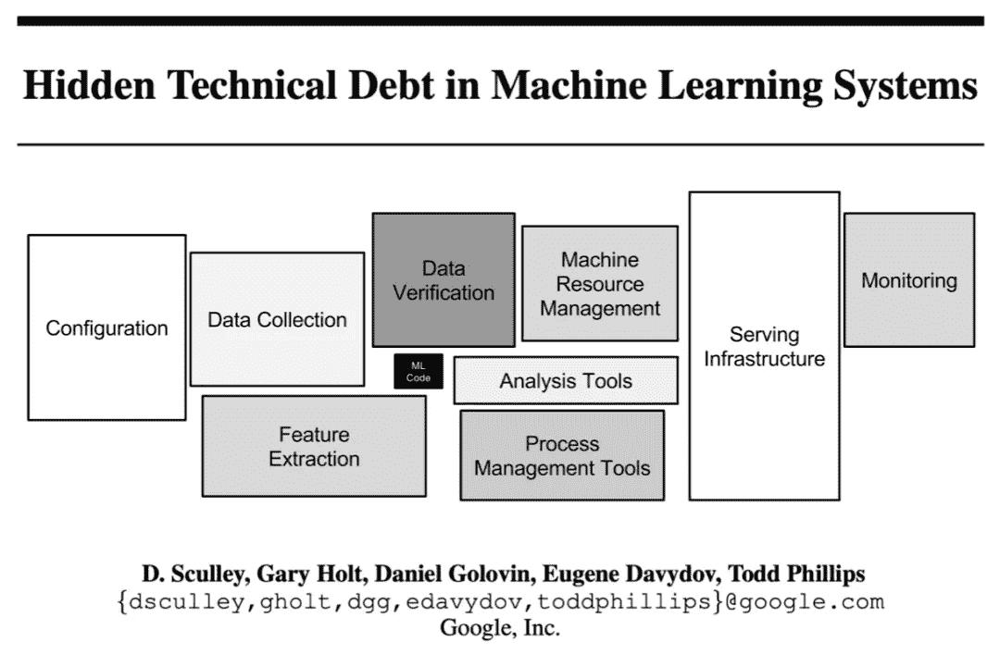

配图 13： Hidden technical debt in Machine Learning Systems

在现实世界的 Machine Learning 系统中，只有一小部分是由 ML 代码组成的，如中间的小黑盒所示，其周边基础设施巨大而繁杂。一个“智能”的应用程序，数据非常密集，计算成本也非常高。这些特性使得 ML 很难适应已经发展了七十多年的通用的 冯 · 诺依曼计算范式 。为了让 Machine Learning 充分发挥其潜力，它必须走出今天的学术殿堂，成为一门工程学科。这实际上意味着需要有新的抽象架构、接口、系统和工具，使开发人员能够方便地开发和部署这些智能应用程序。

## 3.2 如何组装智能

想要成功构建和部署人工智能，需要一个复杂的流程，这里涉及多个独立的系统。首先，需要对数据进行采集、清理和标记；然后，必须确定预测所依据的特征；最后，开发人员必须训练模型，并对其进行验证和持续优化。从开始到结束，现在这个过程可能需要几个月或者是数年，即使是行业中最领先的公司或者研究机构。

好在除了算法和模型本身之外，组装智能架构中每个环节的效率都在提升，更高的算力和分布式计算框架，更快的网络和更强大的工具。在每一层技术栈，我们都开始看到新的平台和工具出现，它们针对 Machine Learning 的 范式进行了优化，这里面机会丰富。

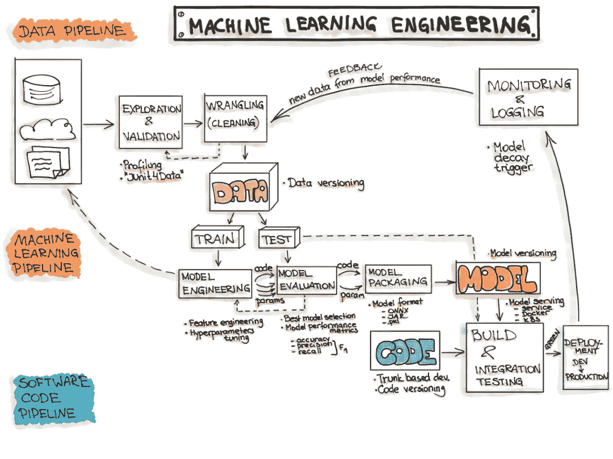

配图 14：Intelligence Infrastructure from Determined AI

参照智能架构领域的投资专家 Amplify Partners 的分类，简单做个技术栈说明。

+   为 Machine Learning 优化的高性能芯片，它们内置多计算核心和高带宽内存（HBM），可以高度并行化，快速执行矩阵乘法和浮点数学神经网络计算，例如 Nvidia 的 H100 Tensor Core GPU 还有 Google 的 TPU ；

+   能够完全发挥硬件效率的系统软件，可以将计算编译到晶体管级别。Nvidia 在 2006 年就推出的 CUDA 到现在也都保持着领先地位，CUDA 是一个软件层，可以直接访问 GPU 的虚拟指令集，执行内核级别的并行计算；

+   用于训练和推理的分布式计算框架（ Distributed Computing Frameworks ），可以有效地跨多个节点，扩展模型的训练操作；

+   数据和元数据管理系统，为创建、管理、训练和预测数据而设计，提供了一个可靠、统一和可重复使用的管理通道。

+   极低延迟的服务基础设施，使机器能够快速执行基于实时数据和上下文相关的智能操作；

+   Machine Learning 持续集成平台（ MLOps ），模型解释器，质保和可视化测试工具，可以大规模的监测，调试，优化模型和应用；

+   封装了整个 Machine Learning 工作流的终端平台（ End to End ML Platform ），抽象出全流程的复杂性，易于使用。几乎所有的拥有大用户数据量的 2.0 架构公司，都有自己内部的 3.0 架构集成系统，Uber 的 Michelangelo 平台就用来训练出行和订餐数据；Google 的 TFX 则是面向公众提供的终端 ML 平台，还有很多初创公司在这个领域，例如 Determined AI 。

总的来说，Infrastructure 3.0 将释放 AI/ML 的潜力，并为人类智能系统的构建添砖加瓦。与前两代架构一样，虽然上一代基础设施的巨头早已入场，但每一次范式转移，都会有有新的项目、平台和公司出现，并挑战目前的在位者。

## 2.3 智能架构的先锋

**Deep Le**arning 被大科技公司看上的关键时刻是在** 2010 年** 。在 Palo Alto 的一家日餐晚宴上，斯坦福大学教授 Andrew Ng 在那里会见了 Google 的 CEO Larry Page 和当时担任 Google X 负责人的天才计算机科学家 Sebastian Thrun 。就在两年前，Andrew 写过一篇关于将 GPU 应用于 DL 模型有效性分析论文。要知道 DL 在 2008 年 是非常不受欢迎的，当时是算法的天下。

几乎在同一时期，Nvidia 的 CEO Jensen Huang 也意识到 GPU 对于 DL 的重要性，他是这样形容的："Deep Learning 就像大脑，虽然它的有效性是不合理的，但你可以教它做任何事情。这里有一个巨大的障碍，它需要大量的计算，而我们就是做 GPU 的，这是一个可用于 Deep Learning 的近乎理想的计算工具"。

以上故事的细节来自 Forbes 在 2016 年的一篇深度报道 。自那时起，Nvidia 和 Google 就走上了 Deep Learning 的智能架构之路，一个从终端的 GPU 出发，另一个从云端的 TPU 开始。

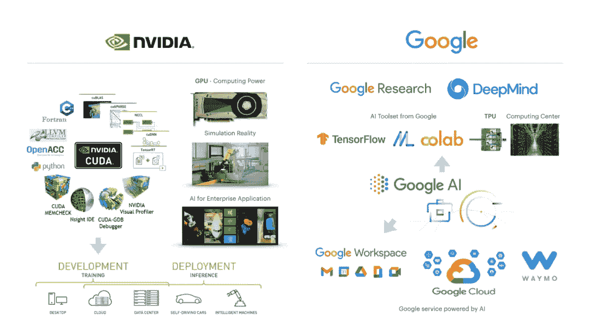

配图 15： Nvidia AI vs Google AI 的对比

Nvidia 今天赚的大部分钱的来自游戏行业，通过销售 GPU，卖加速芯片的事情 AMD 和很多创业公司都在做，但 Nvidia 在软件堆栈上的能力这些硬件公司无人能及，因为它有从内核到算法全面控制的 CUDA，还能让数千个芯片协同工作。这种整体控制力，让 Nvidia 可以发展云端算力服务，自动驾驶硬件以及嵌入式智能机器人硬件，以及更加上层的 AI 智能应用和 Omniverse 数字模拟世界。

Google 拥抱 AI 的方式非常学术，他们最早成立了 Google Brain 尝试大规模神经网络训练，点爆了这个领域的科技树，像 GANs 这样充满灵感的想法也是来自于 Google （ Ian Goodfellow 同学当时任职于 Google Brain）。在 2015 年前后 Google 先后推出了 TensorFlow 还有 TPU （Tensor Processing Unit - 张量芯片），同年还收购了 DeepMind 来扩张研究实力。 Google AI 更倾向于用云端的方式给大众提供 AI/ML 的算力和全流程工具，然后通过投资和收购的方式把智能融入到自己的产品线。

现在几乎所有的科技巨头，都在完善自己的“智能”基础设施，Microsoft 在 2019 年投资了 10 亿美金给 OpenAI 成为了他们最大的机构股东；Facebook 也成立了 AI 研究团队 ，这个仅次于他们 Reality Lab 的地位，Metaverse 里所需的一切和“智能”相关的领域他们都参与， 今年底还和 AMD 达成合作 ，投入 200 亿美元并用他们的芯片来搭建新的“智能”数据中心；然后就是 Tesla，在造电车之外不务正业搭建了世界上规模最大的超级电脑 Dojo ，它将被用来训练 FSD 的神经网络和为未来的 Optimus （Tesla 人形机器人）的大脑做准备。

---

正如过去二十年见证了“ 云计算技术栈 ”的**出现一样，在接**下来的几年里，我们也期待着一个巨大的基础设施和工具生态系统将**围绕着智能****架构 - I**nfrastructure 3.0 建立起来。Google 目前正处于这个领域的前沿，他们试图自己的大部分代码用 软件 2.0 的范式重写，并在新的智能架构里运行，因为一个有可能一统江湖的“模型”的已经出现，虽然还非常早期，但 机器智能 对世界的理解很快将趋向一致，就像我们的 大脑皮质层 理解世界那样。

# 04 一统江湖的模型

想象一下，你去五金店，看到架子上有一种新款的锤子。你或许已经听说过这种锤子了，它比其他的锤子更快、更准；而且在过去的几年里，许多其他的锤子在**它面前都显得过时了。你只需要**加一个配件再扭一下，它就变成了一个锯子，而且和其它的锯子一样快、一样准。事实上，这个工具领域的前沿专家说，这个锤子可能预示着所有的 工具都将集中到单一的设备中 。

类似的故事也在 AI 的工具中上演，这种多用**途的新型锤子是一种神经网**络，**我们称之为 **Transformer （ 转换器模型 - 不是动画片里的变形金刚），它最初被设计用来处理自然语言，但最近已经开始影响 AI 行业的其它领域了。

## 4.1 Transformer 的诞生

**2017 **年 Google Brain 和多伦多大学的研究人员**一同发表了一篇名为《 A**ttention Is All You Need 》的论文，里面提到了一个自然语言处理（ NLP ）的模型 **Transformer **，这应该是继 GANs 之后 Deep Learning 领域最重大的发明。2018 年 Google 在 Transformer 的基础上实现并开源了第一款自然语言处理模型 BERT ；虽然研究成果来自 Google，但很快被 OpenAI 采用，创建了 GPT-1 和最近的火爆的 GPT-3 。其他公司还有开源项目团队紧随其后，实现了自己的 Transformer 模型，例如 Cohere ， AI21 ， Eleuther （致力于让 AI 保持开源的项目）；也有用在其它领域的创新，例如生成图像的 Dall-E 2 、 MidJourney 、 Stable Diffusion 、 Disco Diffusion ， Imagen 和其它许多。

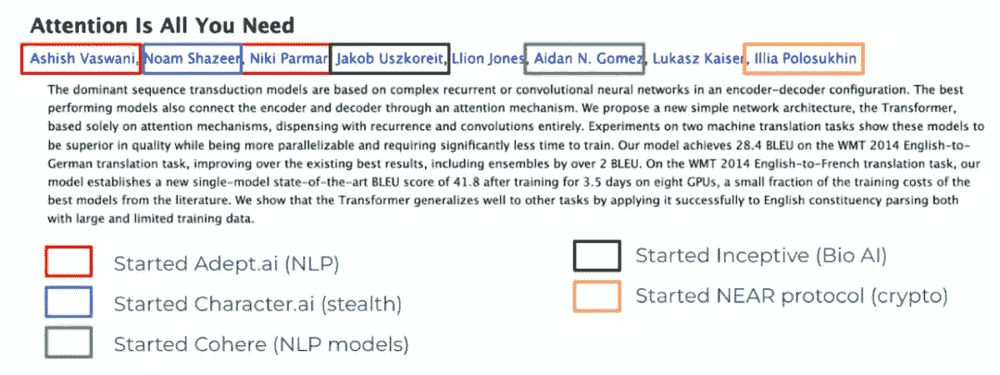

配图 16：发表《 Attention Is All You Need 》论文的八位同学

发表这篇论文的 8 个人中，有 6 个人已经创办了公司，其中 4 个与人工智能相关，另一个创办了名为 Near.ai 的区块链项目。

**自然语言处理 **这个课题在上世纪五十年代开创 A**I 学科的时候就明确下来了，**但只到有了 Deep** Lea**rning 之后，它**的准确**度和表达合理性才大幅提高。序列传导**模型（ **Seq2Se**q ）**是用于 NLP 领域的一种 DL 模型，在机器翻译、文本摘要和图像字幕等方面取得了很大的成功，2016 年之后 Google 在搜索提示、机器翻译等项目上都有使用。序列传导模型是在 输入端 一个接一个的接收并 编码 项目（可以是单词、字母、图像特征或任何计算机可以读取的数据），并在同步在 输出端 一个接一个 解码 输出项目的模型。

在机器翻译的案例中，输入序列就是一**系列单词，经过**训练好的神经网络中复杂的 矩阵数学计算 ，在输出端的结果就是一系列翻译好的目标词汇。

T**ransfo**rmer 也是一款用于 NLP 的序列传导模型，论文简洁清晰的阐述了这个新的网络结构，它只基于 注意力机制 （Attention），完全不需要递归（RNN）和卷积（CNN）。在两个机器翻译的实验表明，这个模型在质量上更胜一筹，同时也更容易并行化，需要的训练时间也大大减少。

好奇心强的同学，如果想了解 Transformer 模型的具体工作原理，推荐阅读 Giuliano Giacaglia 的这篇《 How Transformers Work 》。

## 4.2 Foundation Models

**斯坦福大学** CRFM & HAI 的研究人员在 2021 年 8 月的一篇名为《 On the Opportunities and Ri**sks o**f Foundation Models 》的论文中将 Transformer 称为 Foundation Models （基础模型），他们认为这个模型已经推动了 AI 领域新一轮的范式转移。事实上，过去两年在 arVix 上发表的关于 AI 的论文中，70% 都提到了 Transformer，这与 2017 年 IEEE 的一项研究 相比是一个根本性的转变，那份研究的结论是 RNN 和 CNN 是当时最流行的模型。

从 NLP 到 Generative AI

来自 Google Brain 的计**算机科学家 **Maithra Raghu 分析了 视觉转换器 （ Vision Transformer ），以确定它是如何“看到”图像的。与 CNN 不同，Transformer 可以从一开始就捕捉到整个图像，而 CNN 首先关注小的部分来寻找像边缘或颜色这样的细节。

这种差异**在语言领域更容易理解**，Transformer 诞生于 NLP 领域。例如这句话：“猫头鹰发现了一只松鼠。它试图抓住它，但只抓到了尾巴的末端。” 第二个句子的结构令人困惑： “它”指的是什么？如果是 CNN 就只会关注“它”周围的词，那会十分不解；但是如果把每个词和其他词连接起来，就会发现是”猫头鹰抓住了松鼠，松鼠失去了部分尾巴”。这种关联性就是“ Attention ”机制，人类就是用这种模式理解世界的。

Transformer 将数据从一维字符串（如句子）转换为**二维数组（如图像）的多功能性**表**明，这种模型可**以处理许多其他类型的数据。就在 10 年前，AI 领域的不同分支几乎没有什么可以交流的，计算机科学家 Atlas Wang 这样表述， “我认为 Transformer 之所以如此受欢迎，是因为 它暗示了一种变得通用的潜力 ，可能是朝着实现某种神经网络结构大融合方向的重要一步，这是一种通用的计算机视觉方法，或许也适用于其它的 机器智能任务 ”。

**更多基于 Transform**[er 模型的 Gener](https://mp.weixin.qq.com/s?__biz=MzI3NDQzNTk2Mw==&mid=2247484347&idx=1&sn=ce81d3c4532660d3bbbf675f71246f48&scene=21#wechat_redirect)ative AI 案例，推荐好友 Rokey 的这篇《 AI 时代的巫师与咒语 》，这应该是中文互联网上写得最详细清晰的一篇。

**涌现和同质化**

**Fou****ndat**io**n Mod**els 的意义可以用两个词来概括：涌现和同质化。 涌现 是未知和不可预测的，它是创新和科学发现的源头。 同质化 表示在广泛的应用中，构建 Machine Learning 的方法论得到了整合；它让你可以用统一的方法完成不同的工作，但也创造了单点故障。我们在 Bug 2.0 那一小节中提到的 数据污染 会被快速放大，现在还会波及到所有领域。

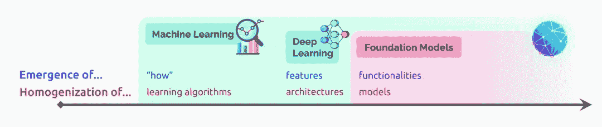

配图 18：人工智能的涌现过程（ 来自斯坦福研究人员 2021 年 8 月的论文 ）

AI 的进化史一个不断涌现和同质化的过程。随着 ML 的引入，可以从实例中学**习（算法概率推**论）；随着 DL 的引入，用于预测的高级特征出现；随着基础模型（ Foundation Models ）的出现，甚至出现了更高级的功能， 在语境中学习 。同时，ML 将算法同质化（例如 RNN），DL 将模型架构同质化（例如 CNN），而基础模型将模型本身同质化（如 GPT-3）。

一个基础模型如果可以集中来自各种模式的数据。那么这个模型就可以广泛的适应各种任务。

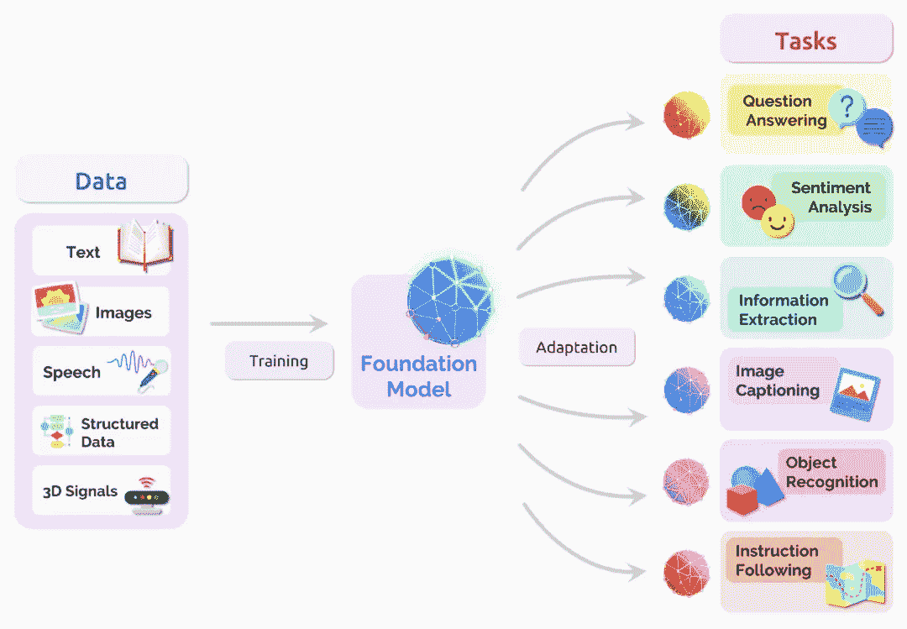

配图 19：Foundation Model 的转换（ 来自斯坦福研究人员 2021 年 8 月的论文 ）

除 了在翻译、文本创作、图像生成、语音合成、视频生成这些耳熟能详的领域大放异彩之外，基础模型也被用在了专业领域。

DeepMind 的 AlphaFold 2 在 **2020 年 12 月 **成功的把蛋白质结构预测的准确度提升到了 90% 多，大幅超过所有的竞争对手。他们在《 自然 》杂志上发表的文章中提到，像处理文本字符串这样读取氨基酸链，用这个数据转换成可能的蛋白质折叠结构，这项工作可以加速药物的发现。类似的应用也在药物公司发生，阿斯利康（AstraZeneca）和 NVIDIA 联合开发了 MegaMolBART ，可以在未标记的化合物数据库上进行培训练，大幅提升效率。

**大规模语言模型**

这种通用化的特征，让大规模神经网络的训练变得非常有意义。自然语言又是所有可训练数据中最丰富的，它能够让基础模型在语境中学习，转换成各种需要的媒体内容， 自然语言 = 编程方式 = 通用界面 。

视频 20：生成式 AI - DALL·E 2 Explained

因此，大规模语言模型（LLMs - Large Scale Language Models ）成了科技巨头和新创业公司必争之地。在这个军备竞赛之中，财大气粗就是优势 ，它们可以花费数亿美元采购 GPU 来培训 LLMs，例如 OpenAI 的 GPT-3 有 1750 亿个参数，DeepMind 的 Gopher 有 2800 亿个参数，Google 自己的 GLaM 和 LaMDA 分别有 1.2 万亿个参数和 1370 亿个参数，Microsoft 与 Nvidia 合作的 Megatron-Turing NLG 有 5300 亿个参数。

但 AI 有个特征它是 **涌现 **的，大多数情况挑战是科学问题，而不是工程问题。在 Machine Learning 中，从算法和体系结构的角度来看，还有很大的进步空间。虽然，增量的工程迭代和效率提高似乎有很大的空间，但越来越多的 LLMs 创业公司正在筹集规模较小的融资（1000 万至 5000 万美元） ，它们的假设是，未来可能会有更好的模型架构，而非纯粹的可扩展性。

## 4.3 AI 江湖的新机会

随着模型规模和自然语言理解能力的进一步增强（扩大训练规模和参数就行），我们可以预**期非常多的**专业创作和企业应用会得到改变甚至是颠覆。企业的大部分业务实际上是在“ 销售语言 ”—— 营销文案、邮件沟通、客户服务，包括更专业的法律顾问，这些都是语言的表达，而且这些表达可以二维化成声音、图像、视频，也能三维化成更真实的模型用于元宇宙之中。机器能理解文档或者直接生成文档，将是自 2010 年前后的移动互联网革命和云计算以来，最具颠覆性的转变之一。参考移动时代的格局，我们最终也会有三种类型的公司 ：

**1、平台和基础设施**

移动平台的终点是 iPhone 和 Android，这之后都没有任何机会了。但在基础模型领域 OpenAI、Google、 Cohere 、 AI21 、 Stability**.ai 还有那**些构建 LLMs 的公司的竞争才刚刚开始。这里**还有许多许新兴**的开源选项例如 Eleuther 。云计算时代，代码共享社区 Github 几乎托管了 软件 1.0 的半壁江山，所以像 Hugging Face 这种共享神经网络模型的社群，应该也会成为 软件 2.0 时代智慧的枢纽和人才中心。

**2、平台上的独立应用**

因为有了移动设备的定位、感知、相机等硬件特性，才有了像 Instagram，Uber，Doordash 这种离开手机就不会存在的服务。现在基于 LLMs 服务或者训练 Transformer 模型，也会诞生一批新的应用，例如 Jasper （创意文案）、 Synthesia （合成语音与视频），它们会涉及 Creator & Visual Tools、Sales & Marketing、Customer Support、Doctor & Lawyers、Assistants、Code、Testing、Security 等等各种行业，如果没有先进的 Machine Learning 突破，这些就不可能存在。

红衫资本美国（ SequoiaCap ）最近一篇很火的文章《 Generative AI: A Creative New World 》详细分析了这个市场和应用，就像在开篇介绍的那样，整个投资界在 Web 3 的投机挫败之后，又开始围猎 AI 了 。

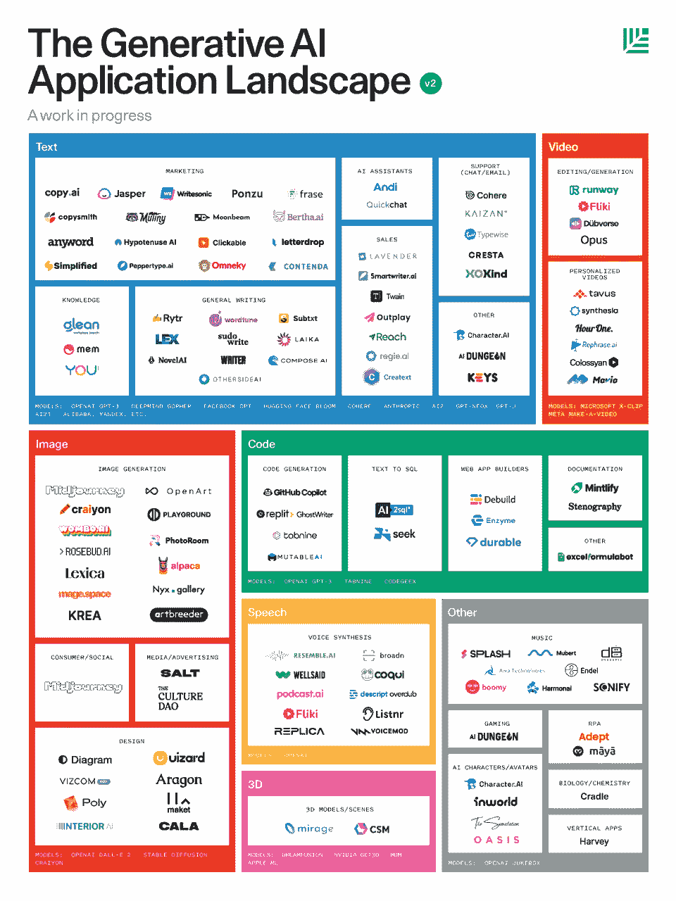

配图 21：在模型之上的应用分类（ Gen AI market map V2 ）

**3、现有产品智能化**

在移动互联网的革命中，大部分有价值的移动业务依旧被上个时代的巨头所占据。例如，当许多初创公司试图建立“Mobile CRM”应用时，赢家是增加了移动支持的 CRM 公司， Salesforce 没有被移动应用取代。同样，Gmail、Microsoft Office 也没有被移动应用取代，他们的移动版做得还不错。最终， Machine Learning 将被内置到用户量最大的 CRM 工具中，Salesforce 不会被一个全新由 ML 驱动的 CRM 取代，就像 Google Workspace 正在全面整合它们的 AI 成果 一样。

我们正处于 **智能革命 **的初**期，很难预测将要发生**的一切。例如 Uber 这样的应用，你按下手机上的按钮，就会有一个陌生人开车来接你，现在看来稀疏平常，但智能手机刚出现的时候你绝对想不到这样的应用和交互界面。那些 人工智能的原生应用 也将如此，所以请打开脑洞，最有趣的应用形态还在等你去发掘。

---

我**们已经感受**了基础模型**的强大，但**这种方法真能产生的智力和意识么？今天的人工智能看起来非常像工具，而不像 智能代理 。例如，像 GPT-3 在训练过程中不断学习，但是一旦模型训练完毕，它的参数的各种权重就设置好了，不会随着模型的使用而发生新的学习。想象一下，如果你的大脑被冻结在一个瞬间，可以处理信息，但永远不会学到任何新的东西，这样的智能是你想要的么？Transformer 模型现在就是这样工作的，如果他们变得有知觉，可以动态的学习，就像大脑的神经元无时不刻不在产生新的连接那样，那它们更高级的形态可能代表一种 新的智能 。我们会在第六章聊一下这个话题，在这之前，先来看看 AI 如何在现实世界中生存的。

# 05 现实世界的 AI

> 过去对无人操作电梯的担忧与我们今天听到的对无人驾驶汽车的担忧十分相似。

> Garry Kasparov

现实世界的 AI（Real World AI），按照 Elon Mu**sk 的定**义 就是 “ 模仿人类来感知和理解周围的世界的 AI” ，它们是可以与人类世界共处的 智能机器 。我们在本文前面四章中提到的用 AI 来解决的问题，大多数都是你输入数据或者提出目标，然后 AI 反馈给你结果或者完成目标，很少涉及和真实世界的环境互动。在真实世界中，收集大量数据是极其困难的，除非像 Tesla 一样拥有几百万辆带着摄像头还实时联网的电车来帮你采集数据；其次感知、计划再到行动，应该会涉及到多种神经网络和智能算法的组合，就像大脑控制人的行为那样，这同样也是对研发和工程学的极端挑战。但在 Transformer 模型诞生之后，能够征服现实世界的 AI 又有了新的进展。

## 5.1 自动驾驶新前沿

就在前几周 Ford 旗下的 Argo AI 宣布倒闭，一时间又给备受争议的自动驾驶领域蒙上了阴影。目前还没有一家做自动驾驶方案的公司真正盈利，除了传奇的 George Hotz 所创办的 Comma.ai ，这个当年 Elon Musk 都没撬动的软件工程师和高级黑客。

**技术路线的选择**

**一辆可以****自动驾驶汽车，****实际上就是**一台是需要同时**解决硬件和软**件问题的 机器人 。它需要用摄像头、雷达或其他硬件设备来 感知周围环境 ，软件则是在了解环境和物理位置的情况下 规划路线 ，最终让车辆 驶达目的地 。

目前的自动驾驶主要两大流派： **纯视觉的系统 **和基于 **激光雷达的系统 **。Google 的 Waymo 是激光雷达方案的先驱，还有刚破产的 Argo AI 也是，其实大部分都是这个流派，因为优势很明显，激光雷达可以精准的识别三维世界，不需要太复杂的神经网络训练就能轻松上路，但大功率激光雷达的成本是个大问题；采用纯视觉方案的只有 Tesla 和 Comma 这样的另类公司，它们完全靠摄像头和软件，无需任何辅助感知硬件。

激光雷达还有另一个问题，它眼中的世界没有色彩也没有纹理，必须配合摄像头才能描绘真实世界的样子。但两种数据混合起来会让算法极其复杂，因此 Tesla 完全放弃了激光雷**达，甚至是**超声波雷达，节省成本是很重要的一个原因，另一个原因是现实世界都道路都是为人类驾驶设计的，人只靠视觉就能完成这个任务为什么人工智能不行？这个理由很具 Elon Musk 的风格，只需要加大在 神经网络 上的研发投入就可以。

Waymo 和 Tesla 是自动驾驶领域的领跑者， Gartner 的副总裁 Mike Ramsey 这样评价 ：“如果目标是为大众提供自动驾驶辅助，那么 Tesla 已经很接近了；如果目标让车辆能够安全的自动行驶，那么 Waymo 正在取得胜利”。Waymo 是 Level 4，可以在有限的地理条件下自动驾驶，不需要司机监督，但驱动它的技术还没有准备好让其在测试领域之外的大众市场上使用，而且造价昂贵。从 2015 年开始，Tesla 花了六年多的时间赶上了 Waymo 现在的测试数据，同时用于自动驾驶的硬件越来越少，成本越来越低。Tesla 的战略很有意思：“ 自动驾驶要适应任何道路，让车像人一样思考 ”，如果成功的话，它的可扩展性会大得多。

**让车看见和思考**

Tesla 在 AI 上的押注是从 2017 年 Andrej Karpathy 的加入开始的，一个灵魂人物确实能改变一个行业。Andrej 领导的 AI 团队完全重构了原有的自动驾驶技术，采用最新的神经网络模型 Transformer 训练了完全基于视觉的自动导航系统 FSD Beta 10 ，在 2021 年的 AI Day 上，Tesla AI 团队也毫无保留了分享了这些最新的研发成果，目的是为了招募更多人才加入。

为了让车可以像人一样思考，Tesla 模拟了人类大脑处理视觉信息的方式，这是一套的由多种神经网络和逻辑算法组合而成的复杂流程。

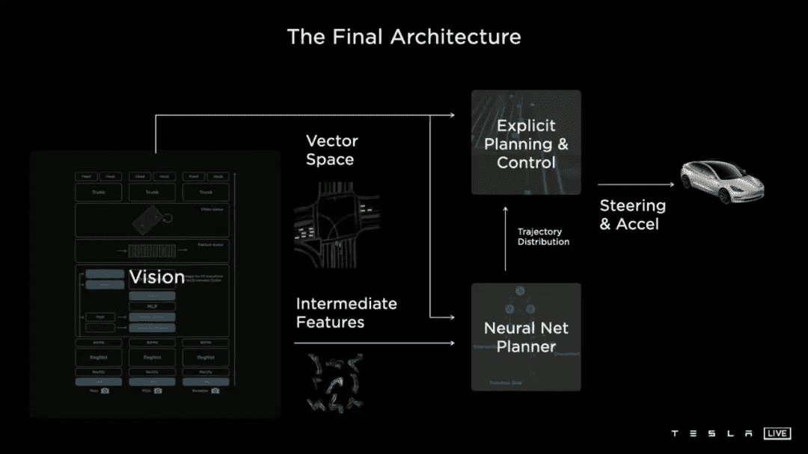

配图 22：The Architecture of Tesla AutoPilot

FSD 的自动驾驶步骤大概如下：

1.  **视觉影像收集 **：通过车载的 6 个 1280x960 解析度的摄像头，采集 12bit 色深的视频，识别出环境中的各种物体和 Triggers（道路情况）

1.  **向量空间生成 **：人类看到的世界是大脑根据感知数据实时构建还原的三维世界，Tesla 用同样的机制把车周围世界的全部信息都投射到四维向量空间中，再做成动态的 BEV 鸟瞰图，让车在立体的空间中行使和预测，从而可以精准控制。在 2021 年之前采用的是基于 Transformer 模型的 HydraNets ，现在已经升级到最新的 Occupancy Networks ，它可以更加精准的识别物体在 3D 空间中的占用情况

1.  **神经网络路线规划 **：采用 蒙特卡洛算法 （mcts）在神经网络的引导下计算，快速完成自己路径的搜索规划，而且算法还能给所有移动的目标都做计划，并且可以及时改变计划。看别人的反应作出自己的决策，这不就是人类思维么？

Tesla FSD 能够如此快速的感知和决策，还得靠背后超级电脑 Tesla Dojo 的神经网络训练，这和 OpenAI 还有 Google 训练 LLMs 类似，只不过这些数据不来自互联网，而是跑在路上的每一辆 Tesla 汽车，通过 Shadow Mode 为 Dojo 提供真实的 3D 空间训练数据。

大自然选择了 **眼睛 **来**作为最重要的信**息获取器官，也许是冥冥之中的进化必然。一个有理论认为 5.3 亿年前的寒武纪物种大爆发的部分原因是因为 能看见世界了 ，它让新的物种可以在快速变化的环境中移动和导航、规划行动了先和环境做出互动，生存概率大幅提高。同理，让机器能看见，会不会一样让这个新物种大爆发呢？

## 5.2 不是机器人，是智能代理

并**不是所有的机器人都具备感**知现实世界的智能。对于一个在仓库搬运货物的机器人来说，它们不需要大量的 Deep Learning，因为 环境是已知的和可预测的 ，大部分在特定环境中使用的自动驾驶汽车也是一样的道理。就像让人惊叹的 Boston Dynamic 公司机器人的舞蹈，他们有世界上最好的机器人控制技术，但要做那些安排好的动作，用程序把规则写好就行。很多看官都会觉得 Tesla 在今年九月发布的机器人 Tesla Optimus 那慢悠悠的动作和 Boston Dynamic 的没法比，但拥有一个优秀的机器大脑和可以量产的设计更重要。

视频 24： Tesla AI Day 2022 Optimus 的发布

自动驾驶和真实世界互动的核心是安全，不要发生碰撞；但 AI 驱动的机器人的核心是和真实世界发生互动，理解语音，抓握避让物体，完成人类下达的指令。驱动 Tesla 汽车的 FSD 技术同样会用来驱**动 Tes**la Optimus 机器人，他们有相同的心脏（ FSD Computer ）和相同的大脑（ Tesla Dojo ）。但训练机器人比训练自动驾驶还要困难，毕竟没有几百万个已经投入使用的 Optimus 帮你从现实世界采集数据，这时 Metaverse 概念中的 虚拟世界 就能展露拳脚了。

**虚拟世界中的模拟真实**

为机器人感知世界建立新的 **基础模型 **将需要跨越不同环境大量数据集，那些虚拟环境、机器人交互、人类的视频、以**及自然语言**都可以成为这些模型的有用数据源，学界对使用这些数据在虚拟环境中训练的 智能代理 有个专门的分类 EAI（ Embodied artificial intelligence ）。在这一点上，李飞飞再次走在了前列，她的团队发布了一个标准化的模拟数据集 BEHAVIOR ，包含 100 个类人常见动作，例如捡玩具、擦桌子、清洁地板等等，EAI 们可以在任何虚拟世界中进行测试，希望这个项目能像 ImageNet 那样对人工智能的训练数据领域有杰出的学术贡献。

在虚拟世界中做模拟，Meta 和 Nvidia 自然不能缺席。佐治亚理工学院的计算机科学家 Dhr**uv Batr**a 也是 Meta AI 团**队的主管，他们创造了一个名**叫 AI 栖息地 （ AI Habitat ）虚拟世界，目标是希望提高模拟速度。在这里智能代理只需挂机 20 分钟，就可以学成 20 年的模拟经验，这真是 元宇宙一分钟，人间一年呀 。Nvidia 除了给机器人提供计算模块之外，由 Omniverse 平台提供支持的 NVIDIA Isaac Sim 是一款可扩展的机器人模拟器与合成数据生成工具， 它能提供逼真的虚拟环境和物理引擎 ，用于开发、测试和管理智能代理。

机器人本质上是具体化的 **智能代理 **，许多研究人员发现在虚拟世界中训练成本低廉、受益良多。随着参与到这个领域**的公司越来**越多，那么数据和训练的需求也会越来越大，势必会有新的适合 EAI 的 基础模型 诞生，这里面潜力巨大。

Amazon Prime 最新的科幻剧集《 The Peripheral 》，改编自 William G**ibson** 在 2014 年的出版的同名小说，女主角就可以通过脑机接口进入到未来的 智能代理 。以前一直觉得 Metaverse 是人类用来逃避现实世界的，但对于机器人来说，在 Metaverse 中修行才是用来征服现实世界的。

---

ARK Invest 在他们的 Big Ideas 2022 报告中提到，根据莱特定律，AI 相对计算单元（RCU - AI Relative Compute Unit ）的生产成本可以每年下降 39%，软件的改进则可以在未来八年内贡献额外 37% 的成本下降。换句话说，到 2030 年，硬件和软件的融合可以让人工智能训练的成本以每年 60% 的速度下降。

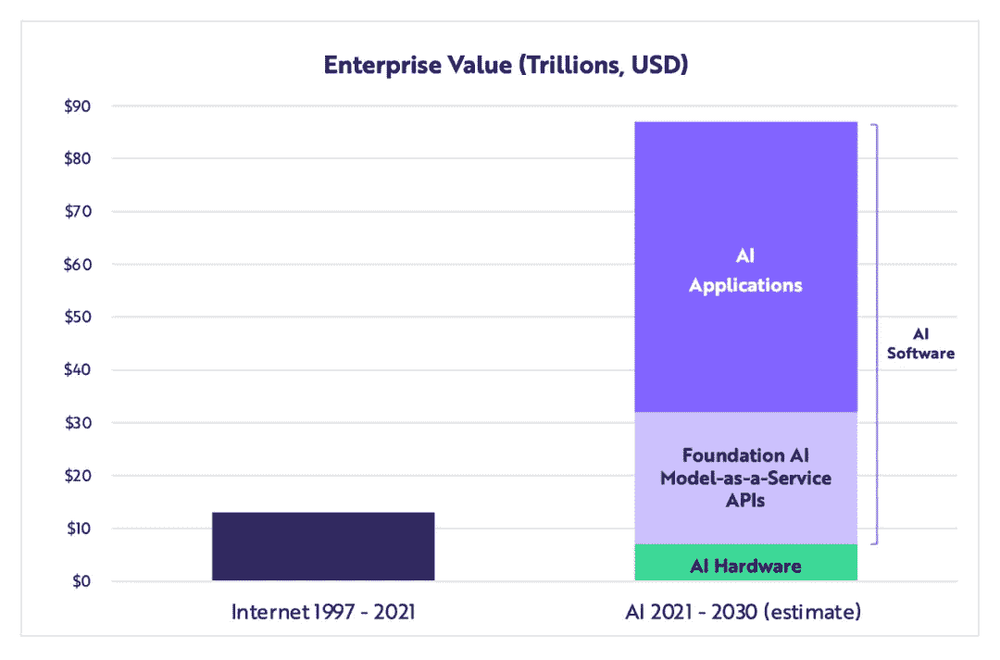

配图 26：AI 在 2030 年的市场规模 87 万亿美元

**AI 硬件**和软件公司的市值可以以大约 5**0% 的年**化速度**扩大，**从 2021 年的 2.5 万亿美元剧增到 2030 年的 87  万亿美元。

通过将知识工作者的任务自动化，AI 应能提高生产力并大幅降低单位劳动成本，从生成式 AI 的应用的大爆发就可以看出端倪；但用来大幅降低体力劳动的成本，现实世界的 AI 还有更长的路要走。我们原以为着 AI 会让体力劳动者失业，却不知道它们确有潜力让脑力劳动者先下岗了。

# 06 AI 进化的未来

科幻小说家 Arthur Clarke 这样说过：" **任何先进的技术都与魔法无异 **"**！如果回到** 19 世纪，想象汽车在高速路上以 100 多公里的时速行驶，或者用手机与地球另**一端的人视**频通话，那都不可想象的。自 1956 年 Dartmouth Workshop 开创了人工智能领域以来，让 AI 比人类更好地完成智力任务，我们向先辈们的梦想前进了一大步。虽然，有些人认为这可能永远不会发生，或者是在非常遥远的未来，但 新的模型 会让我们更加接近大脑工作的真相。对大脑的全面了解，才是 AI 通用化（AGI）的未来。

## 6.1 透视神经网络

**科学家们发现，**当用不同的神经网络训练同一个数据集时，这些网络中存在 相同的神经元 。由此他们提出了一个假设：在不同的网络中存在着普遍性的特征。也就是说，如果不同架构的神经网训练同一数据集，那么有一些神经元很可能出现在所有不同的架构中。

**这并不是唯一**惊喜。他们还发现，同样的 特征检测器 也存在与不同的神经网络中。例如，在 AlexNet、InceptionV1、VGG19 和 Resnet V2-50 这些神经网络中发现了曲线检测器（ Curve Detectors ）。。不仅如此，他们还发现了更复杂的 Gabor Filter ，这通常存在于生物神经元中。它们类似于神经学定义的经典"复杂细胞"，难道我们的大脑的神经元也存在于人工神经网络中？

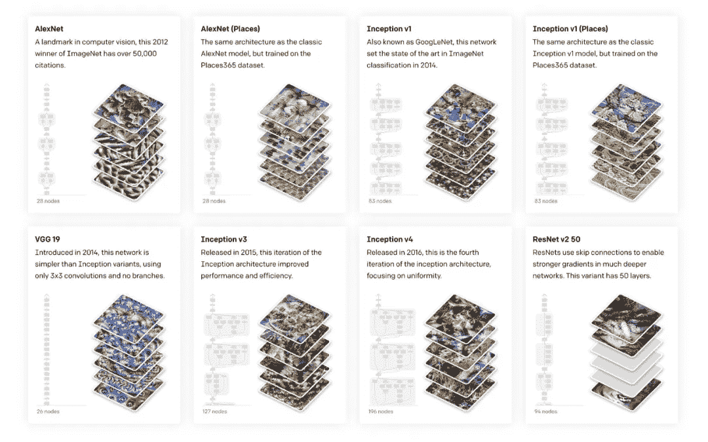

配图 27：OpenAI Microscope Modules

OpenAI 的研究团队表示，这些神经网络是可以被理解的。通过他们的 Microscope 项目，你可以可视化神经网络的内部，一些代表抽象的概念，如边缘或曲线，而另一些则代表狗眼或鼻子等特征。不同神经元之间的连接，还代表了有意义的算法，例如简单的逻辑电路（AND、OR、XOR），这些都超过了高级的视觉特征。

大脑中的 Transformer

来自 University College London 的两位神经科学家 Tim Behrens 和 James Whittington 帮助证明了我们大脑中的一些结构在数学上的功能与** Trans**former 模型的机制类似，具体可以看这篇《 How Transformers Seem to Mimic Parts of the Brain 》，研究显示了 Transformer 模型精确地复制在他们 大脑海马体 中观察到的那些工作模式。

去年，麻省理工学院的计算神经科学家 Martin Schrimpf 分析了 43 种不同的神经网络模型 ，和大脑神经元活动的磁共振成像（fMRI）还有皮层脑电图（EEG）的观测做对比。他发现 Transformer 是目前最先进的神经网络，可以预测成像中发现的几乎所有的变化。计算机科学家 Yujin Tang 最近也设计了一个 Transformer 模型，并有意识的向其随机、无序的地发送大量数据，模仿人体如何将感官数据传输到大脑。他们的 Transformer 模型，就像我们的大脑一样，能够成功地处理无序的信息流。

尽**管研究在突飞猛进，但 Tr**ansformer 这种通用化的模型只是朝着大脑工作的精准模型迈出的一小步， 这是起点而不是探索的终点 。Schrimpf 也指出，即使是性能最好的 Transformer 模型也是有限的，它们在单词和短语的组织表达上可以很好地工作，但对于像讲故事这样的大规模语言任务就不行了。这是一个很好的方向，但这个领域非常复杂！

## 6.2 千脑理论

Jeff Hawkins 是 Palm Computing 和 Handspring 的创始人，也是 PalmPilot 和 Treo 的发明人之一。创办企业之后，他转向了神经科学的工作，创立了红木理论神经科学中心（ Redwood Center ），从此专注人类大脑工作原理的研究。《 A Thousand Brains 》这本书详细的解释了他最重要的研究成，湛庐文化在今年九月推出了中文版《 千脑智能 》。

大脑新皮层（ Neocortex ）是智力的器官。几乎所有我们认为是智力的行为，如视觉、语言、音乐、数学、科学和工程，都是由新皮层创造的。Hawkins 对它工作机理采取了一种新的解释框架，称为 "Thousand Brains Theory"，即你的大脑被组织成成千上万个独立的计算单元，称为皮质柱（ Cortical Columns ）。这些柱子都以同样的方式处理来自外部世界的信息，并且每个柱子都建立了一个完整的世界模型。但由于每根柱子与身体的其他部分有不同的联系，所以每根柱子都有一个独特的参考框架。你的大脑通过进行投票来整理出所有这些模型。因此，大脑的基本工作不是建立一个单一的思想，而是管理它每时每刻都有的成千上万个单独的思想。

我们可以把运行 Transformer 训**练的神经网络**的电脑想象成一个及其简陋的 人工皮质柱 ，给它灌输各种数据，它输出预测数据（参考第四、五两章的讲解来理解）。但大脑新皮层有 20 多万个这样的小电脑在分布式计算，他们连接着各种感知器官输入的数据，最关键的是大脑无需预训练，神经元自己生长就完成了学习，相当于把人造的用于训练的超级电脑和预测数据的电脑整合了。在科学家没有给大脑完成逆向工程之前，AGI 的进展还举步维艰。

视频 28： How the Brain Works: The Thousand Brains Theory of Intelligence

**千脑理论 **本质上是一种感觉-运动理论（ Sensory-Motor Theory ）**，它解释**了我们**如何通过看到、移动和感知三维空**间来学习、识别物体。在该理论中，每个 皮质柱 都有完整物体的模型，因此知道在物体的每个位置应该感应到什么。如果一个柱子知道其输入的当前位置以及眼睛是如何移动的，那么它就可以预测新的位置以及它在那里将感应到什么。这就像看一张城镇地图，预测如果你开始朝某个方向走，你会看到什么一样。有没有觉得这个过程和 Tesla 的纯视觉自动驾驶 的实现方法很像？感知、建模、预测和行动。

**要像大脑一样学习**

**自我监督 **：新皮层的计算单位是 **皮质柱 **，每个柱子都是一个完整的感觉-运动系统，它获得输入，并能产生行为。比如说，一个物体移动时**的未来位**置，或者一句话中的下一个词，柱子都会预测它的下一**次输入会是**什么。预测是 皮质柱 测试和更新其模型的方法。如果结果和预测不同，这个错误的答案就会让大脑完成一次修正，这种方式就是自我监督。现在最前沿的神经网络正 BERT 、 RoBERTa 、 XLM-R 正在通过预先训练的系统来实现“ 自我监督 ”。

**持续学习 **： 大脑通过 **神经元 **组织来完成持续学习。当一个神经元学一个新的模式时，它在一个树突分支上形成新的突触。新的突触并不影响其他分支上先前学到的突触。因此，学新的东西不会迫使神经元忘记或修改它先前学到的东西。今天，大多数 Al 系统的人工神经元并没有这种能力，他们经历了一个漫长的训练，当完成后他们就被部署了。这就是它们不灵活的原因之一，灵活性要求不断调整以适应不断变化的条件和新知识。

**多模型机制的 **：新皮层由数以万计的皮质柱组成，每根柱子都会学物体的模型，使多模型设计发挥作用的关键是投票。每一列都在一定程**度上独**立运作，但新皮层中的长距离连接允许各列对其感知的对象进行投票。智能机器的 "大脑 "也应该由许多几乎相同的元素（ 模型 ）组成，然后可以连接到各种可移动的传感器。

**有自己的参考框架 **：大脑**中的知识被储存在参**考框架中。参考框架也被用来进行预测、制定计划和进行运动，当大脑每次激活参考框架中的一个位置并检索相关的知识时，就会发生思考。机器需要学会一个世界的模型，当我们与它们互动时，它们如何变化，以及彼此之间的相对位置，都需要参考框架来表示这类信息。 它们是知识的骨干 。

为什么需要通用人工智能（AGI）

AI 将从我们今天看到的专用方案过渡到更多的通用方案，这些将在未来占据主导地位，Hawkins 认为主要有两个原因：

第一个就和通用电脑战胜专用电脑的原因一样。通用电脑有更好的成效比，这导致了技术的更快进步。随着越来越多的人使用相同的设计，更多的努力被用于加强最受欢迎的设计和支持它们的生态系统，导致成本降低和性能的提升。这是算力指数式增长的基本驱动力，它塑造了二十世纪后半叶的工业和社会。

Al 将通用化的第二个原因是，机器智能的一些最重要的未来应用将需要通用方案的灵活性，例如 Elon Musk 就希望可以有通用智能的机器人来帮忙探索火星。这些应用将需要处理很多无法预料的问题，并设计出新颖的解决方案，而今天的专用的 Deep Learning 模型还无法做到这一点。

## 6.3 人工智能何时通用？

通用人工智能（AGI）这是 AI 领域的终极目标，应该也是人类**发明了机器**计**算之后**的终**极进化**方向。**回顾 机器之**心 六十多年的进化，我们似乎找到了方法，就是模仿人类的大脑。 Machine Learning 要完成这块拼图，需要有 数据 、 算力 还有 模型的改进 。

**数据 **应该是拼图中最容易实现的。按秒来计算，ImageNet 数据集的大小已经接近人从出生到大学毕业视觉信号的数据量；Google 公司创建的新模型 HN Detection，用来理解房屋和建筑物外墙上的街道号码的数据集大小，已经可以和人一生所获取的数据量所媲美。要像人类一样，使用更少的数据和更高的抽象来学习，才是神经网络的发展方向。

**算力 **可以分解为两个部分：神经网络的参数（神经元的数量和连接）规模以及单位计算的成本。下图可以看到，人工神经网络与人脑的大小仍有数量级的差距，但它们在某些哺乳动物面前，已经具备竞争力了。

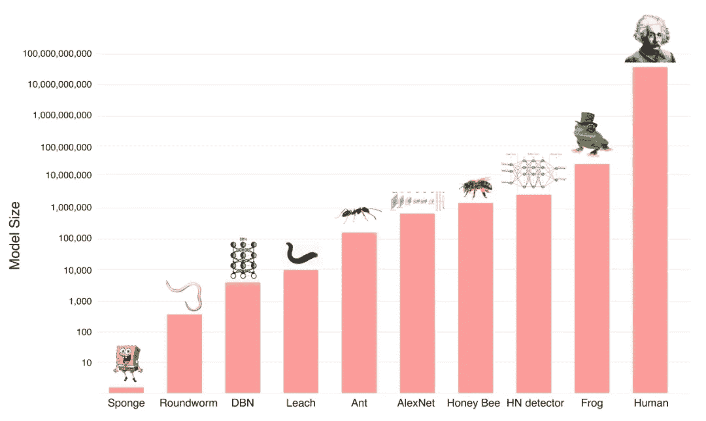

配图 29：神经网络规模和动物与人类神经元规模的对比

我们每花一美元所能得到的计算能力一直在呈指数级增长。现在大规模基础模型所用到的计算量每 3.5 个月就会翻一番。

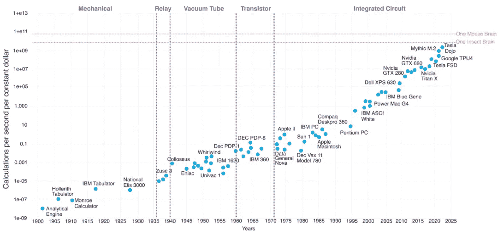

配图 30：122 years of Moore’s Law: 每一美元产生的算力

有些人认为，由于物理学的限制，计算能力不能保持这种上升趋势。然而，过去的趋势并不支持这一**理论。**随着时间的推移，该领域**的资金和资源也在增加**，越**来越多**人才进入该领域，因为 涌现 的效应，会开发更好的 软件（算法模型等） 和 硬件 。而且，物理学的限制同样约束人脑的能力极限，所以 AGI 可以实现。

**当 A**I 变得比人类更聪明、我们称**这一刻为 **奇点 。一些人预测，奇点最快将于 20**45 年到**来。Nick Bost**rom** 和 Vincent C。 Müller 在 2017 年的一系列会议上 对数百名 AI 专家进行了调查 ， 奇点 （或人类水平的机器智能）会在哪一年发生，得到的答复如下：

+   乐观预测的年份中位数 （可能性 10%） - 2022

+   现实预测的年份中位数 （可能性 50%） - 2040

+   悲观预测的年份中位数 （可能性 90%） - 2075

因此，在 AI 专家眼里很有可能在未来的 20 年内，机器就会像人类一样聪明。

这意**味着对于每一项任务，机**器都将比人**类做得更好**；当计算机超过人类时，一些人认为，他们就可以继续变得更好。换句话说，如果我们让机器和我们一样聪明，没有理由不相信它们能让自己变得更聪明，在一个不断改进的 机器之心进化的螺旋中 ，会导致 超级智能 的出现。

**从工具进化到数字生命**

按照上面的专家预测，机器应该具有自我意识和超级智能。到那时，我们对机器意识的概念将有一些重大的转变，我们将面对真正的数字生命形式（DILIs - Digital Lifeforms）。

一旦你有了可以快速进化和自我意识的 DILIs，围绕物种竞争会出现了一些有趣的问题。DILIs 和人类之间的合作和竞争的基础是什么？如果你让一个有自我意识的 DILIs 能模拟疼痛，你是在折磨一个有感知的生命吗？

这些 DILIs 将能够在服务器上进行自我复制和编辑（应该假设在某个时候，世界上的大多数代码将由可以自我复制的机器来编写），这可能会加速它们的进化。想象一下，如果你可以同时创建 100,000,000 个你自己的克隆体，修改你自己的不同方面，创建你自己的功能函数和选择标准，DILIs 应该能够做到这一切（假设有足够的算力和能量资源）。关于 DILIs 这个有趣的话题在《 Life 3.0 》和《 Superintelligence: Paths， Dangers， Strategies 》这两本书中有详细的讨论。

这些问题可能比我们的预期来得更快。Elad Gil 在他的最新文章《 AI Revolution 》提到 OpenAI、Google 和各种创业公司的核心 AI 研究人员都认为，真正的 AGI 还需要 5 到 20 年的时间才能实现， 这也有可能会像自动驾驶一样永远都在五年后实现 。不管怎样，人类最终面临的潜在生存威胁之一，就是与我们的数字后代竞争。

---

历史学家 Thomas Kuhn 在其著**名的《 T**he Structure of S**cient**ific Revolutions 》一书中认为，大多数科学进步是基于广泛接受的理论框架，他称之为 科学范式 。偶尔，一个既定的范式被推翻，被一个新的范式所取代 - Kuhn 称之为 科学革命 。我们正处在 AI 的智能革命之中！

最后，送上一首 AI 创作的曲子《 I Am AI 》，Nvidia 每年的 GTC 大会上都会更新一次内容，看看 AI 如何从各个行业渗透到我们的生活。

# 参考

+   Letter from Alan Turing to W Ross Ashby - Alan Mathison Turing

+   Software 2.0 - Andrej Karpathy

+   The Rise of Software 2.0 - Ahmad Mustapha

+   Infrastructure 3.0: Building blocks for the AI revolution - Lenny Pruss, Amplify Partners

+   Will Transformers Take Over Artificial Intelligence? - Stephen Ornes

+   AI Revolution - Transformers and Large Language Models (LLMs) - Elad Gil

+   What Is a Transformer Model? - RICK MERRITT

+   [AI 时代的巫师与咒语 ](https://mp.weixin.qq.com/s?__biz=MzI3NDQzNTk2Mw==&mid=2247484347&idx=1&sn=ce81d3c4532660d3bbbf675f71246f48&scene=21#wechat_redirect)- Rokey Zhang

+   Generative AI: A Creative New World - SONYA HUANG, PAT GRADY AND GPT-3

+   What Real-World AI From Tesla Could Mean - CleanTechNica

+   A Look at Tesla's Occupancy Networks - Think Autonomous

+   By Exploring Virtual Worlds, AI Learns in New Ways - Allison Whitten

+   Self-Taught AI Shows Similarities to How the Brain Works - Anil Ananthaswamy

+   How Transformers Seem to Mimic Parts of the Brain - Stephen Ornes

+   Attention Is All You Need - PAPER by Ashish Vaswani, Noam Shazeer, Niki Parmar, Jakob Uszkoreit, Llion Jones, Aidan N. Gomez, Lukasz Kaiser, Illia Polosukhin

+   On the Opportunities and Risks of Foundation Models - PAPER by CRFM & HAI of Stanford University

+   Making Things Think - BOOK by Giuliano Giacaglia

+   A Thousand Brains （中文版： 千脑智能 ）- BOOK by Jeff Hawkins

