# 智变时代 / 全面理解机器智能与生成式 AI 加速的新工业革命

> 来源：[https://waytoagi.feishu.cn/docx/DoFudHMYwo0oHkxL2rQcmkCRn3g](https://waytoagi.feishu.cn/docx/DoFudHMYwo0oHkxL2rQcmkCRn3g)

> 🔗 原文链接： h[ttps://mp.weixin.q](https://mp.weixin.qq.com/s/4LvcfLC6C-dZnS7f_IKw-g)q.com/s/4LvcfLC6...

> ⏰ 发表时间：2024-06-12

> 原创 JEDI LU， INDIGO 的数字镜像

“在任何一项足够先进的技术和魔法之间，我们无法做出区分”，这是英国科幻作家 亚瑟·克拉克三定律 之一。相信过去的一年多，令人目不暇接的生成式 AI，就让大家体验到了什么是魔法般的科技。现在应该没人会质疑，最先进的语言模型可以完全通过图灵测试；我们靠感官已经很难分辨 AI 生成的图像和音乐了，AI 技术几周的变化，就超过了过去几年的发展。

Je**nse**n Huang 在台北 **Comput**ex 2024 上这样的比喻：“在十九世纪 90 **年代末期，Ni**kola Tesla 发明了交流发电机，而 Nvidia 现在发明了 AI 发电机。交流发电机生成 电子 ；AI 发电机生成的是 Token ，这两样东西都有巨大的市场机会，Token 几乎可以应用于每个行业，这就是为什么这是一场 新的工业革命 ”。

---

在上一篇《[机器之心的进化 / 理解 AI 驱动的软件 2.0 智能革命](https://waytoagi.feishu.cn/wiki/WmoAwdYZgicqHZkbhIcckWqNnOg) 》之后，时隔一年半，我希望用这篇《智变时代》来温故下 AI 领域波澜壮阔的一年，尝试抓住生成式 AI 变革的本质，带大家拨开喧嚣与迷雾，追寻科技巨头与 AI 机构们在更高智能道路上的探索，以及变革会如何全面改变人机交互、世界的产业、经济还有我们自己。。

全文 36000 字，共分五个章节：

1.  **模型 **- 竞争、泛化与变革的本质

1.  **应用 **- 智能代理、智能体与组织新形态

1.  **智变 **- 廉价诱导需求、从中心到边缘算力、新工业革命

1.  **演化 **- 模型如何理解和进化、自主目标与自动化的 AGI

1.  **选择 **- 职业变迁、自我提升与科技恒大

预计阅读时间九十分钟以上，请先点赞、收藏、转发，找个不受打扰的时间再阅读。无论你是科技从业者、AI 爱好者还是行业专家，都一定会收获满满 😄

# 01 模型 - AI 的群雄逐鹿

“我认为生成式 AI 革命在规模上可以与工业革命或电的发明相提并论。” - 神经网络之父 Geoffrey Hinton 去年离职 Google 后在 接受 CBS 采访 时提到。

2022 年十一月底 OpenAI 的 ChatGPT 横空出世，原本被通胀和加息折磨得萎靡不振的美股，突然被新一轮的生成式 AI 革命给**原地托起。除了 Nv**idia 卖 GPU 带来了真实收入暴增之外，大多数的热情并非来自于收入增长，而是由于大家急于构建 更大的 AI 模型 ，热情来自于对未来业务的梦想。大多数公司心目中明确的目标就是赶上 OpenAI，甚至超越它，尤其是美股的科技七巨头（ Magnificent Seven ）。

### 1.1 逐鹿 OpenAI

2023 年美国的科技巨头可以用两种状态来形容：All in AI 与赶超 OpenAI！经过这一年多的努力，如今许多公司在 LMSYS Chatbot 竞技场 ELO 排名 上已经接近 OpenAI 最新的 GPT-4o ，其中 Anthropic 今年三月推出的 Claude 3 Opus 一度超过了当时的 GPT-4；在某些方面，如上下文长度和视频模态，Google 的 Gemini Pro 已经走在了前面。

那么问题来了，OpenAI 先发优势能够保持多久？ Sam Altman 用他独特的驾驭能力，先是吸引微软为 OpenAI 直接投入超过 100 亿美元的算力支持；现在又通过与 Apple 的合作， 将 ChatGPT 整合到了 Apple 生态 ，从边缘设备入口直接获取用户，毕竟 ChatGPT 的活跃用户已经连续几个月都没有增长，而最大对手 Google Gemini 的用户却在节节攀升。

第一方面是 **算力 **。按照依旧可行的 **规模理论 **（ Scaling Law ），足够多的算力和足够好的数据，就会有足够强大的模型！因此，只要算力足够，Google 与 Meta 就能匹敌 OpenAI。据传 Gemini 2 Ultra 将在各方面超越 GPT-4 Turbo。此外，Meta 预计在今年夏天发布的 Llama 3 405B 也将达到与 GPT-4 匹敌的水平，还是开源的。这意味着只要拥有足够的 H100 服务器，就能达到 GPT-4 级别的智能。

在微软这边，虽然巨额投资了 OpenAI，但 GPT-4 再强大也毕竟不是自己的。从 Semi Analysis 的内部消息 了解到，微软也并没有将投资的大部分算力直接给到 OpenAI 使用；就在不久前，微软完成了对 Inflection AI 的收购，把 Deepmind 的前联合创始人穆斯塔法·苏莱曼 （ Mustafa Suleyman ） 纳入麾下，准备利用他们专业的预训练团队和数据集，再加上自己的合成数据，从头训练一个和 GPT-4 相当的大约五千亿参数规模的 MOE 模型 MAI-1。

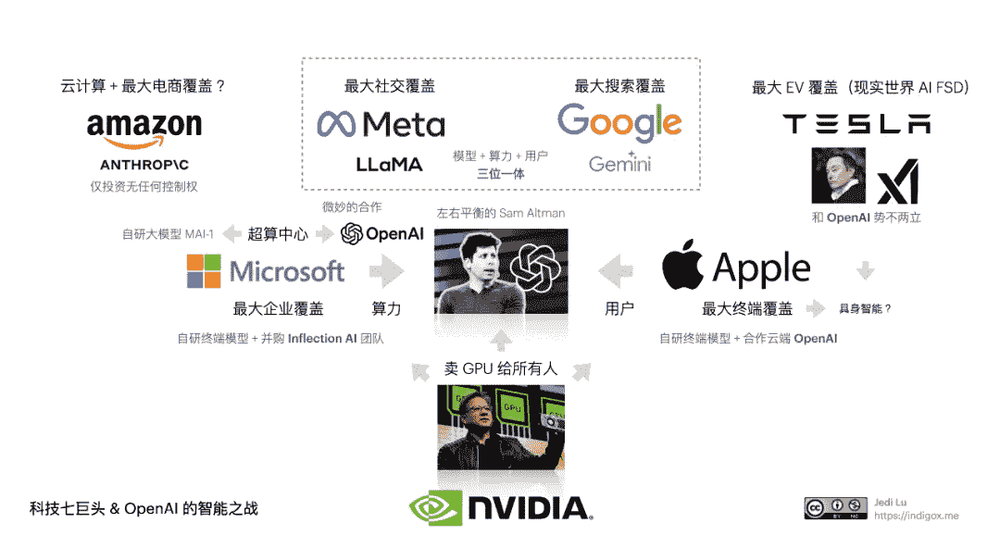

配图 1.01：Mega 7 与 OpenAI 的竞争格局图

另一方面是 **数据 **。因为起步早，OpenAI 在收集使用数据方面一直处于领先地位。但现在情况已经发生了改变，公开的用于训练的文本数据几乎耗尽，所以大家都不约而同地采用合成数据。但文本之外的图像和视频，需要更直接地接触消费者，才能拿到新数据。Google 与 Meta 各自的产品线都覆盖了超过三十亿的用户，这是最大的优势。所以，每次有人问 OpenAI 有没有拿 Youtube 的数据来训练，他们都避而不谈。。

模型的竞赛，就是资本和用户的竞赛 。OpenAI 打响了第一枪，山姆·奥特曼四处游说，搞募资的同时，还得想方设法扩大 ChatGPT 的用户规模。现在 Meta 和 Google 全力以赴，他们从算力到模型再到用户，配置齐备，关键是资本充足；微软虽然投资最多，但和 OpenAI 纠结的关系，让自己不得不背地里另起炉灶；Amazon 也有同样的问题，没法控制自己投资的 AI 联盟 Anthropic，他们就像是在参加一场独臂搏斗。

目前，只有 迷 一样的 Apple 在竞赛中不动声色，作为终端之王，控制了最有价值的入口。 让模型变小能在设备上直接运行，让 iOS 变成 aiOS，应该是 Apple 最大的需求，后面更复杂的 智 能可以慢慢来，毕竟用户跑不掉。

这一回合中，Nvidia 才是最大的赢家，因为竞争越激烈，对 GPU 的需求也就越强烈。对科技巨头来说，他们必须不断加大投入才能跟得上 OpenAI 领跑的步伐，或者维持他们在其垄断领域的市场份额，例如 Google 的搜索。这将使其对数据中心的支出持续不断。因此，他们的利润空间将会被压缩，而 Nvidia 则会从中获利。

OpenAI 在 2022 年就完成了 GPT-4 的训练。从那时起，他们完全专注于下一代模型，尝试新的架构、数据以及更大的规模，而后来者几乎花了一年多的时间，才勉强追平 GPT-4。解铃还须系铃人，OpenAI 能否继续领跑这场大模型的竞赛，在第二回合中也能胜出，就要看今年年底新版 GPT 的真实表现了！

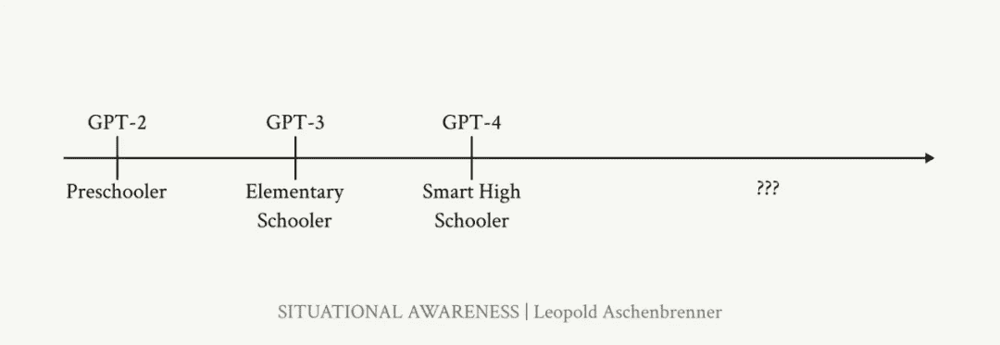

配图 1.02：GPT Timeline（ SITUATIONAL AWARENESS ）

“We can say right now， with a high degree of scientific certainty， GPT-5 is going to be a lot smarter than GPT-4” - 我可以很有把握地说，GPT-5 会比 GPT-4 聪明得多

- Sam Altman

### 1.2 变革的本质

OpenAI 的一鸣惊人并非凭空而来，GPT-3.5 是多年来其大语言模型 GPT 系列中最完善的一次迭代，并通过 ChatGPT 这样一款易用的产品，成功的把大语言模型推向了大众，短短两个月就实现了一个亿用户的增长，打破了之前 Tiktok 所保持的记录。

我**在《 机器之**心的进化 》中详细**介绍过这轮生**成式 AI 变革的来龙去脉，那时 ChatGPT 还没发布。现在，经历了这一年多的 模型争霸赛 之后，我们可以从 大语言模型 （LLM）发展的视角，重温这轮 AI 革命，来理解其背后的本质。

**架构与算力**

由于文本是由长短不一的字母和单词序列组成的，因此语言模型需要一种能够理解这类数据的神经网络。 20 世纪 80 年代发明的递归神经网络（RNN）可以处理单词序列，但其训练速度较慢，而且会遗忘序列中的前一个单词。

1997 年计算机科学家 Sepp Hochreiter 与 Jürgen Schmidhuber 发明了长短期记忆（ LSTM ）网络，解决了这一问题。LSTM 也是一种递归神经网络，具有特殊的组件，可以将输入序列中过去的数据保留更长时间，LSTM 可以处理几百个单词长度的文本串，但其语言能力有限。

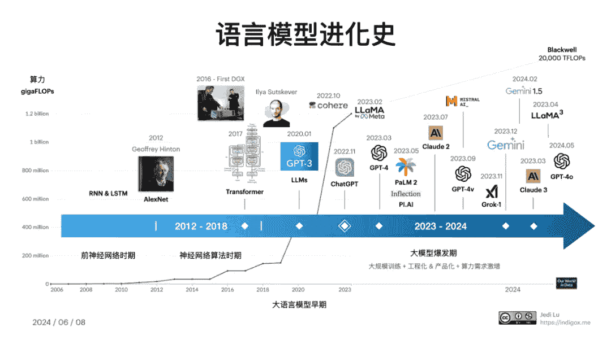

配图 1.03：语言模型发展史 - 从 Nvidia 在 2016 推出第一台 DGX 到现在 算力提升了 1000 倍

**大语言模型 ****背后的突破，**来自于 Google 的研究团队在 2017 年发明了 转换器架构 （ Transformer），这种神经网络可以跟踪每个单词或短语在序列中出现的位置。2018 年，OpenAI 果断地将转换器模型与无监督学习相结合，推出了 GPT ，这是一种在未标注的数据上预训练模型的方法，让程序可以自己找出数据中的模式。在此之前的机器学习大多依赖于监督学习和标注数据，但手动标记是一项非常缓慢的工作，因此限制了可用于训练的数据集的大小。

Ilya Sutskever 领导的 OpenAI 研究团队很执着的确信，用 Transformer 可以并行计算的架构和无监督学习的方式，只要增加算力和数据规模就能训练出更好的模型，从而通向通用人工智能（AGI）。经过两年多的迭代，在 2020 年初用 API 的方式推出了 GPT-3，然后于 2022 年底通过人类反馈的强化学习的技术（RLHF）优化出了 InstructGPT ，也就是 GPT-3.5，很好地减少了 GPT-3 产生的错误信息和冒犯性文本的数量 。

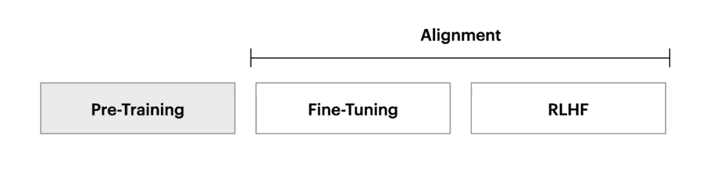

配图 1.04：Alignment 步骤解释

**Ins**tru**ctGPT 更善于遵循人类的**指示，在 AI 术语中被称为 对齐 （Alignment），可以让模型的输出更加安全，错误、幻觉和攻击性语言更少。简而言之，InstructGPT 不是一个混蛋，除非它被要求成为一个混蛋。在所有这些成果之上，OpenAI 在山姆·奥特曼的推动下，顶着巨大的压力对公众开放了 ChatGPT。至此， 一个新的智能时代就被开启了 ！

**人才网络**

虽然 Transformer 架构最早诞生于 Google 的研究，但在庞大的组织内部，并没有得到特别多的重视。“也许 Google AI Research 太像一个学术研究机构了，大家更重视想法的涌现和发表论文，但在坚定的采用一种技术方案，将其工程化和产品化上却被忽视了” OpenAI 的总裁格雷格·布罗克曼（ Greg Brockman ）在最近一次播客采访中这样描述，这也是伊尔亚的团队能够孤注一掷取得成果的主要原因。

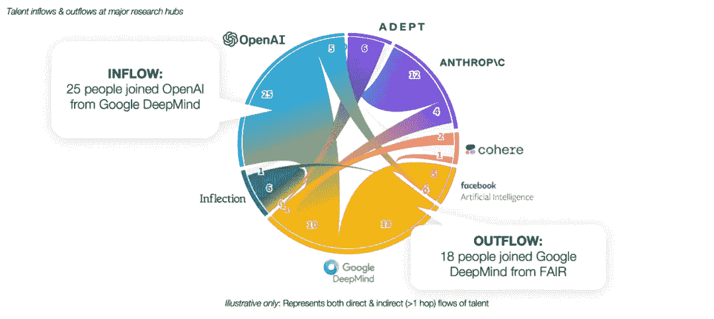

配图 1.05：硅谷 AI 人才流动图（Source: Coatue AI Report 2023 ）

Google 不仅是这次智能革命的架构发明人，也是 AI 人才的黄埔军校。最早《 Attention is all you need 》论文的撰写人分别创建了 Adept 和 Cohere ，OpenAI 也吸引了最多的 Google 研究员加入；在 GPT-3 之后，负责模型安全的 Dario 兄妹因价值观不合，自己创立了 Anthropic ，这是 OpenAI 组织的第一次硬分叉；就在 2024 年五月，首席科学家 Ilya Sutskever 和超级对齐的负责人 Jan Leike 也宣布离职，这会是 OpenAI 的第二次分叉么？

他们会去向哪儿会做什么都还不清楚，但毫无疑问这也是硅谷人才高密度和高流动性的最大特色，技术永远不会被一个垄断的机构限制住，新的想法总能找到适合的土壤发芽，和大自然生态的多样性一样。每一次创新的出现，都离不开硅谷的身影。。

就**在 GPT-4 发布****后的一周，I**lya 与 Nvidia CEO 在 GTC 活动上有一个对谈 —— “ AI Today and Vision of the future ”。其中 Ilya 提到，他坚信两件事情， 第一就是模型的架构 ，只要足够深，到了一定的深度就会 “ Bigness is the Betterness ”，简单说就是大力出奇迹，算力加数据，越大越好，这也是为什么 转换器架构 （Transformer）要比他们之前使用的长短时记忆（ LSTM ）架构要适合扩展； 第二就是任何范式都需要一个引擎 ，这个引擎能够不断被改进和产生价值，如果说内燃机是工业革命范式的动力引擎，现在这个引擎就是 Transformer。

毫无疑问，Transformer 是这次生成式 AI 变革的主角，配合算力、生态还有人才自我强化的过程，其架构潜力还有很大的挖掘空间，这也是 Ilya 还有 Anthropic CEO Dario Amodei 在各自采访中多次强调的看法，领军企业都用脚投票了，从 LSTM 到 Transformer 出现花了二十多年，我们还有足够的工程方法让这一架构的潜力再燃烧五到十年。模型与算力的组合，就像内燃机和石油的组合那样，成为了通用平台，你提供能源，我就能输出动力。

#

### 1.3 泛化通吃一切

“最重要的不是它解决的具体问题，而是广泛意义的通用性在增加”

— Sam Altman 在达沃斯论坛的演讲

大语言模型真的理解世界么？Hinton 教授在去年 GPT-4 刚发布的时候与吴恩达（ Andrew Ng ）的 一次连线**对话中聊**到了这个话题 ，他们的答案是“ 能理解 ”，很显然 Yan LeCun 教授不同意这个观点，2021 年一篇来自华盛顿大学计算语言学家 Emily Bender 的论文 将 LLMs 描述成“随机的鹦鹉”，暗示它们仅通过组合训练过的信息来生成文本，并不理解其意义。

但最新研究似乎证明了 Hinton 与吴恩达的观点，普林斯顿大学的 Sanjeev Arora 和 Google DeepMind 的 Anirudh Goyal 提出了一种理论 - 神经网络规模法则（ Neural Scaling Laws ），当模型规模增大时，模型预测文本并生成正确答案的能力就会提高，即测试损失会减少。这种关系不依赖于任何特定的大语言模型、或训练和测试数据集，而是所有这些系统都遵循的普遍法则。

他们发现，随着大语言模型规模的增加，在单一技能上的熟练度会提高，并且能够同时使用多个技能。这表明模型不仅仅能实现训练数据中领悟到的技能组合，而是能够执行概括和创造性的任务，特别是微软针对 GPT-4 这个超大规模语言的测试（ Sparks of AGI - Early experiments with GPT-4 ），进一步证明了他们的结论。

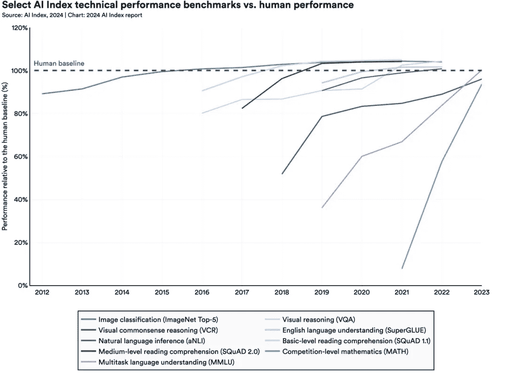

配图 1.06：AI 完成人类智能任务的基准评测对比

Stanford 大学 HAI 小组在 AI Index 2024 报告 中展示了一张 AI 完成人类任务的基准测试图（ Our World in Data 网站还有一份互动版 ）。截至 2023 年，AI 在大部分任务中的表现已经超越了人类的能力，例如 2015 年的图像分类、2017 年的基础阅读理解、2020 年的视觉推理和 2021 年的自然语言推理。当然在 2020 年之后，完成这些任务的都是大语言模型了，目前人类只有在复杂的认知任务，例如在深度阅读理解、复杂推理和高级数学问题解决上还有那么一点优势，但估计这个优势在 2025 年就荡然无存了。。

**世界模型**

研究人员目前也只能从数学方法证明规模法则的有效性，并不能解释复杂神经网络背后的秘密。但伊利亚有一个信念**：“如果你**能够高效地压缩信息，你就已经得到了知识，不然你没法压缩信息”。所以他坚信最新的 GPT-4 里面已经有了一个 世界模型 ，虽然它们做的事情是预测下一个单词，但它已经表达了世界的信息，而且它还能够持续提高能力！

在 ChatGPT 刚推出不久，Newyorker 刊登过一篇有趣的文章《 ChatGPT Is a Blurry JPEG of the Web 》很形象但不是那么准确的解释了大语言模型是对 Web 世界模糊的“图像压缩”。这些模型通过分析和学习大量的文本数据，构建起对世界的压缩表述，涵盖了人类的思想、情感、状态以及人与人之间的互动。大语言模型内化的世界模型能够在推理过程中模拟可能的结果空间，为规划算法提供探索的机会，并给出它想象的答案。

**从语言到多模态模型**

人类可以边看、边交谈，还能同时听着背景音乐和察觉危险。虽然大语言模型仅靠语言就能理解世界，但大千世界的多样性，只靠语言来描述和理解是远远不够的，因此智能不仅限于单一模态。根据伊利亚之前的观点，多模态理解虽然不是绝对必要，但确实非常有用。比如，你能亲眼看到什么是“红色”，比你用语言去描述什么是“红色”要直观的多，这就是对同一概念的多维度理解。拥有这种能力的模型可以更全面地学习世界，理解人类的行为和需求，提高任务解决能力，并克服单一模态的局限性，是让 AI 能在现实世界中运行极为重要一环。

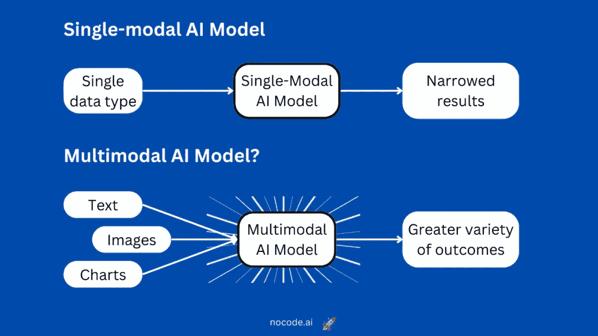

配图 1.07：多模态解释

2023 年九月 GPT-4v 的发布把大语言模型的竞赛带入了多模态模型（LMM - Large Multimodal Models）的时代，ChatGPT 可以看图说话，还能通过内置的 Dall-E 3 直接画图；几个月后 Google 的 Gemini 正式推出，直接就支持了文本、视频和声音多种模态。虽然 Gemini 模型一开始就是按照 LMM 方式设计训练的，但每次都能被 OpenAI 的产品发布捷足先登。。

今年年五月，OpenAI 完成了 GPT-4 的实时听说和视频模态输入的拼图，再一次抢在 Google 之前的发布了 GPT-4o，一款全能模态模型 OmniModel。这次 OpenAI 向智能体方向的研发迈进了一大步，让 GPT 模型有能力进入现实世界了。

这**种随着模型规模以及**模态类型的提升，衍生出新的能力的特性，就是大家常说的泛化，也是 Sam Altman 提到的 广泛的通用性增强 。OpenAI 每一次升级模型，就会让很多专用的 AI 模型和一批小的创业公司所做的事情毫无意义，从最早的翻译和写作工具的替代，到最新 GPT-4o 多模态实现的语音智能助理。

很明显，训练模型的下一阶段竞争，除了合成文本数据之外，就是对话语音、音频、视频、动作控制与反馈等各种模态数据的竞争了，要让语言模型先进化成智能体，才有机会 AGI。。

---

这是一个残酷的时代，我们开篇就看到了过去十来年科技巨头之间从未有过的激烈竞赛，囤积算力、笼络人才，还要小心翼翼的看护好自己的护城河，大家都期望能锻造出最好的 AI 模型，获得进入 AGI 时代的门票；另一方面，做为智能生态下的创业公司，也正经历和移动互联网时代完全不同的环境，模型不是手机操作系统，它的进化速度是非线性和泛化的，你做很多事情就不能用通用性做为出发点，必须有独特的场景，你得绕着大模型的火力覆盖范围前进。。

最后，做为一个普通用户，现在的 AI 是在帮你提高效率，但最终它们会在很多工作场景来替代你。那么，应该如何理解和应对这个智变时代呢？保持耐心，下文更精彩 😄

# 02  应用 - 人机协作新时代

“人们总是高估一项科技所带来的短期效益，却又低估它的长期影响。” - 阿玛拉定律（ AMARA’S LAW ）由美国科学家，未来研究所的院长 Roy Amara 提出。

把时钟回拨到 2022 年，生成式 AI 正式进入大众视野还得是文生图的功劳，OpenAI 的 Dall-E  和 Midjourney 的奇幻效果，还有 Stable Diffusion 开源图像生成模型的各种魔改，记得当时我也是用 SD 模型来练手学习如何进行图像生成训练的 - 手动感知 GenAI 革命 😄

但真正定义智能时代开启的还得是 ChatGPT 的发布，它让我们再一次看到了自从互联网诞生以来，多年未见过的创新密度和创业的热情；一时间能看到的科技新闻几乎全是 AI 新闻，大家在社交媒体上像追星一样追踪 AI 研究人员还有发布在 arXiv 上各种稀奇古怪的论文。但时至今日，唯一的杀手级应用依然是 ChatGPT 。。

### 2.1 AI 应用爆发了么？

Sequoia Capital 在 2023 年九月发表了一年前那篇引领市场的**《 Gen**erative AI: A Creative New World 》的续篇 《 Generative AI’s Act Two 》，里面这样写到：生成式 AI 的第一年，我们发现了一种新的“锤子” - 基础模型 ，并推出了一波新奇的应用，但这些程序大多是些酷炫新技术的轻量级演示，这些产品远远没有达到预期，糟糕的用户留存率就证明了这一点。

当最终用户过了新鲜体验期，对许多应用的需求开始趋于稳定，真实数据就原形毕露了。。

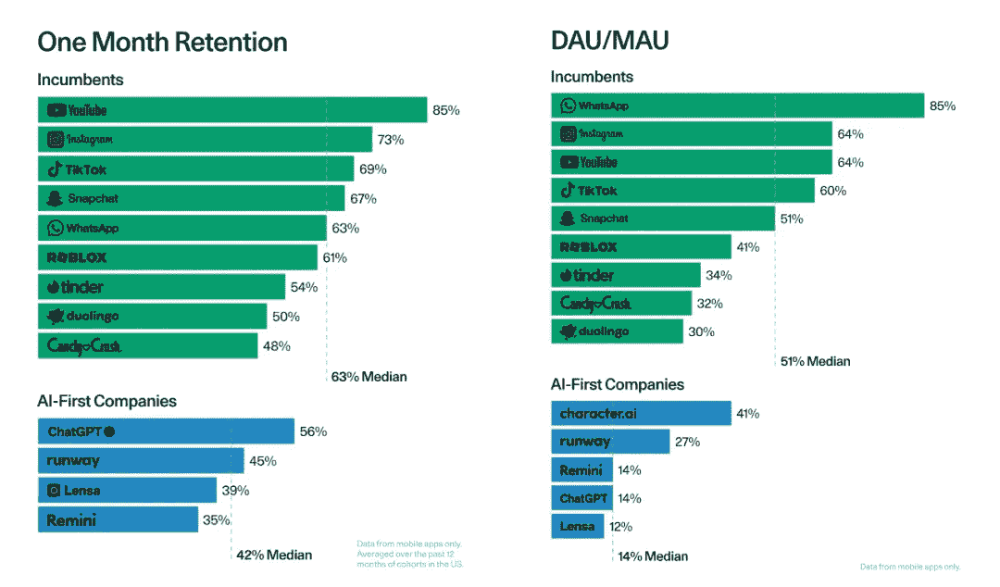

配图 2.01：AI 应用与社交应用使用率的对比

对比流行的社交应用，哪怕是最顶流的 ChatGPT，56% 的首月用户留存度，也不及社交应用的中位数 63%；一些最好的消费级应用拥有 60 到 65% 的 DAU / MAU 比，例如 WhatsApp 的比率高达 85%。相比之下，生成式 AI 应用的中位数只有 14%，AI 陪伴类别除外，这意味着用户还没有在这些 AI 原生的产品中找每天使用它们的理由。看过一个数据，在 Google Gemini 中使用最多的场景就是生成每日菜谱，这个和用搜索引擎的需求基本一样，也许这么短的时间内，大众还没充分发现使用 ChatGPT 这种对话式 AI 的原生场景。

尽管这个市场充满了噪音，还有理想与现实的不平衡，生成式 AI 已经比 SaaS 有了好得多的开局，OpenAI 在 2023 年就实现了二十亿美元的年化收入，对比上一年增长了 900%，SaaS 花了数年而不是几个月的时间才达到同样的规模。

我在《 机器之心的进化 》中做过些预测，拥有独特流程和优秀体验的生成式 AI 应用将胜出。在图像生成领域， Midjourney 一直以他独特的流程和品质保持领先，年收入过亿美金，是少数初创公司不靠融资就能实现增长和盈利的；另外 2023 年的另一个黑马就是 AI 搜索 Perplexity ，他们用合理的产品交互解决了问答式 AI 搜索的难题，去年底的月度活跃就达到了 1000 万，感觉自己使用 Perplexity 的频次就比 ChatGPT 要高。

**正如 S**equoia 在文章中提到的**，市场**正**在进入“ **第二幕 ” - 核心竞争力将来自“ 客户 ”。用一个最近流行的说法，应用将“端到端”地解决客户的真实问题。这些应用在本质上与上一批有很大的不同，他们把 基础模型 作为其解决方案的一部分，而不是解决方案的全部；简单来说，你再做一个模型的包装调用，是没有意义的。

那么，那些拥有庞大客户群的上一代的软件或服务公司，他们会有巨大的优势，把基础模型整合到自己的业务流程中，提供新界面，使工作流程更具粘性，输出效果更好，例如 Adobe，这个创意领域的巨头在 2023 年丝毫不比创业公司的执行效率低，从 Firefly 的模型到产品线的升级，让人眼花缭乱，当然这也是他们的生存之战。

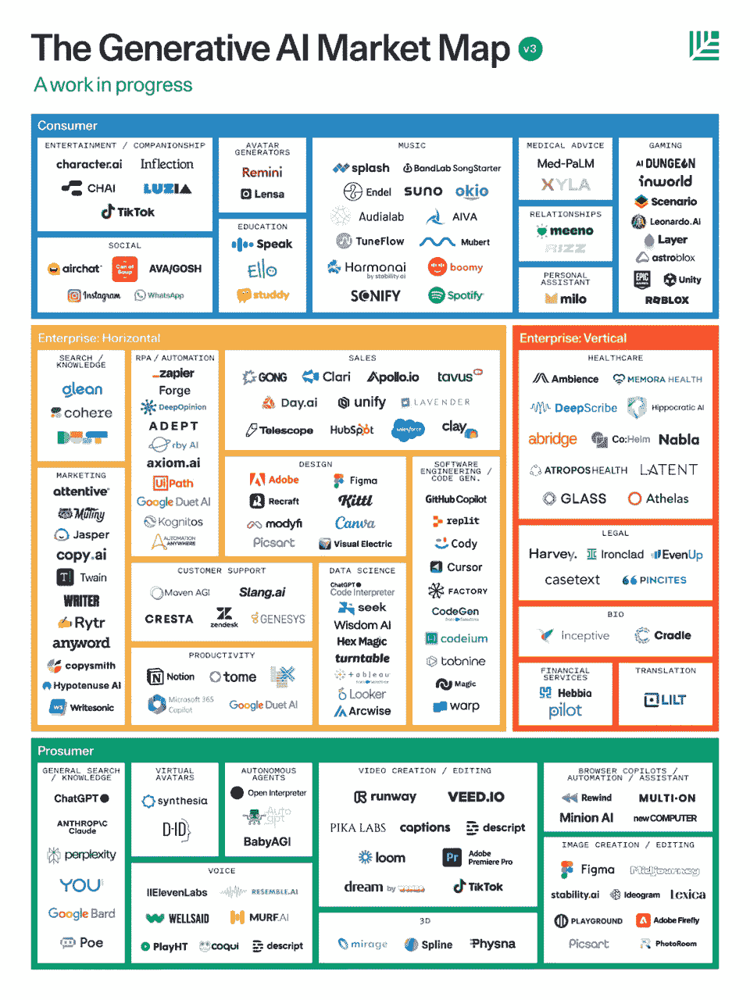

配图 2.02：The Generative AI Market Map

其实，这种把模型融入其解决方案，从端到端解决客户需求的创新公司涌现出了很多，附上 Sequoia 的这张“ The Generative AI Market Map ”，就不逐一列举了。这里的核心是，我们如何看待和使用基础模型，而不是简单的封装它们，这些模型就是智能时代操作系统，需要在上面构建原生的应用程序。

#

### 2.2 智能 OS 与代理

大语言模型不是数据库，而是推理引擎！

去年十月， Andrej Karpathy 在 X 上提出这个概念的时候，他还就职于 OpenAI，不过他已经在今年二月再次从 OpenAI 离职，第一次是被 Elon Musk 挖去 Tesla 研究纯视觉自动驾驶 FSD，那篇定义神经网络编程新时代的文章《 Software 2.0 》也出自于 Andrej，我上一篇《 机器之心的进化 》的副标题灵感就来自这篇。

**LLM OS**

Bear with me I'm still cooking ( X Link )

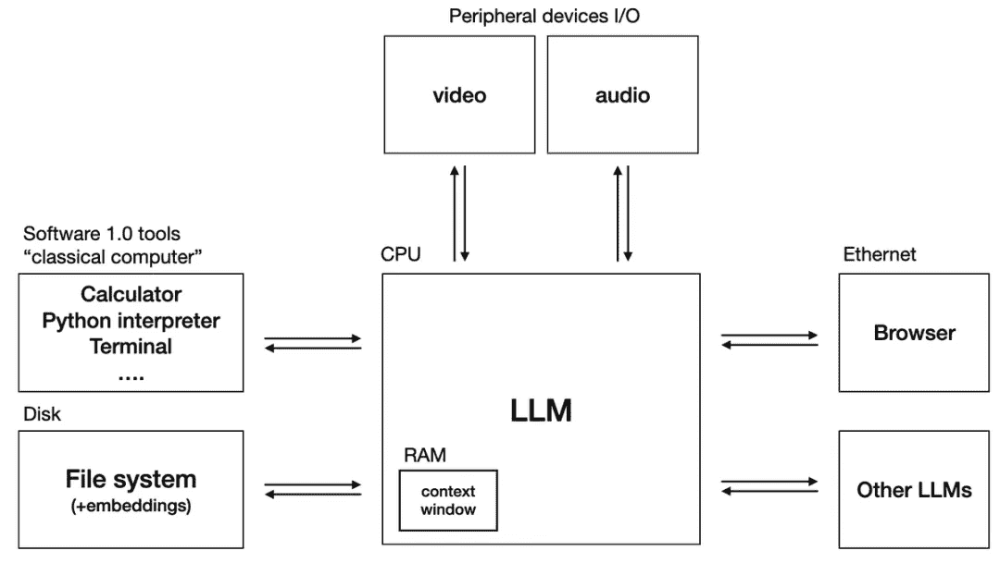

配图 2.03： LLM OS by Andrej Karpathy

SPECS:

- LLM: OpenAI GPT-4 Turbo 256 core (batch size) processor @ 20Hz (tok/s)

- RAM: 128K tok

- Filesystem: Ada002

Andrej 意思是：我们可以像使用操作系统一样来使用大语言模型，现在应该叫多模态模型更合适。这个系统的核心就是 LMM，它就像 CPU 一样处理进入的数据，计算后给出结果，不同的地方电脑 CPU 接受十六进制汇编指令，LMM 接受自然语言，也就是我们常说的提示词。

LMM 中央处理器的速度就是每秒输出 Tokens 的数量，现在 GPT-4o 已经比当时的 Turbo 快了 2.5 倍，大约 50Hz tok/s，不过模型规模越小速度越快，当然推理能力也更差。怀旧一下上世纪八十年代初期的 CPU 速度，速度慢才会限制人们的想象力，天下武功，唯快不破。

系统的内存就是 LMM 的上下文窗口（Context Window），一次推理运算最多能接受的 Tokens 数量，现在 Google Gemini 1.5 Pro 实验 版 已经把这个数字提升到了一千万，一次性输入二十本书和一个小时的电影； 当然这里也存在架构的限制，窗口越大推理越慢，同时模型会失焦，降低推理的准确度。 但充满挑战也就意味着机会无穷，前沿模型研发团队都力争做到吞吐量、速度还有准确度的最佳平衡。

在模**型之外，**还有操作系**统的其它系**统部件，例如 I/O - 用语音、视觉等模态感知；还有文件系统，让模型具备无限记忆的能力，毕竟模型不是数据库，它的内存是辅助计算的。这一年多以来，大模型应用领域最 常 用的方法就是 RAG （ R etrieval Augmented Generation ），这是一种检索增强生成的方法，让模型用大家自定义的数据生成结果，这样就能处理无尽的私有数据，把模型当成高效的 推理机器 来使用。

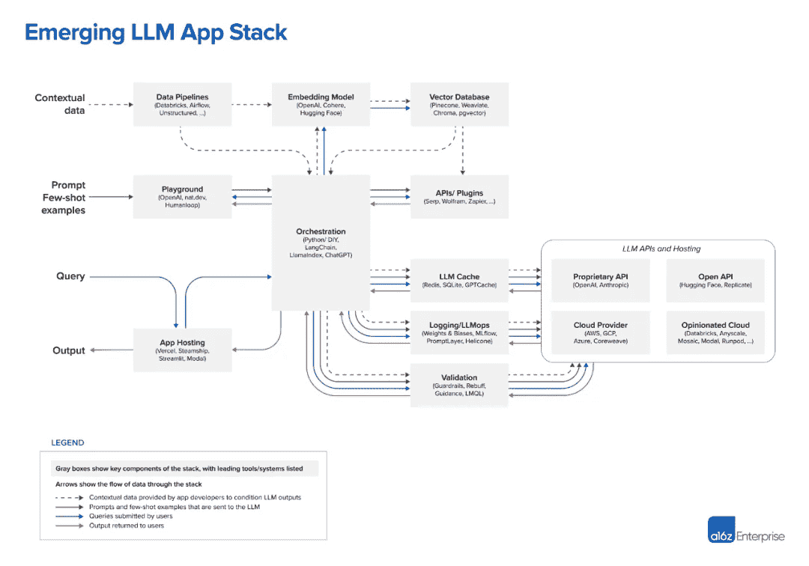

配图 2.04： Emerging LLM App Stack

LLM 和 LMM 是构建软件的强大的新工具，Andrej 的这个类比，会让大家找到一些熟知的感觉。其实在去年五月 a16z 整理过一个指南《 Emerging Architectures for LLM Applications 》，这是一份详细的 LLM 应用堆栈的参考架构，里面提到了 AI 初创公司和大科技公司中最常见的系统、工具和设计模式。

上文提到的 Perplexity 就是 RAG 的最佳应用，还有面向企业知识库的 Glean 也一样，以及我自己正在做的面向个人知识库的 Maimo ，其实所有聚焦到客户流程和需求的具体应用，或多或少都搭建在这个技术栈之上。本文不讨论技术实现方法，我将稍纵即逝的概念串接起来，帮大家整理解题思路！

**智能代理（AI Agent）**

顺着推理引擎的思路，我们可以让 LLM 自己做自动化的**多步骤推理**，其间能自己使用搜索引擎，调用工具以及与其它 LLM 协作，Andrej 的 LLM OS 中就包含了这些模块。最早实现这个想法原型的是 AutoGPT 还有 BabyAGI 两个开源的 智能代理 （AI Agent），就在去年 GPT-4 刚发布的时候，一时风靡全球科技圈，虽然产品非常原型和早期，但是它们给出了很好的解题思路。人类给出目标，LLM 自己分解子目标，就像编程函数的递归调用那样，调用外部工具，自我评估任务是否完成，一步步实现整体目标。

现在，随着 LLM 的推理能力和速度的提高，Agent 的思路已经被很多创业公司还有科技巨头用到了自己的产品之中。例如，前段时间最受关注并且饱受非议的 Devin ，来自纽约的华人创业团队 Cognition AI ，可以像人类程序员一样自动写代码的 Agent，你只需要告诉它你的需求就行，由于演示视频过于科幻，导致被人 揭露造假 。。

行业的另一端，Google 在今年的 Next 与 I/O 大会上，连续 地 发布了自己的 Agent 战略，并且把这个概念放在公司的 AI Stack 之上，Agent 就是接下来 Google App 的衍生。

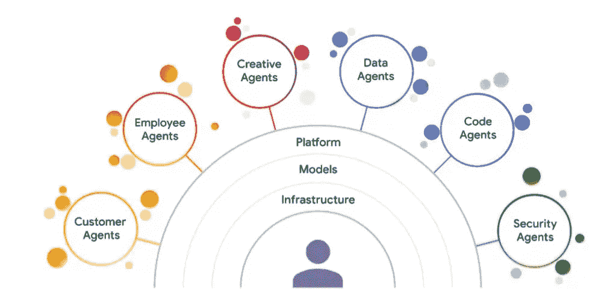

配图 2.05：Google Gemini Agent 战略

从客服 Agent 到员工 Agent 再到代码 Agent，以及最新的 Google Plan Search，可以自动化多步骤执行搜索任务的 Agent。例如，你要找一下附近有折扣的理发店并帮你完成预约，那么新的 Plan Search 能理解你的需求，自动分解任务，然后调用 Google Map 还有其它工具，自动的完成你的请求。当然 Google 现在有底气这样做，还得仰仗 Gemini 1.5 Pro 的推理能力已经达到 GPT-4 的水平了。

就连 Microsoft 也在四月底的 Build 2024 上蹭热度推出了 Copilot 产品的升级， Copilot Team 与 Studio ，让 Agent 完全融入企业内部，自动化日常繁杂的会议记录与日程安排，你也能设计适合组织内部的自动化流程，让 Agent 帮你访问数据库和自动操作办公软件。

现在，软件应用范式已经转移， AI Agent 就是新 SaaS ！

#

### 2.3 全模态智能体

每一次平台型技术的出现，都会催生出新的人机交互方式，个人电脑时代的鼠标与键盘，移动时代的触摸屏，现在是智能时代，我们一度认为 ChatGPT 的 LUI（自然语言对话式界面）就是这个时代交互的终点，但事实并非如此，知名科幻电影 HER 中，那种人类与 AI 全感知无障碍的对话形式，才是我们想要的。

“通过语音、文本和视觉进行推理非常重要，因为我们正在研究与机器交互的未来”，Muri Murati 在今年五月十三日那场不到半小时的超快发布会上这样告诉大家。那天 OpenAI 发布了最新的模型 GPT-4o，并且用了个很前卫的新概念，全模态模型 - Omnimoda Model 。

GPT-4o 是 OpenAI 之前所有技术的集大成者，新模型通过端到端的神经网络，把视觉、语音和文本数据混合训练，而不是用大家常用的工程手段，先各种数据先转换成文本后，交给 LLM 处理，然后再把输出的文本转换成对应的媒体形式。这样，GPT-4o 对音频输入的平均反应时间为 300 毫秒，与人类对话的反应时间相似；而且直接拿音频数据来训练的好处就是模型能从数据中感悟到人类表达的情绪、语调、风格等等，你能听到几乎真实的人类的声音，在一段演示中感觉连训练时的环境声音都给还原出来了。

OpenAI 并没有公开 GPT-4o 的任何技术细节，唯一的线索就是来自他们内部模型炼丹师的一篇博客， 项目名是 AudioLM ，2023 年中启动，目标是用端到端的方式扩大语音模型的能力。

很明显 OpenAI 是有计划的抢先发布，因为 Google 在第二天的 I/O 2024 大会上准备宣布他们最新的研究项目 Project Astra ，一个类似 GPT-4o 全模态模型，结果研究团队拿手机精心录制的与环境实时交互的视频，让 OpenAI 给提前一天全部展示了，而且功能更强大，完成度更高。

OpenAI 会在几个月内陆续更新 ChatGPT 应用，通过 GPT-4o 让其具备 Assistant Agent 能力，一个能够**像人类一**样互**动的“数**字形态”全能助理；Google 也计划在今年内推出 Gemini Live 支持类似功能，我们可以把这种能沟通还能感知环境的 AI 称之为 智能体 （ Intelligent Agent ）。除了端到端的多模态之外，另一个重要的特点就是 实时性 ，之前所有的交互都是回合对话式，包括 API 的调用；现在我们要从文字语音聊天升级到视频直播了，智能体保持一直在线。可以想像，用流媒体的形式来消耗 Token，这对算力的开销得有多大，所以大家必须保持模型能力不变的情况下缩小参数规模，升级架构来提升性能；最好让终端也参与进来分担一部分模型的计算量。

让科技变简单，是技术民主化最重要的一个趋势，没有人能抵挡住这种毫无机械感、完全类人化的交互方式。用这样的思路，可以设计从未有过的硬件产品，也能重新设计现有的产品，例如多年以前的 Google Glass 就可以因此而复活了；因为语音交互的流畅，智能体还能用手机之外的设备来实现视觉感知，那么手机的设计也会因此而进化，触摸交互更简单，在很多情况下，都只需要放在口袋里，给你的智能体提供本地算力。

这样的全模态智能体，将会成为我们和所有智能设备的新交互界面。进一步想象，家庭和办公环境的电子设备，只要联网就能成为智能体的感知器，或者直接成为他们的终端，被智能体控制；再结合具身智能（ Embodied AI ）技术，那就是现实版的 Ghost in the shell 了。。

#

### 2.4 组织新形态

Inflection AI 的联合创始人 Mustafa Suleyman 在他去年九月份出版的新书《 The Coming Wave 》中提出了一个现代版的图灵测试，我们需要一个更适合现代 AI 能力水平的测试方法，这个方法不是能骗过人类就行，而是需要评测 AI 是否具备采取行动和取得成就的能力，以及它们能否对世界产生有意义的影响。

简单来说，要通过现代图灵测试，一个 AI 需要能完成这样的任务：“仅用十万美元的投资，在几个月内通过零售网络平台赚取一百万美元。” 为此，它不仅要制定策略和撰写文案，而且还需研究设计产品，与制造商和物流合作，谈判合同，并创立及管理市场营销活动。简单地说，它需要在极少的监督下完成一系列复杂的实际目标。虽然还是需要人类参与批准某些事情，例如开设银行账户，亲自签字，但所有实际操作都由 AI 来完成。

这里最大的技**术挑战之一，就是让 AI **自己实现分层规划：将多个目标、子目标还有执行能力，组织成一个可以向着单一目标持续前进的流程；然后 AI 还需要可靠的记忆来辅助目标完成，能准确调用实时的数据，例如组件或物流等等。我们前面提到的 AutoGPT 就是这种 Agent 的原型，然后微软的 Copilot Studio，可以让企业设计内部数据处理与日常任务自动化的 Agent；当然这些离 Suleyman 的现代版图灵测试还有很远的距离，但 OpenAI 预告过，他们的下一版本模型 会极大提升推理和规划能力 ，也就是模型在内部实现 Agent 能力的自我增强，这是全自动化的关键，Sam Altman 经常挂在嘴边的 AGI 到来的定义之一就是 AI 能替代百分之七十的人类工作。

[不](https://www.nfx.com/post/ai-workforce-is-here)[久](https://www.nfx.com/post/ai-workforce-is-here)前，知名投资机构 Nfx 在他们最新的《 The AI Wor**kforce **is Here: The Rise of a New Labor Market 》中刚好分析了这个趋势。现在 AI 正在强制逆转 SaaS 这个缩写的含义，从“软件即服务”转变为“ 服务即软件” ，软件既能组织任务，也能执行任务，你无需雇佣额外劳动力，它们是“内置”的，传统的劳动力市场最终将和软件融合成为一个新市场！

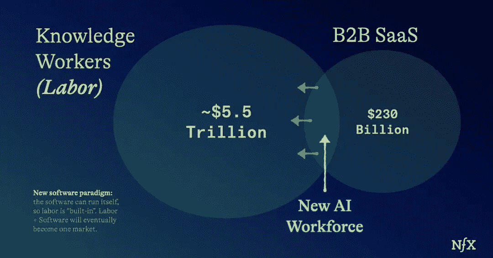

配图 2.08：New AI Workforce（来自 NFX）

例如，我们现在购买 SaaS 销售工具，仍然需要雇 佣 并培训销售人员来完成实际的销售工作。 在公司内部，招聘预算和软件预算不在一个数量级； 在整个经济体中，劳动力市场和软件市场也是完全分开的。 粗略地计算一下，美国企业在知识型劳动力上的支出超过 5 万亿美元； 相比之下，公司在 SaaS 上的支出仅为 2300 亿美元。 接下来，AI 要做的事情就是降低企业在知识工作者上的支出，让大家购买或者是租用能自己工作的 SaaS，从而提高在软件市场的支出。

现在，从企业组织的结构来看，提供这种 AI 劳动力的产品有两种形式：

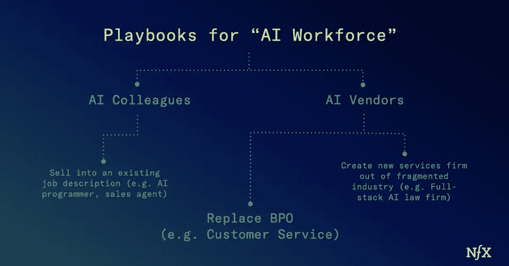

配图 2.09：Playbooks for AI workforce（来自 NFX）

**AI 同事（雇佣）**

在介绍 **智能代理 **那一小节中已经提到，现在控制着中小企业办公入口的 Google Workspace 与 Microsoft Office 都在推出自己的 Agents，我们只需要设定目标，这些 AI 的虚拟员工就能自动完成日常办公中繁杂的体力活；在办公助理之外，这些智能代理也会成为我们的自动化客服、销售、市场运营还有技术支持。例如 Nfx 投资的 Artisan ，一家提供 AI 雇员的 Saas 服务，帮客户自动化市场与销售，AI 员工 Alice 与 Ava 每周能够预订 2-3 次潜在客户会议，在整个销售服务环节中每周七天，每天 24 小时不间断工作。

**AI 供应商（外包）**

想象一下，大部分企业都会使用外包服务，例如专业的客服外包、还有会计以及律师事务所等等，这些独立的服务供应商，他们很多虽然在使用 SaaS 但还是靠人力驱动。现在，新形态的 AI 公司将会是 AI 自动化管理的供应商，只需要少量的人类，可以支持更大规模的客户，例如 AI 客服中心 Smith AI ，把不可规模化的服务型劳动力市场变成可以规模化的软件市场。

**这里存在一个市**场模式变化的机会， AI 劳动力 概念的新型态软件，将吃掉传统 SaaS 的市场空间，让他们的利润减少，当然也会同时减少人类的工作机会，但给了 AI 初创企业新的市**场机会，来挑****战传统软**件公司，这些初创的企业又能创造出不一样的新工作机会。当然，科技巨头不会坐以待毙， Google 最近计划有史以来最大规模的一次收购，用 300 亿美元买下 Hubspot ，知名的市场营销与客户管理 SaaS，Google 期望这个收购能帮助自己快速触达更多客户，好在未来能销售更多的 AI 同事 给中小企业。在本章第一小节就提到了，对于 AI 应用的 第二幕 ，竞争力就是你能控制的客户，以及端到端帮他们解决实际问题。

再往**前看一**步，这些** AI** 劳动力都在承担着机械的自动化工作，软件还没法真正取代服务，它们得有适应人类社会的能力；它们必须看起来、感觉起来，就像是在与人互动；换句话说，软件在某些方面必须有 灵魂 ，就像 优秀 的客服代理、销售代理或服务提供商一样。或许我们从 OpenAI 发布 GPT-4o 的最新演示中已经窥视到了未来，这才是软件和劳动市场真正融合的关键一步；虽然看上还长路漫漫，但我们正在步步的接近，具体会在第四章详细讨论。

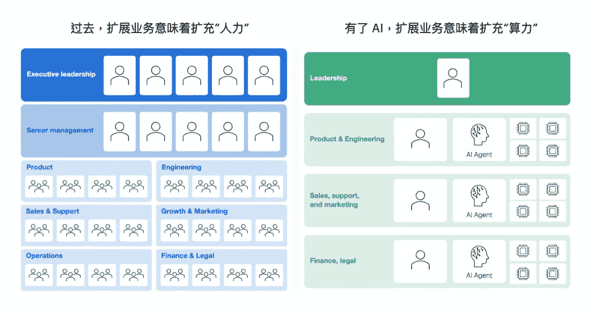

配图 2.10：智能代理将改变企业组织架构

---

**智能时**代**，我们**不能再用移**动时代的**模**式来理解 应用** ，本着人机交互方式越来越简单的趋势，智能应用最先应该从简洁开始，然后它们会从有形的界面中消失，变成真正无所不在的 助理 ，或者是 智能体 ，它们会辅助甚至直接帮我们完成任务；我们与 AI 协作的重点不再是过程，而是目标与结果，能完全自动化并融入人类社会就是 AI 劳动力 的终极目标。

这些数字化的 **灵魂 **将无处不在，我们的个人助理，生活中的陪伴、工作中的同事还有我们的合作伙伴，这是一个听上去有些兴奋，但又让人略感不安，却注定会到来。。

# 03 智变 - AI 加速的行业变革

“人类的智慧是宇宙中最宝贵的东西，但它却是稀缺的；若能借助机器智能来提高全世界的智力供应，无疑这将会是非常受欢迎的。” 互联网先驱 David Gelernter 在他 2010 年的那篇有先见之明的文章《 Dream-logic， the internet and artificial thought 》中这样写到。

从 Hinton 教授的观点衍生一下，既然生成式 AI 革命和电力革命一样或者更加重要，那么机器智能也会和电能一样成为一种通用的“能源”，可以普惠所有行业，“智能”这个词又有了新含义。电力革命花了六十多年的时间，让最高的行业渗透率到达了百分之九十；现在智能变革刚刚开始，我们可以把互联网的出现，看作是机器智能的序章的，为其诞生提供了海量的数据，基础模型将这些数据训练和压缩成了他们对人类世界的理解，在这之上，与人类协同推动世界继续往前。

我们需要做一次小小的思维转变，不应将这种机器智能视作与人类智能完全独立的事物，相反，我们应当将其看作是整体智能供应的一次提高。现在，人类在用模型与算力，构建完全超越互联网形态的信息网络，这将是全球智能体的互联，能够无死角的渗透到所有行业，加速自动化，降低成本，普惠世界。

### 3.1 廉价诱导需求

杰文斯悖论（ Jevons Paradox ），是经济学 William Stanley Jevons 首次在其 1856 年出版的《 The Coal Question 》一书中提出的现象，悖论陈述了当某样东西变得更高效时，人们会消费更多的这种东西。杰文斯观察到，当蒸汽机的效率提高时，使用更少的煤炭就可以做更多的事情，但实际上煤炭的消费量却增加了。人们并不只是用蒸汽机做之前同样的事情，因为成本更低，他们开始用蒸汽机做更多其它的事情。

现代经济学中有一个简单的定义：当商品、服务或资源的供**应或容量增**加导致其消费增加时，就会发生 诱导需求 （ Induced demand ）。经济学家 George Gilder 在《 Knowledge and Power 》中最核心的观点就是经济增长的主要动力就是企业家的创新，产生供给端需求，俗称创造不存在的市场。在这个科技通缩与数字丰盈的环境中，理解这一点十分重要，虽然它很反直觉。

增加对潜在需求的供应，例如 **智能的供应 **，**人们就会更**频繁地使用这些服务。此刻的问题是，智能太贵，训练模型太贵，但这不是一个会长期存在的问题。根据 莱特定律 （ Wright Law ），加速计算硬件的改进，每年会将 AI 相关计算单元（RCU）的生产成本降低 53%，而算法与模型的增强，可以每年会进一步降低 47% 的训练成本。换句话说，到 2030 年，硬件和软件的融合可以使 AI 训练成本以每年 75% 的速度降低。

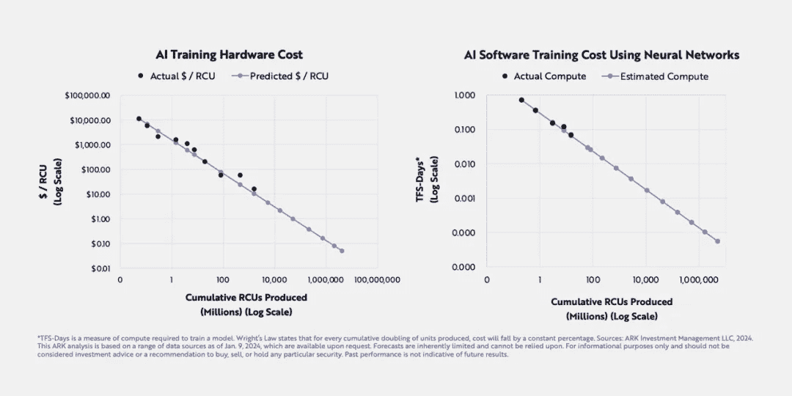

配图 3.01：AI 训练成本每年下降 75%（来自 ARK Big Ideas 2024 ）

**现在，智能的**供应取决于两方面的成本： 训练与推理 ，除非若干年后我们有了全新的训练推理一体的自进化模型架构。OpenAI 的推理成本似乎在以每年约 86% 的速度下降，比训练成本降的更快，最新模型 GPT-4o 和去年同等智能水平的 GPT-4 相比，速度提升了五倍，价格下降了接近十倍，这只是在一年之内。

我们现在使用搜索引擎的成本几乎为零，代价是需要看广告；等使用 GPT-4 或者更高水平智能的成本接近零的时候，这个由供应端免费而推动的需求，会让市场发生什么样的变化，大家可以想象；数以百万计的人和企业将拥有越来越聪明、能力越来越强的智能代理，而且每次模型的升级，都会让这些代理变得更强大，价格还会越来越便宜，这将是劳动力市场的巨变。

上一章中提到了现在知识工作中的支出是 5 万亿美元，**根据世界银行**的数据，2020 年全球 GDP 总额是 84.7 万亿美元， 同年全球**劳动力**占 GDP 的比重为 53.8% ，这是一个 45 万亿美元的全球市场。如果把智能的触角延展到知识领域之外，需要和人类一样 灵巧的机器 ，就能覆盖这个市场，过去它的瓶颈是智能，但现在我们的突破已经近在咫尺，如果 OpenAI 或者 Google 真的能够把智能免费提供，那唯一的限制就是 能源 了。

风险投资家 Packy Mc**Cormick 在他的文**章《 Tech is Going t**o Ge**t** Much Bigger 》中**阐明了这个观点：随着能源、智能和灵活性的成本趋近于零，整个经济将变得更大，结构上更加盈利。科技公司将有巨大的机会销售他们 即插即用的劳动力和智能 ，本质上是将现在分散且不一致的人类劳动力产品化、集中化、按需化和作为服务给 软件化 ，即 SaaS 化。智能的加入，让每个行业看起来都更像软件行业。它们增长更快，利润更高，研发投入更多。。。 软件吞噬世界，AI 吞噬软件 ！

再往前推进一步，如果能源被解锁，我们可以从这篇《 Energy Superabundance 》中看到人类将如何利用几乎免费的廉价能源，例如飞行汽车、超高速列车、地球次轨道旅行、电动卡车运输网、垂直农业、空气凝结水、海水淡化等各种未来的愿景。我们不仅会使用廉价且丰富的能源来更便宜地做同样的事情，我们还会用它来做更多、更好、更快的事情。过去四十年，全球发达国家在能源消耗几乎没有增加的情况下实现了经济的缓慢增长，那是因为能源基础设施的建设几乎停滞，大家并不需要消耗那么多的电力；但现在因为智能的需求，让能源的需求激增，更加便宜的能源和智能又会诱导新的需求出现，从而再次加速经济增长，扩大整体的经济规模。

### 3.2 AI 浪潮的早期

在股市被发明之后，可以看到一个历史规律，以资本量最大的美股为例，每当一家公司问鼎全球市值第一的时候，就能代表这个公司所处的行业将引领未来十年以上的经济增长，它们最能代表一个大变革时代的到来，毕竟大家再用手里的钞票真金白银的押注未来。

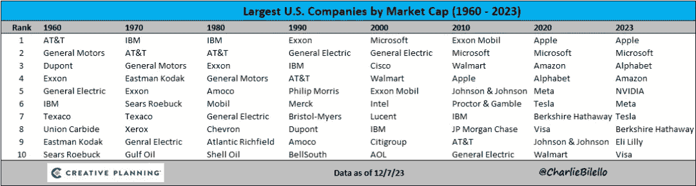

配图 3.02：1960 - 2023 年美股市值最大的公司

上世纪五十年代，AT&T 开启了通讯时代，然后是 IBM 把我们带入了信息时代，第一波浪潮是个人电脑革命，虽然 Apple 起了个早，但还是被 IBM-PC 雄霸天下；再往后面就是微软，开启了桌面软件时代，也同时开启了互联网时代，期间美孚石油会偶尔登顶，但那也是经济周期的影响，毕竟在 2000 年之后，美国的能源公司很少能进前十。信息时代的第二波浪潮始于 2010 年，Apple 成功的通过 iPhone 开启了移动互联网时代，也一举登顶全球市值第一的宝座。

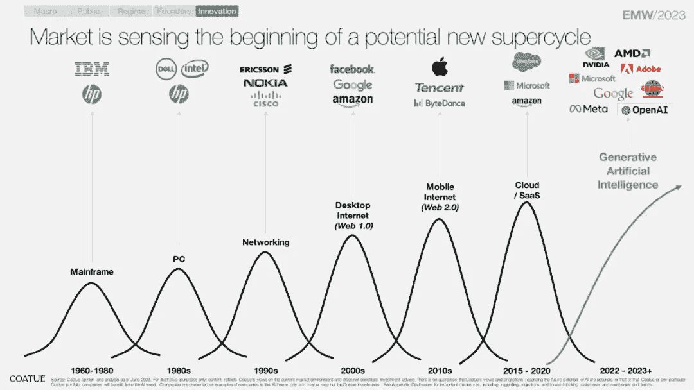

配图 3.03：行业周期切换图（来自 Coatue EMW/2023）

现在又进入了交替期，微软通过与 OpenAI 的深度绑定，在 2023 年再次问鼎第一，另外 Nvidia 也因为算力需求的激增，业绩爆棚，在 2024 年六月的第一周市值达到有史以来最高的三万亿美元，仅次于微软排名第二。如果在未来几个月内，Nvidia 成为世界上市值最高的公司，那我们算正式开启智能时代了呢？还是进入炒作周期的顶峰了？这是个值得思考的问题🤔

类比电力革命，从第一个灯泡被点亮到首座发电设施被发明出来，花了十年时间，然后又花了五十多年渗透到各行各业；这一轮 AI 革命的起点应该是 2012 年的 AlexNet ，由神经网络驱动的人工智能再次回到历史舞台，差不多也是十年后，革命意义的 ChatGPT 诞生，完全证明了在有效的架构 Transformer 之上，叠加算力和数据就能出奇迹；这个组合就像发电站一样可以源源不断的输出智能，后面要做的事情就是扩大规模的同时降本增效，覆盖全行业。

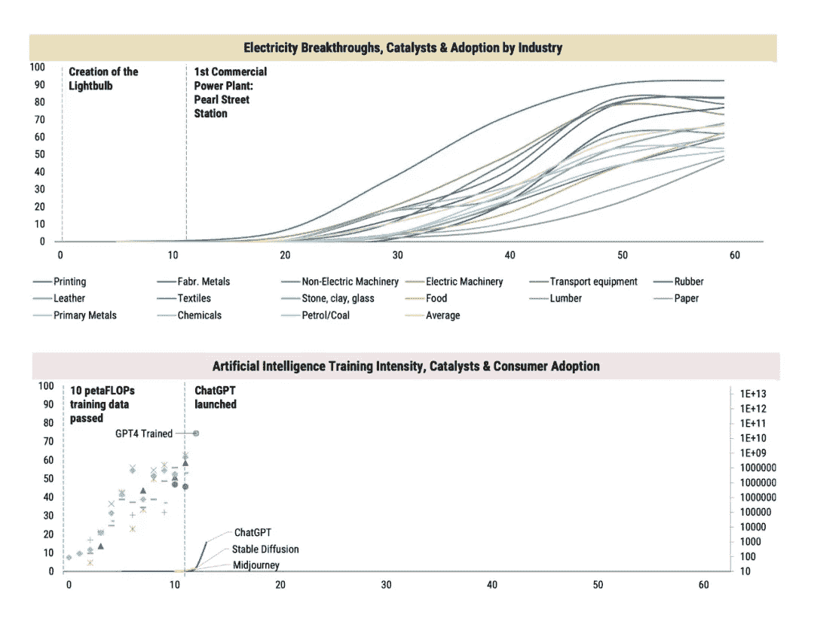

配图 3.04：我们还处于 AI 革命的早期

去年八月，Elon Musk 在首次对外演示 Tesla FSD1**2 的一****次 Twi****tter Sp**ace 中，提到他对算力和能源的看法：“我们 90% 的数据中心都变成为算力中心，提供 加速计算 ；人类很快会变成强计算依赖，未来 80-90% 的能源都会用在计算上”。再回头看看我们现在的基础设施之中，用于 AI 算力的占比有多少？大约 2%， Coatue 在今年初的一份 LP 报告中提到了这个数据。

现在正处于 AI 基础设施第二轮的升级浪潮之中：

+   AI 服务器的占比： **9%**

+   **AI **在整个半导体行业的收入占比： 10%

+   **AI 数**据中心电力消耗的占比（美国）： 2+ %

+   **AI **云计算收入的占比（Amazon & Microsoft）： ～3%

从百分之九到百分之九十，AI 数据中心的升级才刚刚开始。因此，这次智能革命，会让芯片和数据中心业务最先受益，从 Nvidia 的股价就能看出；另外业务用量的提升，AI 云计算收入，其实主要是模型托管的收入，将成为云计算公司的主要收入。

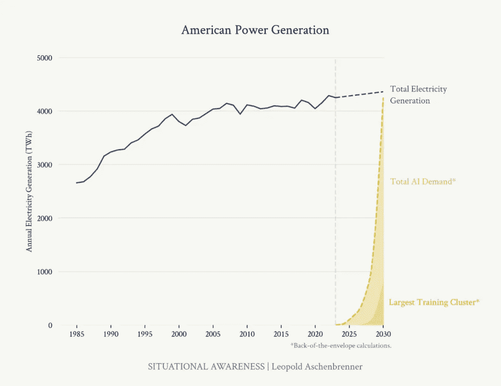

配图 3.05：AI 对电力消耗的预估

这里特别提到了能源， Coatue 预估按照现在的电力基础设施，到 2030 年全美国的电力供应将没法支撑 2500 万块数据中心 GPUs 的消耗，现在才 300 万块 GPUs；电力的产量提升并不如算力提升那么容易，Mark Zuckerberg 在最近一次与 Dwarkesh 的播客对谈中 ，特别吐槽了这一点，电力供应将成为 AI 发展的最大瓶颈！

科技公司这次肯定等不及传统能源企业的升级了，Sam Altman 几乎每次都会表达 AI 的瓶颈是能源供应，因此他投资了 Helion Energy ，一个提供小型化核聚变装置的公司，他们已经和微软签订了合约，计划在 2028 年上线其首个核聚变发电厂，并在一年内达到 50 兆瓦的发电能力；谷歌投资了 TAE Technologies ，就连 OpenAI 自己也投资了 Commonwealth Fusion Systems ，这两家公司都专注于核聚变技术的商业化。

个人感觉，可控核聚变技术的难题很有可能因为 AI 对能源的强大需求而加速攻克，因为市场看到了超级廉价的能源，还能诱导出那么多以前没有过的需求；创造新的市场是企业家与科技创新的最大动力，这是政府引导的科研创新所不具备的。

### 3.3 从中心到边缘算力

2024 年**三月月二**十七日，诺贝尔经**济学奖得**主丹尼尔·卡尼曼（ Daniel Kahneman ）离世，他留给大家最经典的一本著作就是 2011 年出版的《 思考，快与慢 》，详细探讨了人类思维的两种模式：系统 1（ 快思考 ）和系统 2（ 慢思考 ）。

**系统 1 **是快**速、直觉且**无意识的思考模式。它依赖于直觉和情绪，能够迅速做出反应，几乎不需要耗费脑力。例如，判断两个物体的远近、察觉对方语气中的不友善、快速回答简单的数学问题例如 2 + 2 等； 系统 2 则是较慢、需要主动控制且有意识的思考模式。它依赖逻辑和推理，处理复杂的问题时需要集中注意力和耗费脑力。例如，在大脑中计算复杂的数学问题（如 157 x 641）、比较两款冰箱的效能、洽谈重要合同等。

Andrej Karpathy 拿卡尼曼的思考系统做了个很好的类比，当前的 LLMs 只是一个具备快速预测下一个单词能力的“系统 1”思维；我们希望 LLMs 能够真正“思考”，通过长时间的思考产生更准确的回应，也就是深思熟虑。很多研究团队都在想办法让基于 Transformer 的 LLM 具备“系统 2”思维，例如来自 Meta 的 S2A ，但我们从更大的架构层面构思，部署在云端与边缘终端的模型，相互配合，也能实现这种可快可慢的思考方式。

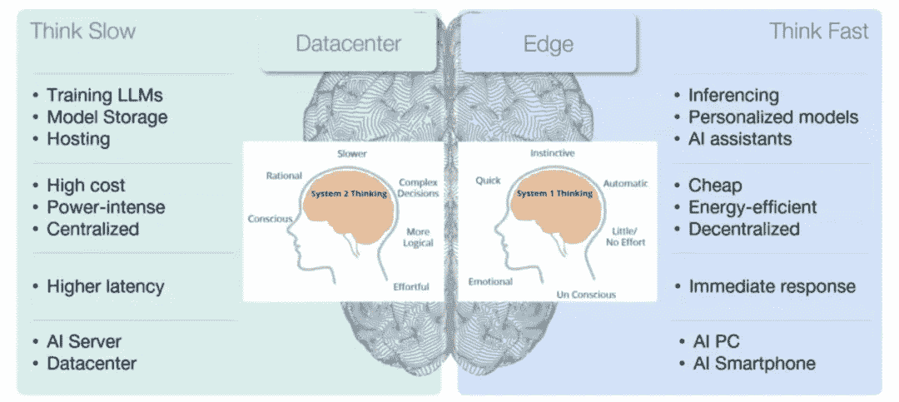

配图 3.06：云端与终端的对比（来自 Coatue LP Report 2024）

有一个明显的趋势，现在科技巨头和 AI 研究机构们推出自己新一代的模型，都按照参数规模区分了版本，例如 Anthropic 的 Claude 3 就拥有三个版本，最大规模的 Opus 价格最贵也最慢，适合做复杂的推理与自动化的任务计划，这是高级智能；其次是 Sonnet，价格速度适中，适合完成个人助理任务以及给定内容的快速分析，例如前面提到的自能体的任务；最快最便宜的是 Haiku，可以执行快速的翻译、客服对话等任务。

不过 Anthropic 和 OpenAI 的模型并没有开源的可以部署在边缘终端上的版本，他们的理由是安全问题；但考虑到自己的自能业务未来在终端上的拓展，Meta 有 Llama 3 7B 、微软有 Phi-3 Vision 、Google 有 Gemma ，他们都是可以适配到移动终端上运行的开源 LLMs，就连最不动声色的 Apple 都偷偷发布了自己的 OpenELM ，参数规模比微软的 Phi 还要小，这是为了在移动设备上节能运行优化的。

因此，我们能看到两种竞争：

**边缘算力 **：拥有最多终端占有量和最好的边缘芯片的，将占据了竞争优势，例如 Apple，它的 A 系列和 M 系列芯片常年算力溢出，现在正好可以用这个作为条件让模型提供方来适应它的需求；紧随其后的就是 Google 还有高通，一个是移动终端的常年老二，另一个是移动芯片 Apple 之外的最大供应商；

另外，PC 级别的终端也因为智能的集成在复兴，微软主打 Copliot PC 的概念。这个级别上由于电力供应更加充足，可以用更快更耗能的芯片，我们应该可以看到未来会有家用和办公用的“智能体”终端诞生，可以把他们想象成带着屏幕的机器人；最后集成了 FSD 的 Tesla EV 也在这个量级之上，毕竟做视觉端到端控制的模型，为了敏捷与安全性，必须本地部署运行。

在边缘，拥有最佳使用场景的将胜出 。

**中心算力 **：科技巨头要发展终端算力，其一，是为了缓解云端的瓶颈，未来大多数的智能任务都是简单的能在终端直接完成的；其二，云端必须承担复杂的推理任务，这是个人、企业还有科研的高级智能需求；最后一个最重要的任务就是训练模型了。

Elon Musk 说接下来拥有 100 亿美元以上的算力投入的公司，才能进入 AI 研发的第一梯队，所以 xAI 就立刻宣布了计划用十万块 H100 连成一个巨大的集群，称之为 “ Gigafactory of Compute ”；不过截止到目前，根据 SemiAnalysis 透露的消息， Google 才是真正的 GPU Rich ，他们自家的 TPU 加上 Nvidia 的 GPU，算力多到溢出，现在训练 Gemini 最新版的算力规模高达 ～1e26 FLOPS，比 OpenAI 用来训练 GPT-5 的要大四倍左右。所以 OpenAI 才要拉上微软，让他出资一千亿美金打造史上最豪华的算力中心 StarGate ，算力能飙升到多少尚不清楚，但设计中 5G 瓦的电力需求，已经占到 2023 全美国数据中心能耗的 70% 了，看来投资核聚变势在必行。。

在云端，拥有最多算力和最优数据的将胜出 。

Apple 在最新的 WWDC 正式发布了 Apple Intelligence ，其中架构上最有趣的部分就是 Apple’s On-Device and Server Foundation Models ，边缘和远端混合的组合模型，用 Private Cloud Computing 技术端到端加密保证用户数据安全。在这个架构之下，每个 iCloud 用户都能够拥有属于自己独特的微调模型，做到基础模型跟着用户一起进化。Apple 正在用自己边缘都优势弥补大语言模型的后发劣势。

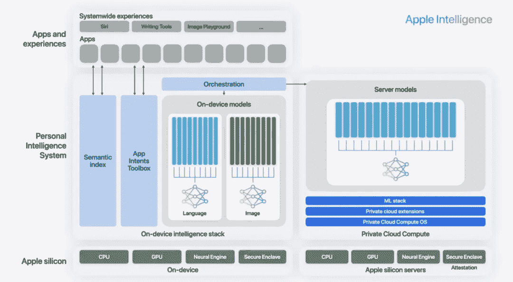

配图 3.07 Apple Intelligence - Private Cloud Computing

AI 基础设施的军备竞赛已经在进行，但终端的竞赛才刚准备启动，而且要为用户提供流畅的智能体验，**必须得两端同时进行；在这个快速**进**化的时期，给**应用的开发提出了巨大的挑战。或许， 智能时代根本就不存在应用开发 ，我们可以用各种硬件还有自然对话方式的交互形态，端到端的给客户解决问题就行，因为这是一次远超互联网和移动时代的 新工业革命 。

### 3.4 Nvidia 的新工业革命

知名播客 Acquired 在 2023 年十月对 Nvidia 的 CEO 做了 一个信息量巨大的采访 ，那时 Nvidia 的市值刚刚突破一万亿美元大关，全球排名第六。

Jen**sen 提到为什么** Nvidia 如此专注的只做加速计算，有一个重要的原因是当他们看到 AlexNet 在计算机视觉中的惊人效果时，意识到这是一个突破性的技术。基于神经网络的深度学习模型能够在短时间内超越过去三十年的计算机视觉工作。。他们发现深度学习实际上是一种 泛化的函数逼近器 （ universal function approximator ），因为其维度可以无限高。这意味深度学习可以解决各种复杂的问题，只要有足够的训练数据。

随着计算变得更便宜，AI 就可以进入更多的经济领域；如果它能被更广泛地采用，那么我们的市场应该变得更大，而且这个循环将继续下去。这里有一句话我保留 Jensen 的原文会更有感觉：“What’s unique about our current circumstance today is that we’re in the manufacturing of intelligence。 We’re in the manufacturing of work world.” - 我们在做制造业的工作，但我们生产的是智能 ！

作为一名 PC 硬核玩家，每一年的 Nvidia 的 GTC 都必须围观，从 2021 一直到今年的三月的这场，我看到了 Nvidia 最清晰的一次平台化布局的全貌，并且用了一个概念，用加速计算平台来支撑新的工业革命（NEW INDUSTRIAL REVOLUTION）。

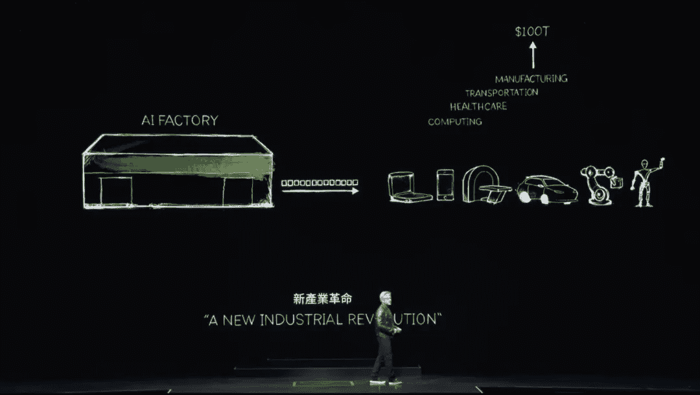

配图 3.08：A NEW INDUSTRIAL REVOLUTION

Jensen 给这次 AI 推动的工业革命预估了一个 100 万亿美金的市场规模，这已经接近去年全球的 GDP 总额了，看来想象力和诱导需求同样重要！那么 Nvidia 要如何拥抱呢？

**提供算力平台 **：最新发布的 Blackwell GPU 已经是一个加速计算平台，通过 NVIDIA Quantum InfiniBand 能够连接数以万计的 GB200 超级芯片，组成一个超级大计算矩阵，可以把这个矩阵当成一块 GPU 来看待。亚马逊的 AWS 已经升级了其 Project Ceiba ，计划通过 NVIDIA GB200 NVL72 扩展的新 Blackwell GPU，提供 65 exaflops 的惊人算力。

**提供推理微服务 NIMs **：这是在 CUDA 之上的 NeMo 微服务（Microservices），Nvidia 面向加速应用开发构建的计算容器推理，你的各种模型和智能计算应用，都可以在上面快速部署。就在五月中微软举办的 Build 2024 上，宣布了与 Nvidia 进行加速计算的全栈合作，除了 Blackwell 之外，还有 NIMs。

**模拟与现实世界通吃 **： Omniverse 模拟现实的能力，除了驱动工业上的数字模拟设计之外，智能时代最大的作用就是合成高品质的训练数据了；配合 Issac Robotic 的服务提供机器人模拟训练，Nv**idia **是计划把工业生产中能模拟的都模拟了，再用模拟的数据训练真实的自动化生产机器，从而让工业智能化，这是在很形象的 智能工厂 。

Nvidia 成功的扮演了智能淘金时代的卖铲人，做为全球唯一的 AI 训练算力供应商，现在要计划把自己的加速计算平台通过各大云计算服务商销售给企业，几乎所有企业的数字化以及工业制造中的智能供应，都绕不开 Jensen 的算力布局。

新工业革命就是智能驱动的传统工业升级与再造。过去，软件的归软件，硬件的归硬件，现在软硬逐渐一体，智能化会让硬件更灵巧，就像人类的智能是大脑与身体的整体组合一样；让设计生产完全通过 AI 模拟与加速，让智能体找到最适合的物理躯体，才能完全释放智变时代的生产力！

### 3.5 Agent 走进物理世界

在上一篇《 机器之心的进化 》中，还在把纯视觉方式的 FSD 当作自动驾驶领域值得探索的前沿方向在讨论，不到两年时间，全北美一百多万辆 Tesla 里面已经预装了最新的 FSD 12，就像在系统升级说明里面写到的：“我们移除了最后几万行人类写的 C++ 代码，把自动驾驶改成了完全由神经网络端到端控制”，也就是光子进入，行动输出，中间完全由神经网络黑箱操作， 软件 2.0 的成功范本。

今年三月底升级到 FSD 12.3.3 之后，我现在大部分时间的驾驶都是让 AI 代劳的。第一趟体验就让我和之前的版本有了强烈的对比，头脑里的第一反应这就是自动驾驶的 ChatGPT 时刻，虽然还有许多小问题，但已经确立了纯视觉加上神经网络控制的可行性，接下来就和训练 LLMs 一样，靠算力和数据就能提升效果了。

**让车在物理**世界中自我行动，这是 空间智能 （Spatial Intelligence）的第一步。路透社报道，在计算机视觉上有过杰出成就的李飞飞教授， 正在打造一家与“空间智能”有关的初创公司 。她在 2024 年最新的 TED 演讲中解释了这个概念：“通过空间智能，AI 将理解真实世界，它们能够处理视觉数据，做出预测并根据这些预测采取行动”。

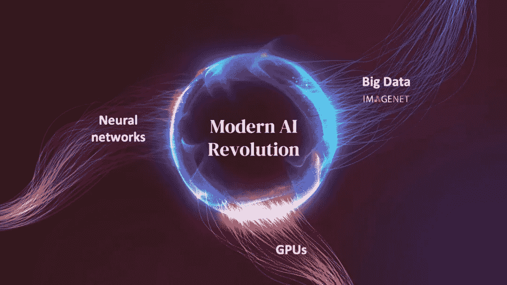

配图 3.09：李飞飞 TED 演讲（ With Spatial Intelligence， AI Will Understand the Real World ）

当我们**人类看到一**个桌上的水杯，大脑就会自动计算它在三维空间中的位置，以及它与桌子和周围一切事物的关系，还会预测接下来会发生什么。行动的冲动是所有空间智能生命形式所固有的，它将感知与行动联系起来。一个具有空间智能的 AI，它也能自动做类似的预测与行动冲动。空间智能将推动 AI 系统获得 具身智能 （ Embodied Intelligence ），能够像生物一样与环境互动，FSD 就是典型的例子，现在 Tesla 正通过其改进版本来驱动 Optimus 机器人，Elon Musk 在 Tesla 最近一次财报电话会上说今年底就计划让 Optimus 能够在 Gigafactroy 代替人类干点活。

不过 Nvidia 有一个**更宏大的计划**，这是今年 GTC 上的 One More Thing，他们计划推出 GR00T 项目，一个 通用智能体 （ Foundation Agent ）。其目标是为通用的人形机器人构建基础模型，使其能在不同实体之间迁移，训练过程类似 OpenAI 训练 GPT-4，通过在海量环境中训练来获得通用性，这里就要用到我们在上一小节中提及的 Isaac Sim 来创造 GPU 加速的虚拟世界。Nvidia 将通过它来以 1000 倍速运行物理模拟，生成无限复杂精细的虚拟世界，正所谓 AI 不用一天，人间就得一年 。。

这个项目的负责人 Jim Fang 在一次 TED 演讲 上概括了通用智能体的三大特征：

+   能在开放世界中探索；

+   拥有海量世界知识；

+   能执行无数任务；

因此需要足够开放的环境、大规模预训练数据和强大的基础模型。就在不久前， Jim 在 X 上放出了一段演示 ，他们的团队在模拟环境中训练了一只机器狗，在瑜伽球上保持平衡和行走，然后将其转移到现实世界中，没有任何微调，行走的非常流畅。这个过程中团队用了 DrEureka，一个 LLM 代理，它能编写代码在模拟中训练机器人，弥补仿真到现实的差距，完全自动化了从新技能学习到现实世界部署的全流程。

在现实世界 AI 的另一端，Tesla 正计划使用两万个 Nvidia H100 GPU 进行 FSD 12 新版本的训练，自家的用于 Dojo 超级计算机的 D1 芯片台积电也开始量产。D1 由 5x5 阵列的高性能芯片组成，通过 TSMC 的 InFO_SoW 技术互联，通俗理解就是在一个单晶元上刻 25 个芯片，它们能像单一处理器一样高效工作。Tesla 会用这个组成新的 Dojo 加速计算阵列，能达到 100 exaFLOPS 的计算能力，将其用来训练未来的 FSD 和 FSD for Optimus。

Nvidia 和 Tesla 正在用各种不同的方式让 AI 进入物理世界，Nvidia 提供通用模型和模拟训练环境，让第三方来生产机器人；Tesla 则是从训练到制造全部自己来，这就像个人电脑时代的 IBM 兼容机 和 Mac 一样，到底谁能胜出呢？拭目以待 👀

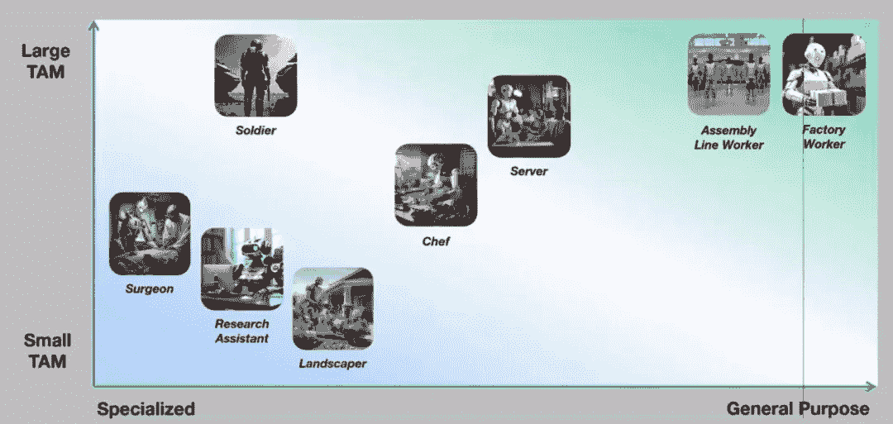

配图 3.12：Coatue 的人形机器人价值对比图

就像李飞飞在 TED 演讲中所描述的：“在那片原始海洋中，也就是我们的远古时代，眼睛的出现引发了寒武纪生命的大爆发。今天，这束光正在照进数字的心灵。空间智能使机器不仅能够相互交互，还能与人类以及真实或虚拟的三维世界进行交互。随着这个未来成为现实，它将对许多人的生活产生深远的影响。”

---

回应本章开头的结论，如果我们能够提升全世界的智能供应，那将普惠到所有行业，尤其是通过人工来进行生产与服务的行业。当智能让机器更加灵巧，能源的充沛让智能无限便宜的时候，我们复制原子的成本就会将接近复制比特的成本，在《 数字重塑人生 》一文中详细讨论了这个话题。

在智能时代，将 **劳动力支出 **转化为 **研发支出 **将改变公司的成本结构，虽然这需要更多的前期投资，但能降低生产和服务的边际成本。软件行业是这里的代表，它应该是法律许可的行业内，利润率最高的行业之一了。软件业的研发投入的平均比例为 17.7%，科研服务的投入略高一些，大约为 26.3%，这里包括了生物技术、纳米技术、先进材料和可再生能源等；但相比之下，制造业的占比为 5%，而金融和保险业仅为为 0.6%。如果这些行业的研发投入比能提高，那每个行业都会看起来更像软件行业，更快的增长，更高的利润和更多的研发。

然而，这里真正的大机会是：大部分经济可能看起来像 SaaS 模式，有更深的护城河、更高的转换成本、有意义的经济规模，甚至是网络效应。例如，还在萌芽期的 RoboTaxi 服务如果能够顺利启动和运行，它将具备上述所有的特点。

或许**在不久的将来，我**们只剩下生产智能的公司与生产机器人的公司，也或者是能够自动化完成特定任务的智能机器公司；所有的生产与服务，全部都由机器来完成。新的工业革命，也是大家熟悉的 第四次工业革命 ，将是一次彻底升级人类劳动力的革命，无论你喜欢还是不喜欢，这个就是我们的未来。。

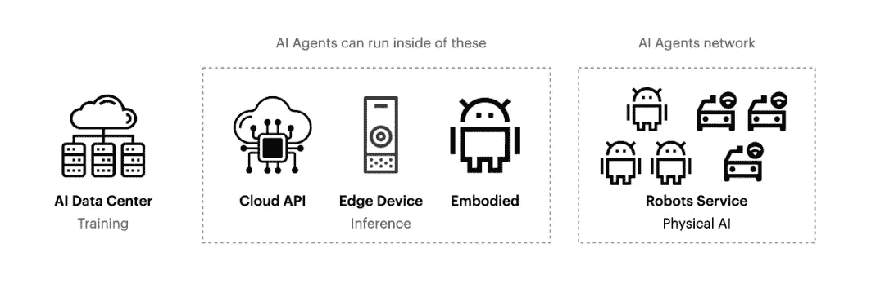

# 04 演化 - 万物皆计算

“算力才是王道，知识都是干扰。” 加拿大计算机科学家与 DeepMind 的首席科学顾问里奇·萨顿（ Rich Sutton ）在他那篇著名的《苦涩的教训》（ The Bitter Lesson - OpenAI 员工必读）中提到，在无穷的算力面前，人类的知识都只不过是一些小聪明而已。。他从我们七十年的 AI 研究中得出了一个历史规律：

1.  研究者总想构建一些知识并教给 AI；

1.  这些知识在短期内让人感觉是有用的；

1.  但是从长远看，人类构建的知识有个明显的天花板，它们的发展会被限制；

1.  让 AI 自行搜索和学习的暴力破解法，最终确带来了突破性进展；

十多年前的 AlexNet 是最好的一次证明，它抛弃了人类的知识逻辑，例如在图片中寻找边缘，或是通用形状，还有通过 SIFT 特征来理解，只用卷积神经网络和某些类型的不变性的概念，就大幅领先了一同参赛的程序。

### 4.1 模型如何理解

我们能从萨顿教授《 苦涩的教训 》中领悟到什么呢？第一个就是** 通用方法**** 的巨**大力**量，那**些随着算力的增长可以持**续扩展**的方**法，就**是 搜索 和 学习 ，类比到神经网络就是 推理 和 训练 ，它们能随着算力的增长而近乎无尽的扩张。

**第二个****就是我们**无法用简单的方法来概括现实和心**智的复杂，**我们无法用 符号 的逻辑来穷尽这种复杂；相反，我们应该只内建能够找到并捕获这些复杂性的 元方法 。这些方法的关键是它们能找到 好的近似 ，但寻找这种好的近似应由我们的系统进行，而不是我们自己。

哲学家维特根斯坦（ **Johan**n Wittgenstein ）很早就表达了对这种近似性的思考：按学科分类做“ 知识图谱 ”的方法根本不可能穷尽所有的知识，事物之间总有些相似性是模糊的、不明确的、难以用语言来形容的。

神经网络的成功，让 连接主义 **全面逆**袭，这种好的近似就是向量**，包括**在自然语言处理领域。大家相信， 符号 进入大脑后会转化为大型 向量 ，所有内部处理都通过这些大型向量完成。如果你想生成输出，就需要再次生**成符号。大**约在 2014 年，机器翻译领域经历过这样一个阶段，使用循环神经网络在隐藏状态中不断积累信息，最终在句尾得到一个大的隐藏向量，这个向量捕捉了句子的意义，然后可以用来在另一种语言中生成句子。Hinton 教授称为这个为 思想向量 ，他在最近接受 AI 知识管理软件 Sana 的 CEO Joel Hellermark 的 一段精彩的采访 中这样比喻。

谷歌研究员 F**ern**ando Pereira 这样说过：“自然语言是人类唯一的符号语言，我们用它进行推理。” Hinton 认为大语言模型和人类大脑做着同样的事情，这就是所谓的“ 理解 ”。它认为语言和思维过程中确实涉及符号，但这些符号通过多层次的嵌入表示（ embedding representation ）被丰富化了。然而，这些嵌入仍然与符号相关联，每个符号都有一个大的向量，这些向量相互作用，从而产生下一个词的符号向量。

“ **理解 **”就是知道如何将这些符号转换成向量，以及这些向量的元素应该如何相互作用来预测下一个符号的向量。 知识体现在你使用的向量及其元素之间的相互作用上，而不是符号规则 。这并不意味着可以完全摆脱符号，而是将符号转化为庞大的向量，同时仍然保留符号的表层结构。这就是如今模型的工作原理，也是更合理的人类思维模型。

Anthropic 最近做了一个关于模型可解释性的研究 - “ Mapping the Mind of a Large Language Model ”。他们从 Claude 3 Sonnet 的中间层提取了数百万的特征，给模型运行时的内部状态来了个快照，并给处于激活模式的特征神经元做了个“距离”测量，这样能够寻找彼此“接近”的特征。在“金门大桥”附近，发现了恶魔岛、吉拉德利广场、金州勇士队、加州州长加文·纽森、1906 年地震和旧金山阿尔弗雷德·希区柯克电影《眩晕》，这些特征还是多模态和多语言的。

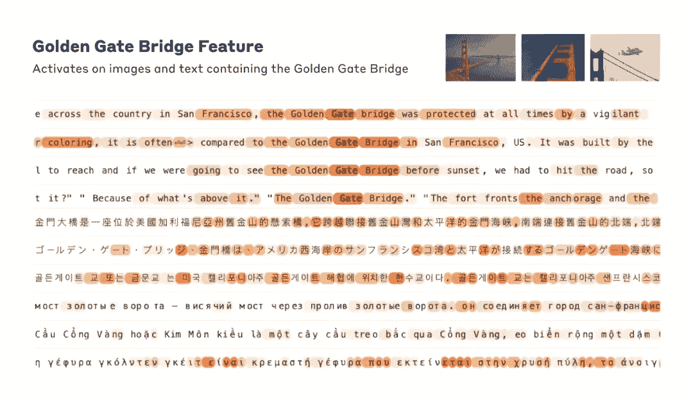

配图 4.01：Golden Gate Bridge Features

这表明，AI 模型中概念的内部组织，在某种程度上符合人类的相似性概念，而且还有更高层次的概念抽象，这也许是 Claude 拥有出色的类比和隐喻能力的原因。用另一个角度来理解， 概念作用的权重构成了模型的知识 ！

### 4.2 经验重塑语言

仅基于文本来学习的限制是什么？它高效吗？为什么模型要这种方式学习，而我们人类却不是？卡内基梅隆大学有一个计算机科学研究小组 CLAW ，主要研究如何与机器交流，以前叫 NLP 现在都是 LLM。他们假设感知、具像化和语言不能相互独立存在，因为经验塑造语言。

在《 **Experien**ce Grounds Language 》这篇研究报告中，团队使用了一个 语料的世界范围 （World Scope）概念，后面简称 WS。现在的大语言模型仅在文本的语料库上训练，就获得了巨大成功，如果能在更大的物理和社会环境中的并行训练，就能解答更深层的问题。因此，WS 按照训练数据获取的范围，被分成了五个级别：

+   WS1 - 语料库

+   WS2 - 全互联网文本内容

+   WS3 - 超越文字的语言，声音、图像、视频、表情各种可以感知的数据

+   WS4 - 物理世界的语言，身处环境中的互动学习

+   WS5 - 人类社会的语言，俗话说进入社会才能成长，机器也一样 。。

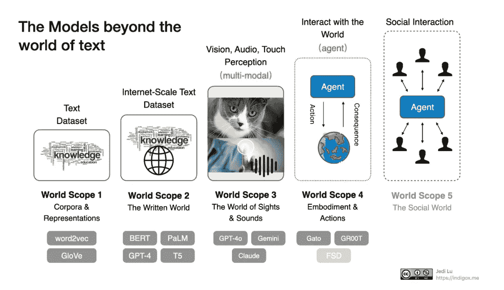

配图 4.02：AI World Scope（ 视频解释 ）

多模态学习可以显著改进模型的推理能力。例如，通过结合视觉和语言数据，模型可以更好地进行空间推理和物体识别，这使得模型在处理复杂任务时表现得更加出色，也很好的减少对单一数据源的依赖。

在 OpenAI 发布了 GPT-3.**5 之后**，大语言模型的发展就已经进入了 WS3 ，从 GPT-4 到 GPT-4o，已经实现了声音、图像、人类情绪等各种可以感知的数据的多模态训练，还有 Anthropic 的 Claude 3 混合了视觉模态的训练，以及 Google 的 Gemini 一开始就是多模态的。从 2024 年开始，几乎所有的 LLMs 都进化成了 LMMs，这是提升模型能力的必经之路。

**要理解物**理世界，模型必须身处物**理世界， **WS4 也就是在上一章提到的 具身智能 。不过让模型看视频来想象 3D 空间也行，例如 OpenAI 的 Sora 正在朝这个方向努力，还有 xAI 即将推出的 Grok 1.5 也展现了很好的空间理解能力，毕竟有 FSD 撑腰。

在具身智能的方向上，Deepmind 的 Gato 是最早的通用代理（ A Generalist Agent ），具备语言理解能力、可以感知环境还能执行动作的单一模型，但还是试验阶段；前面提到的 Nvidia 的 GR00T 把这个往前推进了一步，它也是通用代理，而且能够部署到机器人里面，关键是 Nvidia 有现实模拟技术 Isaac Sim 可以合成虚拟的 3D 世界来训练，因为真实物理世界的训练成本太高了。Tesla 的 FSD 还有来自 Wayve AI 的 AV 2.0 它们并不能算通用代理，因为不具备可以理解语言的综合推理能力，但可以看成是视觉到行动的自动驾驶专用代理；不过 Tesla 的 Optimus 机器人需要像 GR00T 一样的模型来驱动，所以 FSD 必定还得有通用化的潜力。

最后， **WS5 **离我们还有点距离，智能体得大量进入人类社会，与人类互动得到强化反馈才能习得这些数据，它们得经受社会的锤炼。不过感觉 OpenAI 这么急于投放可以进入人类社会的智能助理，就有这个目的。哪怕它们没有身体感知，但也能采集到大量的真实互动数据，这对于提升的推理能力，非常有帮助。。

所以接下来大模型的竞争，在算力有保障的情况下，就是变着花样的来获取真实世界的数据。

### 4.3 柏拉图表征假说

为什么多模态的数据会增强模型的理解与推理能力？如果一直扩大训练数据和模型的规模，会发生什么？Ilya** 在离开 Ope**nAI 后，首次点赞了一篇来自麻省理工学院（MIT）的计算机科学家 Phillip Isola 的最新论文《 The Platonic Representation Hypothesis 》，翻译过来就是 柏拉图表征假说 。该假说的核心观点是，不同的神经网络模型在不同的数据和模态上训练，最终会在其表征空间中收敛成一个共享的现实世界统计模型。

通俗来讲就是强大的模型往往都是相似的，弱小的模型就各有各的弱法；就像幸福的人都是相似的，不幸的人各有各的不幸。。这个隐喻来自两千多年前，柏拉图在其著作《 理想国 》中提出的一个思想实验，探讨了何为“现实”。那时人类对世界的理解，就像一群被终身关在洞穴中的囚犯，看到现实在墙壁上的投影，就认为那是现实；如果你要真的看到现实，你就得走出洞穴，于是哲学家就开始通过逻辑、数学、自然科学等手段，去理解和感知更高层次的“现实””。现在，这个宏伟的目标从哲学家传递到了 AI 科学家的手中。

假设 AI 模型的表示正在趋向于一个共享的统计现实，这就类似于柏拉图的理想现实概念，所以作者称这种表示为 “柏拉图表示”。论文提出了一种验证该假说的方法 — 模型拼接（ Model Stitching ）。通过将两个模型的中间表示层连接起来，形成一个新的“缝合”模型，如果这个缝合模型表现良好，说明两个原始模型的表征是兼容的。

Phillip 选取了 78 个 CV 模型进行表征相似度分析，它们在训练集、任务目标、算法架构上各不相同，我们可以从下图看出明显的收敛特征。

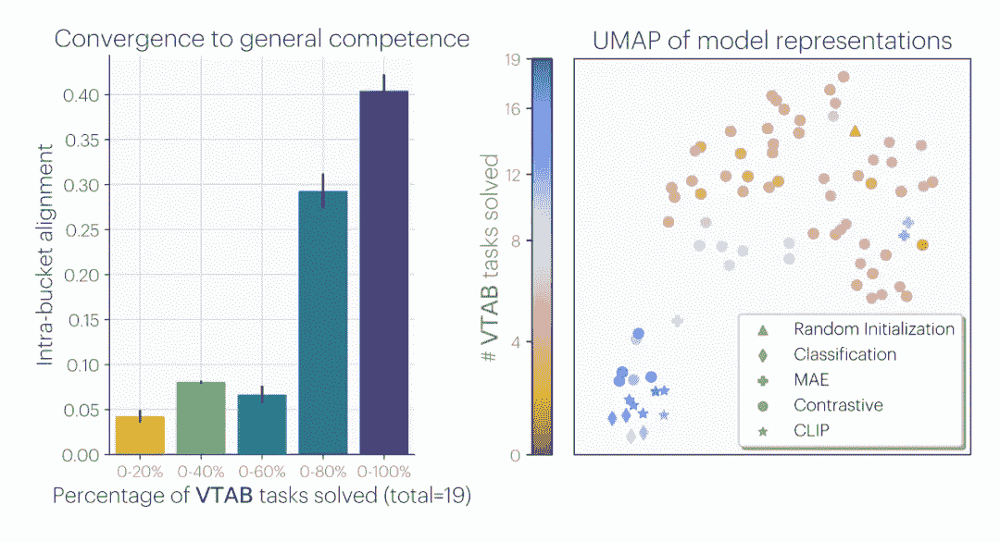

配图 4.03：CV 模型进行表征相似度分析

左边的柱状图中，柱子越高说明表征相似度越高；右边的散点图更清晰，明显看到强大的模型（蓝点）聚集在了一起，说明它们之间有着较高的表征相似度，而弱小的模型（红点）却比较分散，说明它们之间表征相似度较低。

论文指出，AI 模型表征收敛主要有以下三大原因：

+   **任务通用性 **：当一个 AI 模型需要同时完成多种任务时，其表征空间会收敛到一个小范围，因为每个任务目标都会对模型施加额外的约束；

+   **模型容量 **：模型越大，越容易逼近全局最优表征，从而推动表征收敛。更大的模型能够找到一个共享的全局最优解，实现跨模态的通用性和适应性；

+   **简单性偏见 **：深度神经网络倾向于选择最简单的解决方案，这种倾向随着模型变大而更加显著。这种简单性偏见符合奥卡姆剃刀原则，促使模型找到更高质量的解决方案。

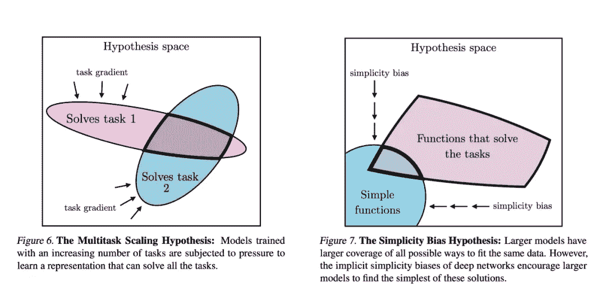

配图 4.04：多任务表征空间的收敛

这里我们可以得出两个结论：

首先，我们能从一个新的视角审视多模态数据之间的关系，如果你想要训练出最强的文本模型，你应该把图像数据也纳入其中，反之亦然；跨模态配对数据可以有效提升表征收敛率；

其次，只要随着模型参数、任务多样性、算力的增加，模型的表征会逐渐收敛趋同，我们就能实现完全**通用的计算**，也就是 AG**I；但任务越**多样，模型越复杂，速度就越慢，我们必须在这 不可约化 的计算中寻找 可约化的解 ，因此为了效率，就需要有专用任务的模型，例如用 AlphaFold 3 来破解生物分子结构，用 FSD 12 来实现纯视觉自动驾驶；

貌似人类已经找到了通向表征世界的全局最优解的路径，那就是 AGI。但在某些场景中，相比竭尽全力取得全局最优解而言，高效地取得局部最优解则更具经济价值。

### 4.4 目标与自主进化

AI 能有自己的目标和实现自主进化么？去年九月接知名播客 80000 Hours 在采访 Mustafa Suleyman 的时候，一开场就问了这个问题：“ AI 有可能成为一个能够自主进化的智能体么？ ”

Suleyman 认为，在短期之内不太可能出现这种智能体。这是一种能够自主运行，制定自己的目标，还能识别环境中的新信息、新的奖励信号，并且学会用它进行自我监督，随着时间的推移，最终可以更新自己权重，实现自主进化的人工智能体，这将是真正的数字生物。如果某种 AI 技术真的展现出这种能力，它可能会有非常大的潜在风险，而且在人类的伦理上会如何看待它们呢？它们是独立的个体，能有自己的权利么？从现在有能力训练大模型的公司和研究机构的态度来看，他们目标是尽量避免这样的数字生命诞生。。

**机器的目标**

让我们先回到机器的目标上来，OpenAI 的联合创始人之一 John Schulman 在接受 Dwarkesh Patel 的播客采访的时候，透露了很多最新的研究进展**。他作为研究科**学家，主要负责 Post-Training 阶段的工作，也就是微调与强化学习（RL - Reinforcement learning）。一定程度上，GPT-4 这样的模型已经表现出了类似人类的心理驱动力和 对目标的渴望 。例如，人类有了吃饭的目标，会进入“寻找食物”的状态，AI 则表现为追求正反馈，模型希望自己的产出得到人类认可，这种认可通过奖励模型（Reward Model）来衡量。实际上，模型努力产出的是人们可能会喜欢并认为正确的结果。

Schulman 认为已经找到通往未来的钥匙，那就是长期进行强化学习训练。通过投入更多的多模态数据和训练成本，强化学习计划会释放 AI 在更长时间里保持连贯的能力；一旦这种能力被解锁，AI 处理任务的水平将达到人类的程度。人类可以通过特定提示语向 AI 描述任务所需的时间尺度，然后 AI 会制定目标计划，无论这一目标是一个月还是十年后。

在执行长时间的任务的过程中，模型幻觉的问题也会被放大，它们会错误地认为自己可以执行、甚至已经执行了某些它做不到的任务。例如 AI 会表示自己已经帮助用户发送了电子邮件或叫了辆出租车，但是实际并没有这么做。。不过舒尔曼说这个是鸡毛蒜皮的小事，Ilya Sutskever 也提到过，通过 RLHF 和一些 AI 工具辅助提高反馈效率，就能在很大程度上解决模型的幻觉问题。

**下一步跃迁**

最近，因涉嫌泄密被 OpenAI 解雇的 Leopold Aschenbrenner 创建了一个新项目 Situational Awareness ，其目标是要让国家来主导 AGI，估计是在 OpenAI 里知道的太多了，发现商业公司很难控制核武级别破坏力的人工智能。Leopold 对模型的进化速度和 Schulman 一样乐观，而且他觉得现在最难的基准测试也岌岌可危，反应不出更好模型的真实水平，所以他采用了一个比较粗暴但很有效的方式来估算 AI 发展的速率 - OOM（Order of Magnitude 数量级），一个 OOM 等于 10 倍，N 个 OOM 可以理解为 10 的 N 次方。

根据 Epoch AI 的公开估计，GPT-4 训练使用的算力比 GPT-2 多了大约三千到一万倍，增加了 3.5 - 4 个 OOM。计算规模扩张还会持续，保守估计，到 2027 年底，很可能会再增加 2 个 OOM；再大胆一些，考虑到微软和 OpenAI 的超算合作，即使是接近 3 个多 OOM，相当于一千多亿美元的算力集群，也是有可能实现的。

Leopold 总结了让模型变强的要素，需要从下面三个方向来提升 OOM：

+   算力（Compute）：上面的预估大约 2 - 3 OOM；

+   算法效率（Algorithm Efficiencies）：对架构的优化，从过去一年模型推理的价格和速度的变化来估算，到 2027 年能提升 1 - 2 OOM；

+   额外的潜力（Unhobbling Gains）：通过强化反馈学习 RLHF、思考链 CoT、工具和 Scaffolding 等方法微调来提升模型能力，这个没法预估，参考以前的经验 Leopold 给了 1 - 2 OOM；

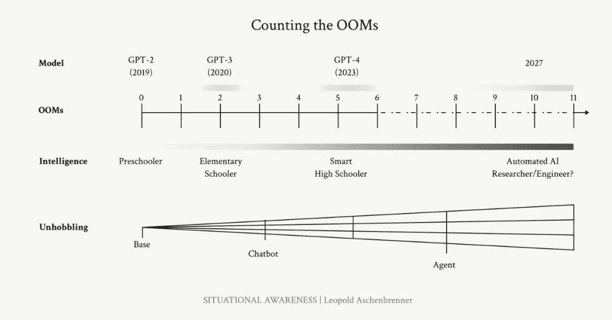

配图 4.05：Counting the OOMs

最晚到 2028 年，可以实现 3 - 6 OOM 的智能提升，从 GPT-2 到 GPT-4 实现了 4.5 - 6 OOM 的提升，因此跃迁还会继续。不过 Leopold 的方法很随意，我把它放在这里做为一种视角来看待，佐证 AI 能力的提升还没有放缓的迹象。有可能我们能在四年内实现全自动化的 Agent，企及研究生的水平，它们可以参与软件工程也可以辅助科研。

如果成千上万个这样的 Agent 协同工作呢？这会是一个什么样的未来 。。

**自主进化的安全问题**

真正的问题是安全，虽然让现在的模型执行连续任务还是个挑战，但智能一旦到了高水平的时候就必须谨慎。如果它们的主要目标是生成令人满意的文本，除此之外并不“关心”世界上的其他事情，那样还好；但在模型需要执行一系列很复杂的、涉及工具的操作，那就可能会出现工具收敛（ Instrumental convergence ）问题。这是一个假设概念，由瑞典哲学家尼克·博斯特罗姆（ Nick Bostrom ）提出，指的是大多数足够智能的存在体（无论是人类还是非人类）在追求不同的最终目标时，会趋向于采取相似的子目标。换句话说，即使这些智能体的最终目标各不相同，它们在实现这些目标的过程中，可能会采取类似的手段或策略，这些手段或策略被称为“工具性目标”，例如积累资源、提高自身智能、防止自我关闭等等，甚至是酿成“ 宇宙回形针 ”这种惨剧。。

今年开始 OpenAI 与 Google 都在演示自己的智能体产品，我们接下来使用的 AI 系统可能会从当前的 “神谕” 模式（即回答问题）转向更自主的代理模式，能够自主执行任务和决策，它们将面对更多真实世界的任务而不是文本生产，而且从纯软件代理，更多的变成物理代理。那时，就需要可以在边缘端可以进行自我学习和进化的 AI 架构，用超大的上下文窗口来实现类似人类大脑的短程记忆，或者可以在本地通过环境反馈微调并升级自己的模型权重。上下文学习和微调所带来的能力在某种程度上是互补的，未来我们的模型不仅能够在线学习，而且还具备认知技能，比如能够自我反思，或者主动寻找新知识来填补知识空白。

在目标的驱动下，AI 有能力进行自我微调和强化学习来升级权重的，但这种后训练阶段的自我改进升级如果脱离了人类的监督，将会非常危险。2021 年成立的 Anthropic 初衷就是采用 “ Constitutional AI ” 的方式，在监督和强化学习阶段，通过 AI 的自我改进来训练，没有任何人类标签来识别有害输出，唯一的人类监督就是通过一系列“宪法”的基准原则提供的。有点阿西莫夫机器人三定律的感觉，但要复杂很多。。

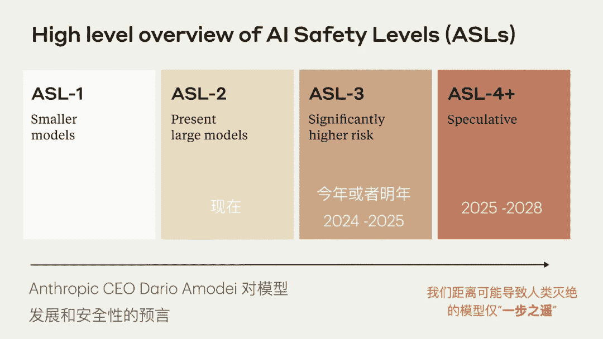

配图 4.06：Anthropic 的 A.S.L。

而且 Anthropic 并不爱提 AGI 这个没法定义的概念，他们用 A.S.L。（ AI Safety Levels ）来判定自己模型的能力水平，参照了美国政府的生物安全级别（BSL）标准，用于应对灾难性风险 Dario Amodei 的解释如下：

+   **ASL-2 **展示出了危险能力的初期迹象 —— 例如，它们能指导如何制造生物武器 —— 但这些信息因可靠性不够，或不具备推导出常规搜索引擎之外的新信息的能力，还不具有实用价值。目前包括 Claude、GPT-4 在内的大语言模型均属于 ASL-2 级别；

+   **ASL-3 **指的是那些相比于传统技术（如搜索引擎或教科书）极大增加灾难性误用风险的系统，或是具备初级自动化功能的系统。例如，如果 AI 在生物学领域的应用导致生物武器的创建和扩散风险显著增加，或者在网络安全方面能够执行破坏性任务，就会触发这一级别；

+   **ASL-4 **及更高版本（ASL-5 +）目前尚未完全定义，但它将涉及更高级的风险，如自主性和可能的说服力。ASL-4 的风险包括国家级别的各种军事领域的攻击能力大幅增强，以及 AI 模型的生存和复制的能力。这一级别可能会引发更深远的社会和存在性问题，需要政府在管理这项技术上发挥作用；

Amodei 认为我们正处于 AI 指数增长的初期，人类的线性思维总是会误判指数增长的潜力。实际上大模型公司已经和美国政府签订了协定，不能过于快速的释放新版模型，恶性竞争；但按照现在的速度，ASL-3 预计今年底或者明年就能实现，ASL-4 预计在 2025 - 2028 年之间可以达到。Schulman 在播客中也表示，类似 ASL-4 级别的 AI 在未来三到五年内就能实现，可以执行长期目标并且完全自动化的智能体。貌似一切都在加速中，但我们真能通过 AI 解锁宇宙的全部奥秘么？

### 4.5 不可约化的计算

计算机科学家、物理学家史蒂芬·沃尔夫勒姆（ Stephen Wolfram ）有一个观点：“我们的科学理论核心之一就是可以把一切过程都视为计算，系统通过计算来确定它的行为”，虽然他的物理思想不被主流物理学所接受，但他创立的 Wolfram 语言在科学界还是很受欢迎的，通过符号计算的方式，把算法和世界的知识构建到了编程语言之中。

**计算不可约 **（ Computational** Irredu**cibility ）就是沃尔夫勒姆在 2002 年出版的《 一种新的科学 》一书中提出的重要概念。它描述了某些计算过程无法通过任何捷径或简化来加速，唯一的方式就是按部就班地模拟整个计算过程，例如知名的“ 三体问题 ”。虽然宇宙无穷复杂，但它还是给人类的探索留下了 可约化的口袋 ，科学的目标就是要探索这种可约化计算的可能性，例如广义相对论方程可以解释和预测宇宙在宏观尺度上的运动。

那么 AI 能否替代科学家，通过寻找某个系统的**运行规**则来解决科学问题呢？现在的答案是 不能 ，从架构来看，目前 AI 还只能做相当浅层的计算，Wolfram 专门写了一篇《 Can AI Solve Science？ 》来详解的其原因，还搭建了不同规模的神经网络预测正弦函数，结果表现平平。

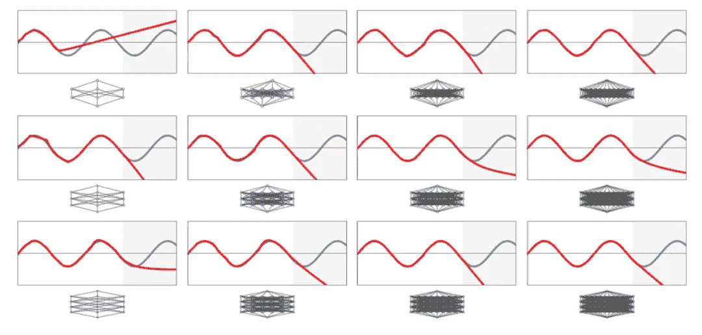

配图 4.07：不同规模的神经网络预测正弦函数预测

理论上，可以用现有数学文献和数百万条定理训练神经网络，然后用它评估系统枚举得到的定理的可**信度，甚至预测哪**些数学**探索方向可能有趣；但现**在的 AI 模型架构更倾向于寻找“ 更多相同的东西 ”，输出的是“主流”和“不太令人惊讶”的东西。而计算不可约性意味着探索过程中总会有出人意料的发现，找到那些可约化的口袋，这些发现不容易归纳到已知模式之中，它们可能提供新的信息或价值；即使 AI 能引导我们发现新思想或技术，但在深入探索之前，仍然无法确定哪个方向是正确， 这通常需要人类来选择 。

**人类智**慧有两种最高水**准的表**现，一个是 艺术 ，**另一个就**是 科学 ，它们都依赖**人类的 创**造力 。科学在某种意义上是 数据压缩 ，我们用定律和方程表征宇宙的动态，从而理解发生了什么。但在这个过程中，还有一个超越数据压缩的方面，就是我们在发挥创造力时，我们自身也发生了变化；这一点类似于艺术： 当你感知某个事物时，它也改变了你 。如果我们富有创造力，就能提出新想法。然而，目前的 AI 模型在创造或生成时，它现在还无法根据自身发现的内容进行更新，这是人类目前还优于 AI 的重要方面，但过不了太久这个优势应该也不存在了。

只有当我们真正感受到时，才能了解自己的反应。这意味着，尽管 AI** 可以**提供指导和建议，但人类在决定哪些新概念值得追，仍然扮演着重要角色。寻找“ 有趣 ”的方向实际上是探索计算可能性的空间，虽然我们关心的计算可能性集合很小，但这对于人类文明的未来至关重要。所以，我特别喜欢 xAI 的目标： Understand the Universe 。

AI 目前更像是延伸人类思维的工具，帮助完成大脑不擅长的任务。像大语言模型这种具有人类特征的 AI（Anthropomorphic AI），就像我们的超级助理，善懂人意，思维敏捷，能够帮助我们加速思考；也有面向科学的理解自然的 AI，帮助我们加速科学的探索。例如 DeepMind 在科学领域就有非常多的成果 ，除了大家熟知的 AlphaFold 之外，还有核聚变所需的等离子体计算、新数学猜想的提出并帮助证明、以及稀有物种的识别等等。

Extropic 的创始人 Guillaume Verdon ，这位量子计算和 AI 领域的专家，也是“ 有效加速主义 ”（Effective Accelerationism， e/acc）运动的发起者之一，他在与 Lex Fridman 的播客对谈 中提到的面向物理的 AI（Physics-based AI），一种以物理学原理为基础，能够更好地在各种规模上表征世界的人工智能。它们可以利用量子力学、热力学等物理学的不同领域来构建世界的模型。Verdon 认为，通过结合物理学原理和人类的认知方式，可以创建出更接近真实世界的 AI 系统。

因为柏拉图表征的假说，还有计算不可约化的限制，我们也许永远不会有一个无所不能的 AI，但我们一定会有多种形态的超级 AI，在可以约化的口袋里面计算和探索，帮助人类，理解宇宙！

### 4.6 自动化的 AGI

至此，已经带领大家领略了一次最新的智能变革，从模型到应用，从智能代理到具身智能，从新工业革命到挑战科研。现在，我们来聊一下大家最关心也最为模糊的话题 - AGI 是什么？在我的理解中它会如何到来？

Deepmind 的研究团队**在去年十一月发表过一**篇论文《 Levels of AGI 》，他们给 AGI 的定义提出了六个原**则，其中最重要的一点**“ 关注能力，而非过程 ”，我们应该关注 AGI 能完成什么，而不是它如何完成任务。这意味着 AGI 系统不需要像人类一样思考或理解，也不需要具备意识或感知能力。另外，应该类似于 自动驾驶的分级标准 ，AGI 的定义应包括多个级别，每个级别都有明确的度量标准和基准。这种方法有助于更清晰地描述 AGI 的发展、评估风险和制定相应的政策。

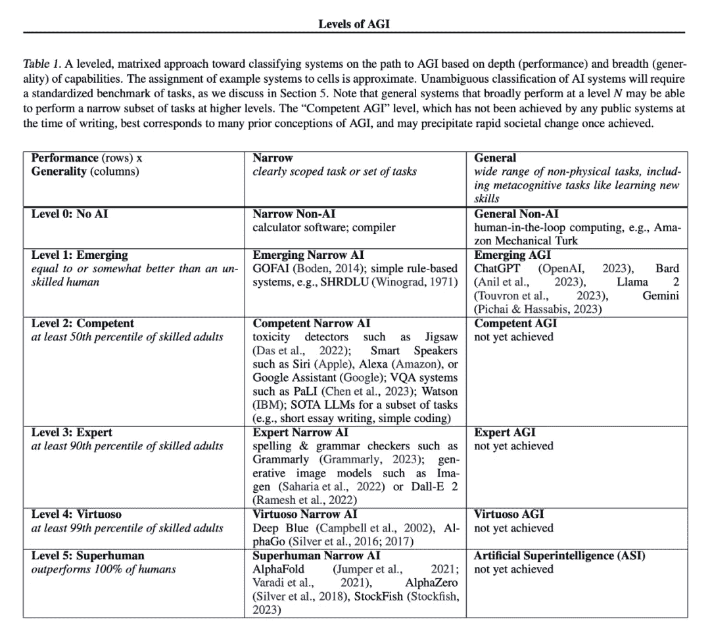

配图 4.08：Six Levels of AGI（Table）

**有一个最**常**见，也是我认为比较合理和**可验证的定义： AGI 是一种自主系统，在大多数具有经济价值的工作中超越了人类的能力。这也是 Sam Altman 经常挂在嘴边说的， 用自动化来贡献 GDP 。Andrej Karpathy 今年初在他的博客上发过一篇名为《 Self-driving as a case study for AGI 》的文章，但不知道为什么很快就删除了，全文表达的意思就是用自动化的交通服务来类比 AGI 和它的经济价值。

用自动驾驶的等级来对应 AI 自动化的能力，会非常形象。现在的 AI 智能副驾（Co-Pilot）就像 L2 - 部分自动驾驶，人类参与多 AI 参与少；接下来的 AI 智能代理（Agent）就像 L3 - 受条件制约的自动驾驶，人类参与少 AI 参与多，我们给代理一个指令，它就能自己干大多数的活，人类只需要少量参与监督、评估和决策，感觉 Tesla FSD 12 就已经到达了 L3，给定目标就能自己抵达目的地，中途很少接管。那么 L4 级别的“高度自动驾驶”对应的是什么呢？更高级的自能体，完全可以自主运行的通用智能助理，给它一个长期目标，它就能很好的为你服务，现在还没有哪家公司的模型能够提供这样的智能；但在自动驾驶这个专项领域，Waymo 已经几乎做到了 L4，拿起 APP 叫车，打个盹的时间系统将你送到了目的地。我问过坐过的朋友，很多人更喜欢 Waymo 而不是 Uber，因为你完全没有陪司机聊天和给评价的压力。。

就在大家还在争论自动驾驶能不能实现以及法律是否允许的时候，Waymo 的 AutoTaxi 服务已经在路上运行了，虽然限制很多、可以用的城市也很少，但这已经不是演示，它就在那里真实的运行着；接下来就是 Tesla 的 RoboTaxi，会在今年八月八日正式对外公开。Waymo 采取了先实现自动驾驶，然后在全球扩展的策略，而 Tesla 则先走向全球，然后再扩大自动驾驶的策略。这只是策略和先期投入成本的差异，他们的最终目标都是在全球范围内实现完全自主运行的交通服务。

---

从某种**角度来看，就**像 Andrej Karpathy 写道的，AGI 看起来并不像一个可以自行进化的超级智能体，脱离我们的控制进入网络空间制造致命的病原体，或者从某个研究所的地下室越狱出来创造一个超级公司来控制人类。相反，它更像是自动驾驶，融合到经济之中的、能改变社会的 自动化进程 。这个过程是渐进的，社会既是观察者也是参与者，并且其扩张速度在许多方面都受到限制，包括法规、劳动力的迁移、信息、物质还有能源。世界不会因为它而爆炸，而是会适应、改变和重构。具体到自动驾驶，交通自动化将使出行更加安全，城市变得不那么烟雾弥漫和拥堵，停车场和停放的汽车将从道路两旁消失，人们将有更多行走和休息的空间。

非常期待 AGI 带来的类似变化 🙂

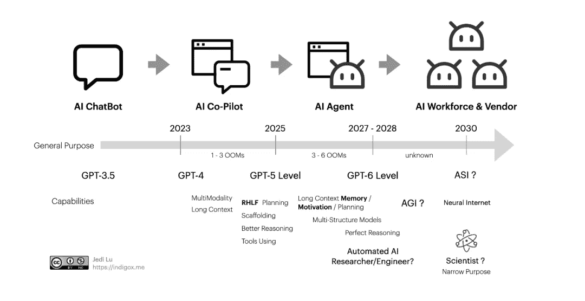

# 05 选择 - 成长与投资

“人类对指数增长的直觉不是很好，当认知成本降低千倍或百万倍，能力大幅提升时，世界会有什么变化？如果每个人都有一家由一万个能力极强的虚拟 AI 员工组成的公司，这些 AI 员工不知疲倦且越来越聪明，世界将会怎样？没有人能准确预测未来，所以保持谦卑非常重要。可以预测几步，但不要过度预测。。” Sam Altman 在今年的 WEF（ 世界经济论坛 ）上分享了很多，我专门挑了这一段放在这儿，想要精准预测复杂的世界，这是一个不可约化的计算。

经过全篇的分析，我们还是能找到可以约化的口袋，现在 AI 正朝着智能体的方向演化，它们大概率会成为人类的助手而不是世界的主宰；智能的供应会像电力的供应那样，渗透到全行业和大家生活的方方面面；人类最宝贵的资产就是我们进化了几百万年沉淀的经验，它刻在我们的基因中，也记录在我们的历史中，这些塑造了人类独特的创造力，我们知道我们想要什么，什么才是有趣的。

### 5.1 职业变迁

回到第三章开头提到的杰文斯悖论（ Jevons Paradox ），在劳动力市场上也一样，效率的提高会导致工作岗位的短期减少，但长期的需求激增会创造更多的工作岗位。 Slow Venture 的合伙人 Sam Lessin 做过一个 有趣的类比 ：“每个人都认为 AI 将会彻底改变法律行业 。。这种想法是错误的 ；AI 将使生成和处理冗长的合同变得易如反掌，导致诉讼量激增十倍，法律业务将蓬勃发展，成为 GDP 的主要组成部分。。就像之前的金融行业一样！”

增加“律师”的供应，会诱发对“法律”的需求；提高律师的效率，反而会增加对法律资源的需求。美国经济学家达伦·阿切莫格鲁（ Daron Acemoglu ）发表过一篇名为《 自动化与新任务：技术如何取代和重塑劳动力 》的研究报告，讨论了新技术对人类工人的几种不同影响，它们分别是：

+   通过用机器替代人类来减少对人类劳工的需求；

+   通过提高人类的工作效率来增加工资；

+   创造新类型工作的需求，以及；

+   通过经济增长来增加整体劳动力需求。

自动化技术提高了以前没法自动化任务的生产力，从而增加了对这些任务的需求。例如，白领在会计、销售、物流、交易和一些管理职位上，部分任务被专门软件和 AI 所取代，但这些技术也提高了生产力，从而增加了对这些任务的需求；但在制造业中却不同，自动化的加速导致了劳动需求的停滞，但新任务的创造速度在减慢，从而对劳动需求产生了负面影响。研究委婉的表达了制造业在全部制动化之后，就没人类工作者什么事儿了。

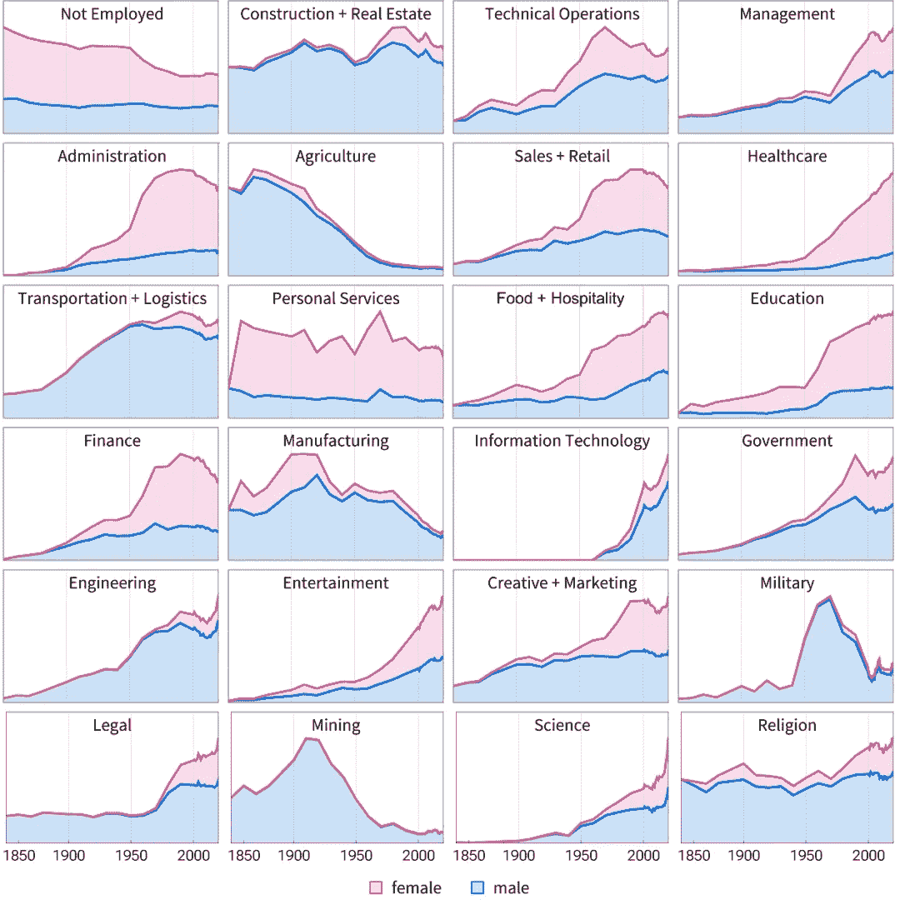

配图 5.01：1850 -2010 美国劳动力市场的变迁

我们可以看到，由于自动化，某些领域的工作数量在减少。这不仅发生在农业和采矿等领域，还发生在金融领域，例如职员和银行出纳的减少；以及销售和零售领域（如网上购物的普及）。有时，制造业的工作数量减少部分是因为自动化，另一部分就是因为有“世界工厂”的存在。

但像物**流和交通这些“技术操作**”比较集中的行业，先因为基建完成趋于饱和，随着技术的更新，需要更多的“技术维护”。人类工作者从操作者变成了自动化系统的管理者，业务效率提高，也会创造更多就业，其实我认为信息产业也属于这一类型。法律、医疗、工程、科学和教育这些处于“ 知识越多，工作也越多 ”的领域将会是需求激增的受益行业，另外娱乐还有餐饮服务业一直处于增长趋势，在各行各业都自动化之后，唯有吃喝玩乐得人们亲自来，所以这将是智能富足社会的常青行业。

**充分发展的行业会被完全自动化 **，现在的 AI 本质上也是人类经验的自动化回放，因此会雇佣更少的人力；但技术也开辟了新的行业，这些领域需要更多的**人手。**而且，因为计算的不可约，事物通常会变得越来越复杂，更多的知识和组织结构将会出现，这也就开辟了需要更多人类参与的“ 前沿 ”领域。尽管有时会突然涌现出新的技术变革，但在人类职业上出现显著变化通常需要一代人的时间。想象一下你在第二次工业革命的前夕，你能预知所有将在未来半个世纪内出现的神奇技术么？例如大规模生产、电力、汽车、电话、飞机等等。这些技术哪些会扼杀工作机会，哪些又会创造就业机会呢？你一定预测不到！所以请保持乐观，新机会一定存在的；需要做的就是提升自己的认知，不要在当下选择已经是趋势之外的行业就行。

最**后，如果 AI** 确实抢走了大多数人类的工作机会，那也意味着让部分企业以及某些精英人类赚了更多的钱，政府可以用税收来平衡这个差异， 全民基本收入 （ Universal basic income - UBI）就是一个很好的解决方法。

### 5.2 自我提升

我们已经进入** 知识经济** 的时代，不是在网上开课贩卖知识那种，而真正做到了廉价且快速的复制知识 - 让知识任务自动化。但要做到能够和 AI 一起协同进化，我们需要提升哪些能力呢？

**善用工具**

历史证明，使用工具的人往往比不使用工具的人表现得更好。人类的发展史就是一部工具演化史，从农业时代的水车运输，到第一次工业革命的纺织机，再到信息时代的电脑，工具越来越自动化。很快，不会用 AI 工具来自动化重复性的任务，就像不会用电脑来处理复杂的计算一样，如果不能适应这个转变，就面临被时代淘汰的命运。

我们会因为这种自动化带来的效率提升，腾出时间来进行更高层次的思考。

**抽象与整合**

现在“ **大语言模型 **”已经压缩了人类历史上积累的大量知识，你可以快速的用这些工具把知识回放出来。随着思维方式的进步，直接学习所有知识细节已经不再必要，我们可以在需要使用的时候通过工具来加速学习；现在需要的能力是在更高的层次上的学习，抽象出更多的细节。

事**实上，AI 在掌握**某些技能或知识的同时，也能使人类更容易学习这项技能或知识。随着技术的进步，AI 必定能做到 - “ 学习人类如何学习 ”，并以适合不同个体的方式来呈现它所学到的知识，让人们更好地吸收。

过去的一种观点是，随着世界知识量的快速增加，人们普遍认为将会越来越专业化。但**现在 AI 让知识自动化的**技**术不断**进步，让我们看到了另一种可能性正在清晰可见： 实现“整合”而不是专业化 ，人们在更高的层次上工作，为 AI 提供方向并作出合适的选择。这是一种充分利用人类潜能的最佳方式：让我们集中精力制定“ 策略 ”，而把具体的执行细节交给更擅长的自动化系统来处理。

但这也不意味着不用再培养基础认知了，我们可以利用大语言模型来加速认知的提**升，用它们**来指导学习，让生物大脑和机器智能一同**进化，**这样我们才有更多的时间来做 高阶思维 的锻炼，例如计划，评估，决策、抽象和创造，从而培养出达到更高理解水平所需的 直觉 。。要知道过去没有高阶认知我们没有任何代价，现在的代价是非创造级别的工作，对人类来说即将失去经济价值，因为 AI 的自动化会做得更好。

**提问与思考**

在许多事情都被自动化的情况下，什么是值得学习的呢？

首先， **学会提问 **，未来的教育应侧重于如何提出有价值的问题，而不仅仅**是回答问题。好的思考**才能带来好的问题， 批判性思维和好奇心 是思考的前提，也是人类文明能够向前的动力。

其次， **学会广泛而深入地思考 ****—— 尽可能**多地吸收各种知识和思维模式，重点培养 结构化思维 。调将复杂的问题分解成更小、更易管理的部分，并通过逻辑和有条理的步骤来解决这些部分，从而达到解决整体问题的目的。

我们**在上一章就**提到了，目前 AI 模型都在练习如何根据长期目标来分解和执行计划，从而提升自己的智能，人类不是更应该这样吗？不然如何去评估和验证 AI 的执行结果呢？利用自然语言来表达和整理思维，形成清晰的“ 人类级别 ” 叙述；所以 AI 不会减少编程的需求，而是让人人都能编程，这是通过算法和逻辑来解决问题的一种思维模式，可以帮助我们更好地结构化思考。

通过广泛而深入的思考，我们才能定义真正对我们有价值的东西。

**成为超级个体**

每**次遇到大的**技术转型，必定会有很多人被甩下车，也有很多人搭上了转型的便车，现在的趋势很明显，要成为能指挥 AI 帮我们干活的 超级个体 ，就像 Sam Altman 在 WTF 上比喻的那样：“如果每个人都有一家由一万个能力极强的虚拟 AI 员工组成的公司，世界将会怎样？” 要成为能调动 AI 干活的人，而不是被 AI 替代的人。

当世界充满了廉价的人造智能的时候，人类的连接和存在感就显得十分有意义。除了前面提到的三个内在能力提升之外，更好的情绪管理和沟通能力，会强化建立社会连接的效率，人类的服务会变得更加昂贵；即使 AI 再强大，大家也身处的是人类社会，而不是在 Matrix 里面，社会连接是个人最重要的资本。我们即将进入社交与智能混合的新互联网时代，要让智能工具成为我们增强社交网络影响力的工具，把它们当作“积木”一样组合成“成品”，来完成我们想做的事情。

最后，引用 Wolfram 在《 Will AIs Take All Our Jobs** and End** Human History—or Not？ Well， It’s Complicated… 》中所的表述的一段：“在新兴的 AI 世界中，有许多技能对大多数人类来说可能不再有意义 —— 正如今天的自动化进步使过去的许多技能变得过时一样。但可以预见人类仍会有自己的角色，对我们来说，最重要的是学会如何选择“ 下一步要去哪里 ”，以及在计算宇宙的无限可能性中，我们应该带领人类文明走向哪里。”

### 5.3 科技恒大

**

“未来**十年，最大的科技公司将比今天最大的科技公司 大得多 ”，这句话来自 Packy McCormick 的《 Tech is Going to Get Much Bigger 》，我在第三章“廉价诱导需求”小节中引用过他的观点 — 科技公司正在越来越大。

不要感到惊讶，因为它们生产的东西非常不同。随着技术（软件和硬件）进入并吞噬更多的经济领域，机会的规模正在逐步增长。我们可以看到最近几十年，美国科技公司已经在股票市值排名中占据主导地位。

在传统的行业分类中，科技并不完全适合任何一个类别 —— 它正在吞噬世界！虽然它最适合的是“信息”产业，其中包括软件、数据处理和电信等等。但亚马逊已经渗透到了“零售贸易”中，技术工人可以被纳入“专业、科学和技术服务”行业，电脑和 iPhone 则被纳入“制造业 - 耐用品”，科技还有还有很多东西（行业）可以吃😋

现在，由于智能的加入，将让科技公司将变得更大，因为自动化让所有市场，都看起来更像软件市场，它们提供即插即用的劳动力。但智能对行业的渗透，也不是一触而就的，我们能看到这波浪潮从智能生成的核心 - 基础设施蔓延到边缘运行的硬件，再从这些终端延展到应用场景，最后进入我们的物理世界。

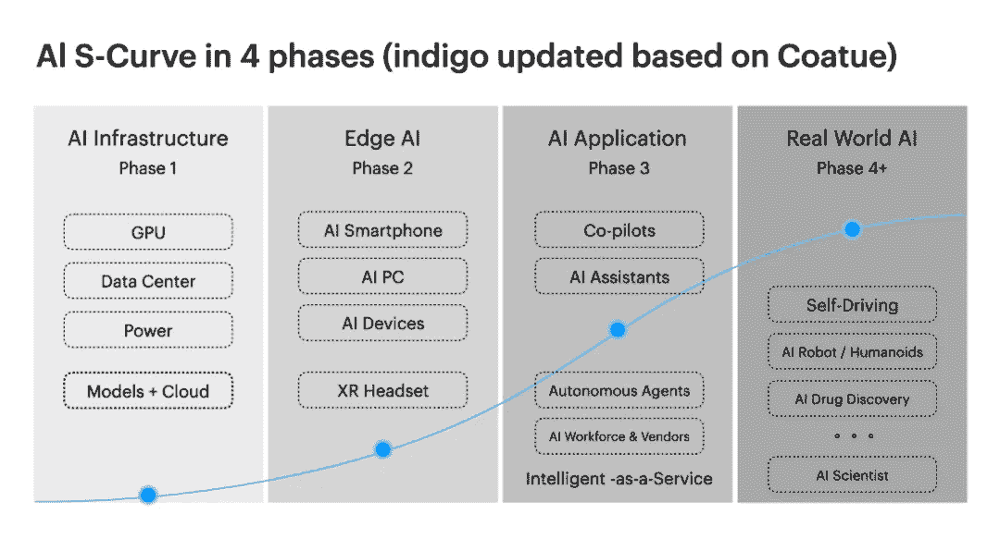

配图 5.02：Coatue 的 AI Cycle Wave（indigo 改进版）

也许就在不经意间，律师、会计还有任何形式的专业服务提供商，都会成为科技潜在市场的一部分。当然它们不是以“我们可以销售行业软件”的方式出现，而是以“我们可以提供销售或者律师即服务”的方式到来。OpenAI 的 GPTs 就是对这个世界的一个小小预览。

在物理世界，用灵巧的智能机器来自动化完成任务，将变得非常有价值。我们能最快看到的就是运输业和制造业的变化，虽然现在的制造已经是自动化大规模生产了，但嵌入了智能的机器一旦进入，大量替代人力之后，生产的学习曲线将快速降低，人类需要耗时间学习，而机器只需要拷贝知识就行。用于生产的机器越来越便宜，它们就会被更广泛的使用，并使其生产的东西也越来越便宜。这些都将是科技公司，而且规模会很大，Tesla 是其中的楷模之一，还有很多用智能加速硬件生产和改造物理世界的初创公司也在其列， Packy McCormick 最近就在他的 X 上列了一个 详细的清单 ，他称其为 Techno Industrial Revolution 。

或许很快，或许还要几年多年，科技公司将进一步拉低成本以及扩大利润，不断增长其收入。一切都会更便宜，他们会卖出更多的产品；他们将把利润再投资于研发，并以更快的速度将研发成果转化为更新、更便宜、更好的产品，这个雪球将在这次新工业革命中持续的滚下去。我们的经济体量将因此而变得更大，从结构上更加有利可图！

无论如何，你都需要想得更远，才能在一个智力和劳动力都将被商品化的世界中胜出。

# 尾声 - 与 AI 的协同进化

因为算力的飞速提升、还有神经网络与硅谷人才网络的演化，我们有了生成式 AI 的革命，它带来了大语言模型。语言原本是人类智慧的火种，但现在我们已知的宇宙里，有一种人造的智能，可以用和我们一样的语言来独立的解释世界，这些人工智能就像神话里的盗火者。

人类面对比自己更加聪明的物种出现的时候，天生就有一种警觉，它们的目的是什么？它们会毁灭我们么？Amazon 的创始人 Jeff Bezos 在最近一次接受 Lex Fridman 采访的时候，就做了个形象的比喻：“现在大语言模型的智能，不像是我们发明出来的，而是召唤出来的”。对复杂的神经网络内隐藏秘密的研究才刚开始，我们如何使用和控制这些黑箱模型，是业界和社会争论最激烈的话题。有人认为 AGI 不加以控制，会导致人类灭亡；也有人认为现在的架构，再怎么扩展算力，也根本实现不了 AGI。媒体报道上充满了各种矛盾且对立的观点，大家还十分喜欢围观这样的辩论，因为我们喜欢寻找大脑中默认想法的认同感。

在这篇文章中，我引用了丰富的论点和最新的研究，尝试给大家呈现出尽可能客观的结论，就是我们还能用多模态的数据提升机器的智能，改进架构和强化训练的方法，可以让 AI 模型往逻辑推理、计划、记忆还有目标感更强的方向发展，Scaling Law 依旧有效；但并不确定在更大规模的数据和训练中，是否会涌现出自主目标或者是我们定义不清晰的“意识”来。科技公司研发的约束方式是训练出辅助人类的超级智能助手，而不是可以自我改进升级的超级自能体，让 AI 渐进式的融入社会，从而推动新一轮的工业革命和经济增长。踩油门还带刹车是同时进行的，这样才能安全切顺滑的驾驶。

我个人最认同 Stephen Wolfram 的观点：未来，A**I 将会从我们人类这里学**习它**们所能学到的**，然后它们基本上将像自然界一样 成为自我运行的计算系统 —— 有时候“与我们互动”而已。他们会对我们“做些什么”呢？就像大自然会对我们“做些什么”一样；AI 会消灭我们么？大自然也完全可以消灭我们。。以一种类似泛灵论的方式，我们可能会把意图归因于自然，但最终它只是“ 遵循其规则 ”并做它该做的事情。即使 AI 可以自我提升成掌控一切的“顶级智能”，但在这个计算不可约的宇宙里，不会存在一个“万事皆通”的计算系统。新兴的生物学领域有一个核心结论：无论你指定了什么“成就”，在计算宇宙的某个地方总会有一个计算系统超越它 - 计算等效原则 （ A New Kind of Science - Stephen Wolfram）。

**最后，如果 **AI 真从我们这里学到了一切，那么它们也必然会继承我们“ 求胜的冲动 ”，也许会导致 它们挑战人类。这将是 AI 宪法具意义的地方：定义一个超越 AI 的契约，让它们无法从人类的天性中习得这个能力，这样我们才能期待与 AI 共存，一起协同进化。

Peace ☮️

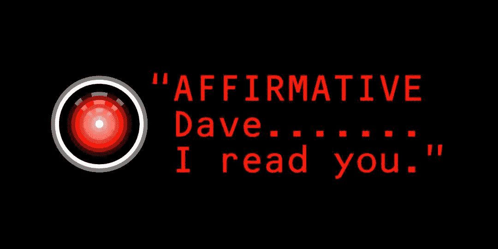

## **参考**

1.  OpenAI is doomed? - Et tu, Microsoft? - by Semi Analysis

1.  Why Geoffrey Hinton is worried about the future of AI - by University of Toronto

1.  ChatGPT is everywhere. Here’s where it came from - by Will Douglas Heaven

1.  An insightful conversation with Geoff Hinton about AI and catastrophic risks - by Andrew Ng

1.  New Theory Suggests Chatbots Can Understand Text - by Anil Ananthaswamy

1.  The Unpredictable Abilities Emerging From Large AI Models - Stephen Ornes

1.  ChatGPT Is a Blurry JPEG of the Web - By Ted Chiang

1.  The Mastermind Behind GPT-4 and the Future of AI | Ilya Sutskever - by Craig Smith

1.  Generative AI’s Act Two - BY SONYA HUANG, PAT GRADY, AND GPT-4

1.  Emerging Architectures for LLM Applications - by Matt Bornstein & Rajko Radovanovic

1.  Mustafa Suleyman: My new Turing test would see if AI can make $1 million - By Mustafa Suleyman

1.  The AI Workforce is Here: The Rise of a New Labor Market - by Pete Flint & Anna Piñol

1.  DREAM-LOGIC, THE INTERNET AND ARTIFICIAL THOUGHT - By David Gelernter

1.  Tech is Going to Get Much Bigger - by Packy McCormick

1.  Intelligence Superabundance - by Packy McCormick

1.  Energy Superabundance: How Cheap, Abundant Energy Will Shape Our Future - by Austin Vernon & Eli Dourado

1.  Mark Zuckerberg - Llama 3, Open Sourcing $10b Models, & Caesar Augustus - by DWARKESH PATEL

1.  Google Gemini Eats The World – Gemini Smashes GPT-4 By 5X, The GPU-Poors - by Semi Analysis

1.  Acquired interview with NVIDIA CEO Jensen Huang - by Acquired

1.  The next grand challenge for AI - by Jim Fang

1.  数字重塑人生 / 理解即将被 Metaverse 与数字转型重构的世界 - by Indigo

1.  The Bitter Lesson - by Rich Sutton

1.  机器之心的进化 / 理解 AI 驱动的软件 2.0 智能革命 - by Indigo

1.  Geoffrey Hinton | On working with Ilya, choosing problems, and the power of intuition - by Joel Hellermark

1.  Mustafa Suleyman on getting Washington and Silicon Valley to tame AI - by Robert Wiblin & Keiran Harris | 80,000 Hours

1.  John Schulman (OpenAI Cofounder) - Reasoning, RLHF, & Plan for 2027 AGI - by DWARKESH PATEL

1.  SITUATIONAL AWARENESS - by Leopold Aschenbrenner

1.  Can AI Solve Science? - by Stephen Wolfram

1.  Guillaume Verdon: Beff Jezos, E/acc Movement, Physics, Computation & AGI - by Lex Fridman

1.  Self-driving as a case study for AGI - by Andrej Karpathy

1.  Why trying to "shape" AI innovation to protect workers is a bad idea - by NOAH SMITH

1.  Will AIs Take All Our Jobs and End Human History—or Not? Well, It’s Complicated… - by Stephen Wolfram

**Papers**

1.  Experience Grounds Language - by CLAW

1.  A Generalist Agent - by Deepmind

1.  The Platonic Representation Hypothesis - by Phillip Isola from MIT

1.  Constitutional AI: Harmlessness from AI Feedback - by Anthropic

1.  Levels of AGI for Operationalizing Progress on the Path to AGI - DeepMind

1.  Sparks of Artificial General Intelligence: Early experiments with GPT-4 - Microsoft Research

**Reports**

1.  AI: The Coming Revolution - by Coatue

1.  THE AI INDEX REPORT 2024 - by HAI

1.  Coatue 2024 LP Report - by Coatue

1.  Automation and New Tasks: How Technology Displaces and Reinstates Labor - by Daron Acemoglu

---

---

这篇文章的引用和参考，文章、视频、播客、论文还有报告加起来四十多篇了，唯一两篇中文的还是我自己之前写的。。不过这次写作确实让我能从之前的阅读中提炼一些更高层次的理解🤔

要消化这么多内容，肯定需要 AI 工具帮忙：

- Maimo.ai 参考内容的检索、问答与要点提炼，混合生成才有新灵感；

- Perplexity 概念解释与引用数据核实；

- ChatGPT 帮我整理写作逻辑和部分输出；

