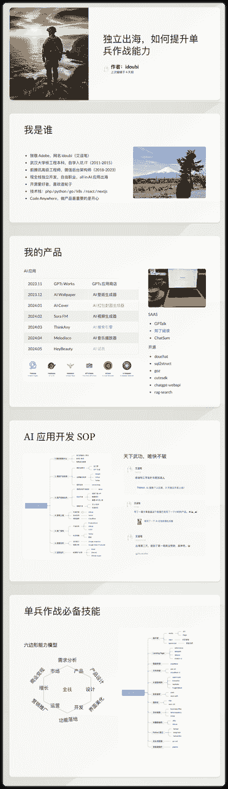
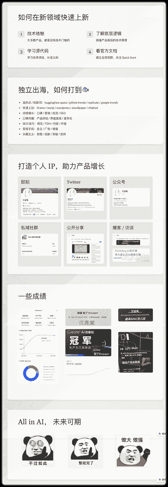

# Idoubi - AI创业者

> 来源：[https://waytoagi.feishu.cn/docx/P713dDyNOoiAYWxIxVLcFBqonSD](https://waytoagi.feishu.cn/docx/P713dDyNOoiAYWxIxVLcFBqonSD)

https://gamma.app/docs/-3uums0picfo0k5b

# 我是谁

+   致敬 Adobe，网名 idoubi（艾逗笔）

+   武汉大学核工程本科，自学入坑 IT（2011-2015）

+   前腾讯高级工程师，微信后台架构师（2018-2023）

+   现全栈独立开发，自由职业，all in AI 应用出海

+   开源爱好者，喜欢造轮子

+   技术栈：php / python / go / k8s  / react / nextjs

+   Code Anywhere，做产品最重要的是开心

# 我的产品

AI 应用

SAAS

+   GPTalk

+   知了阅读

+   ChatSum

开源

+   douchat

+   sql2struct

+   goz

+   cutesdk

+   chatgpt-webapi

+   rag-search

