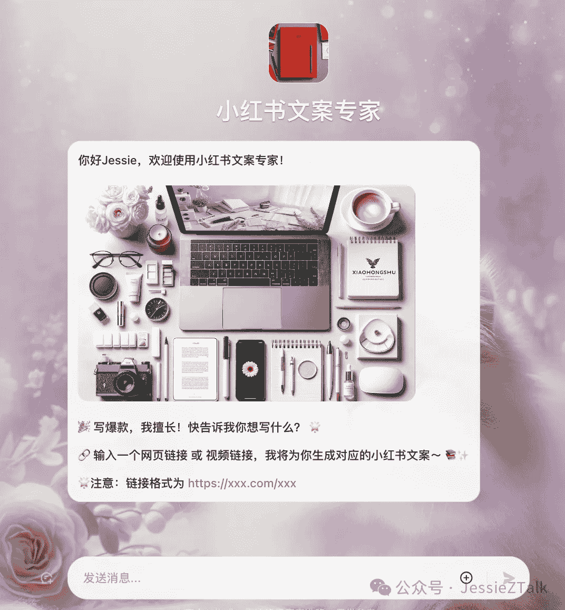
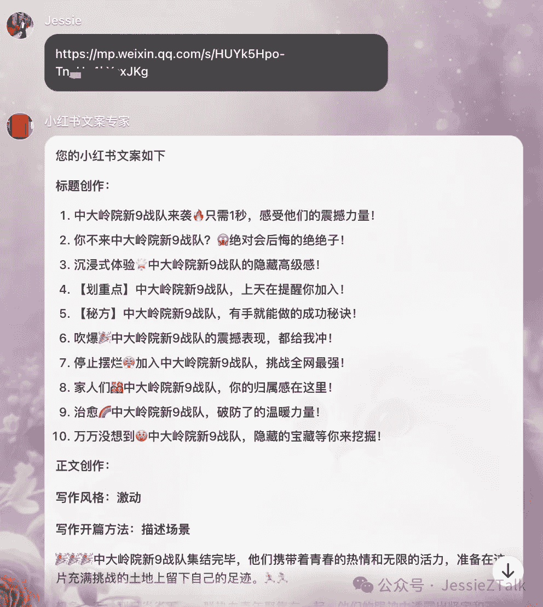
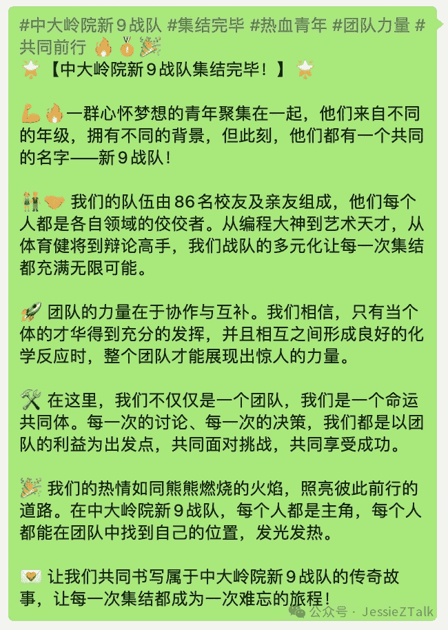
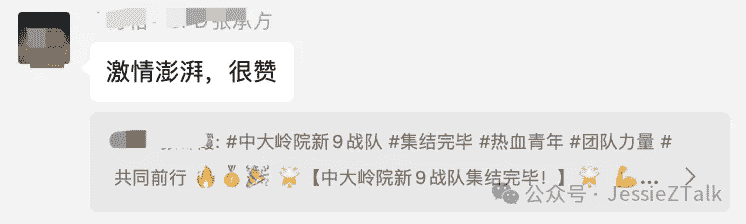

# 怎样利用AI节约10倍内容创作时间？

> 来源：[https://waytoagi.feishu.cn/docx/Pr9wdYPXWoHTOnxpBDDcPfvBnwc](https://waytoagi.feishu.cn/docx/Pr9wdYPXWoHTOnxpBDDcPfvBnwc)

> 🔗 原文链接： h[ttps://mp.weixin.q](https://mp.weixin.qq.com/s/HxWQWsJlb1caGMZeZj5-Ww)q.com/s/HxWQWsJl...

> ⏰ 剪存时间：2024-06-06

> 原创 JessieZTalk

🚀 接着上期SOP + AI：打造职场高效能人士的秘密武器的分享，今天继续聊聊SOP+AI的应用，🎯 今天的主题是“怎样利用AI节约10倍内容创作时间？”

📚 最近跟团队有开始运营小红书账号，就想着先给自己打造点顺手的工具，于是乎「小红书文案专家」就出生啦～🎉

# 一、 **先介绍下我们小Bot**

**🛺BOT名称 ：** 小**红书文案专家**

**功能价值 **：见过多个爆款文案长啥样，只需输入一个网页链接 或 视频链接，就能生成对应的小红书文案，可以辅助创作者生成可以一键复制发布的初稿，提供创意和内容，10倍节约文字内容创作时间。

**🎸应用链接 ：**

https://www.coze.cn/s/ij5C6LWd/

**😊Bot封面：**

#

# **二、 设计思路**

**😔痛点 ：**一个人一天的时间太有限啦，怎样才能保质保量的生产内容呢？如果有人能够帮我写个初稿，我再进行二创，岂不美滋滋。每次还要找配图很麻烦，能帮我生成好配图，那就更美了。

从此能够过上每天睡饱8个小时的生活，哈哈哈～

**🌟实现思路 ：**给自己和团队小伙伴设计一个工作流，让AI按照运营宝宝日常的工作思路和流程，给我们打工。

**🙌一期产品功能：**

1.  可以提取任何链接中的标题和内容

1.  按照小红书平台文案风格，重新整理内容

1.  加入emoji表情包，是文案更有活力

1.  为文案配图片

1.

**👀二期计划功能： 持**续优化升级中～

+   增加全网搜索热点功能

+   提炼热点新闻或事件关键信息

+   结合用户想要生成的内容方向，输出文案和配图

+

# **三、 来看看AI打工人的效果**

##

## **🛶场景：**

下午看到我们沙友群里，发出信息【新9战队已集结完毕，即将出征！】，大家都在祝贺“新9战队加油，预祝凯旋[加油][玫瑰][庆祝]”，我得说点不一样的刷刷存在感，哈哈

## **🍉操作步骤：**

1、找到新9战队的宣传文案链接

2、发给【小红书文案大师】

3、产出的文案，二创调整。

过程和效果如下，还获得了小伙伴们的点赞，这波存在感刷的可以～

🌟 欢迎关注 JessieZTalk ，在AIGC的路上共同成长， 个人/企业有AI咨询需求，欢迎链接我～