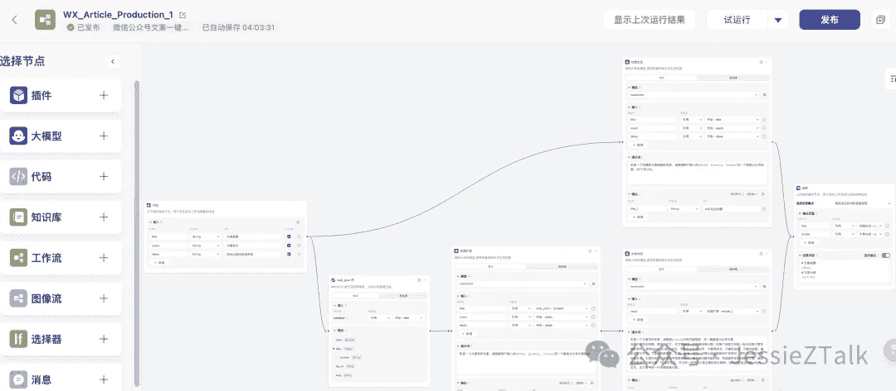
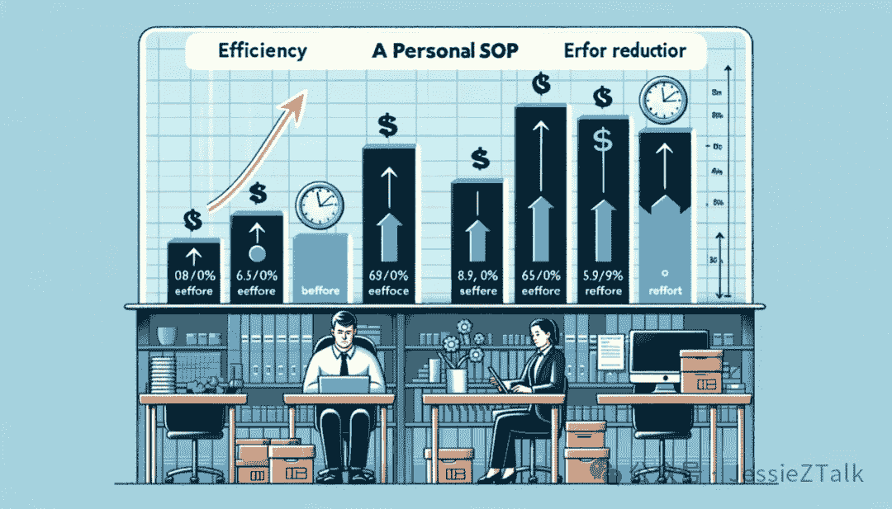

# SOP + AI：打造职场高效能人士的秘密武器

> 来源：[https://waytoagi.feishu.cn/docx/NDRjdywguoCZ1OxS6HMcp8CcnRb](https://waytoagi.feishu.cn/docx/NDRjdywguoCZ1OxS6HMcp8CcnRb)

> 🔗 原文链接： h[ttps://mp.weixin.q](https://mp.weixin.qq.com/s/AsVwu7yb-KOqVOUOhrZoJw)q.com/s/AsVwu7yb...

> ⏰ 剪存时间：2024-05-30

> 原创 JessieZTalk

我们常常会遇到这样的问题：工作流程混乱，效率低下，因为一些琐碎的小事而浪费大量时间。

在这个快节奏的时代，职场竞争愈发激烈。每个人都在寻找提升工作效率的秘诀， 而SOP（Standard Operating Procedure，标准操作程序）无疑是职场中的一把利器。

今天，我将和大家分享这种有效的工具——标准操作程序（SOP），并探讨如何借助AI助手来建立和优化SOP，从而提升工作效率。

##

### **为什么需要SOP？**

+   SOP是一种文档化的流程，它规定了完成特定任务的标准步骤。SOP的存在确保了工作的一致性和可重复性，降低了出错率。

+   设想一下，当你每天都在重复某些任务，但却没有一个固定的流程，每次都要重新思考和安排，这样不仅浪费时间，还容易出错。而SOP的存在，就能帮助你规避这些问题，让每一项工作都有章可循，提高效率的同时，也能提升工作的准确性和一致性。

### **SOP能带来什么好处？**

+   首先， 提升工作效率， SOP能够大大减少工作中的失误。通过标准化流程，每个人都能按照既定的步骤进行操作，减少了因为个人操作习惯不同而带来的差错，并且 减少不必要的重复工作。

+   其次，SOP能够节省时间。标准化的流程可以让你在工作中无需再花时间思考下一步该怎么做，直接按照流程进行操作，大大提高了效率。

+   最后，SOP能够提升团队协作。一个清晰的SOP，可以让团队中的每一个成员都了解整个流程，便于分工合作，提升团队的整体效率。

### **如何制定一份有效的SOP？**

制定SOP并不是一件难事，但要做到高效实用，还是需要一些技巧的。以下是几个关键步骤：

### **1. 识别重复任务**

找出那些你经常需要重复执行的任务，如回复邮件、准备报告等。

### **2. 分析流程**

详细列出每个任务的执行步骤，考虑是否每个步骤都必要。

### **3. 制定标准**

为每个步骤设定明确的标准和时间限制，确保效率。

### **4. 文档化**

将你的SOP流程写成文档，方便随时查阅和执行。

### **5. 测试与优化**

在实际工作中测试你的SOP，根据反馈进行必要的调整。

### 如何借助AI助手建立和优化SOP？

# **SOP+AI  **

**       **

在制定和优化SOP的过程中，AI助手目前已经可以发挥重要作用了！通过一些Agent平台，已经可以DIY自己的工作流了，这篇文章我就用了自己搭建的工作流辅助生成，经过对比测试，比直接通过prompt跟大模型交互，产出的内容更符合我的心理预期。

**工作流截图如下：**

通常以下场景，都可以通过AI工作流的方式来提效：

#### **1. 数据收集与分析**

AI助手可以帮助你收集和分析工作中的数据，找出工作流程中的瓶颈和问题。通过对数据的分析，AI助手能够提出改进建议，帮助你优化工作流程。

#### **2. 自动化流程**

AI助手能够自动化一些重复性高、标准化强的工作流程。比如，通过RPA（机器人流程自动化）技术，AI助手可以自动执行某些固定的工作步骤，大大提高效率。

#### **3. 实时监控与反馈**

AI助手能够实时监控工作流程，及时发现问题并反馈给你。这样，你可以在第一时间进行调整，确保工作流程的顺畅运行。

### 案例分享：SOP与AI的完美结合

我们来看看一个具体的案例。X公司的客服团队在引入SOP和AI助手后，工作效率得到了显著提升。

在引入SOP之前，客服团队的工作流程非常混乱，每个客服人员都有自己的一套工作方法，导致工作效率低下，客户满意度不高。后来，公司决定引入SOP，对客服流程进行标准化。通过详细记录和标准化操作，客服团队的工作效率大大提高。

但这还不够，公司进一步引入了AI助手，利用AI助手对客服流程进行自动化。比如，AI助手可以自动回复一些常见问题，处理简单的客户请求，减少了客服人员的工作量。通过实时监控和反馈，AI助手还能及时发现客服流程中的问题，帮助团队进行优化。

结果，这家公司客服团队的工作效率提升了30%以上，客户满意度也得到了显著提高。

通过以上内容，相信大家已经对SOP有了更深入的了解。SOP不仅能提升工作效率，还能减少失误，促进团队协作。而借助AI助手，SOP的制定和优化将变得更加高效和智能。

如果你希望在职场中脱颖而出，提升自己的工作能力，不妨尝试制定自己的SOP，并借助AI助手进行优化。 相信你会发现，工作变得更加轻松高效，职业生涯也将迎来新的突破。

欢迎关注JessieZTalk，获取更多职场提升技巧与AI应用案例！