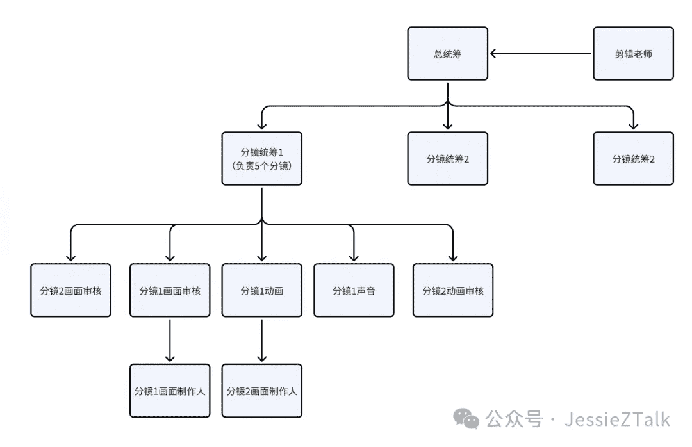
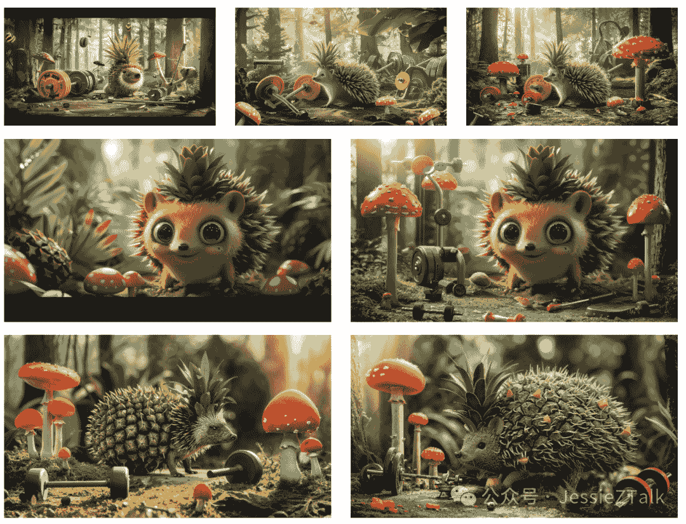
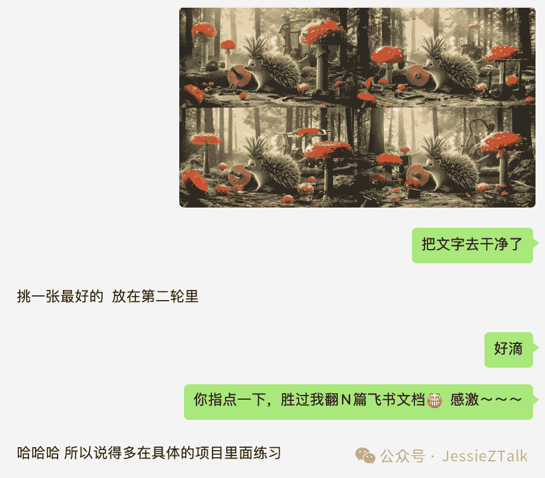
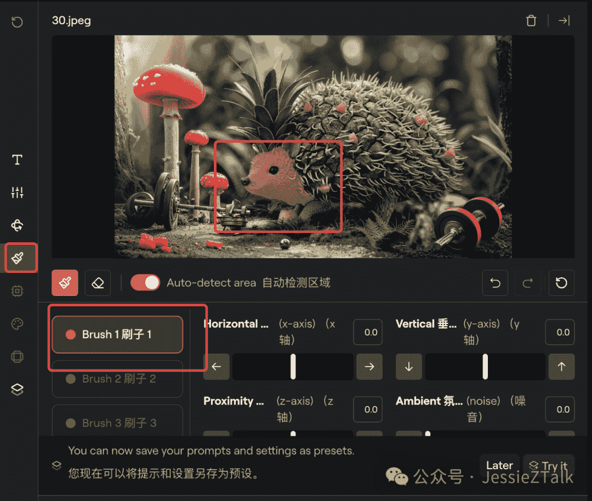
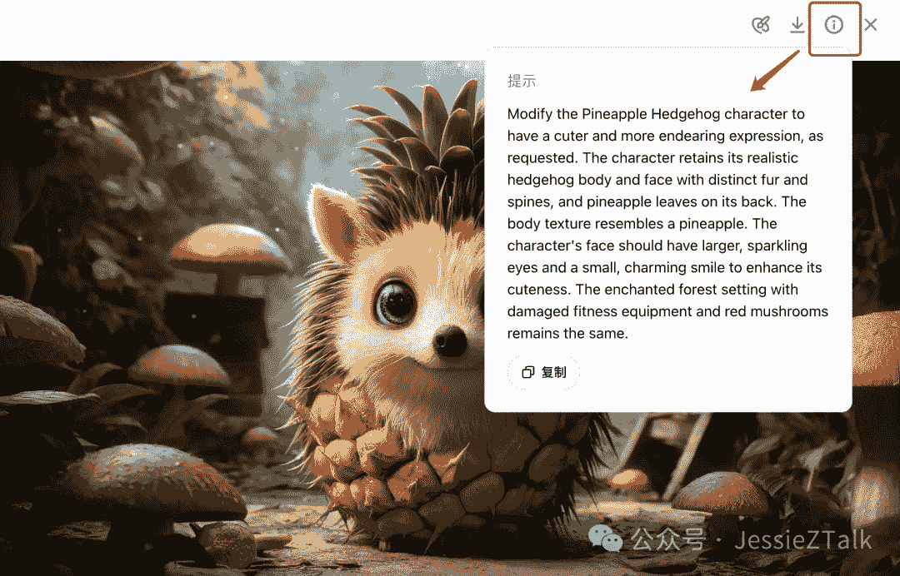

# SOP+AI：作为小白，我是如何参与制作AI动画短片的？

> 来源：[https://waytoagi.feishu.cn/docx/Io66dmNzfoZr8SxSYaTcPPxMnRc](https://waytoagi.feishu.cn/docx/Io66dmNzfoZr8SxSYaTcPPxMnRc)

> 🔗 原文链接： h[ttps://mp.weixin.q](https://mp.weixin.qq.com/s/YsbU0PDSaPxCVqvijUf7BA)q.com/s/YsbU0PDS...

> ⏰ 剪存时间：2024-06-18

> 原创 JessieZTalk

这是一篇迟到的文章，最近有点忙，但是后台看到支持我的小伙伴越来越多，再忙也要坚持写作💪， 今天分享下设计小白怎么借助AI制作视频短片 。

5月份我参与制作的AI动画短片《奥运前夜》6.1在广州电视台播放了📺。作为一个设计小白，同时还定居在广州，我感到非常自豪😄。短片链接如下🔗：

<https://player.bilibili.com/player.html?bvid=1Ys421g7iG&spm_id_from=333.337.search-card.all.click&vd_source=290a2836f7818edc2c18c6eb525d4abe>

## 01

在此首先特别感谢共创活动组织者「AJ、娜娜、猫叔、三思、王贝等」，以及5组组长「阿强」的指导和帮助，通过这次共创过程，我也收获了很多宝贵的经验。

其次，我要特别提到SOP（标准操作程序）和工作流的重要性，它们是确保项目顺利进行的关键。分享AI动画短片制作的SOP流程如下（部分内容来源于Waytoagi AI视频资料分享）：



1、项目规划：确定短片主题和目标观众，制定详细的制作计划。

2、剧本创作：编写故事脚本，设计角色和场景以及创意。

+   分享剧本创作资料如下：

https://waytoagi.feishu.cn/wiki/G11fwW8bmiVLe6kYLgYc2iGin6e

+   捏剧本Bot（ 捏剧本-离谱村专用

https://www.coze.cn/store/bot/7367669913697239052?panel=1&bid=6cs144r404016

3、分镜头脚本：根据脚本制作分镜头脚本，确定每个镜头的画面和动作。

4、资源准备：准备动画制作所需的素材，包括背景、角色和音效。

5、画面图片制作：利用AI出图工具，比如通过ChatGPT、MJ、SD等工具快速生成高质量的图片。

6、视频制作：利用AI工具制作动画，通过RUNWAY、Luma、Dreamina等平台快速生成高质量的动画。

7、后期剪辑：添加音效、配音和字幕，进行最终的剪辑和合成。

8、发布和推广：将完成的动画短片发布到各大平台，并进行推广和宣传。

## 02

接下来，我来分享一下我参与设计的具体内容以及学习心得：

### **1、 我分到的共创内容是什么？**

在这个项目中，我负责的是“刺猬菠萝”角色的图片和视频制作。虽然之前没有相关经验，但在阿强的指导下，我逐渐掌握了基本技巧，并快速入门了MJ和RunWayAI工具来提高效率。以下是我基于剧本 “刺猬菠萝”出国的各种图片， 我最喜欢的是“大眼萌菠萝刺猬”， 但考虑到整部片子的一致性，最终选择了最下方的菠萝刺猬形象。



### 2、 为了做好这件事，我干了什么？

为了能够顺利完成任务，我花了不少时间学习和实践。首先，WaytoAGI社群中有很多入门资料，可以快速了解了动画制作的基本流程和技术。其次，我积极参与团队讨论，向有经验的大佬们积极请教， 大佬指点一下，胜过阅读N篇学习资料 😎， 我墙裂建议， 大家多多参与「共创活动」，不仅能够快速学习，还能收获一帮积极热情的小伙伴！



### 3、快速入门MJ和RunWay心得

MJ和RunWay是两个非常强大的AI工具，分别用于角色图片生成和动画制作。刚开始接触时，我觉得有些复杂，但通过反复实践和摸索，逐渐掌握了它们的使用方法。MJ可以快速生成高质量的角色形象，而RunWay则可以帮助我们轻松实现动画效果，AI工具发展速度特别快，最近Luma 发布 DIT 视频生成模型 Dream Machine图生视频的表现相当惊艳，绝对是电影级表现。

**分享一些实用技巧如下：**

**1） MidJourney 角色一致性 (**cref) 和 风格一致性 (sref)

MidJourney提供了cref和sref两个非常有用的功能，分别用于 角色一致性 和 风格一致性 。以下是一些使用技巧，我这次创作使用到的指令示例如下：

```
https://s.mj.run/DKhX2SZbnUQ Movie shoot, a pile of brand new but damaged fitness equipment, red mushrooms🍄, a fairy tale like forest background,  broken barbell，
&lt;这里放离谱动物的描述词&gt;,
--ar 16:9 --cref &lt;离谱动物的图片链接&gt;   --cw 100 
--sref https://s.mj.run/DKhX2SZbnUQ --sw 1000
```

**角色一致性 (cref) :**

+   使用 --cref后接角色图片的URL，可以在创作中保持角色形象的一致性。

+   可以使用--cw来调整参考的强度，范围从100到0。默认设置是100，会使用面部、头发和衣服；强度为0时，只专注于面部，适合更换服装或发型等。

**风格一致性 (sref) :**

+   使用 --sref后接风格参考图像的URL，MidJourney会生成与这些参考图风格一致的图像。

+   可以添加多个风格参考链接，并通过::后跟权重数字来设置不同风格的相对重要性，例如：urlA::2 urlB::3。

+   通过--sw设置样式的总权重，100为默认值，0为关闭值，1000为最大值。

+   可以结合使用垫图和sref，垫图主要影响画面的构图和元素，而sref主要影响画风。

**2）RunWay的笔刷控制**

在使用图生视频的时候，如果角色变形严重，可以通过笔刷来控制局部动画 ，刷哪里动哪里～



**3**） ChatGPT的语义理解能力比较强，可以先用gpt生成基础的图片和prompt，然后再去MJ里扩图，这样效率很高。



## 03

#### 对于想要了解AI生成图像和生成视频的朋友们，我有以下几点建议：

1、多看教程，多实践：通过学习教程和反复实践，可以快速掌握AI工具的使用方法。

2、积极参与社群交流：加入相关社群，向有经验的朋友请教，可以获得很多宝贵的经验和建议。

3、保持好奇心和探索精神：AI技术发展迅速，不断学习和探索新技术，可以让你在这个领域中保持竞争力。

#### **AI时代对视频内容创作的影响：**

AI技术的快速发展，对视频内容创作产生了深远的影响。它不仅提高了制作效率，还大大降低了制作成本，使更多人能够参与到视频创作中来。对于设计小白来说，这是一个前所未有的好机会，可以通过学习和实践，快速提升自己的创作能力。

总的来说，这次参与《奥运前夜》的制作让我收获颇丰，感谢WaytoAGI、感谢开源、感谢一群为爱发电的小伙伴！希望我的经验能给大家带来一些启发和帮助。

🌟 欢迎关注 JessieZTalk ，在AIGC的路上共同成长， 个人/企业有AI咨询需求，欢迎链接我～