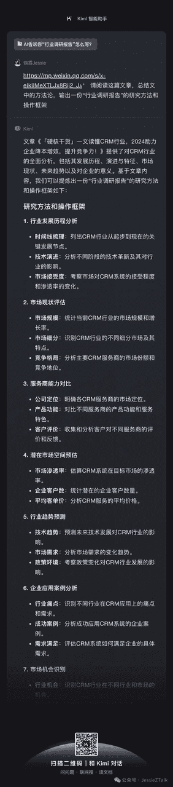

# 行业调研报告：AI 教你“行业调研报告”怎么写？

> 来源：[https://waytoagi.feishu.cn/docx/KsOydCJfKor2a8x4A7KcDkEPnYf](https://waytoagi.feishu.cn/docx/KsOydCJfKor2a8x4A7KcDkEPnYf)

> 作者：JessieZTalk，大厂产品出身，理工科+商科背景，关注商业、AI 科技、互联网营销。

+   本文是结合【AI 工具】与【我自己的“行业调研报告”专业知识】，一步步拆解“行业调研报告”方法论和技巧，对于写“各个行业研究报告”都有参考意义。

+   个人观点：只要问题问的好，AI 会把“优秀行业研究报告”用的技巧和套路扒的干干净净的...

+   原文链接：「AI 学习三步法：实践」干货！AI 教你“行业调研报告”怎么写？

+   [快速学习 AIGC，有料通俗易懂版！](https://waytoagi.feishu.cn/wiki/EJDAw2ovbis1c3kcsKvc2NPXni0?from=from_copylink)I 学习三步法 WaytoAGI 链接：

# 「AI 学习三步法：实践」干货！AI 教你“行业调研报告”怎么写？

我在今年 3 月，运用“10+年产品设计经验+MBA 商业知识+个人行业认知”，历时两周整理了一份 CRM 行业万字干货“行业调研报告”，最近在整理 AI 实践案例，今天将结合我的经验教大家，如何利用 AI 工具，让自己变成一个“行业研究”高手。

[想参考“行业调研报告”写法案例的可阅](http://mp.weixin.qq.com/s?__biz=MzU4MjY5OTU1MQ==&mid=2247483717&idx=1&sn=6a51ba5be617f65ceec891835385e980&chksm=fdb51e35cac29723a5bcc340f5b3a3e3e0830d8fb1110c886781224407959f65e2f9f1f2379d&scene=21#wechat_redirect)读原文：「硬核干货」一文读懂 CRM 行业，2024 助力企业降本增效，提升竞争力！

话不多说，操作方法如下：

# **一、工具：**

1、 Kimi： https://kimi.moonshot.cn/

2、其他任何 AI 工具也可以，越智能的大模型，输出质量会更好，有条件的推荐使用 ChatGPT-4o。

# **二、步骤：**

**1、让 AI 阅读学习：**

一篇你觉得优秀的行业调研报告，总结文中的方法论，输出一份“行业调研报告”的研究方法和操作框架；

**2、问 AI**：

文章在收集行业数据时，用了哪些一手数据和二手数据？推荐一些靠谱的行业资料收集网站

**3、要求 AI：**

我想参考以上内容，写一份“XXX 行业调研报告”。你是一个“行业调研报告撰写专家”，请帮我推荐 10 个“XXX 行业“信息网站和 5 个“XXX 行业”研究微信公众号，然后输出一份“XXX 行业调研报告”框架。

**4、要求 AI：**

请针对以上“XXX 行业调研报告”框架，丰富每一章节内容，每章内容字数大于 200 字。

**5、以上 4 个步骤后，AI 帮**你写一个“XXX 行业调研报告”的初稿了

下来就可以根据你的需求，让 AI 进一步完善每一个章节的内容。然后结合自己的独特经验和知识，对文章内容进行润色和调整。

这样一篇“有内容”、“有结构”的行业调研报告就完成了！

# **三、Attention：**

“有深度”这个事情，可以有 2 个路径：

1、自己对行业比较了解，整理深度洞察和见解；

2、一步一步深度咨询 AI，借助 AI 的海量知识，一边学习、一边研究、一边洞察总结。

（通过借助 AI，可以加速我们的学习和研究能力）

# **四、操作示例如下：**

获取“kimi 对话原文”链接：AI 告诉你“行业调研报告”怎么写？



```
User: https://mp.weixin.qq.com/s/x-eIkIlMeXTLJx8Rij2_JA   请阅读这篇文章，总结文中的方法论，输出一份“行业调研报告”的研究方法和操作框架 
Kimi: 文章《「硬核干货」一文读懂CRM行业，2024助力企业降本增效，提升竞争力！》提供了对CRM行业的全面分析，包括其发展历程、演进与特征、市场现状、未来趋势以及对企业的意义。基于文章内容，我们可以提炼出一份“行业调研报告”的研究方法和操作框架如下：

### 研究方法和操作框架

#### 1. **行业发展历程分析**   
- **时间线梳理**：列出CRM行业从起步到现在的关键发展节点。   
- **技术演进**：分析不同阶段的技术革新及其对行业的影响。   
- **市场接受度**：考察市场对CRM系统的接受程度和渗透率的变化。

#### 2. **市场现状评估**   
- **市场规模**：统计当前CRM行业的市场规模和增长率。   
- **市场细分**：识别CRM行业的不同细分市场及其特点。   
- **竞争格局**：分析主要CRM服务商的市场份额和竞争地位。

#### 3. **服务商能力对比**   
- **公司定位**：明确各CRM服务商的市场定位。   
- **产品功能**：对比不同服务商的产品功能和服务特色。   
- **客户评价**：收集和分析客户对不同服务商的评价和反馈。

#### 4. **潜在市场空间预估**   
- **市场渗透率**：估算CRM系统在目标市场的渗透率。   
- **企业客户数**：统计潜在的企业客户数量。   
- **平均客单价**：分析CRM服务的平均价格。

#### 5. **行业趋势预测**   
- **技术趋势**：预测未来技术发展对CRM行业的影响。   
- **市场需求**：分析市场需求的变化趋势。   
- **政策环境**：考察政策变化对CRM行业发展的影响。

#### 6. **企业应用案例分析**   
- **行业痛点**：识别不同行业在CRM应用上的痛点和需求。   
- **成功案例**：分析成功应用CRM系统的企业案例。   
- **需求满足**：评估CRM系统如何满足企业的具体需求。

#### 7. **市场机会识别**   
- **行业机会**：识别CRM行业在不同行业和市场的机会。   
- **细分市场**：分析细分市场中的特定机会。   
- **创新机会**：探索CRM系统创新带来的新机会。

#### 8. **策略建议**   
- **企业选择**：为企业选择CRM系统提供指导和建议。   
- **服务商发展**：为CRM服务商提供市场发展策略。   
- **行业创新**：提出推动CRM行业发展的创新策略。

#### 9. **数据收集与分析**   
- **一手数据**：通过调查、访谈等方式收集一手数据。   
- **二手数据**：利用公开报告、行业分析等获取二手数据。   
- **数据分析**：运用统计学方法对数据进行分析和解释。

#### 10. **报告撰写**   
- **结构化报告**：按照逻辑清晰的结构撰写报告。   
- **关键发现**：突出报告中的关键发现和建议。   
- **视觉呈现**：使用图表、图像等辅助工具增强报告的可读性。
通过上述研究方法和操作框架，可以系统地进行行业调研，为决策者提供全面、深入的行业洞察。 

User: 文章在收集行业数据时，用了哪些一手数据和二手数据？推荐一些靠谱的行业资料收集网站 
Kimi: 根据文章内容，以下是文章在收集行业数据时使用的一些一手数据和二手数据来源：

### 一手数据来源：1. **国家统计局披露数据**：提供了关于企业法人单位数量的信息。2. **21经济网**：提供了关于中国CRM使用率的报告。3. **CRM厂商行业调研**：提供了关于平均客单价的数据。4. **艾瑞咨询**：提供了关于中国CRM市场规模的数据。5. **T研究**：提供了《中国CRM全景产业研究报告》。

### 二手数据来源：1. **各大CRM服务商官网**：提供了服务商的背景、产品信息和客户案例。2. **知乎**：制造业老宋提供的2023年装备制造企业CRM选型与应用指南。3. **微信公众号**：ToB老人家分享的相关知识。4. **弗若斯特沙利文**：提供了关于CRM企业服务市场的TAM（Total Addressable Market）估计数据。

### 推荐靠谱的行业资料收集网站：1. **国家统计局官网**：提供官方统计数据和经济信息。2. **艾瑞咨询**（iresearch.cn）：提供互联网行业的深度研究报告。3. **T研究**：专注于B2B领域的市场研究和咨询服务。4. **CBNData**（第一财经商业数据中心）：提供市场数据和消费者洞察。5. **QuestMobile**：提供移动互联网行业的数据分析和报告。6. **艾媒咨询**（iimedia.cn）：提供移动互联网、大数据、新媒体等领域的行业报告。7. **前瞻网**：提供行业研究报告、市场调研和数据服务。8. **中国产业信息网**：提供各行业的市场研究、行业分析和预测。9. **中国知网**（CNKI）：提供学术论文、行业报告和专业资料。10. **Wind资讯**：提供金融市场数据和行业研究报告。

这些网站和资源可以为行业调研提供丰富的数据和信息，帮助研究者更准确地分析和预测行业趋势。 

User: 我想参考以上内容，写一份“AIGC行业调研报告”。你是一个“行业调研报告撰写专家”，请帮我推荐10个AI信息网站和5个AI研究微信公众号，然后输出一份“AIGC行业调研报告”框架。 
Kimi: 理解您的需求后，我将为您推荐一些AI信息网站和AI研究相关的微信公众号，并提供一个“AIGC行业调研报告”的框架。

### 推荐的AI信息网站：1. **AI Research** (https://www.aai.science) - 提供人工智能领域的最新研究成果和论文。2. **arXiv** (https://arxiv.org) - 一个包含大量AI和机器学习论文的预印本存档库。3. **Google AI Blog** (https://ai.googleblog.com) - Google人工智能团队的官方博客，分享最新的研究和应用。4. **MIT Technology Review** (https://www.technologyreview.com) - 包含人工智能在内的科技趋势和分析。5. **Towards Data Science** (https://towardsdatascience.com) - 社区驱动的AI和数据科学文章平台。6. **机器之心** (https://www.jiqizhixin.com) - 专注于人工智能领域的新闻和分析。7. **雷锋网** (https://www.leiphone.com) - 涵盖人工智能、智能硬件等多个领域的科技资讯。8. **AI科技评论** (https://www.ai-review.com) - 提供AI领域的深度报道和行业分析。9. **InfoQ** (https://www.infoq.com) - 技术社区，提供AI相关的技术文章和新闻。10. **KDnuggets** (https://www.kdnuggets.com) - 数据科学、机器学习、AI和大数据领域的新闻和教程。

### 推荐的AI研究微信公众号：1. **机器之心** - 提供AI领域最新资讯和深度分析。2. **AI科技大本营** - 专注于人工智能技术分享和行业动态。3. **数据派THU** - 来自清华大学的数据科学和AI研究分享。4. **AI前哨** - 探讨AI技术前沿和行业应用。5. **智能界** - 关注人工智能、机器人和智能制造领域的最新动态。

### AIGC行业调研报告框架：
#### 封面- 报告标题- 子标题（如：人工智能生成内容行业）- 编制单位- 编制日期
#### 目录- 自动更新的目录页
#### 执行摘要- 行业概况- 主要发现- 推荐策略
#### 1. 行业背景与定义- AIGC概念解释- 行业发展历程- AIGC技术基础
#### 2. 市场环境分析- 全球市场概况- 国内市场概况- 政策环境分析
#### 3. 技术发展现状- 关键技术进展- 创新应用案例- 技术发展趋势
#### 4. 行业竞争格局- 主要参与者分析- 市场份额分布- 竞争策略分析
#### 5. 市场需求分析- 用户需求调研- 应用场景分析- 市场容量预测
#### 6. 产业链分析- 产业链结构- 关键环节分析- 价值链分析
#### 7. 行业风险与挑战- 技术风险- 市场风险- 政策与法规风险
#### 8. 发展策略与建议- 对企业的建议- 对投资者的建议- 对政策制定者的建议
#### 9. 结论- 行业前景总结- 长期发展趋势预测
#### 附录- 数据来源说明- 研究方法论- 参考文献
#### 致谢- 对参与调研和提供帮助的个人和机构表示感谢
#### 联系方式- 报告编制单位的联系信息
请注意，这只是一个基本框架，您可以根据实际调研的深度和广度进行调整。希望这个框架能够为您撰写“AIGC行业调研报告”提供帮助。 

User: 很好，请针对以上“AIGC行业调研报告”框架，丰富每一章节内容，每章内容字数大于200字。 
Kimi: 基于您提供的“AIGC行业调研报告”框架，以下是每个章节的丰富内容：
### 1. 行业背景与定义**AIGC概念解释**：AIGC，即人工智能生成内容（Artificial Intelligence Generated Content），指的是利用人工智能技术自动生成文本、图像、音频、视频等内容的一系列应用和方法。AIGC技术涵盖了自然语言处理（NLP）、计算机视觉（CV）、语音合成等子领域，目标是提高内容生成的效率、质量和创新性。
**行业发展历程**：AIGC行业的起源可以追溯到早期的基于规则的文本生成系统。随着深度学习技术的突破，尤其是生成对抗网络（GANs）、循环神经网络（RNNs）和Transformer模型的出现，AIGC领域迎来了快速发展。近年来，随着算力的提升和数据量的增加，AIGC在内容创作、娱乐、教育等多个行业得到应用。
**AIGC技术基础**：AIGC技术基础包括机器学习、深度学习、自然语言处理、计算机视觉等。这些技术使得机器能够理解、分析和生成人类语言和视觉内容。AIGC系统通常需要大量的训练数据来学习生成内容的模式和结构。
### 2. 市场环境分析**全球市场概况**：全球AIGC市场正在经历快速增长，受到技术进步、数据量增加和应用需求的推动。北美和欧洲是AIGC技术发展的前沿地区，而亚洲市场，尤其是中国，也显示出巨大的增长潜力。
**国内市场概况**：中国AIGC市场随着技术的进步和政策的支持迅速发展。国内企业和研究机构在AIGC领域投入了大量资源，推动了相关技术的应用和商业化。
**政策环境分析**：政府对AI技术的重视为AIGC行业的发展提供了良好的政策环境。政策支持包括资金投入、税收优惠、知识产权保护等，旨在促进AI技术的创新和应用。
### 3. 技术发展现状**关键技术进展**：AIGC领域的关键技术包括文本生成、图像识别与生成、语音识别与合成等。这些技术不断取得突破，提高了内容生成的自然度和多样性。
**创新应用案例**：AIGC技术被应用于新闻撰写、游戏设计、虚拟助手、教育内容开发等多个场景。例如，一些新闻机构已经开始使用AI生成新闻报道，而游戏公司则利用AIGC技术创造更加丰富和动态的游戏世界。
**技术发展趋势**：未来，AIGC技术将继续朝着更加智能化、个性化和自动化的方向发展。随着技术的成熟，AIGC将在更多领域得到应用，尤其是在创意产业和个性化服务方面。
### 4. 行业竞争格局**主要参与者分析**：AIGC行业的主要参与者包括技术公司、内容创作平台、媒体机构和初创企业。这些参与者在技术研发、市场应用和商业模式创新方面展开竞争。
**市场份额分布**：市场份额主要集中在技术领先和市场应用广泛的企业手中。随着市场的扩大，新兴企业和小型创业公司也在寻找细分市场的机会。
**竞争策略分析**：企业之间的竞争策略包括技术创新、合作伙伴关系建立、市场扩张和品牌建设。企业需要不断优化产品和服务，以满足市场需求和应对竞争。
### 5. 市场需求分析**用户需求调研**：用户对AIGC技术的需求主要集中在内容的质量和多样性、个性化服务、以及操作的便捷性。用户期望AIGC技术能够提供更加丰富、有趣和有用的内容。
**应用场景分析**：AIGC技术的应用场景广泛，包括但不限于内容创作、娱乐、教育、营销、客户服务等。不同场景下用户的需求各有侧重，对AIGC技术提出了不同的挑战和要求。
**市场容量预测**：随着技术的成熟和应用的拓展，预计AIGC市场的容量将持续增长。市场研究机构预测，未来几年内，AIGC市场将保持两位数的增长率。
### 6. 产业链分析**产业链结构**：AIGC产业链包括基础技术研发、平台开发、内容生成、分发渠道和终端用户等环节。每个环节都有其特定的参与者和价值创造方式。
**关键环节分析**：技术研发是产业链的核心环节，它直接影响到AIGC技术的性能和应用范围。平台开发和内容生成是连接技术和市场的桥梁，而分发渠道和终端用户则是产业链的最终输出。
**价值链分析**：价值链分析显示，技术创新和内容生成环节通常具有较高的附加值。随着市场的发展，分发渠道和用户服务也变得越来越重要。
### 7. 行业风险与挑战**技术风险**：AIGC技术面临的风险包括技术不成熟、算法偏差、数据隐私和安全问题。这些问题可能影响技术的可靠性和用户的接受度。
**市场风险**：市场风险包括需求不确定性、价格竞争、市场饱和度等。企业需要灵活应对市场变化，以保持竞争力。
**政策与法规风险**：政策和法规风险涉及到知识产权保护、数据治理、内容监管等方面。企业需要密切关注政策动向，确保合规经营。
### 8. 发展策略与建议**对企业的建议**：企业应该加大对AIGC技术的投入，优化产品和服务，同时加强与用户的互动，了解和满足他们的需求。此外，企业还应该关注数据安全和隐私保护，建立良好的品牌形象。
**对投资者的建议**：投资者应该关注AIGC领域的技术创新和市场应用，寻找具有潜力的投资机会。同时，投资者也应该考虑风险管理，进行多元化投资。
**对政策制定者的建议**：政策制定者应该为AIGC行业的发展提供支持，包括资金、政策和法规等方面。同时，政策制定者还应该加强对数据安全和内容监管的指导，促进行业的健康发展。
### 9. 结论AIGC行业具有广阔的发展前景和巨大的市场潜力。随着技术的不断进步和应用的不断拓展，AIGC将成为推动内容产业创新和转型的重要力量。未来，AIGC将在更多领域发挥重要作用，为社会创造更大的价值。
### 附录- **数据来源说明**：本报告的数据来源于公开的行业报告、市场研究、技术论文和企业公开信息等。- **研究方法论**：报告采用定性和定量相结合的研究方法，包括文献综述、专家访谈、案例分析和数据分析等。- **参考文献**：列出报告中引用的所有文献和资料。
### 致谢感谢所有参与本报告编写的研究人员、行业专家和合作伙伴。特别感谢提供数据和信息的企业和研究机构。
### 联系方式提供报告编制单位的联系信息，包括地址、电话、电子邮件等，以便读者获取更多信息或提供反馈。
请注意，以上内容是基于当前AIGC行业的一般性描述，具体报告应根据最新的市场数据、技术进展和行业动态进行调整和补充。 
```

欢迎与 JessieZTalk 交流，在 AIGC 的路上共同进步！