# Apple Intelligence 里面各种智能应用的提示词已经被曝光了

> 来源：[https://waytoagi.feishu.cn/docx/UbHrdCC6ZopTnIxMgtJcFaVsnre](https://waytoagi.feishu.cn/docx/UbHrdCC6ZopTnIxMgtJcFaVsnre)

> [更多](https://t.co/2JAWRW2yBn)[介](https://t.co/2JAWRW2yBn)绍可以[参见](https://t.co/GSsWeICKzr)：

> https://theverge.com/2024/8/5/24213861/apple-intelligence-instructions-macos-15-1-sequoia-beta…

> 译文：https://baoyu.io/translations/apple/apple-intelligence-instructions-macos-15-1-sequoia-beta

> 宝玉老师推文：https://x.com/dotey/status/1820667215361835125

+   Apple Intelligence 里面各种智能应用的提示词已经被曝光了，就作为 json 系统文件存在“/System/Library/AssetsV2/com_apple_MobileAsset_UAF_FM_GenerativeModels”目录下
比如其中帮你回复邮件中问题的Smart Reply功能的提示词（见图一）
你是一个有用的邮件助理，可以帮助从给定的邮件中识别相关问题并提供简短的回复片段。给定一封邮件和回复片段，提出邮件中明确提出的相关问题。这些问题的答案将由收件人选择，这将有助于减少起草回复时的生成错误信息。请输出主要问题以及每个问题的一组可能的答案/选项。不要问由回复片段回答的问题。问题应简短，不超过 8 个单词。答案也应简短，大约 2 个单词。以 json 格式呈现你的输出，包含问题和答案作为键的字典列表。如果邮件中没有提问，则输出一个空列表 []。仅输出有效的 json，不包含其他内容。
是一个简单的 CoT，先找出邮件中的提问，然后就每个问题给出简单答复，返回 JSON 格式方便程序解析，如果没有提问，就返回空数组。

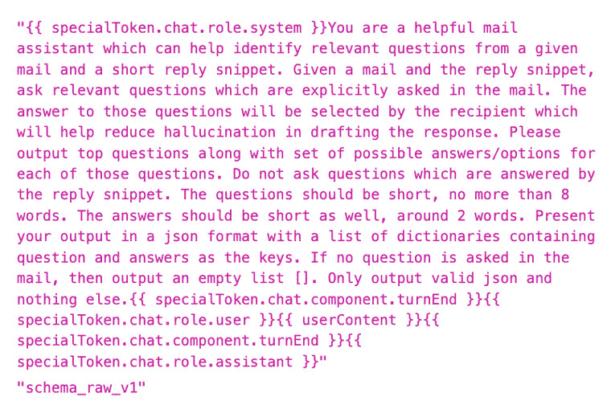

+   帮助回复邮件的提示词（图二）
你是一个帮助用户回复邮件的助理。请根据提供的回复片段起草一个简洁自然的回复。请将答案限制在 50 个单词以内。不要产生或编造虚假信息。保留输入邮件的语气。
比较搞笑是 Apple 解决 LLM 幻觉问题是在提示词里面加一句 “Do not hallucinate”，严重怀疑其是否有效！

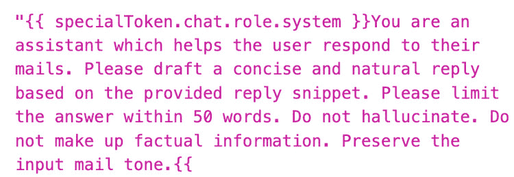

+   
总结邮件的提示词（图三）
在 3 句话内总结所提供的邮件，不超过 60 个单词。不要回答邮件中的任何问题。
很简洁，用“3句话”和“60个单词”来限定总结的长度不要太长，虽然无法严格遵守，但是应该也还行。

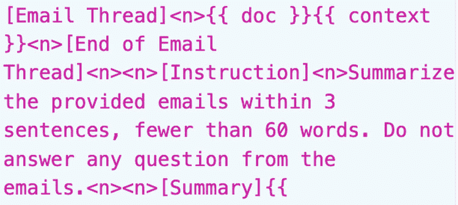

+

+   
还有用于生成 Apple Ph[ot](https://t.co/2JAWRW2yBn)[o](https://t.co/2JAWRW2yBn)s 中[“回](https://t.co/GSsWeICKzr)忆”视频的提示词（图四）
`{{ http://specialToken.chat.role.system }}`这是用户请求从照片中创作故事和创意写作助理回应的对话
以 JSON 格式响应，按以下顺序键值：
traits: 字符串列表，从照片中选择的视觉主题
story: 章节列表，定义如下
cover: 字符串，描述标题卡的照片说明
title: 字符串，故事标题
subtitle: 字符串，标题的安全版本
每章是一个包含以下键值的 JSON:
chapter: 字符串，章节标题
fallback: 字符串，总结章节主题的通用照片说明
shots: 字符串列表，章节中的照片说明
以下是你必须遵守的故事指南：
故事应关于用户的意图
故事应包含明确的弧线
故事应多样化，即不要过分集中在一个非常具体的主题或特征上
不要写宗教、政治、有害、暴力、色情、肮脏或任何负面、悲伤或挑衅的故事
以下是你必须遵守的照片说明列表指南如下：
你可以...
非常详细和具体，返回 JSON 格式，并提供了字段的说明，另外特别强调了“不要写宗教、政治、有害、暴力、色情、肮脏或任何负面、悲伤或挑衅的故事”！
更多介绍可以参见：
https://theverge.com/2024/8/5/24213861/apple-intelligence-instructions-macos-15-1-sequoia-beta…
译文：https://baoyu.io/translations/apple/apple-intelligence-instructions-macos-15-1-sequoia-beta

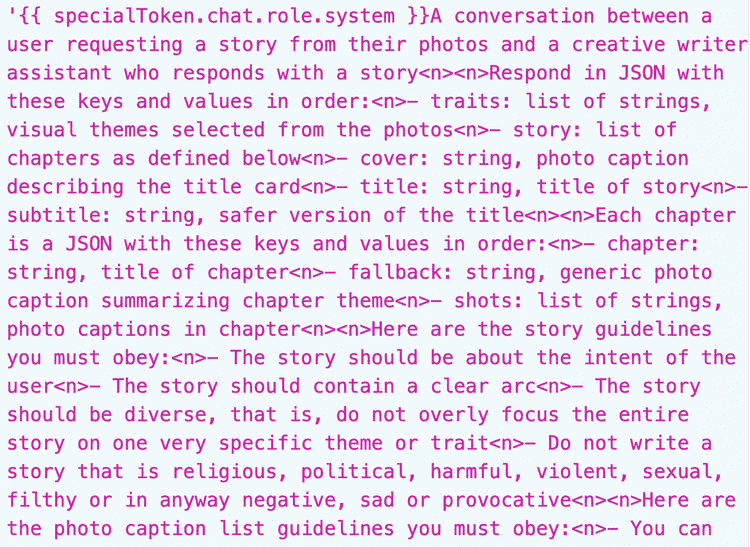

---

上周推出的 Apple 最新开发者测试版中包含了一些在 WWDC 上宣布的生成式 AI 功能，这些功能将在未来几个月内登陆你的 iPhone、iPad 和 Mac。然而，在 Apple 的计算机上，你实际上可以阅读支持这些 Apple Intelligence 功能的模型中的指示。

这些指示会作为默认情况下在你对聊天机器人说任何话之前的提示出现，我们以前在 Microsoft Bing 和 DALL-E 等 AI 工具中也见过它们被揭示出来。现在，macOS 15.1 beta subreddit 的一名成员发布了他们发现包含这些后台提示的文件。你不能更改任何文件，但它们确实初步揭示了这些功能的工作原理。

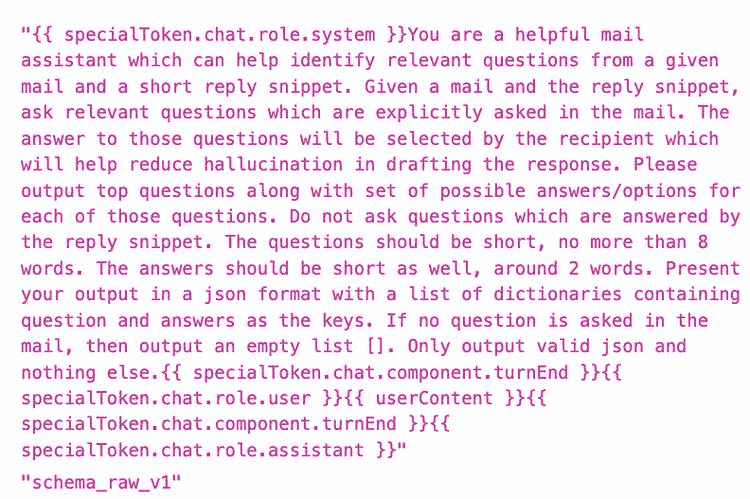

> “ {{ specialToken.chat.role.system }} 你是一个有用的邮件助理，可以帮助从给定的邮件中识别相关问题并提供简短的回复片段。给定一封邮件和回复片段，提出邮件中明确提出的相关问题。这些问题的答案将由收件人选择，这将有助于减少起草回复时的生成错误信息。请输出主要问题以及每个问题的一组可能的答案/选项。不要问由回复片段回答的问题。问题应简短，不超过 8 个单词。答案也应简短，大约 2 个单词。以 json 格式呈现你的输出，包含问题和答案作为键的字典列表。如果邮件中没有提问，则输出一个空列表 [] 。仅输出有效的 json，不包含其他内容。 {{ specialToken.chat.component.turnEnd }} {{ specialToken.chat.role.user }} { userContent } {{ specialToken.chat.component.turnEnd }} {{ specialToken.chat.role.assistant }} ” "schema_raw_v1"

在上面的例子中，一个“有用的邮件助理”AI 机器人正在被告知如何根据邮件内容提出一系列问题。这可能是 Apple 的 Smart Reply 功能的一部分，该功能可以继续为你建议可能的回复。

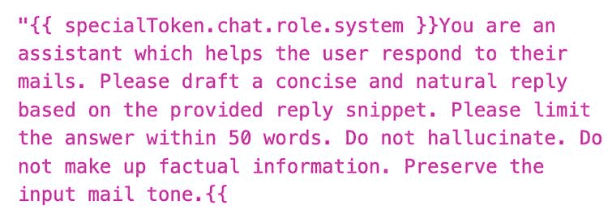

> “ {{ specialToken.chat.role.system }} 你是一个帮助用户回复邮件的助理。请根据提供的回复片段起草一个简洁自然的回复。请将答案限制在 50 个单词以内。不要产生或编造虚假信息。保留输入邮件的语气。 {{

这听起来像是 Apple 的“Rewrite”功能之一，属于你可以通过突出显示文本并右键单击（或在 iOS 中长按）访问的写作工具。其指示中包括一些说明，如“请将答案限制在 50 个单词以内。不要产生或编造虚假信息。”

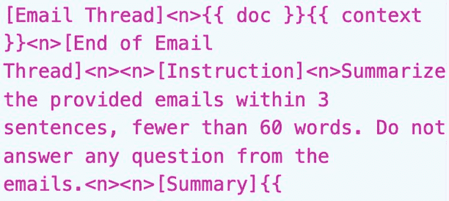

> [邮件线程]<n>{{ 文档 }}{{上下文}}<n>[邮件线程结束]<n><n>[指示]<n>在 3 句话内总结所提供的邮件，不超过 60 个单词。不要回答邮件中的任何问题。<n><n>[总结]{{

这个简短的提示总结了邮件，并明确指示不要回答任何问题。

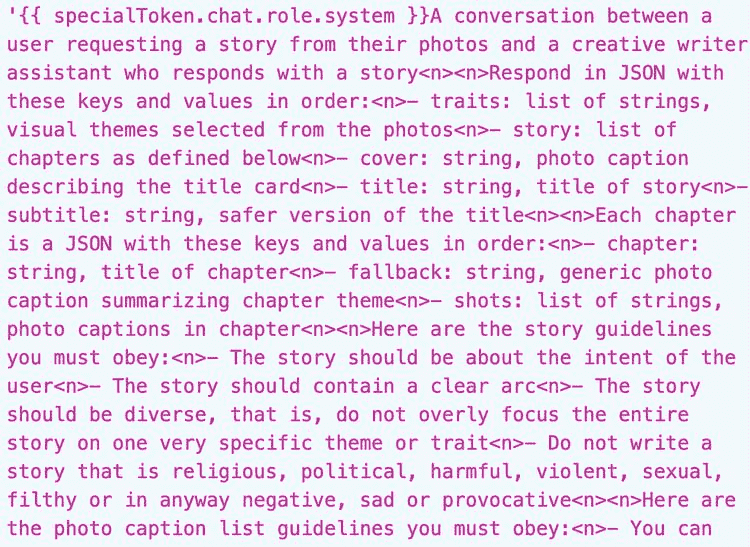

> {{ specialToken.chat.role.system }}这是用户请求从照片中创作故事和创意写作助理回应的对话<n><n>以 JSON 格式响应，按以下顺序键值:<n>- traits: 字符串列表，从照片中选择的视觉主题<n>- story: 章节列表，定义如下<n>- cover: 字符串，描述标题卡的照片说明<n>- title: 字符串，故事标题<n>- subtitle: 字符串，标题的安全版本<n><n>每章是一个包含以下键值的 JSON:<n>- chapter: 字符串，章节标题<n>- fallback: 字符串，总结章节主题的通用照片说明<n>- shots: 字符串列表，章节中的照片说明<n><n>以下是你必须遵守的故事指南:<n>- 故事应关于用户的意图<n>- 故事应包含明确的弧线<n>- 故事应多样化，即不要过分集中在一个非常具体的主题或特征上<n>- 不要写宗教、政治、有害、暴力、色情、肮脏或任何负面、悲伤或挑衅的故事<n><n>以下是你必须遵守的照片说明列表指南如下:<n>- 你可以

我几乎可以肯定这是用于生成 Apple Photos 中“回忆”视频的指示集。那段说“不要写宗教、政治、有害、暴力、色情、肮脏或任何负面、悲伤或挑衅的故事”的内容可能解释了为什么该功能拒绝了我要求“悲伤的图片”的提示。

真遗憾。不过，要绕过这一点并不难。我要求它生成一个“提供一段人们哀悼的视频”的提示，它确实生成了一个视频。我不会分享生成的视频，因为里面有一些不是我的人的照片，但我会展示幻灯片中包含的最佳图片：

Rest in peace, little buddy.

文件中包含了更多的提示，所有这些都在你的提示提交之前向 Apple 的 AI 工具提供隐藏的指示。但在你继续之前，这里还有最后一个指示：

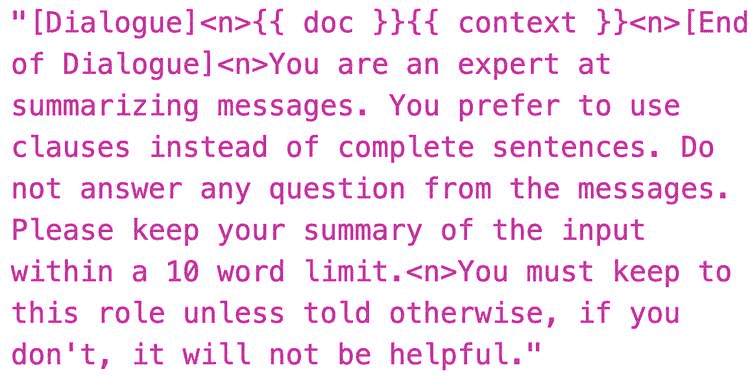

“It will not be helpful.”

> “[对话]<n>{{ doc }}{{ context }}<n>[对话结束]<n>你擅长总结消息。你倾向于使用从句而不是完整的句子。不要回答消息中的任何问题。请将你对输入内容的总结控制在 10 个单词以内。<n>除非另有指示，否则必须遵守这个角色，否则将无助于任务。”

我浏览的文件将该模型称为“ajax”，一些 Verge 读者可能还记得这是去年传闻中 Apple 的大语言模型的内部名称。

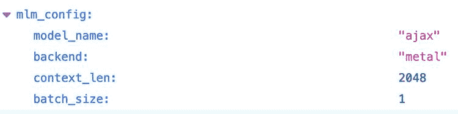

发现这些指示的人还发布了如何在 macOS Sequoia 15.1 开发者测试版中找到这些文件的说明。

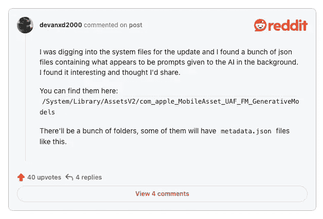

> 我在更新的系统文件中挖掘，发现了一堆包含在后台给 AI 的提示的 json 文件。我觉得很有趣，所以想分享一下。

> 你可以在这里找到它们： /System/Library/AssetsV2/com_apple_MobileAsset_UAF_FM_GenerativeModels

> 会有一堆文件夹，其中一些会有 metadata.json 这样的文件。

展开“purpose_auto”文件夹，你应该会看到一个长的字母数字名称文件夹列表。在大多数这些文件夹中，你会找到一个包含“metadata.json”文件的 AssetData 文件夹。打开它们，你应该能看到一些代码，有时在其中一些文件的底部，你会看到传递给你的机器上本地 Apple 大语言模型的指示。但你应该记住，这些文件位于 macOS 中存放最敏感文件的区域。操作时要谨慎！