# Kostja的增长手册

> 来源：[https://waytoagi.feishu.cn/docx/IluIdpoClopX9dx4rtrc328ynyb](https://waytoagi.feishu.cn/docx/IluIdpoClopX9dx4rtrc328ynyb)

# 自我介绍

> 看到笔记的朋友们好！

> 我是**kostja**，目前在一家Global的AI应用团队做增长，方向是图片🖼/视频🎞的生成和编辑

---

我们的产品：

PromeAI：https://www.cutout.pro/

Cutout.pro：https://www.promeai.pro/

> 关于图片和视频的编辑/生成（抠图，高清，风格化，涂抹，外扩，重绘，文生图/文生视频/图生图/图生视频，电商背景图，换模特）的商务合作可以加我微信，都可以聊！（自有算法，性价比高，提供API，本人背书）：zhangyujie94

---

单个增长主题和关于AI的思考发在即刻：

---

以下是正文：

# SEO

## 为什么要做SEO？

互联网超过三分之二的流量通过搜索引擎产生；搜索引擎不生产任何内容，却是最大的流量和内容载体

SEO战略，就是让谷歌搜索给你打工！

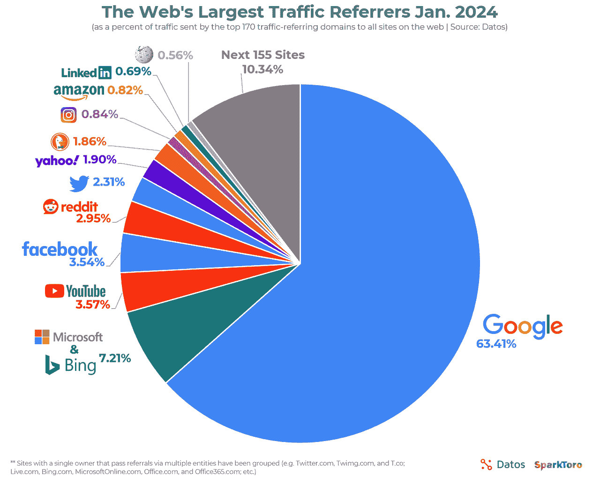

---

谷歌优化≈SEO，因为

谷歌在全球搜索市场的份额是81.95%！！！

（https://www.statista.com/topics/1710/search-engine-usage/#topicOverview）

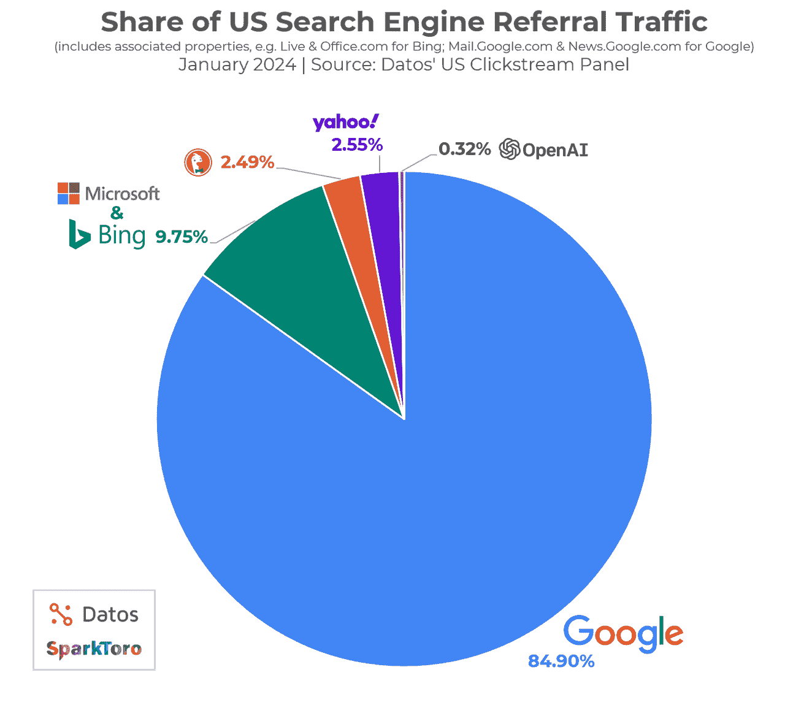

## 从哪里系统性学习SEO？

中文材料：

**最推荐** - Google官方入门SEO指南（全新改版，面向新手，官方教程）：

https://developers.google.com/search/blog/2024/02/ssg-gets-a-makeover?hl=zh-cn

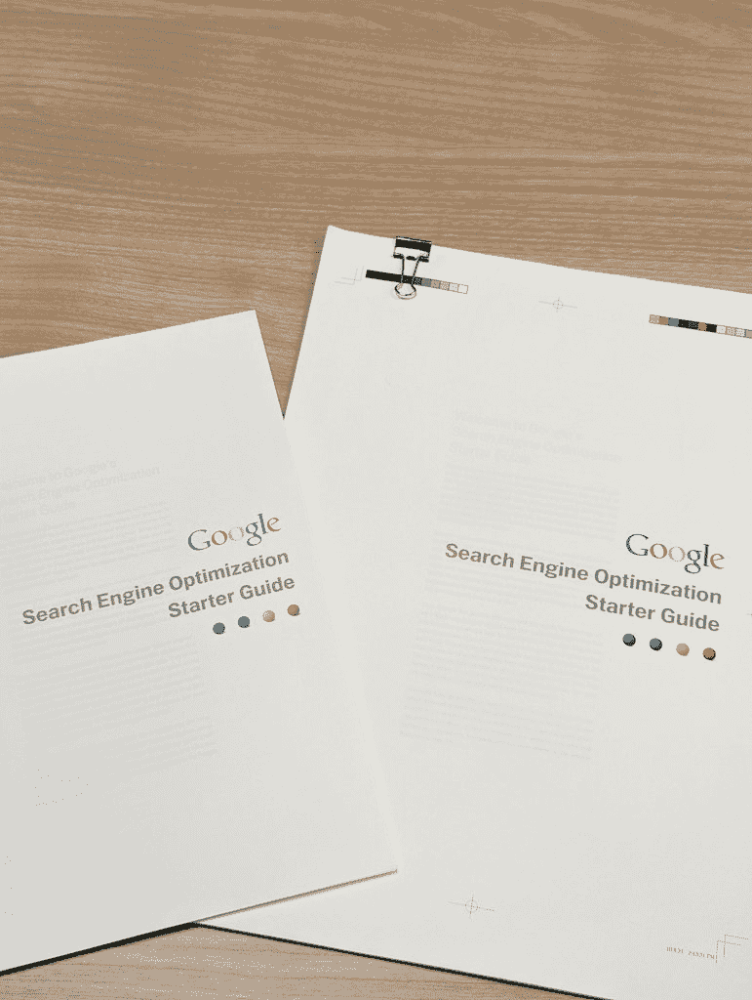

**强烈推荐** -《SEO实战密码》第四版，纸质版本

作者ZAC的个人博客：https://www.seozac.com/

Ahrefs博客中文版：https://ahrefs.com/blog/zh/

英文SEO实战派：https://www.seoactionblog.com/

英文材料：

Backlinko（被Semrush收购）：https://backlinko.com/seo-checklist

Semrush：https://www.semrush.com/blog/google-search-statistics/

Rankmath：https://rankmath.com/kb/

你还可以阅读他们的著作：

Matt Cutts（谷歌算法半官方发言人），Danny Sullivan（Search Engine Watch），Rand Fishkin（Moz创始人），Brian Dean（Backlinko创始人），Avinash Kaushik（谷歌数字营销专家），Justin Cutroni（GA团队负责人），Brain Solis等

## 如何快速crawling, indexing and ranking？

这是SEO最重要的部分，“存在就是被感知”，如果你的内容不出现在搜索结果，那么可以认为你的内容不存在于互联网中

1.  站长工具：Google Search Console，Bing Wenmaster Tools

1.  导航站/所有适合Submission的网站

1.  通稿

如果你预算充足并且想快速索引，可以在Fiverr或Upwork上找自由职业者手动提交工具至导航站，例如下方200＄提交至200+网站

https://buymeacoffee.com/aibusinesstool/e/242527

如果你想手动提交，可以通过网站清单：

https://1000userguide.com/#/

https://mp.weixin.qq.com/s/f0GV7Ld5Ag6N4g0YYsIeog

## 导航站

AI/SaaS导航站指南：

<https://web.okjike.com/originalPost/65f096f83b9c66cae472de62>

## 商业软件评价平台

商业软件评价平台及垂类导航站指南：

<https://web.okjike.com/originalPost/65f9ab2137f7165b214c45a9>

## Product Hunt

Product Hunt是国内AI/SaaS团队出海冷启动的通用路径之一

推荐阅读：深思圈《一文讲透 Product Hunt 产品冷启动》：https://www.woshipm.com/operate/5603648.html

付费服务：哈希增长（https://hashmatrix.xyz/）

[Product Hunt Actions Review](https://toeverything.feishu.cn/docx/V0TDd2rGLo8QtlxFwU7cZPvMnKb)iffine的实操手册（无预算最少能拿到800票）：

监控实时排名：https://pw2.akkio.com/

管理平台（也可以用来找Hunter信息）：https://upvote-bell.com/

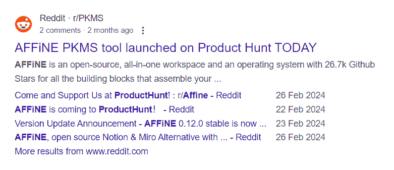

## **Blog**

有商业博客的网站会比没有商业博客的网站取得更好的排名，因为博客会产生大量，持续更新，具有相同主题的相关性内容，而这被谷歌视为积极信号

更具体的数据是：

拥有博客的公司每月产生的销售线索平均比没有活跃博客的公司多 67% (https://www.hubspot.com/marketing-statistics)

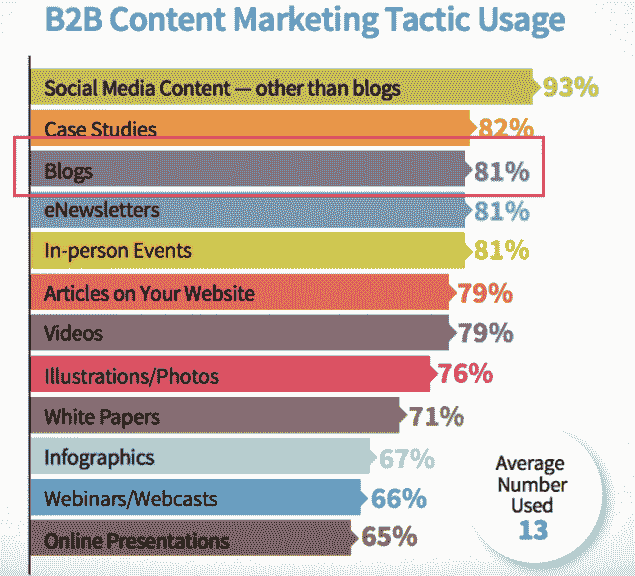

试想用户从什么渠道能找到你的网站：

1.  直接在浏览器中输入品牌名：这是针对已经拥有的受众，他们知道你是谁，但这不能帮助你获得更多流量（所以organic traffic中品牌词流量和direct traffic一样，不算增长渠道）

1.  购买电子邮件列表，批量发送：既昂贵又犯法

1.  付费广告：很贵，而且一旦预算花完，流量也会停止

博客也可以用于社媒，而不总需要为社交媒体创建全新的内容，并通过社交渠道吸引新的网站访问者访问您的博客

博客可以将网站流量转化为潜在客户，每篇文章都是产生新潜在客户的新机会：只需在每篇博客文章中添加一个产生潜在客户的CTA按钮

如果一直为目标受众创建有价值的内容或文章，这将使您成为他们眼中的行业领导者或权威

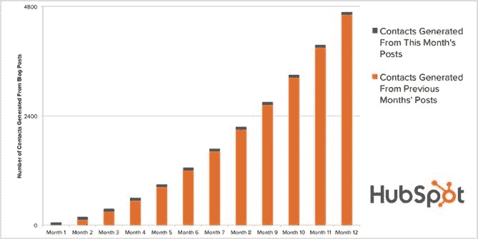

博客还可以通过各种创意方法带来盈利：比如联盟营销，直接售卖外链，co-marketing等等

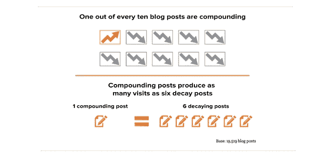

以上所说的都是公司（商业）博客，个人博客对内容的选取更为宽松，可以由团队内部其他重要人物创建，和独立开发者Build in public类似，可以参考https://neilpatel.com/

博客架构最好采用Topic Cluster（https://www.semrush.com/blog/topic-clusters/）或者Silo（https://ahrefs.com/blog/seo-silo-structure/）

### 如何创建博客

（也可以用二级域名blog.domain.com的方式搭建博客；同样，在Medium，Substack，Blogger这类博客平台发布也各有优劣；还推荐一个高自定义搭建的SaaS工具Hashnode - https://hashnode.com/，免费，支持绑定域名，SSL加密）

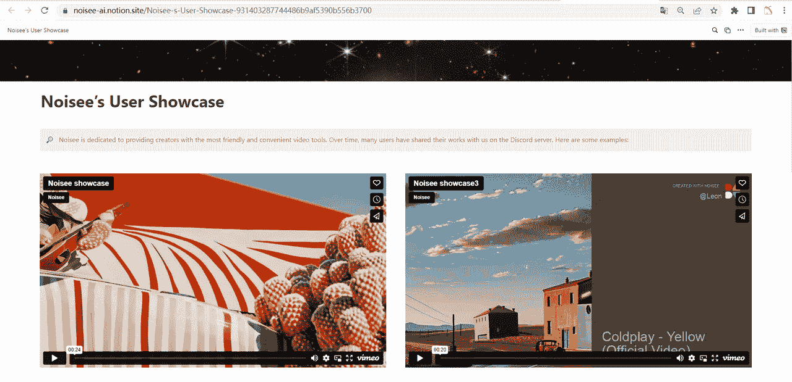

Affine的Iris分享的ClickUp，Notion，F[Community调研报告—ClickUp，Notion，Figma](https://toeverything.feishu.cn/docs/doccnr7qBQlAL5oCErthj0QkbYd)gma等生产力工具的博客内容调研报告：

## 其他

更多关于SEO的信息请访问：[SEO操作手册](https://gx27ntqnm5z.feishu.cn/wiki/QdqFwv6wRilDiIkyz5ccORK8n1f)

---

# 冷启动

除了上述的提交，下面几个方法也可以帮助网站快速跨过冷启动阶段，甚至效果更好；这属于先发优势，也会加剧马太效应

## 老带新

Fotor是全球头部AI图片编辑网站，生成式AI兴起之后孵化了视频生成和编辑平台Clipfly

<https://web.okjike.com/originalPost/6644d9fb19d274e296805ba7>

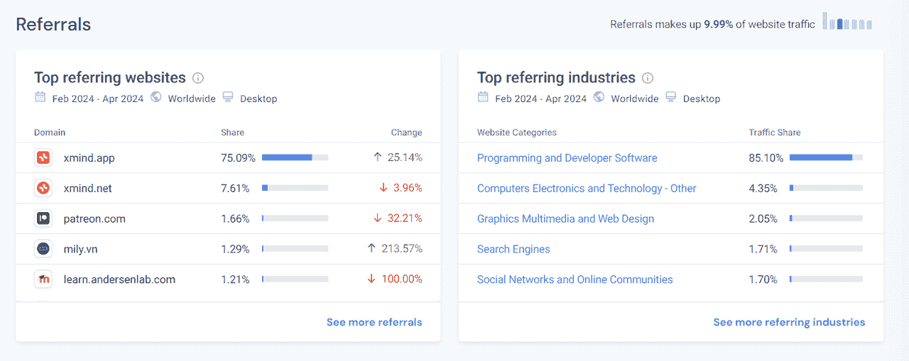

怎么验证这些产品是否依靠老带新方式度过冷启动？去看大网站的Outgoing traffic和新网站的Top referring websites

## 产品矩阵

Slidesgo和Wepik都是Freepik公司孵化的AI产品，Freepik是全球最大图片库之一

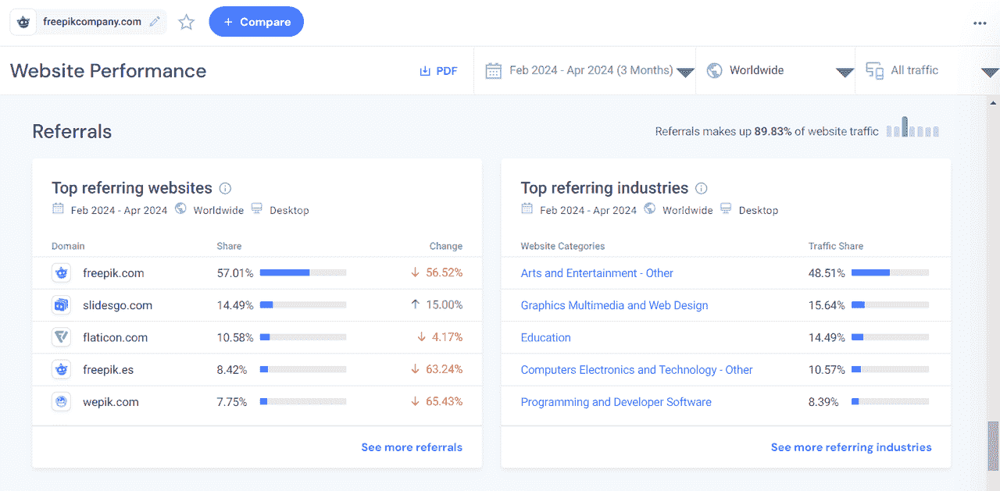

Designify和remove.bg，kaleido.ai是一家公司，后被Canva收购

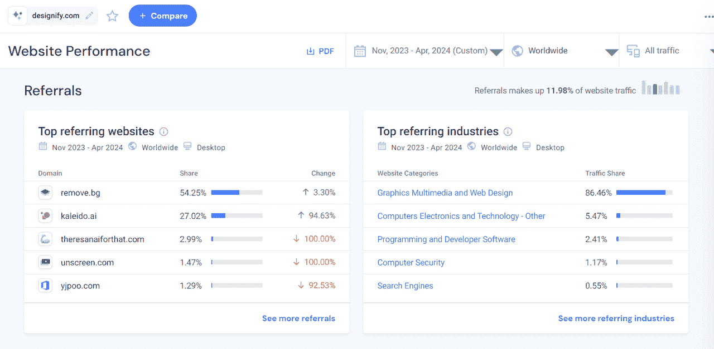

这些都是成熟网站，不是特别具有参考意义，但是可以看独立开发者比如Peter Levels

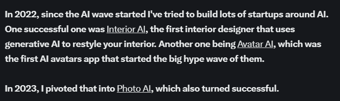

只要你有一个产品获得了成功，那么除了构建产品的SOP经验以外，在发布新产品时也不意味着你需要从零开始，你的每个产品都会成为你下个产品增长的阶梯

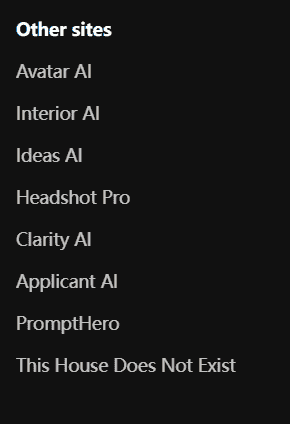

## 合作营销

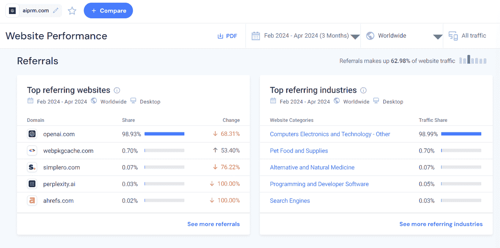

---

# 网站架构

网站结构从产品角度展示了一个网站提供的功能，比如工具和内容；另一方面，你可以看出对应产品的推广逻辑

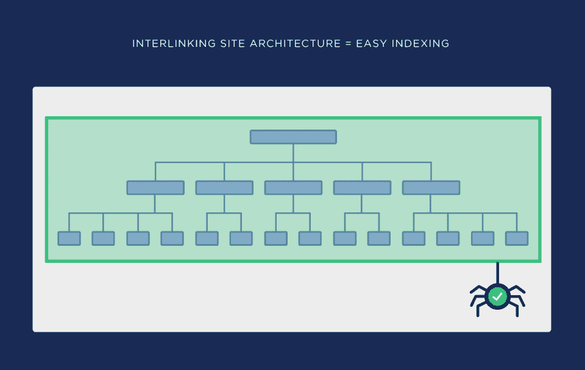

更多关于结构：https://backlinko.com/hub/seo/architecture

如果你有一个网站www.domain.com，那么

www.domain.com/affiliate 代表通过联盟计划做转化

www.domain.com/education 代表通过学生计划做增长

www.domain.com/zh-CN 代表通过多语言做增长

## 联盟计划/Affiliate Program

联盟计划指南：

<https://web.okjike.com/originalPost/6608ff63a922aa28d06fb92b>

Affine的Iris分享的ClickUp，Notion，F[Affiliate Research](https://toeverything.feishu.cn/docx/OwyQd1WtGoiJM2xdZk3cU2YPn1M)gma等生产力工具的联盟计划调研报告：

超过100+AI/ SaaS工具提供联盟计划：https://www.aligngpt.net/post/best-ai-affiliate-programs

主动将Affiliate Program提交到https://affiliate.watch/这类站点，让感兴趣的联盟客为你推广

## 终身计划/Lifetime Deal

终身计划指南：

<https://web.okjike.com/originalPost/664bed97c9f4303af98423a9>

和联盟计划类似的是Lifetime Deal平台，例如Appsumo，对刚起步的出海产品，Lifetime Deal可以帮助快速获得种子用户，获取真实反馈，帮助有方向地迭代；但长期来看lifetime deal不符合SaaS，时间越久，LTV越差

类似的Reddit频道：https://www.reddit.com/r/AppHookup/

深度解析《一文讲透如何用AppSumo来获得早期付费用户》by 深思圈：https://mp.weixin.qq.com/s/0Eyyx9UKUpNgtLme2tYo3w

## 教育计划/Education License

教育计划指南：

<https://web.okjike.com/originalPost/65ba4c14164d89e601bfdddc>

## 折扣/Discount & Promo Code

传统SaaS和软件提供学生优惠比较多，AI产品提供的还很少，可以查看全球最大的学生折扣网站Student Beans：https://www.studentbeans.com/student-discount/us/cats/software

调研之后发现不少有经验的平台原来也在这方面发力：Rytr，Invideo，看的几个打折平台都有他们：Dealspotr：https://dealspotr.com/stores/software；GrabonIn：https://www.grabon.in/ai-software-coupons/

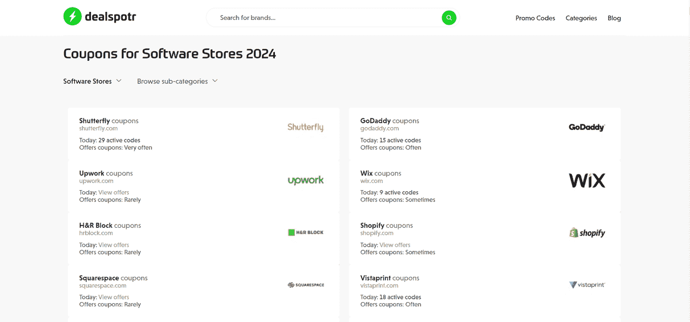

> 打折购买确实是刚需，我自己订阅Wix和Wordpress的时候也会提前在网上搜一下有没有promo code，确实很多，能剩下几十美元

## 推荐计划/Referral Program

Dropbox：https://viral-loops.com/blog/dropbox-grew-3900-simple-referral-program/

Tesla：https://www.inc.com/walter-chen/how-teslas-referral-program-generates-more-than-40x-roi.html

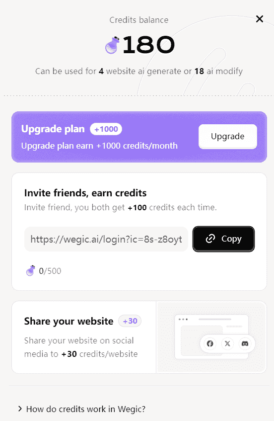

点击我的[邀请链接](https://wegic.ai/login?ic=8s-z8oytSgq9rBw4kAXsGw)注册Wegic，看看是不是真的有转化（doge）

底下那个通过交互活动获得积分的方式可以用来促活，有空分析

也有SaaS提供一站式营销管理，类似将上面所有增长渠道打包，比如

Affise：https://affise.com/

## 其他子目录

想做社区运营，但是团队人员有限，那你应该有

Ambassador Program

Notion在每个国家都设了一位Ambassador

目前全部82位Ambassador：https://noteforms.com/notion-ambassadors-influencers

中国区的是Linmi - https://linmi.cc/about

Notion的官方说明：https://www.notion.so/notion/Notion-Ambassadors-40c3b3ee8c744e7fad34ab4ac9765773

是否要发布Ambassador计[External Ambassador Questions 公开部分](https://gx27ntqnm5z.feishu.cn/docx/GHOVdMZn9od9Sox1m7ycdFDNn4T)的分享 by Affine Iris：

给大工具做配套生态，那你应该有

**Plugin**

在不同平台，这个功能还以Extension/Intergration/Add-on的名字出现；对应的是国内产品的微信小程序，飞书小组件等；在AI时代，则是各种Agents，如GPTs，coze等服务

2B，那你应该有

**Custom Stories**

好的客户成功案例会给你带来更多leads和更好的品牌形象

OpenAI的Customer stories：

<https://web.okjike.com/originalPost/65d6014412ed2fda682b20fa>

面向开发者，那你应该有

**API**

做全球市场，那你应该有

**多语言版本**

注重品牌和声誉，那你应该有

About，Testimonials

面向创作者社区，那你应该有

**Showcase**

注重版权，隐私和商用，那你应该有

**Terms，Policy**

免费工具：

https://www.freeprivacypolicy.com/

https://www.termsfeed.com/

本地运行体验更好，那你应该有

Software，Mobile App

促活，那你可以办

Giveaway，Contest

之前看有实体产品的电商用得比较多，可以单次或举办周期性活动尝试效果；以下SaaS可以帮助快速落地

Gleam：https://gleam.io/

Woobox：https://woobox.com/

Viralsweep：https://www.viralsweep.com/

这些内页可以无限延续；一些部分是通用的，即所有网站都应具备，如About，Contact，Pricing等；另一部分则取决于你的产品形态和运营策略；同时，网页的设计需要考虑很多元素，不单为了增长和转化；我不是PM，但是推荐一本书：Steve Krug的“Don't Make Me Think”，中文译本叫《点石成金:访客至上的网页设计秘笈》

## 如何寻找增长渠道？

冷启动和增长的本质是曝光，被潜在用户看见然后进入之后的转化环节；如果目的是尽可能地曝光，那么意味着你很容易找到竞品的这些渠道（除非是完全私域的渠道，例如newsletter，微信群，朋友推荐等），然后通过相同方式推广

以Suno AI为例，首先在最大的渠道-搜索引擎-谷歌搜索中输入“Suno AI”

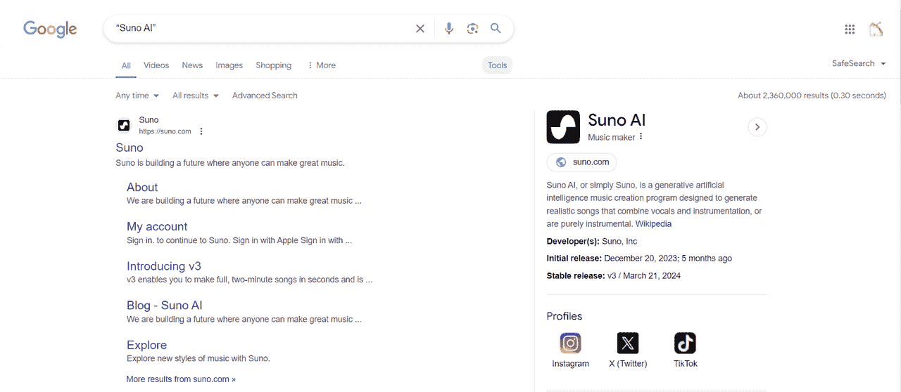

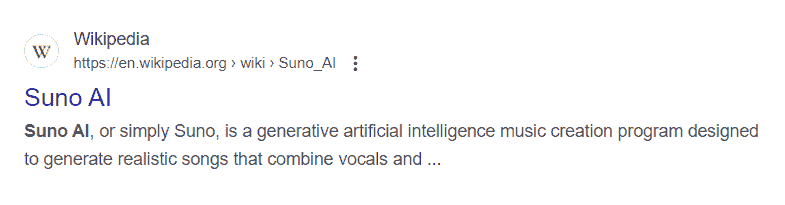

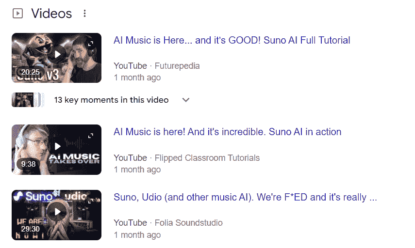

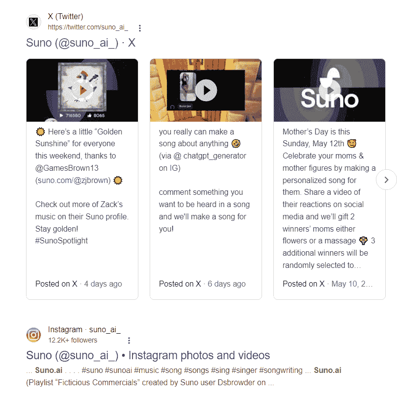

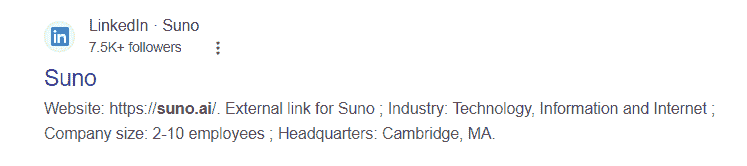

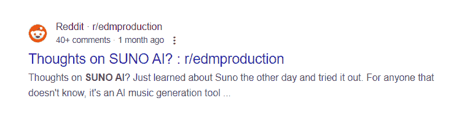

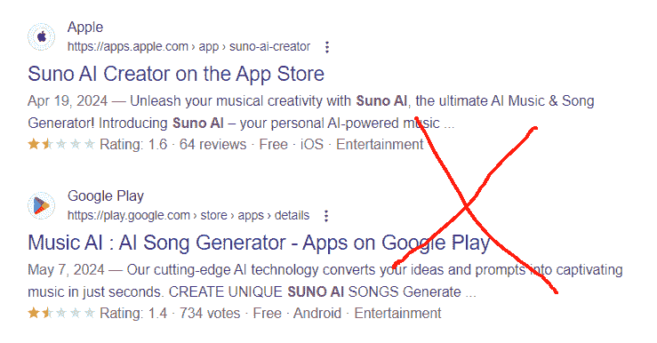

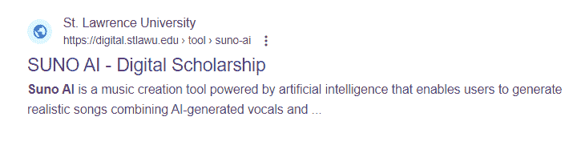

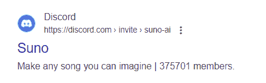

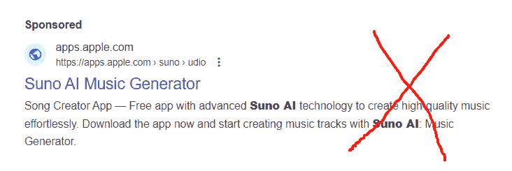

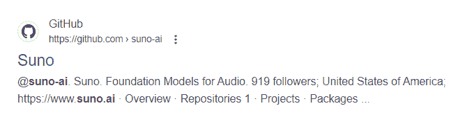

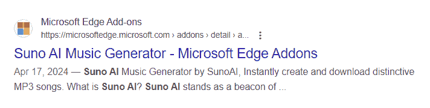

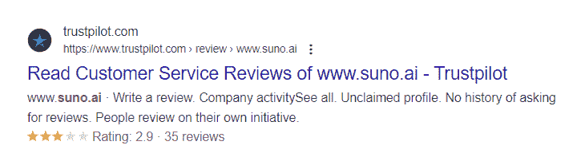

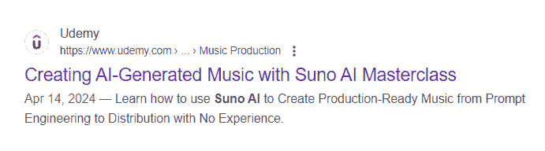

除了开始的站内SEO，剩余都是站外增长渠道，渠道种类和具体路径可以向下无限延长；部分流量源于自发形成，需要分析流量大小和转化的也就是剩下需要主动去挖掘的“付费”流量（直接付费和人力成本）

## 如何快速落地这些渠道？

1.  在网站设计初就考虑整个结构

1.  去看看你的竞争对手子目录里有什么

1.  如果不确定，可以建立落地页，用coming soon和waitlist来验证

1.  一旦成立，可以用SaaS软件快速落地（Gleam，Rewardful，TechSoup）

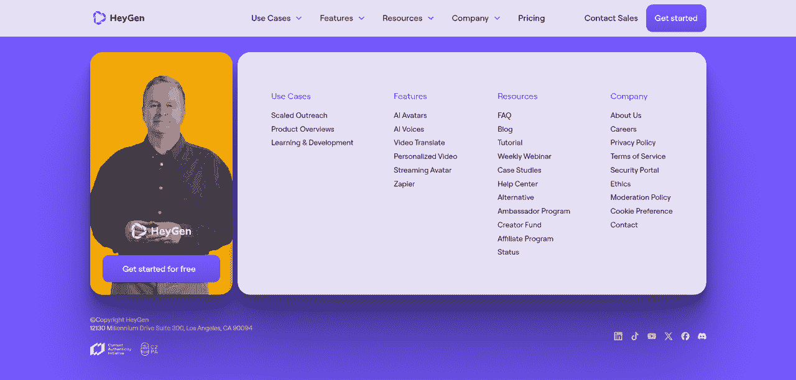

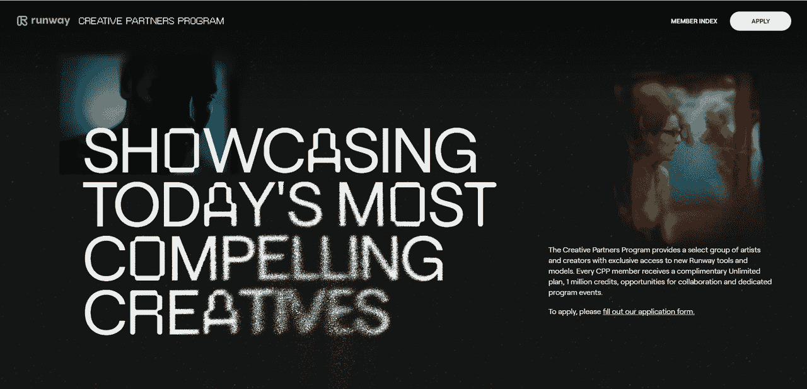

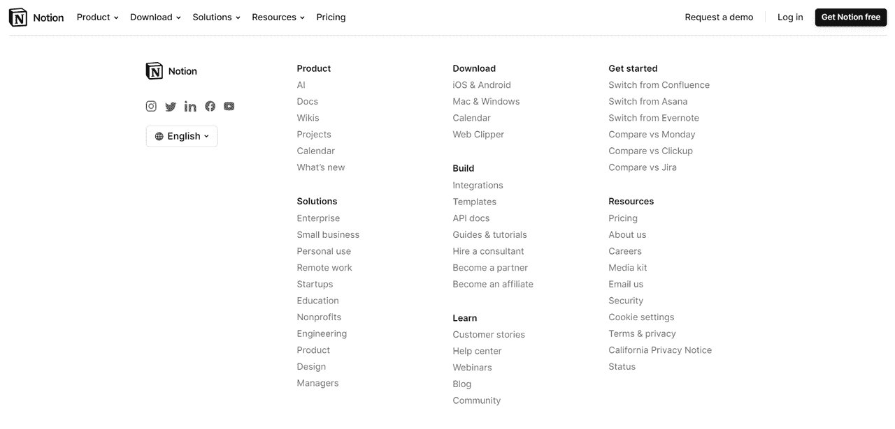

## 如何调研竞品的增长策略（深度）

调研竞品的增长策略是最简单的事情，就像我在上文提到的那样

> 冷启动和增长的本质是曝光，被潜在用户看见然后进入之后的转化环节；如果目的是尽可能地曝光，那么意味着你很容易找到竞品的这些渠道（除非是完全私域的渠道，例如newsletter，微信群，朋友推荐等），然后通过相同方式推广

增长越好的方式越容易被竞品拆解（在同渠道做得更好，或找到竞品还没有开发的新渠道，是两种超过竞品的增长方法）

1.  不要开始就迷信数据，先去官网逛逛看站内增长策略，看menu，footer，sidebar，banner这些，随便点点页面

问这个问题的是建站工具Wegic的小伙伴，调研了一下Dora，Framer，Durable，10Web；在单个渠道做得效果最好，把所有渠道都做了，就能保持增长的领先

|  | Product Hunt Badge | Plugin | Ambassador | Event | Community | Social Media | SEO | UGC | Partnership | Application | PR | EDM | Review Website |
| --- | --- | --- | --- | --- | --- | --- | --- | --- | --- | --- | --- | --- | --- |
| Dora | + | Figma | + | + | Discord，Fb Group | X，Ins，TT，YT | Template |  |  |  |  |  |  |
| Framer |  | Figma |  | Meetup |  | X，Ins，YT，Linkedin | Template，Blog | Gallery | Affiliate，Expert | Desktop | Brand Assets |  |  |
| Durable |  |  |  |  |  | + | Template，Blog |  | Affiliate |  | Media | Newsletter |  |
| 10Web |  | Wordpress |  |  | + | +，Testimonials | Blog |  | Affiliate， | mobile-friendly | Media，PressKit |  | Trustpilot |

1.  逛完了站内，再看看站外的推广策略，分别从最大的渠道依次搜起：搜索引擎（谷歌），社交媒体（...），论坛（Reddit）等，具体方式是搜索品牌词，网址或者#和@，越靠前代表搜索量越大，从这个渠道得到的流量越多，算法已经为你把渠道按照效果排好了顺序，当然一部分是自来水（属于PLG）

Dora：ProductHunt，红人营销，导航站（B12，Easy with AI，Futurepedia），课程（Udemy），外链（Awwwards，SEO巨佬Neil Patel的个人博客：https://aitools.neilpatel.com/ai_tools/dora-created-stunning-3d-websites-without-code/），竞品投了品牌词（Creatie），活动（Dora expo），竞赛（Showcase Challenge）

1.  使用Similiarweb，Semrush，Brand24等工具，着重看产品刚发布时候和骤然增长时候的流量来源，不过某个渠道具体拆解很复杂，因为数据有延后性，而且可能是因为整个流量系统的改变（比如谷歌核心算法更新），或者是整个AI热点的兴起带动所有类似关键词搜索量的暴增（比如Suno带动AI Music概念）

### Dora AI 3月到底干了什么？

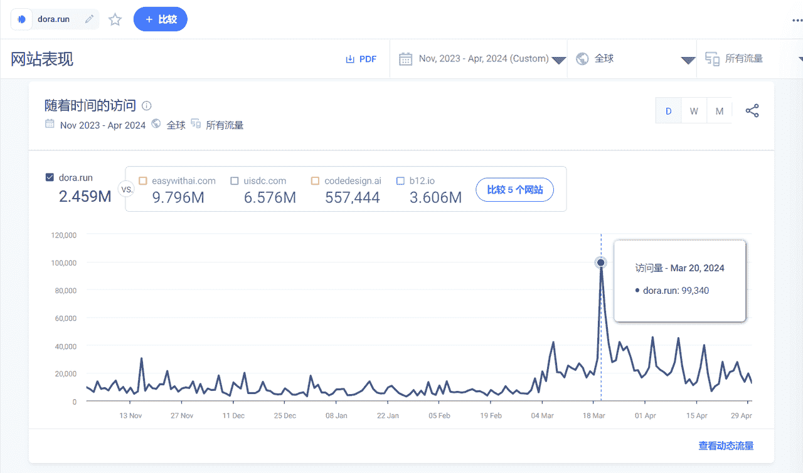

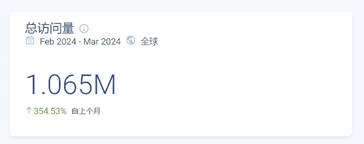

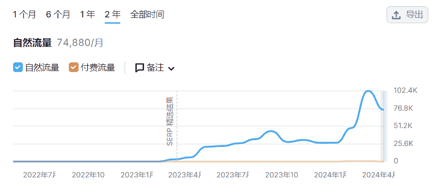

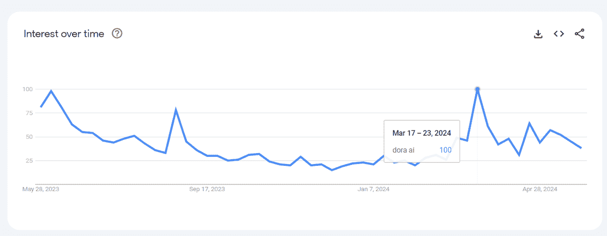

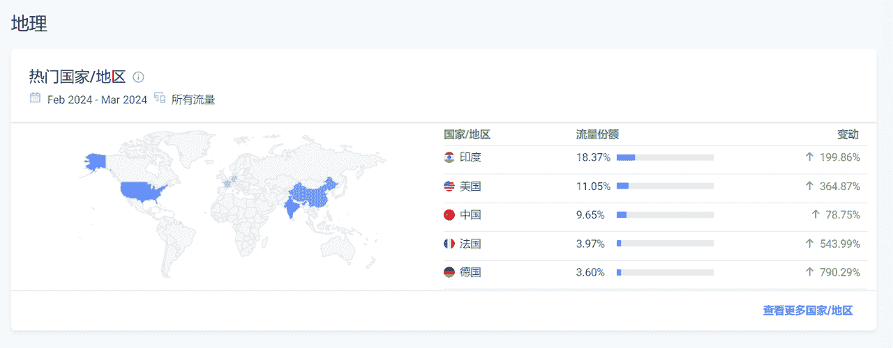

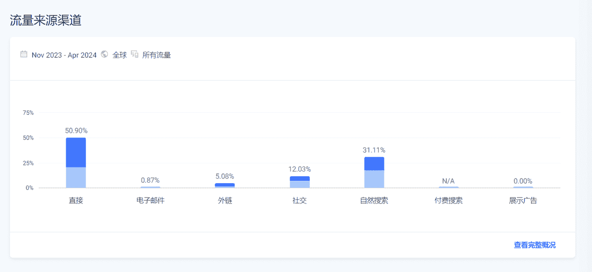

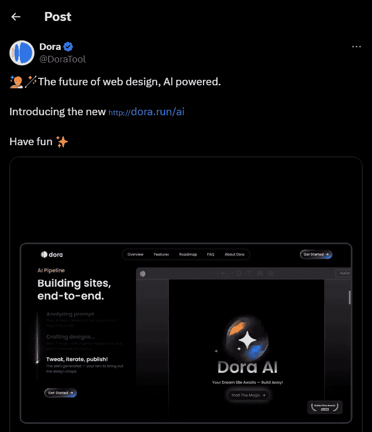

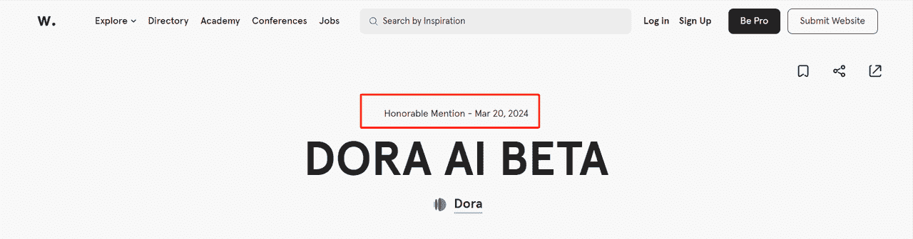

破案了，前者的可能性更大点：https://www.youtube.com/watch?v=XlqNMwsa0QA

Dora AI Beta3月20号正式发布，3月初有预热活动，Dora AI这个品牌词在3月的Google Trends上搜索到达了顶峰

> 所有方式增长策略都仅供参考：竞品做成了不代表你也能做成（甚至他们也很难复现），竞品没做成也不代表你做不成；大部分竞品都做了最少有保底效果

---

# 社媒

## 模态与分类

不同平台代表不同调性和模态：帖子，长文，图文，短视频，长视频，播客：

+   视频类：TikTok，**Youtube**

+   社交类：Facebook，**Twitter**，**Linkedin**

+   图片类：**Instagram**，Pinterest

+   聊天类：Snapchat

## 目的

1.  打造品牌形象

1.  发布信息：新功能/网站优化/活动/成果展示

1.  承接流量：增加用户粘度

1.  获得潜在合作机会

1.  社媒相当于闭环生态；比起搜索引擎，同个社媒使用者用户画像高度相似

1.  大部分社交媒体也提供广告服务

## 优缺点

1.  用得好可以迅速扩大影响力，产生自传播

1.  用得不好会浪费有限的时间人力资源

1.  搜索类平台比推荐类平台会带来更多长尾流量

## 如何做好社媒？

以Feed推荐流做得最好的小红书为例

小红书内部有个CES ( Community engagement score )的指标： CES ＝点赞x1+收藏x1+评论x4+转发x4+关注x8

底层推荐算法框架更复杂，但是可以发现是以用户的互动行为作为指标，对应SEO中的平均浏览时间，平均访问页面数量，弹出率等；以大数据+深度学习为框架的推荐算法，自动化买粉/刷赞行为很容易被识别出来

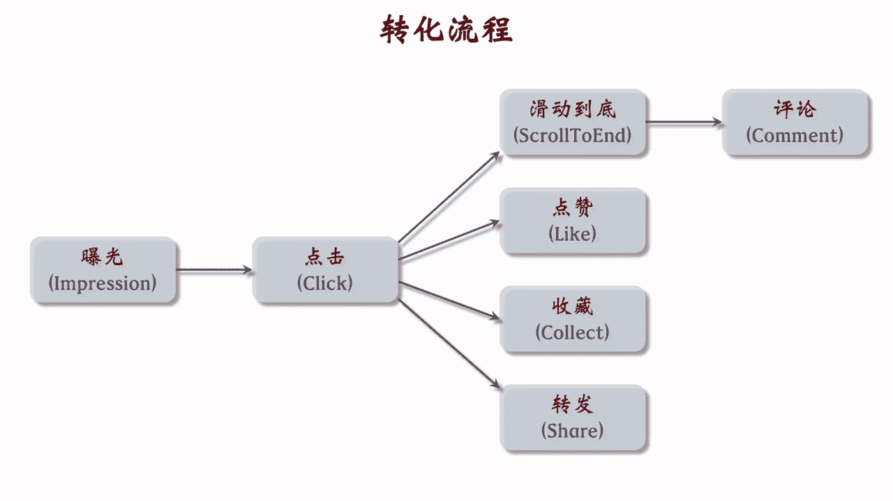

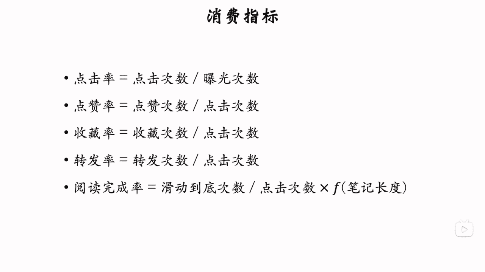

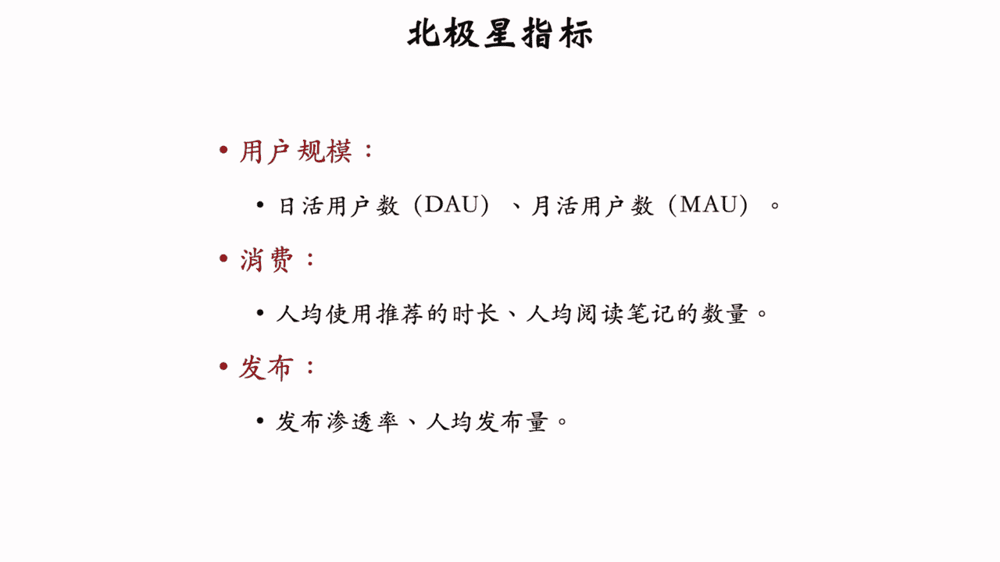

小红书推荐算法概览：https://mp.weixin.qq.com/s/T_yjqy4RbAD3CAGild6pQw

王树森讲小红书算法：https://space.bilibili.com/1369507485

评论区总结的笔记：https://www.yuque.com/yuejiangliu/recommended-system-in-the-industry/resource

## 热度检测工具

Awario，Keyhole，Brand24

预算有限：品牌词，网址，Tag

## 多平台管理工具

Buffer，Hootsuite

## Build in public

除了内容上做到Build in public外，还可以通过在推特上搜索带#buildinpublic的内容主动推广

很多独立开发者通过在推特上Build in public做增长，比如：

Pieter Levels：https://twitter.com/levelsio（416k）

Danny Postma：https://twitter.com/dannypostmaa（114k）

Marc Louvion：https://twitter.com/marc_louvion（90k）

Tony Dinh：https://twitter.com/tdinh_me（125k）

## Reddit

可以用来推广的Subreddit：

https://www.reddit.com/r/InternetIsBeautiful/（17M）

https://www.reddit.com/r/dataisbeautiful/（21M）

https://www.reddit.com/r/SideProject/（157k）

https://www.reddit.com/r/Entrepreneur/（3.4M）

https://www.reddit.com/r/ChatGPT/（5.2M）- Weekly Self-Promotional Mega Thread

一些Reddit Know-How：https://mail.ehandbook.com/p/reddit-unmarketing

---

# 红人

在进行红人营销前考虑好自己的预算，丰俭由人；预算有限，就不需要对定制化服务调研，直接开始人工找，顺便找找感觉

## 红人营销到底是什么

引用另外一份关于创作者经济的报告：创作者经济是一个由 Instagram，YouTube 和 TikTok 等平台上的独立内容创作者驱动的动态系统；在2022年该行业约有 5000 万创作者，累计价值超过 1040 亿美元；用通俗的话说红人就是专业或者业余的内容创作者，在国内更类似于自媒体这个概念

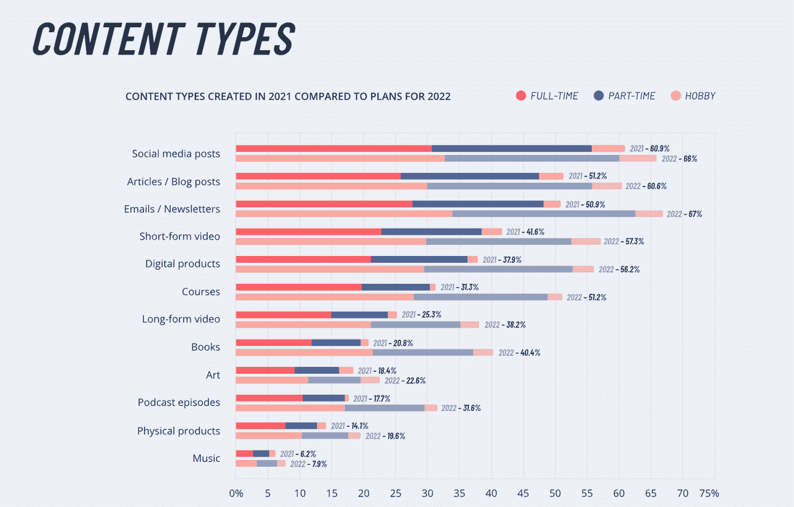

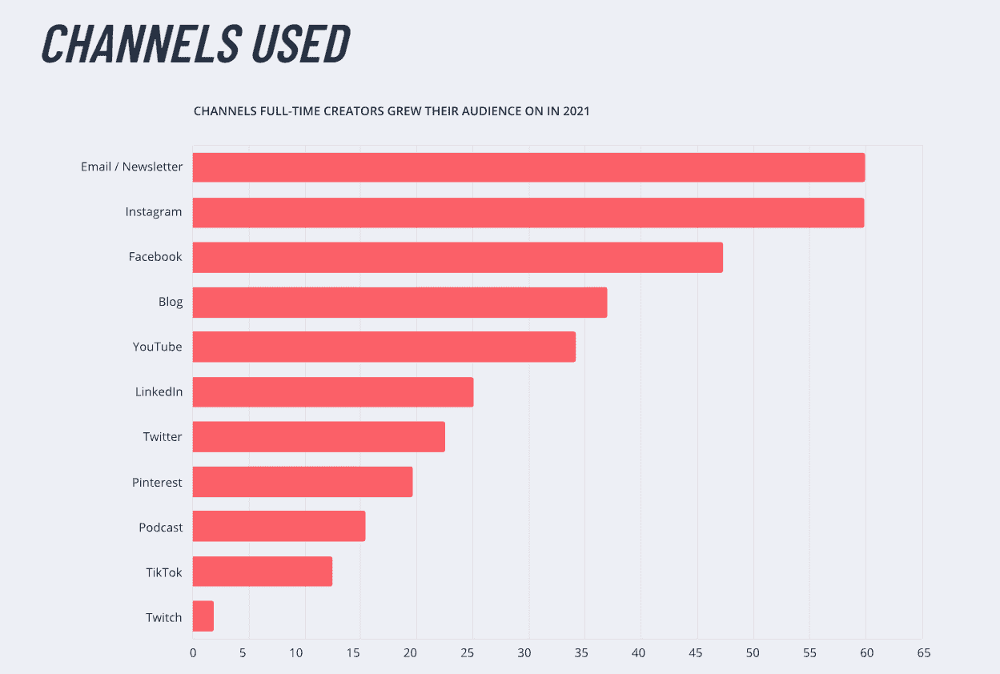

Passionfroot是这条赛道第一名，除此之外还有Pallet（https://www.pallet.com/），Kajabi（https://kajabi.com/）等

## 如何寻找红人

1.  表单

https://www.dropyourai.com/influencers

https://theresanaiforthat.com/influencers/

https://pddf6tgpxv.feishu.cn/share/base/query/shrcnny5xkZDk9D4UD42bJ11KMb（密码：210）

来源：你好我是210（https://web.okjike.com/u/147E9798-697F-4504-8CFF-813ED7DE99CF）

1.  工具

付费软件：noxinfluencer，influencity（七天免费），buzzsumo，scrumball，

Campaign发布平台：socialbook.io，influenz

免费工具推荐，用来找同类型红人 - 谷歌浏览器插件SimiliarTube，输入 KOSTJA 可以 REDEEM 500 credits

https://chromewebstore.google.com/detail/similartube/leokjncneiocjfkalljjokhomjnpolkk

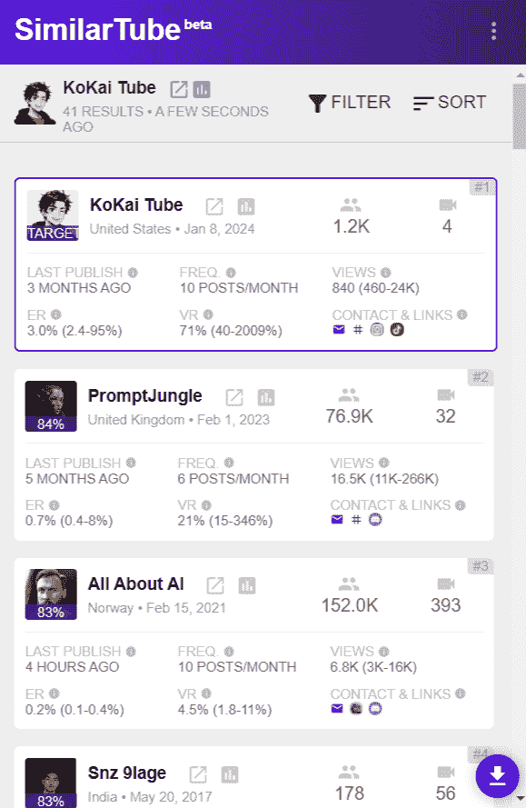

对工具的一些思考：

1.  自己找

通过品牌词，行业词，场景词

查看竞争对手找的红人

一些高级搜索语法，比如在推特上你可以搜索

Keyword+min_retweets:number

min_faves:number

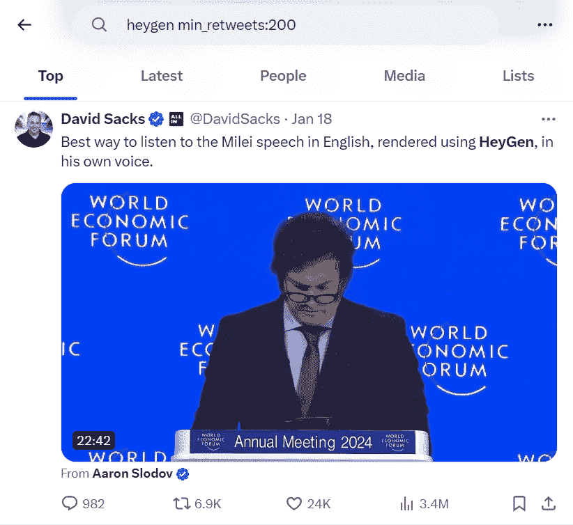

或Advanced search

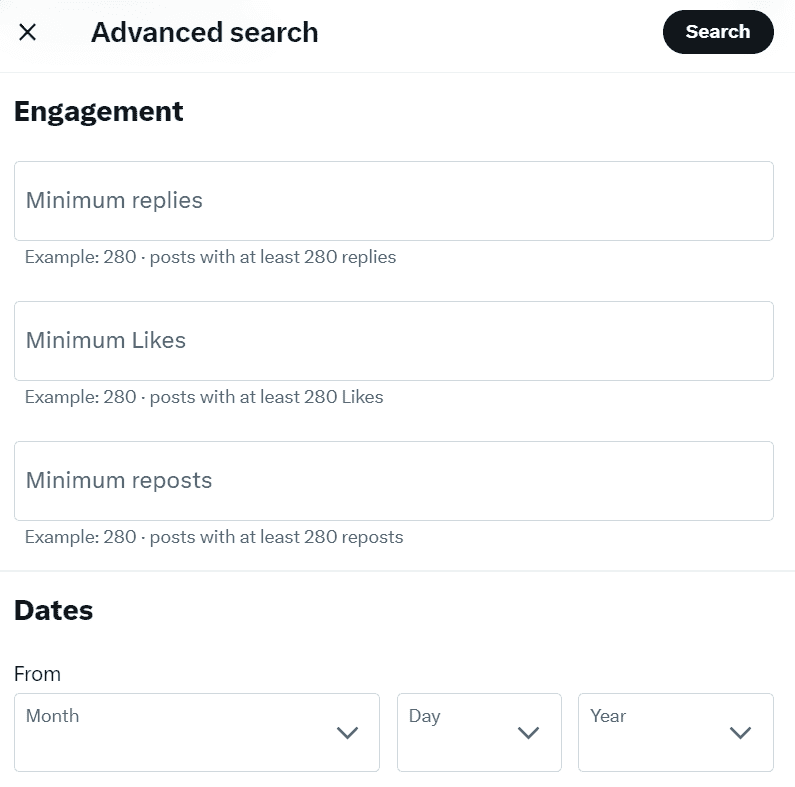

https://www.youtube.com/watch?v=on49dH1heA4&t=127s&pp=ygUGaGV5Z2Vu

通过对这位红人其他视频的观察，联盟计划赚取佣金也是他获得收入的一部分

## 内容形式

Review

Favorites

Tutorial/ How to

Placement advertising

Promote

某些红人合作是真的贵！

## 注意事项

出具频道数据

约定上线日期

付款方式：推荐paypal，有问题可以平台申诉；预付+尾款

# PR

## 为什么要做PR？

PR长期做口碑；市场营销强调直接的市场推广和销售转化；资源有限的环境中PR与Marketing往往由同一人承担；对于初创企业而言，生存和发展是首要任务；在早期阶段，产品开发和数据表现是关注焦点，尤其是对于那些面向企业（ToB）的创业公司；但品牌形象的塑造也很重要

## 预算有限，寻求海外PR报道

1.  HARO（www.helpareporter.com）和类似网站(https://pitchresponse.com/blog/what-are-some-haro-alternatives/)

1.  在社媒中搜索 #prrequest和#journorequest可以找到很多记者的需求，再配上其他hashtag可以快速找到合适的记者

1.  PR Tools：Muck Rack A News Tip, Source Bottle, Qwoted，ProfNet

PR是一个长期过程，看Picsart是怎么做的：https://picsart.com/press-kit/

Picsart将2015年开始关于他们的上百篇报道全集中在Newsroom一个页面，这不会带来直接增长，但是能带来长期品牌效应，更多情况可能只是将有影响力的几篇报道放在About Us板块

拓展阅读：

和海外公司公关负责人聊聊，什么是好的PR：https://www.xiaoyuzhoufm.com/episode/647571b653a5e5ea146fad56

出海品牌PR难，Techcrunch Rita教你如何打动海外媒体人：

https://www.xiaoyuzhoufm.com/episode/6399cc1a4ded9d81d0a113c5

# 广告投放

我也不懂，知识盲区

不过，移动应用出海投放和ASO可以研究下面的帖子：

<https://web.okjike.com/originalPost/64f5dfe8c70326f2eb6401a6>

# 邮件

邮件营销渠道很多，分站内和站外：站内靠欢迎邮件，博客内容订阅等；站外靠Newsletter，这部分和其他营销方式相重合

## Newsletter

海外内容创作者有自己的社群，也就是他本人的私域渠道，触达方式有独立站，社媒和Newsletter；如何找到这些内容创作者，可以看独立站是否有订阅按钮，可以看Substack和Medium这类平台，也有专门的交易平台

### Passionfroot

Passionfroot是个创作者经济平台，可以撮合品牌方和创作者，这个平台的大部分创作者（红人）都有自己的社群和对应的newsletter

这篇Passionfroot的文章就列出了20位AI领域提供newsletter的顶级红人：https://www.passionfroot.me/blog/top-ai-creators-and-ai-influencers，拿出其中一个分析

# 产品

## Hyegen

Heygen是优等生，在PMF，增长，团队管理，用户反馈上可以抄的作业

<https://web.okjike.com/originalPost/66157a0ea922aa28d0543bec>

## 支付

如果你有大量俄罗斯用户无法通过PayPal或Stripe付款，可以尝试这种方法，但是会有10%的损耗：https://www.youtube.com/watch?v=RadmPQRkzdU

---

# 出海手册/方法论/经历分享

独立开发者出海社区oversaas.club：https://oversaas.club/

硬地骇客 - 两个月 $12000 ARR 实践之路：https://book.hardhacker.com/

出海同学会的增长部分：[6.「全球获客增长方法论」](https://yfqtipm0a9.feishu.cn/wiki/MO9fwGuVDi1FjzkT7DPcuKiXnqf)

[关于出海](https://miracleplus.feishu.cn/wiki/YgVdwVKcfiNXf2kLySRcaCpvnCh)别鸣谢书航，本手册源于某次内部线上分享修改：

---

# 其他

## AIGC？建议你换成GenAI！

<https://web.okjike.com/originalPost/65841d4c60830f16ae16e116>

同样，

有这个图标而且只有英/中的也可以判断是国人团队的产品

---

# 持续更新ing...

> 都看到这儿了，点个赞吧！