# SEO操作手册

> 来源：[https://waytoagi.feishu.cn/docx/Qx9YdUqcnoBFNwxJzQocZWzJnad](https://waytoagi.feishu.cn/docx/Qx9YdUqcnoBFNwxJzQocZWzJnad)

# 介绍

在这个章节我会整理理论，案例，实操，以及一些解决方案

SEO不仅仅是技术，也是艺术，核心是优化重要指标；谷歌排名超过200个指标（https://backlinko.com/google-ranking-factors），我会优先选择重要部分记录

其他增长渠道，请浏览：[Kostja的增长手册](https://gx27ntqnm5z.feishu.cn/wiki/Hg8Mwb7gmi4rH2kTLXNczrh0n2b)

---

# SEO工具

Semrush，Similarweb，Ahrefs，Moz，Google Trends等

https://backlinko.com/best-free-seo-tools

对于新手，下方谷歌插件AITDK能满足基本需求

https://chromewebstore.google.com/detail/aitdk-seo-extension/hhfkpjffbhledfpkhhcoidplcebgdgbk

其他免费工具：

Broken Link Checker：https://www.brokenlinkcheck.com/

查找同一域上重复内容：https://www.siteliner.com/

查找页面副本：https://www.copyscape.com/

检查是否为AI生成内容：https://undetectable.ai/

本地化网站爬虫检查：https://www.screamingfrog.co.uk/seo-spider/

外包SEO服务：

---

# 谷歌200个排名因素

## 最重要的8个

+   **Quality Content****（高质量内容）:**最重要的SEO因素-谷歌希望内容对用户有用且高效，这也是谷歌存在的价值，极致的自然搜索体验才能带来更好的付费广告收入

+   **Backlinks****（反向链接）:**从其他网站到您网站的链接，越多/越权威的网站通向你的网站，代表你的网站越权威，网站排名就越高

+   **Technical SEO****（技术方面）:**比如网站速度，移动设备友好性和可抓取性；网站“硬件”方面足够优秀，搜索引擎就可以更好索引和理解你的内容

+   **Keyword **Optimization（关键词优化）: 优化整个网站中相关关键字，有助于搜索引擎了解网站的内容

+   **U**ser Experience (用户体验)：衡量用户使用网站体验的指标，谷歌喜欢向用户提供更好体验的网站

+   **Schema Markup****（结构标记）:** 结构化数据，添加到网站中可以帮助搜索引擎更好地理解内容，在SERP呈现出更多方式

+   Social Signals（社交信号）: 社交媒体现在也是除搜索引擎之外流量的一大来源，网站收到点赞、分享和其他社交互动是良好信号，在页面中加入这些CTA按钮

+   Brand Signals（品牌信号）: 品牌在互联网上的整体认知，让品牌广为人知并有权威性

---

# 搜索引擎结果页面（SERP）

在搜索时，谷歌会自动联想可能出现的词组来帮助你更好地搜索，这是：

## 自动补全功能（Autocomplete Feature）

https://blog.google/products/search/how-google-autocomplete-works-search/

搜索引擎结果页面（Search engine results page，SERP）就是输入关键词搜索引擎显示的页面

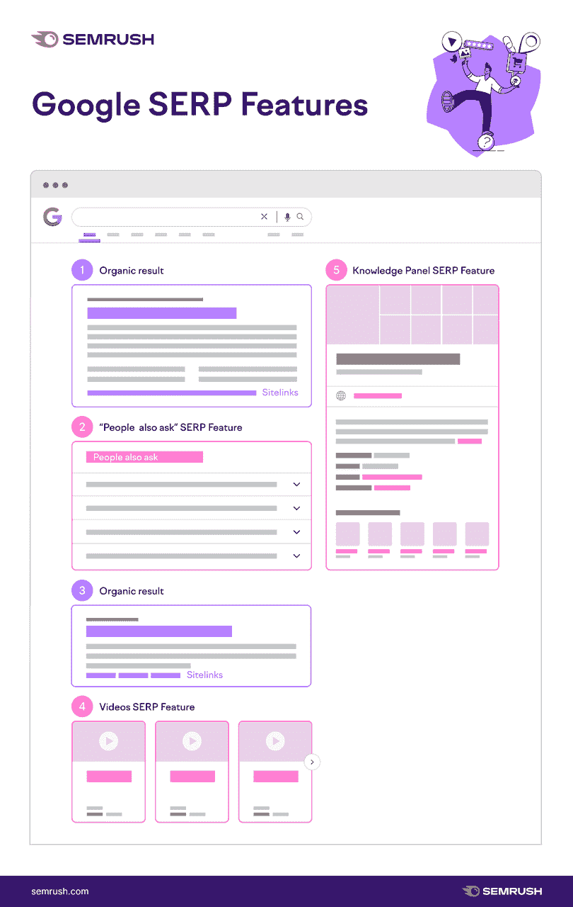

搜索结果中最重要的就是自然搜索结果和付费搜索结果，对应的是SEO和SEM

## 自然搜素结果（Organic search result）

## 付费搜索结果（Paid search result）

# 富文本摘要（Rich Snippets）

以OpenAI为例，下面是搜索“OpenAI”会出现的富文本摘要，某些元素只出现在特定主题，例如购物，本地服务，机票等，不过多赘述

## 精选摘要 (Featured snippets)

谷歌在排名前五的结果之一提取精选摘要，被称为“Position zero”

## 知识卡片 (Knowledge card，Knowledge panel，knowledge graph)

公司Logo可以出现在竞争对手的知识卡片中

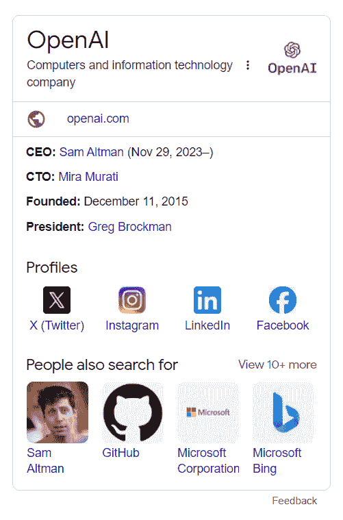

## 焦点新闻轮播 (Top Stories)

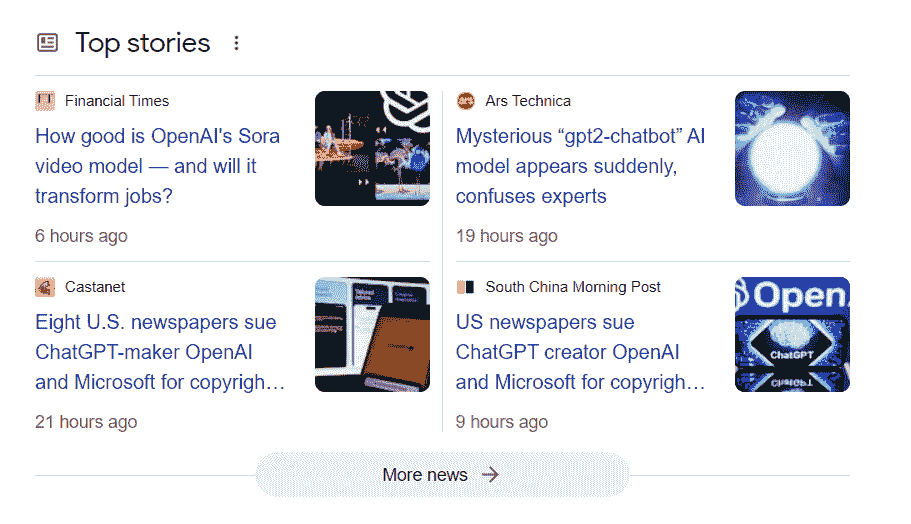

## 相关问题 (People Also Ask PAA)

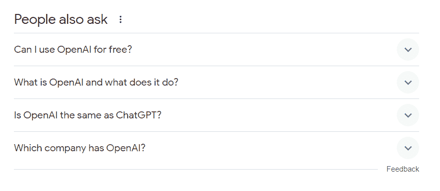

## 站点链接（Sitelinks，Oneline sitelink）

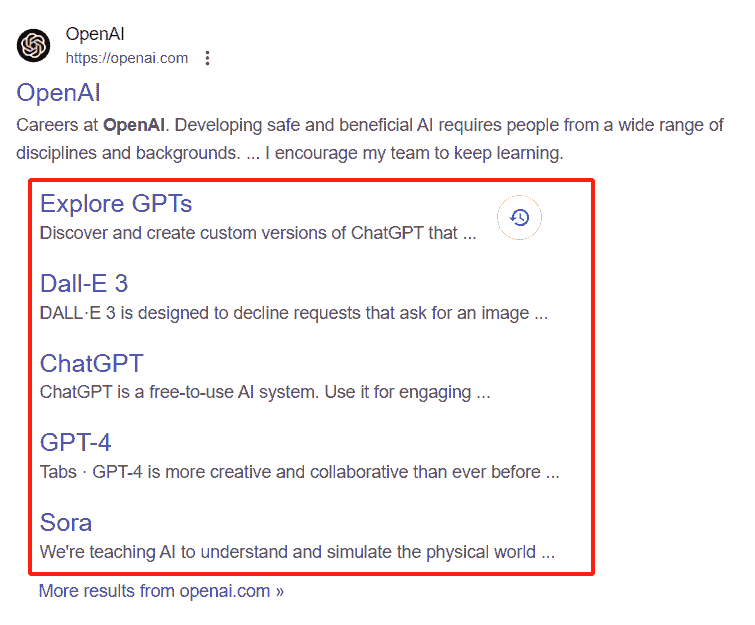

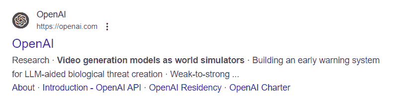

## 推特信息 (Tweet boxes)

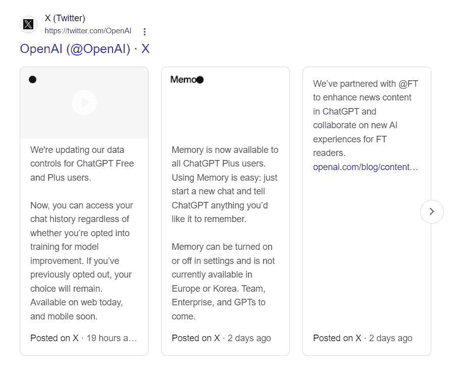

## 视频 (Videos)

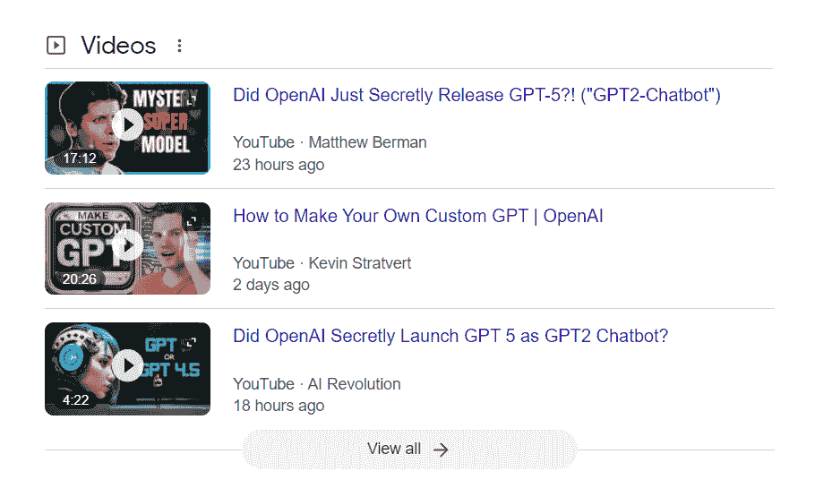

## 相关搜索（Related searches）

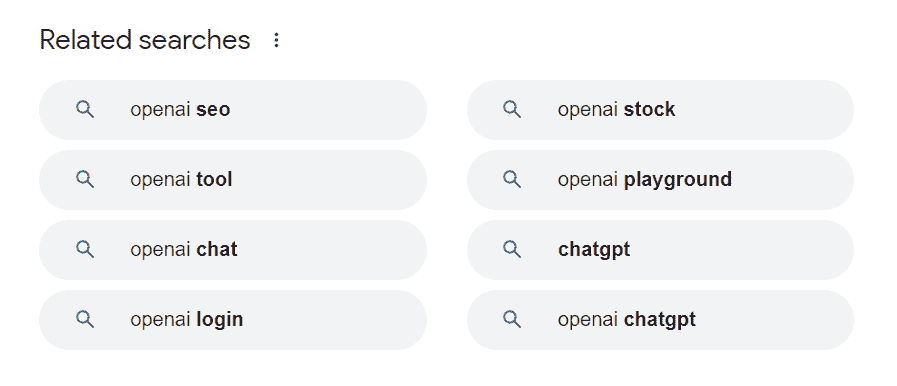

还有一些出现在特定的长尾词搜索中，例如搜索“who is on the board of openai”

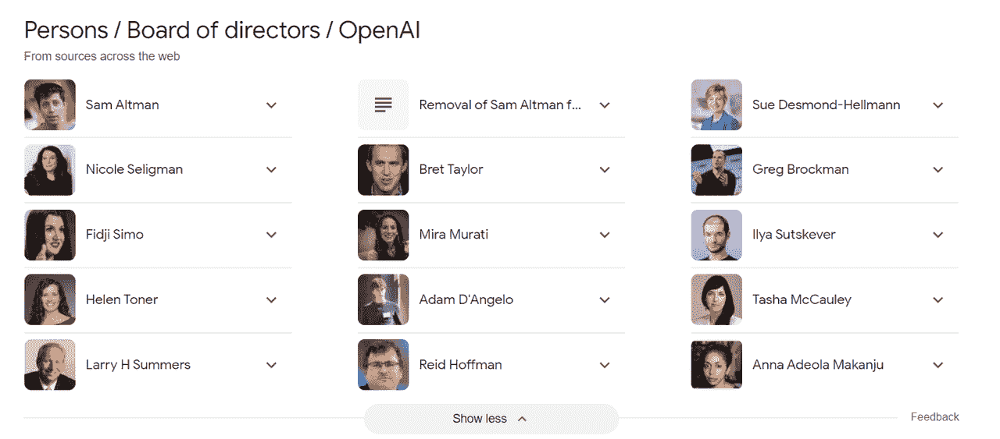

## 搜索框（Search box ）

## 精选图片 (Image Pack)

## 购物广告 (Shopping results)

## 购物搜索结果（PLAs）

## 评分（Reviews）

## Business profile

## Local Pack

## SGE

---

谷歌带来这些更好的搜索体验，可以让用户不需要点击跳转到某个网页就能得到答案，随即也导致了一个结果，就是“Zero-Click Content”

# 零点击内容（Zero-Click Content）

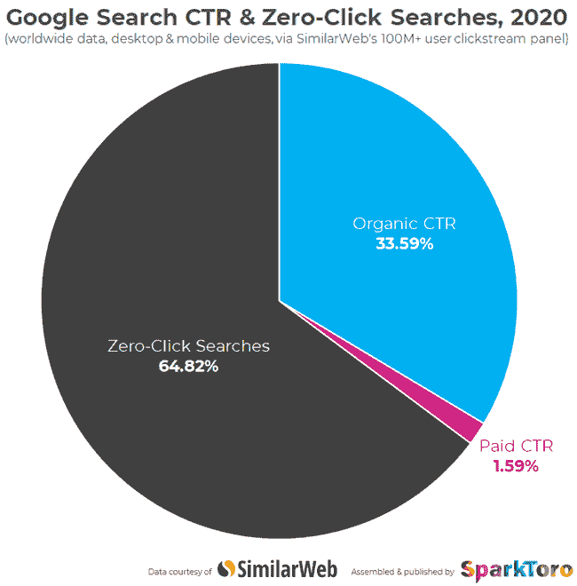

相关阅读：

https://sparktoro.com/blog/zero-click-content-the-counterintuitive-way-to-succeed-in-a-platform-native-world/

https://sparktoro.com/blog/in-2020-two-thirds-of-google-searches-ended-without-a-click/

---

# Cross-Post和Canonical Tag

跨平台发布（Cross Posting）指的是在不同平台上重复使用相同的内容

将相同的内容发布到所有平台，或者可以稍微改变一下 - 更新标题，图片或视频，而不需要为不同的社交媒体平台制作新内容

每个平台都有自己的风格

规范化标签（Canonical Tag）当同时发布大量未指定规范链接的重复内容的网站可能会受到搜索引擎排名的惩罚，这时候需要规范化标签，不仅用于站内重复页面，也用于多平台发布

部分平台可以手动添加，如Medium

部分建站插件工具可以添加，如Rankmath

> 简单说，这个标签相当是一个页面内的301转向。区别在于用户并不被转向，还是停留在不变网址上，而搜索引擎会把它当作是301转向处理，也就是说把页面链接的权重都集中到代码中指明的规范化网址上。

https://www.seozac.com/seo/canonical-tag-301/

谷歌官方指南

如何使用 rel="canonical" 及其他方法指定规范网址：https://developers.google.com/search/docs/crawling-indexing/consolidate-duplicate-urls?hl=zh-cn

相同内容多平台分发有助于曝光，但是要讲技巧，如果同时在能被索引的多平台发布，不同URL会分散权重，不利于排名

# Page Speed

通过谷歌开发者工具检测网页加载速度：https://pagespeed.web.dev/

谷歌用Core Web Vitals衡量网页的加载速度，响应能力和视觉稳定性。它包括以下三个指标:

最大内容渲染时间(Largest Contentful Paint, LCP)

LCP代表页面最大元素的渲染时间,通常来说页面中最大元素能快速渲染会让用户感觉页面性能良好

累积布局偏移(Cumulative Layout Shift, CLS)

首次输入延迟(First Input Delay, FID)

每个指标在性能得分的占比和优化方法：https://developer.chrome.com/docs/lighthouse/performance/performance-scoring?hl=zh-cn

# 外链

在增长团队中负责反向链接具体工作的是SEO外联专员（SEO Outreach Specialist），当然大部分时间是SEOer同时兼任这项工作，也可以交给代运营或通过Fiverr等平台将这部分工作外包出去

SEO Outreach Specialist 的工作可以概括为：

1.  与行业相关或潜在相关的网站建立联系，以获取高质量的反向链接

1.  与目标网站进行沟通，就链接位置和合作细节进行谈判

1.  制定和执行SEO外联策略，以提高网站排名和流量

1.  跟踪和分析链接建设活动的效果，以优化策略

1.  确保推广内容与SEO最佳实践相符合，提高搜索引擎的友好度

1.  维护与合作伙伴的良好关系，以确保长期合作

1.  了解SEO的最新趋势和算法更新，以保持策略的有效性

发布博客和文章，用于交换外链的平台Linktopia（在promo code输入KOSTJA1M9 领取一个月会员）：

https://linktopia.io/

其他付费服务：https://www.icopify.com/

**海**外图片/视频或者泛AI/SaaS的内容和工具站也欢迎通过kostja@cutout.pro找我沟通外链合作

最少需要多少外链才可以进入谷歌搜索前十：https://ahrefs.com/keyword-difficulty

## 外链策略

外链不仅仅可以帮助你提高排名，增加转化，建立品牌权威，也可以帮助你的提高整个域名的权威

终极省流版：https://backlinko.com/link-building-strategies（三个字，太全了！会按照可行性把部分策略列出来）

Email Signatures：在电子邮件签名中包含一个链接

Contextual Links：一些内容和你高度相关的外链，例如同样一个指向https://www.promeai.pro/的链接，锚文本既可以是“PromeAI”，也可以是“best AI image generator”

Resource Page Link Building：资源页面外链建设，资源页面，就是指那些汇聚了很多外链的页面（比如导航站），这样的外链会很好拿到，只要相关性高，站长非常高兴接受

https://backlinko.com/hub/seo/resource-pages

Tabbed browsing：点击外链打开新标签页面，而不是直接跳转，不然会影响浏览时长

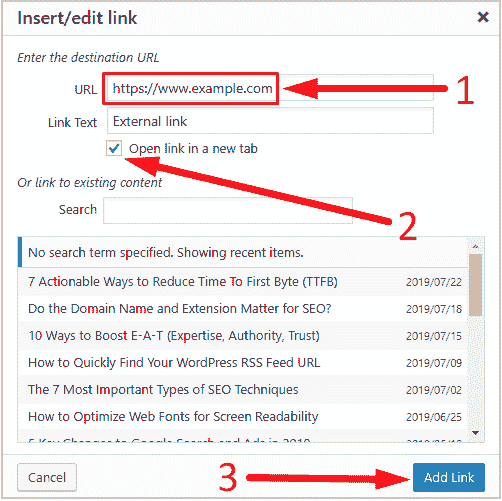

## 锚文本

Co-citation and Co-occurrence：https://www.semrush.com/blog/link-building-what-are-co-citation-and-co-occurrence/

# GSC

## Organic CTR

https://backlinko.com/hub/seo/organic-ctr

# 网站架构

1.  有良好逻辑的整体架构和内链结构能提高谷歌蜘蛛的crawlability and indexability，如果网站页面较少甚至不需要提交sitemap（几百页面以下）

1.  你无法影响站外链接对你网站的影响，但是可以通过操纵内链来手动分配页面权重

1.  将category和tag相似的内容聚类，可以提高某个主题的权威性，如果谷歌将你的判定为权威信息来源，排名会变容易

1.  合理的网站架构可以让谷歌帮助你生成sitelink，帮助提高你的点击率

1.  用户体验更好，增加页面停留时间，提高转化