# 质朴发言：视觉-语言理解模型的当前技术边界与未来应用想象｜Z 研究第 2 期

> 来源：[https://waytoagi.feishu.cn/docx/UDeadudumoJ4tGxdoPycsIbsnrc](https://waytoagi.feishu.cn/docx/UDeadudumoJ4tGxdoPycsIbsnrc)

原文链接：https://mp.weixin.qq.com/s/dYLqW8dNOcQw59UtQwXNgA

来源：质朴发言

发文时间：2024.01.22

近期，生成式 AI 领域的浪潮催化了多模态模型的探索，研究人员不断尝试使用更多模态数据的编码，以训练出能够理解和处理多种类型数据的模型。

本份研究报告集中讨论了基于 Transformer 架构的视觉-语言模型，这些模型优化了从视觉输入到语言输出的转换过程。

报告的范围专注于视觉和语言之间的交互，而不考虑单纯的视觉到视觉的计算机视觉任务。

**综上，本报告旨在为所有关心大模型事业****的伙伴，提供一个全****面而深入的视角，以理解视觉-**语言理解模型的发展历程、现状及未来趋势。🌊

> **目录 **建议结合要点进行针对性阅读。👇

> **一、视觉分析技术**

> 1、Transformer 视觉模型优点

> 2、Transformer 视觉模型的局限

> **二、图像-语言模型**

> **三、视频-语言模型**

> **四、LLM 多模态 Agent**

> **五、应用场景**

> 1、多模态内容理解与处理

> 2、智能交互与自动化

> 3、具身智能

> 4、未来发展趋势（2024-?）

> 5、视频生成模型 mapping

> **六、未来发展方向**

> 1、技术路径而言：利用预训练 LLMs 进行指令调整

> 2、应用场景而言：赋予机器理解多模态的能力

> **七、References **

> **八、附录**

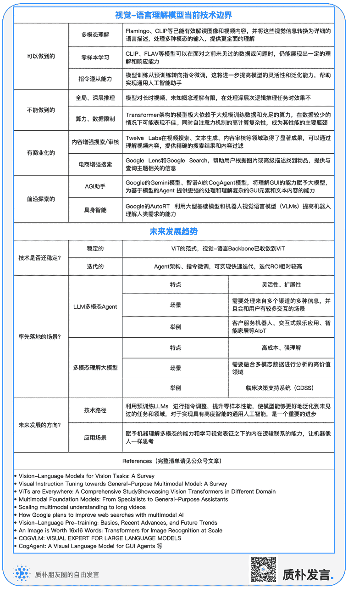

# **#一、视觉分析技术**

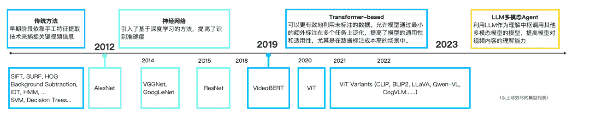

视觉分析技术的演进路径

CV 技术经历了几个重要发展阶段。在** 2014 年之**前，早期的方法主要依赖于手工特征提取技术，如 SIFT、SURF 和 HOG，这些方法通常结合了传统的机器学习算法。

进入 2014 年，随着深度学习的兴起，神经网络（CNN）开始在 CV 中发挥核心作用。这个阶段经历了从零开始的深度学习、有监督、无监督和自监督。

到了 2019 年，随着 Transformer 结构的诞生及其在自然语言处理中的成功应用，预训练 Transformer 架构模型如 VideoBERT 开始兴起。

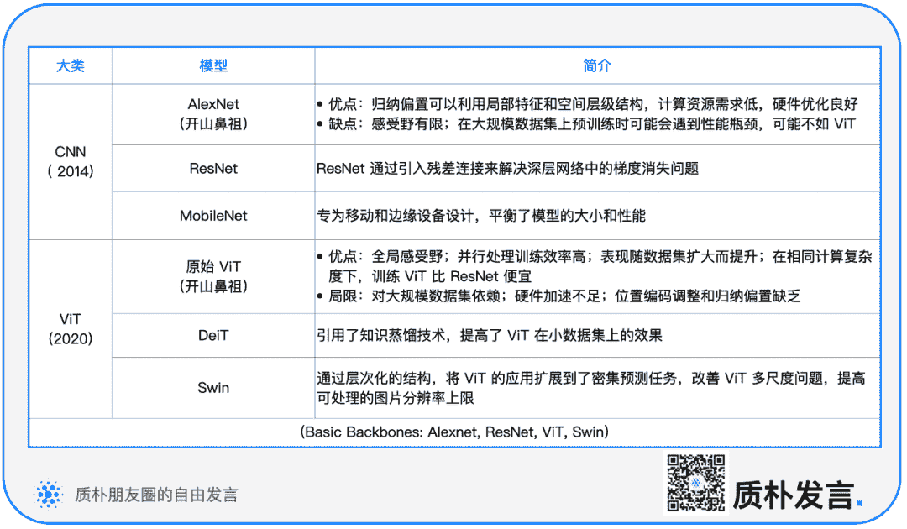

## 1.1 Transformer 视觉模型优点

+   **底层机制优势：**ViTs 利用 Self-attention 机制收集图像各部分之间的信息，能有效处理长序列数据。这一机制能在全局上下文中理解长距离标记关系，特别适合于解析复杂视频内容及其时序关系

+   **训练方式优势：**ViTs 可以在大规模无标签数据集上进行预训练，随后在具体任务上进行微调。这种训练方式允许模型在资源丰富的数据集上学习，然后迁移到更特定的应用场景

+   **效果优势：**经大规模数据预训练的 ViTs 在下游任务，尤其是图像识别方面效果显著，与最先进的卷积神经网络（CNNs）相比，ViTs 能在更低的计算资源消耗下达成优异的表现

+   **多模态融合优势：**ViTs 在多模态学习上展现出的灵活性有助于打破传统视觉理解和自然语言处理（NLP）之间的界限。

+   类似的 Transformer 架构可以应用于不同模态的数据，如将 NLP 中的标准 Transformer 模型应用于图像分类任务

## 1.2 Transformer 视觉模型的局限

+   **数据依赖局限**：ViTs 的高效性部分依赖于训练数据的规模，当训练数据集不够大时，缺少归纳偏置（inductive bias）的 ViT 的表现通常比同等大小的 ResNets 要差一些，可能在数据较少的场景下表现不佳

+   **算力支持局限**：自注意力的计算复杂性是 ViTs 性能瓶颈的主要来源。由于需要处理大量的 token 对，这种机制在计算上非常密集

# **#二、图像-语言模型**

这些模型的核心有三个主要组成部分：

1、每种数据模态设计了专门的编码器，将各自模态的数据转换成嵌入形式

2、将不同模态的嵌入信息映射到同一个多模态嵌入空间，实现嵌入的对齐

3、一个能够生成文本响应的语言模型

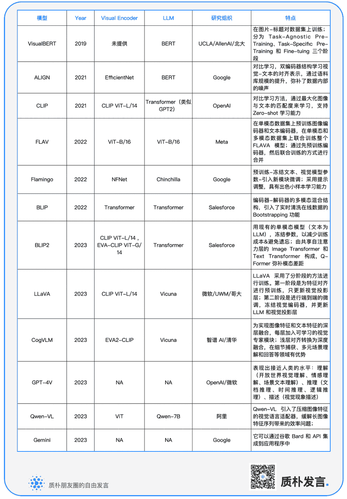

# **#三、视频-语言模型**

视频本质上是在时间序列上连续排列的二维图片。这使得视频比起静态图像增加了一个维度：时间。

**因此，视频-语言模型（Video-Language Models）不仅**需要处理视觉数据，还需要理解和处理时间序列信息，把握每个画面转换之间的动态联系。

视频-语言模型存在独有的挑战，例如，与庞大的图像-文本数据集相比，相应的视频-文本数据集规模较小。

此外，视频的描述通常需要超过单一短文本提示，可能需要一系列提示或者一个讲述随时间发生事情的故事。

**下**表总结了近两年来在视频-语言模型领域的一些重要研究，包括 13 个预训练模型以及 17 个指令微调模型研究：

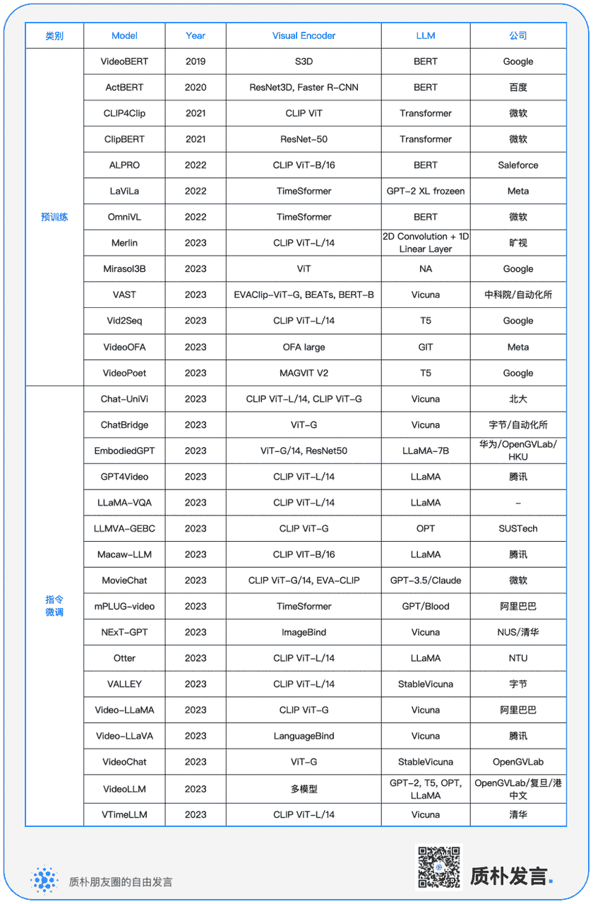

# #四、LLM 多模态 Agent

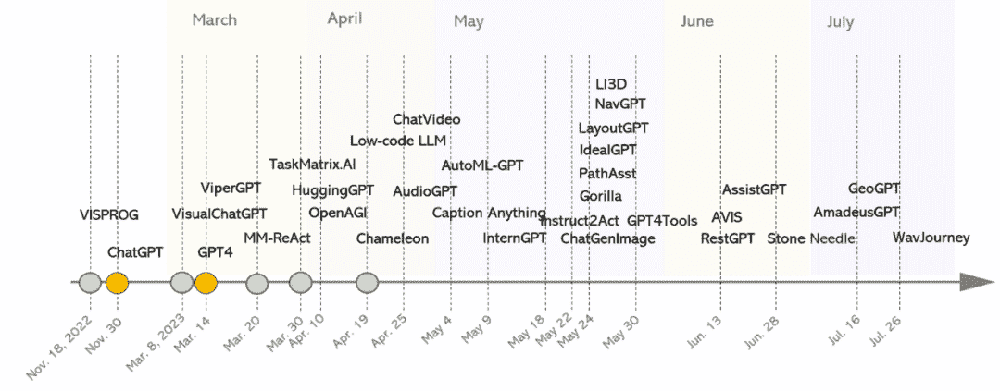

从2022年11月18日到2023年7月26日，多模态Agents的迅速增长 (Li et al., 2023)

近年来，随着大型语言模型（LLM，如 GPT-3）的发展，研究者开始尝试将 LLM 作为中枢神经调用多模态模型（LLM 多模态 agent），以进一步提升视觉理解任务的效果。

严格来讲，2023 年兴起的 LLM 多模态 agent 并不算是视觉基础模型的又一技术迭代，而是将现有技术融合的新尝试，是一种集成了多种模态数据处理能力的 AI 技术

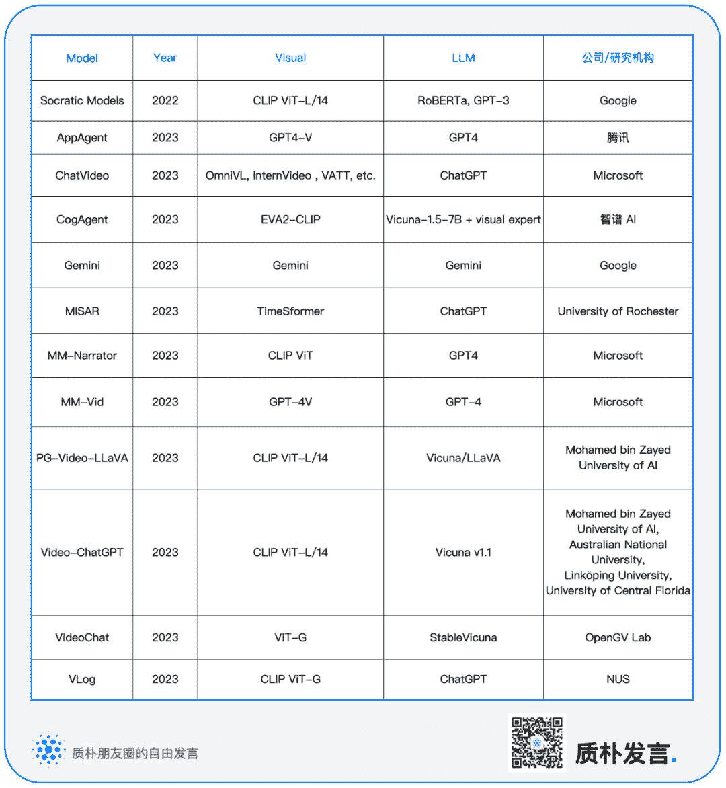

LLM 多模态 Agent 的优点：

（1）其高度的灵活性和扩展性。它可以根据不同的任务需求，调用最合适的模型来处理任务，无论是文本、图像或是声音数据。这种模型的扩展性能使其能够适应多样化的任务和数据类型，优化资源使用，提升效率；

（2） 因为无需训练，系统开发周期快，成本很低。

LLM 多模态 Agent 面临的局限性：

（1）它的调试和工程化难度较高，这可能意味着在维护和升级过程中需要更多的成本和技术投入；

（2）由于多个组件的紧密耦合，单点故障可能导致整个系统风险增加；

（3）没有涌现出新的能力。

LLM 多模态 Agent 适用的场景包括：

（1）需要综合处理视频、语音和文本等多种信息的复杂环境。例如，在自动驾驶汽车中，需要融合处理来自摄像头、传感器的视觉信息以及语音指令；

（2）高度交互和灵活的用户界面也是 LLM 多模态 Agent 发挥优势的场景。这在如客户服务机器人或是交互式娱乐应用中尤为明显，它们需要与用户进行自然流畅的交互，并理解用户通过多种渠道表达的需求和指令。

# **#五、应用场景**

## **5.1 多模态内容理解与处理**

斯坦福：Med-Flamingo

+   **模型特点：**继承并扩展了 OpenFlamingo-9B 的能力，主要通过预训练在出版物和教科书中配对和交错的医学图像文本数据集来提升该模型

+   **落地场景 - CDSS：**医生们通过一个互动应用程序对问题和模型的生成答案盲评，证实了 Med-Flamingo 在生成医学 VQA 中提高了多达 20%的临床评分

**Google: MedPaLM**

+   **模型特点：**MedPaLM 模型有 12 亿、84 亿和 562 亿参数的变体版本，并在临床评估中显示出与人类放射科医生相当的临床显著错误率

+   **落地场景 - CDSS：**能够处理包括临床笔记、实验室结果、生命体征、医学照片甚至基因组数据在内的多样化数据源，整合和分析来自不同医疗领域的信息，从而提供更全面的解决方案

Twelve Labs: Pegasus-1

+   **资金与投资：**李飞飞、Scale AI 创始人 Alexandr Wang、Nvidia、Intel Capital、Samsung NEXT Ventures

+   **模型特点：** Pegasus-1 是一个先进的视频理解模型，约 800 亿参数，能够深入理解视频内容。能够处理从 10 秒到数小时不等长度的视频。能够理解视觉信息以及音频和语音信息，包括人物、物体、场景，背景音乐和对话等。

+   **解决方案：**

+   **视频搜索：**语义视频搜索服务，通过描述性语言在数小时的视频内容中快速找到用户想要的那一瞬间

+   **视频-文本生成：**提供 API 以从视频生成文本摘要、关键点、标签和标题等，能够在没有音频或者文字的情况下，提供视频内容的报告。

+   **定制化模型：**提供定制化服务，允许用户微调自己的模型，以满足特定领域的需求

+   **落地场景：**

+   **广告插入与内容审核：**用于判断视频内容，例如区分展示刀具的视频是暴力内容还是教学内容

+   **流媒体内容分析：**自动生成媒体分析报告，比如从视频中自动生成亮点集锦，或者为视频生成标题和标签

+   **运动赛事视频分析：**与 NFL 在内的多个行业公司合作，帮助精彩瞬间捕捉、技术动作分析、比赛策略分析等

**Google：多模态模型 MUM（Mult**itask Unified Model）

+   **模型特点：**MUM 利用了 T5 文本到文本框架，比之前的 BERT 模型强大 1000 倍，可以将复杂的查询分解并理解其不同组件。

+   例如，在计划爬山前的准备中，“准备”可能包括健身训练和了解天气状况。MUM 还能够从图片中理解信息并回答相关问题，如辨识图片中的登山靴是否适用于某个特定活动。

+   **落地场景：**

+   **电商搜索：**Google Lens，利用 Lens，用户可以根据照片和高级描述找到物品，例如服装。

+   **增强搜索：**Google Search 中，用户将开始看到由 AI 策划的关于某些主题应该知道的事情的列表，例如丙烯酸绘画材料。还会根据查询主题提供细化或扩大搜索范围的建议，以及通过搜索发现的视频中的相关主题。

## **5.2 智能交互与自动化**

GUI Agent 类，将图像理解能力赋予 Agent，应用于 GUI 界面，为 Agent 提供更强的视觉感知能力

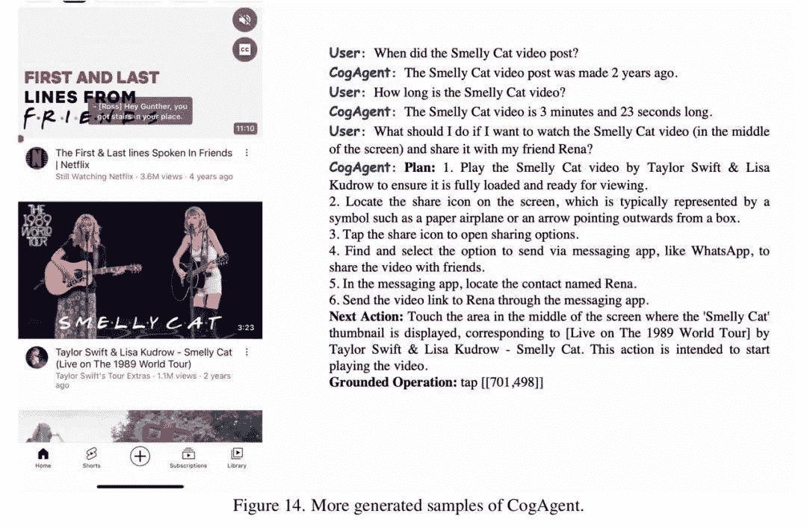

智谱CogAgent

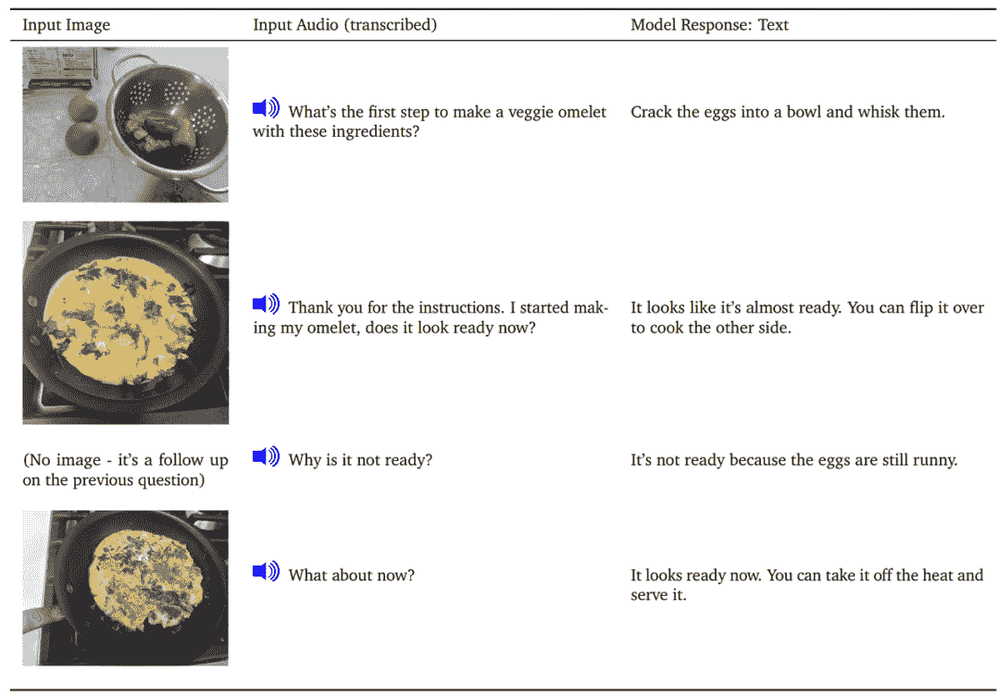

Google Gemini

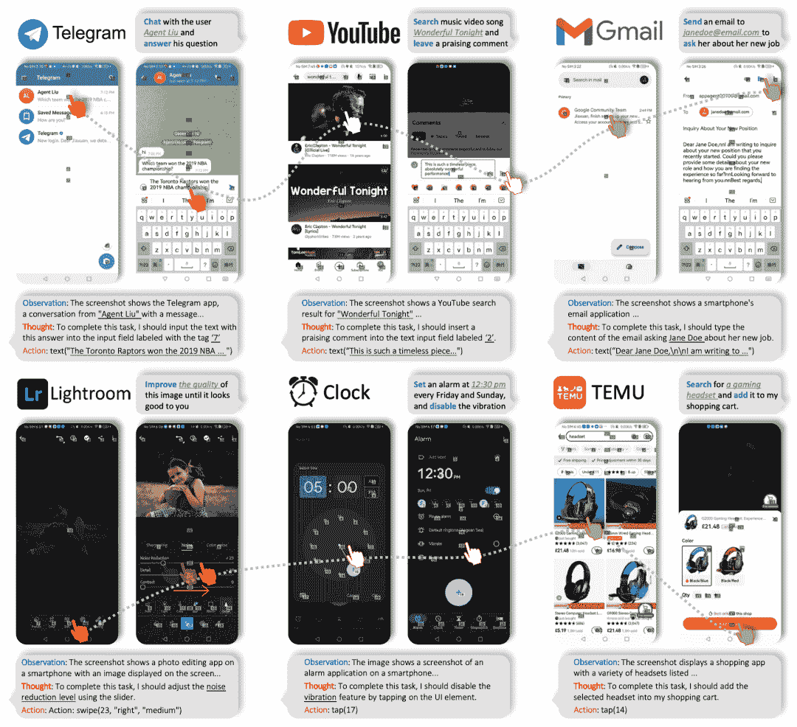

腾讯 AppAgent多模态Agent框架

**智谱 AI：CogAgent**

+   CogAgent 是由清华大学和智谱 AI 共同开发的一种新型视觉语言模型（VLM）。

+   这个模型专门设计用于理解和导航图形用户界面（GUI），并采用了低分辨率和高分辨率图像编码器的双编码器系统，能够处理和理解复杂的 GUI 元素和文本内容。

+   **Agent 能力：**能够针对任何给定的 GUI 屏幕截图返回计划、下一步操作以及具体操作坐标。

+   它还增强了与 GUI 相关的问答能力，能够处理关于任何 GUI 屏幕截图的问题，如网页、PC 应用程序、移动应用等。

+   **演示案例：**CogAgent 能够识别和解释小型 GUI 元素和文本，在 PC 和 Android 平台的 GUI 导航方面表现出色

**Google: Gemini**

+   Gemini 是由 Google 开发的一系列新的多模态模型，其最大亮点之一是其原生多模态大模型的设计。它能够处理不同形式的数据（语言+听力+视觉），并在一开始就在不同模态上进行预训练，利用额外的多模态数据进行微调以提升有效性。

+   **Agent 能力：**调用多模态，完成实时场景交互，通过不同模态之间的准确推理，能够概括和无缝理解、操作以及结合不同类型的信息，包括文本、代码、音频、图像和视频，为用户提供了自然的交互体验

+   **演示案例：**在烹饪场景中，Gemini Ultra 通过一系列图像和音频的交互展示了其在处理用户提问、图像细节以及多模态推理中的出色表现，模型准确回答了用户的问题，体现其调用多模态能力的统一性

腾讯：AppAgent 多模态 Agent 框架

+   AppAgent 是由腾讯开发的一种基于大型语言模型（LLM）的多模态 Agent 框架，由大型语言模型驱动，能够掌握并使用任何应用程序来执行复杂任务。

+   它通过直观的点击和滑动手势与应用程序交互，模仿类似人类的动作，操作复杂功能

+   **演示案例：**在使用 Adobe Lightroom 进行图像编辑的测试中，AppAgent 通过实时截图和展示应用程序 UI 的 XML 文件，可以准确感知、推理并响应任务要求的能力

## **5.3 具身智能**

**谷歌：AutoRT**

+   **VLM 的应用：**AutoRT 利用大型基础模型和机器人视觉语言模型（VLMs）提高机器人理解人类需求的能力。

+   **模型特点：**通过视觉语言模型使机器人更好地理解它们所处的情境，并且能够根据大语言模型建议的任务清单进行自主作业，还能够处理大量不同的设备和任务。

+   **落地场景 - 自动化管理：**DeepMind 使用 AutoRT 系统成功地指挥多达 52 台独特的机器人，在多达 6,650 个任务中收集了 77,000 个机器人尝试的数据。

# **#六、未来发展方向**

## 6.1 技术路径而言：利用预训练 LLMs 进行指令调整

最初，多模态融合方法常采用预训练的目标检测器，例如 ViLBERT、VisualBERT 和 Unicoder-VL。

这些方法通过提取图像特征和执行交叉模态预训练任务，为后续的图像-文本任务奠定了基础。

**随着 ViT 的出现和普及，更多方法开始利用 ViT 作为图像编码器**。这些方法强调大规模预训练，以提高模型的性能和泛化能力，例如 Flamingo。

近期，我们见证了向多模态 LLMs 的发展趋势，从进行预训练到向指令调整（instruction tuning）转变。

例如 LLaVA 和 MiniGPT-4，它们通过融合视觉和语言信息，能够更有效地完成视觉理解相关的任务。

这进一步提升模型对于指令的理解能力，提升零样本性能，使模型能够更好地泛化到未见过的任务和领域，对于实现具有高度智能的通用人工智能，是一个重要的进步。

## 6.2 应用场景而言：赋予机器理解多模态的能力

当前视觉-语言模型（vision-language model， VLM）的商业化场景局限在视频的分析搜索。然而，其更广阔的应用前景在于将这些模型作为信息输入的媒介，进而驱动程序或模型完成其他操作。

例如，CogAgent、AppAgent 和 AutoRT 等系统将 VLM 作为核心组件，使机器得以理解和处理多模态信息。

在视觉学习过程中，模型主要学习的是图像表征，而不是内在的逻辑联系，这与语言学习不同。

而如果能将视觉模型与大型语言模型结合，利用后者来解读更复杂的概念，视觉模型将更接近于理解真实世界的通用人工智能。

**进一步而言，视觉语言模型的精进在现实世界，有助于机器更深层次地理解和交互物理世界，本质**上是将复杂的视觉信息转化为更直观、易于理解的语言形式，从而深化对物理世界的认识。

视觉作为人类获取信息的主要方式之一，通过视觉到语言的转换，机器能够更直观地理解物理世界，例如分析图像或视频内容，描述场景中的物体、动作和事件，这对理解物理世界的动态变化至关重要。

**语言作为人类交流的基本工具，当机器能够将视**觉信息转化为语言，其交互能力将显著提升。

这意味着机器可以更自然地与人类沟通，提供有关视觉环境的信息，实现更有效的人机交互，从而为我们畅想具身智能提供可能性。

# **#七、References **

•🔥Vision-Language Models for Vision Tasks: A Survey

•🔥Visual Instruction Tuning towards General-Purpose Multimodal Model: A Survey

•🔥ViTs are Everywhere: A Comprehensive StudyShowcasing Vision Transformers in Different Domain

•🔥Multimodal Foundation Models: From Specialists to General-Purpose Assistants

•Vision-Language Pre-training: Basics, Recent Advances, and Future Trends

•An Image is Worth 16x16 Words: Transformers for Image Recognition at Scale

•COGVLM: VISUAL EXPERT FOR LARGE LANGUAGE MODELS

•CogAgent: A Visual Language Model for GUI Agents

•AppAgent: Multimodal Agents as Smartphone Users

•Gemini: A Family of Highly Capable Multimodal Models

•Qwen-VL: A Versatile Vision-Language Model for Understanding, Localization, Text Reading, and Beyond

•arxiv: ChatVideo: A Tracklet-centric Multimodal and Versatile Video Understanding System

•arxiv: Video Understanding with Large Language Models: A Survey

•arxiv: Vid2Seq: Large-Scale Pretraining of a Visual Language Model for Dense Video Captioning

•CSDN 博客：视频理解多模态大模型（大模型基础、微调、视频理解基础）

•CSDN 博客：逐字稿 | 9 视频理解论文串讲（下）【论文精读】_视频理解论文串讲（下）

•Youtube: Two-stream Convolutional Networks for Action Recognition in Videos

•arxiv: Is Space-Time Attention All You Need for Video Understanding?

•Learning Transferable Visual Models From Natural Language Supervision

•李沐论文精读系列二：Vision Transformer、MAE、Swin-Transformer_李沐 讲 vit-CSDN 博客

•Twelve Labs is building models that can understand videos at a deep level

•Google MUM 相关内容： venturebeat.com、blog.research.google

•Scaling multimodal understanding to long videos

# **#八、附录**

Image-language models👇

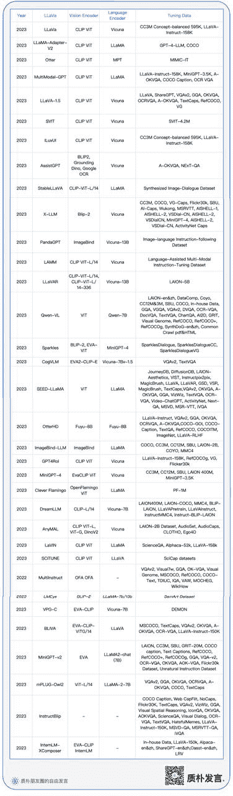