# 质朴发言：AI产业背后的亿级美金市场：合成数据｜Z研究第 4 期

> 来源：[https://waytoagi.feishu.cn/docx/LQU8dUoHMoGdlTxJk1gcahK7nw6](https://waytoagi.feishu.cn/docx/LQU8dUoHMoGdlTxJk1gcahK7nw6)

原文链接：https://mp.weixin.qq.com/s/iEfvn1iG9ue1Hdydsr0ILQ

来源：质朴发言

发文时间：2024.03.16

随着AI浪潮，多家机构判断全球合成数据生成市场规模预计将显著增长：

合成数据 2022 年市场规模为 1.638 亿美元，预计到 2031 年将达到 34 亿美元，复合年增长率为37.3%（Straits Research）。

合成数据的市场规模将从 2023 年的 3 亿美元增加到 2028 年的 21 亿美元，复合年增长率为 45.7%（MarketsAndMarkets)。

到 2030 年，市场规模预计将超过 23.398 亿美元，复合年增长率为 31.1%（Fortune Business Insights）。

甚至在某个节点，合成数据体量超过真实数据，成为训练模型的主要"燃料"；因此 Z 计划 team 对这个 AI 产业背后的亿级美金市场开展研究，提炼观点如下：

**观**点 1：本轮 AI 技术浪潮下，AI 产业的商业价值将从数据的收集、流转、存储（历史→当下）流向数据的计算、应用、预测（当下→未来）。

但数据驱动的应用仍存在障碍：高昂成本使数据价值难以发挥。在此背景下，合成数据有望凭借其隐私保护能力、低边际成本开发新数据的能力，重塑 AI 产业。

**观**点 2：在 AI/ML workflow 变化的过程中，我们认为合成数据本质上既是“数据驱动”理念的新动力，也是被数据驱动的新对象。

具体来说，合成数据位于 workflow 的数据准备阶段，为模型提供优质训练集；而 workflow 各环节又对合成数据有反馈，进而影响合成数据的效用与迭代。

**观点 3：AI 产业重塑的趋势之下，上下游公司及专注合**成数据的创业公司将争夺数据合成的关键点位。

目前已明确入场的包括：拥有垂直场景合成算法 & 强业务 Know-how 的初创团队、积累数据标注评估经验的标注公司、聚集活跃开发者力量的开源模型平台、具备研发 & 用户 & 工程化经验等规模优势的底层大模型厂商、基于已有软/硬件生态拓展合成数据的科技大厂。

**基于技术特点、行业趋势及商业价值，我**们认为：合成数据赛道的核心竞争要素依次是数据能力、迭代能力、平台能力和场景选择。🌊

OpenAI Sora 的技术报告中提到：

**由 DALL・E 3 生成训练视频相应的 c**aptions，以此达成视频和文本的对齐

**使用 GPT-4 自动扩写用户 Prompt，增加场景细**节描述，以生成更逼真、细节更丰富的视频。

尽管报告未提到，但许多人猜测 Sora 使用了 UE 生成的高保真游戏场景数据，才达到了如此逼真的效果

此外，Anthropic 推出的大模型 Claude 3 在其技术文档中确认使用了内部合成的数据进行训练

+   **从 Sora、Claude 3 等事实中，可观察到一个趋势：“数据训练模型-模型生成/预测/仿真模拟得到合成数据-合成数据训**练模型”的 AI/ML workflow 正在形成，其中与传统 AI/ML workflow 最大的区别即为合成数据

+   无论合成数据算法成熟度如何，“模型再生训练数据”已是大模型在工程化上的成功实践。

+   考虑到未来模型的复杂性和数据需求进一步提升，合成数据的影响或将逐步扩大，进而重塑 AI/ML workflow

+   **AI/**ML workflow 变化的本质是什么？合成数据概念从何而来？为何合成数据会对 AI/ML workflow 产生影响？合成数据将如何影响具体 workflow /受 workflow 的反馈影响？什么样的公司将占据合成数据赛道的关键点位？

+   接下来，我们将依次解答上述问题，并在文末整理了多模态数据生成产业的 Mapping。

> **目录 ****建议结合要点进行针对性阅读****。👇**

> 一、为什么合成数据能重塑 AI 产业

> 1、AI/ML workflow 的价值分布变化：从对当下数据的处理、分析，流向对未来数据的预测、应用

> 2、数据驱动的应用仍存在障碍，高成本使得数据价值难以发挥

> 3、合成数据介绍

> 4、合成数据的特点有望清除数据驱动应用的障碍

> 二、合成数据如何重塑 AI 产业——通过影响 workflow

> 1、传统 AI/ML workflow

> 2、合成数据 workflow

> 3、融入合成数据的 AI/ML workflow

> 三、什么样的公司能占据合成数据的关键点位

> 四、结论：合成数据赛道的核心竞争要素

> 附：多模态数据生成产业 mapping

> 1、多模态数据生成的类别

> 2、国内外多模态数据生成产业图谱

> 3、合成数据赛道

> **参考文献**

# #一、为什么合成数据能重塑 AI 产业

## 1、**AI/ML workflow 的价值分布变化：从对当下数据**的处理、分析，流向对未来数据的预测、应用

**a. 需求侧**

+   过去，需求集中在数据收集-分析；

+   过去对数据的利用集中在收集、转换、存储等，即对历史和当下情况的分析；

+   随行业发展，需求流向数据应用-预测；

+   随着模型 Scale up 带来推理能力增强，企业用大数据驱动业务的价值提高，对决策的科学性、客观性要求提高，企业希望使用数据对未来情况进行预测、模拟。

+   **此外，AI/ML** 技术的突破，带来应用端对数据的新需求；

+   据 Epoch AI Research 预测，到 2026 年，现存的用于 AI 模型训练的高质量语言数据将耗尽；

+   据 Gartner 预测（下图），到 2030 年，合成数据将成为 AI 模型的主要训练数据来源。

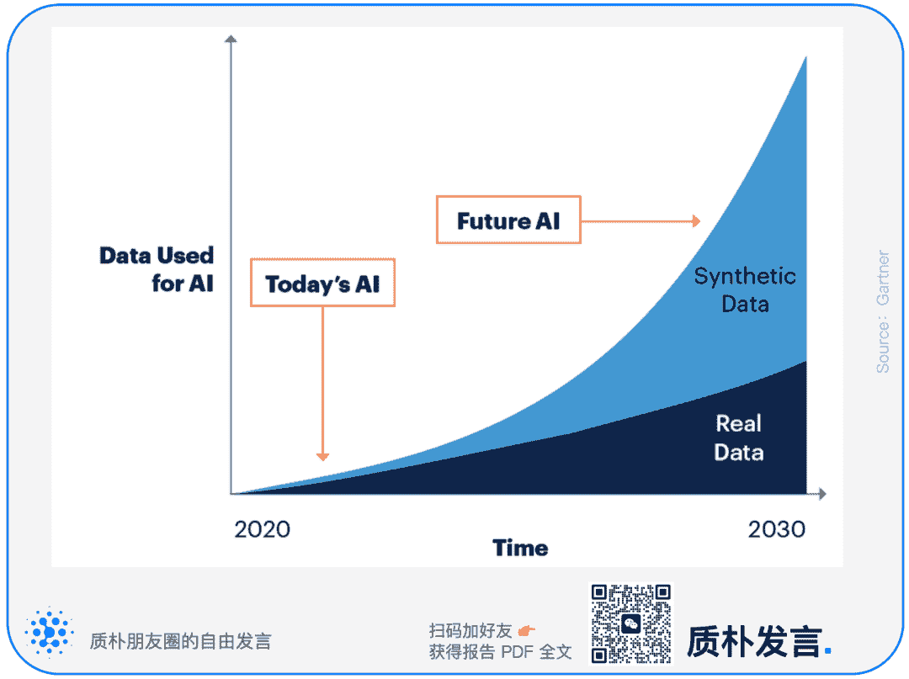

**b. 供给侧**

+   **数据行业可分为 infra 层和应用层**，后一层的爆发依赖于前一层的成熟，包括：

+   底层的云；

+   数据湖、数据仓库以及围绕其创造出来的工具和生态；

+   数据应用的上游供给成熟，而其本身仍处于发展期；

+   根据 Fortune Business 和 Reprotlinker ，2021 年全球数据科学市场规模为 570.8 亿美元，预计在 2026 年可达到 2,142.4 亿美元；

+   多模态生成式 AI 的成熟提供了数据应用增长的技术支撑。

## 2、数据驱动的应用仍存在障碍，高成本使得数据价值难以发挥

**a. 显性成本**

+   使用隐私保护机制的合规性和风险相关的成本；

+   使用数据屏蔽或匿名化方法的公司会使数据面临泄露和重新识别的风险；

+   **无论是涉及客户数据还是**敏感的业务信息，泄露的成本均不可小觑。 IBM 报告称，数据泄露给企业经营带来的平均成本攀升至 392 万美元；

+   除了安全风险，企业还受到严格的监管；

+   **全球数据安全政策趋严；**

+   欧洲的通用数据保护条例 （GDPR） 、我国的《数据安全法》、《个人信息保护法》均是对数据驱动行业的监管补充；

+   **不合规的成本不断上升，**因为其不仅含罚款结算，还包括业务中断、生产力和收入损失。

+   据研究公司 Ponemon Institute 和安全公司 GlobalScape 的报告显示，企业每年因数据违规而造成的成本平均为 1480 万美元。

**b. 隐性成本**

+   **无法利用部分数据的机会成本；**

+   如无法使用真实场景中的用户数据，导致无法发挥数据的全部潜力，训练数据质量偏低。

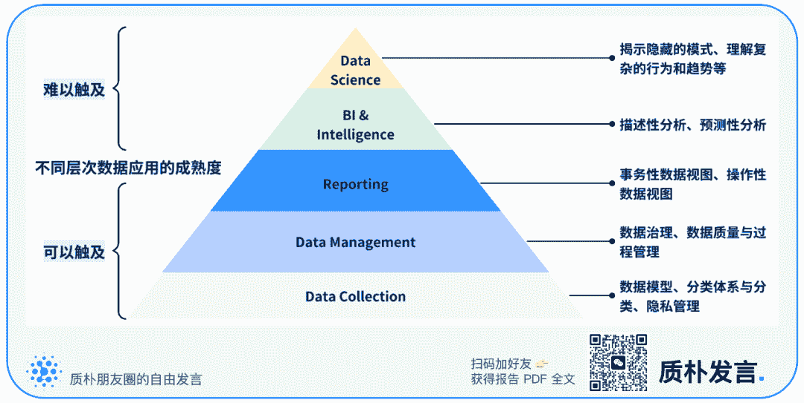

+   数据共享流程冗杂，导致时间、资源成本超出数据价值。

## 3、**合成数据介绍**

**a. 概念界定**

“合成数据是使用有目的的数学模型或算法生成的数据，目的是解决数据科学任务。”

— Synthetic data, what, why, and how?

**b. 技术路径**

+   经典的合成数据技术包括蒙特卡洛模拟（MCS）、自回归（AR）模型、FLOW 、VAE、GAN 等

+   随着 LLM 及相关技术的爆发，使用大模型合成数据成为一种新兴方式

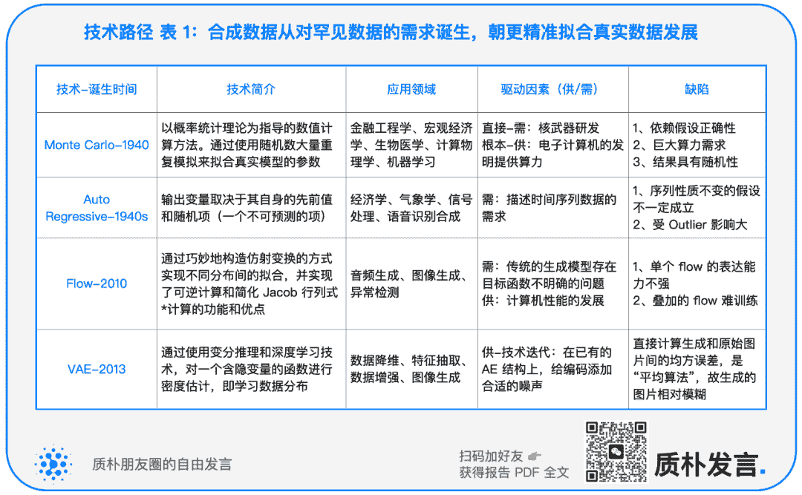

+   合成数据的早期应用均是为获得现实完全无法获取的数据，如微观尺度、未来尺度

+   随技术发展，对合成数据的要求转向基于真实数据的复制、变换和扩充，但质量差、训练难阻碍了实际应用

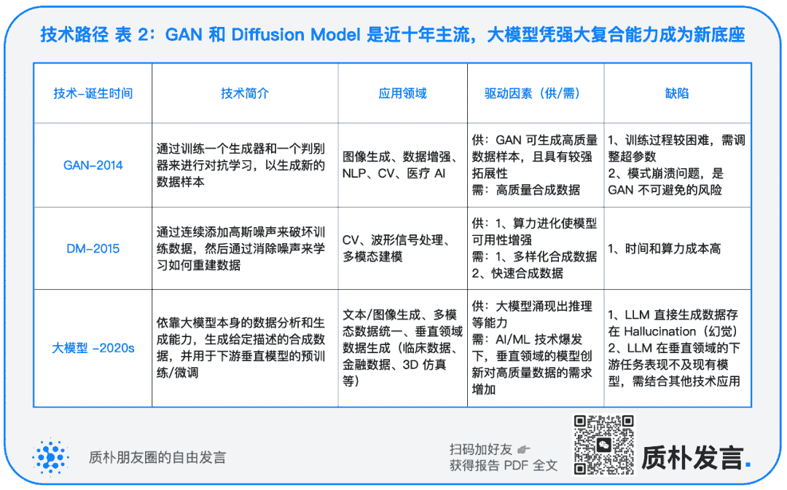

+   总的来说，合成数据技术的演进是由供给端（技术进步、基础设施完善）和需求端（具体任务、解决问题）交替影响、共同推动的。当下得益于供需两端同时驱动，市场空间有望迅速提升

+   **粗**略测算，2027 年中国合成数据市场空间约为 2733 亿元（人民币） * 10% * 50% = 136.65 亿元

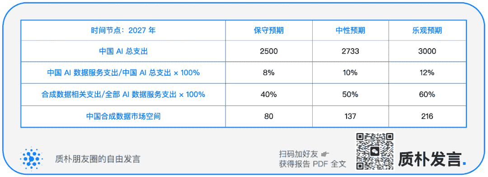

+   据 IDC 预测，**2027 年中国 AI 支出规模将达到 38**1 亿美元（对应约 2733 亿人民币）

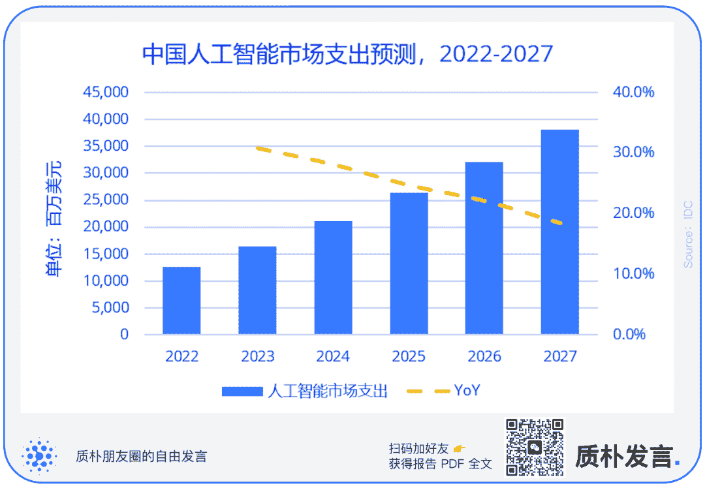

+   据 IDC 测算，2023 年中国 AI 基础数据服务市场规模将超过 70 亿元（人民币），并将在 2025 年突破 120 亿元，2019-2025 年年均复合增长率（CAGR）约为 47%；

+   结合 AI 总支出数据，2025 年中国 AI 数据基础服务支出占 AI 总支出的比例约为 7%；

+   数据上，分子增速大于分母；实质上，数据驱动逐渐替代模型驱动理念。因此未来该比例预计将持续扩大。

+   中性预期下，**2027 年中国 AI 数据基础服务支**出占 AI 总支出的比例预计为 10%。

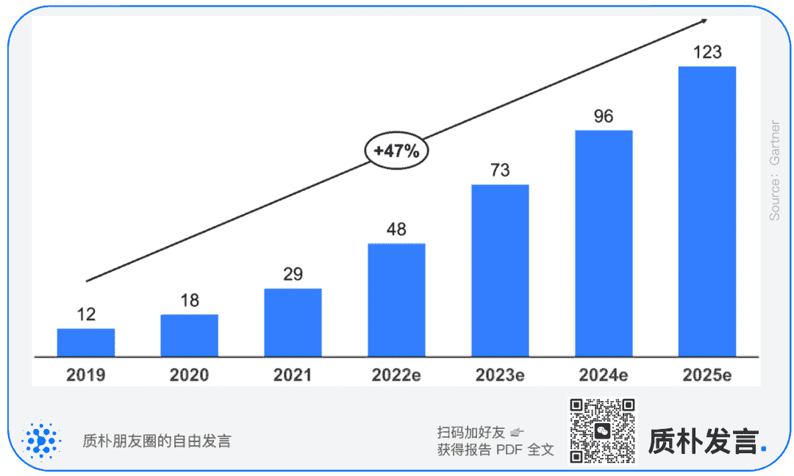

据 Gartner 预测，2024 年， 60% 的 AI 数据将是合成数据，被用于模拟、预测场景和降低风险。

**结合当前各类 AI 场景使用合成**数据的占比及趋势，中性预期下，2027 年合成数据相关支出占全部 AI 数据服务支出的比例将达 50%

## 4、合成数据的特点有望清除数据驱动应用的障碍

a. 合成数据技术具备三大特点：

+   **隐私数据的保护**

+   案例：合成数据帮助咨询公司迅速验证项目交付价值

+   Accenture 与一家银行客户希望合作搭建 Fostering Better Finance 项目。

+   该项目旨在从银行的信用和借记交易档案中识别弱势群体，并及早干预以推动更好的财务结果。但该项目很大程度上依赖于使用银行客户最敏感的交易数据；

+   合成数据供应商 Hazy 为 Accenture 提供了银行交易数据生成模型，该模型生成的数据不包含已有客户信息，但生成了真实的客户资料和行为。

+   Accenture 基于合成数据迅速启动项目，构建测试原型应用，将交付价值证明的速度提升了八倍。

+   **数据去偏及平等化**

+   合成数据技术可生成不受历史偏差影响，而在其他方面具有统计准确性的样本数据；

+   重要的是，这类数据可重复用于训练多个模型，使得使用者不再需要对每个模型分别校正，从而大大减少了训练开支。

+   **定制化扩充数据**

+   定义：已知现实分布后，再合成未知的场景

+   以自动驾驶算法训练为例，环境模拟引擎可以：创建逼真的街道，生成各种罕见环境；避免隐私问题；以零边际成本生成完全准确的像素级标签。

b. 因此，合成数据可从直接和间接两方面缓解数据驱动应用的难题

+   **直接获得数据洞察力的价值**

+   合成数据意味着无限的合规可用数据，且比敏感数据使用价值更高；

+   提高内部数据的敏捷性，节省成本；

+   新增收入：数据货币化或产品开发。

+   **间接缓解合规风险的价值**

+   合成数据不属于个人数据法规范围，缓解了不合规的风险；

+   采用合成数据可间接防止敏感数据的暴露，减轻了潜在损害；

+   据 Ponemon 测算，客户的个人身份信息（PII）在数据泄露/黑客攻击中的恢复成本为 150 美元/条。

# #二、合成数据如何重塑 AI 产业——通过影响 workflow

Q：为什么说合成数据会重塑 workflow？

A：合成数据本身位于数据准备阶段发挥作用，但 workflow 各环节都可能对合成数据产生反馈，进而影响合成数据的效用；我们希望通过分析这些反馈效应，以判断未来合成数据赛道的领先公司

## 1、传统 AI/ML workflow

a. Workflow 总览

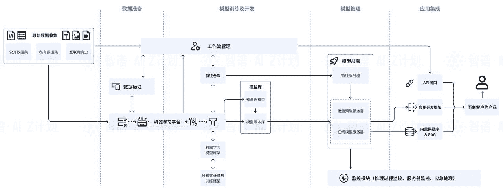

图：AI/ML workflow 总览

+   公开数据集：如 Common Crawl、ImageNet、Open X-Embodiment 等

+   私有数据集：如企业内部数据、从其他企业购买数据（如 OAI 从 Reddit 购买数据）等

+   互联网爬虫

**c. 数据准备，组件包括：**

+   数据标注：对原始数据分类、标记，形成特征标注

+   特征仓库：集中存储和管理数据特征，便于模型训练时的特征选择和复用

+   机器学习平台：提供数据处理、转换和清洗的一站式服务平台（同时也涉及到模型训练及开发阶段）

d. 模型训练及开发，组件包括：

+   模型库：含预训练和优化后的模型集合，供后续部署和应用

+   机器学习模型框架：提供构建、训练模型的基础架构

+   分布式计算与训练框架：用于模型训练，支持多计算机并行处理

+   Workflow 管理（训练跟踪及模型性能诊断）：跟踪模型训练过程，诊断模型性能，优化模型开发流程（同时也涉及到数据准备阶段）

**e. 模型推理，组件包括：**

+   **模型部署**

+   特征服务器（feature server）

+   管理特征数据，将数据转换为模型可理解的特征格式，提高模型推理效率和精度

+   批量预测器（Batch Predictor）& 在线模型服务器（Online Model Server）

+   分别用于离线及历史数据分析和在线实时数据处理

+   监控模块（Monitoring）

+   监控推理过程的预测准确性、延迟等关键指标

+   监控模型服务器的运行情况、资源使用情况

+   发现问题后触发警报，以迅速修复

**f. 应用集成，组件包括：**

+   API 接口：提供应用和 AI/ML 模型的标准化交互接口

+   应用开发框架：提供 AI/ML 应用开发的工具和框架

+   向量数据库 & RAG：落地应用场景中数据的存储、管理等操作

## 2、**合成数据 workflow**

a. 合成数据在 AI/ML workflow 中的位置

合成数据在 AI/ML workflow 中处于数据准备阶段，为后续模型训练提供训练数据集

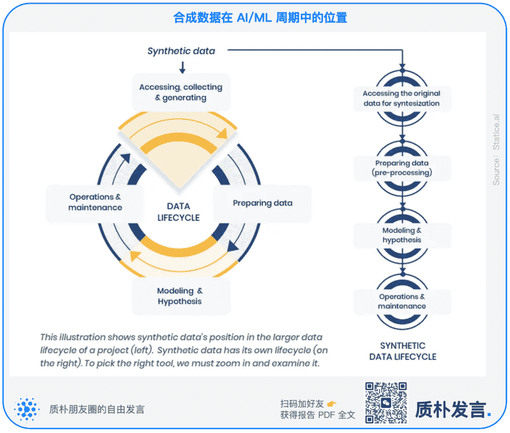

b. 合成数据自身 workflow 流程

需求分析-数据准备与理解-生成模型建模-数据生成-合成数据评估-数据增强及标注-数据集成与应用-生成模型迭代优化

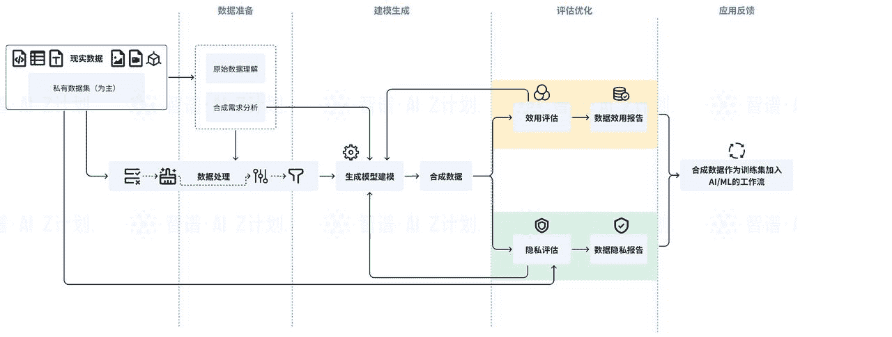

图：合成数据部署 workflow

c. 与传统 AI/ML workflow 的不同之处

+   建模准备：针对任务选择模型 vs 根据下游模型和真实数据选择生成策略

+   建模目的：泛化场景下的推理能力 vs 生成可替代真实数据的合成数据

+   评估优化：

+   评估下游任务指标 vs 对比真实数据作为训练集的效用

+   直接运行模型 vs 可低成本标注&调整合成数据环境，随后再用于下游模型训练

+   应用反馈：从任务运行中直接获取模型反馈 vs 从下游模型的运行情况间接获取训练集反馈

**d. 案例：**

+   **生**成建模模型生成符合真实分布且保护患者隐私的电子病历（EHR）数据，用来训练预测患者疾病和跟踪健康状况的 ML 模型

**背景：**电子健康记录分析（EHR）在加强患者护理、评估临床治疗效果和推动临床研究方面具有巨大的价值。

通过在 EHR 数据上训练的统计模型和机器学习模型，能够预测诸如糖尿病等疾病的风险，监控病人的健康状况，以及预测病人对特定药物的反应。

然而，在确保数据隐私和符合患者保密法规（如 HIPAA）的前提下，如何有效利用 EHR 数据充满挑战

+   **传统方法的劣势：**传统的数据匿名化方法既繁琐还可能损害数据价值，且容易受到隐私攻击；

相比之下，Google Research 提出了一种新的生成建模框架 EHR-Safe，通过生成合成的 EHR 数据，既保持了数据的实用性，又确保了患者隐私

+   **合成数据的优势：**基于 EHR-Safe 中的创新方法，实验表明其合成数据可以满足两个关键属性：

高保真度（对于特定的任务能够展现出与现实数据相似的性能）；2、满足一定的隐私措施（即不会暴露任何真实患者的身份信息）

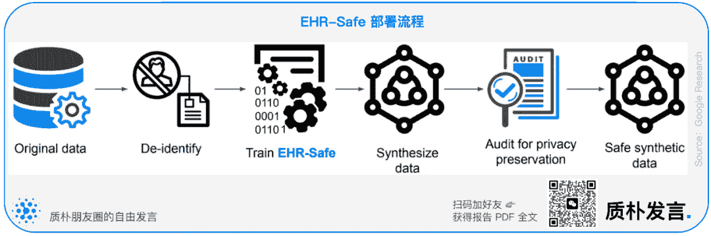

## 3、融入合成数据的 AI/ML workflow

下图展示了合成数据融入后的 AI/ML workflow 全流程，并列举出 workflow 各环节各元素对合成数据的反馈作用

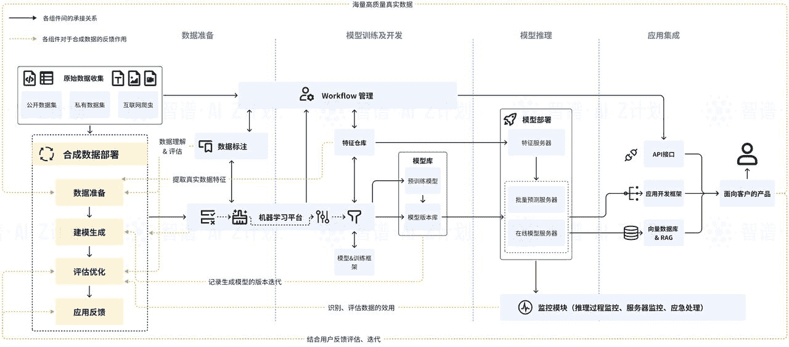

融入合成数据的 AI/ML workflow

# #三、什么样的公司能占据合成数据的关键点位

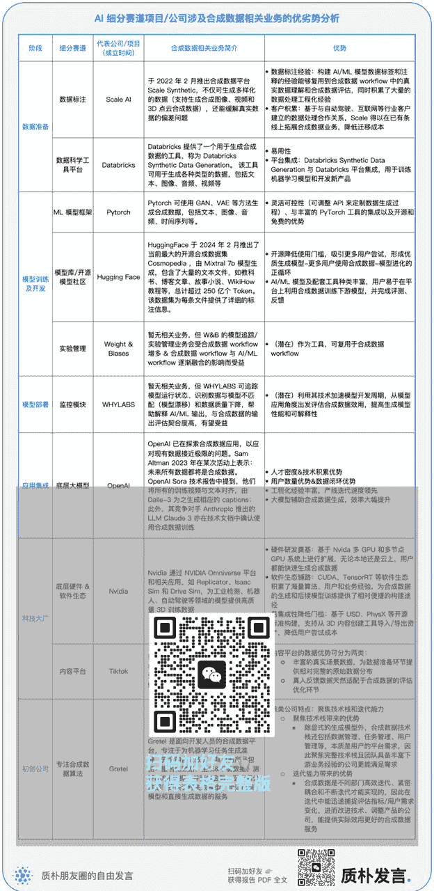

AI 细分赛道项目/公司涉及合成数据相关业务的优劣势分析

# #四、结论：合成数据赛道的核心竞争要素

+   **数据能力：**数据获取能力、从海量真实数据中提取高质量信息的能力、数据处理自动化能力、数据沉淀能力

+   **迭代能力：**随着前沿技术的拓展、工具部件的丰富和业务经验的积累，生成模型及其余 workflow 环节对应迭代的速度及效果

+   **平台能力：**搭建合成数据的闭环 workflow 的平台能力

+   **下游场景选择：**在数据、算力、算法三要素中，数据已经成为瓶颈的场景；合成数据能带来应用的增量价值的场景；

+   从终局出发，最终必须有相当比例的合成数据参与，而非由真实数据处理后亦能完成的场景

# #五、附：多模态数据生成产业 mapping

## 1、**多模态数据生成的类别**

多模态合成数据从大类来看有非结构化数据（图片、视频、语音等） 和结构化数据（表格等）两大类。

测试数据 （test data） 相对特殊，会根据具体形式分为非结构化和结构化数据。

**非结构化数据生成包括：**

+   **文本生成：**利用自然语言处理技术生成新的文本内容，如新闻文章、社媒帖子、办公文本等。

+   **图像生成：**通过生成对抗网络（GANs）等技术生成新的图像，如人像、场景图、风景画等。

+   **音频和语音生成：**包括音乐创作、语音合成等，通过 Transformer 和文本到语音（TTS）等技术生成新的音频内容，如音乐作品、服务语音、虚拟角色语音等。

+   **视频生成：**通过 Transformer 和扩散模型（Diffusion Model）等技术，生成新的视频内容，如动画、演示视频、虚拟现实视频等。

+   **3D 生成：**通过神经辐射场模型（NeRF）模型等技术生成三维图形和模型，如人物建模、道具建模、场景建模等。

+   **合成数据生成：**通过变分自编码器（VAEs）等技术，生成模拟现实的数据，并用于应用、预测和生成，如自动驾驶道路模拟、股市预测、大模型训练题库等。

**结构化数据生成包括：**

+   **表格生成：**通过变分自编码器（VAEs）和序列到序列模型（Seq2Seq）等技术生成表格文件、表格公式，并清理、创建、转换和分析表格中的文本数据；

+   如表格结构设计、数据分析表、表格自动化等。

+   **代码生成：**通过变分自编码器（VAEs）和序列到序列模型（Seq2Seq）等技术创建和辅助创建计算机代码，如代码生成、代码优化、代码修复等。

## 2、** 国内外多模态数据生成产业图谱**

+   **产业赛道特点：**

+   文本、图像生成赛道公司数量最多，烯牛数据统计的公司中，国内文本生成和图像生成公司分别接近 60 家；国外文字 140 余家，图像 60 余家；

+   仅文本生成和图像生成两个赛道的公司数量就比所有其他赛道的总和还多。

+   视频生成赛道随着 sora 的发布进入全新阶段，众多视频生成企业面临淘汰。

+   3D 生成在娱乐产业，包括影视、游戏等领域迅速落地；在实际的生产生活场景中，自动驾驶模拟、3D 建筑是首要的切入点，其他场景还处于初步开发的阶段。

+   地域特点：全球多模态数据生成产业以中美两国发展最快、产业最完整

+   美国 0-1 技术突破 +2BC 均衡。

+   中国 1-N 发散应用 +2B 明朗。

+   **logo 版**

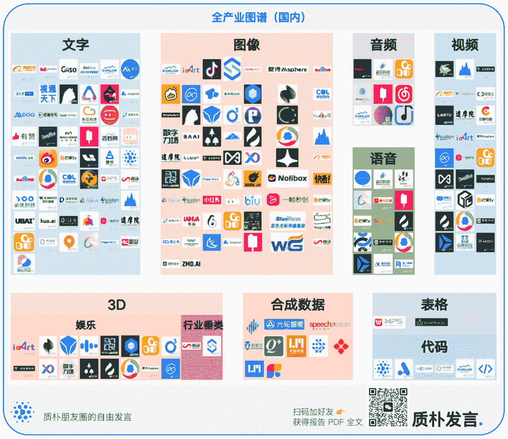

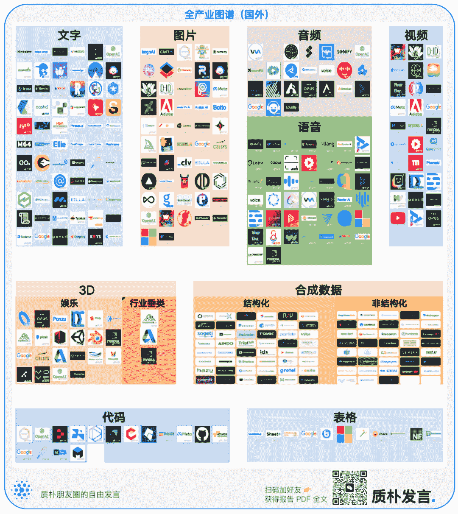

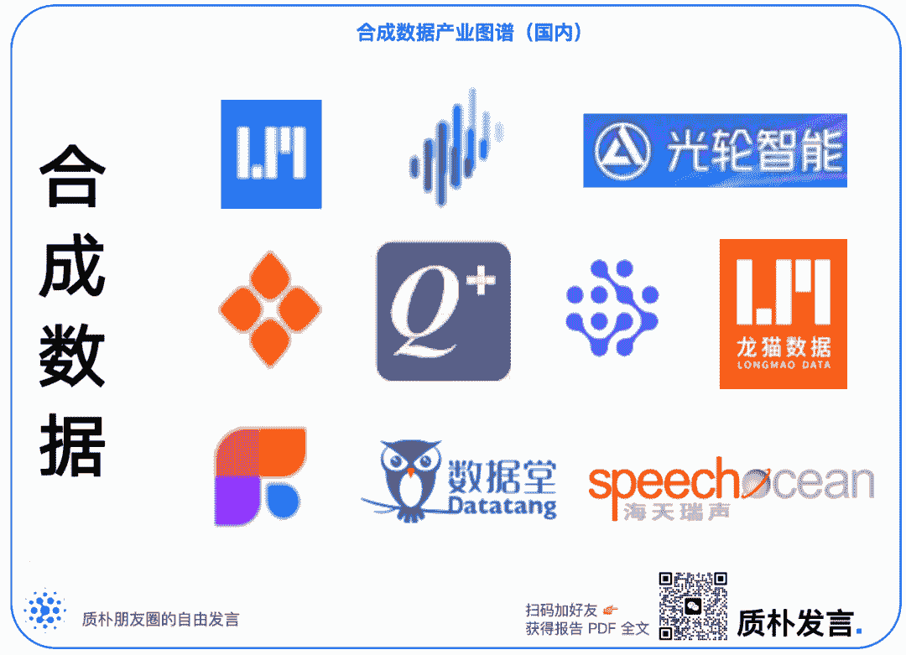

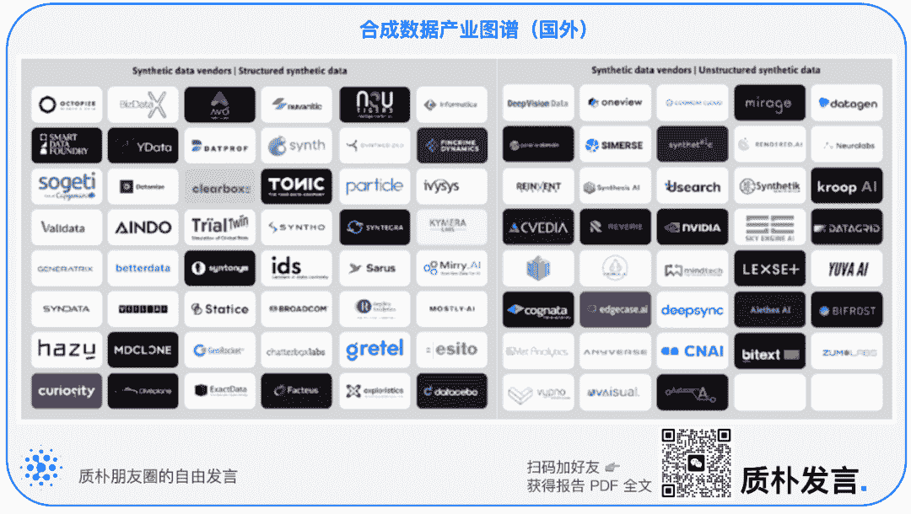

## 3、**合成数据赛道**

合成数据的商业价值在于应用、预测和生成

**a. 应用：行业垂类场景**

**优势和价值：**体量大、安全性高、可定制、噪音少、成本低、获取难度低、符合规定

**具体场景：**

+   制造业：

+   产品设计：用合成数据模拟测试，减少实物样品的制造次数。

+   供应链管理：模拟不同的市场条件和供应链动态，优化库存管理和物流配送。

+   质量控制：用来训练机器视觉系统，提高产品检验的效率和准确性。

+   医疗业：

+   疾病预测：训练疾病预测模型，辅助医生进行早期诊断。

+   临床试验：模拟临床试验，预测药物效果和副作用。

+   患者隐私保护：进行医疗研究和分析，保护患者隐私。

+   金融业：

+   风险管理：模拟市场变化，评估金融产品的风险。

+   欺诈检测：训练模型，识别潜在的金融欺诈行为。

+   算法交易：开发和测试自动化交易算法。

+   汽车出行：

+   自动驾驶：训练自动驾驶系统，模拟各种道路和交通情况。

+   交通模拟：模拟城市交通流量，优化交通规划和路线设计。

+   安全性分析：进行碰撞测试和安全性分析。

+   文娱传媒：

+   个性化推荐：优化内容推荐算法，提高用户体验。

+   虚拟现实：创造多样化的虚拟环境，用于游戏、影视制作等。

+   内容审核：训练图像和文本审核系统，提高审核效率和准确性。

**b. 预测：未来预测和决策场景**

**优势和价值：**干扰和偏见少、可创新、可定制、速度快、灵活性高

**具体场景：**

+   公司战略制定：模拟公司内部、市场环境、政策环境变化，辅助决策。

+   未来形势预测：比如模拟不同市场和政策环境，预测股市变化。

+   大场景综合规划：比如模拟不同人文和自然环境，从而进行城市规划、交通规划、管道线路规划。

**c. 生成：模型场景**

**优势和价值：**体量大、可定制、噪音少、成本低、获取难度低

**具体场景：**

+   大模型训练：通过大规模生成数据提高模型的有效性和可靠性。

+   模型测试和评估：模拟各种情景，有效评估模型在不同条件下的性能，确保模型的鲁棒性和准确性。

+   算法优化：针对性地生成数据缺陷，从而指导模型进行自我学习和调整，提高算法的泛化能力和效果。

合成数据赛道的核心竞争要素我们最终归结为：数据能力、迭代能力、平台能力和下游场景选择。在数据、算力、算法三要素中，数据已经成为瓶颈的场景；

合成数据能带来应用的增量价值的场景；从终局出发，也必须有相当比例的合成数据参与，而非由真实数据处理后亦能完成的场景。

**合**成数据作为“新能源”，是伴随着 AI 浪潮高速兴起的产业，谁能占据核心点位，并最终用合成数据重塑工作流、产生价值，我们拭目以待。

参考资料

+   Practitioners guide to MLOps, Google

+   Emerging Architectures for Modern Data Infrastructure | Andreessen Horowitz

+   What is Synthetic Data? Use Cases & Benefits in 2024

+   medium.com

+   blog.research.google

+   Synthetic Data Generation in 2024: Techniques & Best Practices

+   Best Synthetic Data Generators of 2024 based on 103 reviews

+   AI Job of the Future: Synthetic Data Engineer, Medium

+   https://mp.weixin.qq.com/s/VkHOzVWd5RIsFTHbIVbYHQ

+   https://www.infoobs.com/article/20230308/57546.html