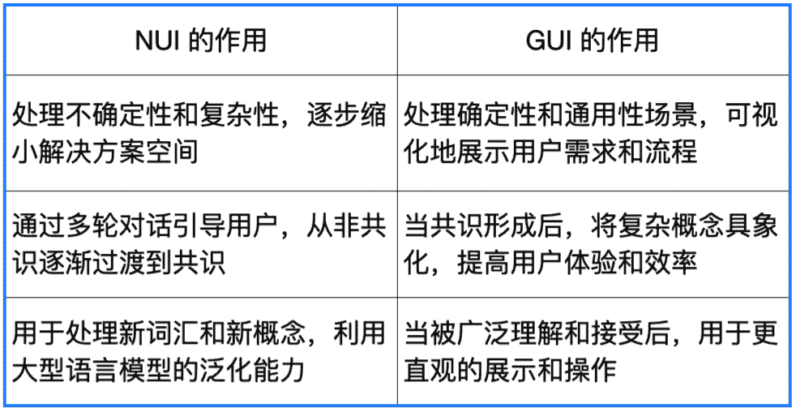
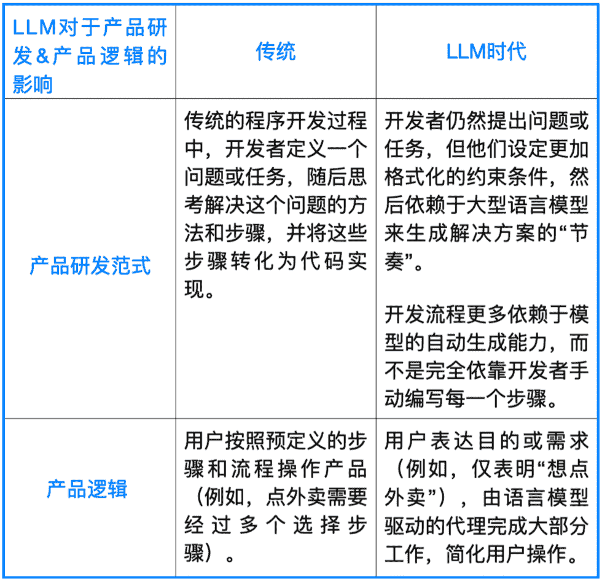
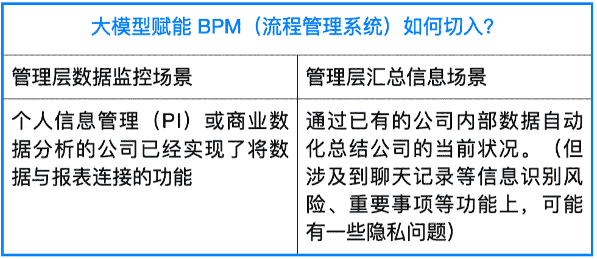
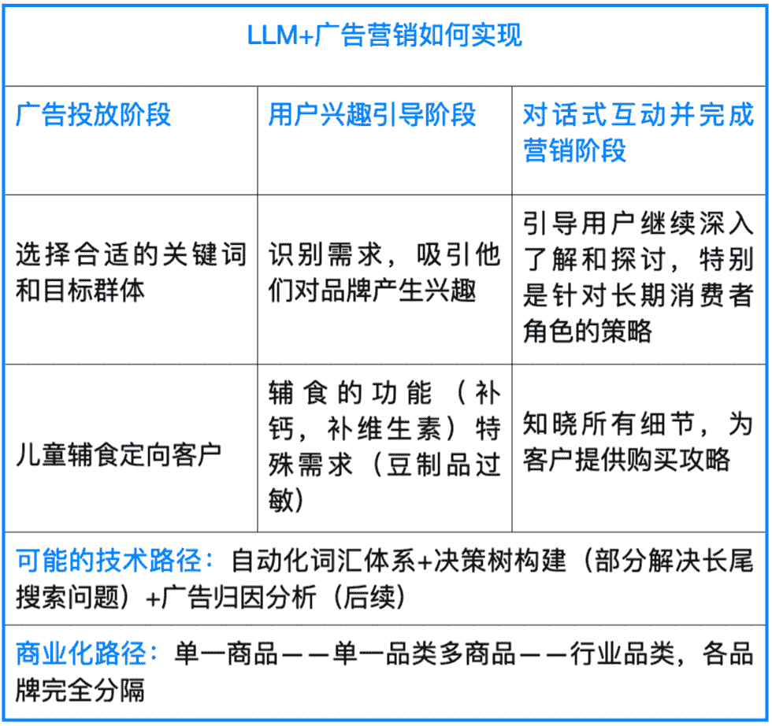
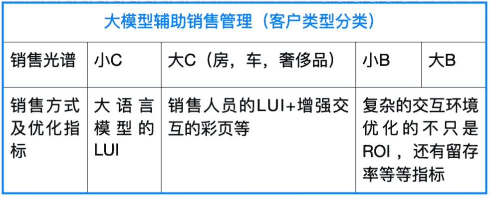
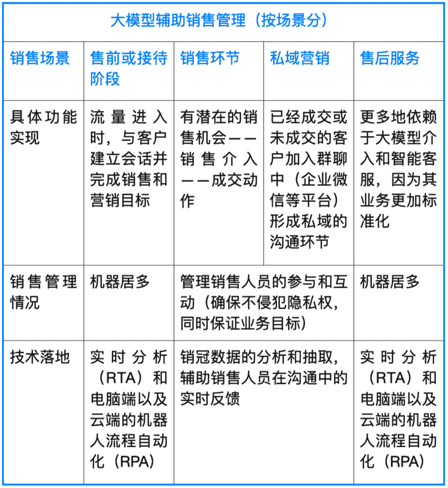

# 质朴发言：大模型时代的产品长啥样&壁垒在哪？｜Z 沙龙第 2 期

> 来源：[https://waytoagi.feishu.cn/docx/CFbQdSc1golCFVx2d1CcMEkinJf](https://waytoagi.feishu.cn/docx/CFbQdSc1golCFVx2d1CcMEkinJf)

原文链接：https://mp.weixin.qq.com/s/YEoW6-T7tkSHjGuYIPtcZA

来源：质朴发言

发文时间：2023.12.04

大模型带来的人机交互范式的转换，将彻底改变产品设计思路。比如已经可见的有，从图形界面转向自然语言界面。但自然语言交互是否就是最好的交互形式，尚难有定论。那么，大模型时代的所谓 Native 产品，应该长啥样？主流的交互方式会是什么样？

甚至大模型都已经这么强了（至少大家还愿意相信会越来越强），那还需要产品做什么？产品经理又能在其中做什么？

我们不知道，所以组局请教。秉持所有人想所有人学习的精神，活动纪要抛开敏感信息，尽可能保留原汁原味，粗颗粒度结构化摘要如下。后面继续办，一起来聊！🌊

> 以下为本文目录，建议结合要点进行针对性阅读。👇

> **一、大模型时代做产品有何不同**

> 1、从 GUI 到 NUI

> 2、大模型时代产品是不是纯 NUI 就行？

> 3、应该如何将 GUI 与 NUI 结合？

> 4、大模型时代产品经理面临的认知升级

> 二、何为 AI-Native 应用以及如何构建壁垒

> 5、AI-Native 应用要如何构建壁垒？

> 6、C 端/ B 端产品的迁移成本

> 三、专题讨论：C 端 AI 产品实践

> 7、AI 陪聊可以分化的方向

> 8、社交场景下的交互范式变革

> 四、专题讨论：B 端 AI 产品实践：新生产力与行业赋能

> 9、大模型赋能 BPM（流程管理系统）如何切入？

> 10、大模型+广告营销如何实现

> 11、大模型辅助销售管理（按客户类型、场景分）

> 12、某碳金融+大模型从业者在开发GPTs时的三点分享

> **五、尾调：投资人观察**

> 这一代 AI 大模型创业与上一代 AI 创业的区别

# **#一、大模型时代做产品有何不同**

## **1、从 GUI 到 NUI**

本次沙龙，很多同学都谈到了大模型的交互方式是 NUI =自然用户界面（通过自然语言文本或者语音，以及输入输出图片等直接交互，就像人和人之间聊天一样），与我们现在熟悉的桌面软件/移动 App 的 GUI =图形用户界面（在众多图标、重重菜单或者瀑布流中选择）差异很大。

**现**在我们习惯在 GUI 界面里通过点击按钮与机器交互，这是一种结构化和机械化的方式，往往需要付出一定的学习成本，甚至需要经过专业学习才能熟练使用这些工具（Photoshop、Excel 等等都有很多图书卖得很好）。

而在大模型时代，尤其最近多模态发展很快，基于对话的 NUI 交互方式更符合人的直觉，用户几乎不需要特别学习，就可以通过对话来操作，就好像背后有一个懂得这些工具的人在帮助你。

**NUI 还有一个特点，用户的互动**性&参与感更强，需要用户发挥主观能动性。当然，这也带来一个负面因素：大模型产品现在对普通用户而言使用门槛较高，即使是 ChatGPT，用户的留存率和粘性也无法与目前主流 App 相比。

如果未来大模型产品都是 NUI 的，可能会对整个信息产业带来深远影响：

+   目前我们无论是 toC 还是 toB 都有众多软件，其中一个重要原因，是 GUI 界面的层层菜单扩展性不好（即使是 Word 这样熟知的软件，很多功能通过菜单查找也非常困难），一个软件能承载的功能是有上限的。

而 NUI 很像万能秘书，你可以把各种功能都塞进去，毫无违和感。微软最近发布会的动作，似乎已经能够看到这个软件巨头正在把所有软件都融合为一个产品：Microsoft Copilot。

+   **如果不需要图形界面了，我们人手一个的硬件可能就不再是手**机，而是其他形式，有屏幕和语音交互就行。今天如日中天的苹果，未来很可能只是一家品牌和设计非常好的硬件公司而已，不再有平台属性。

+   因为 NUI 界面极其简单，对产品经理的要求也将发生巨大改变。

## 2、大模型时代产品是不是纯 NUI 就行？

有同学马上指出，NUI 的问题也很明显，在一些场景远不如 GUI 有效。以设计、编程这些专业工作为例，很难想象以后只用语言、语音，而没有图形界面操作台，就能完成所有工作。（反对的意见也同样有力：专业的设计和编程在整个社会工作里其实是很小众的。）

又有同学举例，在涉及行业“黑话”或较多专业知识的场景，“把事情讲清楚”已经是一个非常高的门槛了，并不觉得会比 GUI 更简单，或者说此类场景下，自然语言相比于图像点击的交互链路会更长，效率很低。这引出了下面这个关键问题👇

## 3、应该如何将 GUI 和 NUI 结合？

**一位智能硬件厂商的同学认为：**

**服务的标准化和自然语言的模糊性之间虽然存在**矛盾，但可以在同一个产品当中结合使用。（因此处理好 NUI 和 GUI 的边界，对于 AI Native产品至关重要。）语言模型不仅能输出语言，还能生成界面，根据需要显示按钮供用户点击。

虽然现在的模型主要是文本、语音和图像的交互，但未来它们能够在需要特定图标或按钮时展示出来，从而提高效率和便利性。我们已经在一些产品中看到了这种初步的探索。

例如，某手机品牌最近推出了大模型助理。在这个产品中，用户可以直接通过对话框告诉他想要做什么，而大模型助理会提供相应的按钮供用户选择。

**这**表明未来的自然语言交互UI界面不仅仅是纯语言交互，而是可以包括语言、图标、视频等多模态交互，以实现最大的效率。

这有点像去餐厅点餐，服务员先与你交流，然后给你一个菜单自己选择。我们不需要完全替代传统的UI界面，只需替代那些不太适合的部分，其他部分仍可以保留现有的界面。

来自某大厂互联网广告产品经理补充了一个具体产品实践：

最初，我们直接把搜索交互变成了一个Bot的形式，通过对话直接解决用户需要的信息和服务类型。作为品牌广告的从业者，我需要将品牌价值和服务信息直接高效的传递给用户。

当用户进入 Bot 后，系统弹出“你可以向我直接提问”，用户不知道该问啥，这种纯 NUI的交互很快遇到了困难。后来我们开始使用决策树引导用户进行多轮对话，这样很快起到了效果，用户对话轮次提高了一倍。

举个例子，比如在买奶粉的场景中，我们最初只是简单回答关于乳糖含量的问题，然后对话就结束了，用户也不知道还能问什么。但是，我们发现在搜索过程中激发用户的兴趣是非常重要的。因此，我们采用了另一种方法：主动推送相关信息，以激发用户进一步互动。

比如，我们最近在与一家奢侈品品牌合作，重构他们的小程序。这个小程序之前的一个问题是，时尚穿搭的用户在使用时会搜索一些非常特殊的词汇，例如“美拉德复古”或“多巴胺穿搭”。对于不了解这些专业术语的人来说，这是个挑战。运营团队也难以进行有效的标签优化。

但是，利用大型模型，我们能够挖掘相关的慢时尚文章，从而更好地理解和服务这些用户。我们还在对话中加入了激发区，询问用户是为自己还是为他人购买，考虑到不同身高背包的匹配度等因素，这样就能更有效地引导用户做出选择。

**某 Agent 框架创始人分享了自己对于 NUI 能力**的底层逻辑以及 NUI 产品应用的洞察：

**对于大型语言模型的理解：**

1.  大型语言模型（如 NUI ）在底层逻辑上并非真正的“沟通”，而是进行向量计算。即使在单轮对话中，模型已经考虑了多种可能性。

1.  多轮对话可以帮助聚焦和明确语义，通过产品设计的辅助，大型语言模型可以有效解决语义混淆问题。

**产品设计中的考虑要素：**

1.  产品经理常常会高估模型的预训练（Pre-trained）能力，而低估上下文学习（In-context Learning）的重要性。实际上，通过Prompt Engineering和其他技术，上下文学习可以极大地增强模型的实用性。

1.  产品设计应考虑结合外部信息和工程手段，而非单纯依赖模型。例如，可以通过结合用户画像、推荐系统等外部模块来增强模型的效果。

**一位 AI 投资人阐述了自己对于 NUI** 和 GUI 在产品当中扮演角色的思考：

1.  NUI 与 GUI 在产品中的作用相辅相成：

1.  NUI，特别是在多轮对话方面，可以帮助缩小解决方案的空间。它通过切片和向量知识库的匹配，可以逐渐将非共识过渡到共识阶段。

1.  GUI 在确定性、通用性和普适性场景下帮助可视化用户需求和流程。

1.  **产品设计可以根据用户认知的迁移而迭**代，完成从 NUI 到 GUI 的切换：

1.  当市场教育和用户共识逐渐形成时，可以从 NUI 逐步过渡到 GUI。

1.  GUI在用户已经对某些概念有清晰认识的情况下能提高用户体验和效率。

例如，我最近点了一款“美拉德风”的乐乐茶，APP 里面不仅有文案，有产品的样例呈现，同时有一个“美拉德杯”的图形标签。在类似这样的消费决策的过程中，消费者潜移默化地就对“美拉德风”这样的术语逐渐有了共识。

而当这种共识较广泛地形成后，站在**产品经理的角度，就可将其转化为 GUI。因为**核心用户群已经对这些术语有了清晰的理解。这时，GUI可以大大提高用户体验和效率。

**同时从认知和解释的角度来看，图像和文本的接受度和遗忘**曲线有很大差异，因此图像天然更加用户友好。但是，NUI 也是必要的，比如处理诞生之初的“美拉德风”这样的新兴词汇或未普及的专业术语。

我们需要先通过大型语言模型的泛化能力接纳这些新词，然后随着用户认知的建立，将解决方案逐步确定到一个可 GUI 化的阶段。

**总之，NUI 擅长处理不确定性、复杂性和新概念，通过多轮对话帮助用户理解和接受新的信息。而 G**UI 则在概念变得普遍和确定之后发挥作用，通过可视化界面提高用户体验和操作效率。产品设计时应考虑这两者的结合使用，以实现最佳的用户体验。

## 4、大模型时代产品经理面临的认知升级

从 GUI 到 NUI 的转变，对产品经理的挑战是巨大的。毕竟，传统上产品经理大量工作都在考虑图形界面的各种要素。NUI 实际上要求产品经理换一种新的世界观：计算机系统现在就像人一样，未来智商还会很快达到（马斯克的预测是3年，黄仁勋是5年）甚至超过人类（ OpenAI 的预测是 2030 年）。

**系**统这么聪明了，产品经理应该如何自处？OpenAI 的产品经理 Joane Jang 在两周前的 OpenAI DevDay 演讲中，已经给出了答案：模型就是产品。

深入了解大模型的底层逻辑，不断跟踪和预测大模型能力的发展和边界，做大模型的心理学家（白盒），同时在一定程度上了解大模型的技术细节（黑盒），做大模型的神经科学家，将成为产品经理最重要的基本功之一。

与此同时，大模型时代的软件开发也有巨大变化。

一位同学对此做了很好的总结：

另一位同学从任务可行域与数据需求角度来阐述这一问题：

任务可行域从封闭有限的状态转变为一个更加开放无限的状态。

首先，任务可行域更大：大模型在任务和数据上能够执行多样的多模态任务。

其次，单任务的数据需求更小：大模型在效果上具备了更强的泛化能力，能够解决更广泛的问题。

因此，产品经理在使用大模型时，需要有一个坚实的基础逻辑，以便在业务上使用较少的数据或甚至无需业务数据就能取得良好的效果。

# #二、何为AI Native 应用以及如何构建壁垒

## 5、AI-Native 应用要如何构建壁垒？

某出海创业公司 CMO 分享了他的思考：

1.  **应该从哪些方面构建壁垒:**

1.  **用户心智的占领: **用户对品牌或产品的认知和信任是关键。对于 ToC 来说，最核心的是，你能否满足用户需求，创造出真正有价值的产品，从而建立用户网络和用户认知。

如果大家都认为你的产品好，那么它就会成为大家默认的选择。比如普通人甚至可能认为 ChatGPT 等于 AI，等于先进的生产力，他们并不需要区分太多技术细节。

例如，如果用户认为某个英语学习应用是最好的，他们就不太会花时间去看其他应用。这意味着只要大家认为你的产品好，它就可能真的变得更好。短期内，某些模型在特定层面上已经接近甚至超越了行业标准。但这并不是最重要的，重要的是品牌力。即使你的产品比竞争对手好一点点，但如果对方的品牌力足够强大，你也很难超越他们。

1.  **品牌和行业标准: **品牌力量和行业标准的建立能够为产品创建持久的优势。
例如，当年英特尔与摩托罗拉竞争时，英特尔的技术并不比摩托罗拉强，但英特尔赢得了竞争，关键在于品牌力。消费者对英特尔的品牌有深刻的印象，所以更倾向于使用它的产品。

1.  **不应该从哪些方面构建壁垒:**

1.  **过度依赖技术: **技术本身往往不能形成长期的竞争壁垒。技术的优势可以被快速超越或模仿。

1.  **对于数据量过分强调: **大量数据不一定能构成壁垒。有时，最优的数据比大量的数据更为重要，例如使用优质数据训练模型可能比大量一般数据更有效。

与此同时，另外两位创始人在「技术」和「用户心智」要素上分享了不同看法：

**长期来看，技术上的优势仍然是决定**性的因素之一。品牌和用户心智的优势并非永恒的，一旦技术上拉开代际的差距，就容易被超越。例如，Jasper 尽管有品牌和用户基础，但由于技术上被 ChatGPT 超越，最终失去了市场优势。

一位资深 C 端产品经理分享了他关于构建壁垒的心得：

1.  **垂直领域数据壁垒:**

大模型在段子等梗文化相关内容生成上的表现基本都是不及格的，主要原因文化背景导致用户对幽默和搞笑有独特的定义，如果一个产品能针对其业务微调数据，这种文化适应性就成为了一个难以逾越的壁垒。

1.  **用户的情感和时间投入作为壁垒:**

用户对产品的情感和时间投入可以形成强大的忠诚度。例如，Glow 用户对产品的深厚情感，他们不仅投入了时间和精力，而且还充满了情感。当面对新产品时，即使新产品更高级、更智能，用户也会因为不愿放弃已有的情感和记忆投入而犹豫。

1.  **社交网络和关系维护作为壁垒:**

在社交产品中，维持和升级用户的社交网络是构建壁垒的关键。例如，如果一个社交平台能够有效地帮助用户找到特定类型的人并提升他们的社交关系，用户就更倾向于留在该平台。重新建立这样的网络在新平台上成本很高，所以用户更愿意留在旧平台。

## 6、C 端 / B 端产品的迁移成本

**C 端产品的迁移成本**

1.  产品经理 A 分享：情感陪伴是 C 端产品的迁移成本的重要来源

强调情感陪伴类产品（如Glow）通过情感连接和用户的个性化体验，创建了独特的用户粘性。这种产品的使用涉及深层次的情感投资，形成了高迁移成本。

市面上有一个特别好的例子：林间聊愈室。它的处理方式类似心理治疗。它结合了声音、形态和对话，而不仅仅是简单的问答。它能够理解你的心情，询问为什么不开心，引导你回忆原因。这种产品像一个了解你的好闺蜜，但也带来了授权问题。如果你必须从头到尾讲述一遍，比如为什么生气，这种交互就显得繁琐。

1.  产品经理 B 分享 - 数据和个性化习惯是提高迁移成本的重要举措:

提到了个性化数据的重要性。例如，在风格化的娱乐产品中，由于用户的文化背景和幽默感，这些产品可能为用户提供了高度个性化的体验，从而增加了迁移成本。

1.  产品经理 C 分享 - 时间和情感投资:

如日记应用，用户在这类产品中累积大量的个人历史和情感连接，构成了巨大的迁移成本。

**B 端产品的迁移成本**

1.  投资人 A 分享 - 工具类产品迁移成本很低:

认为工具类B端产品，如代码搜索工具，设计为高效率，使用户能够轻松迁移，因此迁移成本较低。

1.  产品经理 A 分享 - 工作流程和使用习惯会增加迁移成本:

指出尽管工具类产品易于迁移，但用户的工作流程和习惯也可构成一定的迁移成本。例如，用户可能习惯于特定笔记软件的界面和功能，从而增加了对该软件的依赖。

1.  投资人 B 分享 - 工具类产品的迁移成本不能一概而论:

面**向企业工作场景的效率工具（如代码搜索工**具），由于其设计初衷是提高组织整体协作效率，因此不得不保证用户在找到更优工具时可以轻易迁移。然而，对于面向生活/个人工作场景的效率工具则没有“保障用户低成本迁移”的刚需。

例如，拿 Notion 这个笔记工具来说，它在一些特别的小功能点上悄悄地提高了迁移成本，比如复制粘贴图片的难度（即便可以复制文本，图片和标题的格式会混乱）。当用户记录了大量笔记后，会发现无法轻松地将内容迁移到其他平台，比如 Mac 的原生 Note 上。这时，倘若替代品并没有压倒性产品优势（往往较难做到），用户会感到困难而放弃迁移。

# #三、专题讨论：C 端 AI 产品实践

## 7、AI 陪聊具体可以分化的方向

我们讨论的重点是新一代AI产品在角色扮演领域的应用，特别是在少儿领域。在孩子们的世界里，角色扮演是个挑战，因为他们可能不熟悉某些角色。

例如，如果你问一个孩子谁是奥特曼，他们可能不知道。我们的任务是首先创造这些角色，然后在故事的某个节点或结束时引入它们。我们正在尝试的是把重点从单纯的模型能力转移到创造有趣的人物设定上。

比如，我们的角色是不是比喜羊羊更搞笑，比熊大熊二更有趣？我们现在的工作主要是围绕新媒介创造新内容。

例如，编织一个奥特曼打怪兽的故事，在社交网络中引入小朋友，让他们一起完成一个冒险。这个过程的编制成本很高，直到冒险结束之前可能不会有新产品推出。

**所以，我们的策略是从专注于微调模型的底层技术转移到创造新内容上。我们现**在使用更成熟的模型，这也回答了我们之前讨论的问题，即做应用层比做模型层更有挑战。

目前，我们观察到市场上许多应用层的产品在竞争中显得有些可怜，每次开会都是那几个人在讨论。

关于与小朋友的交互，我们发现他们对新鲜事物的接受能力非常强。在对话中，他们经常会提出一些问题，比如“谁是蔡徐坤？”这类问题是底层模型难以解决的。我们尝试过维护一个知识库，比如英语单词大全或网络热词。

但最终发现，供应商的搜索功能比我们自己维护的知识库更先进、更有效。因此，我们放弃了自己维护知识库的做法，转而利用供应商的搜索能力。

孩子们的特点是他们每句话只说几个字，但愿意持续交谈长达三到五个小时。因此，如果我们不进行工程化处理，成本将非常高。尽管当前长上下文给我们带来的成本很大，但我认为在未来，通过降低成本，我们可以在这方面实现更多个性化，创造优质体验。

## **8、社交场景下的交互范式变革：**

**关于社交的交互，有三大定义：**

+   首先，人们倾向于向上社交，寻找社交阶层上的人。但实际上，大多数人都是普通人，达到这样的社交目标非常困难。

+   第二，表达的质量与反馈成本正相关：表达越好，越容易获得正面反馈，但这通常需要投入大量成本，无论是智力还是其他资源。

+   第三，隐私是一个大问题：是否愿意在网络上暴露自己，承受评价和观点，是一个重要考虑。

**AI + 社交产品的核心目标应当是通过 AI 来减轻表达**的压力和隐私问题，提供一个替代解决方案。

例如，类似于口碑效应，但在成熟的社交环境中不需要从头开始建立。这样，用户的参与变得更加容易，提高了整体效率。我认为，匹配机制不需要过于复杂。

比如，我提出要求，今天我想找一个能和我聊诗词哲学的人，明天可能是寻找一位朋友，大致就是这个思路。关于个性化的问题，比如精选人物颜色，我认为这其实就像女生化妆和拍照美颜一样，是一种增强设计。

我要写一个强大的个人陈述，如果我的表达不够好，需要别人帮助我改写，这是表达式的增强。在这个层面上，AI可以帮助改善你的表达，提供更多机会。你们可以这样理解增强AI的聊天机制。

从实际操作层面来看，如果我有特定需求，我希望能在平台上找到满足我的需求的人。但问题在于，这个过程的层次太多，太复杂，难度很大。例如，我们可以在自由社交时间针对特定项目进行更深入的探讨。

我在想，比如像 Character.AI 这样的产品，它的角色有时会投射人性的阴暗面。我之前和别人讨论过，AI 角色的产品在当前可能只能覆盖全世界 3000 万 DAU，它本身做不大。如果真的想要扩大它的规模，那么就需要发掘人的真善美，找到除了软性钩子之外的其他深入理解人性的钩子，比如唤起童年的温暖回忆或填补童年的缺失部分。

但正如前一位老师所说，用户将自己的信息投入平台是有很大的侵犯性的，输入成本非常高。比如之前的一个产品，尝试做话题社交，结果失败了，很快就消失了。回到角色AI这个话题，我认为它是一个长期看好的方向，但在短期内，比如一年或两年内，我不太看好这个方向的发展。

在社交领域，AI 的结合可能主要是辅助社交。像前面老师提到的，许多社交场景，特别是陌生人社交，经常遇到的问题。我在思考，传统的社交软件，如陌陌、探探或海外的应用，它们通常把人的颜值作为最重要的评判标准，这可能导致越轨行为，或者变成一个荷尔蒙驱动的平台。

如果真要做 Dating + AI 结合，我认为可以走两个方向:

+   一个是清晰地向量化人物特征，鼓励大家去交流。

+   另一个方向是教育用户树立正确的交友观念，特别是男性用户，不要成为渣男或渣女，树立正确的交友观念，虽然这很难实现，但话题社交可能是一个可行的解决路径。在日常社交中，尽管颜值可能是第一印象的因素，但最终是否能与某人持续交流，取决于是否有共同话题。

现有的社交产品多是通过用户打标签来促进**交**流，如‘牵手’和‘青藤之恋’这类软件。但我发现，用户很少会根据这些标签进行深入的话题探讨。AI可能作为中间的润滑剂，帮助搭建讨论场景，促进交流。

比如，AI知道不同用户的需求和过往经历，然后搭建一个讨论场景。AI在这里像一个策划者，但它的理解能力也有高低之分。

# #四、专题讨论：B 端 AI 产品实践新生产力与行业赋能

## 9、大模型赋能 BPM（流程管理系统）如何切入？

## **10、大模型+广告营销如何实现**

## 11、大模型辅助销售管理（按客户类型、场景分）

## 12、某碳金融+大模型从业者在开发 GPTs 时的三点分享

+   不要过分期望在国内找到大量 C 端用户，因为许多从业人员因为限制不了解如何有效使用。

+   海外的社媒大 V 或特定行业的 KOLs 在使用GPT时，其引用量或使用率非常高(自带流量重要）。

+   **如**果 GPTs 能够成为一种盈利模式，那么它的使用率将直接影响收益。这意味着需要找到一个最大公约数的方向来满足商业需求。例如，专注于一个非常小众的领域可能会使得使用率较低，从而影响盈利。

# **#五、尾调：投资人观察**

**面向普通消费者和小企业：**

+   更早面临商业化挑战，但 C 端人群能够受益或使用 AI 技术的场景，可能需要尽早的 Product Marketing Fit 验证，很多企业在此阶段消亡。

+   面对 C 端及小 B 的企业生存能力可能更强。

+   难以达到特别高的发展天花板。

**面向大企业和政府：**

+   订单总额高，但实际上涉及 AI 核心技术的只有很少，如果只专注于 AI 技术，可能就无法拿到这样的大订单。最终演变成集成商，不得不与全国商家竞争。

+   原因是面对收入压力时，创业企业会做一些离他们近的业务。

+   最终公司发展方向定位发生变化。🌊🔚

**🐋 文中专业词汇注释**

+   NUI (Natural User Interface): 自然用户界面的缩写，指的是用户通过通过口头或文字、上传输出图片等方式与计算机系统或软件进行交流，就像和人交流一样。

+   GUI (Graphical User Interface): GUI是图形用户界面的缩写，它是一种允许用户通过图形符号和视觉指示与电子设备交互的界面，代表了现代计算机操作的标准模式。

+   **Jasper.AI 公司: **Jasper.AI是一家专注于利用人工智能技术生成内容的公司，提供基于AI的自动内容创作工具，旨在帮助用户高效生成各类文本内容。

+   **Notion 公司: **Notion是一个提供多功能组织和协作工具的公司，旨在通过一个集成平台为个人和团队提供笔记记录、任务管理和数据库功能，以提高工作效率和组织能力。

+   **RTA ：**Real Time API，实时接口，是结合直投和程序化投放的基础上增加的一种实时的广告程序接口，实现广告优选和实时的个性化定向要求，最终提升广告投放效果。实质上是：在直投和程序化基础上增加一个面向广告主的API接口，让广告主去判断是否投放。

+   **RPA：**Robotic Process Automation，机器人流程自动化是指在各行业中使用软件自动化来实现原本由人类操作的计算机完成的操作。

+   Apple Vision Pro：苹果公司于2023年6月6日发布的首款头显，具备多个摄像头，用户用手势、眼睛或者语音就可操作控制，可以用来工作、娱乐、沟通的新一代电子产品。