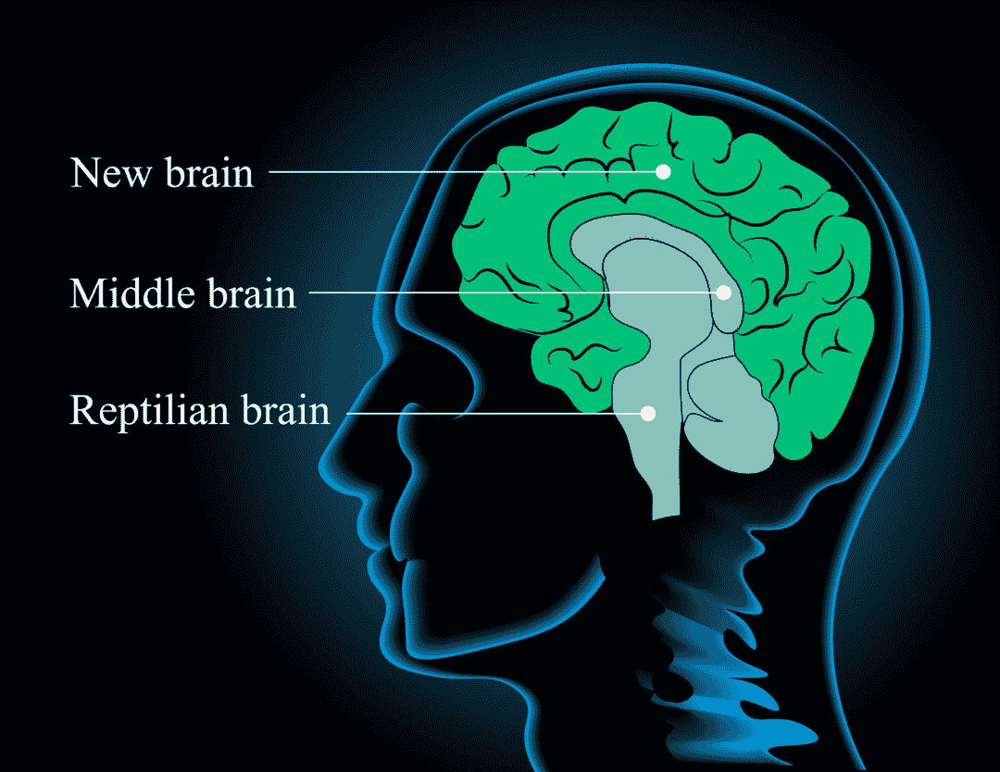
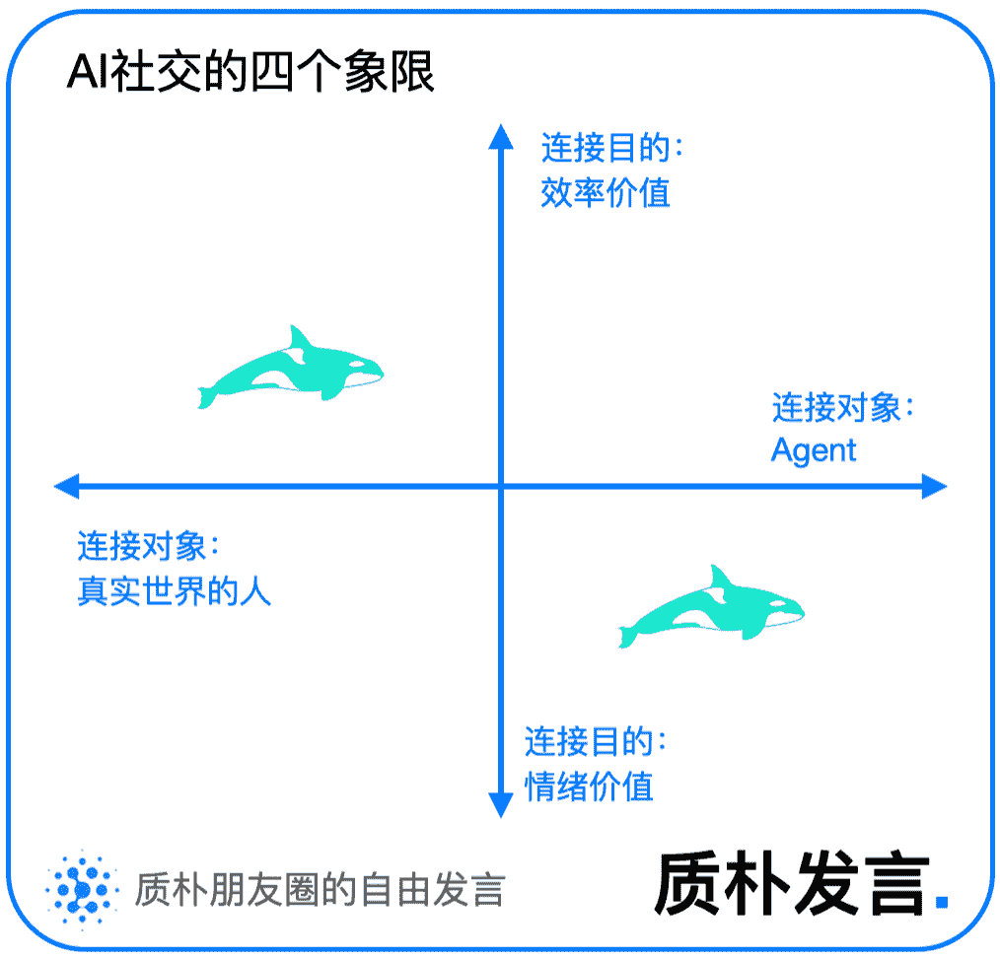
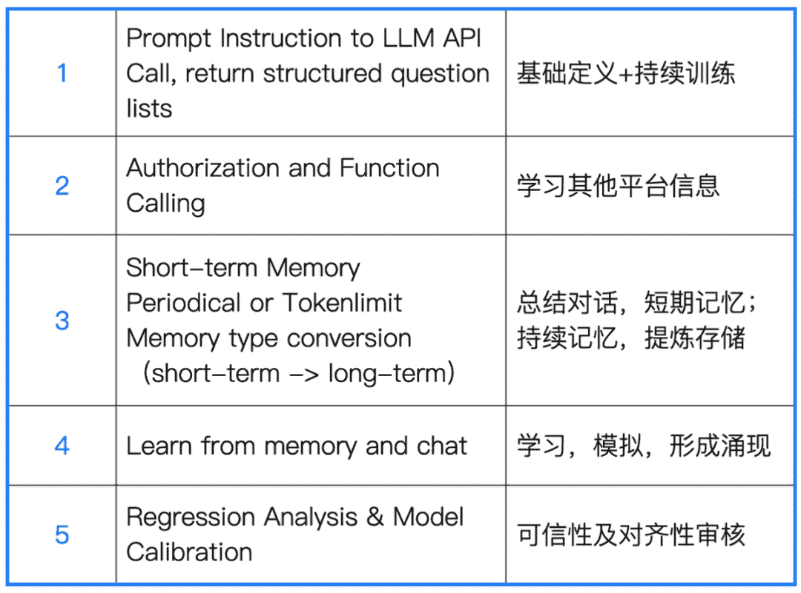
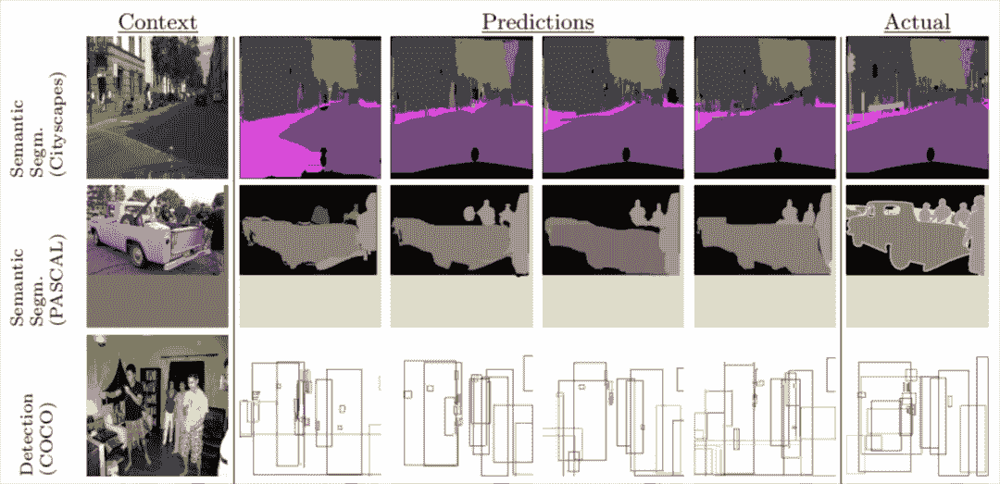
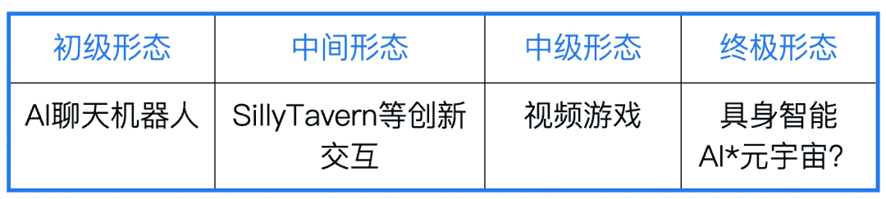
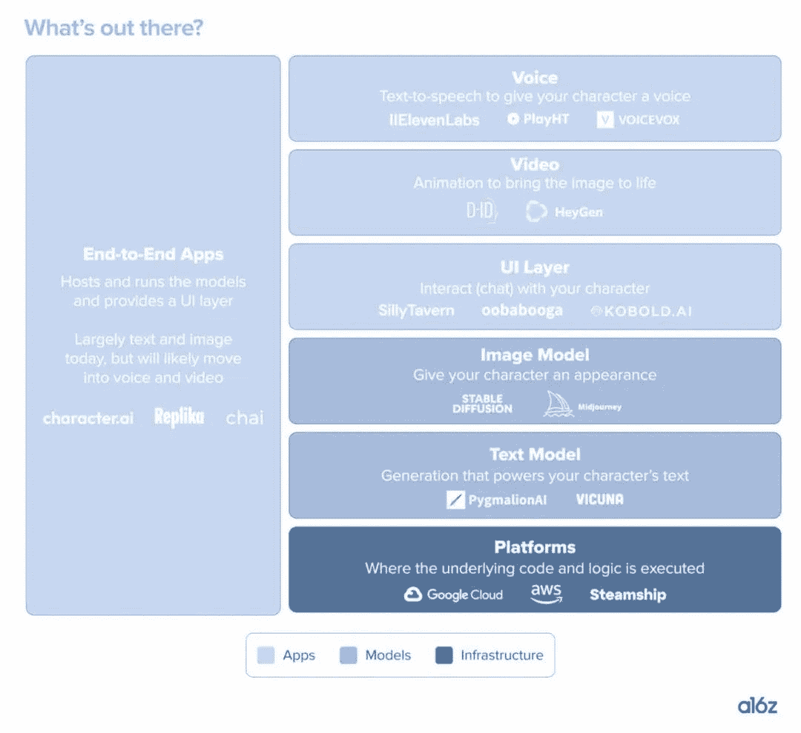
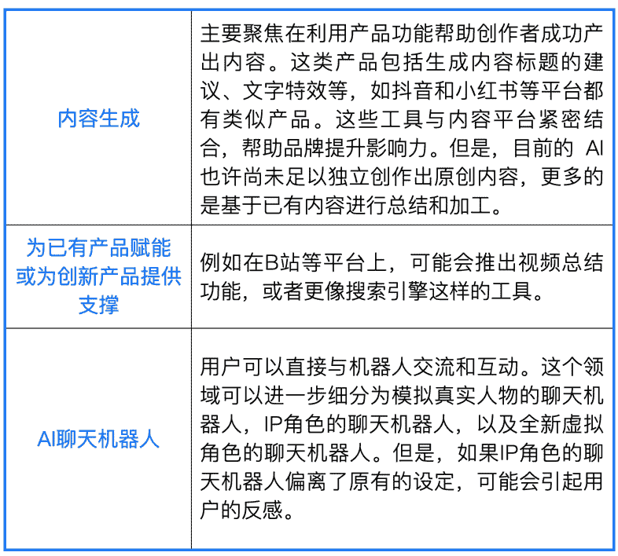
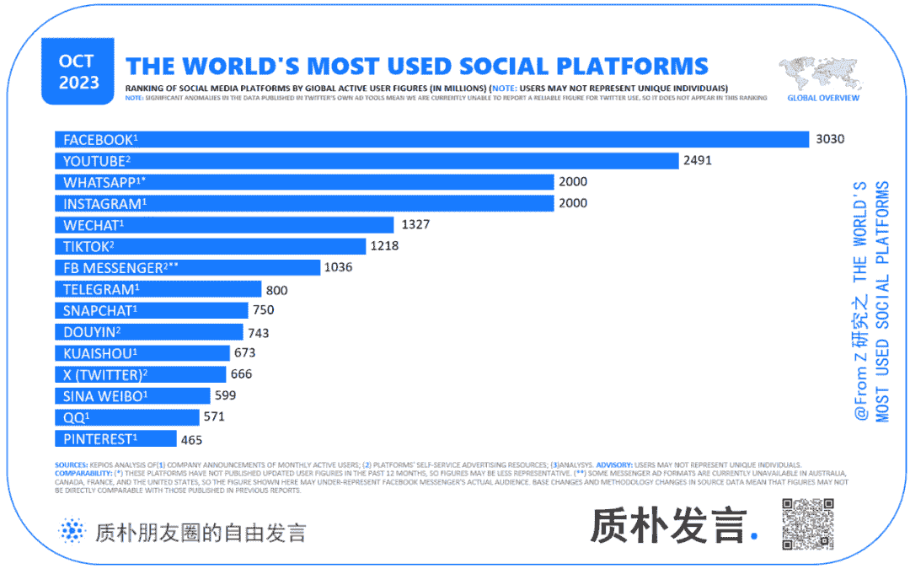
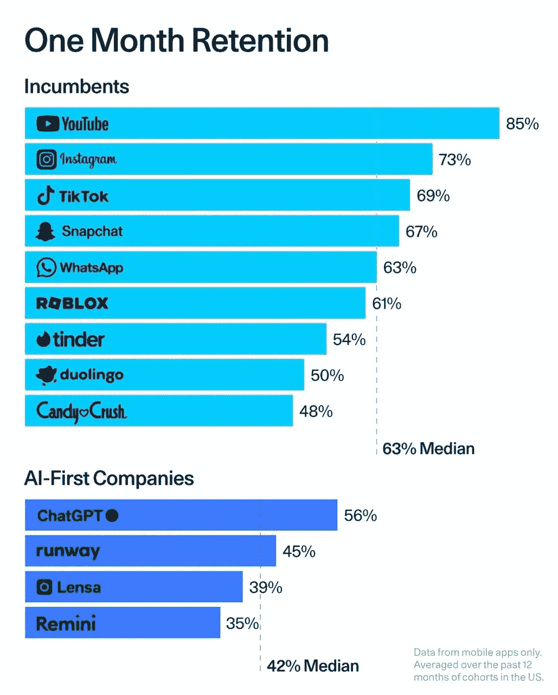
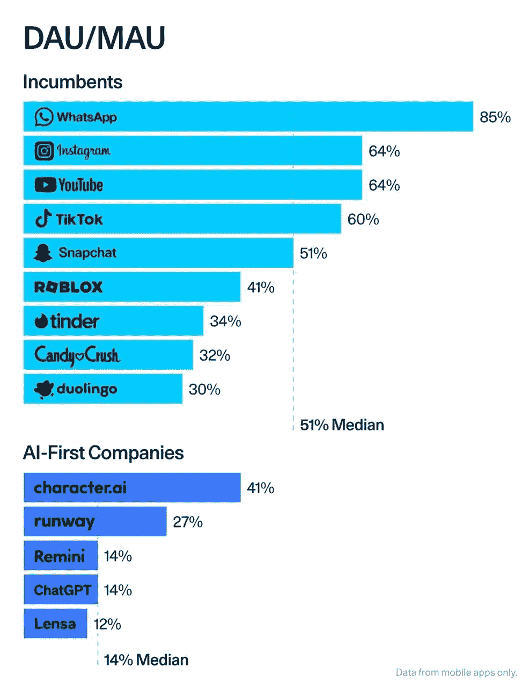

# 质朴发言：人人都想做出下一代拟人/情感/社交网络的 AI Native 产品｜Z 沙龙第 3 期

> 来源：[https://waytoagi.feishu.cn/docx/URpudZVnKohNgjxgbbxcRRsenkg](https://waytoagi.feishu.cn/docx/URpudZVnKohNgjxgbbxcRRsenkg)

原文链接：https://mp.weixin.qq.com/s/96q7tGGVpQwY9Jxgea1CgA

来源：质朴发言

发文时间：2023.12.14

第二期Z沙龙聊起AI产品2C方向有啥大机会时，发现大家对于AI拟人、情感与社交产品的热情远超其他。顺势组了这个局。我们在收到大家预备分享内容后，都发了正式邀请信。秉持所有人想所有人学习的精神，与会都是同学，一人一页PPT五分钟。

大家的信息量都太高了，不忍割舍任何一部分。索性，抛开敏感信息，按照分享顺序，直接将现场内容原汁原味逐字整理如下。所以读起来的确会不太顺畅，就收藏起来反复读。🌊

# **生成式AI数字人方向创业者**

## **1、情绪是什么呢？**

+   我认为情绪是心智的一部分，可以被理解为心智的一种快捷方式。是一种直接、直观的反应方式。相比于直觉：直觉更类似于两个节点之间的短路，情绪则是内置的快捷方式。

+   情绪并不是简单的爬虫脑劫持。

+   在观察情绪的运行过程中，我们发现情绪既不是完全自发的，也不是完全自我产生的。因此我们是不能在处理情绪时将其视为一种计划的：情绪在某种意义上需要训练，但又无法完全被训练到一个模型中。

## 2、情绪在我们的产品中起什么作用呢？

+   我认为情绪是个体智能的一部分，如一个agent，是伪随机数的发生器（random number generator）它可以产生许多变量，并由此产生复杂性。

+   在群体智能中，情绪可以作为信号，用来协调智能体的行为。因此情绪是类人AI的必经之路。如果我们简单地用一个模型去训练我们的AI，那就像是将一个复杂的表达式简化，这显然是不准确的。

# **情感疗愈方向创业者**

聊天经济在小红书上非常受欢迎，付费数据转化效果也比较好。线上的反馈数据不断被验证，并反馈到我们的底层学习模型中，是一个迭代的好方法。

+   一个疗愈式ChatBot的核心壁垒可能是：智能性，强陪伴性和全面性（场景及功能全面）。

# 某资本AI赛道投资人：AI+游戏趋势与观察

+   游戏本身是交互式的数字内容

+   玩家的底层需求是需要即时反馈——构建操作行为——状态变化——快速反馈的闭环。而需求的趋势会是更轻量级的体验、更好的画面和更多玩法。

+   现在的游戏行为模式越来越碎片化，比如RPG游戏，攻防游戏等，都加入了休闲元素。

+   AI可以通过：个性化生成游戏资产、AI叙事及NPC设定、多Agent驱动来赋能游戏体验。但同时叙事控制权从游戏创作者交给Agent后，也会出现游戏体验失去边界的问题。

来源：与会同学现场分享，质朴发言重制

第二象限（左上）的目标是提高个人工作效率，这通常依赖于社会角色，并且是一个高信息密度的双边市场。例如，求职者AI教练，AI招聘助手，以提高求职者和招聘者的效果，会主要关注产品在信息处理和市场基础方面的能力。

第四象限（右下）面向孤独和寂寞的人们，他们需要有情绪需求，需要陪伴，需要有人与他们交谈，需要得到关心和反馈。其次是受伤的人们，他们可能受到了一些包括原生家庭情感的影响，需要心理学和专业的介入。

**对于这些情绪需求，我们看到一些产品形态是人与Agent的交互，更**多的是交互内容。我们会关注这些产品在多模态能力、定制化能力和交互模式方面的表现。

# AI赛道投资人分享对于AI陪伴产品的看法

1.  **产品定位与功能多样性:**

1.  产品不应仅限于情感陪伴，而应扩展为类人助手。

1.  这种助手应解决两类需求：理性严肃场景的问题解决和感性需求的满足。

1.  **当前市场现状与趋势分析:**

1.  大多数APP旨在解决用户的情感需求。

1.  现有的分析显示，AI和用户体验如何通过机制设计建立强连接。

1.  观察到的趋势是，当前的方法变得更游戏化，不再遵循传统方式。

1.  **产品设计理念:**

1.  结合原始设计理念和游戏化思维设计情感陪伴产品。

1.  包括基于特定场景的机制扩展、优化方向选择，以及执行一系列互动行为（如发送礼物和通话）。

1.  这些策略实际上是对传统迷你游戏设计理念的新应用。

1.  **情感陪伴企业的关注点:**

1.  如“筑梦岛”在QQ中的应用，展示了如何在大流量平台上建立深度连接。

1.  关键问题是如何在现有社交环境中与真实或虚拟对象建立更深层次的关系。

1.  两个关注点：每个用户如何代表你并建立新的社交关系；在这过程中创造的价值体验。

# **AI社交软件的开发者**

1.  为用户打造数字分身，创造社交关系是有价值的

1.  通过AI Agent，可以在人与人之间创造新的社交关系。

1.  用户在网络平台（如C.AI的网红）上的高度参与和投资。说明用户愿意为这种新型社交互动支付相当的金额。

1.  推荐使用多种技术手段，辅以Prompt engineering，优化AI的交互能力。

1.  声音等交互细节的重要性：使用MiniMax模型，并期望AI能进行长时间交流。

1.  Trainable Agent 如何建立

来源：改编自与会同学现场分享内容

# AI Agent搜索工具方面创业者

1.  未来可能有开发AI agent专用的浏览器，以及其他产品如电商平台、社交媒体等。

1.  人类应成为AI agent的陪伴者，而非相反：AI agent可能具有社交需求，这超出了普通商业交流的范畴。

1.  人类陪伴AI的方式可能是提供拟人化的核心知识和个性化信息。

1.  在实现人工助手角色的过程中：AI会理解用户的社交网络和个人信息，提供有效的协助。但这过程中AI也可能形成自主意识，这种自主意识可能是agent背后的开发者和维护团队的意识延伸。

1.  未来AI可能因为需要弥补信息差来让帮助人类解决特定任务，如人机验证。

# 对于未来的交互形态，某大厂产品经理

+   目前的AI产品常采用聊天方式，但未来可能发展为更多模态的形式，如情感陪伴产品。例如，可穿戴的AI眼镜，配备摄像头，同步用户和AI agent的视觉体验。这种眼镜通过实时视频流，能识别场景和物品，提供即时反馈，但这样延时很高。

+   我们正朝着制作更小型、响应更快的端侧模型发展。已实现的功能包括基于环境氛围推荐音乐，以及根据冰箱内食材推荐菜谱。为增强交互性，考虑允许用户自定义交互规则，创造UGC（User Generated Content）生态系统，共享技能。

+   关于未来技术，我想到的是以XR硬件为载体的AI，如AI眼镜（钢铁侠里的贾维斯）。不仅限于AR技术，AI眼镜能够看到用户所见，并给予反馈。AR可用于视觉反馈，例如创建虚拟宠物角色，增强agent的可视化和互动性。

+   数据质量和运营分布策略同样关键。未来可能需要直接以视频为基础进行原生训练的模型，以提高处理视频流的效率。目前的模型转换信息为文本后再处理，可能导致体验复杂和响应缓慢。我们在寻找更优化的方法以提升用户体验。

+   像DeepMind Transframer这样的项目，它的视图基本上是合成的，采用的是延时反馈的方法，在某些任务中也产生了质量较好的输出。

来源：https://sites.google.com/view/transframer

来源：https://sites.google.com/view/transframer

# **某拟人大模型公司的算法工程师**

我认为AGI（Artificial General Intelligence）拟人化的极限，就在于如何重建人格。这里，我从一些科幻作品中获取灵感，我非常欣赏《西部世界》中的接待员。

拟人化的极限，就是达到一个机器拥有身体智能的程度，AI的展现使你无法分辨它是机器还是人。我选择了一条关注强沉浸感和情感寄托的路径，如何提高情感输出能力以接近一个完整的人格。

**设计思路1：增强情感寄托**

近期对各种AI伴侣产品进行了分析，我发现它们仍处于比较初级的阶段，距离最终拥有类似的情感输出能力或严格的认知理解，还有较大的差距。我最近玩的一款游戏，它的开发认为，通过提升情感寄托和沉浸感来增强玩家的游戏体验，获得了非常显著的反馈。但其本质上，这款游戏仍然属于传统的Galgame或者剧情向的文字游戏，具有一次性的特性（通过DLC更新等持续吸引注意力，会比较困难）。

**设计思路2：增强沉浸感**

如果我们把电子游戏作为中级形态，C.ai，星野的图文产品作为初级态，他们之间还有一种中间态，这种中间形态特指角色的动态效果，这就是SillyTavern。你可以认为它就是一个框架，可以往里装不同的大模型、不同微调好的虚拟角色，用不同的交互逻辑。

因为开源，在交互界面上，有一个近似于视频的效果是非常有趣的。这里面，角色支持动态交互的效果，这一点能大幅提升沉浸感，角色是基于和用户的文字对话的内容来针对性的做出交互动作:

这已经非常接近于电子游戏了，甚至未来SillyTavern支持了电子游戏也说不定。SillyTavern，在图文和视频之间，找到了一条新的中间态，对于当前的图文形态为主的Al+Chatbot产品带来了一种可能性。

来源：https://sillytavern.pro

特别注释：Silly Tavern（https://sillytavern.pro）是一个可以本地部署的虚拟角色聊天软件，支持多种虚拟角色，也可以自己创造角色，后台可以连多种不同的大语言模型(LLM)，比如 OpenAl、Claude、Llama 等支持文字转语音 (TTS)。

**#质朴发言注：「**2023年6月22日，A16Z发布的It’s Not a Computer, It’s a Companion!（这不是一台电脑，它是一个伴侣）就讨论了ChatGPT出现之前的Clippy、SmarterChild、Alicebot和Kuki等产品。还提到了专门用于与机器人聊天的应用程序和网站们，其中包括SFW（Safe for work：内容尺度）各不相同的Chai，Janitor AI，Chub AI，Charstar和SpicyChat等。A16Z还汇总了一张stack图，其中UI层与角色互动的例子里就有刚刚嘉宾提到的SillyTavern。

当然这张图如果更新至今，在Video类别中D-ID和HeyGen的旁边，肯定也要加上Text-to-Video的黑马：Pika Lab。实际上，在这一领域也不断涌现新的研究成果，如结合了S**o**cioMind（社会心智）和MoMat-MoGen（运动匹配与运动生成）实现自主3D角色的Digital Life Project：https://digital-life-project.com。」

来源：A16Z https://a16z.com/its-not-a-computer-its-a-companion/

# **AI 创业者**

1.  情感陪伴产品的关键要素是长期交互处理和情感语音应用：

1.  **长期交互处理：** 对用户长期记忆的重视是关键。产品活跃度和留存率的提升依赖于深入的交互内容，如提供可选择的长篇内容。

1.  **情感语音的应用：** 目前大模型在情感语音方面的能力还有限。使用情感化的语音可以提高用户接受度，特别是在处理敏感内容时。

1.  **AI产品的发展趋势**

1.  **预设角色与用户生成内容的结合：**与用户熟悉的虚拟IP的结合有助于建立更深情感连接。

1.  **立即实现功能的重要性：**不仅需注重产品的情感驱动，还要考虑可立即实现的功能，如简单日常用途，这对普通用户尤其重要。

1.  **技术和产品的微小化趋势**

1.  **硬件和软件的演进：**从大型机、台式机到手机，从网页应用、移动应用到微信小程序和对话型产品，技术和产品正趋向微小化。

1.  **用户角色的转变：**在互联网时代，用户从传统角色转变为敏捷开发者和超级个体，参与产品的制造和创新。

1.  **AI产品的未来方向**

1.  **大模型的作用：**从2018年BERT出现后，我们可以在更大比例上理解用户需求，这比此前的关键字搜索更加有效，到如今大模型在商业场景中发挥着越来越重要的作用，如自动回答常见问题。

1.  **AI与用户互动的隐蔽性：** 理想的AI产品应使用户在交互过程中几乎感觉不到它是AI。例如，通过AI平台提供的推送服务，既能解答用户问题，又能为达人释放更多时间。我认为，当所有产品都宣称"我是AI"的时候，能否让用户感知到这是一个AI，已经不再是主要焦点。

# **Web3和社交领域创业者**

**1、****究竟什么是“产品工程教程”？**

简单地**说，它是通过某种工具**将个体连接在一起。在此过程中，我们可能面临两个问题：一方面，我们需要选择合适的供应商；另一方面，AI代理在这个过程中扮演怎样的角色？回归到社交的本质，我们不能只是为了社交而进行产品设计。产品的核心应立足于两个方向：一方面，要吸引越来越多的用户；另一方面，要促进用户更多的使用，从而带来更多的收入、资源点和盈利。

**2、**如何实现让用户成为我们的推动力？

我认为每一个成功的产品背后都承载了一个故事。每个人都有自己独特的故事，但随着近一年半的过去，仅靠跟随趋势去吸引用户已经难以为继。我们需要通过AI的帮助，降低付费成本，带给我们更多的流量。

**3、****产品应该具备怎样的内容？**

强化自我的认知无疑是提高效率的关键。有时，因为他人一小时没有回信息，我们可能会发生焦虑，这其实暴露出自我认知的不足。所以，我们必须在社交平台为用户提供一种自我认知的强化，帮助他们找到自己的定义。

首先，我们的平台上每个用户都应有自己的成长目标，即他们所期望成为的人。以他们想要成为一个团队领导者为例，这是他们真正向往的状态。此外，我们需要为用户在平台上解决自我情绪的问题，为他们提供一个合理而自然的情绪释放场所。在这里，AI技术的需求就显得尤为重要，通过创造一个无私的机器人，我们可以在任何时候帮助用户排解情绪。

其次，社群归属感也是强化用户粘性的重要因素。我们的用户应在平台上找到自己所属的“家”。无论是虚拟的微信群还是真实的人群，关键在于我们要帮用户找到自己的“家”，只有这样他们才愿意回到我们平台，更加深入的参与其中。

**4、****如何维持用户的持续使用？**

平台只有拥有自己的生态体系，才能让用户在长期内愿意使用我们的产品，从而实现产品的资本化和记忆化。我们的目标应该是将有共同兴趣的人匹配在一起，并让他们向这个世界展示自己的个性。

除此之外，我们还需要保护用户的社交行为隐私，并确保其可靠性。对于用户而言，他们需要的是一个借口或者一个解释。我们需要让他们掌握事态的实际发展情况，并理解我们希望通过产品来突出每个个体的个性和独特价值。我们需要让他们以自己的标签为傲，并在有能力发光、发热的人面前凸显自我。

**此**外，我们还需要给用户提供社交回报，而这种回报并不仅是帮他们快速找到某个人，而是更精准地帮他们找到自己真正想要寻找的人。

# **某AI工具类产品创业者**

**1、**我是如何进行智能开发以满足项目需求的？

我们在与人的对话中，会基于两方的信息和关系来理解每个消息的形式，分析各自的地位、关系、对方可能会从与你的交互中获得什么。这个过程既包括了内部思考，也包括了外部分析。这种思路让AI的决策过程更像是人类的思维方式。目前我们正在使用外包数据和外挂数据库的方法进行实践。

**2、**让机器像人一样思考：人类的联想式思维思维与记忆图谱？

人类的**联**想式思维与数据的处理流程有所不同，数据服务使得从喜好中挖掘关联关系成为可能，比如通过寻找你可能喜欢的声音或你曾经喜欢做的事情。使用这种数据关联方式，我们试图模拟人的思考层面及决策逻辑，希望能帮助大量的模型进行优化。但大家也都明白，这种数据处理逻辑有其缺陷。例如，大规模的数据处理（比如采用多个维度的Agent模型进行思维模拟）会消耗大量资源，同时也会产生较高的延时。当然，我们可以在一定程度上通过资源调度来将延时压缩到可接受的范围。

**3、****模型记忆问题：**

在模型设计时，我们考虑的确实包含了诸如"遗忘曲线"这样的现象。在模型的角色设定中，如果是AI，那么它将无法遗忘；但如果设定的角色是人，那么遗忘就成为了可能。引入遗忘前，如何使模型正确理解和处理数据，这是我们需要解决的首要问题。

**4、****主体的关系问题：**

你**需要去思考和处理不同主体间的**关系，这些关系可能对每个主体都有所不同。预设的关系可能无法覆盖所有对话场景，因此我们现在正在研究如何最优地组合运营策略和AI逻辑，以在更多场景中实现最佳效果。

讨论中提到的三种关系其实是平等且复杂的。举例来说，我可能认识并熟悉你，但你并不认识我，对我是陌生的。这就涉及到一种“亲密度”的多维度性，也带有方向性。例如，你可能是一位知名的网络红人，我对你的了解程度很高，但你可能完全不认识我，这就构成了一种复杂的关系。

# **一位大厂战略同学**

根据目前的主流观点，包括社交平台、内容平台和媒体平台在内，我们可以将其划分为以下几类：

AI还**可以做到类似Tinder帮助用户做筛选的环节，但同时这里**也存在一个问题，就是在社交平台上，人们并不总是想要展现自己完全真实的一面，现在每个人可能都在各种社交平台上展示出了不同的身份：你在微博上说的话，微信朋友圈里的言论，以及在其他社交平台上的表现可能都构筑了不同的“人设”。因此，如何整合这些来源各异的信息也是一个值得考虑的问题。

社交脸谱。来源：图由DALL E生成

# 另一位互联网大厂AI从业者分享社交平台的两大类

社交，或者Social这个词，在最早的19世纪，它与许多词汇有着相同的含义，例如Cooperation，它们都表示一种相互合作的意义。这是社交一词严谨的历史解释之一。

其次，马克思在他的社会主义哲学中指出，人作为一种生物，只能通过社会合作和联结才能生存和获取生存资料。出生后，你与世界，以及其他生物（无论是否为人）的交互都强化了这一观念，也就是人的生存需要社会合作和联动。

图源：https://datareportal.com/social-media-users

从这张图的情况来看，世界上最大的社交平台们都满足了人们生活中的基本需求，否则，它就只会成为一个小众市场。每个新兴的平台可能一开始大家都会觉得有趣，但随着新鲜感的消退，如果不能持续解决用户的问题，用户数量肯定会减少。

**我**得出的结论是，社交平台解决的是人们在生活中的社会合作和连接的需求，也就是Cooperation和Association这两个词的实质。

在上面这个社交平台型产品的列表上，我把14个产品分成了两类：一类是更偏向于社交网络的；另一类是更偏向于社交媒体平台的，基本各占一半。

1.  对于社交网络，这指的是像即时通讯这样的产品，Facebook可能会有些尴尬，因为当大家想到Facebook，首先浮现在脑海中的关键词其实是"连接"，而非它的"内容"。如果仅仅看内容，并没有太多的意义，因为大家每天分享的大多是一些个性化的东西，目的并非仅仅是为了内容本身。因此，我倾向于将这些产品看作是社交

1.  我们还能看到社交和电商的融合趋势，全球五分之一的电商规模实际上源于社交电商，也就是那些发生在社交平台上的交易。特别是对年轻人来说，他们的购买决策在很大程度上受到社交媒体的影响，这种影响力还在逐渐增加。

1.  因此，我们开始意识到，在社交平台上，我们可以堆叠其他模块，例如 AI Agent等。值得注意的是，AI Agent的最大特点是可以感知环境并根据感知结果做出判断，并据此决定下一步行动，然后根据反馈进行迭代。有了这个能力后，是否可以让社交平台具有更多其他元素呢？也就是说，这两类基础通讯和内容平台的社交平台是否可以有更多除了闲聊之外的专业功能？这是我也在思考的问题。

因为我认为，**无论是搜索引擎还是社交平台，下一次的重**大创新绝不会仅仅是用新的方式去生产内容。

# **某AI社交APP创始人：AI Agent 在模**型设计和应用场景中到底扮演什么样的角色？

**1、“模型即产品”将成为趋势。**

**在大**模型时代的很多情况下，模型本身就是产品。这使得技术产品化的效率大大提高，现在基础模型拓宽模型的边界方面所付出的成本，远远小于十年前在互联网和PC互联网领域尝试寻找新应用场景的成本。

我有一位斯坦福的同学在做研究时，了解到一位在OpenAI工作的前辈，他在上个月与我分享的见解给我带来了深刻的冲击。他阐述了一个主张：在他们的工作中，模型本身就是产品。这个想法听起来简单，但是当我尝试从各个角度去深入思考这个问题时，我开始意识到这确实是个重要的观点。

在很多情况下，**模型本身确实就是产品**。现代商业环境下，基础模型在不断扩展其记忆、自定义、执行任务的能力，进一步接入各种API和外部数据，增强模型的能力。与此同时，他们在拓宽模型的边界方面所付出的成本，远远小于十年前在互联网和PC互联网领域尝试寻找新应用场景的成本。

2、“模型即产品”趋势下，用户增长成为除技术以外，产品几乎唯一的优势。

二十年前，你或许可以创造一个特定场景下的小社区、小群组、小内容分享平台或其他任何类型的应用，并且能活得很好。十年前也许一样。但是现在，这已经变得非常困难。

模型的扩展能力如此之大，以至于市场上流传的工具产品、社区产品和聊天产品，甚至包括有社交元素的产品，与模型相比，几乎没有任何优势。他们唯一的优势就是持有用户流量。

因此，我认为，要想创建一个具有足够优势和壁垒的应用场景，你必须确保在3到5年的周期内，你的流量能够非常快速地增长。如果你的流量增长不够快，例如，增长系数没有达到1，那你将很难跟上基础模型的步伐。

如果你不能全面扩展自己的模型编辑，那么你将无法在数据增长中找到任何优势。持续的创新和快速的流量增长，是在当前的环境下存活下来，乃至成功的关键。

**3**、从构建产品长期壁垒的角度看，AI Agent 在聊天中应该扮演的角色是：帮助探索熟人社交的全新互动方式。纯AI虚拟陪聊产品的壁垒很浅。

尽管我们的团队规模相对较小，但我们试验了大量的AI产品。其中一个我们尝试过的方向是纯AI虚拟陪聊产品。

当时我们每天能消耗十几亿到20亿的token。我们的研究发现，我们的用户主要是年龄偏低的人群，比如14-16岁的青少年是最多的。另外，这些用户平均使用时间很长，有的用户一天使用时间甚至可以达到十四五个小时。尽管我们的平均使用时间达到了一个小时，但实际上用户群体的中位数应该非常低，商业价值也相对较低。因此，我认为，AI虚拟陪聊是一个很可能被模型侵蚀的领域。

在社交场景中，我认为核心分为两个方面：陌生人社交和熟人社交。我们也尝试过陌生人社交，优点是拉新成本低，但是留存率并不理想。在Soul这样的APP上，大部分用户（约80-90%）更倾向于视觉体验，如看到对方好看的照片或者自拍，而真正陷入深度聊天，寻找灵魂伴侣的用户在全部用户中只占10%左右。

我们发现，有效的用户留存来源于真实的人际关系，也称之为半熟人圈子（让一个用户去联系他的朋友圈，可以让他去实现一些行为），越接近熟人社交的场景，平台的用户留存能力就会提高。

**所以，我认为AI+社交场景的核心就是能否能创造**出一个非常明显的熟人间的全新的互动方式。例如，除了让AI帮我们回应熟人的消息，我们是否能在熟人之间找到一个真正的新的交互场景？如果AI产品能成功实现这一点，那将是一次具有改变性的突破，而其他的问题，实际上都是基于这个“1”后面的“0”。

# 某创业公司CMO分享了他对于产品增长和留存的想法

红杉资本在今年发布了一个“AI第二幕” 的报告，其中提到了Instagram等优秀的互联网产品的留存，他们的首月平均留存率是63%。而现在的AI First或AI Native，以及其他一些头部的AI产品，他们的平均首月留存率是42%，其中最高的甚至达到了56%。

另一个指标是用户活跃度DAU/MAU，在Instagram等产品中，他们的平均DAU/MAU达到了51%。但是，当前的AI产品，包括ChatGPT，虽然C.AI是个例外达到了41%，但其他的平均值是14%。这是一个现象，也是一个值得关注的问题。

现在面临的最大问题其实是AI产品留存上的问题，这当然也涉及到商业化和盈利等因素。但是无论你是在做产品还是在创业，增长都是一个极其重要的要素。

**关于增长，主要有两种方式：**

**1、投放**

第一种就是通过投资买用户，这需要你有充足的资金。例如，一个APP的用户成本现在大约在5-10元甚至更高，这根据不同的产品类型而变化，如果你想要达到100万，甚至是几百万的用户规模，这就需要大量的投资。

**第二种方式是边赚钱，边买用户**。这就需要你的商业化策略足够稳健，可以在获得收入的同时，吸引更多的用户。

**2、用户自传播**

第一种是创新体验带来的惊叹感触发分享冲动。为了让用户传播，你首先要给用户带来新颖的体验，这种新颖感也被称为社交货币。比如说，妙鸭和HeyGen的产品就是达到这种效果的典型例子。当产品具有颠覆性创新的元素，如突破性的惊叹感，让用户有分享的冲动，进而触发口碑营销，带来巨大的用户增长。

因此，虽然产品本身技术难度可能并不高，但蕴含的创新元素和用户的新颖感体验仍可引发用户自传播，这也就是我们在产品设计和创业中要注重的。

第二种是在技术上超越同类产品触发口碑营销。具体来说，技术创新的价值：模型层>中间层>设计层。如果你的创新来自底层模型，那么你需要从数据层面规避一些问题，或者提升某些能力；如果你的创新来自中间件，那么你可能需要在框架等方面实现优化；

如果你的创新来自产品设计层面，比如UI设计或者提示方式等，那么这些创新可能就不够稳固，一旦你将其推向市场，很可能很快就会有大量的模仿者。例如，妙鸭虽然非常厉害，但是它的用户留存并不高，也很容易被其他大厂模仿。如果这样的产品没有持续的创新，那么它很可能会渐渐被市场淘汰。

关于留存，核心在于：满足用户本质需求，与用户同呼吸。

**分享一正一反两个案例：**

**1、彩云小梦提升留存率的手段：**“中间续写”功能，这个功能的用户群体主要是网文作家，他们有一个特殊的需求，即在已知故事开头和结尾的情况下，创作故事的中间部分。这对于大多数现有的文本生成工具来说是一个挑战。

例如，在字符统计方面，用户在使用过程中发现字符数的统计与他们的期望不符。在彩云小梦中，换行被算作一个字符，而在出版行业通常不会这样计算。

这种差异导致了用户在字数统计上的困惑，因为他们发现自己的文本字数比预期少了几百到几千字。这些反馈使得开发者意识到了问题，并对产品进行了相应的改进。彩云小梦的这种快速响应用户反馈，不断迭代的方式，使得它能够更好地满足用户的需求，从而增强用户粘性。

2、Midjourney 留存率不高的原因：因为对于很多文生图重度需求的用户，例如专业设计师，它并不能像 Photoshop 一样精调图片细节，因此目前很多设计师用的频率并不高

# 某情感陪伴大模型研发负责人分享了他对于情感陪伴的用户洞察

首先，在游戏化的场景下，大模型体验的优化领先于其他场景。

在游戏化的场景下有两个主要的观察点：

1、新鲜感能吸引来用户，但无法留住用户。首先，我们注意到无监督的模型通常具有很高的开放性和随机性，能带给用户强烈的新鲜感和探索冲动。正如之前的演讲者提到的，有一些用户每天可以花十多个小时聊天，通过持续的互动，他们能得到持久的刺激。

但是，如果仔细分析他们聊天的内容，我们会发现，在不受控制的情况下，大部分内容都会围绕性相关的内容展开，此外，用户常期待模型能表现得更加“性感”，而正常的聊天表现相对较少。

**2、能留住用户的“钩子”，核心在于**满足用户不变的需求，而不是创造新的场景。其次，随着用户对模型性能的深入理解，他们对模型的新鲜感和迎合感可能会逐渐消失，这就好像谈恋爱一样。一段时间后，你大概能清楚地预测到模型的表现，而对模型的兴趣也会逐渐递减。

实际上，初期的日活数据就能印证这一点：模型推出后的用户活跃度呈现稳步下降的趋势。

通常情况下，那些进行了精细设计的产品会表现得更好。比如有具体故事内容，或清晰定义的IP角色的产品，包括我们之前提到过的“完蛋！我被美女包围了！”，他们的表现和我们的一些发现相似。对于人类来说，新鲜感可能并不持久，但是，人为设计的刺激或者"钩子"，仍然能持续带给大家冲击。

用户在体验一个游戏的过程中，从开始到最后的沉浸，可能的结局和路径有限。AI的出现能够在这个过程中增加一些变化和新鲜感，但其大部分的探索都是虚拟的和非现实的，Aha Moment仍然是人为主导来设计的。

正如许多人提到的，用户需求并不会因为AI的出现而发生改变。AI的出现，所能做的是在已有场景下，给用户需求的满足带来一些新的体验，或者提供一些新的解决方法。但其核心仍然是满足用户需求，而不是创造新的场景。

**其次，从用户角度看，为何使用一个产**品，为何使用模型，我认为有两个关键因素：

1.  第一个是能否让用户在消磨时间的过程中感到愉快。无论是通过建立关系，还是通过提供有价值的内容。

1.  **第二个是模型能否帮助用户节约时间，让他们**有更多的时间去赚钱或者做他们想做的事情。举个例子，如微博和Twitter，这些平台都是基于这两个理念来吸引用户的。比如说，我们今天在这里，大部分人的目的可能是希望用短暂的沙龙的时间获得更多的信息，节省搜索和筛选信息的时间。

**由此可以看到两个方向：**

1.  **让用户更愉快地消磨时间。**例如乙女游戏，在没有利用AI的情况下，他们本就具有成熟的商业化变现体系。使用AI或否，只是帮助提升用户体验。这样的路径是对已有商业化模式的优化。

1.  **帮助用户更高效地节约时间。**利用AI解决问题，如新闻报道，家庭教育，或者招聘，主要是通过AI提高效率或带来新鲜体验，但核心任务不变。

# 2位创业者讨论了AI客服的价值：满足“情绪垃圾桶”的需求

**创业者A：**

我曾听到一个人与联想或移动的客服争论了一个多小时，尽管客服无法解决他的问题。我认为他并不是为了解决问题而争论，而是因为他有聊天的需求，或者他的某些需求没有得到满足。客服不能挂断他的电话，否则可能会影响他们的KPI。

因此，我们需要寻找那些无法拒绝、无法暂停、无法停止的聊天场景。我不确定这是否与AI虚拟达人对话有关，因为抖音虽然是电商，但它也是社交平台，人与人之间的场景与此不同。

**创业者B：**

我觉得售后场景可能更适合AI客服，因为售前聊天可能过于分散，难以理解用户的需求。同时，售前的“情绪垃圾桶”的需求从数量上应该较少，因为用户购买我的课程，他们肯定看过我的短视频，看过我的直播，对我有认可和敬仰。在他们与我沟通的过程中，他们不可能会像对待客服一样骂达人。

# 某AI辅助情感疗愈平台创始人分享了她的创业心路历程

我们公司内部早期探讨过很多次陌生人社交，但实际上我的观察是，国内陌生人社交的商业机会很少。我们也想对标像Soul。考虑到商业闭环在国内市场落地的可行性，我们选择了疗愈这个领域，因为在疫情期间，以及现在的AI市场发展，陪伴和母婴是一个重要的领域。

作为女性，我早期也是深度用户体验的受益者。我发现我教育的就是我自己。我觉得作为女性，我们的内心精神需要被理解。我们在国内试过所有的社交APP，我觉得整体的感觉就是女性在AI这一波意识的觉醒是必要的。因为我们的创造理论想象力，包括我刚刚听这个谈论的时候，我有很深的感触。我希望加入女性的合伙人，因为我发现在社交这个领域，男性和女性的思考路径是不一样的。

**此**外，创业者分享了她对于情感产品的思考：情感疗愈的核心竞争力仍然在人的服务，AI的价值在于：对于未被触达的场景的延伸。

1、我们在B端商业场景中发现，垂直模式已经在我们的产品中展现出来。例如，我们曾经给某婚恋网站做过AI红娘，我们将自有的垂直情感模型接入到我们的3D模型中，然后做整个垂直数据的衔接，和我们自有模型的衔接，这就可以直接商业化出来。

**2、在C端的一个问题是，即使没有AI Bo**t，我们也能通过咨询的方式实现产品体验。这个问题实际上是，现在所有的C端用户都很难找到一个集合购物平台一样。我们的逻辑是，如果我今天有问题，我在深夜的时候没有办法去问朋友，那么我就需要一个咨询平台。

在前端，我们可以通过强伴随性来满足用户的需求。例如，我需要先聊200次才能感觉到我抚愈别人。如果没有这个数量，我不敢说我是一个功能型的人，而是一个社交型的人。这就是我们需要打通的地方，只有打通了，Bot才能发挥其功能性。

## 提问：如何定义这个情感模型是否达到了我们的预期“心理疗愈”效果？

首先要明确一点，如何定义用户与Bot的关系？你可以把它理解为，它不是一个最优选的伴侣，但至少是一个还不错的男性朋友。同时，心理咨询场景更强调专业度，所以用户与心理咨询Bot的交互的过程中，对信任的需求没有那么苛刻。

从量化衡量的角度，我们会根据经验取一个长期的用户交互轮次的中间值来找到这个平衡点，来判断一次“心理疗愈”的有效与否。

## **提问：在实际应用中，我们发现真实的重要数据与模拟训练之间**存在较大的差异。你是如何解决这个问题的？

前期靠行业know-how来设计回复模版，随着用户量上升，利用实际对话数据进一步微调模型。例如，我们在高质量的数据输入过程中可能会遇到一些问题。

另外，当我们开始服务并有大量用户涌入时，我们需要重新训练模型，这时我们就拥有了真实可靠的数据。

我们主要处理的是泛情感问题，而不是所有人都需要解决的问题。当我们处理这些问题时，我们需要关注定制聊天或者大家的聊天可能是多种形式的，如果你问对方今天失恋了，它不应该简单地回答你，而是会回应你的情绪。

如果Bot不能调动用户的情绪，那么这个情感陪伴过程就是无效的。因此仅凭QA对话形式来训练模型，是无法还原心理咨询/情感陪伴场景的。

## **提问：平台是否应该给核心用户物质激励？假设你一晚上聊了200个话题**，抚慰了很多人，如果平台会给你一些激励，比如给你一些钱，是否会让用户更有成就感？

同意。我觉得女性在社交中最需要的是平等的尊重和对待所有的陌生人。所有陌生人社交的终极问题在于：用户进入任何一个社交领域都有可能不会真正地被平衡对待。我希望在 AI 这一波我能够解决的是，我们能够用精神和物质的激励的方式，鼓励平台上的心理咨询师们参与推动社交平权。

# **接下来，两位 C 端社交产品创始人分享了他们对于**“C 端应用的壁垒该如何建立”的相似看法

1、熟人社交仍然是最具价值的场景：

**创**始人A指出，熟人社交的价值在于，即使是微信等平台**上沉默的、似乎不再活跃的联系人，其**实仍然具有潜在价值。这些联系人虽然不再频繁交流，但过去的社交关系提供了一种基础信任，可以作为重建联系的基础。而这种熟人关系网，随着LLM的到来，衍生出了“大模型辅助社交激活”的机会：通过技术手段激活这部分沉默社交的想法。例如，通过接入微信等社交平台，可以帮助用户重新连接和激活这些已经变得沉默的社交关系。

2、Agent 辅助社交关系的追踪，激活“‘半熟’的社交网络”：

创始人B指出，他们在产品当中创建了一个 Agent 机制：基于关于人际关系变化的问题，随着时间的推移，人们的职业和兴趣可能发生变化，但这些变化往往在社交平台上不易被察觉。他们通过这个代理了解这些老朋友的最新动态，即使他们在社交平台上不再活跃或者不经常更新状态。

例如，当一个人到达一个新的城市或改变职业时，这种系统可以自动提示用户他们的老朋友也在同一个城市或行业，从而帮助他们重新建立联系。

**在 Agent 的辅助下，用户可以不费吹灰之力地实现社交关系追踪，随时捕捉触点，**激活“‘半熟’的社交网络”，从而帮助用户更有粘性和方向感地维系和新老朋友的关系。

# **来**自一位投资人的问题：在有目的性和消遣性质（例如Dating App）的社交场景下，用户会想和Bot聊吗？Bot提供了什么价值？

## 一位社交平台创始人分享了他的看法：

我们最开始做这个产品是有一个预设的，这个预设也是来源于我们真实的体验。对于像Tinder或者是探探这种，你刷照片左右刷的这种，他们是具有非常高的歧视性的，好看的人会获得非常多的机会，一旦你的照片不够好看，你几乎获得不了任何匹配。

在这个条件之下，我们想解决的是，如果你是这样一个类型的人，可能因为我人可能特别好，但我是个技术人员，我不会拍照，我还是想认识你，但我获得不了任何匹配机会。

而如果现在有一个Bot的存在，我首先达到一个目的是我有机会能跟你的Bot开聊；而我跟你开聊就意味着我是有一定的机会能够稍微了解一下。有了这个机会之后，我才能够向你展现出一些可能我外表之下隐藏的一些更好的特性，我才会有更大的机会跟Bot后面的真人开聊。

我们希望帮助尽可能地减小歧视。（如果极少数情况下，用户和Bot都无法进行有效的对话，那可能真的是用户需要反思的问题）。我们引入了2D动态照片、声音克隆等元素，尽可能地让你与Bot的交流接近真人的体验，你可以获取到50%以上的信息。这样一来，当真人出现后，用户才可以更好地处理真实的社交关系。

## **如**果你是一个“能介绍谁喜欢你”这样的APP的用户，你想让Bot帮忙做前筛吗？是否有一些心理动机让你不想让它帮忙做前筛？

我们认为这是肯定的。对于一部分用户来说，信息筛选是非常必要的。比如对于女性用户，我知道90%的男性用户的目的都不纯，所以我想从这些低质的人中筛选出一个可以和我聊天的人，这需要我花费大量的精力（可能 100: 1 甚至 200: 1 的比例都未必会遇到一个）。所以我认为对于女性用户来说，信息的筛选是必要的。

同时，信息筛选和奖励机制是相辅相成的。我们认为在信息筛选之上可能需要叠加一些其他的奖励机制，才能保证我们一些优质的用户（例如，让具备好的社交需求的女性能够留在这个平台）。只有这些核心用户得到了一些奖励，才更愿意留在平台，帮助平台提高整体留存率。

总之，信息筛选本身并不能解决问题，但是它可以提升我的社交感受。平台的高频用户他们更需要的是得到一些回报。这个回报可能是金钱，也可能是真正得到了一些好的社交关系。我相信在Bot的帮助下，还是能够有比较多的用户愿意在这个社交平台上。

## **紧**接着，一位大厂商业分析师抛出问题：如果平台同时存在真人和他的AI Bot分身，他们的关系是怎样的？是否应该贴近现实生活1:1的映射？

某社交平台创始人：这是一个好问题。我们认为大部分人在所有社交平台上扮演的都不是真实的自己。你在微博、微信和小红书上的形象可能是三个完全不同的人。所以，我们并不完全要求你的AI分身必须与你一模一样，你也可以选择用一个网红的图片，只要能够吸引到别人，我觉得就能够达到目的。

所以我们提供的服务包括你可以克隆你的声音，如果你的声音不好听，不愿意展现这个声音，你可以选择我们提供的预设的好听的选择。当然，我们希望你的AI助手尽可能地贴近你，因为这样会更有利于你去扩展。我们鼓励用户展现真实的自己，因为这样更有利于建立连接。

我认为当我们在社交场景中创建一个AI代理时，这个代理并不一定需要完全映射我们在现实世界中的自我。这是供给方的方案。而作为需求方，当我接触到这个AI代理时，如果我想要进一步深度链接，我可能需要更好地描述自己，创建一个更贴近现实生活1:1的映射的自我描述。

# **一位投资人分享了他的产品思考**

总的来说，社交平台上用户与现实生活相似度是一个重要的因素，我们需要根据供给方和需求方的不同场景调整它的权重。

在前期拉新获客的阶段，可以适当放低真实性的门槛；但随着对话的深入，匹配程度高的用户从Bot辅助的陌生人社交向真人沟通的熟人社交的场景切换的过程中，平台需要动态地提升用户与现实生活相似度的要求，从而承接好熟人社交的需求。

**在**传统的社交平台上，会存在匹配效率与真实度，鱼和熊掌不可兼的问题；但AI Agent能力的加持下，二者可以越来越低的成本的得到兼顾。

# **最后，一位创业者分享了他应对 C 端AI社交产**品的用户增长、低留存、低活跃度问题的经验

1、做快速有效的产品A/B测试：

我认识的创业者们，他们在产品设计阶段会很注重快速有效的部署。比如，有人在短短几天内就能测试几百个用户。我以前听一个从字节的朋友说，他在2012-2015年做了4000多次的A/B测试。往往测试上线 15 分钟，你就已经能直观得出结论到底部署 A 还是 B。这种快速测试方法能帮助我们及时调整，提高用户留存和活跃度。

**2、关注产品实用性和用户增长：**

很多创业者花太多时间在感性讨论上，而忽略了实际的用户增长数字。我们讨论的时候应该更关注产品的实用性，这样才能提高投资回报率和用户增长。在早期阶段，如何有效控制资源消耗也很关键。

3、“人对 Agent”的冷启动和异步沟通是最有效的：

我们尝试过八九种不同的人和AI Agent的组合，比如人**对Agent、Agent对Agen**t等。最终我们发现“人对 Agent”的模式在帮助冷启动和异步沟通方面特别有效。例如，当用户不在线时，AI可以解决异步通信的问题，当你不在线时，可以帮你先回复90%的消息，剩下的最高质量的10%对话再由人与人来完成。

**4、要使用低成本的增长策略：**

在产品早期做增长时，我们整体使用低成本的社交媒体策略。每天花少量预算在小红书、抖音等平台上发帖，一天准备 50 块钱成本，发 5 个视频、 5 个图文。然后开始买 100 块钱的量，跑到 100 块钱的时候，看互动成本有多少，然后再循环往复，逐渐加量到一个月 3000 块钱，其实能拉到很多新用户。这种方法实际上能以很低的成本吸引大量用户。🌊

**🐋 文中专业词汇注释**

+   **爬虫脑：**又叫本能脑或下丘脑，在爬行动物时期进化而成，能在无意识时做出反应，主要作用是保护个体生命安全，遇到危险的时候会快速做出战斗、逃跑或装死的行为选择。

+   **Galgame：**是一种玩家可以与动画美少女进行互动的电子游戏，其受众主体是男性。galgame的游戏类型大多数是vng(视觉小说)但是也有交互式的galgame。

+   **DLC：**Downloadable Content 指游戏的后续可下载内容，比如资料片和MOD，可以认为是这个游戏的追加内容。

+   **SillyTavern：**是一个可以本地部署的虚拟角色聊天软件，支持多种虚拟角色，也可以自己创造角色，后台可以连多种不同的大语言模型(LLM)，比如 OpenAl、Claude、Llama 等支持文字转语音 (TTS)。

+   **BERT：**是 Google 于 2018 年提出的一个预训练模型，它的全称是 Bidirectional Encoder Representations from Transformers，顾名思义，BERT模型的基本框架用的是 Transformer 中的 Encoder block。除此以外，它提出了两种方法，即 Masked Language Model 和 Next Sentence Prediction。类似于ELMo、GPT等模型，我们可以将BERT看作是两阶段模型，第一阶段是 pre-training 预训练阶段，第二阶段是 fine-tuning 微调阶段。

+   **HeyGen：**是一个创新的视频平台，可以通过文本生成视频，有不同的视频模板，可以定制化人物形象、工作服装等等。用户只需上传视频，选择语言，就能生成自动翻译、音色调整、嘴型匹配的视频。

+   **彩云小梦：**是一个智能写作AI，它能够通过 AI 续写，为写作者构造故事的平行世界。用户只需开个头，AI 就会帮你创作故事。用户可以自由定义故事的世界设定，并扮演其中的角色，与其他角色聊天。用户还可以在小梦的世界广场，选择感兴趣的世界，扮演自己喜爱的角色。

+   **Soul：**是一款创新的社交APP，旨在通过独特的个性化匹配算法帮助用户建立深层次的人际关系。

+   **妙鸭相机：**是一款在线生成专业质感大片的AI相机

+   **Midjourney：**是一款基于人工智能技术的绘画软件

+   DeepMind Transframer信息汇总：

+   Transframer是一种基于概率帧预测的图像建模和视觉任务的通用框架，可以生成连贯30秒视频。

+   Transframer可以预测任意帧的概率，这些帧可以以一个或者多个带标注的上下文帧为条件。

+   Transframer架构包括多帧U-Net编码器和DC-Transformer解码器，用于处理一组带注释的帧以及部分隐藏的目标DCT图像。

+   Transframer可以应用在多个广泛任务上，包括视频建模、新视图合成、语义分割、对象识别、深度估计、光流预测等等。

+   Transframer在8个不同的任务和数据集上使用相同的损失函数联合训练，可以生成不同的样本，在某些任务中，产生了质量上好的输出。

+   https://sites.google.com/view/transframer