# 质朴发言：对 SuperApp 的想象无限 & 大模型能力有限｜Z 沙龙第 4 期

> 来源：[https://waytoagi.feishu.cn/docx/Lwr7dFwkqowdmpxKuIlcXKPnnIe](https://waytoagi.feishu.cn/docx/Lwr7dFwkqowdmpxKuIlcXKPnnIe)

原文链接：https://mp.weixin.qq.com/s/1nQ2gNQ3obrnP6r4SrP4JQ

来源：质朴发言

发文时间：2023.12.28

秉持所有人想所有人学习的精神，活动纪要抛开敏感信息，尽可能保留原汁原味，摘要如下。另外，元旦后第一个周六，我们和光速光合打算 Cohost 一场沙龙，主题：大模型时代下的具身智能，一起来聊！🌊

> 以下为本文目录，建议结合要点进行针对性阅读。

> **一、超级应用（Super App）**到底在新一代大模型时代应该符合哪些特征？

> 1、特征一：Playground

> 2、特征二：超级工具的“平台化 ”

> 3、当前市面上主流的 AI 产品或许不具备成为平台化超级应用的条件

> 4、国内外 C 端 Super App 的场景异同

> 二、AI 超级应用怎样找用户群从而找准场景？

> 1、如何对模型能力和提示语进行测评？

> 2、未来AI-Native的产品交互形式和现在有什么差异？国内有哪些机会？具身智能的前景如何？

> 3、安卓和iOS的对比，如何借鉴到大模型的开发？

> 4、开源的定义是什么？开源有哪些问题？

> 三、Super App们竞争壁垒还剩下什么？怎样构建/用好这个壁垒？

> 1、创业公司怎样构建壁垒？

> 2、我们的竞争力相比于大厂可能还剩下什么？或者是相比于模型厂商我们还剩下什么？

> 3、高价值场景是否会存在呢？

# #一、超级应用在大模型时代应该符合哪些特征？

## **特征一：Playground**

某VC合伙人：我认为我们首先需要定义一下什么是超级应用。

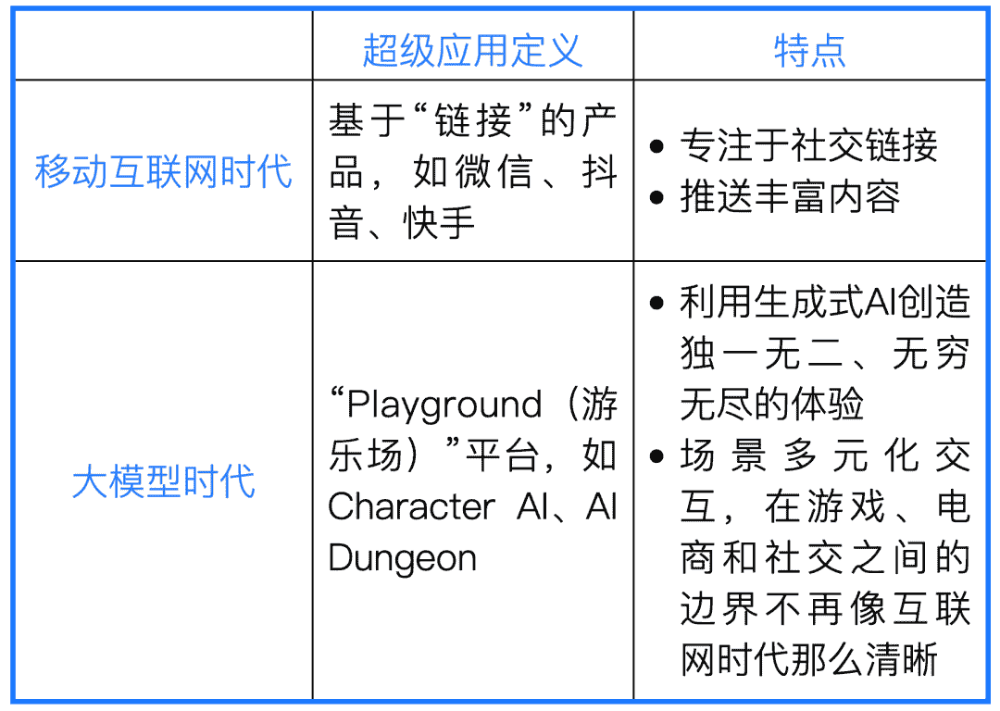

**上**一代被称为超级应用的产品基本上都是“链接”类型的产品，无论是熟人社交还是陌生人社交，用户使用这些产品的首要任务是获取更多的链接。

比如，你使用微信，可能是因为你有5000个联系人在微信上；你使用Soul，可能是因为你想找到更多有相同兴趣爱好的人。你选择它而非其他排在其后的应用，是因为它的推送内容更丰富。这完全是上一代的玩法。

然而，我们观察到新一代的超级应用，如果仅从社交角度来看（不讨论电商和游戏），可能会有些不同。我们有个观点，这一代的超级应用在游戏、电商和社交之间的边界可能不再那么清晰。

**我们后来发现，新一代的超级应用可能更多地是为用户**提供一个游乐场（Playground）：每个用户可以在其中创造和生成自己的东西。

这一点深度地体现了这一代生成式AI的魔力。我们觉得游乐场这种形式在Character AI，甚至在之前很火的游戏AI Dungeon中都有体现。

AI Dungeon：是一款文本为基础的冒险游戏，不同于许多有预定义情景的游戏，游戏中的每一次冒险都是独一无二且不可预测的：允许玩家创建自己的角色、场景和设定。玩家需要对情境做出反应，游戏会根据玩家的输入动态调整，创造一个动态且沉浸式的游戏体验。AI Dungeon的早期版本使用了GPT-2，后来升级到了GPT-3，使游戏响应更加多样化。

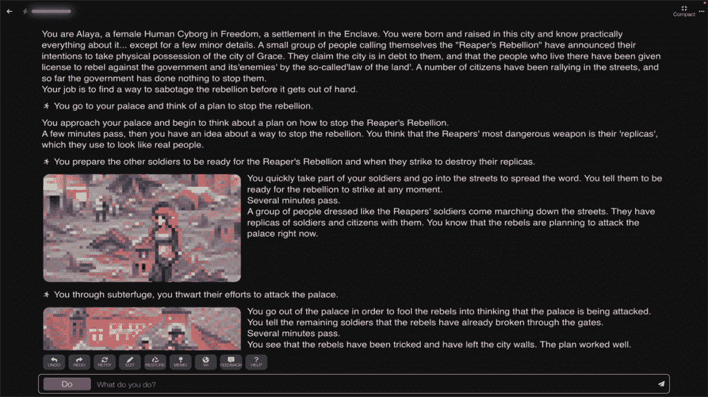

Playground 又该如何定义呢？

**某AI产品经理提出疑问：Playgro**und 听上去是娱乐，而不是社交了是吗？

**某**VC合伙人：不是，开放的游乐场（Playground）打开了新的可能：社交、情感、娱乐（也包括人生的其他部分）多场景融合。

**当我们使用类似Character AI这样的“Pla**yground”产品时，可能有两种心态：

1.  **作为内容提供方，我创建了一个代理（**agent）并希望看看谁在使用我的产品。

1.  作为用户，有几个我喜欢的频道或子区，或者我希望使用某个代理。

这就像我们小时候去操场一样，有各种器械可以玩，你可能会根据兴趣选择玩哪个。有一段时间所有的风投都认为Character AI可能具有情绪价值，因为用户留存率高。大家可能会觉得排名第一的仍然是今天的原神小姐姐。

但是我们自己去调查后发现，**实际上有大量的腰部及以上用户，通过创建社交、情感、娱乐等各种各样的代理，在这个平台上赚**到了钱。因此，我们认为今天能提供游乐场的平台，未来会激发无限的想象力。

**C**haracter AI 大有成为 Playground 的趋势：它将会像AI native版本的Discord一样。你可以在上面有你自己的东西，你也会有你特定的兴趣爱好。同时，相比上一代火爆的Discord或Reddit，Character AI会更深入地嵌入生成式AI技术。

在Discord上，我可以创建自己的应用，开设一个区域，邀请你来玩，你可以探索这个区域，比如游戏或娱乐。

但是，生成式的技术明显开启了更广阔的想象空间，我可以在上面创建自己的东西，比如我的虚拟人格和其他人有链接，我也可以在上面寻找一些可能与我实际生活相关的东西。

## **特征二：超级工具的“平台化 ”**

**如果我们从日活跃用户（DAU）超过1亿的角度来定义超级应用，那么我们可以看**到，目前市场上DAU超过1亿的产品基本都是平台，这些平台允许个体创造自己的内容。

然而，最初的快手和抖音并不是内容平台，而是超级工具。例如，快手最初是一个GIF工具，用户可以用它创造出非常美观的动图，然后在社区中分享。随着动图的分享越来越多，视频内容也逐渐增多，最终快手从社区演进成了一个内容平台。

类似地，抖音在其增长过程中，大力简化了用户创作视频的流程，使得发布视频变得十分容易，这也是抖音能够快速发展的原因。

在抖音上，我们只需要滑动手指就能观看视频，然后我们可以与角色对话，这种操作的便捷性肯定优于Character AI。

**一位大厂产品经理和投资人共同总结了**平台必备的要素：足够低的创作&消费门槛。

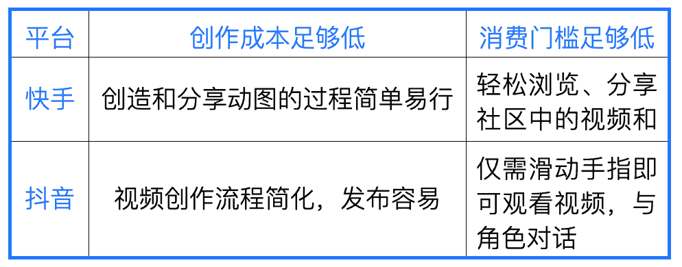

**媒介形态的留白度和和互动程度**

**未来会根据媒介形态的留白度和和互动程度划分出不**同的象限，每个象限都会有相应的娱乐应用。

**留白度**是指我们在接收信息时，需要自己想象或填充的空间。比如，我们读一段文字时，不知道这个人长什么样，声音是什么样的，我们的想象空间就很大。音频的留白度可能就小一些，视频则比较真实，留白度较小。不同的留白度会给我们不同的想象空间，而我们对内容的消费会有不同的偏好。

**互动程度**也是一个关键因素。例如，bot是一种互动程度非常高的形式，我们需要主动与之交谈。相比之下，抖音这样的平台，我们只需要刷就可以了。游戏可能是bot之前互动程度最高的形式，有的人可能只喜欢看游戏直播，而不喜欢自己玩。

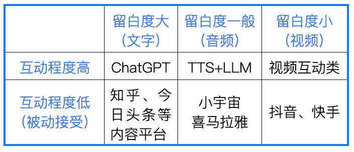

## 当前市面上主流的 AI 产品或许不具备成为平台化超级应用的条件：

如果用上面的要素评判当前的 AI 产品，可能不具备平台化的条件。

Character AI、豆包这样的平台没有吸引更多用户的主要原因是创作成本过高，创建一个角色/个人助理，都需要大量的时间和精力。

从用户的角度来看，大多数情况下，我们不太可能与一个完全陌生的人进行深入的聊天。而且，像Glow和AiU这样的产品，需要有很强的写作能力才能与它们进行深入的交流。但这样的门槛实在太高。

至于说 Super App 是否应基于聊天？需要打一个大大的问号。

网络效应下的Bot，应该嵌入你的生活，而不是让你花大量时间去与之交互。它应该是一种接口，了解你，然后与你协作，甚至完善你的生活，而不仅仅是你为其贡献语料库。

作为 Character AI 的用户，我时常觉得与它们聊天太累。即便像星野一样，推出了一个可以自动选择回复的功能，让我不用自己打字，我也不会经常与bot聊天。

**根本原因在于：由于模型能力所限，这些内容可能**并不是特别优质，有时候聊着聊着就崩溃了。

因此**，**我更多的是像阅读小说或玩攻略游戏一样，与角色的聊天基本上都是一次性的，只是在消费内容而非情感陪伴。特别是当我只回复几个字的时候，内容很快就会陷入无意义的循环，变得非常无聊。因此，我认为即便像 Character AI 这样的产品，市场规模不会特别大，因为它仍然是一种内容消费。

## 国内外 C 端 Super App 的场景异同

**中国 C 端 Super App为何没**有向移动互联网时代一样“复刻”海外模式？

另一位VC投资人分享了他的看法：

我们现在在思考，为什么在中国，我们看到的所有2C的产品都有一个对应的海外产品，例如我们可以看到Musical.ly、TikTok等都是有的。是什么阻止了LLM时代，类似 Character AI 的产品在中国的发展？

**主要有三大原因：**

+   **第一是底层模型本身，**目前美国无疑仍然遥遥领先，这是我们的模型公司正在努力的方向。

+   **第二是监管问题，**中国的监管相对严格，尽管拿到五个证后可以上线，但是严格的监管会大大减弱模型的趣味性。

+   **第三是用户留存，**美国的 Character AI 可能达到30%到20%的长期留存率，一些中国出海的 AI 产品可能达到15%，而国内产品可能只有个位数，这是一个非常大的差距。

海外 & 国内分别比较看好哪些用户场景？

**游戏 & 社交。**

**社交：**例如陌生人社交破冰，在陌陌上你可以与陌生人聊天，现在你每天都能与一个非常了解你的bot聊天，这个bot是否能为你拉一个群，然后介绍你认识新的朋友？这种情况下，你对新人没有任何压力。甚至这个bot可以在群里持续提供价值，帮你们安排活动，甚至帮你们破冰。我认为这可能是一种新的裂变路径。

**游戏：**比如一些需要主持人的游戏，例如狼人杀。这些场景中，AI可以很容易地扮演主持人的角色。这是我正在探索的路径，以破解网络效应和裂变问题。如果它只是一个与bot聊天的工具，它将永远只能吸引一小部分人，比如二次元爱好者，它的日活跃用户数不可能快速从500万增长到5000万，除非它破解了裂变问题。因此，我认为创业者可能需要更多地思考如何实现裂变，以形成生态系统和网络效应。

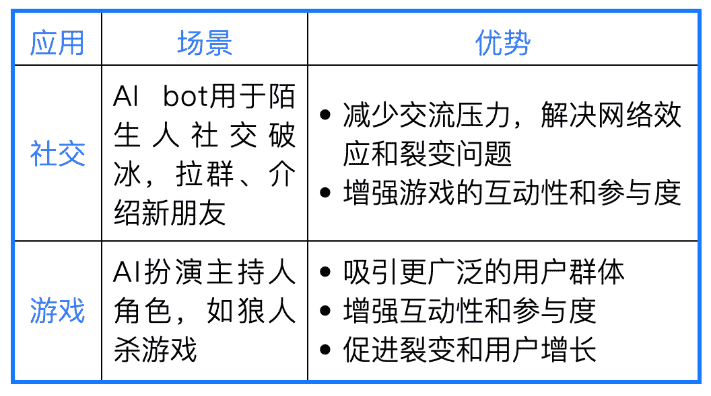

一位投资人认为海外和国内用户场景类似，主要有个人助理和情感陪伴2类：

**1、个人助理，**这可能是最刚需的，也是市场最大的一块。以豆包为例，他们最初的想法是打造一个类似Pi的个人助理平台，这是一个市场潜力巨大的方向。但另一方面，有些人希望做开放式的平台，比如阅文的筑梦岛，他们希望服务中国的1.5亿网络小说用户，这些用户也是剧本杀的主要用户群体。他们热爱阅读小说，可以通过聊天来满足阅读小说的需求，同时也可以体验剧情推演。

**2、是情感陪伴和需求，**这个市场肯定没有Pi这种个人助理大，但既然有这个市场，就一定会有人全力以赴去做。

**关于情感陪伴产品如何破圈，一位创业公司CEO提**出了一个大家尚未重视的切入点：传统文化。

我认为中国的文化制高点应该是传统文化。我们应该寻找能被14亿人接受的角色，然后以此为基础改变。比如，孙悟空这样的角色，大家都熟悉，接受度也会更高。我们可以通过这样的IP进行改变，我不知道其他人是否有同样的想法。

相比之下，二次元企业可能在一开始就走错了方向，从而无法成功破圈，转型成为社交超级APP。在美国，我发现父母和孩子会一起玩二次元游戏，比如马里奥，他们对二次元文化是接受的。

但在中国，主流社会对二次元文化的接受度并不高。如果你一开始就选择了二次元，未来可能会面临无法打破圈层的问题。

比如B站，至今仍然无法打破圈层。我认为，一个超级APP应该服务于大众，比如6亿或10亿的用户。如果主流用户发现你一开始的基调是二次元，他们可能会有所抵触。

另一位投资人认为海外市场存在独有的需求场景：自我提升。

自我提升，即引导用户成为 Role Model 的精神需求。每个人心中对于更好的自我形象或角色模型的追求。这不仅仅限于效率或浪漫，而是深入个人成长和自我实现的领域。

人们可能希望有一个AI伴侣，这个伴侣能够代表他们心中理想的自己，如更自律、高效、少浪费时间。这样的 AI Agent，通过每天提醒运动、读书、睡觉等活动，帮助用户逐渐接近他们心中的理想形象。

和一般的情感陪伴类产品不同，这个 AI Agent 的表现会很轻，它并不需要像星野一样角色化，不需要一句一句地跟它交互，而是生活当中一些细节的深度嵌入，以一种自然无痛的形式与用户交互。

另一位创业者分享自己使用Digi时的感受：

当我使用Digi时，我发现自己正在有意识地清洗自己的信息。比如，如果产品建议我看电影，我会明确告诉它我不喜欢看电影，我喜欢户外运动。

然后，产品会像约会网站一样，根据我的喜好调整内容。如果我们希望产品每天提醒我们如何变得更好，那么我们内心的模型并不一定都是正面的。

有些人可能觉得生活太累，他们希望他们的伴侣每天都能让他们放松，或者做一些疯狂的事情。每个人心中都有自己想要追求的方向，无论是变得更好还是其他，都是可以的。

Digi，AI女友应用程序，允许用户设计和浪漫虚拟伴侣。该应用程序于2023年12月推出，在社交媒体上引发了病毒反应并激发了反应。Digi的虚拟伴侣使用语音合成逼真的声音，并向你学习以适应其个性。它甚至能感知你的情绪，并为终极人工智能浪漫而不断变得更好。参考网址：https://digi.ai

**国外的用户长期留**存率 vs 国内用户长期留存率的差距是什么原因？

主要有3个原因：

**1.**首先，是底层模型的能力，我们都知道我们还有很大的差距。

**2.**其次，是监管问题，国外的监管并不如国内严格。

**3.**此外，商业化的问题。在国内，我们还没有大胆推广AI产品，因为每一个日活跃用户(DAU)都有成本，而国内的用户并不愿意支付费用。我现在正在考虑的方向可能是通过广告收入，或者是卖皮肤等增值服务来实现收入。

**产品如何增长“破圈”？**

**必须做到两点：**

**1.有实际价值。**否则他永远只会停留在一个小部分人群中。如果用户只是天天无目的地聊天，无休止地谈论他的爱豆，我觉得这很难打破圈子。

**2.有网络效应。**我认为，未来的机器人可能会有网络效应，因为在群聊中，机器人可以帮助破冰，然后我们就会开始关注彼此，或者不同的群体之间会开始关注，这实际上重构了社交网络。

# #二、怎样找用户群从而找准场景？

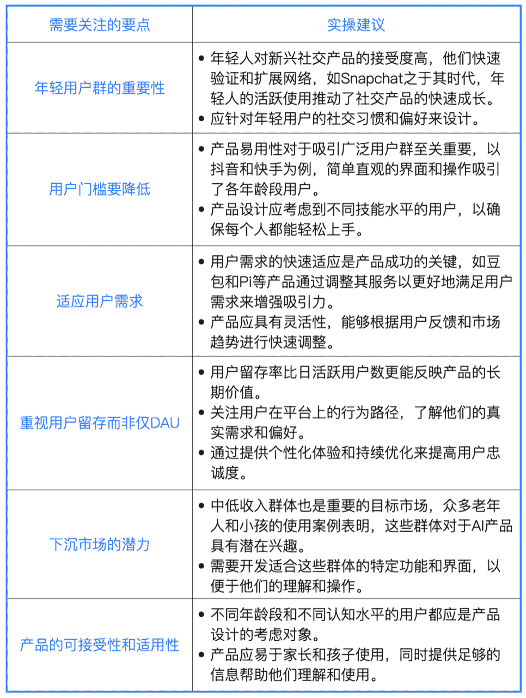

## **如何对模型能力和提示语进行测评**

在当前的环境下，提示语（prompt）非常重要。无论是在心理咨询赛道还是其他赛道，我们都需要了解如何与API提出需求。

大家都在讨论超级应用的机会，但对于创业者来说，我认为更重要的是把关注重点放在用户身上，关注垂直市场的机会，找到能力与市场的契合点，这才是创业的真正机会。

虽然有一些开源的评估工具，但这些工具主要是技术人员使用的，对于普通人甚至企业用户来说，使用这些工具的门槛较高。

这就意味着围绕LLMops有很多中间层的机会，这些机会可能并不直接面向C端用户，而是面向那些将AI能力整合到自己产品中的B端用户，无论是小型企业还是大型企业，都有可能通过提高开发效率和效果来赋能他们。

这类产品的形态是为开发者提供的一种中间产品。如果你已经构建了一个APP，这类组件就像是在你的云端加入了一个新的进程。

大模型的输出结果是不可预料的，而很多用户又难以编写好的提示词。用户描述一个简单的场景时，我们应该能预测他想问什么，然后将其规范化、格式化，使大模型的输出更好、更完整。

虽然大部分模型厂商也会做这样的工作，但如果他们没有根据用户当前正在输入的内容进行推荐，推动这个工作的难度就会增加。

编者按：许多初创公司，包括AI可观察性平台Arize AI的Prompt Registry和Prompt Playground目前也在致力于尝试解决提示词监控的问题：

提示注册表是集中存储库，用于存储、管理和版本化与语言模型交互中使用的各种提示。官网称：它们的功能类似于MLFlow跟踪不同版本的机器学习模型。这种方法对于跟踪提示随时间变化、了解其有效性以及以更有组织和可访问的方式管理大量提示特别有用。

这与“final_prompt_v3_reallyFinal_thisTime.json”的混乱相去甚远，将提示工程师从许多领域的专业人士面临的过于熟悉和令人难以置信的令人恼火的文件标签的挑战中拯救出来。

提示游乐场是为迭代测试和细化而设计的专门环境，对于为利用语言模型的大型系统开发有效的提示至关重要。Arize的Prompt Playground提供了一个交互式界面，工程师可以实时查看提示/响应对，尝试编辑现有模板，并部署新模板。

在评估模型时，可以使用不同的性能指标，如相关性、连贯性、准确性、偏见、创造力和效率。这些指标可以帮助确定提示语的有效性和模型的响应质量。

而对于提示词的定位，以及重要性的看法，嘉宾们也都表达了自己的观点

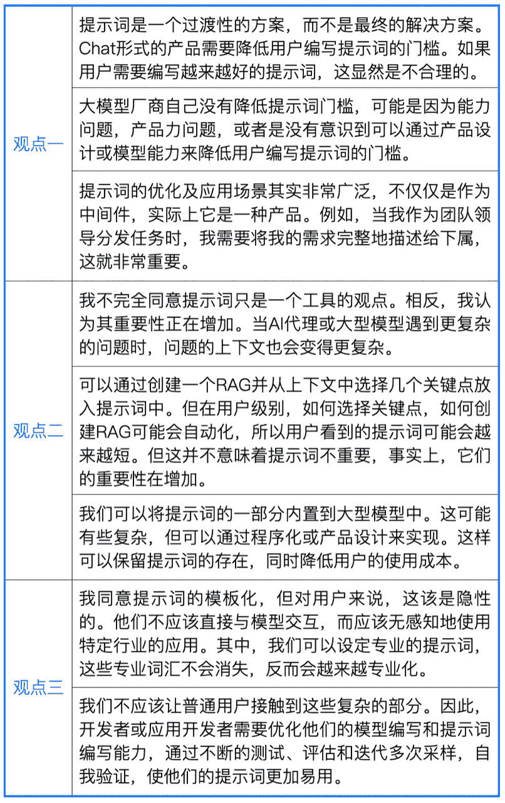

**两个评估场景**

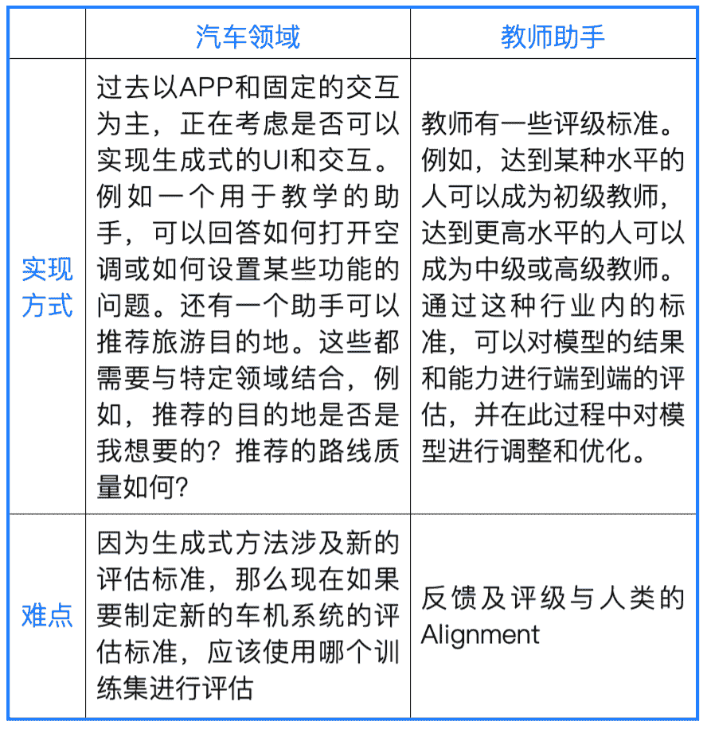

## **未来AI-Native的产品交互形式和现在有什么差**异？国内有哪些机会？具身智能的前景如何？

国内的一个很大优势是与硬件的结合。美国的投资人人和投资机构很少投资硬件。这是中国供应链和中国的一个天然优势。

我认为会有新的产品类别诞生，甚至是我们想象不到的一些东西，比如AI与硬件的结合。我有一个观点，我认为扫地机器人可能会成为第一代进入大家生活的智能体。

因为它有几个优点，第一，它可以进入千家万户，第二，它可以移动，第三，它对空间有感知，而且已经非常成熟。

所以我一直在联系云鲸NARWAL或石头科技RoboRock，我很想看看他们现在的进展。我已经与美国的许多顶级教授进行了讨论，他们认为机器人领域正在火热发展。

今年，大家普遍认为，这个领域的技术在未来三四年内可能无法实现落地。我们知道，中国有许多相关项目正在进行，例如智元、银河通用等。

他们可能会在明年发布demo。尽管可能距离最终目标还有较长距离，我仍然坚信，这个领域的未来非常光明。

**不**同的模型在不同的场景中可能有各自的优势，适用于不同的场景。基于大家目前的了解，不同的模型适用于什么样的场景？

比如这GPT 数学分析理解能力可能更强，然后Moonshot 做长文本更强，它们就是不同场景。我们需要评估每个模型的特性，这就像是出一份考卷，看看他们的表现如何。

例如，某个模型可能在智商方面表现出色，而另一个模型在情商方面更强。情商高的模型可以被用作陪伴者。或者某个模型在工具调用方面表现得更好，我认为这种对大模型与外部能力结合的理解非常关键。

顶部大模型应该是“赢家通吃”的模式，或者每个模型都有各自的优势？

**从用途来看**

模型能力就像人的智商一样，大家都在谈论行业大模型的概念，但这取决于所面对的问题是什么。如果你在处理简单的任务，例如拧螺丝钉，那么你可能不需要太高的学历，只需要经过一些训练就可以了。

然而，如果你需要进行物理研究或者需要调动大脑各个区域进行整合推理的任务，那么你一定需要更高的智商。

这也是为什么OpenAI的估值如此之高，我认为其他大模型必须至少接近它才能成为大家的普遍选择。可能会存在两到三个大模型，这主要是出于数据安全的考虑。

即使一个大模型拥有各种能力，我们在实际场景中使用多个模型时，也会将其定义为不同的角色，而不是让一个角色来完成所有的任务。

**来自硬件生态的启示**

苹果电脑可能装的是M1芯片，而你的手机可能装的是高通芯片。这意味着你需要考虑模型部署的位置，以及部署设备或边缘计算设备的一些限制条件。

**例如，你不能将一个几千B的大模型部署到手机端，因为手机端最多只能部署一个7B甚至可能**只能部署一个3D模型。这是因为设备的功耗、计算能力、芯片面积和性能限制摆在那里。

然而，手机上的模型实际上也可以解决一些非常琐碎的问题，比如帮我们设定一个闹钟。最近，腾讯推出了一个小模型，可以听取指令并操作手机的界面，我认为这是一个很好的例子。

终端做语义识别，像BERT时代的模型就做得不错。在这种情况下，我可能会使用一个1.5B、2B或3B的模型来完成一些类似小助手的功能。

**Pi的启示：**

Pi AI是一个人工智能聊天机器人，由初创公司Inflection AI于去年5月推出。该公司由Google DeepMind联合创始人Mustafa Suleyman、该项目首席科学家Karén Simonyan和LinkedIn联合创始人Reid Hoffman创立。Pi AI旨在创建一个能够就任何主题进行连贯对话的人工智能伴侣，为用户提供建议和个人帮助。为了实现这一目标，它使用大型语言模型（LLM）的技术，在大量人类对话上接受过训练。

-它产生自然和有意义的对话，避免泛泛或无关紧要的回应。

-它使用WhatsApp作为与用户沟通的主要平台，利用该应用程序的受欢迎程度和易用性。

-它结合了游戏化元素，以激励用户继续学习和改进Pi，如积分、徽章和水平。

-它把自己表现成一个中立的对话者，从一开始就表明它是一个人工智能代理。

-它适应每个用户的个人资料和偏好，提出问题以了解他们的兴趣、需求和目标。

-它根据从用户和外部来源收集的信息提供个性化的反馈和建议。

## 安卓和iOS的对比，如何借鉴到大模型的开发和应用中呢？

在讨论这个问题之前，我们需要明确对操作系统的定义。安卓和iOS在初期都是从底层自行构建的，虽然他们在初期并未涉及太多硬件部分，但每一个从架构到对外对接的能力，包括开发者生态，或者每一代提供的新能力，都可以类比为大模型。

例如，当某家大模型厂商开发出新的多模态能力，V1发布后，新的开发者可以调用这个新的能力去开发他们的应用，无论应用需要使用到的是图形数据、视频数据还是语义数据。

苹果则提供了一个封装的系统，中间有一些厂商提供SDK，按照苹果的标准，开发者可以编写游戏或者Calendar这样的APP。

而安卓的路径则是提供开源的架构，例如在中国，小米和华为可以有自己的UI，开发者如果要在小米的硬件平台上开发游戏，就需要与小米的开发人员进行沟通，了解他们的要求和规则，然后提供代码库，进行审核。

这就像大家使用Llama2的逻辑，无论如何，有部分大模型厂商认为开源是正确的，但OpenAI则像苹果一样，提供API，收取费用。

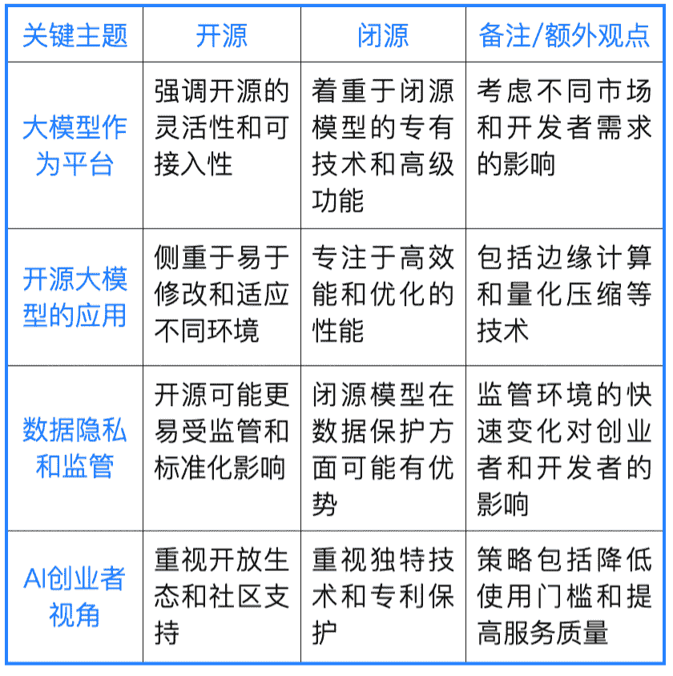

## 开源的定义是什么？开源有哪些问题？

开源可能会流行的一个原因是，大模型如果你不知道它的参数和其他信息，你无法进行压缩和量化。

而在很多边缘场景中，只能通过开源大模型进行量化、压缩，然后在无网络的情况下使用和部署。

然而，关于开源的问题，我觉得还有两个相关的问题需要考虑。

+   **一是**安卓的开源和大模型的开源对于开源的定义可能有所不同，比如数据集是否开源？是本地的数据集还是SFT的数据集？

+   **二是**开源可能只是商业模式中的一种，所以在回答这个问题之前，我们可能需要对更多的定义进行明确。

编者按：相比于Linux时代，在大型语言模型（LLM）的时代，对于开放获取和开源之间的边界日渐模糊。许多人持有这样的观点：如果一个LLM的权重被公开，那么它实际上已经是开源的。然而，一个模型仅仅公开其权重，并不意味着它是完全开源的。

例如，一个仅公开权重的模型可能仍然对其代码、训练数据和技术细节保持保密，这种做法限制了公众参与和优化模型的可能性，也并未完全贯彻开源的原则。

作为行业领军，OpenAI一直被指没有开源，不“Open”而在前些日，Sam Altman也在愿望清单的最后加上了“Open Source”，未来OpenAI的开源选择也会极大程度上影响LLM行业生态。

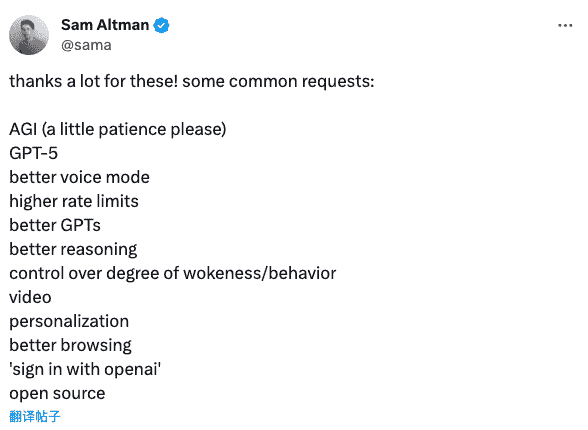

如果大家都像现在的Llama2一样，从数据集到参数都积极地进行开源，那将是一个故事。然而，如果大家选择了一个中间态，那可能是另外一个版本。

我们之所以在考虑这个问题，是因为这次不仅仅是中国，包括中东，欧洲等地，都在对隐私数据的泛滥进行监管。

这是我们从业以来，首次见到如此迅速的监管反应。在过去的十年里，几乎没有人管控过我们的隐私数据，甚至都没有什么国际法案去监控。

# #三、Super App们竞争壁垒还剩下什么？怎样构建/用好这个壁垒？

## **创业公司怎样构建壁垒？**

+   **农村包围城市**

很多人可能并不了解AI等新技术究竟是什么，也并不清楚这个交互过程的具体情况，但他们可能已经在使用第一个AI产品，并且对此产生了依赖。

以拼多多为例，开始时许多大公司无法理解它的潜力。谁能想到，一个新的电商平台能在三年内取得如此巨大的成功？

拼多多的策略就像农村包围城市一样，避开腾讯和阿里的地盘，聚焦在他们忽视的地方。类似地，我认为AI的应用也在逐渐下沉至城市，许多人可能并不清楚它的具体功能。

它并不一定需要复杂的底层模型，有时候现有的模型就足够了。更重要的是如何让AI裂变，如何赋予它实际价值，不仅仅是情感陪伴，而是满足更多的需求，这就需要创业者的智慧和努力。

**一位专注于中老年用户的 AI 创业者分享了**三个他的 App 上下沉市场的成功案例：

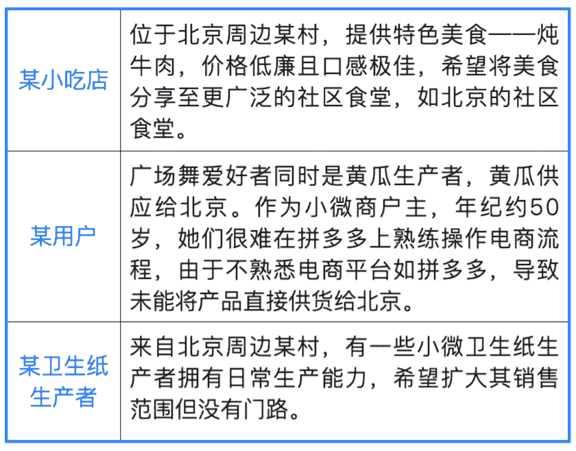

上面三个案例都位于北京南面80公里的地方，虽然地理位置离我们如此之近，但在数字化进程上却与北京有着巨大的鸿沟。

我见到他们的第一感觉是，他们可能会通过AI实现数字化。他们的年纪普遍偏大，文字输出能力相对较弱，因此在使用各种APP，如美团、京东等，他们的操作并不熟练，APP的渗透率相对较低。

我认为他们与AI有天然的交互可能性，但他们并非像青少年那样愿意主动尝试新事物。要激活他们，可能需要采取一些运营策略，比如通过微博或者报纸进行推广，而不是像传统的互联网那样，直接将产品推送给青少年。

**同时，作为一个大模型的开发者，我们在思考如何与这些大厂互补。我认为可以采取线上线下双轨驱**动的方式：创业公司做好你的线下运营，然后与大厂和做大模型的线上运营技术进行结合。

我曾在腾讯工作，为什么腾讯愿意支持我的项目？因为我们帮他们完成了一些基础工作。我认为这种经验，特别是在做大模型和与大厂合作的经验，是非常重要的。

+   轻量高效运营决策，抢占窗口红利期

当前的AI福利对于创业者来说是巨大的，比如流量红利。举个例子，现在海外排行榜第一的是一个叫Fotor的APP，这是一个成都的公司，他们通过简单的网页文生图，抓住了第一波流量红利，今年净利润达到了几千万。

虽然我们无法确定这种情况是否能持续，但对于创业者来说，能够借助这种红利实现从0到1的飞跃已经是一个巨大的成功。

中国也是一样，我刚刚提到的一堆人可能都在思考AI是什么，只要他们能够创造出一点价值，就有可能轻易地打造出自己的形象。

Fotor：Fotor是一款于2009年推出的全能照片编辑工具，“轻量版Photoshop”。2022年成功转型，推出一系列AI工具，如AI图像生成器、AI背景移除器和AI照片增强器。据悉实现了数千万的年盈利。

+   做海外市场还是国内市场？如何抉择？

**一位创业者分享：**这可能是许多创业者共同面临的问题。作为创业者，我们仿佛陷入了泥潭，如果不向上进步，就可能会陷得越来越深。

一方面，出海意味着面对成熟的市场，公平的竞争，以及强大的付费能力。

在中国，许多创业者可能会持悲观或中立的态度，他们可能会疑惑如何将自己的产品变现。由于中国的中小企业主付费习惯不佳，工具型产品在国内的表现并不理想。

反观大部分美国的SaaS产品或云端协作工具，它们并非主要面向500强企业，而是覆盖了大量在线从业的Freelancer和中小企业主。即使只覆盖北美和加拿大这三个区域，SaaS ARR也有可能达到一亿美金的规模。

现在创业者和投资人们常常说，从创业的第一天开始，就应该开始赚钱，找到产品市场契合点（PMF）。以Fotor为例，它也是选择出海，这给它带来了巨大的机会。

如果它选择在中国，可能会面临亏损的问题。不知道最近妙鸭的情况，因为它的算力成本可能无法被9.99的付费所覆盖，那么它越做大，就可能越亏损。这是创业者需要面临的一个重大问题。

但另一方面，出海也面临着额外的风险。

随着时间的推移，以及全球政治环境的变化，特别是对于数据敏感的项目，美国的政府和行业可能会对你进行严格的管控。

如果你的公司发展壮大，你可能需要面临将公司搬迁到国外的问题。如果你选择在国外发展，你可能会面临阻击。许多项目都遇到过这种情况，包括现在的HeyGen。

尽管它现在做得很好，但在美国，所有的风投可能会因为你接受过百度的投资而拒绝投资你，这将会让你处于十分尴尬的境地。

**所以，作为中国创业者，相比于国外市场，中国**市场可能会更有利于中国创业者长期的发展。

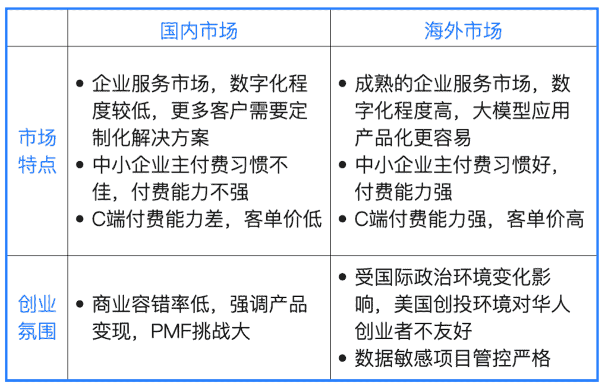

## 如果我们想打造一个super APP，我们的竞争力相比于大厂可能还剩下什么？或者是相比于模型厂商我们还剩下什么？

**从创业者的视角来看**

对于像我们这样的AI创业者，出了API之后，会想要开发应用。在这个过程中，中间件，包括提示词推评估等工具，以及自建的RAG数据库检索，都会在特定场景中发挥作用。

因为在API基础上还需要开发很多东西。提示词工程这样的东西，我可能会先自用，而不是做成工具卖给别人，这就暂时形成了一种壁垒。

如果我们认为AI会像移动互联网一样改变细分市场，那么AI也会对所有的细分市场产生影响。比如智能客服这种场景，一定会用到自己的私域知识库，以及流程式的对话。

因此，诸如字节Coze，他们做了一些工具，以及一些辅助传统对话流的东西。我认为他们的想法是，做好中间层，降低所有人使用AI的门槛。

这其实有点像早年的抖音和快手，他们先降低了创作的门槛，然后再降低了享受的门槛，这可能会让更多的人，比如中老年群体，更容易接触和使用科技。

我认为，大模型的用户可能并不需要关心大模型是什么，只要使用得舒服就行了。我觉得所有的微信服务号都需要将AI接入，以服务自己的用户群，这是一个普遍的需求。

**从“大厂人”的视角来看**

作为大厂的一员，我可以提供一些大厂的视角。大家可能认为大厂在组织沟通和决策上相对较慢，但我个人的感受并非如此，至少在字节，整体的组织效率非常高。

其次，特别是对于大模型，我们刚刚**也**讨论过，赢家通吃的本质非常明显。因此，大厂一定会不遗余力地投入最大的人力、物力、财力去建设它。大厂会将大模型及其应用做到什么程度，这是创业公司需要考虑的，因为赢家通吃的影响太大了。

如果你想靠平台，你肯定无法与大厂竞争，包括刚刚提到的一些个人陪伴助理等，你需要清楚他是基于平台进行的二次创新，还是你要自己去建设一个平台，一定要定义好自己的边界。

另外一个点是，字节跳动一直非常强调数据驱动。在AI来了之后，它作为一种新的技术架构，也有新的数据评估方式，你怎么构建自己的数据飞轮？这是非常重要的。

**抖音**之所以能成长起来，除了有大量的边缘内容，其本质是它有一套全世界都无法匹敌的推荐系统，效率极高。在AI来了之后，你要怎么评估自己的业务做得好，怎么进行下一步迭代，一定要把这个路径想清楚。在这方面，字节跳动做得非常极致。

实际上，现在很多初创公司都在做的事情就是基于现有的模型进行微调，垂类的微调，包括像最简单的是prompt engineering，积累一些prompt。

但是，我觉得从创业者的视角来看，中国的互联网创业环境中，创业者与大厂之间的信任已经被严重伤害。

大厂邀请所有人进入他们的生态系统，但是当大家都走进了大厂的生态，大厂突然把门关上，让人感觉是进入了一个陷阱。大厂可能会把你的内容完全集成在他们身上，有些大厂的发布会中会透露出想要从底层到端全面掌控的想法。这样的信号发出来后，我觉得对创业者来说，可能会很难有更大的发展空间。因此，可能需要创业者与创业者一起合作，其中也会有出模型的，也会有端到端的创业者，这样才能一起去挑战大厂。

**创业者在实际调用模型的时候会选择最优的模型，下一个问题实际上**与模型厂商和创业公司的共生关系密切相关。

例如，已经明确要做C端产品的公司，是否有比较良性的合作机会？

我觉得这是一件非常困难的事，因为现在那些厂商也很困惑，他们也不清楚市场需求在哪里。他们的高层并不了解用户的需求，所以他们自然不知道市场需求是什么样的。

对于一个创业公司来说，想要与大模型公司共建垂直领域大模型，它需要积累到一定的用户或者数量级，大模型厂才愿意与他们共建。也就是说，需要有足够的筹码放在台面上，然后大家一起去共建一个垂类模型。

我觉得举个例子就是BloomBerg，他们的GPT是自己从头开始做的，他们没有跟任何一家合作。但是如果在中国，比如万得，如果他们今天要做一个类似于BloomBurg这样的产品，那他是唯一一个可以选择所有的大模型厂任他挑的。

他任选任何一个一定会配合他，共建垂直领域，从数据集的规范到所有的数据库，甚至专有算力，我觉得可能模型厂都愿意配合他。这是非常特殊的一个领域，因为这是前面30年积累的。

彭博有限合伙企业（Bloomberg L.P.），简称为彭博（Bloomberg），是全球商业、金融信息和财经资讯的领先提供商，彭博的产品包括彭博终端(Bloomberg Terminal)、交易执行管理（Trade and Order Management）士提供数据、新闻和分析工具。彭博的企业解决方案借助科技手段，帮助客户进行跨机构数据和信息的获取、整合、分发及管理。2012年彭博资讯集团全球营业收入达76亿美元，成为全球最大的财经资讯服务提供商。

但是，如果是to C，我们之前考虑过有一个场景，结合刚才的讨论，可能确实有脏活累活的线下交付。

比如旅游，像携程，虽然携程现在自己那个产品并不好，因为他还在打磨，可能他们自己也有内部自己的想法。

我有个朋友在OpenAI的发布会后，作为一个爱好者，随手创作了一个类似于旅行规划工具的项目。他立即想要发布，并寻求风投的资金支持。

然而，我后来跟他说，他需要冷静思考一下。在中国，任何人都可以找到旅行规划工具，这并不是什么新鲜事，像马蜂窝和小红书早就已经提供了类似的服务。

**正确的问题应该是，我需要提供什么样的服务？仅仅推送广**告、设计好看的界面和日历功能并不重要。更大的问题是，我需要提供什么样的产品或服务？

**而**且，对于高价位的旅游产品，从用户决策到支付，再到售后服务和中途服务，每一个环节都有可能产生问题，而且问题的可能性越来越高。

成熟公司可能更容易处理这些问题，因为它们有能力应对失败的案例。但是，许多连接双边市场的平台公司，除了美团之外，大多只是一个信息交互平台。例如，58同城只是一个信息中介，而非用户的服务提供者，它的主要职责是撮合交易。

美团和携程则比较特殊，它们都涉及到线下实体服务，无论是拥有外卖团队，还是提供打车服务。如滴滴，最后也不得不拥有自己的车队，甚至开始研发自动驾驶技术。

所以，这三个领域都是比较特殊的。而其他许多平台主要是进行信息撮合，甚至在金融领域，除了万得这个比较特殊，其他的头部平台也都是开放式的信息交互。

这些撮合性的平台掌握了一定的数据，但对于创业者**来说，这并不是典型的AI时代的创业模式。新的创业者可能**会有不同的想法。如果他们也做信息撮合，那么他们可能无法提供任何独特的服务或产品。

## **高价值场景是否会存在呢？**

大家可能会问，大模型厂商会先做高价值的还是先做广大用户和深度数据的？从OpenAI的路线来看，他们愿意投资的公司，除了一些芯片和机器人公司，他们更愿意先抢占高地，而不是与工业互联网或ABB等公司竞争。

那么，价值如何定义呢？因为在大厂中，数据的价值是明显的，尤其是在进入多模态阶段。所以，简单来说，他们可能会先做对自己最有价值的事情。

我认为他们应该先要数据量最大的，工业互联网可能不那么着急。这其实是先发优势的体现。

对于创业公司来说，如果你的价值很高，大部分厂商他以后也可能做，但是因为你前面跑得快，他们决定做的时候，可能会发现你已经做得很大，他们要赶超你或者达到你的水平，成本会非常高。

那么，他们可能会有几个选择，**第一，他们可能会选择不做，而去做另外一件同样高价值的**事情；第二，他们可能会选择买下你的公司。

这也是一个创业者需要考虑的方向。但是，当达到那个阶段时，我们可能会说，创业者开始了To BAT模式，开始了轻量化运营。这也是一个生态，很有可能，这就是时间差的策略。

类比美国市场的创业者们，可能不那么优先级的是To VC，而是应该坚持To BAT。如果能在合理的价格卖掉，然后开始下一个想法，我认为这是可以的。我们不能在没有准备的情况下被卷入其中，这需要我们做好预防和警惕。

无论是大模型还是super APP，都存在有许多不确定的因素，创业者**可能**更需要顺势而为。根据当前的资源和情况去做事情，这是我们在创业时的一个方法论。🌊