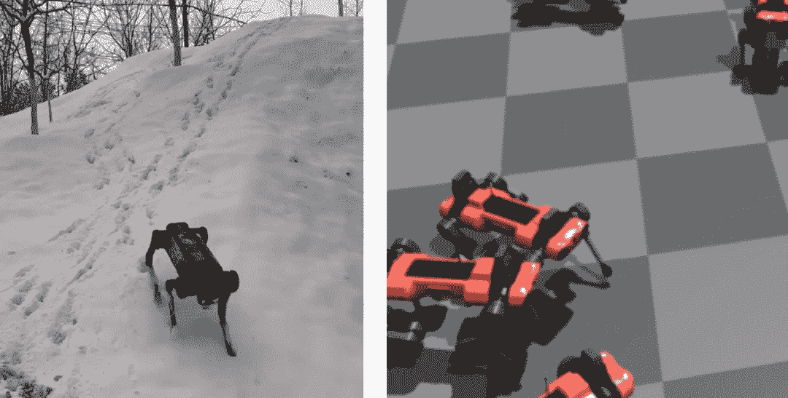
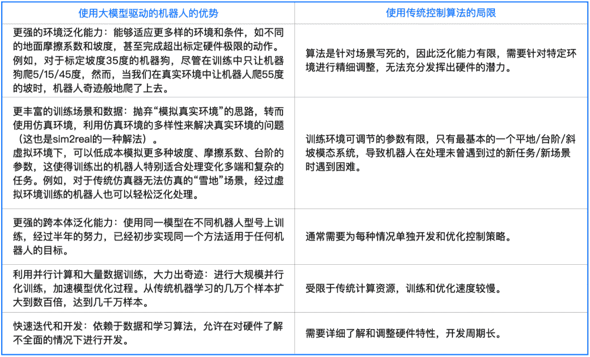
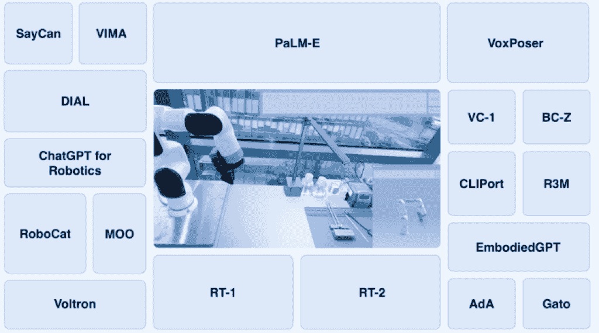
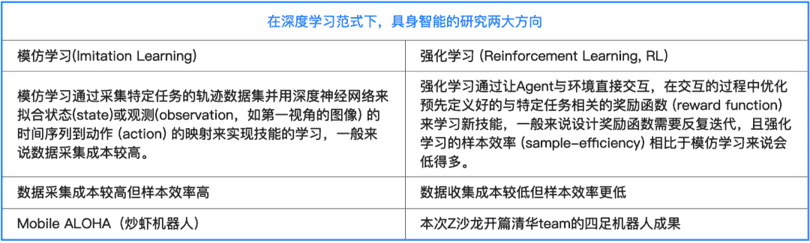
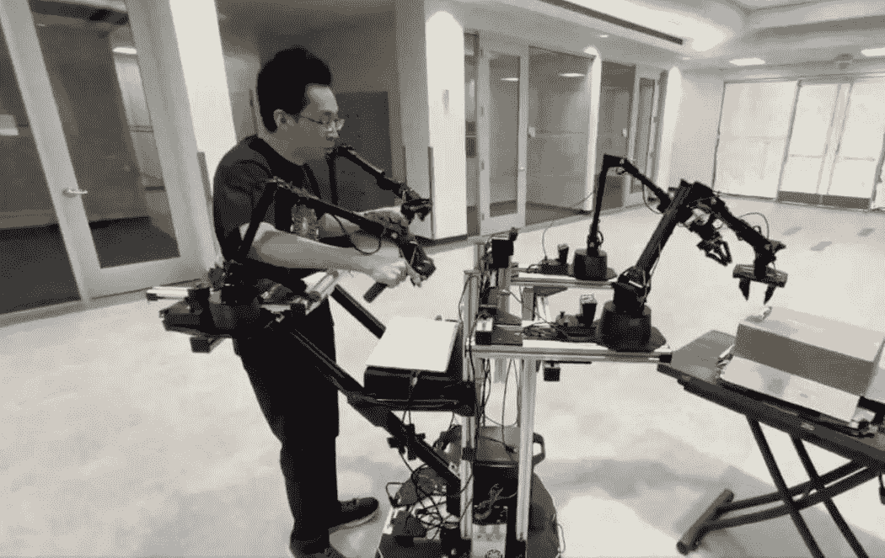
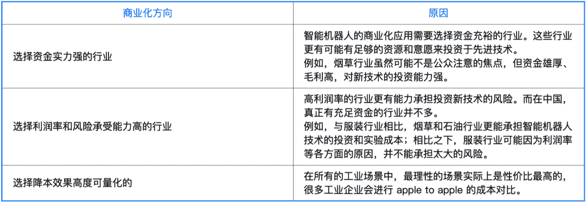
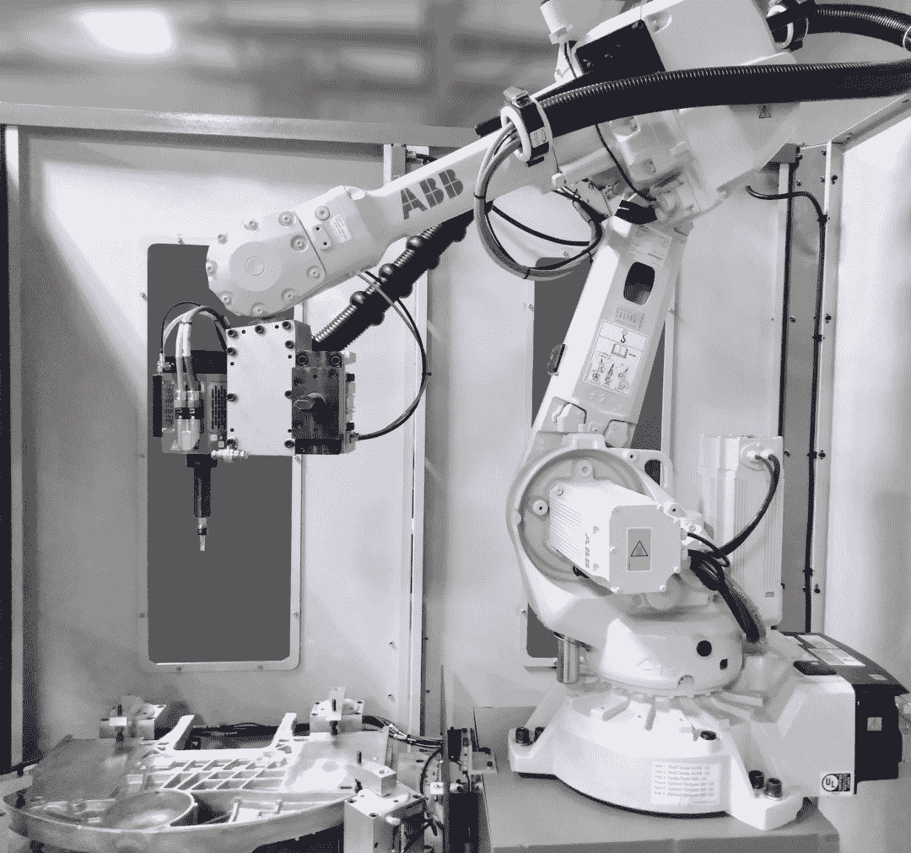

# 质朴发言：大模型时代下的具身智能｜Z 沙龙第 5 期

> 来源：[https://waytoagi.feishu.cn/docx/GZPudwlpXoq9wPxEqPMcHX53nWa](https://waytoagi.feishu.cn/docx/GZPudwlpXoq9wPxEqPMcHX53nWa)

原文链接：https://mp.weixin.qq.com/s/EHtk5IsA7bNVrW_1J5q0-A

来源：质朴发言

发文时间：2024.01.12

早在 2021 年 10 月，斯坦福的李飞飞团队发表在 Nature Communications 上的 Embodied Intelligence 论文 Embodied intelligence via learning and evolution 研究了智能体的智能化程度与身体结构的关系。

在后续接受采访时，李飞飞提到过这样一个观点：从识别图像这样简单的机器学习能力，到学习如何解决复杂类人任务，具身智能可能会迎来一次重大转变。

而 LLM 席卷全球后，将 LLM 接入机器人本体，是目前许多团队在做的尝试。LLM+VLM+机器人方案更被认为是通用知识、视觉智能和硬件操作的结合，让人看到具身智能的曙光。机器人和 AI 从业者们开始更加广泛探讨“大模型能给具身智能带来什么？”。

由此，我们在 1 月 6 日举办了 Z 沙龙的第五期：大模型时代下的具身智能，这也是首期 co-host 形式。我们有幸与光速光合的朋友们一起邀请了许多产业界和学术界的朋友来到质朴发言，碰撞思想，交流观点。

清华大学的研究人员在圆桌中分享了让人激动的学术进展，如“基于强化学习实现更强场景泛化能力的四足机器人”“精细操作上的触觉仿真，仿真环境渲染视觉效果迁移到真实世界”方向的最新成果。

也有投资人们对谈 Stanford 最新的炒虾机器人 Mobile ALOHA 主创的收获。Google DeepMind 的 RT X、Figure.AI 的场景化研究，也都在圆桌中有所讨论。还有一些具身智能从业者，和研究人员关心的点，在此罗列一些，方便大家结合目录使用：

+   对大模型驱动的机器人研究未来展望（1.8）

+   **构**建具身大模型的海量数据从何而来？Sim2Real 和超级 Simulator 是否会带来变革（3.2）

+   从业者们如何看待强化学习和模仿学习这两大具身智能研究方向（3.2）

+   **Embodied 和 interacted 的鸿**沟面前，VLM 是否是缸中之脑（3.5）

+   AI 创业者转行具身智能创业，会遇到哪些问题（5.1）

> **目录 **建议结合要点进行针对性阅读。👇

> **一、具身智能本体的形态会是怎样的？Mobility**和 Manipulation 如何实现？

> 1、具身智能的实现思路：

> 2、具身智能相比于当前的LLM，是"下一代智能“

> 3、关于如何用多模态模型实现具身智能，理想和现实的差距仍有待学术界弥合

> 4、想要让机器人实现具身智能的目标，应该从三个方面训练机器人

> 5、大模型的到来，为智能机器人的研究带来了实实在在的生产力爆发

> 6、大模型动的机器人研究 vs 传统控制算法驱动的机器人研究

> 7、对大模型驱动的机器人研究未来展望

> 8、未来4大趋势

> **二、如何定义具身智能？**

> 1、具身智能的具体定义是什么？大模型要解决的智能问题与具身智能要解决的核心问题的差异点是什么？

> 2、“人形”对于具身智能重要吗？

> 三、数据从何而来，如何构建具身智能的大脑？

> 1、关于大模型和多模态的数据泛化

> 2、数据采集和数据量问题

> 3、如何解决特定任务/特定场景问题?

> 4、结构化场景与非结构化场景

> 5、目前的VLM还是缸中之脑?

> 6、强化学习的优势及超级仿真器可能

> 四、落地场景可以畅想，但哪种最先商业化？

> 1、ToB or ToC? ToB 公司能否无缝转向 ToC?

> **五、什么样背景组成的团队堪称具身智能创业的梦**之队？工业机器人？自动驾驶？服务机器人？

> 1、机器人创业观察

> 2、硬件选代和软件迭代的区别

> 3、成本和场景价值决定创业终局

> 4、具身智能出海insights

# **#一、具身智能本体的形态，Mobili**ty、Manipulation如何实现?

一位来自清华大学的研究员为我们带来了分享：《大模型和具身智能的简单思考》

背景：在 2020 年底和 2021 年初的时间节点，尽管大模型在内部并不火热，但团队已经开始考虑将人工智能向实体发展的方向，并开始在这个方向上工作。

本次分享主要介绍了团队目前在大规模具身强化学习方法上的进展。

## **1.1 具身智能的实现思路**

在 2020 年，受到李飞飞发表的文章的启发，我们认为具身智能应该通过未来的通用人工智能技术来实现。

智能产生于具身本体、大脑和环境的耦合，这使得人工智能能够与人类一样，以第一视角与环境交互，在每个时间步得到内外部的感知数据。

具体来说，具身智能应该解决两个开放性问题：

1、第一个问题是自我认知，即你是否能够建模自己

2、第二个问题是建立自己与世界之间的关系

编者按：在 Metin Sitti 的 2021 年论文 Physical intelligence as a new paradigm 中，他提出了一个观点，即在具身智能物理层面上，柔性系统能够对周围环境的刺激做出反应。

这些系统通过自我定位、自我运动和自我感知（如本体感觉）与环境条件和身体部位的交互作用中，能够确定自己的位置，并据此采取后续行动。

这表明，具身智能不只是能够感知环境，还能基于这种感知进行自主行动。类似地，另一篇论文 Embodied Intelligence in Physical， Social and Technological Environments 也对具身智能给出了定义。

在这篇论文中，具身智能被描述为生命体基于多种感官信息自主对环境做出反应的能力。在这一过程中，生命体作为一个积极主动、多感官的个体，能够识别和调节自己与环境中发生事件的关系。

## 1.2 具身智能相比于当前的 LLM，是“下一代智能”

目前大家更关注的是大模型的发展，但我们认为，对于学术界来说，大模型领域的革命性突破的研究机会已经不多了。我们认为学界应该朝着下一代人工智能终极挑战前进：具身图灵测试。

编者按：“具身图灵测试”由 Yoshua Bengio、Yann LeCun 等学者联合发表的论文 Toward Next-Generation Artificial Intelligence: Catalyzing the NeuroAI Revolution 提出，它的核心在于高级感觉运动能力，具体包括与世界互动、动物行为的灵活性、能源效率等特征。

论文地址：https://arxiv.org/pdf/2210.08340.pdf

## **1.3** 关于如何用多模态模型实现具身智能，理想和现实的差距仍有待学术界弥合

现在的大语言模型可以理解为 AI 学习了所有人类的知识，而未来的多模态大模型可以使得机器可以真正地看到世界，但这也带来了两个问题：

第一，机器“睁开眼”看到世界后，它对世界的理解是否更深入？例如，多模态模型对猫的理解是否比单独的语言模型对猫的理解更深入？现在我们知道，这还做不到。因为现在的工作方式基本上是将模型冻结，视觉并没有真正对语言模型，对世界的理解起到实质性的作用。

第二，给出描述后，视觉是否能做得更好？这一块学界基本上也还没做到。因此，我们认为，目前的人工智能水平与理想的人工智能还有很大的差距，而真正的人工智能应该靠是能与世界进行交互的具身智能来实现。

## 1.4 想要让机器人实现具身智能的目标，应该从三个方面训练机器人

1、和人的交互，即现在的人机交互模式

2、和环境的交互

3、和其他智能体之间的交互

## 1.5 大模型的到来，为智能机器人的研究带来了实实在在的生产力爆发

虽然我们团队从 2006 年开始从事人工智能的研究，但是直到今年以前，我并不真正相信 AI 的能力。

因为我觉得 AI 只是一个软件，它只能解决 case by case 的小问题，而且其局限性非常明显。但是今年，我开始相信 AI 能够实现我们几十年来的梦想。

尽管我们的团队规模相对较小，只有六七个人，但在大模型的加持下，我们的成果却远超一些研发投入 8-10 倍之于我们的，经验丰富的大型团队。

下图是团队训练的机器狗（左图为真实场景，右图为仿真环境）：

嘉宾注：该研究成果的核心思路是大规模具身强化学习方法

观点一：训练样本的数量大幅度提高

观点二：训练任务的多样性大幅提高

观点三：见多识广的仿真提升实际场景迁移

## 1.6 大模型驱动的机器人研究 vs 传统控制算法驱动的机器人研究

## 1.7 对大模型驱动的机器人研究未来展望

AI 为传统机器人带来了理念上的重大变化，通过更复杂的场景和仿真，我们有可能实现这一目标，包括跨越我们之前的“sim2real”等概念。

不过，我个人认为，计算是更根本的问题。如果我们想实现理想中的计算，可能需要的算力比现在的 LLM 所需的算力还要大。

我感觉这可能会成为未来我们需要解决的重要问题。随着计算能力的发展，我相信具身智能将有真正的落地可能。

## **1.8 未来 4 大趋势**

1、更逼真、多样的仿真环境

2、更大规模的训练数据

3、更强大的本体计算单元

4、大模型的深度结合，实现更广泛世界知识的融入

**Q：机器人需要的“大模型”是哪种**大模型？它是怎么运用在这个机械狗身上的？

A：需要参数量适中的“多模态大模型”。

+   首先，我们需要大量并行地处理多模态数据，那么势必要采用基于 Transformer 的大模型；

+   其次，为了保持机器人的稳定性，我们还需要考虑控制频率，至少需要达到 100 赫兹才能保证控制的稳定。因此基于有限的算力，我们需要一个参数量适中的大模型

**Q**：在强化学习这个领域，关于机器狗的学习方法一直存在争议。一部分人认为不需要使用强化学习，而另一部分人则坚信强化学习的重要性，您怎么看？

A：关于强化学习的优势和劣势

强化学习的优势：足部控制能力强。经过一年的尝试和整合，我们发现强化学习在足部控制各方面的性能实际上超越了其他方法，例如让机器狗在复杂的地形上行走。

强化学习的劣势：（暂时）不擅长非常精密的控制。例如我最近看到一个老师的项目，他让机器狗背着一个盘子，上面有一个玻璃珠，机器狗可以控制这个珠子在平坦的盘子上保持稳定，这种精密的任务使用强化学习会有困难。

**也**就是说，强化学习在足部控制方面的工作表现出色，但在精细化操作，也就是 Manipulation 上，表现得会表现得相当笨拙。

Q：我们训练使用了那么多数据，有多少是仿真数据？

**A：全部数据都是仿真数据。**

在我看来，最基本的是要考虑不同的摩擦系数、不同的斜坡和不同的台阶。而并不需要去考虑具体的环境，如草地、雪地等，因为可以将它们抽象成上述这些更基本的元素。

Q：咱们团队有没有考虑继续扩展到手部操作的研究呢？

我们也尝试了强化学习，但我们观察到了一个结果，比如说，我想让机器使用灵巧的手抓各种各样的杯子，但是没有产生泛化性。

机器将所有杯子视为同一种形状，并使用同一种策略去操作，这就没有产生对形状的泛化。

我觉得这有点奇怪，因为手部和物体会产生接触，脚部和地面也会产生接触，如果它能在地面上工作，我感觉它也应该能在手部操作上工作。

A：是的，我的学生他们现在就在做手相关。这里面的关键在于，强化学习的门槛相比传统的监督学习门槛要高很多。

我们团队从 2015 或 2016 年开始做强化学习，那时候我们在一个类似于 zoom 比赛的竞赛中获得了冠军，我记得那年我们战胜了 Facebook 和 Intel。

我们自己开发的平台现在有 7000 多个 star，应该是目前最受国际欢迎的平台之一。

Q：目前强化学习的方式对于误差范围的控制能达到多么精确的程度？

我们现在遇到的问题是，我们已经开始尝试商业化，但每次的路线并不是我想要的。

**A**：在精确控制上，它与传统控制还有一定的差距，因为人工智能的优势在于其泛化能力，而劣势就是对于精确度的牺牲。

这就像大模型的创造力和幻觉一样，如果你给它过多的限制，它的创造力就会被限制。这永远是一个针对具体任务的 Trade-off 问题。

# **#二、如何定义具身智能**

## **2.1 具身智能的具体定义是什么？大模型要解决的智能问题与**具身智能要解决的核心问题的差异点是什么？

一位机器人领域连续创业者兼投资人分享了他的看法：核心差异在于具身智能需要与物理世界进行交互。

+   数字智能（大模型要解决的智能），是完全在数字世界中形成的智能。数字世界的交互比较简单（约束少），可以符合/不符合物理规律。你可以设计很多的数字世界来构建你所有可能形成的空间定义和范畴。

+   具身智能，就是具有身体的智能，它与物理世界有交互。这种与物理世界的交互带来了一系列问题，例如，我们在学习电路时，会学习模拟电路和数字电路的区别。在数字电路中，你可以有零一变量，并可以直接定义它的所有边界，它是一个具体的数值。而在模拟中，它就变成了很多的波动信号，这个波动信号中需要做很多降噪处理。这可能是从数字智能转向具身智能时面临的最大问题。

另一位投资人对具身智能的定义做了补充：

首先，如果我们将与环境交互的能力拆分开来，核心能力包括：

+   第一部分：感知环境

+   第二部分：基于环境信息进行理解、决策、判断

+   第三部分：执行操作

+   第四部分：反馈

**那**么，具身智能最近有什么大的变化呢？我认为核心变化在于第二部分，也就是对环境的理解、决策和判断，也就是“大脑”的部分有了进步。

但实际上，在其他部分并没有发生实质性的变化。因此，回到非具身智能和具身智能的问题，非具身智能相对于具身智能要简单得多。实际上，非具身智能只是大脑部分发生了变化。

一位创业公司技术 Lead 提出了不同的观点：

我并不同意具身智能一定要是物理实体，它也可能是数字实体。比如在 West World 等场景中，我们完全可以有一个 Agent 纯数字载体。

数字世界的载体同样需要去感知、交互、主动获取数据、主动犯错、主动迭代、收集和反馈。

**我**认为，具身智能的实现与物理世界和数字世界没有特别大的关系。虽然大模型可能让这个问题看到了一些曙光，但并没有完全解决。

也许更有可能的是，数字世界会先有所突破。比如，以前的非玩家角色（NPC）都是按照剧本来编写的，现在可能会更加自主、更加真实。

所以，很有可能在未来 10 年内，机器人还在原地，而数字世界已经发展得很快。当然，作为做机器人创业者的我们，肯定希望借这一波机会推动机器人的小脑发展。

另一位创业者分享了他对于数字智能、具身智能和传统智能机器人差异的看法：

**核心差异在于，具身智能在物理世界中感知环**境的难度远大于数字智能在虚拟世界的难度。我出身于清华机械专业，从研究生一年级开始，我一直专注于智能机器人的研究。

**今年人工智能的火热让我发现，这两个领域实际上有**着许多相似之处。我们当时做智能机器人的研究，也分为四个部分：感知、规划、决策、行动。第一步是先有传感。

作为机械学院的一员，我在研究具身智能时，不仅关注感知，还会深入研究更底层的传感，包括视觉传感和触觉传感。

我认为，如果你想与物理世界进行交互，那么最重要的就是你能够感知这个物理世界。这是物理具身智能与虚拟世界的一个最大区别和难点。

例如，你在虚拟世界或游戏中，可以获得所谓的“完美观测”，但在真实世界中，你需要感知和理解更多的信息，这对你的决策可能会更重要。

**我**认为，具身智能和智能机器人这两个词基本上可以视为同义词。如果非要区分的话，智能机器人可能更强调一些“本体”的概念。

例如，我们从研究的第一天开始，就会考虑到电机的扭矩负载等问题，这些都是机械工程师必须考虑的问题。

而对于具身智能来说，可能更多的是考虑如何使用大型语言模型等工具与环境交互，如何不断提升自身的能力。

但无论是智能机器人还是具身智能，我们的最终目标都是一样的，那就是希望能在现实世界中构建出一个能够自主完成各种任务的机器人或者 Agent。

## 2.2 “人形”对于具身智能重要吗？

国内外很多团队在研究双腿的模型，双腿代表了人类的生活环境，它能适应狭窄的空间。但是，我们是否应该将精力集中在双腿上？或者说“人形”对于具身智能重要吗？

一位创业公司技术负责人分享：

**对于双足问题，如果我们只考虑让机器人进入工厂，进**行流程操作，那么现有的技术其实已经足够。

但如果我们采用终局思维，也就是考虑最终的目标，我认为我们还是要向着人形机器人的方向发展。当然，如果在终局阶段我们不需要考虑地形，或者可以使用轮式机器人，甚至能跳跃的机器人，那也是可以的。

但无论如何，我们都需要考虑“足”的问题。目前，对于双足机器人，我们面临很多挑战，比如硬件难以支持复杂的行动。

例如，人在走路时，有一部分关节是直的，但机器人很难实现这一点，机器人会尽量避免这个位置。

为了避免这个位置，机器人的膝盖需要有一个巨大的覆盖范围，但这对电机来说是一个巨大的挑战。但我相信，随着技术的迭代，我们未来能够解决这个问题。

也许在未来，我们甚至可以设计出能够直立的关节。因此，我认为这并不是一个大问题。我觉得人形机器人是一个我们现在比较认同的终局目标。

除了对于人形的研究，机器人的自主装配可能是一个非常有趣的研究点。比如，马斯克计划在火星上建立基地，但我们不可能一开始就运送大量人员过去。

可能的方案是，先运送一个机器人和一些设备过去，然后在火星上建立工厂。机器人可以自主地采矿，然后用 3D 打印技术制造零件，自行装配，甚至实现自我繁殖。

这可能是一个生产力的转折点，通过这个点，机器人可以自我制造，开启一个全新的生产时代。

**一位学者分享了不同的看法：**

对于机器人而言，“双足”的代价可能远高于收益。对于双足机器人，我们知道一些动作，比如翻跟头等，可能相对简单。

然而，真正的挑战在于行走，如何保持平衡。因为在行走过程中，必须有一段时间只能依赖一个脚来维持平衡。这可能需要付出较大的代价。

我们人类需要解放双手才不得不双足行走，且经历了数千万年的进化，但是对于机器人来说，是否真的需要加上这样的双足限制呢？

如果从工业的角度来看，很多时候轮式的设计可能更有效。在一些复杂的情况下，可能四足的设计更有效。在极度越野的情况下，可能四足的设计有其优势。

# #三、数据从何而来，如何构建具身智能的大脑?

## 3.1 关于大模型和多模态的数据泛化

1、大模型并不一定是解决所有具身问题的答案。

2、我们正在进入一个新的时代，特点是数据生成和使用的速度正在加速。

3、我们需要考虑的是，我们的环境和物理环境的感知是非常重要的，这会影响我们在具身场景下对数据的理解和使用。理想状态是我们能很好地理解和使用所有模态的数据，但这些数据在过去并没有被记录下来。

4、如果硬件形态和硬件本质不同，那么获取的数据可能无法泛化的。

编者按：具身的三种核心能力，感知、决策、执行中，感知与决策关联度更加密切，这两个环节相比“执行”虽然有海量的互联网数据支持，但数据可用性上仍有不少问题。

而且使用的模型也是亟需探索的问题：如果使用单一任务的视觉大模型进行感知会丢失很多重要信息。

## **3.2 数据采集和数据量问题**

+   **在**整个工业界，我们如何看待数据？我们应该如何处理数据？如果我们要进行一些模拟，那么在实际的训练过程中，真实数据应该占多少比例才会更好？

某人形机器人公司工程师：在数据问题上，我有一个观点，OpenAI 发布了 Scaling Law，它说明了模型和数据之间存在一种对应关系。

例如，在某些情况下，一个小模型可能需要大量的数据才能训练得比较完备。然而，目前在机器人领域的数据集并不多。

Google DeepMind 在 10 月份开放了一个数据集，汇总了全球各个机构、公司和高校的各种数据集，共有 2.8 亿个 token。按照 Scaling Law 的说法，该数据集只能训练出 100M 的模型。

编者按：7 月，谷歌 DeepMind 宣布推出 RT-2：全球第一个控制机器人的视觉 - 语言 - 动作（VLA）模型。

10 月 4 日，谷歌旗下著名 AI 研究机构 DeepMind 在官网发布了，全球最大通用大模型之一 RT-X，并开放了训练数据集 Open X-Embodiment。

据悉，RT-X 由控制模型 RT-1-X 和视觉模型 RT-2-X 组成，在特定任务（搬运东西、开窗等）的工作效率是同类型机器人的 3 倍，同时可执行未训练动作。

Open X-Embodiment 数据集，这是一个由 22 种不同机器人在执行超过 16 万个任务时收集的百万级数据集。这些数据被用来训练 RT-1 和 RT-2 的改进版本模型，即 RT-1-X 和 RT-2-X，它们展示了显著的泛化能力和跨机器人学习的涌现能力。

Google 团队已经将整个 X-Embodiment 数据集以及 RT-1-X 模型的检查点（checkpoint）开源，但论文中性能最佳的 RT-2-X 模型（拥有 55 亿参数）尚未公开。

模型和数据集地址：https://robotics-transformer-x.github.io/

论文地址：https://robotics-transformer-x.github.io/paper.pdf

此前，OpenAI 首席科学家在 The Lunar Society 博客上也提到 OpenAI 放弃机器人领域是因为目前难以获取数据。

我们现在的大模型，包括 VLM（Vision-Language Models）需要大量的数据，这些数据是人类几十年来积累的。

如果我们想要训练出一个大模型，比如 GPT-4 类似的规模，可能需要几千亿甚至 1 万亿的参数。

如果想要训练出一个机器人模型，则需要更多的数据。目前，我们只有 2.8 亿的数据，而我们需要的模型大小可能达到 55 亿。

**如**果我们想要将模型的大小提升到 5 万亿级别的，如果我们每年的计算量和模型大小都翻两倍，那么我们可能需要 8 到 10 年的时间。

因此，我认为数据问题是一个关键问题。我们可能需要通过某些方式来解决这个问题。如果我们依赖数据的规模，那么我们可能需要更多的时间。

如果想要将视觉数据加入到我们的模型中，可能要过三年。如果要将机器人的行动数据加入到我们的模型中，可能需要再过几年。因此，我们需要考虑时间问题和选择正确的路径。

最近，我与一些海外的华人教授进行了讨论，他们认为我们可能过于乐观，认为在数据问题上仍有很长的路要走。同时，如何收集数据也是一个重要的问题。

+   端到端模型是否会是终局？

**从 AI 的角度来看，我们一直在观察多模态模型，以及是否**会进化到具身的单一模型，这些都有待考量。

大家可能认为端到端大模型是终局，但实际上这个终局可能是无法实现的。例如，VLA（vision-language-action）模型的 Action 最终 Action 到什么程度。

如何获得一个足够强大的 Vision 模型都是未知的，可能我们还无法定义模型的终点是什么。

编者按：基于深度强化学习的端到端（End-to-end）的控制架构是自动驾驶领域中新兴的研究热点，它能克服传统方式依赖先验环境建模的问题，可以直接实现通过从感知到控制功能的映射。

在大模型领域可以理解为：一个 AI 模型，只要输入原始数据就可以输出最终结果。Google的 RT-X 系列专注于机器人 High-Level 决策问题，其中就使用 Transformer Model 进行端到端训练。

## 3.3 如何解决特定任务/特定场景问题？

大家在做的大部分工作，**无论是 Sim2Real 还是模仿学习，在环境感知——任务规划决策——最后执**行这三个环节中，其实更偏向后两者。大部分的工作与大脑没有关系，而是基于环境感知。

GPT-4v 和 Gemini 想解决的是一个通用场景，这需要面对同时面对常识问题和生活场景问题，这对于大模型是完全不同的问题。

**语言模型中包括的人类公共知识不包括生活中的细节**或者说小脑知识，比如人想喝水，如何拿水。

如果只是一个现实场景的问题解决，需不需要做那么方案性的事情？如果想做通用的端到端视觉模型，可能效果也不想预想的那么好。

但如果我们只是解决一个特定场景的模型，那么数据量或者压缩率说不定就会很高，这会更容易对齐。

也可以作为多模型的一个协作，用一个类似的方式去更好地优化它的鲁棒性。这可能也为我们提供了一个 bottom-up 和 top-down 的思路，去解决通用的问题。

投资人与 Mobile ALOHA 主创 对谈所得：

Mobile ALOHA 模型在某些任务上达到了 80%的成功率，但在某些任务例如炒虾只有 40%的成功率。

他们发现，如果数据量足够大，成功率会很高，但如果数据量较小，失败率会很高。他们也不能做到泛化。

这就引出了一个问题，我们是否真的需要去做到所有的场景？在他们的数据中，有一个重要的点就是，他们必须使用特定的夹具，这也是一个问题。

编者按：Mobile ALOHA

早在 2023 年 4 月，Stanford team 就发布了一个名叫 ALOHA 的低成本开源双向远程双手远程操作的硬件系统，整个硬件系统成本不到 20，000 美元，能够执行 RAM 插入、动态任务（乒乓球颠球）以及接触丰富的任务（如穿鞋）。

2024 年 1 月，Zipeng Fu 与 Tony Z.Zhao 等人发布了 Mobile ALOHA 的视频包括这个系统移动完成使用咖啡机、浇花、炒菜等多种任务。

Mobile ALOHA 是一个经济实惠的系统，它允许用户通过全身远程操作来收集数据。这种设计使得系统更易于普及和使用。

Mobile ALOHA 利用模仿学习技术，通过观察人类的演示来训练机器人执行复杂任务。通过每个任务 50 次演示，共同训练可以将成功率提高到 90%，使 Mobile ALOHA 能够自主完成复杂的移动操作任务。

🌟该机器人的软硬件全部开源

项目及演示：mobile-aloha.github.io

学习代码：github.com/MarkFzp/act-pl…

硬件代码：github.com/MarkFzp/mobile…

论文：mobile-aloha.github.io

A Day of Mobile ALOHA

遥控操作演示 by @litian_liang

我也向 Mobile ALOHA 主创提出了一个问题，如果我们使用 YouTube 上的视频或者第一人称视角的视频作为模型的基础数据，这是否可行？

他们告诉我，这是不可行的，至少是人采用夹具的数据。这就引出了一个问题，即在机器人或具身的场景下，我们如何确定哪些数据是有效的？

我注意到我们并未讨论这个问题。在某些特定或 niche 场景下，可能并不需要那么通用的数据，而是需要与场景相关的数据，比如家具或工业场景的数据。

这种情况下，数据量并不需要特别大，只要有足够的样本数据，就能达到很高的准确率。

**如**果我们采用类似于解决 bug 的方法，即使用少量的数据和模仿学习的方式，可能就能解决机器人数据的问题，而不是做通用的功能。

这种场景主要解决的是决策能力，而这个能力可以通过大语言模型深入学习知识体系来提升。

**总结一下：虽然现在的机器人具有一定的**泛化性，但这种泛化性做得相对较差。比如，现在的机器人只能端一种盘子，只能盖一种盖子，只能用一种铲子。

但推椅子可能所有的椅子都能推的进去。逻辑上这是一种和人一样的类比思维，如果没有完成类比的时候，机器也就无法泛化。

但在工业或家庭环境中，许多习惯和物品都是固定的，我们是否可以通过这种方式解决数据通用化的问题？

**其他投资人及创业者补充发言：**

目前很多团队在研究 Agent，最新的问题之一是 Agent Tuning，从底座拆分是有三个问题：

对于 ALOHA 这类技术解决现实问题的考虑：

1、传统工业场景存在节拍和固定流程，很难替代。

2、工业节拍弱，但附加值高的场景，适合 ALOHA 这种模仿学习+数据来解决专用场景问题。

## 3.4 结构化场景与非结构化场景

我们在与国外创业者及科研团队交流过程中，得出一个共同的认知是：大家会认为这个数据在现**在这个阶段做泛化的话第一是量不够，第二是质量不够好。

**我们上一代的硬件逻辑都是在一个高度结构化的层面上进行的。我们不能预测所有的输入，这是一个问题。我们都在努力实现第二步：一个完全非结构化的场景中寻找落地和实现的方法。我们认为，在未来几年中，可能会实现商业化落地的成本还是一个半结构化过程，什么是半结构化的场景。

我们把一个产品分为两部分：你想做什么，以及你在这个过程中的环境是怎样的？如果这两件事都可以预测，那么这个场景可以被称为一个完全结构化的场景。

但是，如果在过程中有很多不可预测的因素，这个场景就不是完全结构化的。所以，我的结论是，如果我们现在在讨论数据的问题。

那么，对于一些在结构化场景中无法处理的边缘情况，我们实际上有足够的数据来处理这些情况。所以我认为，最近可能会看到这样的落地实现。

我之前提到过一个简单的例子，即拉门的动作。由于门两侧的压强不同，拉门时会有一个瞬间的巨大阻力，这与我们推木门所需的力量完全不同。

如果你想让一个机器单独实现这样的动作，但又考虑到这是一个非结构化、不可预测的任务，那么机器可能无法完全实现。

甚至在原型设计时，机器可能无法达到预设的能力。这可能会限制我们在非结构化场景中的应用。

## 3.5 目前的 VLM 还是缸中之脑？

我在思考 VLM 问题，即使我们假设人类的炒菜或抓取物体等技能可以完美实现，并让 VLM 作为一个中枢去炒菜，他也可能无法做好。

即使我们用语言指导他拿起锅和铲子，进行炒菜的动作，他也可能无法做好。目前，我们的训练主要依赖海量的互联网视频、文本和图像数据，但很少有真实场景中的交互数据。

比如，我看到这个场景，我的手在这个位置，我不能往前碰，否则会碰到电脑。网络上很少有这样的数据，因此在数据方面，互联网数据和实际操作数据之间存在很大的差距。

即使是最强大的 GPT-4v，也难以填补这个差距，无法完全部署到实际操作中去。Embodied 和 interacted 的数据还存在巨大 gap。

那么强化学习是否像我们想象的那样对数据量要求降低了呢？

其实也未必如此，强化学习需要开始在仿真环境中尽量见多识广。

我们也提到过，强化学习和大模型的结合可能会降低对数据量的需求，但主要在模拟环境中。在仿真环境中，对真实数据的需求其实降低了。

我们希望在保持环境的同时，能够尽量减少对大量数据的依赖。在机器人操作任务中，高精度操作如拧螺丝钉或拿起扁平物品（如笔或纸）是复杂且具有挑战性的。

强化学习虽然有助于解决这类问题，但更关键的是模型需要具备高度泛化能力，而不仅仅是精确执行特定动作。

在执行任务时，安全性也是重要考虑因素。例如，拿起杯子时，机器人需要确保以正确的方式操作，避免错误地拿起无法站立的杯子。

尽管在小范围场景中，通过与相关人员合作和实验，可以较快地实现特定任务，但要达到更高泛化性的任务执行，仍需进一步研究和实践。

## 3.6 强化学习的优势及超级仿真器可能

强化学习的一个最大优势是可以在模拟器里面收集无限的数据。模拟器里面的数据是无限的，包括英伟达的、物理虚拟引擎、游戏引擎，这里有无穷的数据资源。但这些数据可能并不那么好用。

如果我们要做物理交互的任务，那就需要物理引擎特别逼真的数据。如果是视觉为主的任务，比如说炒菜，那就需要视觉做得很逼真的数据。每个任务和数据需要有一些更强关系。

编者按：NVIDIA Isaac Sim：是一款可扩展的机器人模拟应用与数据合成工具，可提供逼真、物理属性准确的虚拟环境。在 NVIDIA Omniverse 的赋能下，NVIDIA Isaac Sim 能够使世界各地的开发者和研究人员能够针对各种任务训练和优化 AI 机器人。

如炒菜这样的任务，有许多需要讨论的细节。炒菜涉及多种物理属性，如滑动的水分、软质的食材等，这些物理特性并不容易模拟。

我的一些同事在进行物理仿真的研究，他们深知仿真的复杂性和前沿性。虽然可以在特定任务上做出精细的仿真，例如流体动力学或气动模拟。

但当我们尝试将这两种仿真技术结合时，可能会遇到大问题。因为这些仿真技术是特定的，为特定任务设计的。

炒菜的复杂性在于它涉及到多种模态，这些模态都需要被模拟。例如，触觉模拟是一项挑战，如果要模拟光触觉，那就需要对柔性材料进行准确的模拟。

然而，柔性材料的模拟仍然存在许多问题，有许多模糊的内容需要处理。所以，如何构建一个强大的仿真器是一个关键问题。

我们如果能够构建出这样的仿真器，那么强化学习将会有巨大的进步。我们人类的感觉占据了大部分的皮层，例如视觉和触觉都需要大量的计算能力。

所以超级 Simulator 是 game changer 吗？如果我的仿真器做得比别人强，但还没有达到几乎没有差距的程度，它能否成为改变游戏规则的因素？

我认为，如果你的仿真器做得足够强，那么这条路是值得下注的。肯定是要押注相关产业最强的几位科学家。

但是，只有当你真的能改变游戏规则，才能被认为是成功的。这需要我们能够做出真正接近现实的仿真。所以这个问题很难立即回答。

**清华某具身智能相关科研团队发言：刚刚大家提到仿真器在视触觉的仿**真还不够好。这确实是之前的问题，但我们最近已经做了一些工作来改进这一点。

**我**们的研究已经实现了在精细操作上的触觉仿真，并且能在仿真环境中渲染出 90%以上的视觉效果，然后直接迁移到真实世界。我们认为，解决实际问题确实会面临许多挑战。但如果你对现实世界的基础模型有深入理解，那么你可以解决一些问题。

然而，也有一些问题我们可能无法解决。例如，现在还没有任何仿真器能够模拟打鸡蛋或者切肉这样的操作。这些任务可能需要模仿学习的帮助，或者在模拟器中实现真实感觉后，再在真实环境中进行操作。那么，我们应该把精力放在模拟器的逼真度上，还是在实际操作中？

这取决于你想要做什么。对于同样的任务，比如操作或抓取任务，我们认为可以通过模拟钢体和软体来实现很好的同步。

但如果涉及到复杂的液体或凝胶，如炒菜，物理形态的模拟可能就会变得非常困难。在这种情况下，我们认为应该在视觉上进行环境模拟。

**Q**：目前也有一些团队都在做 Sim2real，还有团队在做模仿学习。像刚体这样的问题上，模仿学习也可以应用，你们有没有一些交集的案例？

对于任务的交集，或者是任务的能力，都可以讨论。有没有一些任务两者都可以达到相对较好的效果，甚至可以互补？有没有这方面交集的一些案例？

A：**对于特定的机器人和特定的场景，模仿学习是很好的方法，如 ALOHA。**比如说，如果我有一个特定的机器人，在一个特定的场景下，它能够快速地完成很多任务。

但如果我们想要实现一个泛化的策略，让机器人在不同的厨房，使用不同的锅和灶，实现一个通用的策略，那么在这种情况下，Sim2Real 可能是更低成本的方法。

对于模拟方法，我认为应该结合随机参数和适应性调整。如果你的数据已经很好，那么你可以直接使用它。

但如果你不能做非常暴力的 randomization，那么你可能会导致策略的失效。如果你只做 domain adaptation，那么换一个环境可能就不行了。

所以，我们认为，你需要一些少量的数据，来帮助你知道你需要在怎样的合理范围内做这个 recommendation。

编者按：在机器学习中，通常会将训练数据集和测试数据集看作是从同一个数据分布中独立采样得到的。但是，在实际应用中，测试数据往往来自于与训练数据不同的数据分布，即不同的领域（Domain）。

这种情况下，模型在测试数据上的表现往往会大幅下降，因为训练数据没有覆盖到测试数据的分布。

为了解决这一问题，国内外学者在如何将源域的知识传递到目标域以改善目标域的预测效果等方面进行了许多探索。其目标是找到源域和目标域之间的桥梁，将在源域学习到的知识迁移到目标域，增强在目标域的预测效果。

解决这一问题的方法称为领域自适应（Domain Adaptation，DA）。领域自适应作为迁移学习的一种，其主要解决的是源任务和目标任务相同，但是数据分布不同的问题。

# #四、落地场景可以畅想，但哪种最先商业化?

**创业往往是先从解决一个小而痛的问题开始**，然后不断扩大边界。这个起点应该是什么？

我们现在已经看到了一些落地的答案：比如：药店的上下货、家里的 3D 清洁、药品试剂摆放等等。我们已经有了一些答案，但是还有很多问题等待我们去解答。

一位机器人创业者分享了他的商业化落地心得：

我的背景是在跨国消费品负责销售与市场相关的工作。我的项目是基于解决我在过去二十年的工作中一直无法解决的问题：如何在消费品行业中，在线下零售店内有效推荐商品？

我认为，尽管很多人都说线下零售业务都要转移到线上，线下的生意未来会越来越困难，但实际情况可能并非如此。

如果从宏观角度来看，中国的社会商品零售总额每年超过 40 万亿，其中 30%发生在电商，70%发生在线下。

然而，如果我们将视角扩大到全球，美国的电商只占 11%，欧洲可能只有 8-9%，日本可能更少。

在中国，线下零售业的从业人数超过 7000 万人，所以这个 30%和 70%的界限，中国未来不太可能再有大的突破。

另一方面，人作为高等生物，我们的社交需求和对体验的追求是持续存在的，这需要线下零售业务的存在。

从大环境来看，线下零售是大模型应用的一个重要场景。在这个场景中，有一些刚需的商业机会。

比如在一个零售店内，同一品类（如化妆品）会有多个品牌在同台竞争。这时，每个品牌之间存在两个刚需：

**1、吸引消费者进店。**假设在我们的零售店内，共有 10 个品牌都在销售防晒霜，我的首要任务就是将其他 9 个品牌的消费者吸引到我这里，让所有进店的消费者，在购买防晒霜时都先来看一看我的产品。

那如何解决这个刚需呢？我们的解决方案是使用三维全息显示技术，例如设置一个显示屏或者全新的机器人，无论是固定的还是移动的，通过这种方式，我可以确保消费者在进入这个区域时。

首先看到的是我的产品，解决了第一个痛点。而且这个解决方案需要强大的技术壁垒，如光学新材料，目前我们已经拥有了最好的技术。

**2、商品推荐，消费者教育。**这个时候，大模型的多模态交互就能发挥作用。因此，我们的创业项目就是从线下零售场景切入，利用三维全息显示和大模型的多模态交互，为用户打造一个沉浸式的购物体验。

**我们有两种形态的解决方案：**

一种是可移动的机器人，底部是机器人底盘，上面使用三维全息显示技术。我们使用的薄膜是一种光学新材料，贴在 2D 的显示屏上，以此来显示出裸眼 3D 的图像。这种方式效率非常高，可以展示各种形象。

比如，当我们推荐一款奶粉时，我们可以说这款奶粉源自天然牧场，同时，机器人会以三维全息的方式显示出天然牧场的景色。

第一种方案适用于空间较大的零售店，比如 Prada、LV 或爱马仕等。但是，如果在空间相对较小的超市里，我们会使用一个 32 寸的液晶屏，上面贴上我们的新材料，并结合 3D 算法来呈现出裸眼 3D 的形象，作为导购和引流的工具。

## 4.1 ToB or ToC? ToB 公司能否无缝转向 ToC？

**一位投资人分享：**

关于 ToB 和 ToC 的问题，我认为，虽然大家都认为通用机器人最具想象力的应用场景在 ToC，但是 ToC 需要更多的泛化性。

而在很多工厂中，其实并不需要那么多的泛化性。为了落地，很多人都是先从 ToB 切入一个点，因为 ToB 有更具体的场景可以做。

一位投资人分享了他对于大湾区制造业的观察：

我们的公司位于广州，覆盖了大湾区，包括佛山，这是一个集中了大量工业化生产，包括机器人和手机等的地方。它们既有制造机器人的，也有使用机器人进行生产的。

智能裁剪技术，市场很大，工厂欢迎，但需要有敢于吃螃蟹的人形成标杆效应：举一个例子，当他们需要设计一款服装，从设计到打板，再到样衣的制作。

这个过程中会遇到很多问题，比如，设计好的服装在模特或者人身上试穿后，可能会发现布料的垂感不对，需要再次调整。这个过程中，大量的手工活被机器人替代，可以实现小单快返，例如来自 Shein 和网红几百件的定制化小订单都可以出。因为他们在前期使用了很多的打板师和缝纫师在工作，每天都在做这些工作。广东的很多服装厂，他们都给我们提出了这个问题，所以我们带着这个问题去寻找解决方案。

这是一个 10 万亿的市场，具体的需求量很大，但是需要找到愿意尝试的人。有少数几家愿意用自己的工厂来做这个实验。这几家公司都是二代准备接班，所以他们愿意尝试新的事物。

他们的想法是：如果能让优秀的裁剪师使用，哪怕需要 5000 次的试验，只要能解决这个问题，然后泛化到更多的机器人，那么这些厂家都会愿意尝试。

一位研究员分享了他对于智能机器人的商业化的研究成果：

接下来，大家分享了一些当前正在落地的 ToC 的商业化场景：

1、家用清洁机器人：扫地机器人，这是一个很成熟的 ToC 场景，机器人在家庭环境中执行日常清洁任务，只需要用到比较强的足部控制能力，即可实现商业化落地。

2、智能监控/跟拍机器人：例如用于记录孩子成长过程的机器人，它可以跟随孩子并记录视频，让父母在与孩子互动的同时进行拍摄，解放了父母的双手。

3、自动化厨房机器人：国内某家电公司正在研究全自动化厨房方案，使用自动化设备+机械臂，洗菜机等设备。用这个机械臂把放菜，按一个按钮，把炒好的菜端出来以实现烹饪过程的自动化。

# #五、具身智能创业的梦之队会长什么样？

在我们进入第四阶段时，我们需要考虑什么样的团队最能完成这个任务，实现具身智能。我们看到市场上有各种各样的团队，有工业机器人团队，自动驾驶团队，服务机器人团队等等。因此，我们需要研究哪个团队最适合来完成这个任务。某基金投资人，前机器人创业者分享：

## **5.1 机器人创业观察**

我自己是上一波自动驾驶和机器人创业浪潮的参与者，曾经制造了一个与自动驾驶车相似的机器人，然后进行了一次迭代，使用了复杂的 SLAM 技术，16 线激光雷达和各样的传感器。

最后制造出了这样一个机器人产品。我后来经常反思一个问题：为什么上一波的机器人创业大多数都失败了？但是像云迹科技却最终坚持下来了。

在我看来，第一个就是我们产业的问题，就机器人产业、汽车产业和手机电脑产业，会有一个横向对比。

我们总认为从过去 20 年就投资人都很喜欢机器人，每年都在投各种各样的机器人。但是大家有没有想过其实在相比这三个产业里面，后两个产业的总产值和总价值要远高于机型产业。

从 ABB，KUKA 这些老牌的工业机械臂厂商，后来没有再出现特别大规模的公司。石头科技、优必选可能算是很大的企业，但也没有特别大规模。

其实很重要的一个原因是因为机器人本身是在工业产业的这个形态里面是“替代”，从工业制造的基础设施到 c 端的应用其实中间会有 gap。

然后用通用方法其实是解决不了，那这个时候其实面临的问题其实是今天很多从 AI 创业者转型而来的人会遇到的。

## 5.2 硬件迭代和软件迭代的区别

机器人产业既无法摆脱传统制造业的问题，同时又需要 AI 的人才。因此，我想与大家分享一个观点：

**硬**件思维和软件思维在这个行业中是非常重要的。许多做 AI 的人讲究快速迭代，但硬件的迭代速度不会特别快。

比如在与 ALOHA 主创的对谈中，我们聊到未来 ALOHA 这个产品肯定要加触觉，如果增加触觉后，整体的学习策略是否需要大变？

他们正在考虑如何设计硬件才能让软件迭代具有可行性及可持续性。这是一个我们需要注意的问题。

如果你是做软件或 AI 的，你可能会想尽快迭代，软件可以一个 bug 一个 bug 改，做 AB testing 但硬件需要更深思熟虑，你的硬件是否具有通用性。

或者说你的硬件是否考虑了在这个场景下已经有足够多的未来的想象空间，否则你可能会陷入我们曾经创业遇到的困境。

作为一名创业者和投资者，我在审查项目时，总会询问创业者是否考虑过他们的算法与硬件的关系，以及他们是否具备硬件思维。这是我认为每个创业者都应该关注的重要问题。

## 5.3 成本和场景价值决定创业终局

另一个关注点是成本和场景价值。举例来说，我们曾经制造的一款机器人，成本近 20 万，售价 40 万，主要用于园区内的一氧化碳氨气泄露检测。

这种场景下，由于一氧化碳氨气泄露可能造成人员危险和工厂停工，损失巨大，因此客户愿意支付高价购买。然而，有多少工厂或场景能承受这样的价格呢？

**许多创业者认为硬件成本一定会下降，但实际上，硬件本身**的成本是下不去的。这是许多人忽略的问题。

因此，我认为创业者一定要清楚地认识到，你必须找到一个场景，其价值大于你的成本。

比如说，有许多人做厕所清洁的机器人，你现在来替代保洁，你大概率在接下来的三五年内你会失败，但你未来 5-10 年你肯定会回来。

那你为什么会在今年开始创业？那你不是选错时间了吗？你应该选择五年之后开始创业。很多创业者只是想说我有这样一个技术，有这样一个产品，然后来做这个事情。

但你根本没想起你这个产品的价值，很可能你做了一个 10 年后的事情，但你可能在 5 年后你就失败了。所以我觉得在创业者涌入具身智能创业的时候，至少避免去产生这种情况。

最后，关于 learning based 还是 model based 的问题，我此前一直在思考：底层感知、控制、上层决策有哪些东西是要用 learning 的方式去做的。

因为 learning 伴随着概率问题，但有很多是不需要跟物理世界真实接触其实是不需要概率的，所以端到端的去打通，我觉得可能并不是一个最好的策略。

应该是很多需要泛化的决策，可能要用 learning based。但是有些在末端的执行组织需要的更多的 model based。

我之前提到的具身智能是与物理世界互动的一种方式。因为与物理世界交互，你就无法像在数字世界中那样实现零延迟。

你的计算量越大，延迟就越大，这在实际操作和执行中会产生误差，这个误差通常是由物理零部件和物理带宽的影响导致的。

实际上，许多问题可能可以通过简单的 model based 的方法解决，只需要在决策层面加入 learning based 即可。

1、未来 20 年，汽车和手机电脑产业可能面临变革，投资于上游产业链，如 5G 和电机，以及具身能力相关的技术，可能是创业的新机会。

2、在机器人设计中，应优先考虑脑、手和眼睛的协同运作，而不是过分专注于腿的研究。手和眼睛的协同对于感知和操作至关重要。

3、具身智能带来的新变量，如电子皮肤和六维力传感器，可能在末端关节处提供更多信息，为产业链带来新的机遇。在产业链中，从基础层面到上游，都有潜在的创新空间。

## 5.4 具身智能出海 insights

**1、出海机遇：**国内机器人产业应考虑出海，尤其是 ToB 行业，国内硬件供应链优势强，海外市场对机器人的需求迫切且成本价值更高。

**2、出海准备：**创业者需评估自身是否具备出海基础，如熟悉海外市场，且需有深入了解海外市场的能力。

**3、市场差异：**海外市场与国内市场在工作节奏、客户交流方式等方面存在差异，创业者需适应这些差异。

**4、实地调研：**与海外客户深入交流，了解需求，是开发成功产品的关键。

**5、市场成熟度：**随着市场成熟，海内外都会有更强的团队出现，竞争将更加激烈。

**6、海外市场研究：**了解海外咨询公司和智能公司的实际情况，如出货量和活动范围，有助于更好地理解市场动态。

具身智能目前仍在寻找合适的商业化落地场景，本次 Z 沙龙中的学者和创业者们也在做各种不同的尝试，也期待未来有更多从业者加入进来，拥抱具身智能浪潮与变革，最终实现更广阔的愿景。