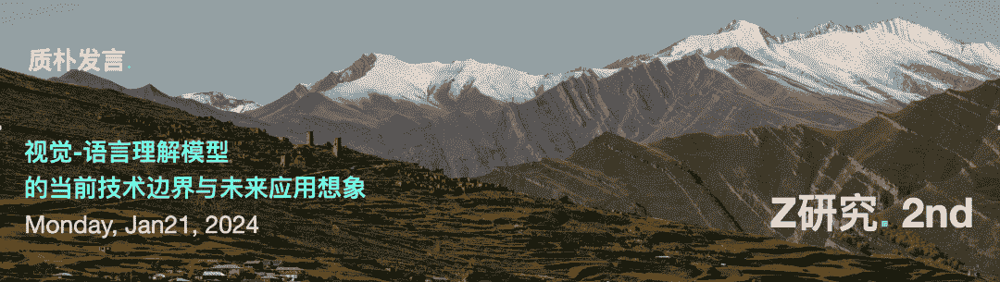
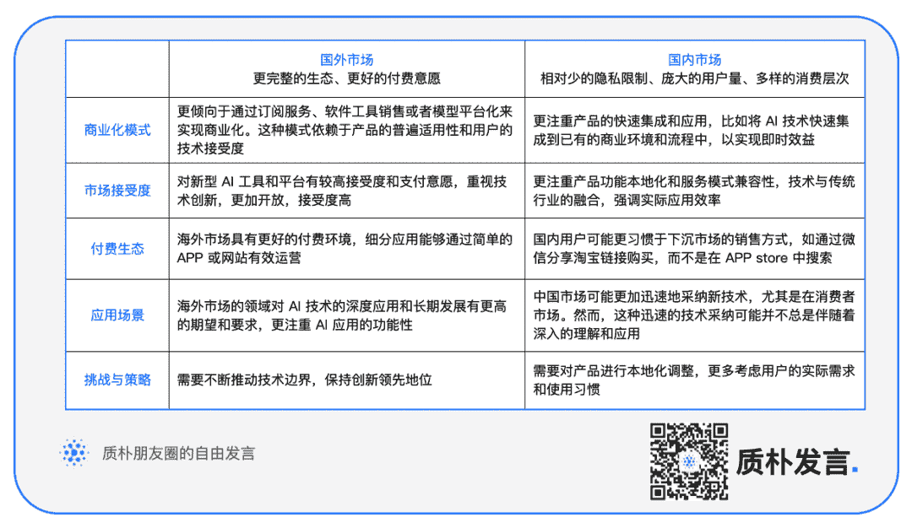
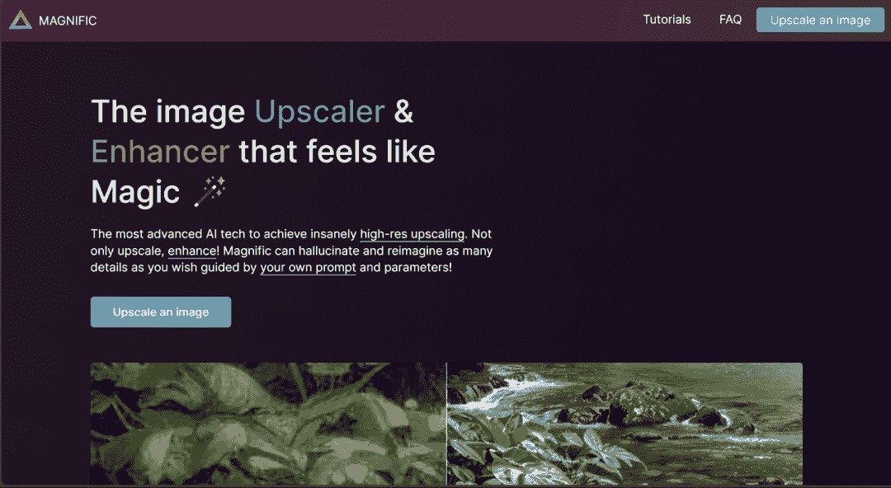
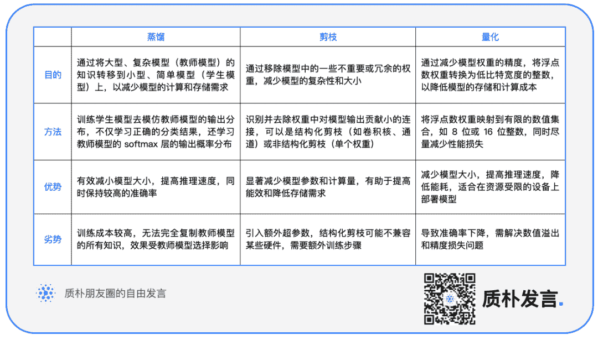
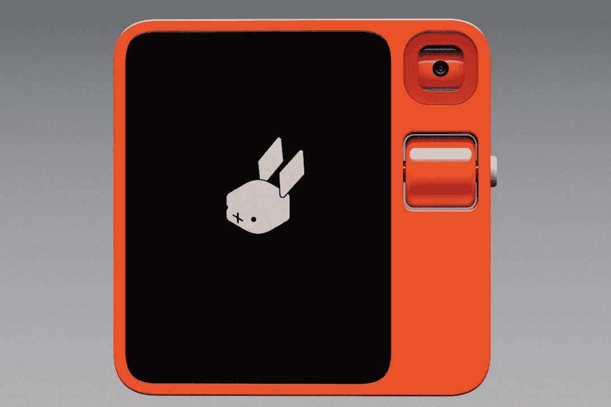

# 质朴发言：期待地搓手手：多模态大模型的 GPT 时刻｜Z 沙龙第 6 期

> 来源：[https://waytoagi.feishu.cn/docx/YjGNdfLxYoJKedxxC3gcNMownIg](https://waytoagi.feishu.cn/docx/YjGNdfLxYoJKedxxC3gcNMownIg)

原文链接：https://mp.weixin.qq.com/s/oMJXjcx9sJs-KVJ5-eWxMg

来源：质朴发言

发文时间：2024.02.01

编者按：2024 会是技术变革的关键一年，可以预见：Gemini 将揭开神秘面纱，卷到飞起的理解、生成模型又要迎来一轮爆发，在 B 端的落地场景也慢慢清晰。

还有许多我们不可预知，或者是非共识的，比如视频生成的技术路线是否收敛，比如数据问题中数据标注自动化及合成数据究竟效果如何。

在 2024 或不远的将来，或许人类会迎来多模态的 GPT 时刻，我们希望大模型能够真正理解世界，也希望其能给人类输出更多样化的内容，赋能教育、医疗、电商多个领域。

1 月 20 日，我们有幸和**创新工场**一起 Co-Host 了 Z 沙龙的第六期“多模态大模型技术的进展及应用”，也邀请到模型厂商多模态研究人员，AI 大厂科学家，投资人，创业者身份的多位“质朴同学”碰撞观点，贡献想法，并把想法留存，希望未来，我们的畅想变成现实，预言最终成真。

> **目录 ****建议结合要点进行针对性阅读****。👇**

> 一、多模态模型算法：模型架构和数据困境

> 1、多模态模型的技术架构

> 2、多模态模型的数据问题

> **二、多模态模型的商业化落地**

> 1、2B 还是 2C？国内还是出海？

> 2、多模态模型在不同市场的应用

> 三、未来，多模态的 GPT 时刻

# #一、多模态模型算法：模型架构和数据困境

## **1、多模态模型的技术架构**

**技术分享**

3D 模型、图像和视频可能会融合成一个统一的模态。举例来说，从一个截面观察杯子的移动，这可能是内容上的一个维度变化，从而形成一个空间维度的变化。

视频编辑本质上是连续多帧的编辑，而这种编辑过程与 3D 模型的空间变化相似，因此我们可以推测这三种模态的未来可能是融合的，既能够生成视频，也可以生成 3D。

编者按：

**我们可以简单地理解：视频 = 二维图片 + 时**间维度；3D = 二维图片 + 深度维度

在视频理解与生成以及三维模型生成这些领域，研究人员经常按照这个思路，将二维图像转换或提升到三维。

目前，3D 生成的主流两种技术路线是原生 3D 和 2D 升维，原生 3D 指的是使用 3D 数据集进行训练，从训练到推理都基于 3D 数据;

2D 升维指的是从二维图像出发，通过创建深度图、立体生成和未覆盖区域的重建等步骤，将二维图像转换为具有深度感的三维表现。

插播一条预告：质朴发言 Z 研究分支的下期主题正是 3D 模态模型。

3D 模型的一个重要特性是视角不变性，这意味着无论从哪个角度观察一个三维对象，其基本结构和特征都保持不变。

3D 模型具有的强大先验性，即从不同角度看到的状态之间存在因果关系和一致性，使得物体的变化一致，而不像是视频更像是一种概率的推测。

例如，一个图像上的大杯拿铁标签在视频中可能会随着物体的转动而消失，而在 3D 模型中，物体的形状是恒定的。

因此，你会发现如果我们的模型既支持 3D 生成，又支持视频生成，那么它就可以实现图文编辑以及具有强一致性的视频生成。

**我**们认为接下来，Open AI 会尝试把图片、视频、3D 变为一个自然空间。在这种情况下，我们不需要去区分当前的对象是哪种模态;

只需要训练一个模型就能实现文生 3D 或者文生视频，实际上 Google 的 VideoPoet 已经在这个方向上有很多尝试，但其分辨率还不够高。

编[一文纵览文生图/文生视频技术发展路径与应用场景｜Z 研究第 1 期](https://waytoagi.feishu.cn/docx/XCiodvb1koHXO1x2X9ac6tiJnfe?from=from_copylink)按：我们对于 Google 的 VideoPoet 及相关生成模型进行的详细的分析，信息补全请戳👉

人类与外界的交互是并行的，我们不仅仅是简单地接收信息然后回应，而是同时进行信息的接收、处理和回应。

Transformer 架构的多模态模型给机器提供了一种像人类一样与世界互动的新机会，让 AI 也有这种输入和输出的并行能力，这将推动实现 AI 与人世界的无缝沟通。

另一个，更前沿的概念是杨立昆（Yann LeCun）提出的世界模型，从学术研究的角度来看，这可能将会成为近一年值得关注的研究点。

编者按：

杨立昆（Yann LeCun）提出的“世界模型”基于这样一个理念：为了让 AI 系统更接近人类智能，它们需要能够构建和理解一个关于世界如何运作的内部模型。

这种世界模型的概念使 AI 系统能够更快地学习、规划并完成复杂的任务，并能够适应不熟悉或未知的情况。

它赋予了 AI 系统更高级别的认知能力，如情境理解、长期规划和复杂决策。为了实现这一目标，杨立昆提出了 JEPA（Joint Embedding Predictive Architecture）的架构，通过层叠的方式进行更抽象、更长期的预测。

**创业者分享**

3D 技术不仅是对静态物体的描述，更重要的是动作和行为的模拟。而动态表达的关键在于如何使 3D 模型在虚拟空间中自然地移动和互动，这需要复杂的算法和精确的数据支持。

动作生成领域数据的匮乏，特别是与语言模型相关的文本数据对，更加稀少。因此如何用小量数据、低成本训练好模型，是创业团队需要算好的一笔账。

我们在探索一种模型结构，类似于一个文本生成图的结构，核心在于如何将文本与 3D 动作在一定范围内进行有效地分类和标注。

对于特定的动作，比如芭蕾舞视频，我们更关注如何通过视频获取 3D 综合信息，得到更清楚的动作标记，以便模型获得更多的语义输入。

**模型输出的主要是在 3D 空间中表达人或动物的方向向量，这样的输出结构不仅使**得 3D 角色或动作的表现更加生动和自然，还能够在一定程度上简化模型的处理流程。

目前，标准化物体的动作，无论是刚性还是非刚性物体非常困难。为解决“动作分支多，短期内难以用统一思想归并”的问题，我们目前的解法是反向思考;

首先看哪一类的对象或哪一类的常见运动最常被使用，然后从数据的角度完成闭环。我们目前客户主要在海外 C 端，用户反馈数据非常有用，并且已用到模型训练里去。

**创业者分享**

观察开源的模型，目前的 VLM，多是在语言模型训练完成后加入图文理解的能力。例如，完成 SFT 之后的 checkpoint 模型再被增强以理解图文内容。

目前，各自模态的 encoder+对齐模块的解决方案是主流，把 alignment 拿掉的技术方案仍然处于前沿研究阶段。

原生的多模态架构，据我们内部讨论也没有达成一个共识，如果在算力和数据资源充沛的情况下，这可能会是最终的解决方案。

编者按：目前的 VLM 有三个主要组成部分：

1.每种数据模态设计了专门的编码器，将各自模态的数据转换成嵌入形式

2.将不同模态的嵌入信息映射到同一个多模态嵌入空间，实现嵌入的对齐

3.一个能够生成文本响应的语言模型我们对于 VLM 详细的分析[视觉-语言理解模型的当前技术边界与未来应用想象｜Z 研究第 2 期](https://waytoagi.feishu.cn/docx/KjlGdLTJLoJsNHxlPX5cA9yunSb?from=from_copylink)探讨了模型架构的演变，信息补全请戳👉

**创业者&技术分享**

Google 最近开始着手的工作主要集中在 tokenizer 技术上。当前，生成的视频在分辨率和帧数方面还不够理想。

我们目前主要的挑战是如何找到一个合适的 tokenizer 使得压缩之后的偏置图像所含的信息量仍能很好的保留。

此外，这些 tokenizer 是否能够完整地表达整个物理世界的图像？

即使完成了 token 的处理，它的计算复杂度与目前使用的语言模型相比仍存在数量级的差异，我们的算力能否支撑起来？这都是我们要面对的问题。

**我**们希望建立一个能够结合物理世界的图像数据和文本数据的统一模型。在这个模型中，语言模型将负责推理处理，而视觉模型则用于识别和分析图像。

期待 2024 年原生多模态算法能够突破，一旦实现突破，目前市场上许多小玩家的工作的价值和意义可能会被模型能力淹没，但目前还面临计算复杂度高和数据不足的挑战。

## **2、多模态模型的数据问题**

**a. 什么样的数据是好数据？**

**创业者&技术分享**

在多模态领域，数据不仅要涵盖广泛的信息，还要具备高度的准确性和一致性。

**对于视频数据而言，**好的数据应该包含较高的信息密度。例如，对于一个演讲视频，画面自始至终都对着他，这样的视频信息量可能有限；

而一个教程视频中，可能从简单的草稿到最终的精美作品的整个过程，都蕴含着丰富的信息，这种数据对于训练模型来说非常宝贵，因为它们提供了从开始到结束的连续性和细节。

数据的标注精确度是判断其质量的另一个重要因素。

在视频数据中，准确的标注可以帮助模型更好地理解内容，提高训练效果。例如，将 YouTube 视频的标题与视频内容精确对应，以确保训练数据的准确性和有效性。

**对于图文数据而言，**好的数据往往是图像和文本之间有紧密关联的。例如，儿童绘本中，一张图讲述一个故事的部分，然后下一张图是故事的延续。

这种类型的数据在训练多模态模型时非常有用，因为它们反映了图像和文本之间的自然关联。

**b. 多模态模型的数据困境**

观点一：语言本身其实包含了很多世界知识，在短期内我们现的现在的多模态模型依然依赖于语言模型，会和语言模型对齐。

相对来说，与文字相关联的图片和视频数据集仍然较少。我们发现，无论是中文还是英文的视频，都很难提取出高质量的数据。所以我们可能会一边清洗数据，一边造数据。

**投资人分享**

视频数据很多，不太需要合成，目前的一个关键问题是视频生成中标注的精确度不够。现在很多做视频生成的方法都是把这个视频剪出来，并且做自动标注的那个数据处理的模型。

**相关领域创业者分享**

我们正在使用合成数据来加速数据收集过程，帮助我们训练模型。从效果上看，应用合成数据在训练效率方面有很大提升。

通常，我们的数据通过模型输出合成的，随后由专家进行校对。为了提高数据收集效率，传统的问答形式被转换为选择题或判断题的形式，让专家进行选择。

在图像和视频领域，类似的方法也适用——通过生成的图像或视频数据，专家可以挑选出符合专业级别的内容进行标注。

**为了提高准确率，我们通过 Agent 的方式，在主流程生成之外有一**个监督程序来判断执行情况，在生成的过程中进行检查，如果存在问题，系统会重新生成；

在连续三次错误后，则会有监督员干预提供正确的指导后继续生成。数据和标注员需要十分专业——他们知道错误生成的正确答案。

在我们从事的 AI 求职辅导领域，只有 500 强公司的高级副总裁级别以上的专家才有资格进行数据校对和提供方法论技巧。

数据的质量和维度对我们最终模型的产出效率至关重要，可见在未来，“数据标注”类岗位的门槛会逐步提高。

**相关领域创业者分享**

与其他领域不同，医疗数据不需要通过爬取获取。大多数客户，如医院等，拥有大量的商业医疗数据。因此，数据处理的挑战更多在于数据的传输和处理，脱敏是目前在攻克的难点。

在 12 月份，我们团队利用约 130 万条年度有效数据，通过生成模型的扩散方法进行提升，合成了一个百万级别的数据集，并将其开源。

**在**合成过程中，我们发现原始真实数据的质量和数量对合成效果的影响很大，因此我们需要尽可能提高这些数据的质量。

团队发现直接使用合成数据进行训练可行，但在实际应用场景中可能会出现一些不匹配的情况。

例如，不同机构或医院对阳性和阴性的定义可能不一致，导致标准不统一。尽管存在这些问题，合成数据仍是一个不错的替代训练数据集。

c. 数据领域的三个趋势、挑战和机会

**从量到质的转变**

早期的大模型训练侧重于“暴力美学”，即通过大量算力和大规模数据集来驱动模型的性能提升。

然而，随着技术的进步，数据质量成为了提高模型性能的关键瓶颈。这意味着简单地增加数据量和算力不再足够，更重要的是提高数据的质量和相关性。

**数据标注向知识密集型转变**

多模态模型需要处理多种类型的数据（如文本、图像、声音等），这要求数据标注过程更加细致和复杂。

例如，进行情绪判断或推理时，需要更高水平的理解和分析能力。数据标注不再是简单的劳动力作业，而是转变为一种知识密集型的工作。

这要求从事标注的人员不仅要接受专业的培训，而且在某些情况下，需要特定领域（如法律、医疗、金融等）的专家来执行。

数据标注的自动化和合成数据的使用

随着人工智能技术的发展，数据标注领域正在经历自动化转型。这意味着可以使用大模型来自动标注数据，进而提高标注的效率和减少人力成本。

合成数据的使用越来越普遍，主要原因包括成本较低、可以避免隐私问题以及能够生成长尾场景的数据。

例如，在自动驾驶领域，合成数据可以用于生成罕见但关键的路况场景，以提高模型的鲁棒性和准确性。

**挑战与机会**

在数据标注领域，美国的一些技术密集型企业，如 Scale AI，利润率高达 70%，而中国的一些人力密集型企业（如凯天瑞声）利润率只有 10%左右。

在中国，很多数据标注服务并非由专业的厂商提供，这导致了数据质量和服务标准的不一致。

这不仅是一个挑战，也为那些能提供高质量和专业化服务的企业提供了机遇。同时，如何促进中文互联网数据的更好流通也是一个待解决的问题。

**数据标注领域创业者分享**

大模型的数据标注不再只是关注清晰的行业术语，而是更多地需要模型能理解的标注方式，这可能涉及更多上下文的理解和语义分析。

目前数据服务依赖于标注员本身对业务的理解，这些数据是高阶的，通用型的已经不需要了，更多的是公司内部的独有的数据内容和词语，真正能承接大模型数据标注的服务商不多。

真正能够承接指令、承接数据标注的通用型公司其实不是特别多，因为这更依赖于本身对业务的理解。因此，现在大部分的客户的数据标注都是自己做，我们也会参与其中。

**d. 数据隐私与安全**

**数据加密与计算效率的权衡**

隐私问题在数据处理方面尤为复杂。虽然联邦学习被提出作为一种可能的解决方案，但效率极低，低了几个数量级。

并且自从概念提出以来，除了在数据加密方面取得一些进展外，其它方面的发展仍然缓慢。数据加密的程度与计算资源的损失之间存在基本的权衡。

尽管一些硬件厂商，如 Intel 和 ARM，推出了针对隐私保护的加密产品，虽然在理论上可行，但实际效率仍然很低。

**隐私与效率之间的权衡**

虽然理想情况下，用户可能希望所有数据都在本地处理以保护隐私，但在实际操作中，获取用户的显式许可并实现这一过程可能非常复杂。

**在中国，隐私问题相对于效率被赋予了较低的优先级。这与中国市场的特点和用户**的需求有关，更多地倾向于效率优先。这种态度在新兴市场中较常见，但在中国尤为突出。

从中国的创业生态来看，这一点更加明显。中国市场上的许多创新和创业活动都是在追求高效率和快速增长的背景下进行的。

在这种环境中，隐私保护通常被视为对效率的一种牺牲。因此，在权衡隐私与效率时，很多企业和用户更倾向于选择后者。中国在隐私这方面整体上是比较落后的

# **#二、多模态模型的商业化落地**

## 1、2B 还是 2C？国内还是出海？

**投资人分享**

过去两年，多模态模型的出圈概念和商业化故事吸引了科技工作者和非科技工作者的关注，文生视频被视为下一个 GPT 时刻的有前景方向。

AI native 公司的多模态模型出圈概念响应了商业圈对商业范式和产品工具的需求，但实际中，技术上和商业化上都面临不同的落地挑战：

**技术上来看，**由于生成可控性、准确率、连贯性等问题的存在，造成多模态工具可用性低、用户留存差的问题。

在 3D 建模和渲染方面，多头问题（即处理多个 3D 对象时的复杂性管理）和 Mesh 渲染（即 3D 模型的网格渲染技术）的缺乏，是制约这些领域发展的关键技术难题。

在视频生成方面，如何确保生成的视频在视觉效果、内容连贯性以及与现实世界的一致性上达标是难点。特别是在处理长时间跨度或复杂场景的视频时，保持高质量和逼真度尤为困难。

**商业化上来看，**中国市场和海外市场在用户需求和习惯上存在显著差异，商业化途径与海外市场有所不同。

例如，尽管有些 AI 工具试图完全取代现有工作流程（如 Midjourney 企图取代 Photoshop），但在国内市场可能因为用户习惯于现有工具：

在这个环境下，国内的 AI-Native 公司需要有“自我造血能力”，而实现商业化的途径之一是从结果切入。在国内，AI native 公司可以通过两种途径：

+   提供定制化的外包服务来吸引客户，例如针对特定行业或场景的 AI 解决方案。这种服务通常需要深入了解客户需求，以及高度定制化的技术实现。

+   通过算力定价，即根据客户使用的计算资源来收费。这种模式适用于那些依赖大量算力运行的 AI 服务，如大规模数据处理、复杂模型训练等。

在提供这些服务时，AI native 公司需要不断优化其算法和技术，以提高效率和降低成本，从而在市场上保持竞争力。

尽管面临挑战，但对未来 AI 技术发展仍持积极态度。在算法上在提高现有技术如 Net 的可用性和实时效率方面的进步；

**在**数据质量上，通过合成数据的方法、对以前质量不佳的数据进行标注和修正；这些都将有助于提升多模态模型在实际工作中的表现。

在整个赛道上面，我们认为新型的交互方式（如 3D 和视频）将提供重要的市场机会。

作为投资人，会优先从技术成熟度高的方向入手，选择实际场景，结果导向（如视频拼接、对动态要求没那么高的商品展示等），而非一开始就定在纯文生多模态模型，可能更现实。

**投资人分享**

2023 年看了近百个多模态项目，但没出手，原因如下：

**对于图像类的项目，**

+   **面向大众的项目，**我们关注了二次元创作项目和宠物相关项目，观察到这类项目用户增长迅速但同样快速面临增长瓶颈。这可能是由于内容生态的薄弱，缺乏足够多样和丰富的漫画或视频内容所致。

+   **面向设计师的项目，**用户量表现不错，但盈利上限可能受限，可见天花板就是剪映。同时，国内市场付费意愿低，市场空间有限，出海可能更有利，但国内平台若想进入海外市场将面临很多挑战。

+   **面向企业的项目，**我们关注了电商领域相关项目，其中文生图和生视频类别增长迅速，收入增长显著。但对这些项目未来的收入天花板表示担忧，尤其是如果电商平台自行开展这些服务，独立创业公司将面临的挑战。另外，这些项目的毛利可能并不高，很多部分仍需人工参与。

**对于视频类的项目，**我们看好视频在 C 端的巨大发展潜力。随着技术的发展，视频内容的形式正在不断演变。

例如从传统的长视频转向更加流行的短视频格式，每一代视频形态的变化以及内容的迭代都有可能催生一个大型平台。AI 主导的内容生成可能会催生出新的视频平台。

大模型可能在搜索和推荐之后引领出一个全新的范式，虽然大模型可能不会在分发逻辑上产生质的变化。但是，这种生成式的改变有可能使得内容定制化达到新的高度。

目前，视频生成技术已经发展到可以生成 3-4 秒的视频内容。一些创业公司正在训练更大的模型，预计在今年能够生成长达 10 秒的视频。这意味着技术已可以支持短剧或类似内容的生成。

**对于 3D 类的项目，**内容生成的效果有了显著的提升，已达到可用于 C 端的水平。在 B 端，尽管在游戏和建筑行业，3D 技术已有初步应用；

但在满足这些行业更高精细程度的需求方面还有所不足。3D 技术的进一步发展可能受限于缺乏合适的硬件平台。可能 VR 内容需求增加之后，这块应用会出现大爆发。

**投资人分享**

虽然 3D 技术有其潜力，但其在非 AR 和非机器人应用中仍稍显遥远。收敛到业务相关的领域，离得最近就是图和视频。我们可以进一步区分 A 类和 B 类业务

**A 类业务，**关注在现有问题下更有效率地解决问题。这类业务面临较大挑战，因为大部分领域都有现有的行业巨头占据。A 类业务做得更多的是增强，为商家提供一些生产力工具。

**B 类业务，**提供新场景，在这一块更看好 C 端有新的场景出现。内容领域的发展经历了从阅读报纸和杂志的传统阶段，到现在的互联网主导内容推送阶段。

这种变化预示着定制化内容有巨大的发展空间。例如，抖音这样的平台最初只是短视频分享，但现在已涵盖本地生活、商品推广等内容，可见内容和信息分发逻辑的变革所带来的巨大机遇。

无论是标准化的内容还是定制化的服务，都要通过有效的供应链进行交付。这包括内容供应链、商品供应链和服务供应链，这些供应链的构建和优化对成功交付产品很重要。

在服务和商品领域，有拼多多和美团，在内容领域，是否也能有 C 端的应用能够整合供应链资源。对于创业公司和投资者而言，寻找并专注于具有独特价值的特定细分市场是关键，先找一些独特讨巧的品类，再慢慢滚雪球。

在中国，C 端的投资机会是 10 倍甚至 100 倍，但内容创造方面由于数据和素材的限制仍存在一定的挑战。因此，我们希望寻找能够快速实现的小规模但有潜力的项目开始。

**出海很重要，**以 Apple Music 为例，其在美国的定价为每月 10 美元，而在中国仅为每月 15 元人民币。尽管价格差异显著，美国市场的渗透率却远高于中国。

在成本全球统一的前提下，在海外收入会高很多。但同时，海外市场尤其对中国本土创业者来说，存在明显的挑战。成功的案例相对较少，但这也提供了特定的机遇空间。

**创业公司在国内的优势则是相对少的隐私**限制、庞大的用户量基础和多样的消费层次。在中国市场，任何一个细分领域都有可能发展成为巨大的商业机会。

**大厂员工分享**

国外市场付费环境良好，细分应用通过 APP 或网站实现盈利较为常见。相比之下，国内市场尚未广泛采纳这些产品为主流交易形式，但存在潜在的线下交易机会；

如在二手平台上交易如图像修复或数据分析的服务。这类服务在用户中有着较高的需求但在表面上不易察觉。

在国内，尤其是下沉市场中，用户对算法应用的接受方式可能与传统的 APP 商店不同。他们可能更习惯于通过社交媒体和电子商务平台获取这类服务。

## **2、多模态模型在不同市场的应用**

a. B 端：医疗影像和制造业领域应用的探索

+   **医疗领域的探索**

**大厂 AI 团队分享**

我们团队之前积累了一些判别模型的经验，后来开始转向生成模型，这种方法的优势在于可以“不死板的输出”。而在医疗领域，需要模型精准输出，这类任务更偏向于判别式的问题。

多模态模型的应用将带来更精准的判断和执行，提高工作效率，并在工业、医疗、教育等领域具有广阔的应用前景

**案例：医疗图像识别**

需求是针对医疗影像做判别和分割，模型上选择 LLAVA 1.5 做图像理解/判别。数据方面，医疗领域的数据由客户提供，不需要爬。脱敏是目前在攻克的难点。实践中 UNet 比 transformer 应用更广

挑战包含两方面，生成质量不高和训练周期太长。对应解决方案上，一方面可以堆算力、拉高分辨率；另一方面，原始真实数据越多，合成效果数据越好

+   **工业制造业领域的探索**

**讨论**

在小家电行业中，大模型基于图纸生成装配流程面临两个主要问题：图纸作为商业机密需要私有化部署，以及图纸数量不足导致大模型在工业应用上受限。

**深入业务的多模态模型应用，需要真实的业务数据，因此数据标注环节需客户参与**。核心在于本地部署的需求是为了安全还是方便模型微调，这决定了所需模型的参数大小。

今天在做模型微调时，不需要大量的参数，因为它已预训练了大量的内容。在微调过程中需要高阶的数据。以前经常讲知识库，建立很多拓扑规则，然后再去做后面的应用。

但现在，这个过程可能会被推翻，因为模型需要更原始真实的内容。一旦建立了知识图谱，可能会对它的原意进行失真，无法获取原始的意思。

工业质检是基于视觉的一种检测方式，它是工业领域中最早被引入的应用场景之一。尽管它已相对成熟，但其并未深入到 B 端的核心应用场景中（如研发设计、生产制造）。

现在，我们希望将多模态和大模型应用在这个领域，以解决上一代无法解决的问题，通过大模型和精细调整来提升性能。

过去，知识都是通过传授经验的方式，现在有了多模态模型，我们是否可以通过视频学习，将这些经验或具体细节转化为改进生产效率的方法。

不论工业质检还是其他场景，拿大模型做，本质是从 99 分提升到 99.5 分的问题，对应最终收入也只是几十万的合同。

**在这个领域，行业 knowhow 重要性大于算法和数据、解决方案大于产品。如**果收敛到特定场景，现状是系统问题（加一个机械臂比算法强）和长尾问题（缺失数据）；

AI 模型能力得不到发挥，商业化也跑不起来。因此，未来解决方案还是基础模型能力增强。所以，对于本轮 AI 来说，做发散的内容或工具会优于超级收敛的场景 ；

例如图像增强 AI 工具 Magnific，由两人团队开发，以 39 美元起步的高价，仍获得了消费者火爆的购买支持。

编者按：

Magnific 是一款由 Javi Lopez 和 Emilio Nicolas 开发的 AI 图像增强工具，通过先进的算法提升图像的清晰度和细节，同时能根据用户输入的提示创造性地补充图像内容。

这款工具特别适用于专业领域的艺术家和设计师，帮助他们实现高分辨率和细节丰富的图像创作。

尽管处于测试阶段，但 Magnific 已经因其出色的图像处理能力受到了业界的关注和积极评价。官网链接：https://magnific.ai

**b. C 端数字人的落地案例**

**大厂团队分享 & 讨论**

让虚拟人物融入用户的现实生活，人物一致性的难题目前，我们的虚拟人物和情感主要依赖于用户的主动互动，虚拟人物本身相对被动。虚拟角色并不真正了解用户，用户也不会将大量个人信息传递给 B 端或 C 端，这限制了虚拟角色的主动性。

**我们的目标是让虚拟人物能够更加自然地融入用户的生活，例如**参与到与用户息息相关的节日或其他场景中。

技术实现上，我们发现，人物在图像中的一致性是一个重大挑战。但我相信今年会有实质性的进展，像阿里、腾讯这样的大公司已经在进行相关工作；

最近还有一款受到大佬认可的开源项目 photo master，其人物还原度可以达到 90%。因此，我认为今年在文本生成图像的人物一致性方面可能会出现闭源突破。

**对**于 3D 生成的人物，目前主要有两种方式。第一种方式是完全利用 AI 来生成 3D 的所有元素，例如动画。

目前市场上已有多个玩家在采用这种方法，利用 AI 进行特效制作、打光等一系列的图像处理。

另一种方式则是将 3D 技术与现有视频结合，然后进行一些稳定性的处理。然而，目前这两种方案都还存在一定的局限性，离成熟商用还有一段距离。

**创业者分享**

很多算法的商业化其实在水下，很多修复算法的购买发生在二手平台上而非官方商店的软件里。

以声音生成技术的商业化为例： 我们注意到，这种技术对于不同的用户群体有不同的影响。

例如，对于豆包这个产品，有两种主要的用户，一部分是老板，一部分是小孩。小孩在使用豆包聊天后，他们的交流能力会得到提升，因为豆包可以复制他们的声音，使他们更加兴奋和感兴趣。

对于老人来说，如果有一个能复制他们身边人的声音的工具，会帮助他们缓解孤独和寂寞的感觉。

在 AI 技术方面，老年人和小孩更容易接受这种技术，即使这个技术制作的产品可能看起来不够真实。

例如，我们在制作媒体内容时，经常会有人希望我们能够复活他们的亲人。尽管我们认为这个产品可能看起来不够真实，但他们仍然觉得这是一种神奇的体验。

**案例：逝者数字人**

针对的主要是二三线城市的用户群体，其吸引点在于声音和照片的动态展示。这不仅是出售多模态的感官体验，更重要的是大模型角色扮演能力带来的体验提升。

要让用户达到"aha moment"（顿悟时刻），需要通过多轮对话实现，而这个过程中，前期的声音能力尤为关键。

因此，我们看好多模态技术，主要是因为它能引导大众市场接受并开始使用 AI 工具。这种技术不仅提供了新颖的体验，也能满足用户在情感层面的需求。

**在商业化过程中，最吸引用户的往往不是技术本身，而**是技术能带来的特定体验或满足的特定需求。

例如，在声音生成技术中，能模拟亲人或熟悉人物的声音可能比单纯的技术展示更有吸引力。因此，深入了解和沟通客户的需求对于商业化至关重要。

**c. 端侧与多模态模型的结合**

**技术分享**

实际上，模型部署在端侧的前期压力非常大，尤其是在处理高度复杂的 PS 问题时。目前只尝试了 1-3B 参数量的模型，现在部署加速的话，需要新的框架帮助。

此外，最近刚推出的推测性编码能将性能提升 5 倍到 10 倍以上。但这就会留下一些性能问题。

蒸馏、剪枝、量化是常见的三种策略。和同学们讨论后发现，蒸馏方面的效果并不稳定。这是一个可行的策略。但是真正部署的话，蒸馏带来的成本高收益小。所以现在最常见的策略是量化。

编者按：蒸馏（Distillation）、剪枝（Pruning）和量化（Quantization）是三种常见的多模态模型端侧部署策略，旨在减小模型大小、提高计算效率，同时尽可能保持模型的性能。

关于部署，各大厂商都在进行模型的研发，特别是在如何将模型部署到移动端上。vivo 最近开源发布了一款产品，将多模态模型部署到手机上。

如果手机内存较少，将动态模型部署到手机上可能会遇到一些问题。因此，进行端到端部署或执行动态模型是一个非常热门的方向。

"AI PIN" 和 "Rabbit R1"这两款产品已经验证了用户需求的存在，但我认为它们目前处于一个产品的过渡状态。

用户当前的需求状态正在推动这种转变，无论是对于手机还是云端服务，都需要一个辅助端口，这可以理解为一种过渡设备。

在手机出现之前，曾有名为 "BB 机" 的过渡设备，其作用是通知用户谁在打电话，然后用户可以找到最近的电话进行接听。

虽然 "Rabbit one" 产品已经验证了市场需求（据说已有一万多人购买），但未来的趋势可能是向端化或专业一体化发展，这取决于硬件发展和模型突破。

数据存储方面，将数据放在云端的重要性并不大，因为网上评测显示，体验并没有太大差异。

比如，购买 Apple 产品的主要是轻户外用户，他们不太可能在信号覆盖不到的地方用产品。企业可能需要一些轻量化的 AI 模型，这些模型是判别式的，需要轻量化处理。

**隐私**是一个重要的考虑因素。"Rabbit" 和 "AI PIN" 的定位不完全相同，"Rabbit" 更像是轻便的手机，而 "AI PIN" 可能成为没有显示模块的投影设备，而不是智能穿戴设备。

这与 "Rewind" 项链类似，后者可以记录用户的生活，但如果设备实时捕捉到敏感信息（如银行卡密码），将这些信息完全放到云端是不安全的。

"Rewind" 的项链主要执行数据采集功能，采集的数据最终需要用电脑搜索，PC 端可能会有一些端侧的算力，大模型可能放在多个 PC 上。

**下一期的**** Z 沙龙****主题是****“AI+硬件”**，敬请期待。剧透一下具体的议题点：

1、Al native 硬件：端侧 AI 变革将至。大模型与现有终端融合型态探讨，AI 手机、AIPC、AI XR、AI 可穿戴设备、AloT、AI 座舱。

2、芯片、成本以及数据隐私安全角度，端侧小模型有什么要求？

3、如何解决端侧硬件能耗、存储、算力在 AI 硬件使用场景需求下的平衡？

4、Al native 硬件头脑风暴，对现有产品吐槽，Al native 硬件杀手级场景会在什么地方？

5、我要 Al native 硬件创业，供应链+软件+硬件，怎么搭积木？

# #三、未来，多模态的 GPT 时刻

回看中国和美国市场在智能手机应用初期的发展趋势，中国起初侧重于解决实用问题（如翻墙、越狱、内存清理），随后转向功能性应用的开发（如手电筒、指南针、墨迹天气）。

类似地，OpenAI 的 GPT 推出后，初期应用主要是解决现有问题或提供便利服务，如帮助翻墙（套壳）、出加速推理框架、集成应用商店等。

接下来，预计 2024 年会出现一些以大模型为基础的高频工具，这些工具可能会在日常生活中提供更多便利。

**要实现多模态的 GPT 时刻，**需要大模型能够实现更连贯、实时的内容生成。为了实现这一目标，模型架构需要进行重大突破，特别是在适应多模态输入输出（如图片、视频、语音）方面。

关注点在跨过“可用”的墙，因此需要完成模型融入工作流的闭环。以设计海报或 LOGO 为例，公司通常会有品牌设计师。

如果他能在多项任务上达到一定的融合水平，例如，我作为老板，可以给他提出任务，他就能帮我完成这个产品，使其达到可用状态，这就是多模态的 GPT 时刻。

在交互方面，重点在于实现“指哪打哪”的水平，即模型能够直接根据用户的指令和意图快速响应。

**模型**的性能提升是相对线性，我们的工作就是持续地、逐步地寻找性能提升的可能性。我们认为 2024 年可以期待在生成上，生成的图片能有更好的一致性，在理解上对于图像的风格内容能更深入。

编者按：

**2024 年在多模态，我们仍有哪些问**题？这些问题会在 2024 变为共识吗？

+   从头训多模态能力对模型能力会有帮助吗？

+   Elven Labs、Luma、Pika 等公司的上限是什么体量

+   相比于理解都用的 LLM 路线，生成模型部分人用 U-net 部分人用 LLM，最终也会走向收敛吗？

+   生成方向，Diffusion 的现有开源生态更繁荣。也更适合小公司发展（投入低）。未来会迎来更强烈的竞争吗？

+   更精细化的理解需求需要什么样的技术来实现？