# 质朴发言：AI Native 硬件：端侧 AI 革新将至｜Z 沙龙第 7 期

> 来源：[https://waytoagi.feishu.cn/docx/WxNXdjTi4oxYnoxHDwpcjEsHnce](https://waytoagi.feishu.cn/docx/WxNXdjTi4oxYnoxHDwpcjEsHnce)

原文链接：https://mp.weixin.qq.com/s/_D53DDHWUSC0T4XNoKYecg

来源：质朴发言

发文时间：2024.02.19

编者按：随着 LLM 的发展，人们不断思考：手机和电脑作为上一代移动互联网的载体，是不是 LLM 的理想硬件呢？LLM 会给传统的终端带来哪些变革呢？真正**的 AI** native 终端会是怎么样，最终创业者如果想 AI 硬件创业，可能的优势与思路有哪些？作为 Z 沙龙在 2024 年新年前的最后一场，我们有幸邀请到真格基金的投资人与我们一起 co-host，并且设计了这些问题供大家在沙龙中头脑风暴：

+   AI native 硬件：端侧 AI 变革将至。大模型与现有终端融合型态探讨，AI 手机、AIPC、AI XR、AI 可穿戴设备、AloT、AI 座舱

+   芯片、成本以及数据隐私安全角度，端侧小模型有什么要求？

+   如何解决端侧硬件能耗、存储、算力在 AI 硬件使用场景需求下的平衡？

+   AI native 硬件头脑风暴，对现有产品吐槽，AI native 硬件杀手级场景会在什么地方？

+   我要 AI native 硬件创业，供应链+软件+硬件，怎么搭积木？

许多大厂的 AI 硬件专家，硬件创业者与投资人们与我们一起讨论出了很多有意思的 insights。都在下方👇

> **目录 ****建议结合要点进行针对性阅读****。👇**

> **0、AI native产品一览**

> **一**、大模型与现有终端融合形态探讨，AI 手机、AIPC、AI XR、AI 可穿戴设备、AloT、AI 座舱，有什么有意思的形态？

> 1、前创业者分享：2C 端硬件的阻碍与难点，可穿戴及贴近需求的硬件：

> 2、某手机厂商分析师：AI 生态的理想状态，未来趋势及现有终端设备的作用：

> 3、另一位手机厂商专家：手机行业的内卷和对于 VR 的探索

> 4、某大厂 VR 眼镜从业者分享及相关讨论：从几个维度解释为什么 XR 眼镜相对手机来说，更适合 AI 的形态

> 5、投资人+大厂人：端侧的大模型学习人的手机操作等方向畅想

> 6、大厂自动驾驶从业者：自动驾驶的类比

> 7、智能驾驶、整车硬件、座舱从业者与投资人分享：智能座舱讨论

> 二、芯片、成本以及数据隐私安全角度，端侧小模型有什么要求？

> 1、某实验室研究人员：科研领域的尝试

> 2、某创业者：芯片成本和数据隐私安全的角度分享

> 3、某创业者：未来 AI 模型与硬件的三种部署方式畅想：

> 4、大厂人+连续创业者：硬件成本问题讨论

> 5、连续创业者：时延问题讨论

> **三、如何解决端侧硬件能耗、存储、**算力在 AI 硬件使用场景需求下的平衡？

> 1、主题分享与讨论：关于 AI native 创业观察

> 2、讨论：端侧硬件能耗、存储算力，在 AI 硬件上的一些基础上的一些平衡

> 3、AR 使用体验分享

> 4、科研人员分享

> **四、AI native 硬件头脑风暴，对现有产品吐槽，AI n**ative 硬件杀手级场景会在什么地方？

> 1、讨论：VR 究竟能成吗、什么时候能成？

> 2、讨论：定制化 AR 芯片 or 等技术成熟后组合创新

> 3、AI 硬件杀手型场景

> 4、OpenAI 会下场做硬件吗？

> 5、AI native 创业是更容易了还是更难了？

# #0.AI native 产品一览

在开始之前，我们先来看看今年很火的几款AI native 硬件：

1、Rewind Pendant ：Rewind Pendant 是一款可穿戴设备，可以捕捉您在现实世界中所说和听到的内容，然后将其转录、加密并完全存储在您的手机本地。

通过 Pendant，Rewind 成为一种个性化人工智能，真正由您所看到、所说或听到的一切提供支持。

Rewind Pendant可以为你进行：录音转录、数据加密和本地存储。所有这些功能都在你的手机上完成，保障了绝对的安全性和隐私保护。

我们高度重视隐私问题，为此提供了一系列功能，确保不会未经他人同意记录他们的声音。https://www.rewind.ai/pendant

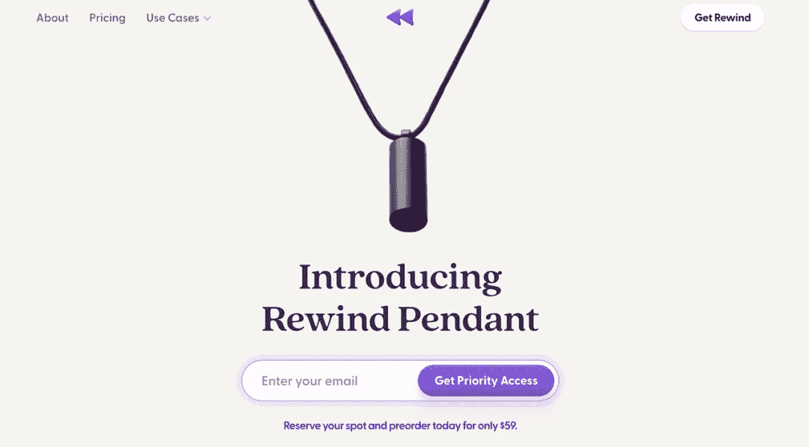

**2、Rabbit R1**：Rabbit R1 是一款新型人工智能驱动的移动设备，通过高级语音命令简化了应用程序的使用。

售价 199 美元，配备 360 度摄像头、触摸屏和 4G 连接。据其公司介绍，Rabbit OS 是首个建立在 Large Action Model（LAM 大动作模型）上的操作系统。

在 AI 功能层面，LAM 与 LLM 的区别在于，可以处理自然语言并转化为可执行任务。LAM 能与常见应用（如 Apple Music、Uber、eBay 和 Amazon 等）交互；

支持语音命令，代表用户执行复杂任务，如制定旅行行程、订票、购物、发送信息、控制音乐、回答查询等。

这个基础模型据称可以通过学习用户在使用特定应用程序时的意图和行为，来推断和建模人类在计算机界面上的操作，然后模仿和执行它们。

在不久的将来，用户可以教会自己的「rabbit」执行特定任务，比如使用图片编辑软件从照片中去除水印。https://www.rabbit.tech/

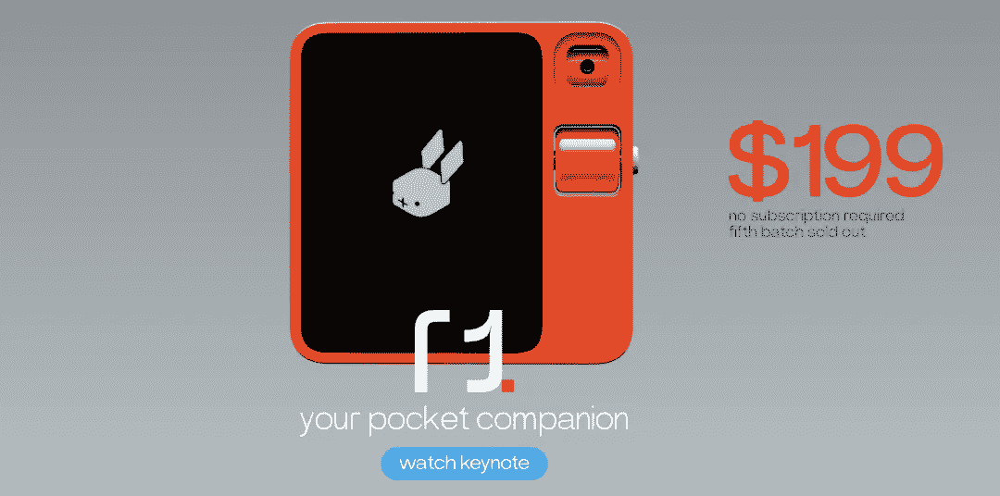

**3、AI Pin：**Humane 是一家由前苹果高管成立的硬件初创公司，他们做的可穿戴设备 AI Pin 于去年 11 月公开亮相。

AI Pin 是由 Humane 公司开发的创新可穿戴设备，它通过激光投影技术在用户手掌上显示信息，无需屏幕。

这款设备由高通 Snapdragon 芯片驱动，运行 OpenAI 的 GPT-4 语言模型，集成了麦克风、摄像头和传感器，能够进行语音通话、上网和回答用户问题。

AI Pin 的设计注重隐私保护，配备了“信任灯”功能，确保用户在设备收集数据时得到通知。

尽管 AI Pin 在技术集成和用户体验上展现了巨大潜力，但其高昂的价格和市场竞争可能影响其市场接受度。

Humane 公司计划通过扩展功能和开放平台，使 AI Pin 成为日常生活的智能伴侣 https://hu.ma.ne/

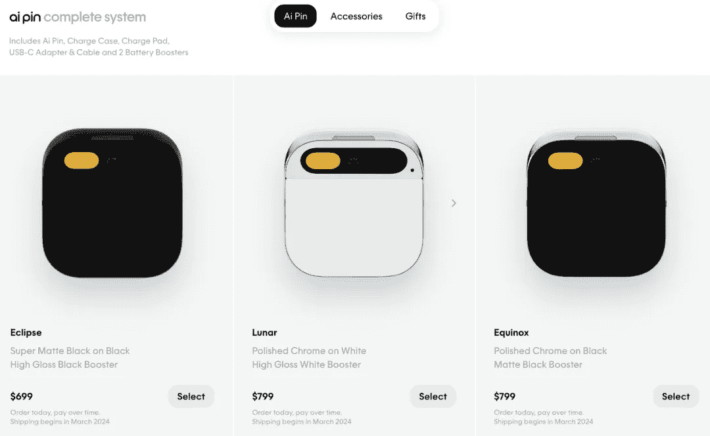

** 4、TAB AI：**Tab 是一个挂在您脖子上的小冰盘，可以聆听您（以及您周围的人）所说的一切。

它本质上只是一个麦克风和一个充电后可持续使用长达 30 小时的电池，它使用蓝牙将您的音频传输到您的手机并传输到云端；

ChatGPT 目前在云端转录您的对话，各种人工智能模型将为您提取见解。 （它的用户体验不是最终的，但假设你会使用手机屏幕来完成你想做的大部分事情。）

最终，Tab 是一个人工智能伴侣，或者创始人 Schiffmann 所说的“clarity machine”，可以在你生命中的每时每刻。https://twitter.com/AviSchiffmann/status/1708439854005321954

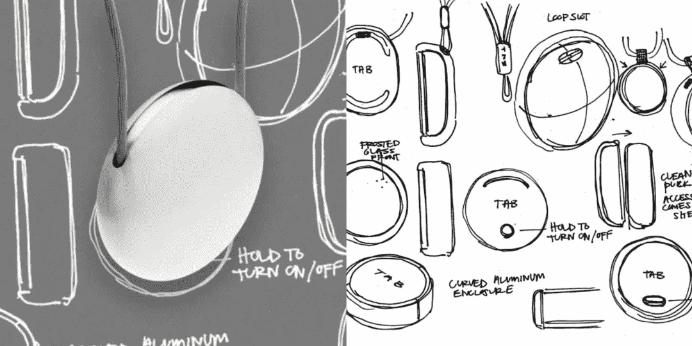

**5、**OpenAI 和 Lovefrom 在软银 10 亿美元融资开发的备受期待的“人工智能 iPhone” 。好，看完现在有的产品，接下来是Z 沙龙 7th 的正文：

# #一、大模型与现有终端融合形态探讨，有什么有意思的形态？

## 1、前创业者分享：2C 端硬件的阻碍与难点，可穿戴及贴近需求的硬件

a. 软件产品经理和硬件产品经理，这完全是两个不同的世界。

在软件领域，我们可以通过小步迭代和版本更新来获取流量。但对于硬件来说，你需要前期做出大量的投入；

无论是工业化设计，还是前期的 3D 冲压模型，甚至招聘硬件团队进行 SDK 调用，这都需要大量的资金和时间；

比如与深圳华强北的工厂在线上视频沟通，以及第一批样机的质量问题，比如调整风扇的位置等。在高并发或长时间使用的情况下，硬件的构建会变得非常复杂。

编者按：AI 硬件是一个复杂的系统性工程，从最早的设计 PCB 线路板等电子设计流程，到编译后的 ic 烧录，再到通讯及互联设计；还有供应链中上下游工厂的配合及流水线的把关。硬件初创企业可能会随着公司壮大及产品落地，不断完善以下开发流程：

立项（用户/竞品/早期定价及成本估算）——供应商——产品设计开发（结构设计，电子设计...）——EVT（工程验证测试）——DVT（设计验证测试）——PVT（生产验证测试）——PP（小批量生产）及 MP（量产）良率提升，ORT 测试——市场推广——硬件售后。

**b. ToC 端的硬件，本质上还是一个消费品。所以，大模型与 C 端产品的结合，**其实还是要看能否满足大家的消费需求。个人认为，目前最成熟最有落地性的是智能家居。

如果我们回顾一下日常生活中接触的硬件设备，除了手机和电脑外，扫地机器人的出货量之大、应用场景之广是无法忽视的。

扫地机器人能在家中的封闭环境下进行巡逻或规划路线，扫地机器人对空间、对三维环境有认知。

它现在已经能在家里进行地图更新，或者对家里的环境，甚至人的移动情况有一定的了解。

**这**些特性使得扫地机器人这样的硬件设备能够提供更多的交互可能性，无论是多模态交互，还是我们所说的"always on"交互。

我认为，目前像石头、追觅这样的大厂商可能能够使在二维空间（即地面）上形成的单位数据输入能够与家中的常驻人群，如小孩和老人进行良好的交互。

c. 银发经济及健康智能感知的潜力巨大：

从 70 年代到 85 年代出生的这一代人，有财富而且对智能感知有认识，他们已经习惯了使用硬件设备，他们非常愿意为自己的健康生活消费。

我之前参加过红杉 sparkle 的一个项目是关于智能戒指。我当时的想法是，希望能通过无感的方式将智能能力输入到硬件系统中。

这个设备不应该是手表，应该是更简单，能够无感地带在人身上，进行数据信息的分析。健康的可穿戴设备。

因为它能监测血压、血氧、温度、体温等数据，甚至如果它有语音识别功能，可以通过语音输入实时唤醒。

为什么要做硬件呢？因为我认为硬件是新的数据源的输入。至少在中国，手机端的 APP 流量已经饱和，你很难再开发出一个新的 APP 并吸引用户。

硬件是唯一能够让你获取新的数据源，形成新的市场份额的方式，所以我认为需要实时地贴近用户的生活，如 Humane AI pin 的设计思路。

## **2、某手机厂商分析师：AI 生态的**理想状态，未来趋势及现有终端设备的作用：

**a. AI 生态应是分布式的，分布在不同的终端设备上**，以适应人工智能的感知、决策和执行环节。

+   感知环节：可穿戴设备和 always on 设备在监控健康数据和语音数据方面有优势。

+   决策环节：具有计算能力的终端更适合执行决策任务。

+   执行环节：手机和 PC 适合执行互联网服务，而车辆和机器人适合物理世界的交互。

**b. 理想状态是多设备协同，通过单一账号和云技术串联数**据服务，但对用户设备需求高，现实中不现实（消费电子的三轮周期：PC、手机、可穿戴设备，只有手机实现了“人手一台”）。手机作为完成“感知—决策—执行”最小闭环的优势：

+   规模够大，增长问题不需要重新思考；

+   小规模的算力足够，现阶段基本能跑 7B 端侧模型；

+   离互联网服务很近，不需要重新塑造软硬结合的生态。

**c**. AI 在手机上会是怎样的体现？多数厂商将生成能力搬到了端侧，包括文本生成和图片生成。但个人认为，卷生成能力不是手机的正道。

OPPO、Vivo、小米更多的选择在手机上做生成性的场景，比如唤起语音助手后，vivo 可能是帮我读 PPT，生成思维导图，而 OPPO 可能生成文案。这肯定是一个场景。

手机作为一个移动终端，从诞生之初就不是强生产力设备，历史上移动设备也无数次想增加生产力，但最终生产力主力场景仍然是 PC;

因此生成能力在手机端侧，够用就行，如顺手生成点评内容、顺手做个简单的回答，更复杂的生成内容，交给云侧或 PC。

除了生成能力，大模型还带来了更强的理解能力，这是更适合给手机带来的能力提升。手机拥有大量的用户行为数据，知道用户在什么时间，什么地点，喜欢用什么东西；

**手机同时承载着大量软件生态，几乎绑架着用户日均 **5 小时的使用时长。通过 AI 的能力提升，将这两部分内容更好的链接和重构，有可能给用户带来更好的使用体验。

d. 实现连接和重构这个美好愿景过程中会有很多问题：

手机厂商和 APP 厂商，都是不好惹的大玩家，中间会有利益诉求的不断碰撞。

手机厂商希望用户对互联网的入口归一，都通过手机/手机助理来调用互联网服务，用户向手机助理提出需求，助理自己调用各种应用满足用户。

互联网厂商希望将用户圈在自己的池子，才有可能创造更多的商业化价值......类似的冲突还有很多。

AI 的到来，手机对用户的理解更深刻、个人助理属性进一步加强、用户的手机使用体验有明显提升，这其中有用户主动提出的服务请求、也有手机助理根据自己的理解向用户提出的很准确的服务建议：

+   作为用户，我们应该是幸福的，手机的使用体验会因为 AI 有很明显的提升；

+   作为大厂，是要保持危机的，手机厂商和应用之间的商业关系可能存在重构的机会；

+   **作为**创业者，可能注定要拥抱其中一个，要么选手机助理，给最好的调用服务，做一个小插件；要么选 AI native APP，需面临互联网时代的增长问题，当然也可以押注下一代终端设备。

## 3、另一位手机厂商专家：手机行业的内卷和对于 VR 的探索

a. 手机行业的内卷使得大家拥抱 AI

我感觉整个手机行业，尤其是中国的手机行业，实际上是一个内卷的行业：他们做很多事情其实并没有太多的创新，必须有一个强大的依托。

比如说生成式 AI，这个领域火，那我当然要去做。当高通骁龙 8 Gen3 芯片可以支持大模型，那我就必须得用。小米、OPPO 、vivo 等等。

**手机的特点是什么呢？**就是它的场景太多了，太复杂了。所有人都得用手机，但所有人用手机的需求都不一样。

AI 最好有一个特别直观的用户群，特别直观的场景，可以真正落地，所以像这些手机厂商只需要抓住一两个点去做就行了。

**手机厂商拉开差距的功能**：第一把语言辅助功能做好，包括 Apple 的 Siri，感觉不够智能。我看别人用 ChatGPT 这么好用，但我自己回去用 iPhone 还是那么难用；

而且我用其他厂商的手机，包括语音智能辅助功能，感觉都非常难用。但为什么不把这事做好呢？因为这事非常难做，所以手机厂商们还是先上一些噱头。

b. 扫地机器人行业目前已不适合初创公司进入：

因为现有的玩家自己就会去做这些 AI 的东西，作为一个创业公司来讲，不仅要打 AI 这张牌，基本功能也要做好，这并不容易，然后还要去打市场，这是非常非常难的。

c. VR 肯定可以跟 AI 结合

因为它本身是一个计算能力非常强的计算机，但是现在 XR 这个东西，我觉得它的整体效果的重要性远大于它的 AI 的应用。

比如苹果的 Vision Pro，如果把它跟 PICO，或者说跟 Meta quest 比，根本不在同一个级别。而且市场上其实如果真正懂做硬件的解决方案，无非就是高通出的而已。

所以我倒觉得如果创业公司做 XR，比如 VR 这个东西，你去打 AI 这张牌可以，但你跟苹果的 Vision Pro 比，你的 AI 可能只是其中一个很小的一部分，而不是最大的卖点。

## **4**、某大厂 VR 眼镜从业者分享及相关讨论：从几个维度解释为什么 XR 眼镜相对手机来说，更适合 AI 的形态

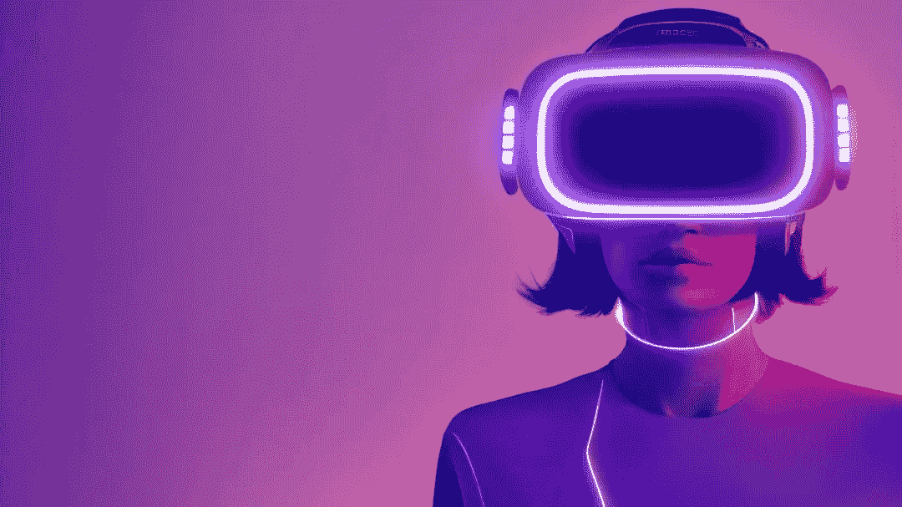

a. XR 眼镜在 AI 形态上的优势：

+   **算力与续航：**XR 眼镜使用与手机相同的高通芯片，但由于续航需求较低，可以实现更高的性能，有利于 AI 算法的部署。

+   **always on 问题：**always on 状态不仅与技术有关，更与消费者习惯和产品形态有关。XR 眼镜作为日常佩戴设备，更可能实现长时间在线。

+   **消费者习惯与产品形态：**眼镜的接受度很高，消费者更习惯佩戴眼镜，这使得 XR 眼镜在长时间使用上具有优势。

+   **沉浸感强：**用户一秒进入体验

b. 手机厂商在 XR 领域的潜力：

+   **技术储备：**手机厂商拥有深厚的技术储备，包括荣耀手机明年即将推出的 Eyes Tracking 技术和 Mate 60 的 Always On 摄像头，这些技术在 XR 领域同样有价值。（Always On 的黑白摄像头是创新。把手机当扫码枪用，即使手机没唤醒，但对准二维码时，它就知道要扫码。这是在系统和硬件上的创新，能用低功耗的黑白摄像头）。

+   **市场进入时机：**手机厂商尚未大规模进入 XR 市场，但预计在未来几年，如谷歌推出 XR OS 后，手机厂商可能会凭借其技术优势进入市场。

## 5、投资人+大厂人：端侧的大模型学习人的手机操作等方向畅想

现在手机的大模型其实没找到最好的应用场景。我发现很多手机厂商宣传片在强调如何在大屏手机上阅读论文。在提供信息服务这方面，手机天然的体验不如电脑和网页端。

**一个值得期待的方向是：**最近腾讯发布了一篇论文，研究如何让端侧的大模型学习人的手机操作，然后替人操作应用，或者是拍摄图片。如果有哪家手机公司能先实现这个功能，我认为解决的问题将会非常明确。

编者按：腾讯最近开源了个新的 Agent 项目：AppAgent，它是基于大语言模型构建的多模态 Agent，专门用来模拟人类用户操作智能手机中的各种应用程序。

项目首页：https://appagent-official.github.io/

论文：https://arxiv.org/pdf/2312.13771.pdf

源码：https://github.com/mnotgod96/AppAgent

**API 授权问题：**

大家有没有试过在 GPT 中使用 Zapier？当你使用 GPT 去替你操作一个实际的 Google doc，或者是一个实际的美团买菜这样的应用。

你就会发现，完成这类应用最大的一个问题是现在开发者他们对自己的 API 管理的非常严格，包括他们允许什么样的人可以调用他们的操作。

所以，你可能会遇到这样的情况，你想让 GPT 的一个插件去帮你完成一件事情，但是会首先面临 API 的限制。

Rabbit 的评测，其实也存在类似的问题：现有的服务中没有开发者愿意让手机厂商的大模型随意操作。

能让 GPT 代理在端侧或云端帮助人们完成多任务的，可能是全新应用场景，而非买菜这类。因为买菜等一些 API 已经成熟，开发者和厂商没有好的默契去完成这件事情。

我目前看到的商业模式最正确的一个 AI 硬件是可以贴在手机壳上，然后可以录音，解决了 iPhone 的录音问题；

同时也可以实时录制你的对话，然后将语音传到云端进行转录的硬件，解决了苹果手机不能录音的问题。

编者注：PLAUD 致力于成为全球 AI 音频硬件领域的领航者。其旗舰产品 PLAUD NOTE 创新性地融合了双拾音技术，装备了三重麦克风系统：

两枚空气传导传感器捕捉周围环境声音，而第三枚则是振动传导传感器（VCS），用于特殊录音需求。

这一设计使得 PLAUD NOTE 能够适应两种主要的工作模式：标准录音和通话录音。

在标准录音模式下，PLAUD NOTE 通过空气传导传感器捕捉声音，适用于会议记录、电话通话和语音备忘录等日常场景。

而在通话录音模式中，PLAUD NOTE 展现了其独特之处。传统上，要录制手机通话，用户需要依赖授权应用或通过扬声器录制。

然而，PLAUD NOTE 利用其振动传导传感器，通过捕捉通话时产生的微小振动来实现录音，无需依赖手机的音频输出。

这一独立功能使得 PLAUD NOTE 能够无缝录制包括 Facetime、WhatsApp、Zoom 和 Skype 在内的多种网络通话，提供了一种全新的通话记录解决方案。

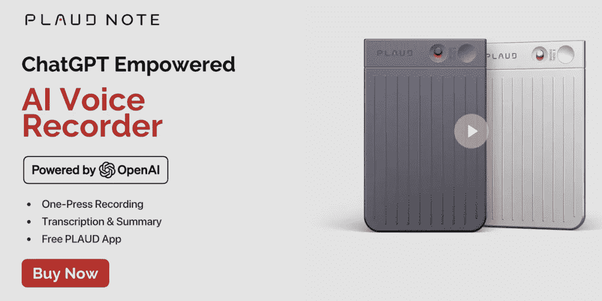

和 Rewind 类似，我认为能赚钱的硬件可能就是把语音这个功能做好。从现在处理好语音，到未来处理好视觉，这中间一定会有很多小的产品形态值得我们去探索。

这些小的产品形态并不需要我们一下子构建一个像手机这么大的故事，但我相信在这些小的产品形态上，我们的创造力一定能找到商业化的良好回报。

如果多模态能力提升之后，我们可以有另一条路径，就是直接阅读屏幕，像人一样，这可能是一个 RPA 的路径，去直接操作，这个过程可能就不需要调用 API。

但这个过程也可能存在一些问题，比如说，如果某天 APP 换了 logo，那么 AI 所理解的东西就变了。

但随着技术的进步，因为 logo 下面可能也有名字，可能也是一个手机公司期待的解决办法。另外，我了解到，7B 的模型现在应该已经可以在高通芯片上运行了。

虽然说 7B 的模型可以在高通上运行，但它能否实现自然对话的质量？可能不太行。我看了昨天新出的 mini CPM，它在 iPhone 15 上，才能勉强做到 15 个 tokens 每秒；

但是人的自然对话需要 10 个 tokens 每秒左右，但使用场景中你需要展示出来，大家需要规划 10 个 tokens。

所以看起来，即使是 CPM 这样的小模型，即使在考虑到背景的情况下，也不能在端上做出非常好的自然阅读速度的生成。

编者按：2 月 1 日，面壁智能发布了旗舰端侧模型 MiniCPM，它以小博大的性能超越了 Mistral-7B，并在 MT-Bench 等榜单上表现出色。

MiniCPM 是一款能说会看、具备编程能力、拥有多模态能力的端侧模型。它不仅在性能上优秀，而且具有极低的成本，支持 CPU 推理。

MiniCPM 开源，并已在主流移动操作系统上进行了适配和测试。

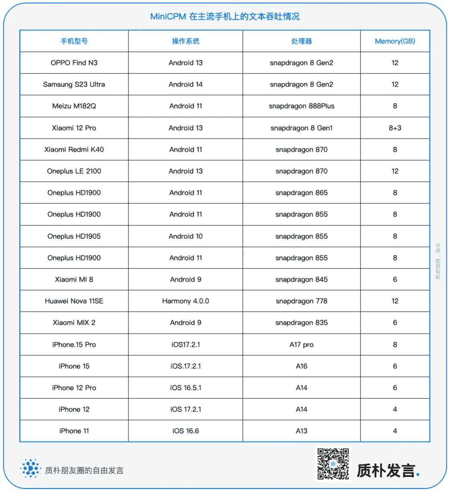

**手机的使用场景方面，**虽然在 research paper 上说可以用，但是在需要考虑耗电和速度的时候，它似乎并没有那么吸引人。所以如果厂家在手机上做这个生文功能，如果不能提供足够的不同的价值，其实还是挺没有吸引力的。因为它会快速耗尽你的电量，这是一个非常严重的问题。

同时，需要的内存会变卡顿。而且，如果这个功能不能关闭，那它有什么意义呢？

端侧和大模型的结合可以从一些更具想象力的方向，或者针对特殊人群进行探索。这些特殊人群可能足够大，因为他们的需求可能会被泛化。

比如，渐冻症患者可以使用出门问问的模型，为残障人士提供一种将他们的语音转化为清晰自然语言交互的方式。

这个项目可能只针对残障人士，市场可能不大。但如果我们将其扩展到所有老年人，比如阿兹海默症患者，他们最终可能无法清楚地表达他们的意图；

那么这个市场就会非常大。我觉得可能是一个很好的创业方向，我们不应该只关注存量市场，还可以卷增量市场。

**A**gent 能否使得大模型取代 iOS 和安卓的生态，使得 llm 成为唯一的过路费，并使得与大模型深度耦合的硬件也成为唯一的过路费？

+   有没有哪些现有的安卓应用的形态和 iOS 的形态是大模型无法实现的？或者说有些用户的应用场景是无法实现的？

**游戏娱乐是很好的例子。**我们发现，用户可以通过语言模型以更粗的颗粒度描述自己的需求并完成。

用户有时候会享受细颗粒度探索的乐趣。有一些细颗粒度的需求，如进行上滑交互、浏览页面时会产生乐趣。比如游戏带来的愉悦感，这部分的细颗粒度体验很难被替代。

大模型还是很难取代 iOS 和安卓的生态，但它可以取代一些深度长时间工作的部分，如长文本处理，或者帮助你写代码等，在更长时间、更深度的工作上提供更大帮助。

在办公场景的硬件有很多与大型语言模型相关的机会。AI 与现有终端的融合有两种思路，一是 C 端应用，二是是更适合 AI native，更能帮助 AI 训练，更接近 AGI 的硬件。

**为什么选择 XR 呢？**因为它的视觉输入传感器位于你的眼睛附近，所以它的输入传感器和人类的输入传感器是一起的，包括可能在耳部，在声音部分也是一样。

这两种感知占据了人获取信息的重要部分，所以在这样的场景下，它能更好地进行训练，去理解你现在所处的场景，你现在的需求。

智能硬件，它更应该成为一种人类的外骨骼的形态。作为人类具身的一种外化，将你生物的传感器信息转换成数字信息，然后更好地被训练来满足你现在所处的场景和需求。

其实所有的本质不是抽象在 app 上，它是我们身处在这个环境之中开始产生的。像这一类的设备，我们认为它是未来最终极的，最好的最小可行性产品（MVP）的硬件形态。

**真实看到的，实际上是多角度的。**即使你的手机一直开着，你不是一直拿在手上使用，它看到的可能只是这个角度的视图。

Sensor 同步，时间上是一致的，你需要同时看到这些信息，才能理解这个世界。这就是我认为 XR 眼镜的价值，就像是头戴的特斯拉。

**端云结合问题：**它可能不一定在端侧进行所有的处理，可能只完成一些数据采集。这可能就和我们后面要讲的端云结合、如何裁剪模型的问题挂钩。

我们在第二部分讲述端侧小模型时，会涉及到裁剪的刀法的一些问题，就是如何把感知这个环节做好。这里的难点可能在于法律上可能存在一些风险和问题。

例如，如果你的实时图像数据，考虑到现在的算力情况，必须要上传到云端去处理。MIT 的韩松组他们展示了只需要 256K 的内存就可以运行 TinyML 模型；

但那是针对特定问题的。所以，如果经过裁剪，我们可能会在后面讨论如何进行裁剪，可能会根据不同的情况进行。

编者按：

OmniML 成立于 2021 年，总部在美国，创始人之一为 MIT 韩松教授。发布的 Omniizer可以通过弥合机器学习模型和边缘硬件之间的差距，简化和加速机器学习操作。2023 年，英伟达已秘密收购 OmniML。此前，MIT 韩松教授团队发表了 On-Device Training under 256KB Memory，曾提出一种算法-系统协同设计框架；仅用 256KB 和 1MB 的内存即可实现设备内训练，且开销不到 PyTorch 和 TensorFlow 的 1/1000。

## 6、大厂自动驾驶从业者：自动驾驶的类比

自 2017 年开始从事 L4 级别自动驾驶的工作，当时自动驾驶或 L4 级别的需求非常强烈，主要是将人或物体从 A 地运输到 B 地。尽管需求明确，但当时面临的主要问题是能力不足。尽管有各种可能的方法和乐观的想法，但愿景实现仍存在困难。

**算力是一个重要因素。**由于缺乏大算力的低功耗终端设备，当时采用了大量的 X86 机器和特斯拉显卡，但这些更多是实验室的 Demo 版本。

尽管当时有人预测算力的降价，但并不是那么乐观。然而，随着摩尔定律和硬件量产的发展，现在激光雷达等设备的价格已经大幅下降，显示出指数级增长的态势。

英伟达用了三代终端的算力，在量产上的终端算力表现良好。我们在使用高通的非车规量产自驾芯片进行自动驾驶方案的开发，用手机芯片实现小型自动驾驶方案是可能的。

**目前的趋势是 CPU 的工作正在迅速转移到 GPU 和 NPU 中。在自动驾驶领域，系统**由多个小模块组成，每个模块可以使用 GPU、深度学习或传统的 CPU 机器学习。

从研发的角度来看，硅片上越来越多的部分正在转向 AI，而 CPU 的部分也在不断增长。这一趋势与英特尔股价下降、英伟达股价上升的价值变化相一致。

**三个识别技术的关键点：**

+   从方法的角度，规则驱动和数据驱动是完全不一样的，因为大部分的数据工作现在都在为我服务。所以，第一个关键点就是技术的发展，一个是技术的指数上升的脉络。

+   第二个关键点是对需求的理解，其实说到底，出行或者是物理世界的移动一定是刚需，所以这个需求是没有任何问题的，只要有人能解决这个问题。

+   第三个关键点是重 AI 的应用，我说的是绝对的重 AI。为什么车必须在车上运行 AI 呢？很简单，因为它是实时的，有危险性，要求高，它是刚需。相比传统的AI，如人脸识别，并不需要一秒 60 帧识别它，你打开手机或者支付的时候就可以了，甚至是"Hey Siri"，这不是最好的吗？那为什么我不能 always on 呢？

**三个由此得出的观点：**

+   目前最重要的 AI 原生应用是自动驾驶，然后以此推断，我看到的是 Vision Pro ，12 个传感器，巨大的算力，以及始终处于开启状态。这是我的第一个观点。

+   用多模态做感知，和我们今天的专用模型、特斯拉这种端到端模型，肯定比不过特斯拉的最先进的技术。但三五年之后，它们会汇合，这个战略趋势是必然存在的。

+   今天大模型本身在体验和性能上已经过了一定的拐点，它会从算力上迁移到云端和终端，所以算力一定会溢出。在这个观点之下，重 AI 的 AI 原生硬件会更大规模的普及。普及的关键转折点是要找到使用上的刚需。相当于是有一个代际差异的体验提升，同时又匹配到了这个能力。

## 7、智能驾驶、整车硬件、座舱从业者与投资人分享：智能座舱讨论

车是移动的家，这一观点正在逐渐成为现实。

车里面其实有将近 2-3 千元的沙发，还有一个非常好的空调，还有非常出色的小 1000 块的音响。很多人在家里其实不具备这样的条件，但在车里玩游戏是一个很爽的体验。

这就是一个可能性，而且我认为这个可能性会变得越来越大。许多人在批评理想汽车，说它就像大彩电、大冰箱。

今天买理想汽车的人并不太关心技术，他们关心的是，你有没有解决我的问题？所以我觉得，除了出行本身的移动需求，比如说电机，电池这些，剩下的在座舱里面的可能性会越来越多。

**今**天车上搭载的算力，它需要布置的那些因为出行而使用的传感器都已经布置好了。有了这些可能性之后，再加上 AI 的应用，其实它的可能性会越来越大。

除了汽车厂商自己在做这些之外，其实还有很多小的创业公司在这个领域中尝试。但至于说车的 AI 座舱里会不会形成像手机、苹果 iOS 那样的生态系统？

可能性不大，因为它的使用场景还是有限，毕竟它还在动。当然，当车停下来，可能会有特殊的应用场景；

比如玩游戏，但是到底有多少可能性，我觉得还不确定。但至少比过去大家对于车的理解，现在已经可以拓宽很多。

大家原来对车的智能化的理解主要是集中在自动驾驶上。但实际上，从去年开始，大家的关注点已经转向了座舱，因为自动驾驶的进展总是停留在 99%。

大家都在追求自动驾驶这个目标，但实际上，很难通过一个测评去达到一种一致性，说谁是 99 分，谁是 98 分。但座舱的优化其实是非常容易被感知和传播的。

**新能源车智能化**

包括许多车企实际上致力于做座舱的芯片，这主要是基于语音，做一些大模型。虽然我不一定看好这个方向，但我觉得整车厂在做大模型这方面还是更有优势。

我个人觉得，这个方向是绝对正确的，因为它真的能带来很大的区别，消费者一看就能看出来这个区别。

除了座舱以外，我觉得驾驶本身，比如说今天那些在出行上选择 L2，甚至更低级别 的车企，我觉得也是一个非常智能化的体现，而不再去追求那些特别酷炫的东西；

而是更关注辅助功能，不管是停车还是过一些载道，这些在实际驾驶中都是非常实用的。大家都在探讨自动驾驶，我认为，我们应该关注自动驾驶能实现到什么程度。

以前，大家特别喜欢朝 L3 L4 方向走，但现在的情况已经不太一样了，大家一直在说时间很重要，但整体感觉座舱的可感知性更重要。

**当自动座舱里有了很多的 AI 算力之后，你从工作生活的效用或者是消费娱**乐的角度，能实现什么原来完全实现不了的体验呢？除了打游戏之外，还能有哪些例子呢？

比如，你坐在车上的不同位置，你想开窗户，我要开我这一侧的窗户，这件事其实很容易实现，对吧？

但这对于客户来说是易传播的，因为它需要识别这个人的位置，这是一个很重要的点。还有很多与车本身交互的功能，都是很小的点，我并不觉得短时间内一定需要大模型。

有很多的父母在车里的时间会大幅增加，比如带孩子上课外班的时候，他有两个半小时的时间，孩子在教室里，父母没地方待，找一个舒服的地方，能看片，能躺下，这就是一种可能性。

**车内的时间可以被用于做很多事情**，比如点外卖，大家在车里吃饭。因为理想汽车的后排还有一个小桌子，很多家长都在那个小桌子上用餐。

**车内的时间大幅拉长**，我认为，包括从理想汽车的角度看，其实在很多场景上都大幅度地拉长了，这跟我原来想象的场景完全不一样。

实际上，AI 1.0 已经在做这些工作，但理想汽车的最新更新中，他们用了 LLM来做一些非常不同的事情。

他们把整个车的说明书都输入到系统中，然后用他的长文本理解能力，让他可以回答很多关于车本身的问题，做得非常好。

比如你问，“我能不能把滑雪板放车里？”它会告知车厢长宽多少，两米的板可以放进后备箱。这是 LLM 带来的长文本理解能力，对车况的理解也能加入进去。

**如**果全自动驾驶真正实现了，那可能它会远远超越只是一个通勤中休息的工具，它可能会变成你整个工作生活中最重要的工具。

未来如果房子买不起，也可以住在车里，车比房子便宜得多。你现在一平方米可能要 10 万块钱，而一辆车大概有 4 平方米的空间。当然，这两者的寿命不太一样。

# #二、芯片、成本以及数据隐私安全角度，端侧小模型有什么要求？

## 1、某实验室研究人员：科研领域的尝试

针对 AIoT ，最近在做新尝试，将部署 nvidia 在 jetson orin 做基于 TensorRT 优化后的方案加载到航拍无人机端侧。（特别是多模态实例分割的相关组件 OWL VIT+SAM）

然后实时在森林、城市等 unstructured environments 检测特定类型对象（Points of Intersts，PoI），通过分割技术创建一个包含关键对象及其几何关系的地图，以进行语义 SLAM 下的定位与导航服务。

之所以想部署 foundation model，动力有三点：

+   第一点，区别于传统 yolo 用到的粗类型，我们表达 PoI 的有时候需要用一些多属性词汇，这就需要多模态大模型的优势；

+   第二点，我们是兼容当前终端的传感器，并在此基础上利用更多的语义信息，特别是在光照和外观变化方面得到比传统基于特征的 SLAM 系统更加鲁棒的框架；

+   第三点，如能直接从原有航拍图片上计算出结构化特征，并返回到作为地面站的无人车上，比实时传图片到云侧的通信开销更小、也方便做联邦学习技术上的隐私考量。

**不同阶段思考：**

在实施端到端模型时遇到困难，模型效果不佳的情况下，由于模型是黑盒子，很难有效的优化和调整。后尝试离线强化学习和模仿学习来改善模型效果，但仍觉得是无底洞。

因此，他们开始思考将端到端的过程分解为各个模块，每个模块可以采用不同的方法，既可以是神经网络，也可以是传统方法。

这样做是为了提高模型的可解释性和可调整性。去年，他们转向仿真研究，通过创建硬件在环的环境来模拟真实场景，以便在仿真环境中获取数据，并实际环境中进行测试。

然而，从仿真到实际应用存在问题。一方面，仿真中的物理速率可以调整，以确保仿真的准确性，但真实场景下，对实质性的要求是无法避免的。

另一方面，他们在参加美团无人机比赛时发现，由于延迟的存在，仿真和真实部署之间存在差异。

因此，开始关注端侧计算，通过在端侧设备完成大量计算，减少与云端的通信数据，同时也考虑到隐私问题。

他们尝试了多种方案，包括 mini GPT、LAVA，以及最近的 LLAVA plus 等，但这些方案在他们的应用场景中存在一些限制。

最终可能可行的想法是大型模型视为一个传感器，进行更可解释的端到端操作，而不再是一个黑盒子。

他们目前正通过用实地分割的多模态模型，分割出场景中的关键物，提取关键点，以增强 SLAM（同时定位与地图构建）效果。同时也能用传统的 SLAM 为基准来评估效果。

**在构建无人机和无人车时应将大模型视作传感器，进行更可解释的端到端操作，**而不再是黑盒子。同时，模块化也很重要，端侧计算在解决延迟和隐私问题方面具备潜力。

## 2、某创业者：芯片成本和数据隐私安全的角度分享

在提供基于云端的模型服务时，隐私数据、成本控制方面均有挑战。在为某 B 端用户服务时，用户对于数据是否会被用于训练模型的担忧，可能导致用户对服务的抵触。

**聊天机器人方面，**如果用户知道数据可能会被获取，他们可能会不愿意分享，尤其是涉及个人情感或情感帮助方面。因此端侧模型可能会开启新场景来更好的保护隐私。

**关于成本问题，**大模型在用户量上来后可能导致成本失控，因此可以用这个解决方案实现：即将一些简单的任务放在端侧执行，例如使用 7B 模型处理表格上的问题。

**7**B 模型能够在聊天场景下提供良好的用户体验，并且在喂入领域语料后，结合强化学习和标注，能够解决相当多的问题。

少部分无法解决的问题丢到云端去处理。这样可以在控制成本的同时，确保用户得到满意的服务。只有当不被模型覆盖的能力是少部分时，这种成本控制方法才是可行的。

例如，如果只有 5%以下的用户流量需要走到云端，那么这种方法相比所有服务都基于 API 的做法，能够大幅降低成本。

## 3、某创业者：未来 AI 模型与硬件的三种部署方式畅想：

AI 模型与硬件之间有几种可能的部署方式，从而对于模型的要求做出更清晰地判断，我们初步认为主要有三种方式。部署在云端、终端和用户家里。

**1、模型部署在云端，**通过 wif 或者 5G、6G，触达到用户终端。云端的模式下大模型可能有两种发展趋势种可能是使用一个大模型系统服务千百个、千万个用户；

但是面临着严峻的教据隐私安全挑战，必须有足够有说服力的架构和措施来确保用户隐私安全不被窃取和越狱，这基于当前大模型的不可解释性，可能是难以实现的。

2、为每个用户在云端部署一个小模型，用户根据自身的使用情况对这样的服务进行付费，付费模式可以是多样的，好处就是灵活，可以做到社会资源有效利用的最大化。

**3、模型部署在终端**，也就是手机、电脑、XR、可穿戴等各种设备当中，这对于模型小型化、低功耗的要求非常高，尤其是在体积越小的硬件设备当中；

对于端侧功耗和计算能力的影响非常大，我们认为小于手机形态的产品上，不太可能通过将模型部署在端侧，创造非常好的、在续航一一智能体验一一使用体验上的平衡。

当然，手机和电脑终端的端侧小模型还是有很大的前景，对端侧模型的低功耗、低算力和高智能体验有很高的要求。

**最终端侧**模型要 PK 的是云端模型+互联网能带来的体验，其劣势在于端侧模型的智能体验比云端模型差。优势在于个性化、数据隐私安全和对联网稳定性和延时的要求低。

会存在新的形态是用户通过购买自有消费级服务器，将中小规模的模型部署在用户的家里以平衡数据安全和优秀的智能体验，但这在一段时间只适用于消费能力比较强的高端用户。

**综上，我们认为 AI Native 硬件所需的 **AI 模型是小模型，端侧或云端都有可能。只有每个用户对应独立的小模型，才能解决隐私问题，将不同用户间的数据从物理上隔绝；

即使是这样，我们都不能完全保证数据安全，因为每一个小模型作为用户的意图，在与其他模型交流的过程中，仍有可能导致数据泄露，不过这是个长久需要解决的问题。

**云侧与端侧的讨论：**

隐私问题是否是一个伪命题？因为所有的软件都在云化，讨论隐私安全就像我问，用微信，隐私会不会被腾讯知道？这个问题并不是新命题，实际上它是一个十年前的问题。所以，如果我们要对比端侧模型和云端模型，我们可以直接比较手机上的 APP 和云端的 APP。

**可能有两个核心点：**

1、时延，这可能是最关键的区别。

**2、成本问题。**大模型带来的额外成本，它的 API 成本比传统的要高很多，这个本身是由供应侧来解决的。如模型的摩尔定律能够继续，那么如果云端的模型价格降低，这个问题也就不存在了。

只要是更好用的 APP，我就会选择使用云端。

我记得去年我去美国的时候，听到许多专家普遍认为：其实很多模型还是可以在云端被使用的。最终，用户会用脚投票。

**以地图为例****，虽然有很多离线地图，**但当你开车的时候，我相信大家可能并不会使用离线地图。我个人也是如此，我更倾向于使用联网的地图，因为它的实时信息更新更快。

**比如路况、堵车情况**，甚至现在还有红绿灯的倒计时。云端的优势非常明显，包括实时联通和实时迭代。功能的迭代也可能随时在进行。

对低延迟有要求的场景可能包括哪些呢？

首先，环境感知是一个重要方面，因为实时感知周围环境对于许多应用来说至关重要。

另一方面，考虑到上一代手机上运行的 AI 模型，例如美颜和拍照时添加趣味元素（如在头上添加兔耳朵），这些功能通常依赖于端侧 AI。

这些应用场景，**如游客在景点拍照，表明端侧 AI **在处理图像方面的重要性。因此，我认为图像处理模型，如 diffusion model，可能对实时性有更高的要求。

## 4、大厂人+连续创业者：硬件成本问题讨论

+   即使在端侧运行模型，成本也是很高的。这实际上是将成本转移到了用户侧，因为移动设备运行大型模型会很快耗尽电源，设备可能会变热、变慢。因此，如果不能提供非常好的体验，这并不是一个有说服力的方案。可以用实时充电来弥补，但对于移动端设备来说，不能一直插着电源，这也取决于产品定义。

+   对于手机或其他通用设备，测试过程是非常复杂的。如果运行大模型，需要开启各种新功能，手机都有电源模型，都会进行测试。即使电源消耗在预期范围内，也需要考虑设备的使用体验。目前，据发言人所知，只有 MTK 和高通的芯片能够调试出 7B 模型，但成本还没有调整。（天玑 9000，骁龙 8 Gen1）

+   如果是嵌入式设备，运行 7B 这种模型的芯片是非常贵的。未来端侧小模型创业形态可能不会是机器人，而是应该是一个基于软件的应用，就是一个手机 APP。

在 CES2024 上看到的陪伴类设备，定价可能高达 700 美金一个，但他们使用的芯片解决方案非常简单，只用了：Rockchip。因为他们承受不起高成本，可能主要的资金都花在了市场渠道上，整个硬件的成本其实很低。如果你想运行一个 7B 模型，用高端的芯片，可能直接上升到承受不起的成本。

编者按：Rockchip 简称 RK，是一家总部位于福州的 SOC 设计公司。RK  基于 Arm cortex-A 内核设计的一系列 SOC ，在国内外的产业界和极客中很受欢迎。

## **5、连续创业者：时延问题讨论**

在 VR 环境中，用户对延迟的容忍度是一个非常关键的指标。在某些场景下，如环境感知或 6DOF 算法，用户对延迟的容忍度可能非常低。

因此，厂商倾向于将这些任务放在云端处理。同时，他们也考虑到了功能划分，哪些场景适合在端侧处理，哪些场景适合在云端处理。对于哪些场景是高延迟，哪些场景对延迟的容忍度较低，比如说对于大模型最敏感、最需要的肯定就是与最终整个交互相关的部分；

比如房间的 SLAM、手柄和手势交互这一块。包括严重的延迟问题，这些都是不能容忍的。我们可能会花费 30%的时间在调整时延这些事情上；

大部分时间都在与工程师团队讨论，比如你的设定是 50 毫秒还是 40 毫秒？如果从 50 毫秒减少到 40 毫秒，可能我们需要花费一到两年的时间。

编者注：DOF 是自由度 degree of free 的缩写是 VR 定位系统中的一部分，指的是物体在三维空间中的方式。目前 VR 中的 DOF 分为 3DOF 和 6DOF 两种。

3DOF 即 3 自由度，只有旋转坐标没有位移坐标，只能以设定好的虚拟头部为中心点，观察的基点源于头部视角，就像固定在电线杆上的摄像头可以任意旋转，但无法上下左右前后离开电线杆。

6DOF 即 6 自由度，在 3DOF 基础上再增加“上下、前后、左右”等 3 个位置相关的自由度。

头部从 3DOF 只能检测到头部转动姿态到 6DOF 伸头缩头等姿态，还可以检测身体移动上下前后左右位移的变化。所以 6DOF 更加符合人体体验，更具沉浸感。

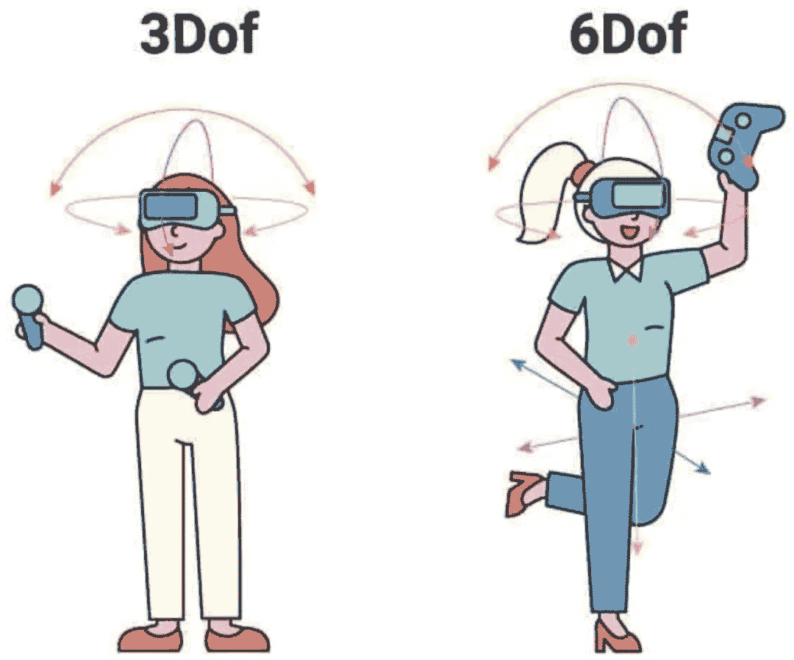

最早在 90 年代的高端相机上使用的：眼动追踪（Eye-Tracking） 技术的发展及其在 VR 中的应用很重要：眼动速度很快，精确捕捉眼动角度很难，但这是提供良好交互体验的关键。

未来可能会有一些与输入和内容创作相关的小型模型，这些模型可能会全天处理用户的输入行为。

苹果公司在 iOS 上进行了本地模型输入法补全的工作，以及根据用户输入习惯进行补全的做法。而 XR 技术的最大挑战之一就是文本输入，因为文本输入并不适合眼动，而人眼对文字有高速阅读的习惯。

因此，苹果 Vision Pro 在输入方面没有使用眼动，而是进行了大量的模型训练来帮助用户更快、更少次数地点击完成输入。

# **#三、如何解决端侧硬件能耗、存储、**算力在 AI 硬件使用场景需求下的平衡？

## 1、主题分享与讨论：关于 AI native 创业观察

AI Native 不等于 AI Augmented 硬件

+   **AI Native：**无法脱离 AI 存在，如 ChatGPT，无 AI 就没此产品，无此形态，这无能力。对于 AI native 来说，一个硬件产品如果无 AI 能力，那么它的产品形态跟价值基本上不存在。AI 硬件创业者应选择该类

+   **AI Augmented：**在没有 AI 的时候也可以用，有了 AI 过后，它的体验和能力是增强的， 但 AI 并不是这个产品，AI 加持不是最大的差异化；例如：车、PC、手机。创业者需避开该类

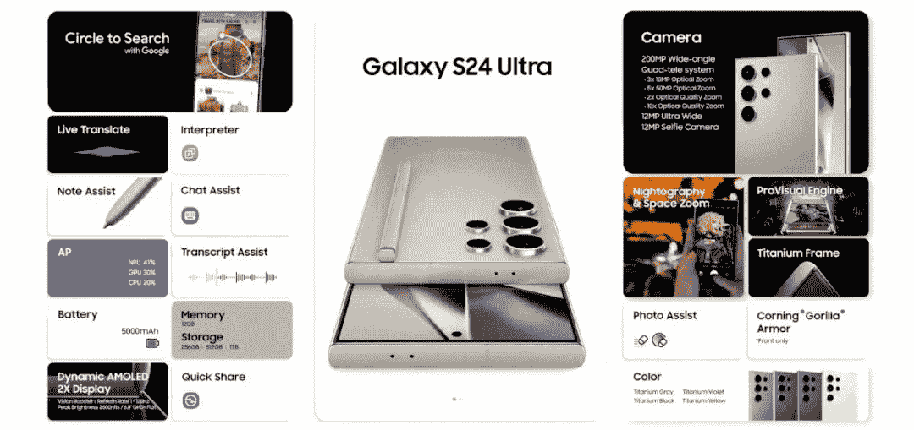

**音频和语音是现有技术能力下率先成熟的领域。

以录音**笔为例，为什么说简单的录音笔有这么大价值，因为之前的录音是音频的存储。而今天，音频存储可结合大模型能力完成内容理解、拆解、summary，从而可以将原先的用户价值重新定义。

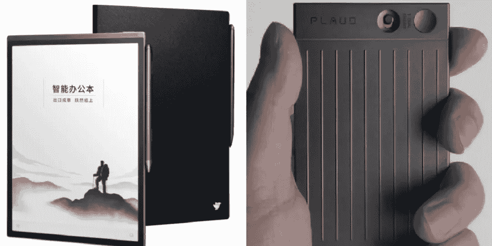

**图像与视频是正在发展的方向**

2014 年 Google glass 的理念：没有复杂的视觉效果，但结合音频、视觉，将环境分析和场景理解投射到眼前的屏幕上。

在 CES 2024 上看到了有趣的案例：导盲棍（见下图）。但这个大方向上还有非常多短板，both 硬件和软件。

背景补充-导盲机器人 Glide

+   Glidance 公司开发的导盲机器人 Glide 在 CES 2024 上荣获了机器人创新奖。这款机器人旨在辅助视力受损人士，就像导盲犬一样。Glide 配备了先进的传感器系统，能够进行精准导航和避障，并通过手柄上的触觉反馈和声音提示向用户传达信息。

+   传统的导盲犬通过牵引来引导视障人士，但这种方法有时会让主人难以掌握牵引绳，可能会引发安全问题。而 Glide 则采用了更为贴心的设计，它不会强行牵引用户，而是根据用户的行动来调整自己的动作，确保用户在整个导航过程中始终掌握主导权和安全性。

+   值得一提的是，Glide 的售价与一部手机价格相似，这使得导盲机器人成为一种具有很高性价比的机器人设备。导盲机器人的商品化与普及化，不仅能够提高视障人士的生活质量，同时也具有巨大的经济潜力。

**属于创业公司独特的机会：与人的多模态交**互是 AI Native 的独特创新想法

跟人的动态交互占据人的沟通的注意力、时长和理解，以及创造娱乐情绪相关的价值。以一个全新的硬件形态，全新的交互场景可能是 AI native 独特创新机会。

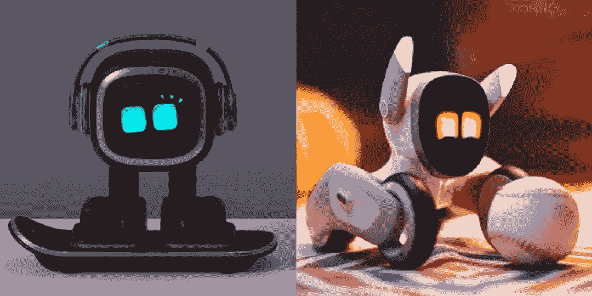

**Q：部分“niche”的产品，别****人很容易追赶，**怎么看待未来的量和护城河？

A：投资人分享

市场空间要看存量场景和用户&增量市场和可能获得的市占率。以录音笔为例：千万销量每年，核心是用户体验和用户价值能否实现十倍提升，以及一家公司能否找到有用户粘性、可迭代的特性。

在这个基础上，能否建立更强的护城河，是和技术深度有关系的。

例如：扫地机器人-石头机器人。成功的核心是技术比上一代好，所以渗透率持续提高；技术比后发者好，所以市占率高；而华为、小米等巨头大厂又看不上。

**硬**件公司的护城河方面，首先和软件不一样，倾向于先看历史再找规律。过去十年，中国最成功的硬件创业公司可分为两类：

1、石头、Anker：垂类心智。先做好设计，定义新品类，发挥中国供应链的优势，涨得快但天花板有限；

2、地平线、理想：组织形式和传统友商不同；组织能力强于现有赛道友商，而组织能力体现在于管理者和规章制度。

**大厂产品经理：**

+   **创业的门槛似乎已非常高：**我曾经拥有一个约 100 人的团队。我们每天都会产生各种创业想法，并开发最小可行产品（MVP），然后进行迭代。但一位前辈指出，几乎所有能赚钱的点子都已被尝试过。这让我意识到，要在已有方向上创业确实充满挑战，因此我开始考虑转向尚未开发完全的硬件领域。

+   大模型的应用一个主要挑战是知识库的整合：尽管大模型的能力已经非常强大，但在实际应用中遇到困难。如何将客户的数据库和业务内容与大模型结合，需要进行大量的知识库向量化工作，以及 NL2Sql 等技术的应用，这在工程量上极大，可能与模型本身的成本相当。

+   **关于数据库的思考：**在 We**b 2.0 时代，**数据的产生为大模型提供了训练素材。如果你在这个时代有所贡献，那么你的数据就对大模型有价值。然而，对于那些在上一代互联网时代没有留下痕迹的人，比如我的母亲和外婆，他们在大模型的知识体系中可能没有贡献。硬件的发展则创造了新的数据来源，比如通过传感器捕捉人眼所见和生活感知，AI 硬件可为大模型提供新的类人感知数据输入。

+   通过一体化能力迅速转化为游戏内容：最近注意到 GTA6 的预告片，它展示了视频内容与游戏的结合，这使我产生联想。未来在抖音等平台上的内容，可以通过强大的一体化能力迅速转化为游戏内容，反之亦然。内容的创作和消费之间的界限将被打破，跨媒介的内容转换将成为一种趋势。

+   硬件在内容创作和记录方面的潜力：像 Google Glass 这样的硬件产品，以及 Snapchat 的尝试，都表明了硬件在内容创作和记录方面的潜力。通过新的硬件和大模型的结合，我们可以为新用户群体创造新的内容，同时通过大模型的能力，将这些内容转化为新的数据资产，并定义新的场景

**创业者回应：**

同意上述观点， AI 硬件可分为几类，如音频和语音，现在能力较成熟，有很多硬件非常确定可以出来。这些也比较刚需，非常直接，消费者也愿意买单，能力也达到拐点。

但其实偏娱乐陪伴类的那些东西，非常考验产品本身的定义。可能产品定义本身没有问题，但能力又达不到那个拐点，会导致讲得很好，但实际上用户拿体验差；

所以从投资人的视角来看，怎么去看类似于这种，如偏娱乐、偏情感类的这种非刚需类的种硬件。

最难的是，当你这个东西做对的时候能看得出来。第一款产品其实是开了陪伴机器人品类的一个先河，是 Anki 公司 。

做 Cosmo 跟 Vector，其实 Cosmo 最开始卖的挺好，做一个圣诞礼物，然后到 2018 年出的 Vector 。

公司遇到了经营管理层面的困难，这个产品的定义跟品是没有问题的，高峰的时候一年做 1 亿多美元，但是这个团队是 CMU 出来的，完全没供应链管理和经营管理的能力。

Anki 成立于 2010 年的人工智能机器人公司，由三位卡内基梅隆大学的机器人专家创立。该公司致力于开发能够与人互动、学习和成长的智能机器人产品。

Cozmo 和 Vector 是 Anki 推出的两款明星产品。

Cozmo 于 2016 年发布，是一款小型履带式机器人拥有摄像头、麦克风和扬声器等传感器，能够识别用户的情绪和动作，并做出反应。

Vector 于 2018 年发布，是 Cozmo 的升级版本，拥有更强大的功能和更丰富的玩法。

这两款产品都受到了消费者的欢迎，尤其是 Cozmo，在 2016 年圣诞节期间成为爆款产品。Anki 也因此在 2017 年达到了顶峰，年收入超过 1 亿美元

然而，由于产品价格较高、市场竞争激烈等原因，Anki 在 2019 年遭遇了财务困境，并最终在 2020 年宣布破产。

所以 Anki 最后把这个品类给做废了，但是他们体现出来**的这个用户价值、用户情感，不**管是否高端，本质上是交互的就是有价值的。

但是你回到 18 年的那个实验，当时它上面是有一个 Alexa 的这个对话能力的，那个年代的智能音箱或者智能对话能力是非常多。

在今天其实好的产品经理应该可以在现场去买，可以做大量的体验的裁剪创新，是可以作为产品的；

那这个就是硬件产品，**它永远是在前沿的科技跟用户体验间做非常精准的 balan**ce。不能太贵，用户体验又必须满足需求。我觉得这个是很难的创意。

但是早期公司如果有很多创业者不是愿意尝试，而且换句话就是回到刚才的逻辑，就是很多品类里面，如果它是一个清晰的，大家都看得清楚的品类。

大厂方面，大厂的产品经理，算 ROI 算得非常精的，如果预算到有 1,000 万的销量，那他也不去做，这种品类的机会就像当年扫地机器人的生意，机会只在于大厂看不上。

**创业者反驳：**

刚刚您说的是“因为产品定义得非常对，但没有工程能力或者把它实现出来”，我的看法恰恰相反。就是包括 Rabbit AI，包括 Meta 等等。

大家做的 AI 的 native 的硬件，或者哪怕是传统手机厂商，大家真正差异点都是在需求上，你觉得国内的厂商做一个应用商店跟苹果做应用商店的认知一样吗？

你觉得**苹**果做应用商店就是为了抽流水吗？不是的。所以这个事情我觉得大家实际上核心都是在产品的定义，因为它直接和体验相关。

大家在讲，甚至说是苹果，大家在讲和苹果竞争的时候，和大厂竞争的时候会觉得它有生态，所以是一个巨大的竞争壁垒，你没有办法越过去；

但我们完全认为都不是，因为**苹**果最开始看这件事情都不是这么看，所以如果你能找到更根本的东西，你就可以超越他，都是因为做硬件本身，是个 engineer 的过程。

你只能用市面上已有的供应链上的一些方案来重组做 balance，向市场表达你们的理解，而非你把最前沿的技术去推动这个东西可能只有非常大的量。

**投资人讨论：**

今天的品类里，娱乐和情绪价值其实是在产品定义里面讲的概念和想传达的东西，也许再过五年他能做到。

但在当下其实**这**款产品已经出了很久了，并没有做到。所以实际上看似概念很好，但用户并不买单。 那其实是因为他在做产品定义的时候没有很好地考虑到技术发展的趋势。

因为它还不像上面说的音频比较明确，做录音频很直接就能解决那个拐点。情感陪伴这种东西有的时候它的拐点是很模糊的，就是你可能觉得，这刚好跟我的情感很 match；

可能比如说 **Nomi**，表情的互动有人觉得很有趣，也可能很多人觉得完全没有用。所以更考验产品经理在这里面的一些判断，以及购买的用户群体能否匹配构想中的用户画像。

部分老一辈人会觉得：这个东西是个玩具吗？可能是，但它比玩具贵很多，玩具可能 100 块钱一个，但这个可能要大几百或者甚至上千。

背景补充-Nomi

蔚来汽车开发的一款人工智能助手，集成在蔚来汽车的车辆中。Nomi 以一个小型机器人的形式出现，位于车辆的仪表盘上方，可以与驾驶员和乘客进行交互。

其设计考虑了人机交互的便捷性和安全性，它可以通过语音识别、面部识别和手势控制来响应用户的指令。

Q：中国有这样能够探索新硬件形态的产品经理和设计师吗？怎么看人才土壤？

技术本身不是那么重要，交互形式甚至更像是关键点。和在 Ai Pin 工作的朋友聊天，他们内部华人不多，但对产品本身挺悲观的，觉得这个事情不是目前合理的解决方案。

但是如果想做另外一版的创新性的产品，比如中国版的 AI Pin，有什么想法和分享吗？

**投资人回答：**

建议较大，国人做形态性的创新很难，历史上国人在形态创新上面，新形态品类的创新里面基本上没有成功的先例。所有成功的公司基本都属于在现有品类上增强这一类。

因为今天这个地方肯定是相对新品类的，Xreal、Rokid 等等，其实在整个全球市场市占率不错。

而**这个品类其实就是已经被别人发明**了，或者至少有人做出了原型。换个角度想，即使是 Hinton，他也不是最开始提出人工智能人，而谁把他发扬光大了？这个很重要。

这个我就想说，品类**从无到有**，**这个事情中国团队做的少一点，**但是我觉得**更重要的是谁能把它做大。**所以这个逻辑就回到了如果我们在讨论谁能做大，我更 care 谁能做大。

从 0 到 1 做的事情的难度非常大，比如说迪斯尼最近推出的乐园巡游机器人，非常酷炫。我认为在那种表现力的角度来讲，从那种表现力的角度来讲，应该是独一无二的。

但像这种团队在中国其实挺难的，为了做这个，不光是一群机器人的 research，还有很多迪斯尼的动画师参与设计。这能力可能对于中国创业团队，哪怕大厂，都是很难的。

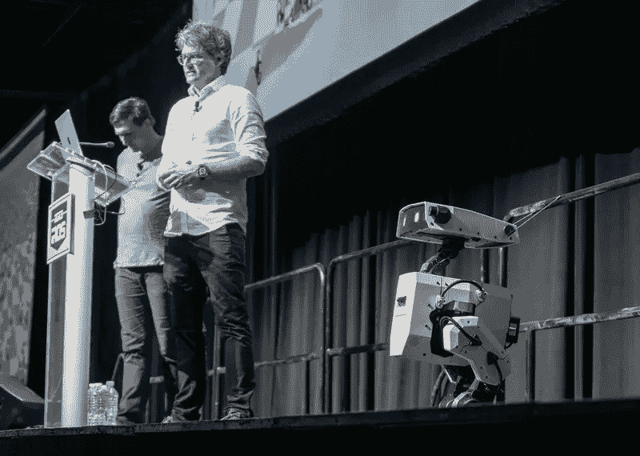

背景补充-Disney Robot

迪士尼团队自主研发了一套强化学习系统，使得机器人能够在行走过程中保持动态平衡，使机器人能够更自如地移动和适应复杂环境。为了让机器人更人性化，迪士尼还邀请了动画师将动画角色用动作表现情感的方式应用到了机器人身上，使其能用肢体语言和表情来表达喜怒哀乐等情绪。

从结果来看，中国很多公司，包括大疆、石头**、云鲸等，实际上是在那个品类已经出现了，**玩家已经定义了产品，你是在这个产品的基础上 significantly 做工程上的增强；

**例**如大疆的第一代产品就比当时市场上其他的，像那个英国的那个消费级无人机自选业务，无人机要做得更加稳定、更加好，它并不是说这个从 0 到 1 的创新品。

所以中国的很多公司因为执行力、工程能力做得好而成功的。开创全新品类的公司其实不多。绘本阅读机就是一个全新品类的事情，之前的确无人做过，我是很 respect 的。

**创业者回应：**

人才这个事情有不一样的看法，我认为中国现在一定是有这样的产品经理和设计师的。原因在于这是一个历史的发展阶段，我们在之前要先解决吃饱，再解决吃好的问题。

**别人那里有成熟的方案，你没有必要去创新**，你只有等到跟他站在同样的一个竞争维度的时候，你才有创新的动力和激励去做这些事情。

而且这个伴随着中国科教兴国的整个的战略，现在我们有那么多高素质的人了，所以这个可以生长起来，它真正生长起来是哪些人会成为这些呢？

就是在**现**有的素质教育的过程中，那些非常跳脱的，能不断做创新的人，然后他在学习、生活、工作当中都能够不断的去做创新的人。

这样的产品经理和设计师，我认为中国是有的已经生长出来了，因为这个时间点到了。就是接下来就在这波年轻人里。

**从历史上看，之前中国公司很多人是在做效率工具，如清洁、航拍，**只把某一种效率的能力做得更好，其实它是缺乏一些 creative，缺乏一些娱乐性，缺乏一些情感性的。

这种创新的为历史上中国的公司做的并不好，我认为下一代创业者，90、00 后的创业者可能在这方面会有更多的天赋。

## **2、讨论：端侧硬件能耗、存储算力**，在 AI 硬件上的一些基础上的一些平衡

**创业者分享：**

我们认为** AR 眼镜可能具有隐性优势，因为它具备佩戴舒适和第一人称视角的特点；与 VR 不同**，有 Always-on 的潜力，可以模拟人类感官器官，从人类视角理解感知世界。

目前 AR 设备面临诸多挑战，如光学元件、算力、电池等问题。高通平台是目前穿戴设备较好的平台，但其 AI 模型能力和算力有限，电池容量也受限。

**眼镜的舒适度考虑下，电池容量只有 200 毫安，相**比手表和手机较小。未来端云结合或端边人结合的架构将是解决方案，将轻量级甚至完整的算力放在端上，与大模型配合。

AR 硬件需要摄像头和显示屏来实现输入输出，这才是更接近感知世界能力的模型。因此，AI 的融合应是 AR 设备的发展方向。

## **3、AR 使用体验分享**

**某硬件团队员工：**

最近一直在使用 Rokid 的 AR 设备，感觉不错。在观看《繁花》的过程中，我对比了之前使用过的 VR 设备。

由于自己有过制作 VR 的经验，我觉得 VR 设备相对笨重，佩戴起来非常热。相比之下，AR 技术带来了更好的体验，尤其是在观看电视台播出的剧集时。

**然而，AR 技术仍有待进一步发展。今年，我认为最**大的挑战在于如何将 AR 设备打造得更轻便，使其成为一副真正的眼镜，同时解决近视问题。

我们希望这样的设备重量能控制在三四十克左右，以免过重影响佩戴舒适度。这样的重量限制也会对硬件设计和使用时间产生一定的影响。

## **4、科研人员分享**

最近，我们团队在边缘计算领域有了一些新想法，**关于模型在端边云结构中的通用性与专业性**。我们认为模型可能不需要在边缘侧具备全面的知识，而是可以更专注于特定领域的知识。

例如，刘老师团队开源的基于 MOE 的 LLM 应用和我师弟的项目，都是在训练和推理过程中只激活部分神经元，以加快计算速度。

这样的做法旨在提高边缘侧的计算效率，因为如果处理速度慢，使用传感器收集实时数据就失去意义了。在 AVP 等场景中，如果所有数据都发送到云端，通信可能会成为问题。我

们还考虑到，模型可能因为学习过多而变得不够精确。因此，我们思考是否应该进行模型剪枝，类似于 GMV 的做法，主要是为了提高速度。剪枝不仅能加快处理速度，还可能使模型在特定场景下表现更佳。

这些设计思路受到了 Dyna Bert 的工作启发。我们认为，尽管大公司可能认为加大模型规模可以解决“幻觉”问题；

但我们科研人员更倾向于停用不重要的部分，以优化性能。对于资源有限的创业团队来说，这是一种实际的方法。

背景补充-Dyna Bert

基于 Transformer 模型的动态自适应模型，根据任务需求调整模型的宽度深度，将原始大模型缩小为合适的小模型，以在性能、效率和可解释性等取得平衡。

# **#四、当前可见的AI硬件产品吐槽，AI n**ative 硬件杀手级场景会在什么地方？

## 1、讨论：VR 究竟能成吗、什么时候能成？

**投资人分享：关键因素包括：1、芯片公司足够重视；2、技术**上续航和体验达成平衡；3、消费者接受心理

首先高通需要推出 R1 级别的芯片，苹果已有 R1 芯片，但还不够，VR 在中国市场的接受度取决于消费者心理。如游戏主机在中国销量不佳，消费者难以被说服购买。

随着创新者的出现，这个问题有望解决。目前，PICO 等 VR 设备因无法高效办公而难以让大家找到借口去买。

苹果实现了良好整合，但头戴设备仍不适合要交流的办公场景。市场的打开需解决技术上续航和产品体验的平衡问题，以及消费者心理接受度问题，什么时候消费者能接受？

要么是往办公场景走**，要么是消费**者能够接受“我就买个游戏机”，然后这样的情绪在市场中散播开后，这个事就成了。

类似地，词典笔 30 年前就已存在，但直到 2018 年才流行。这是因为市场最终接受了这项技术。

最初，词典笔用的是山寨手机芯片运行本地神经网络模型，该技术在 2016 至 2017 年就已实现。但直到 2018 年，产品体验和消费者认知才达到成熟，市场接受度才上升。

这一过程中做产品的团队并没有太多改变，只是体验和消费者认知到位，使得家长认为孩子需要这个东西。可以说有很强的外部因素。

**大厂员工分享：**

我不认同**，词典笔是个相对垂类的、历史的市场，演练过程才是**这样的。但对于 VR 来说，它是有关键节点的，在发生了某个变化之后导致它可以推向大众的。就是重量。

总体看认为 VR 的成熟点在 15-20 年。我觉得这里有两个节点：

+   第一个节点叫做说这个头显演进到一个重量上，我能够持续佩戴 8 小时的一个节点，在这个时候它可以有 PC 的场景。相当于不用买显示屏了，它是 PC 一个更大的一个屏幕。那这个场景我说足够了，我一天也只需要用 8 小时，也不需要室外场景，笔记本怎么用它就怎么用，这是第一步

+   **第二个步骤就是它更轻了**，之后我带着它出去变成替代手机，变成一个全天显示的场景了，这个更远了，但由于现在各种Micro LED 的技术，成熟时间也很难去判断。

所以核心是在这**两个情境下，他会完成，**但是具体说是哪一波，那我觉得这个波到底是多长的时间呢？

能不能明确？答案可能不取决于市场热度有多高，而是基础科学发展的自然结果。VR 要到 50 克，那就得看基础科学。

投资人回应“15-20 年才能成熟”的观点：

我认为刚刚提的 VR 在 15-20 年成熟的时间框架比较合理。有可能真的就是这样，只是我们今天的线性思维其实很难去想象 15 年、 20 年后的事情。

甚至 AGI 都可能在十年内实现，但 VR 技术可能在十五年内还未成熟。回想过去谷歌 2014 年开发 Glass 产品时，其二十几克的设计目标就是为了实现全天候佩戴。

**大厂员工：**

Google Glass 体验一般。尽管 AVP 提供的完整体验很厚，在**办公场景中效率很高，解**决了透光率和视野全包围的问题（目前通过 VST 技术解决），但形态上超越阈值了。

苹果通过 AVP 展示了在体验上可以达到极致，接下来的挑战是如何减轻重量，但目前看，AVP 仍然比 PICO 等设备重得多。

背景补充 - VST 技术

VST 技术用内置的摄像头或传感器捕捉现实世界的视频并将其显示在头显中。用户通过头显屏幕看现实世界的视频，同时可以叠加虚拟元素，常用于 VR 头显。在遮挡效果、FOV、虚实匹配、配准、亮度匹配等方面相比其他技术路径更优，但在延迟和功耗方面有差距。

**投资人分享：**

要实现 8 小时舒适佩戴，设备重量需从 650 克降至约 50 克或 30 克。电池约重 200 克，光学机构件约两三百克，这些部件的重量不随摩尔定律减少。

另一种方案是分体式设计，整体重量可与 Mac 电脑相当，但头戴部分需足够轻。这样的设计可能受欢迎，因为它能提供比 Mac 更大的屏幕。

技术瓶颈在于如何将光学处理部件的重量从一两百克降低到三分之一或四分之一，短期几乎是不可能实现的。

这是个长达 20 年到50 年的挑战。目前无明确的技术路径，任何声称 5 年内能实现的都应该被怀疑。如自动驾驶技术总被认为 5 年内可实现，但技术发展需要更长时间。

预测15-20 年是合理的，对于 AGI 的实现也是如此。有人认为 AGI 可能在 15 年内实现但也有人质疑。即使技术未能如期实现，也不影响 AGI 在其他方面结合并发挥作用。

## 2、讨论：定制化 AR 芯片 or 等技术成熟后组合创新

**投资人分享：**

芯片想要解决 AR 领域的问题，换句话说就是更好的感知能力。以地平线为例，其在推出的低成本、低功耗芯片在智能机型产品中市占率其实非常高。

这些芯片应用于扫地机器人、智能割草机以及其他物联网智能产品中。与传统的ARM 处理器比，地平线芯片增加神经处理单元（NPU）算子和特定的算法，有边缘计算能力。

地平线芯片的算力是逐年线性增长的。当前的芯片提供 5 TOPS 的算力，而新一代产品可能提升至 10-15 TOPS。这种增长于 AI 应用是有益的，但很难在低成本设备上跑。

在消费级芯片中，手机芯片要几十甚至上百美元的成本，带来 20-30 TOPS 的算力，而 Mac 芯片是 C 端市场上最强的选择，甚至能运行如 llama 2-7B 这样的大型模型。从消费电子或消费级机器人的成本角度来看，如果公司单产品的算力预算在 10-20 美元之间，可能只能获得用于智能家居的芯片。

在 AR 领域，Vision Pro 推测使用了 M2 芯片，而 R1 芯片则是一种专为实时显示处理设计的处理器。国内也有创业公司正在开发类似的产品，但从商业模式来看，由于芯片产量有限，这种小批量生产的 AR 设备难以实现成本效益。

因此，目前大多数 AR **设备仍然依赖于高通的芯片，这些芯片也是**从手机芯片衍生或优化的版本，这使得在成本上实现 AR 设备的普及仍然具有难度。

## **3、AI 硬件杀手型场景**

**讨论：硬件应用场景-摄像头案例**

起码从刚才的讨论中，我们可以初步得出结论：下一个革命性的 AI 原生应用场景可能不会出现在 VR 领域。而智能摄像头其实是一个容易忽略的应用。

例如，大约 3-4 年前开始流行的使用 5 号电池、安装在门口的智能摄像头在北美市场表现出色，这些摄像头能检测到门口的活动并在有人时启动录制。

这推动了摄像头行业的一次重大变革，并促成了许多公司的涌现，Anker 就是其中之一，它在北美每年销售大量这类摄像头。

在有了这种观测模型之后，训练成本的降低将推动围绕摄像头的应用发展。无论是用于安全监控还是前几年国内市场推出的专门照顾婴儿的“婴儿监视器”，这些特定用途的摄像头都有很大的发展潜力。

未来两三年内，这些想法可能成真。应将重点放在几颗关键的星上。主要挑战之一可能是电池技术，特别是在能量密度方面能有 10%到 20%的提升，这是关键的技术突破。

投资人分享：AI-native 的硬件产品有什么不同

我们今天探讨 AI 原生硬件的发展场景，是因为今天的 AI 与以往的 AI 有着显著的不同。这些差异体现在几个方面：

+   **文本和语音的互动方面：****特别是自然语言的交互**，这是与过去不同的一个重要方面；其次，是逻辑推理能力的增强；最后是 AI 相比原来能够更加创造性的生成一些内容，这是在大模型和新一代 AI 的泛化中大家所观察到的一个趋势

+   **在硬件产品形态中应用：**我们需要思考的是，如何将这些 AI 的新特性融入到硬件设计中。例如，如果真的使用自然语言模型来进行交互，会有**哪些新的差异化体验出现？****过去我们使用电脑和手机时，主要是**通过打字来进行交互，而现在我们开始使用语音。但在很多场景下，我们仍然习惯于使用文本交流；比如在办公室里，我们可能更多地使用飞书等文本通讯工具，像 VR 头显这类的产品，它可能更适合于那些需要频繁使用语音交互的场景。

+   **在家用场景下：**比如使用智能音箱，你可以通过说话来进行互动，而不需要触摸屏幕或在安静的环境中说话。我们需要考虑如何将这些点融入到未来的硬件产品设计中。

**创业者分享：**

正如前面的投资人所提，手机、汽车和 PC 作为三大行业，并不适合创业公司涉足。因此，我们应当关注新兴品类，其中 AI-Native 领域为创业者提供了巨大机遇。

我目前是围绕娱乐价值和情感陪伴的机器人开发，类似于音箱的升级版。正在探索媒体场景的具体位置，特别是将 AI 技术融入人的外设设备中。

除了手机配件，我们还可以考虑家庭场景，它是一个极佳的 ToC 端市场。汽车也可以视为半个家，未来可能发展成为一个移动的家。未来 Vision Pro 可能被放大成汽车大小，围绕乘客的是屏幕，苹果公司推出汽车后，外壳是个巨大的 Vision Pro，乘客周围是屏幕。该设计使光学问题不是关键，而是另一套系统。

**作为硬件创业者，我们发现音箱的变**种提供了一个小机会。特别是在大模型存在幻觉问题的背景下，寻找高容错性的应用场景变得尤为重要。

我们发现幼教场景是一个非常适合的领域，孩子们与 AI 聊天时不会太介意错误，他们可以与机器人愉快地交流。

因此，我们正在开发一个面向幼教场景的陪伴机器人，其主要功能是讲故事，结合多模态技术将故事转化为动画。

我们预计半年内视频生成技术将成熟，届时可以将孩子们的积木游戏直接转化为动画，甚至能让 3 岁的孩子成为导演。这可能是我们发现的一个能够满足局部痛点的创新方案

**大厂员工分享：**

在新闻报道场景中，比如在北京的严寒天气里，我们可能会看到外卖员戴着手套的情景。我认为这是一个值得深思的问题，最终需要考虑的是软件层面。

例如，美团这样的公司如何简化外卖员的终端操作界面？他们可能推出一个简单易用的设备，但关键在于外卖员何时会认为他们的使用体验需要通过硬件来提升。

我认为，不同的人群、国家以及气候条件下，对硬件的需求差异很大。例如，北方地区的人可能需要戴着手套操作设备，这可能会带来不便。

目前，正在开发智能组合交互工具，通过语音交互，并计划在此基础上加入 AR 功能。

## 4、OpenAI 会下场做硬件吗？

OAI 不会随意进入某个领域，只有当某个东西具有实际意义时，OAI 才会考虑涉足。对于 OAI 来说，做 AI 芯片是有意义的，而其他领域暂时看不到意义。

一个明确的共识目标是，**大家都希望 AI 能帮助最终完成任务，无论是从信**息处理端改善体验，还是从执行端改善体验。目标是缩短从需求到任务完成的全过程，提高效率。

目前，OAI 正在做的事情是从 GPTs 开始，可能发展到 Search+GPTs 和各种其他功能+GPTs，显然未来的趋势可能是这样的。

如果你给 GPT 配备一个硬件，比如 AI Pin，你可以将它挂在身上，将所有的能力与之相连，这对于 AI 硬件的未来可能产生重大影响。

我个人认为，结合实际情况，在硅谷组建一个这么大的硬件团队是非常困难的。此外，尽管我们有很多好的想法，但将这些想法具体化并落地实施是困难的。

我们可能**考虑制造机器人、机械臂甚至手机，但目前对于 O**AI 来说，它可能也没有完全明确的方向。因此，如果方向不明确，组建团队也会面临挑战。

总体看，根据我对 OAI 的了解，尽管 OAI 资金雄厚，但如果它选择进入硬件领域，目前可能只是作为一个 OEM 集成商。

最有意义的事情可能是制造芯片，类似于地平线公司那样，这可能是对 OAI 最有意义的一个方向。

## 5、AI native 创业是更容易了还是更难了？

在之前的讨论中，我们探讨了**许多垂直领域的应用场景**，但由于这些应用是基于大模型，它们很容易被更广泛的 AGI 覆盖。

**AGI 的处理能力更加**庞大，能够处理更加复杂和大量的数据。AI 模型依赖于输入数据的粒度，需要分析当前的具体场景，因此它依赖于多模态的输入和充足的信息源。

**由于 AI 不再**依赖于精确的操作，对于粗粒度的任务和指令，它需要对来自不同数据源的信息进行更强的分析。

例如，我们之前讨论的许多家居场景，实际上更需要一个完整的生态系统。这些场景并不是失去制造小规模硬件的机会，而是更多地关注于构建生态。

构建生态系统的最有吸引力的部分在于能够整合不同的信息，描绘出用户画像和需求，使得通过简单的语言指令就能实现最终效果。

**大厂 VR 员工分享：**

+   硬件发展到今天，我认为已经没有什么新的东西可以做。但是，我对 AI 的了解可追溯到十几年前，我之前对其持怀疑态度；但最近我看到了 ChatGPT 和其他 AI 产品的实际应用，我发现 AI 确实有用，它既有吸引力又有实用性，这本身就很难得。

+   我认为关键在于，无论是大公司还是小公司，都可能会有新的机会。但是，这个机会在哪里？今天我听了一圈，至少可以听出，大家还没有形成共识。

+   相信大公司的人也不清楚。当然，这样才有机会创新，才有新的突破点。可能会有一些随机的机会出现，或许能出现一个真正理解如何去做 AI 硬件的旗舰公司。

AI Native 硬件：端侧 AI 革新将至，希望各位创业者和从业者们可以在 2024 取得新的进展和突破！