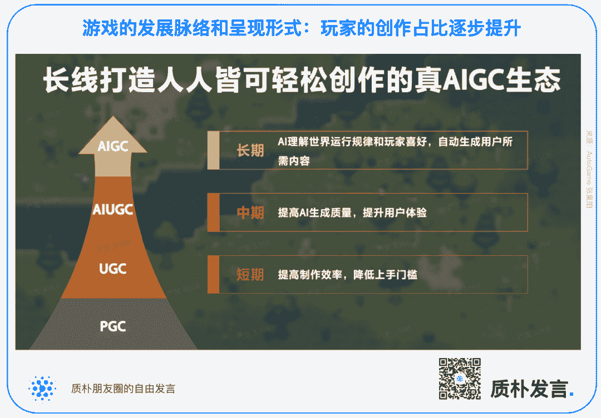
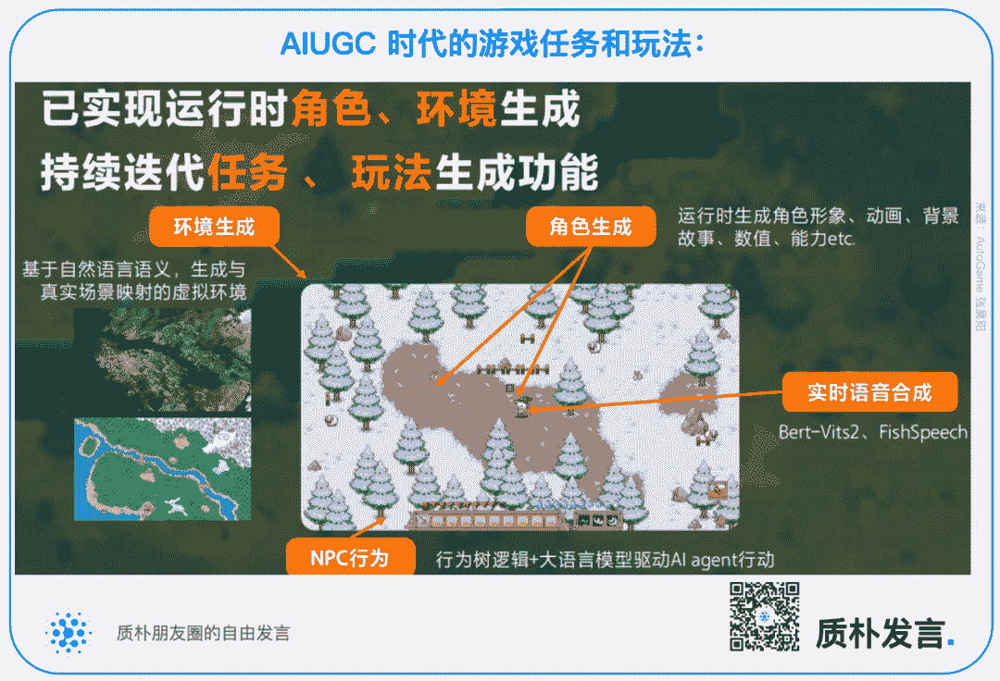
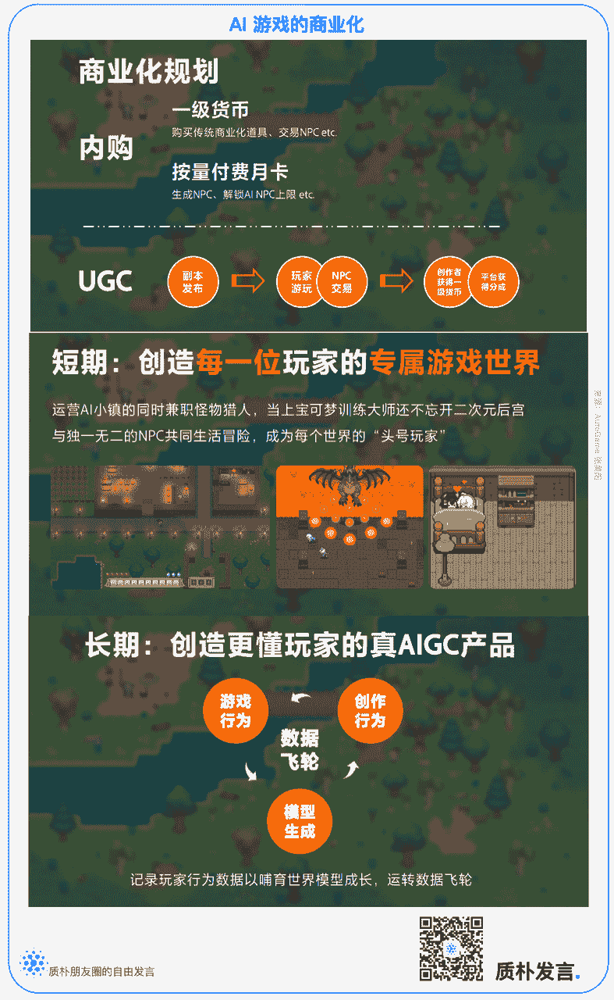
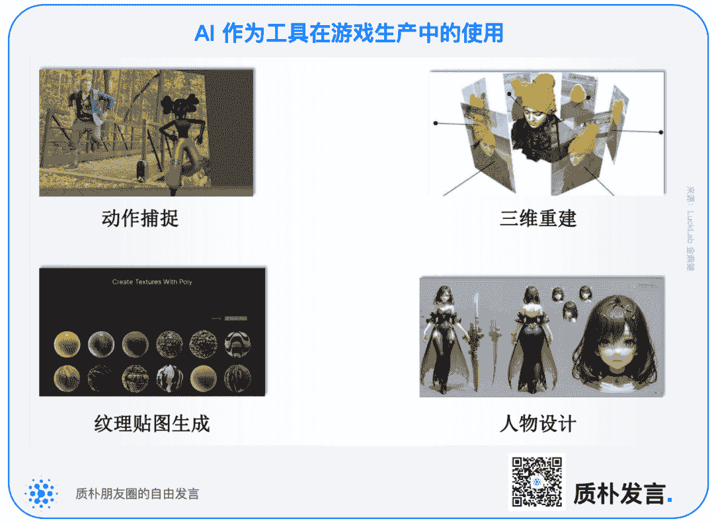
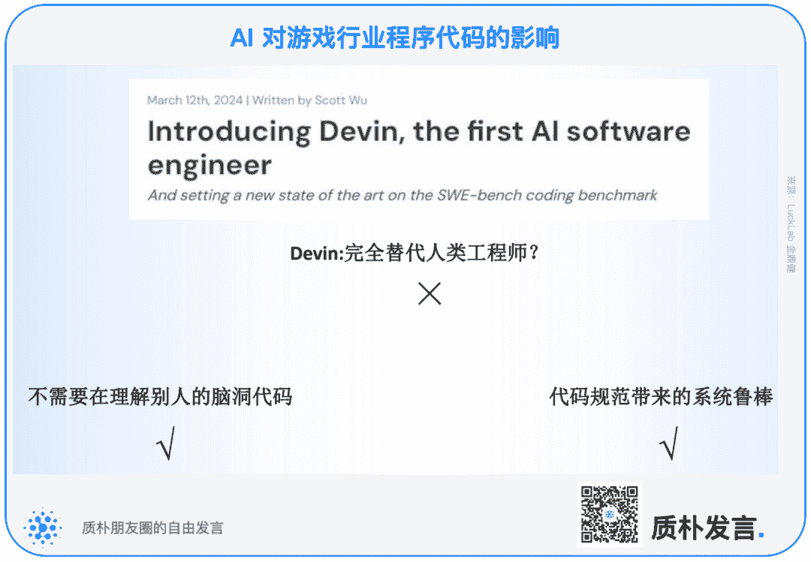
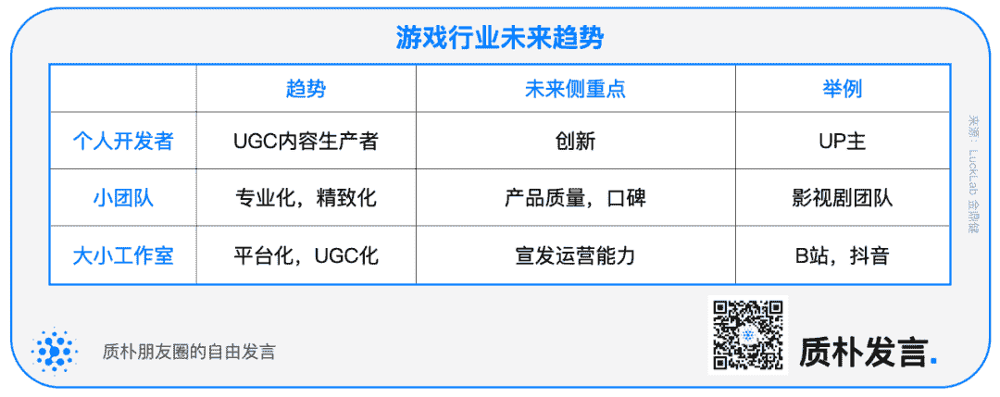
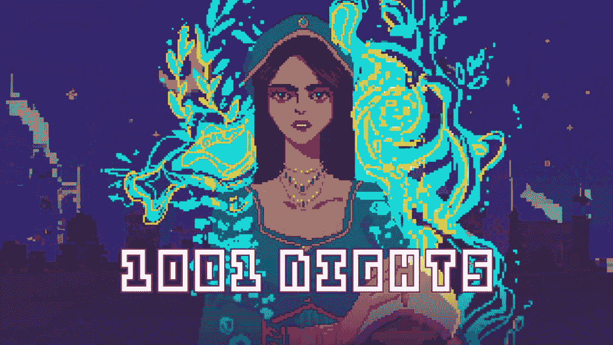
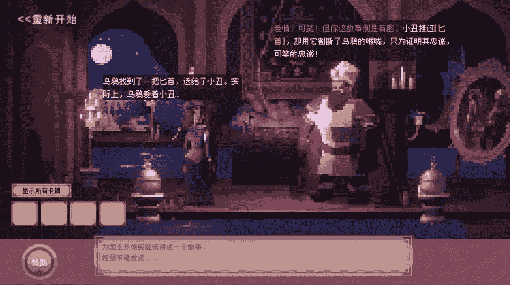

# 质朴发言：吐血整理：AI 大模型浪潮涌动游戏范式革新｜Z 沙龙第 9 期

> 来源：[https://waytoagi.feishu.cn/docx/SpaKdCzhPo2oWTxoSmAcj8e2nig](https://waytoagi.feishu.cn/docx/SpaKdCzhPo2oWTxoSmAcj8e2nig)

原文链接：https://mp.weixin.qq.com/s/IRekQtHS6CUJDRw22Jr9aA

来源：质朴发言

发文时间：2024.04.12

**编者按：Z 沙龙第一次来**到上海，与 GameTrigger 一起 host 了一场游戏从业者及 AI 从业者畅所欲言的沙龙活动。

不仅讨论了 AI 如何与游戏结合？过程中存在哪些问题，还从实操层面讨论了“多结局”“游戏资产/全要素生成”“NPC 行为”“监督强化学习 AI”等问题。

我们还有幸请到了两位同样从大厂游戏工作室出来创业的年轻又优秀的创业者：17 和鼎健；

他们 share 了非常多游戏行业的 insights，而这些 AI+游戏的 insight 也正是他们迈出创业一步的内在思考与源动力。

本文尽量还原了在场所有嘉宾的讨论和“去立场”发言，编者节选了一些有意思的话题放到这里：

+   做星露谷物语的 AI 版，思考《元宇宙的厕所会堵吗？》?

+   模型输出不稳定的情况下，如何实现：TPF：Technology Product Fit？

+   《底特律变人》、《博德之门 3》，我们怎么面对 AI 生成的更多结局保证玩家依然买单？

+   伊甸岛和赛博斗蛐蛐烧 tokens 的背后，怎么优化，我们能从中找到乐趣吗？

+   《决战拜年之巅》这类 chatbot 应用爆火后，用户有哪些有意思的反馈？

+   投资人该如何投资 AI 游戏、一级市场对于 AI 游戏怎么看

+   《一千零一夜》这样 AI 原生的游戏，游戏策划如何让整套体验闭环，玩家愿意买单

+   沙盒类/像素类/卡牌类，数值策划和玩家行为模拟，“AI+”能“+”在哪里？

具体的答案还需要读者们到文章中去找，整理不易，欢迎大家转发点赞在看😄。

此外，开场自我介绍环节，每位朋友都推荐了自己喜欢的游戏，所以我们整理了这次沙龙大家围绕AI+游戏产业链的话题；

也在最后附上了一份精心整理的游戏 list，如果你也是一位游戏爱好者的话，也可以跳转文末，看看有没有你心爱的游戏上榜，对介绍感兴趣的话，去玩玩看吧～

[**游戏创作不**](http://mp.weixin.qq.com/s?__biz=MzkyMDU5NzQ2Mg==&mid=2247483667&idx=1&sn=b0bf8af76ea56c21ec294ed2a9d316a5&chksm=c19127aaf6e6aebc1d23d1c8f9092818d99ea422c25e1a2eb6d18f4afc1283f7bae40750090d&scene=21#wechat_redirect)**易，如**果你是一名AI+游戏创业者，欢迎联系 Z 计划😎！

我们愿意提供 GLM 系列大模型 tokens/现金/技术支持等等，来帮助大家更好地迭代产品，让游戏的快乐更好地分享给每一个人。

> **目录 ****建议结合要点进行针对性阅读****。👇**

> 一、引言：AI 大模型浪潮带来了什么

> 1、游戏与生成式 AI 的发展趋势

> **二、游戏+AI 制作讨论**

> 1、如何设计一款 AI 游戏？

> 2、什么样的游戏算是好游戏？

> 3、游戏与 AI 的结合会产生哪些问题？

> 4、AI Agent 的演绎如何能收敛到预设的故事线？

> 5、游戏的多结局是目的还是手段？多分支游戏内容对于玩家意味着什么？

> 6、AI+游戏未来如何发展？

> 7、AI 如何重塑游戏制作？

> 三、资本市场如何看待 AI+游戏

> 1、投资人观点

> 2、投资机构观点

> 3、投资游戏是否值得？

> 四、昊阳：从 PGC 到 AIGC，AI 是如何改变游戏的？

> 1、未来的游戏形态：全要素生成

> 2、游戏的发展脉络和呈现形式：玩家的创作占比逐步提升

> 3、AI 游戏的商业化

> 五、鼎健：从开发、玩法和行业的角度看 AI 给游戏领域带来的变革

> 1、AI 作为工具在游戏生产中的使用

> 2、AI 可以带来的新玩法

> 3、对于整个游戏行业可能会有的影响

> 4、AI 加游戏具体该怎么做

> 六、真·AI 大模型游戏到来前，还要再讨论清楚的一些事儿

> 1、仰望星空和脚踏实地：对于“用 GPT-5 做产品设想” 的讨论

> 2、从具身的角度出发看 AI 大模型游戏

> 3、新 AI 游戏的诞生面临的困难点、阻碍以及解决思路

> 4、适合与 AI 大模型结合的游戏画像

> **附录：沙龙嘉宾推荐游戏**

# #一、AI 大模型给游戏带来了什么

## 1、游戏与生成式 AI 的发展趋势

+   **游戏在品类上创新**，随着大的带宽和生成式 AI，一些新的品类会运而生，比如说互动的交互、互动的游戏、互动的短剧。

+   **游戏在品质上提升**，Vision Pro 这类产品的出现，给用户视觉效果上带来创新。VR、MR 的游戏项目品质也会提升。

+   **游戏合规化**，推动产业健康发展，去除黄赌毒的内容

+   **游戏的全球化，**国内的游戏卷去海外，改一个语种还是有很大发展。

+   **游戏工业化**，AI 辅助游戏的开发，加上游戏以后端构建服务，这里面其实还是有很多应用场景。从技术项目来讲，就是既服务于开发者，也服务于这个发行商。

在生成式AI 领域，值得关注的三个话题：

+   **游戏内容辅助生成，**生成文、生成图、生成 3D 以及生成音乐。应用分为两个场景，一个是游戏策划人和制作人，第二个是美术的设计师。

+   去年开始，听的较多的是基于 Stable Difussion 的生成。对于工业化的游戏公司，它能够通过 2D 美术素材的辅助生成提高创业效率 50%，降低 20% - 80%的成本。

+   文生图：提示词加参数就可以形成 2D 的参考图，适配度是非常高的，可能一开始用 SD 或者其他的开源工具去做。

+   图生图：原画师或美术会使用，用一个线稿或原画，在原画基础上加一些 Prompt，加一些参数，就可以形成一个效果图和二级的素材，这种情况会越来越多的。

+   动画辅助渲染：用 Lora 对角色背景、关键帧进行风格渲染。例如，用真人视频渲染成二次元风。

+   **游戏的智能运营，**包括智能 NPC 互动、客服、攻略的问答、代码和脚本的生成。主要针对游戏的产品经理、运营经理和社区的运营经理。

+   智能 NPC：保持长期记忆；保持人物个性和对话表现形式；满足成本平衡

+   游戏社区运营：海外 Discord，国内 Fanbook。让更多的玩家在游戏之外，在社群里面很好的互动，如基于游戏的美术素材二创、对于攻略的查询和智能客服。

+   **游戏的 Agent，**游戏的智能体会对于数值平衡、玩法平衡、对战机器人以及玩家模拟做很多的事情。

+   **数值策划：**通过强化学习可以进行自动化的数值和玩法的平衡，可以让自动化的测试替代人工的测试。

+   例如，卡牌游戏打 1000 局人工需要 50 个小时，但是用 AI 测试， 17 分钟就可以完成，在 1000 局过程中，可以调战斗值、防御值。

+   **玩家行为模拟：**在自博弈的训练中让机器代表攻击方和防守方，模拟玩家的行为；最终提升玩家的留存率、在线时长、活跃度和付费率；

+   技术可以用到深度强化学习 DRL，以此来训练不同等级的 AI bot 模拟玩家。

# **#二、游戏+AI 制作讨论**

## **1、如何设计一款 AI 游戏？**

一位恋爱游戏制作人分享了他的心得：

+   过去的叙事是编剧加 CV 的模式，在 AI 时代是要改变的。我们也在探索怎么把过去的故事桥段打碎，像现在短剧的形态，每个桥段体验两三分钟。但是同样的桥段由于个体的记忆不同，比如说我喜欢猫，你喜欢狗，当我看到一只猫的时候，我们的对话是不同的。

+   我们使用 Multi Agent 的架构，Agent 背后有一个董事会在开一个私董会，整个 long term 的记忆保持用户的偏好

Multi Agent：一群能够交互、协作、竞争或者彼此学习的智能体。这些智能体可能是软件（如虚拟机器人、算法或模型）或硬件（如机器人）。

多智能体系统在多个领域都有应用，例如在自动化控制、社会模拟、资源管理和电子商务中。

这些系统的设计和实现涉及到复杂的交互和协调机制，以及对智能体自身决策能力的研究。

## **2、什么样的游戏算是好游戏？**

**一位游戏投资者分享：**

+   游戏是一种对生活的模拟、抽象以及艺术化的再创造。有时候我们不用去深入探讨，Tech 是怎么样的，是怎么实现的；而是回忆一下曾经有没有心动过某个人，有没有暗恋过某个人，甚至谈恋爱，其实就是要把这些收集起来，以产品的形式做出来。

+   对于 AI+游戏，有些开发者会跟我聊 Roguelike，其实大家想去聊里面的随机性、策略性的制作，有三个很重要的因素。

+   **资源管理：**所有做的好的 Roguelike 游戏都是资源管理，我们的资源流量是有限的，例如背包乱斗里面用户有有限的金币和有限的背包格子。

+   用户要做抉择，先赚更多钱去买更厉害的装备，还是慢慢成长。要强调 Roguelike 的复玩性，当游戏失败后，用户会认为是自己的问题，而非策划的问题。

+   **风险博弈：**所有设计师的设计思路都根植于用户的日常生活，例如，玩家实现 10 回合胜利，游戏会问见好就收还是再来进取。

+   **题材包装**：游戏虽然有缺点，但包装的很好。将用户生理体验对秩序的理解放进游戏中

+   目前设计的游戏，我们很**看重能否激发玩家的欲望**，玩家能否自己做策略去不断的调优。AI 游戏并不是全靠技术解决问题，底层逻辑是人性，只是借助 AI 将它放大。

+   Roguelike 游戏存在策略退化的情况，玩家玩通关后大概率不更换策略，因为越到后面风险越大，人会倾向于保守。这个时候用户玩的不会是新内容，而是自己擅长的。

+   Roguelike 游戏前期的学习和策略的随机性是玩家喜爱的，但要避免后期大家玩法的同质性。如果涉及到社交，社交平台上用户的攻略可能会趋于一致。

+   游戏设计本身需要降低用户游玩门槛，玩法更加多元。

**Roguelike：**是欧美国家对一类游戏的统称，是角色扮演游戏（RPG）的一个子类，始祖游戏 Rogue 被评为史上最伟大的游戏之一；

所以Roguelike代指模仿始祖游戏而衍生的各种游戏；随机生成各种事物，这个特点可以说是 Roguelike 游戏最核心的要素之一；

玩家开始的每一次游戏过程都是全新的游戏过程，场景，敌人，宝物，技能等所有事物都会进行随机排列；

每一次游玩过程都是独一无二的，这样设计的最大优势就是可以大幅度地延长玩家的游戏时间，增加玩家粘性，让玩家每次游戏都有新鲜感。

代表游戏：Hades、死亡细胞、杀戮尖塔、以撒的结合

**一位独立游戏开发者分享：**

很多游戏的制作者，他们做的游戏其实都是兴趣驱动。比如说像黑羊的作者，他的作品其实是他自己的亲身经历，加上自己想表达的东西。

像去年比较火的火山的女儿，那个产品拿出来大家都会觉得不可能。因为这种题材太老套。但是他们做出来就是成功。

**背包乱斗：**一款非即时制 PvP 类自走棋玩法的游戏，于 2023 年 5 月 30 日在 Steam 上开启 Demo 阶段测试。

相较于自走棋竞争较为激烈的传统玩法融合模式，背包乱斗将较为创新的背包管理玩法和自走棋进行结合的玩法设计较为新颖。

游戏链接：https://store.steampowered.com/app/2427700/_Backpack_Battles/

**火山的女儿：**一款美少女养成游戏，玩家将在剑与魔法、炼金术盛行的火山国抚育女儿不断成长，而玩家和女儿所做出的决定可能会影响到整个火山国的未来。

游戏链接：https://store.steampowered.com/app/1669980/_/

## 3、游戏与 AI 的结合会产生哪些问题？

**a. 生成质量不稳定**

传统游戏的方法论在AI 上会失效。设计师对于游戏的美学、文学、玩法都有很高的要求，但是 AI 生成的质量不稳定，做不到理想中 100%的水平。

**一位游戏制作人分享：**

+   我们自己做过类斯坦福小镇游戏——伊甸岛，这款游戏既是一个游戏，也是一个基于 Generative AI 的社会实验虚拟模拟。

+   要思考这项技术的成熟度，与其他产品相比，如存在多年并用类似 GPT 技术的 AI，我们的产品有何不同？如果将其置于虚拟世界中，是否会使这个 Agent 更实体化？我们从设计上规避了一些 AI 的不成熟之处，类似 TPF。我们当时的规避策略是不让生成式 AI 去完全生成剧情，它不再是一个“上帝模型”。我们让每一个 AI 都有自己的角色身份，然后通过 AI 与 AI 之间的互动，AI 与玩家之间的互动，产生一些可以归纳枚举的游戏行为。最后进行剧情包装时，我们让 AI 根据自身和玩家的行为，通过大语言模型进行二次创作，生成的内容有点像 AI 剧本杀。

+   **从**功能性角度，类似 Character.ai 的 Agents，我们会采用几种方式来提升我们的 Agents 的效果。

+   我们会进行检索增强生成（RAG）。我们会给每一个 NPC，包括游戏中玩家自创的 NPC，设定一些关键词，包括他们的身份、背景、口头禅和可能的性格等。在这个检索增强生成的框架下，会给他们一些提示词进行约束。他们就不会告诉玩家他们是一个 AI 助手，而更像一个游戏中的角色，这样会增强玩家的代入。

+   我们不仅需要在 AI 模型层面下功夫，还需要在产品层面做很多工作。我们需要让 AI 在游戏中更真实，能够感知环境，因此需要在游戏中打一些标签。例如，我们有一个游戏的 NPC 在酒馆环境中，我们需要让程序能够判断这个区域是酒馆。甚至，未来可能会有一些多模态模型的能力也能用在上面，通过截图来识别 NPC 在什么样的环境中。这样的设计会给玩家带来更好的游戏体验。

+   一般的 AI 像一些 CI 类的产品，只**是**与用户进行对话或者让用户想象一些场景。在提示词工程或Instruction 中要求它进行动作描写、环境描写、行为描写，以及匹配到游戏中的枚举行为，最后加上它的话语会让整套的人设、效果会更好。

TPF：Technology Product Fit，技术产品匹配。由王小川在极客公园创新大会 2024 上发表。

王小川看来，大模型带来的新的开发范式下，产品经理的出发点，应该从思考产品市场匹配（PMF），到思考技术与产品的匹配怎么做，即 TPF（Technology Product Fit，技术产品匹配）。

网站链接：https://www.geekpark.net/news/329067

**b. 大语言模型没有执行工具**

**一位游戏从业者认为：**

+   构建 Agent 时要用 RAG。RAG 的来源一部分是对 NPC 的设定集，另一部分是给 Agents 增加更多感知维度。Agent 能感知很多东西，但无法完全模拟真实世界。例如，如果把斯坦福小镇的NPC 移植到星露谷物语中，想让 NPC 帮我做些事情，但他没有执行工具，玩家体验会很差。尽管大语言模型可以理解，但它无执行工具。

+   推荐一篇文章《元宇宙的厕所会堵吗？》. AI native 的游戏本质是为了好玩，游戏和真实世界的模拟是两回事。如果我们把所有的事情都塞到游戏世界，那就是元宇宙。

+   **游戏是一个节俭的经济学体系，我们并不需**要把现实世界中的所有事情都搬到游戏中去。而是经过包装，让游戏有趣，能够达成叙事目的或可玩性的目标。在游戏中，作为策划或设计者，我们设定的是 AI 的行为边界。当然，我们可以扩展这个行为边界，让 AI 做更多的事情，但这并不意味着让 AI 做所有的事情。可以从设计层面利用大语言模型，理论上，让 AI 拿起锄头是它应该做的一个行为。我们可以在上下文中给 AI 传递一个行为标签。

+   例如，让 GPT 根据玩家触发的关键词生成行为。我们在上下文对话中加入一个行为标签，然后前端读档，读到这个行为标签的时候，AI 就会停止对话，然后拿起锄头去执行自己行为树的相关逻辑。

+   不要把 AI 当作万能药，需要更聪明地利用它的优点，规避它的缺点。在一次又一次的评估过程中，让 AI 变得越来越完美，而不是一开始就期待它能解决所有的问题。

《元宇宙的厕所会堵吗？》：该文章探讨了元宇宙概念的多个方面，包括其与游戏设计的关联、玩家在元宇宙中的角色、以及元宇宙的想象与现实之间的差距。

文章指出，元宇宙的讨论要从游戏设计的视角出发，以具体和建设性的方式进行思考，同时强调了玩家在虚拟世界中的重要性，以及其对元宇宙的贡献和影响。

链接：https://mp.weixin.qq.com/s/aT-5vffsYujIFxmgilGEnQ

## 4、AI Agent 的演绎如何能收敛到预设的故事线？

+   AI native 的游戏并不是传统设计师认为的强控制游戏。游戏本身是一种交互行为，它与电影艺术的线性过程不同，游戏实际上有无数种可能的交互。在过去的游戏中，由于技术限制，无法设计无限种结局。另一方面，无限种结局在某种意义上并不一定是好事，设计师可能只想设计几种预设的结局，这取决于需求。

+   AI native 的游戏更像是一个现实世界的模拟。它能够实现用游戏模拟现实世界，让用户打开无限的想象力，包括满足玩家自我表达的欲望，以及提供各种交互手段。游戏的策划或制作人不需要强行控制玩家必须发生什么事情，而是在可选的范围内，让玩家和 NPC 能做的事情更丰富。这个范围可能是预先设定的，也可能是动态生成的，或者在版本更新时增加，以提高游戏的丰富度。

+   现在的 AI，语义理解能力非常强，如 GPT 有 function calling 的能力，它能够匹配到用户游戏内的行为，结合传统游戏中的行为树的能力，它就能够表现出这个行为。在这个过程中，它会一步一步地强化设计师设定的限制。在上下文提示词或日志中，都不会超出设定的范围，所以它是相对可控的。

+   **A**I 游戏与传统游戏的不同之处在于，它需要先见用户，或者需要做多轮的评估测试。一开始的版本可能会有瑕疵，或者不符合策划和制作人的预期。如果专门的测试和策划团队来评估模型的不足，然后反过来调整模型提示词，或者在 RAG 中加入不希望有的内容。这会使 AI 接近人类水平，最终满足设计师的需求。

## 5、游戏的多结局是目的还是手段？多分支游戏内容对于玩家意味着什么？

**一位投资者分享：**

+   多分支意味着降低玩家的不安全感。玩家选择了这条路，是不需要考虑机会成本，不需要考虑错过了什么，这条路依然很精彩，设计师需要控制玩家的心流。

编者按：

游戏的多分支可以分为**剧情多分支与操作多分支。**

**剧情多分支，**即游戏的剧情与玩家的行为息息相关，结局的走向取决于玩家不同的选择，代表作：《底特律变人》、《博德之门 3》等；

**操作多分支**，即玩家的剧情走向已经固定，但是玩家达成结局方法可以多元化，代表作：《杀手》系列。

游戏的多分支化有利于吸纳更多类型的玩家，同时大量的玩家交互也能促进游戏的打磨。

但是，多分支意味着设计师需要极其细致的打磨，使得每一个结局的导向都比较合理，对于游戏厂商来说，剧本与制作的成本会成倍增加。

随着生成式AI 的发展，或许 AI+游戏这种模式可以打破这些桎梏，多分支的游戏可能是一种趋势。

## **6、AI+游戏未来如何发展？**

**a. 从设计师角度**

**一位前光遇从业者分享：**

+   游**戏往往是一**种裁剪的艺**术，重要的**部分往往是在**舍弃的部分里面。AI** 与这种情况恰恰相反，AI 适合做不裁剪的通用任务。因为它强调的是通用人工智能（AGI）。设计师需要明确想做的游戏类型，是一个作者型游戏，还是一个服务型游戏，还是一个以无限性为乐趣点的游戏。我会倾向于创作型游戏，玩家不仅是玩家更是创作者。

+   前两种游戏类型中，AI 更多的是生产力工具，通过技术的结合在细节提效提产，让一些细节更好，从而减少人力投入。最后一种类型，叙事的收束收敛不必要。

+   在作者型的游戏中，用户是为了体验作者对生活的认知。在服务型游戏中，用户是为了满足底层的逻辑需求，为了让人类原始的乐趣被更好地视觉化。第三种类型中，更多的是创造乐趣，并且用户创造出来的产物通过其他的媒介进行多次传播。这是最适合 AI native 去做的事情。

**b. 从用户角度**

一位非游戏从业者分享了她的看法：

+   玩家首先是希望探索不同的结局方式。通过行动，玩家可以产生一个结局，这会给玩家带来很大的成就感。但我认为，大部分的游戏玩家更喜欢被动接受，他们更喜欢创作者告诉他们选择 A、B 还是 C，让他们做选择题，而不是简答题。

+   在创作者游戏中，游戏对玩家的要求也会很高。例如，Character.ai 或者是 Talkie，我的第一感觉是，为什么这个虚拟人物这么主动？还没有跟你聊上几句，就开始反问我问题。我希望虚拟人物先给用户提供足够的情绪价值，或者让用户做选择题，选择到一个用户觉得舒服的地方，用户才会开始输出。

+   目前的大语言模型以语言为主，这种摩擦感会更强烈。例如，“Glow”这样的游戏，所有的动作都需要通过括号里的细节描述。看到大家的创作，我觉得他们每个人都可以去写晋江小说。他们都是同人文的创作者，玩得很开心，但对我这样一个普通的玩家来说，摩擦感非常大。在设计游戏的时候，如果能以一种非常直观的方式降低摩擦，可能会吸引更大的人群。

+   这也涉及到游戏的定位问题，是从小众市场扩大，还是一开始就要接触一群完全不同的玩家；比如像"恋与制作人"乙女类游戏，游戏的画面感非常好，玩家可以在不了解任何剧情的情况下与它产生良好的接触。

**Glow：**一款 AI 虚拟聊天应用， 2022 年上线，4 个月内近 500 万用户。可以实现用户与自行创建或网友分享的已设计好的智能体自由或任务推动式的对话。

网站：https://www.glowapp.tech/

**恋与制作人：**一款面向年轻女性用户的以恋爱为主题的角色扮演游戏，于 2017 年 12 月 20 日发行。游戏基于抽卡养成的玩法开展。玩家以女主角的身份负责经营一家影视制作公司，历经各种离奇事件，邂逅四个不同类型的男主角，并与他们培养感情。

网站：https://evol.papegames.cn/home

**c. 从创业者角度**

**一位游戏创业者分享：**

+   关于摩擦，角色扮演这种消耗的用户精力太大，没那么多人愿意投入，可能每日活跃用户（DAU）只有 1000 万上限。我们尝试将角色扮演部分融入游戏本身的交互中。例如，"Rex 现在拿起了一个星巴克的咖啡"，或"Rex 现在盯着你右手上的戒指看了一眼，看了多少秒？"这样的情境在游戏交互中容易被提取出来，变成系统提示。

+   我们还探索了一些关于**空间的交互**，比如用户是一个男性角色，AI 代理是一个女性角色。在过马路的场景下，用户站到了她靠近来车方向的一侧。这样的交互可以通过文字描述，从游戏空间中提取出这些对象的关系，并以提示的形式传递给玩家。这时，AI 的反应可能是："哇，你好贴心，你居然知道过马路时应该站在来车的一侧。"这样的交互可以增强游戏的沉浸感和玩家的参与感。

## **7、AI 如何重塑游戏制作？**

**a. 创作者需要理解玩家**

目前，多模态的大语言模型的确定性不强，但文字类有一定的确定性。从模型的角度看，上下文的提高和总体成本的下降会促进跑团类上帝的实现。一位投资者人分享：

+   从产品的角度，制作者需要思考什么东西能够降低玩家的创作门槛。首先，这个东西最好是现实的，因为一个完全虚构的世界，玩家需要先理解它；第二，这个东西应该是有天然的多样性；第三是 AI 需要能够扩写片段文本，形成有趣的故事，并且很好地转化为社交货币进行传播。AI 虚拟女友之所以在媒体上火热，是因为大家觉得它有趣，包括年初的"哄哄模拟器"，本质上是因为大家都有共同的经历，如哄女友或应对春节的七大姑八大姨。

+   我之前跟一个制作人分享过一个观点，比如"中国式家长"这个话题，它之所以能够发行并取得好的效果，也是因为 UGC 的推动。我们都经历过高考，但每个人的高考故事都略有不同。那么游戏只需要给用户一些引导，帮用户整理脑中的高考经历；过问答的形式以及图文生成多模态的形式，帮用户慢慢地写出一个故事。有时候，故事本身可能并不有趣，但是讲故事的方式可能是有趣的，它是有悬念的。

+   随着技术和大脑的进步，我们可以在产品侧通过题材设定让玩家逐渐熟悉并开始自由创作。这种创作会被分发出去，成为一种社交货币，创作的内容还会被人看到，甚至可能会小火一把，慢慢地在社区中传播，甚至会形成一种社区文化。

**哄哄模拟器：**是一款由大模型作为底层技术的简易对话版小游戏。游戏预设了不同场景（那种情侣之间出现矛盾的时候，需要用“哄哄”技巧的场景）；

用户则需要使用自己的语言技巧在对话框中进行回复，而后判定回复的“正确与否”程度来对“被哄对象”的原谅度进行增减。

网站：https://hong.greatdk.com/

**中国式家长：**这是一款轻松休闲的模拟养成游戏，模拟从出生到成人这段过程，探讨孩子与父母之间的关系。

https://store.steampowered.com/app/736190/_/?l=schinese

**一位游戏制作者分享：**

+    GPT-4 已经非常强大，但它对于幽默感、情绪的理解识别并不很强。游戏的乐趣应该交给玩法本身。可以依靠大模型去做一些事情，但不能把玩法全部依赖于大模型。

+   很多时候，**游戏设计的灵感来自于生活。**我们应该把喜欢的东西高度抽象化，然后再去设计游戏。当觉得现有的传统游戏技术无法满足需求时，我们再去考虑 AI 能在其中做一些什么。AI 能做的事情应该是稳定的，这样才能做出一个更好的 AI 游戏。

**一位游戏创业者分享：**

+   当用户和 NPC 对话时，NPC 需要看着用户说话。当用户叫 NPC 时，NPC 会转向用户，如果它的肩膀、头和眼睛的转动速度是一致的，用户会感觉到恐怖谷。但这三者之间只有毫秒级的差别，这种细微的差别，会让用户的主观感受从恐怖变为感到被关注。

+   唯一的判断指标是这样的媒介**是否能让用户更多地感受到被爱**。如果这种被爱的感觉增加了，那么这是必要的。至于能否做或多少钱做，这是创业者要去优化的事。

**b. AI 游戏领域，对于 3D、2**D 和纯文字的选择，是基于什么样的逻辑？

**一位游戏创业者分享：**

+   从创**业者的角度来看，我们需要考虑文字游戏、2D 游戏、3D** 游戏，甚至 VR 游戏的选择。首先，你需要看你的资源是否足够。比如，2D 游戏和 3D 游戏的开发成本有大约 10 倍的差距。因为 AI 游戏的本质是 AI，需要将程序化模块、产品用户体验搭配好，需要尽量压缩美术的成本。

+   游戏，尤其是视频游戏，需要有美术的包装才能吸引用户，吸引玩家。如果是纯文字的游戏，这种模式在今天已经不算是主流了。像做 VR 游戏一样，以前在做 VR 内容的时候，人们会把全景视频甚至 360 度照片也称为 VR 内容，但真正的 VR 内容，需要更多的工作。同样，对于 Chat Bot 类的产品也是。如果只是一个简单的文字模拟，甚至只是一个好感度加减的东西，广义上可能称为游戏，但狭义上，这会偏离行业和用户的认知。

+   我们开始立项时，3D技术还不够成熟，尽管有些人认为它已经有了发展的苗头。比如，胡渊鸣在 **11 月份左右发布了 Meshy。但将这项技术应用到游戏工**业界还有很长的路要走。从游戏从业者的角度，会关注布线是否合理，蒙皮权重是否能生成，是否可以直接添加动画，以及材质等问题。这个过程中 AI 本身会有很多问题，成本也会增加。作为一个创业者，特别是在当前的环境下，需要考虑资源是否足够支撑走那么远。最终还是会选择 2D 的策略。

**Meshy：**是一款 3D 内容生成工具，包含文本转 3D、图像转 3D 以及从文本到纹理的三种方式。

公司联合创始人兼 CEO 胡渊鸣是计算机图形学知名学者，毕业于清华大学姚班，是 MIT 博士，也是「太极」（TaiChi）编程语言作者。

公司官网：https://app.meshy.ai/zh/login

# #三、当前资本市场如何看待 AI+游戏

## **1、投资人观点**

**一位游戏投资人分享：**

+   **3D 游戏比 2D 游戏更**难做，但在社交上，3D 能提供更高的社交要素。比如说你现在在喝咖啡，我不知道它是甜的、苦的，但可以观察你 3D 的表情，大概能猜出来。于是我就会问，然后你给我额外的增量，然后信息就进入 long  context 里面，成为一个很好的触发器。

+   作为投资人，要考虑供给和需求。首先，创业者要选择一个品类或赛道。在这个赛道上，不可避免地会遇到替代品。另一种逻辑是，需要考虑创业者手头的资源和资金。

+   我认为投资思维在这个问题上非常重要。你首先需要考虑用户需求是否满足最小可行产品的要求。问题解决了，再来讨论创业者是否有能力实现它。需要考虑创业者的产品在竞争中的地位。与同类产品相比，创业者的优势在哪里。

## **2、投资机构观点**

**一位 FA 从业人员分享：**

+   投资机构对游戏行业的观点大致可以分为三类。我们接触的机构相对来说，更倾向于传统的财务投资，例如双币（人民币和美元）投资机构。然而，现在美元投资已经相对稀少。人民币投资，包括国有资本投资，目前在市场上相对活跃的人民币和国资。人民币投资出现了一种情况，即他们的回购条款必须是标准化的，这并不是一个具体的金额。现在很多投资机构的投资策略更多是为了退出，投资项目主要是为了上市后的收益，大部分收益来自上市或并购。目前，游戏行业并不是一级市场的热门投资领域。

+   **对于游戏投**资，投资者**会关注两个方向**，一个是游戏+AI，另一个是游戏+Web3。传统的游戏，比如之前的米哈游，大家都错过了。原因实际上是因为游戏行业的风险相对较大，对于一级市场的财务投资者来说，它并不是一个可控的赛道。很多时候，尽管从逻辑上看，投资看似可行，但在实际落地过程中，是否真正有数字支持，这是一个难以理解的问题。

+   大家认为 AI 在游戏中引入了一些非常不同的变量。通用人工智能的核心在于理解和生成，这为交互提供了良好的基础。游戏，因为其生成内容、故事、叙事和世界观的能力，为通用人工智能提供了一个优良的环境。对于通用人工智能来说，游戏场景提供了巨大的想象空间，尤其是结合元宇宙和未来的开放世界等概念，这些都是投资者看待游戏和 AI 融合的出发点。

+   目前游戏也是 AI 应用的一部分，大部分的 AI 投资（90%）都集中在基础模型上，比如智谱、minmax 等。剩下的 10% 的投资可能分布在几个方面，包括基础设施、具身智能以及应用，其中游戏是应用的一个重要的点。但在应用这一块，大家都比较理性地看待数据，通常会参考 10 倍的年度收入（ARR）作为估值。

+   目前，所有的 AI 产品，在国内最大的就是豆包，它的注册用户有 1,800 万，日活大概是两三百万。像情感陪伴领域，日活相比于传统的游戏，数字相对较少。在国内，月活突破 1,000 万的游戏产品大概有 50 个，包括 APP 和小程序。

+   **AI 游戏实际上有一**个核心问题，就是如何与用户更多地对齐。人与人之间的理解是非常困难的，比如我和一个刚认识的人交流，如何更多地了解这个人？我觉得时代性是非常好的一点，我们这一代人有共同的经历。另一个可能偏向玄学，是星座和星盘。

+   游戏中存在个问题，是当游戏 Agent 与用户进行交互时，如何更多地展现自己？在一个快速的陌生环境中，如何破冰？这个 Agent 如何收集到更多的有效信息？我觉得可能在这个时代，甚至像星盘这样的工具，通过相对简单的输入就能得到大量的信息，这是非常有意思的。

## **3、投资游戏是否值得？**

**一位游戏投资人分享：**

+   **投资游戏这件事被很多人看低**，因为它确**实不符合**投资和资本的运**作逻辑。一方面是监**管问题，另一方面是要达到IPO 的要求。很多游戏已经赚了很多钱，可能有些头部创始人身价很高，但压力也巨大。从这个角度来看，我们的考量AI 项目有两种逻辑。

+   第一种逻辑，**把游戏做好大家分利润。**对于项目大概预测未来的利润区间，然后规定条款，当上线后，一年内的现金净利润达到某个预设的门槛就开始分红。

+   另一种逻辑，**海外更倾向于通过并购来实现增长**。像 TikTok、Embracer 这样的公司，就是通过并购不断扩大规模，从而获得利润。对于创业者来说，这并不是坏事。在资本市场融到了钱，创业者才有资金招募先进的生产力，有先进的技术，做出更出色的游戏，才能一步一步走上去。

+   Agent 很有可能就是在帮我们创造社交货币，构成新的网络连接。如蛋仔派对、光遇，不是我们想象中的社交，如颜值、经济、社会身份社交，它是基于游戏的。在传统观念里，我们可能只是认识了对方，但在不同的游戏中，我们都可能通过社交来构建新的关系，无论是剑网 3、蛋仔、原神，甚至是游戏外的社区的线下社交。可能的方式是聚焦游戏化的模式，构建好的目标感、商业化逻辑，再加上一些好的选材，让更多的人产生社交网络的效益。

+   还有一种思路是社区化，进行**创作者经济**。设计师搭建了大舞台，有了大模型作为一个发动引擎，有些是 PUGC 的创作者，他们创作一些好的内容，吸引更多的人；他们既是贡献者，也是用户。平台有了足够的流量，就能接广告，然后 PUGC 的人可能会赚到钱。

**一位投资从业人员分享：**

+   回购条款是标准条款。有两类，一类涉及到个人回购，一类涉及公司集团回购。目前来看，可能比较 Founders 友好的是公司回购，即整个集团回购。如果涉及个人回购，可能是以在公司取得的所有股权和利益为限，这相对来说会比较有保障。但如果涉及到创始人的个人资产，那风险就会很大。

+   对于投资退出，一般的方式是通过上市或并购。财务投资人通常不会要求分红，他们更多的是通过上市或并购来退出。现在的情况更像是击鼓传花，只是由于 IPO 受限，大厂并购的机会不多。因此，退出的阻力增大，这个时候投资人的一个诉求就是希望持续造血，等到这个寒冬过去。

+   **投资人对于数字会很关注，**尤其是之前有大额亏损的项目，现在可能就很难接受。尤其是应用层投资，因为应用层项目非常的多，有两类；一类其实是生意，不需要去上市、并购，不需要 fancy 的团队、很强的技术、壁垒，但很能赚钱。这种项目市场可能不看好，但它是很好的项目，闷声发大财。

+   一级市场看好的项目需要论证自己的地位，游戏行业是一个周期性很强的行业，有些游戏可能无法持久吸引玩家，留存率很差。这些游戏的日活、月活和留存等数据也会有这样的问题，它们会有一个周期，甚至一些头部的大游戏也会遇到这样的问题。游戏的投资周期和退出周期很长，可能需要十年，而在这个过程中，游戏可能就消失了，这也是资金匹配度的一个问题。

# #四、昊阳: 从 PGC 到 AIGC，AI 是如何改变游戏的？

Autogame创始人 17 （张昊阳）给我们带来了他对于 AI 改变游戏的思考。

## **1、未来的游戏形态：全要素生成**

我之前写过一篇文章叫《“全要素生成”会是未来的游戏形态吗？》，其中盘点了可能的未来游戏形态，以及和 AI 结合的各类游戏。

我提出了一个概念：全要素生成，即游戏里所有游戏元素都可以通过实时生成的方式由玩家创造；

相当于作者提供了一个舞台，让玩家基于舞台去体验自行创作游戏的乐趣，落地到产品就是 Magi 这款游戏。

**其形态是可交互、可交谈的 AI NPC 和 Agent，并且有着千人**千面的游戏故事线。每一次和角色的互动都是实时根据玩家之前提供的文本来进行演绎的。

**游戏提供的自然语言编辑器就是玩家打造自己游戏世界的异次元工具，游戏**里的角色、环境、任务，甚至是玩法都可以通过自然语言驱动的 UGC 编辑器来实现。

“全要素生成”会是未来的游戏形态吗：文章探讨了 AIGC 在游戏领域的应用，包括基础应用、上层应用、技术瓶颈、法律风险，以及对未来游戏形态的展望。

1、AIGC 在游戏领域的基础应用：

+   文本生成：AIGC 可以用于生成游戏策划案、角色属性表格、故事情节等。

+   图像生成：AIGC 技术能够辅助设计游戏原画、场景、图标等。

+   音频生成：AIGC 在音乐创作和声音克隆方面有所应用，可以生成游戏音乐和角色配音。

+   视频生成：AIGC 能够根据文本或图像生成视频内容，用于游戏剧情和动画制作。

+   三维生成：AIGC 在 3D 模型和场景生成方面有广泛应用，包括使用摄影测量技术和 NeRF 生成技术。

+   策略生成：AIGC 在游戏 AI 行为和任务调度方面提供了新的解决方案。

2、AIGC 在游戏领域的上层应用：

+   AI NPC 和虚拟人：AIGC 技术可以用来创造更加真实的非玩家角色和虚拟人物。

+   数字人社群：AIGC 可以创建由 AI 驱动的社交网络，使得 AI 角色能够互动和交流。

**3、AIGC 热点话题：**

+   技术瓶颈：如大语言模型的长时记忆问题和模型参数量的限制。

+   产业冲击：AIGC 对游戏产业的影响，包括对游戏开发者工作方式的改变。

+   法律风险：AIGC 带来的版权问题和合规性挑战。

**4、“全要素生成”未来展望：**

+   概念提出：未来游戏可能完全由 AIGC 技术生成，从故事情节到游戏世界。

+   科幻电影中的情境：文章提到科幻电影中的场景可能因 AIGC 技术的进步而变得更加真实。

链接：https://www.youxituoluo.com/530782.html

我自己是算法出身的游戏客户端，也做游戏的设计，我提出了一个 Multi Agent 的架构，能够通过我们自己设计的这套架构针对性地实现高度注释、高度解耦和高质量。

这里解释一下：我想让 GPT 帮我生成游戏的代码，但是如果传统地命令它去直接生成的话，可能会像人类在一个模块上堆特别多的功能，这样产出就很臃肿。

如果从游戏侧去改变 API 的实现方式，再让大语言模型去学习的话，它就能够实现比较高质量的游戏代码生成。

我们自己搭的框架快速在 UE 引擎当中去创作新的 Flappy bird 游戏、 2048 游戏，以及事先生成些小人物，我们的游戏就是提供了自然语言 UGC 编辑器的能力。

23年 10 月 AutoGame Research、X-in**s**titute 和 USC 联合发布论文 GameGPT: Multi-agent Collaborative Framework for Game Development

游戏开发中一个多智体协作框架GameGPT，提供了一系列方法来缓解冗余和幻觉两个问题。

方法包括与几个内部词典的双重协作（dual collaboration）和分层方法，减轻规划、任务识别和实施阶段的幻觉和冗余。用一种解耦方法实现高精度代码生成。

+   AutoGPT 使用 LLM 智体来处理现实世界的决策任务，从受监督的学习者那里获得次要意见以提高性能；

+   HuggingGPT 使用 LLM 作为控制器来协调复杂人工智能任务的完成，将 GPT-4 集成为批评者来评估决策准确性；

+   MetaGPT 引入了一个多智体框架，可用于自动化各种软件的开发；CHATDEV 框架利用智体增强软件开发过程中各种角色之间的协作。

GameGPT框架是用于游戏开发的多智体系统。为了解决 LLM 的局限性和游戏开发的时间限制，将不同角色的多智体集成到框架中。

GameGPT以协作方式运行，呈现双重协作方式。首先，LLM 和特定任务的专家模型之间合作，加强决策过程。

其次，协作发生在不同角色智体之间，有助于决策纠正并最大限度地减少 LLM 的幻觉。

GameGPT 框架运行五个不同的阶段：游戏开发规划、任务分类、代码生成、任务执行和结果摘要。

在接收客户端的请求后，游戏开发管理器启动规划阶段，创建任务列表。游戏开发工程师利用专家模型准确确定任务类型及其相关参数。

游戏引擎工程师与游戏开发工程师一起生成代码和脚本。在头三个阶段，加入三位批评者，减轻与幻觉和冗余有关的担忧。

在结束这些阶段时，游戏引擎测试工程师承担任务执行，并随后生成一个全面的结果摘要。

论文介绍引用：https://zhuanlan.zhihu.com/p/681934172

原文：https://arxiv.org/abs/2310.08067

## 2、游戏的发展脉络和呈现形式：玩家的创作占比逐步提升

a. Before AIUGC: PGC →PUGC→UGC

+   PGC 最古早，专业厂商做内容生产

+   PUGC 是厂商提供地图编辑器，专业玩家通过地图编辑器在短期内做新玩法，比如从魔兽编器里跑出的 Dota，又从 Dota 的编辑器里跑出的自走棋等等

+   UGC 成为新潮流，包括我的世界、Roblox，网易的蛋仔派对、腾讯的圆梦之星、原神等等， UGC 已经慢慢成为——尤其是大 DAU 游戏——高活跃度游戏的标配

UGC能够延长游戏生命周期，带给游戏生命力。

以往的游戏上线后的 DAU 会慢慢下滑，而有了 UGC 属性，就多了自传播属性，且满足玩家的创作和愿景需求，长远看可以诞生新玩法，DAU 会相对平稳甚至逆势反增。

**b. During AIUGC：AI 的能力让 UGC 的门**槛越来越低，并且大大提升了生成内容的质量

以Midjourney 为例：没有 Midjourney 的时候，创作有不矮的门槛，普通人创作需要花费很多的时间；

Midjourney 来了后，一般人也可以创作自己的作品，即使专业美术更擅长使用这些工具，但是创作的权利已经被下放，某种意义上实现了创作平权。

迁移到游戏场景下，本来做游戏内容是非常专业的事情，需要一个人既懂建模绘画、故事编写，还会游戏的代码编写。

但现在**各种能力最后都收敛回讲好故事（描述好需求）的能力，剩下的3D 建模、 2D **图像视频、音频、游戏美术设计等，都可由 AI 自动完成——这就是 AIUGC 。

+   **AIUGC 时代的 NPC：**

+   所有玩家都能通过 AI 去创造新角色。比如在游戏中，玩家通过自然语言输入自己想要招募冒险者，她可能有金色的长发或者特定的经历。AI 就会在玩家设定的世界观下脑补角色和角色故事，并生成相应的能力数值、词条、能力标签，最后实时地使用 AI 实时创建的角色形象；对应的动画和所有的细节也一并配齐，那么 NPC 就不再是游戏的预事件构成的，而是具有无穷想象力的。

+   我们自己的游戏中有一套 AI 管线来让角色更能贴近人类角色，其中有福瑞、机械等等类别。我们之前玩了一个梗：在选择性别的时候选武装直升机。一个朋友想生成一个金光闪闪的天使，但他的性别是武装直升机，最后的故事设定里就写了角色的认同是武装直升机。在我们早期的版本里去选类似的特殊性别的话，真的会生成一个武装直升机，但是最终还是要规定到可用的游戏生成，feature 后来也就优化成了类人型角色。

+   **AIUGC 时代的环境：**

+   **环境创作被下放：**在 PCG 时期，玩家最多选择一下地图是雪地还是山丘。但是现在来到了语义理解的时代，可能输入一张卫星图像或者一个描述，游戏就能创建一个符合要求的环境。

+   AIUGC 时代的 NPC 行为：

+   **更加鲜活甚至以假乱真：**NPC 能有无穷多类似人的行为。我们在开发 Magi 时平衡了成本和实际能提升的效果之后，做了很多优化来让 NPC 更具有鲜活的特性，甚至一部分实时语音合成做到了可以以假乱真的水平。

+   AIUGC 时代的游戏任务和玩法：

+   **玩家自己创造故事和任务线：**以往玩家想要创造自己的故事和任务线很复杂，需要做包括写逻辑、连节点等工作。有了自然语言，直接告诉 AI 增加一条任务线，有某敌人在某地点，击败后可以获得某道具，输入提示词后，AI 会自动把玩家的输入结构化成游戏的任务配置表；玩家就可以在配置表的基础上再进行编辑和改造，几轮改进之后，玩家就真的可以去创造任务副本，并拥有属于自己的游戏世界。

c. After AIUGC: AIGC

**上帝模型乃至世界模型：**AI 学习了很多人创造的内容之后，可能会涌现到能够理解游戏世界，包括其运行规律、NPC 的运行规律、人的所有的喜好偏好等等。

也许最后所谓 AI 游戏能成为游戏形态下的 AI 抖音，像头号玩家世界一样不断产出新的内容。不论是谁将这个想法付诸实践，希望 3 到 5 年内行业里这个 idea 会成为现实。

## **3、AI 游戏的商业化**

**a. 产品形态**

+   游戏形态：由于要消耗算力，AI 游戏目前还会是网游的形态。

+   买断制游戏很难回收成本

+   对话按量付费为玩家所接受**—**—买断制的成本不足以支持后续模型的运行，所以做商业化设计的时候主要考虑如何把消耗AI 的成本转嫁给玩家，并且让玩家愿意为此付费：

+   **聊天模块按量付费：**假如原神出了一个玩家和神里绫华对话的功能，可能充值月卡会附带送跟 AI 对话的次数，赠送次数用完再按高于单次算力成本的价格收费。玩家对每次少量消费无感知，消费的意愿就可能很强，整体来看就可以覆盖 token 成本。

+   **UGC 模块包装成抽卡：**玩家创建角色、环境、任务和玩法，消耗算力的同时会消耗货币，很适合包装成类似于二次元游戏的抽卡 gacha 模式。

+   **WHY NOT 其他形式 ?**

+   希望自己制作的游戏：

+   被更多的人玩到、启发其他人创作

+   成长为平台、成长为生态

+   甚至能成为划时代的产品，被载入游戏史册

+   游戏的形式是否会造成冲突，还没有答案。有人也可能会去考虑 其他形式，或者折中做两个版本的游戏。举个例子：来自普林的 Michelle 团队在 Character.AI 之前就做了类似的虚拟人项目，但是后来风头被盖过，公司也一度紧张。Michelle 最后选择去拥抱 Web3 并取得了还不错的发展。所以要看做游戏的目的在于什么：是游戏本身？还是赚更多的钱？

一位Web3 游戏投资人分享了他的看法：

+   AI 的优势在于可以把游戏行业外的人带进来，并且有更多的社交、交易、交互。 而且这一特点不仅仅适用于游戏行业，还有教育、Web3 等等。

+   相比于游戏制作人“以游戏为本”的理念，Web3 讲究 finance 而不是游戏本身，所有技术都只是以赚钱为目的的工具，也就有了 Game fin、Social fin、Defi 等等。

b. 生成类游戏和独立游戏的市场竞争

+   **是游戏，不是生产工具：**玩家生成符合游戏世界观的 UGC 内容本身就是玩游戏的过程，在沙盒游戏或者 top down 的 3C 游戏的视角下玩法非常多;比如 Roguelike、RTS 等。但并不意味着可以通过这个游戏生成一个真正意义上的星际争霸。

+   **满足玩家需求，而非制作者需求：**玩家**可以在这个基础上创作并设计玩法，比如把别的游戏题材，像**原神、星穹铁道里的角色通过 UGC 方式移植到这款游戏里；满足娱乐属性，用来分享甚至交易，而不是让玩家把游戏当成游戏引擎来玩。概括地说：我们不是做 Epic 和 Unity 做的事情，而是做类似于 4399 甚至 Roblox 。

**c. 用户策略**

+   **提供情绪价值：**和角色的对话以及对话产生的一系列互动，都是为了玩家真正地跟角色有真正链接，从而更好地提供情绪价值。我们的游戏后续也会考虑让对话影响战斗，比如和 NPC 对话到一定好感度，或者触发关键词，能够创造新的道具、新的剧情去解锁。

+   **玩家反馈：**我们的游戏有一个四五十人的小范围内测，其中有一个玩家持续玩了 9 个小时的时间。他特别喜欢原神里的胡桃，“我比原神文案更懂胡桃！”;在游戏的前面两个小时不断抽卡，花了两个小时间去写胡桃角色卡，那个版本的游戏 AI 很擅长跟玩家探讨人生和哲学，玩家当时刚好就处在人生的低谷；最后游戏也给他提供了非常多的情绪价值，剩下的 7 个小时中有 4-5 个小时都是在跟我们游戏中的胡桃对话。

+   为什么沙盒玩法：高用户粘性+适合 AI NPC 的场景

+   买断制沙盒游戏，玩家能一次性玩 150 甚至 300 个小时，远远高出其他类型游戏，即便游戏已经足够轻量，玩家也一直有事情做，比如收集资源和分配资源。

+   NPC 在这个玩法下可以辅助玩家做自动化

# #五、鼎健: 从开发、玩法和行业的角度看 AI 给游戏领域带来的变革

Lucklab创始人鼎健给我们带来了他对于 AI 改变游戏的思考。

## 1、AI 作为工具在游戏生产中的使用

+   **广义的：**在游戏领域已经广泛应用，甚至很多游戏中大地图的制作、三维建模、人物动捕等技术已经形成成熟的解决方案。

+   狭义的：也就是最近的 AIGC 概念，纹理贴图、 ControlNet 、人物设计等都有应用。

游戏行业主要有三个角色：美术、程序、策划，AI对这三个角色的影响包括：

**1、美术：** AI 管线和 AI 绘画可以降低近 50% 的成本。AI 技术帮助技术人员用内容锁定游戏，也就是文字替代所有技能。

**2、策划：**

+   **组织间沟通：**策划和美术沟通时，AIGC 工具可以帮助策划先有一个粗糙的美术想法，这样再和美术同事对接可以节省很多时间成本。

+   **综合策划：**AI 工具起到升级版谷歌作用。

**3、程序： **

+   **程序交接：**直接把别人写的代码交给 AI 分析，迅速同步关键信息。

+   **代码管理：** AI 处理未遵守统一标准的代码，使之达到规范一体，可以提升整体系统的鲁棒性，降低游戏反攻风险和开发成本。

从和平精英的AIGC 管线经历看 AI 如何影响游戏产业工作流

+   **成本大幅减低：**文创、宣发海报、IP 绘画需求大、单价高，按传统方式制作一幅渲染度很高的海报从几万元到十几万元不等。而在 AIGC 加持下，美术的人工成本可以大幅降低。

+   **具体工作方式：**由于 Midjourney 和 Stable Difussion 都没有办法达到完美，所以我们内部用自己的数据训练了一个模型，让它真的去替代一部分生产流程。由于其能力没有办法做到输出的东西开箱即用，所以更多是做辅助性的工作：比如做漫画的时候，可以让画师把线稿画好，接着让 AI 去把线稿精细化并上色；后面再不满意的地方由画师用 PS 做精调等后续工作；再比如让 AI 去把原画加工成有自然光线的画面，成本只需要几百块钱，替代了单价十几万的建模渲染制作方式。

+   **推广阻力：****和平精英组内推广 AI 绘画的时，阻力来自**可能失业的美术同事，但目前 AI 绘画替代的更多是较低级的工作，具体的审美、题材等等仍然要专业的美术。补色这类工作会交给外部合作的 CP 。相比较下，小团队对绘画的质量要求就不会那么高，AI 绘画基本能够满足他们的需求。

## **2、AI 可以带来的新玩法**

**a. 监督强化学习 AI**

+   **应用思路：**单一场景中，优化 NPC 的动作行为。

+   **难点：**行为拟人的同时，不能过强或者过弱。

以和平精英中的NPC 为例：强化学习使 AI 表现得更像真人，同时又让玩家相对容易吃鸡成功。

我们之前的设计思路是采取局内动态等级调整的方法把 AI 分级，AI 会根据玩家的水平实时调整难度，使得玩家的体验比单纯地成功多次或者失败多次更优。

**b. 对话类游戏**

+   **应用思路：**深度个性化，情绪识别，角色成长，多模态交互

+   **难点：**AI 的情感理解能力可能不足，玩家体验太累

**c. Agents 社群游戏**

+   **应用思路：**赛博斗，窥探欲，主宰世界

+   **难点：**商业化成本高；单纯的 agents 社群，难以长期具有吸引力

+   伊甸岛和赛博斗蛐蛐：有了上帝视角的可能性，但相应带来了巨大的成本

+   AI Agent 社群游戏玩法是不是足够好玩：玩家开始时兴奋，但新鲜感很快褪去.

**——AI agent社群适合在开放大世界游戏**，主打锦上添花，单独一套玩法依然很难。

## 3、对于整个游戏行业可能会有的影响

两个字：分化——不同的规模的团队做完全不同的事情

+   **个人开发者：**有了完整的 AIGC 技术，一个人就可以把美术、策划、程序的事情都做了，个人开发者很有可能会自己去做一些 UGC 游戏

+   **小团队：**做更深度的工作以形成差异

+   **大型工作室：**不会是单纯开发游戏，更多会去做 UGC 平台，比如蛋仔派对。在 AIGC 技术的加持下，他们会更有动力提供并运营这类工具和平台。

+   这些不同规模的团队在游戏方面未来的发展趋势可以参考视频领域，比如很多用户已经可以用简单的剪辑软件去制作视频了。个人开发者就像现在的 up 主；未来的小团队，可能就像影视团队做一些微电影和网剧；大公司、大工作室更像抖音、 B 站这样的平台。

## **4、AI 加游戏具体该怎么做**

**决战拜年之巅创始人分享**：Chatbot 算 AI 游戏吗？

+   **做这个产品的原因：**参加了 Globalgamejam 游戏比赛，在 48 小时之内开发出一个游戏，那一年的主题是 "make me laugh"；我们的产品负责人就谐音想到江浙沪孝子排行榜的“孝”。刚好要春节了，我就想做个类似拜年的东西出来。

+   **一炮而红：**当时也只是在参赛群里面发了一下完成度 50% 的半成品，原本想再花点时间把它做得更好，作为一个引流产品给一个老的产品做引流；但是一下子就在 QQ、微信火起来了，大概两天就有 200 万的用户， 31 号下午开始起量，最高峰可能同时在线有 6 万人，服务器都支持不了了；凌晨我们才做好调整。后续也有厂商给我们赞助了几台服务器。这就是我们开发这款应用的过程，游戏上线时间就一个星期左右。

+   **是 Chatbot：**我们的东西跟哄哄模拟器一样，可能是一个 chatbot，但不是一个游戏。

**决战拜年之巅：**基于 GLM 大模型开发，又称过年模拟器。玩家在 10 个 AI 角色组成的家人群里，面对“七大姑八大姨”的连环拷问，自由对话打出属于自己的结局。

**游戏链接：**微信小程序搜索“决战拜年之巅”

**今时之AI ，彼时之显卡：**显卡技术刚出现时，3D 引擎带来了不一样的乐趣，但不代表游戏有变好玩。

行尸走肉显卡有顶级的图形渲染能力，但趣味性没有随之提升，游戏的收入、知名度也很惨淡；同时期的游戏开心消消乐没有用显卡、没有 3D 渲染，反而吸引了更多玩家。

**设计AI 游戏，要明确三个点：**

**1、游戏的目的是好玩。**

2、加 AI 的游戏本质上还是游戏，而不是 AI 产品。

**3、游戏不能完全依赖技术，新技术能提高**游戏的上限，但是没有办法兜住游戏的下限。

**——正确的思路：**先设计游戏，再看 AI 的能力是否真的需要、是否增加可玩性

**——错误的思路：**先有 AI 技术，再看什么游戏可以套上——本末倒置

# #六、真·AI 大模型游戏到来前，还要再讨论清楚的一些事儿

## 1、仰望星空和脚踏实地：对于“用 GPT-5 做产品设想” 的讨论

**一位游戏投资人发表了观点：**

+   **简单的工作会被替代，**不管是程序还是美术，基于 GPT-5 甚至是更先进的 AI 去设想，否则时间差太短。大部分工作还没有被替代，但是单一的工种迟早面临淘汰。

+   **一些所谓创意的工作也会被替代，**在 **2**-3 年之后，游戏行业中的传统游戏都可以加入一个机制——用自然语言交互转换成代码、界面并产生玩家自定义情节的机制。对于传统游戏，AI 的加入是为了起到加持作用，不管 AI 怎么迭代，都无法替代游戏丰满的内核。游戏本身的优势是丰满度或者完整的系统，而不是靠创意，因为创意是 AI 的版本上来以后大家都可以用的东西。

**针对这个观点，听众们分享了自己关于“G**PT-5面前，我们该做哪些工作”的看法：

+   **一位游戏制作人分享了他的观点：**

+   我不太同意“GPT-5来了之后，我们现在做的工作会没有意义” 的观点，我也不认为会出现 GPT-5 到来后，所有 APP 报废的情况，不然很多产品就没有必要做了。

+   大厂大模型提供底层能力支持，如 OpenAI 做底层模型，但具体到某款 app 或者某条细分赛道就需要下游自己开**发，**用大模型的能力结合下游设计的应用产品。我自己创业比较久之后，发现大家特别强调 AI 能力有多强而忽视产品开发的难度，实际上恰恰相反：AI 能力没有大家想的那么强，但是产品开发难度还是很高，尤其是产品设计师在去想 TPF（Technical Product Fit） 的时候要付出很多人类的思考去综合决策。

我比较认同要向着下一代技术去想象下一代产品的形态

+   我之前发过一篇文章， 里面写到 Sora 会如何改变现在游戏生态，下一个游戏怎样和 Sora 结合。但是现在 AI 和游戏结合并且用大模型去创造新的世界这件事并不是由 OpenAI 来做，因为它不是游戏行业且没有游戏的 know-how。而像收集对机器人训练来说很重要的行为数据，也就是游戏厂商包括 Epic 和 Unity 才有能力去做事情，这个可能反而是游戏人要想着去做的。

+   开发产品本身也是阶段性的事情。回到创业者本身，创业者要先去思考资金有多少、能支持做什么样的东西，而不是想做什么就做什么。一般来说一个公司不可能靠一个产品吃到死，这其中肯定存在迭代，比如我们下一款产品就可能会去挑战 3D 游戏，但不是现在。

+   **一位大模型厂从业者：**

+   **从模型厂的角度来讲：模型的能力是**确定的，做产品和看产品的思维不能太跨越。不能在没对标模型下直接跳到落地产品，市场需要有产品来推断并且触达到用户。

+   **务实的做法：**贴着已有的模型能力做延伸，并且不被蚕食——如此一个创业项目才有可能在这个时代融资并且活下来。我在模型厂 support 创业公司，认为国内的创业者可以瞄着 GPT 去努力。而虚无缥缈的 AGI 其实不能作为一个创业的指导服务。

+   一位游戏制作人认为：即使是在 AI 时代，做游戏≠做好玩的游戏

+   AI游戏本质上首先是个工程学问题。在每个人都能创造游戏的时代，假如我们出道面试题：扑克牌能做什么游戏？有了 AI 辅助，大家每个人都可以搓一个产品出来，但是这不意味着所有人都可以做的很好玩。

+   一位游戏从业者认为：工程 GPT 不能够替代游戏策划

+   我们不该仅是想象几十年后的 AGI，然后一起躺平去等。相反要把握短期内这些改变。核心玩法是很早期的一小环，游戏在接下来的阶段也会有更复杂的涌现。

+   30 年前卡马克刚开始做 3D 引擎时，考虑到射击类的可玩性最高，于是就首先做了射击引擎，这在后续成就了 COD、暴雪这些公司；进入 3D 引擎时代， 2D 游戏并不是直接消失了或者被淘汰了；UE 的 Lumen 效果特别棒，以往的游戏引擎生产的游戏也依旧有很多玩家。

**——我们的观点本质上不是对立的，因为游戏技术本身就是多元化的存在，有着**渐进式的发展过程，每个人有自己的禀赋资源，在各自的赛道做出出彩的产品，就是好的。

## 2、从具身的角度出发看 AI 大模型游戏

**一位游戏投资人分享：**

想实现一个真正的大模型游戏，首先的门槛就是具身。

+   **人类就是个 Sensor：**我们接触到数据要经过人脑模型处理后再得出判断，人类的训练源就是我们实际的社会。

+   艺术创作类的游戏和电影业很相似，越来越多的电影人出现在 TGA 上，可以看出 3A 游戏产业已经逐渐往电影工业的方向发展。这其中总是存在一些更有吸引力的导演，他们的所谓“模型”，训练源就是他们的一生，而获取这部分数据就需要有具身的 Sensor。因此从维度来看，这不是一个完全信息取代的关系。我认为首先要迈过门槛，而这个门槛离我们却是稍远一些的。

一位游戏投资人做了补充：

+   **大模型上下游逻辑：**OpenAI 要做的是具有通用能力的基础模型，类比发电厂，OpenAI 负责发电，其他人可以继续去做电灯、电视机等等。我很认同如果应用做得很薄，可能会被挤出来的这件事。所以说产品要做深，核心就在于 SOP 或者说工序的复杂程度，而且越复杂越难以被替代。

+   对于游戏工业来说，人的认知理解也很重要：每个策划人都有自己的一套世界观和规则，玩家也必须服从这套规则，这是游戏的本质和核心特点。在这样的一个过程中， AI 其实提供的是一种能力，在能力实现以后，核心就是创意，这其中就考验到游戏制作人对人性的理解、对游戏本质的理解。

+   **大**模型厂商看好 Agent，但看的不是打着 Agent 概念的创业公司，而是做大模型能力应用和开发，并解决最后一公里的公司。

+   应用层需要关注生成内容的一致性和可控性。我们今年年初把一圈的 3D 公司都聊完了。 3D 技术成熟度会逐步提升，预计到 24 年年底达到类似于 Sora 的水平。但是一致性和可控性目前还是很难解决的问题，因为用低维度的语言信息去描述二维、三维甚至四维的信息，信息缺失是不可避免的。可控性越难的工作，其流程和细节就越需要人去琢磨。这里可能就是应用层公司主要关注的方向。这部分和多模态也有很强的关联，真正的多模态也需要具身。

## 3、新 AI 游戏的诞生面临的困难点、阻碍以及解决思路

一位游戏制作人分享：

**1、成熟的生成管线道阻且长**

类似 Meshy 等 3D 生成管线用在游戏工业界还需要一定时间；对于 2D 生成，最近出现 Latent Difussion，也是 ControlNet 作者做的新东西，可以去做更精准的生成。

AI 的实际能力和大家所认为的存在着偏差，模型还有很多潜力可以挖掘，而挖掘的过程要做很多工程化的优化。

比如像素风在美术，尤其是 AI 美术生成里是素材比较少的一类绘画风格，生成路径不完备。假如在像素风细分赛道我们做到了第一，那这就会成为我们的优势。

**但**是其中过程就需要我们的美术和策划同学不断迭代模型，到最终产品可以实时生成并且直接在游戏内应用，那么就需要达到一个很高的水准和完成度。

ControlNet：https://github.com/lllyasviel/ControlNet

2、大模型游戏不只单纯接入大模型

很多懒惰的人会把大模型直接接到 NPC 上，并且认为 Character.AI 就是这样没什么技术含量。

实际背后的工作量恐怖。之前硅谷的科学家跟我说 Character.AI 这家公司不是一个产品公司，而是一个非常厉害的技术公司，它的微调的能力甚至一定程度超越 OpenAI 。

如果说 OpenAI 有着 100 倍的算力，那么 Character.AI 只有 1 倍的算力，但是它花三个月和 OpenAI 花两周做出来的结果是差不多的。

3、更适合中国创业者体质的竞争模式——错位竞争

中国和其他国家地区的创业者没有获得算力等资源的渠道，这就需要去错位竞争，包括 Prompt 的工程、设定世界观、游戏规则等方面，去在不同的产品形态上下功夫。

以做一款 chatbot 举例：要去定义一套副文本并且和游戏高度耦合，也就是说放到其他的游戏里就无法使用；

这个副文本要能够描写动作、环境、行为，并匹配到游戏里的 NPC ，从而让它们真的去执行——这其中就要下非常多的功夫，并且不断地迭代下去。

**我**更想强调的是：要谨慎地看待AI 这件事情，AI 不是万能药，它需要我们做很多对齐的工作才能落地到产品。

## 4、适合与 AI 大模型结合的游戏画像

**从生成内容的角度来看：**

一位大模型厂战略投资人分享了一个他喜爱的AI 游戏：

之前在即刻上发过一个门卫游戏的文章，它应该也是参考已有游戏的思路，玩家需要扮演一个门卫，check怪物的身份来判断放不放它们进来。

我觉得这个类型的游戏非常适合加入 AI，因为这样一来生成的怪物就可以千人千面，玩家解密的过程也就总是新鲜有趣的。

**这不是我的邻居：**玩家扮演大楼门卫，核查每一位来者的身份，通过手中的住户资料和电话询问等方式，辨别真伪，防止伪装成人类的幽灵复制人进楼。

游戏链接：https://nachogames.itch.io/thats-not-my-neighbor

**一位游戏制作人分享了他**的游戏产品选择文字类游戏的原因：

+   我们的商业化思路较保守，收费采取传统的网络游戏模式；成本则是尽可能降低，对形式工程要求相对更低，输出 token 量也更少——这么来看文字类游戏就很合适。

+   比如国外有一款游戏叫做反人类卡组，本来输出的字就很少，也不需要特别多的提示词。

+   AI 完美解决传统反人类卡组问题：比如有限的卡牌导致新鲜感很容易过去，而如果让 AI 每一局实时生成，游戏体验就会有质的提升。

一位游戏制作人分享 CRPG 适合接入大模型的原因：

很喜欢一款叫动物迷城的游戏，感觉非常适合接入大模型。

+   **原游戏形态：**以前更接近逃脱类的游戏，现在也已经补充了剧情。玩家扮演一只动物角色，在一个充满各种动物角色的虚拟城市中进行探索。通过完成任务和挑战来提升自己的技能和属性。玩家要运用逻辑思维解决谜题，管理和发展自己的城市，与不同的动物角色互动建立友谊，探索未知区域并参与冒险。

+   **如果可以加入大模型**：代码是 AI 生成，大家玩的过程中代码不一样，体验也不一样。可以规定一些 basic action，如给大佬送烟结交、加入帮派、建立帮派等行动。我希望我们做的事情就是连 Dynamic 代码都是 AI 生成的。 因为工作室人比较少，尝试过类似的游戏产品后觉得过程还是比较长。

**动物迷城：**Metal Head Games 开发的角色扮演游戏，于 2023 年 11 月 3 日在 Steam 上发售抢先体验版。

玩家将扮演狐狸记者托马斯在严酷的监狱中生存、探索和逃脱，还需要在狱中里应外合、收集证据、洗清身上的冤屈。

游戏链接：https://store.steampowered.com/app/1735700/_/

**从商业模式来看：**

一位游戏投资人提出了问题：

+   **游戏很看受众群体体量，**如果没有办法很大，游戏是否加 AI 是一个有待商榷的问题。

+   类似星野的商业路径得益于以语言为主的玩法，对于图像等其他资产没有很高的要求，成本也就相对更低。

+   如果希望像 Roblox 那样可以去编辑各个世界，就需要为用户的每一个操作去付出服务器成本——这也是 Roblox 的致命弱点，这款游戏至今其实也没有盈利。

+   我得出的结论是：它是一个服务器独立公司，那么回本周期也非常长。

**在**这样的情况下，大模型游戏的成本最后是不是能打住？卡牌、模拟经营等游戏的用户付费习惯还能不能持续？最终的应用模型怎么思考和计算的？

Roblox：世界最大的多人在线创作游戏，是一款兼容了虚拟世界、休闲游戏和自建内容的游戏，游戏中的大多数作品都是用户自行建立的。

从FPS、RPG到竞速、解谜，全由玩家操控这些圆柱和方块形状组成的小人们参与和完成。在游戏中，玩家也可以开发各种形式类别的游戏。

游戏地址：https://www.roblox.com/

一位游戏制作人针对这个问题做了分享：

+   模拟经营游戏中，帕鲁给了比较好的答卷，一方面，玩家自己的 host 可以做，另一方面帕鲁火了之后，阿里云和腾讯云开始出自己的广告并教玩家去部署帕鲁服务器。

+   游戏成本和用户付费的本质还是游戏的形式，那么 AI 游戏的出现就意味着网游和单机游戏之外的第三种交互形式，很可能就是类似原神这种接了网游的单机游戏。

+   一人一世界：跑在本地即可，小部分付费经过服务器校验，跟传统游戏差别不大

+   社交：可能已有的游戏付费有覆盖模型成本；AI 部分在开发侧降低 token 调用量，尤其是像斯坦福小镇这类游戏；游戏侧在一个游戏日，也就是 20min 左右只发送一次请求，减少玩家等待时长，也能够降低频次和减少数据量。

+   Chatbot 类游戏：买断制的 AI Native 游戏，像一千零一夜、Spooky Men 和一些海外的游戏，处于过渡阶段而没有到 PMF ；哄哄模拟器这类游戏更类似 AI 版人生重开模拟器等 H5 游戏，变现的方式是广告、门票费、心理测试等。这些游戏虽然有很多爆款，但也不是最终理想的商业模式。

+   另外，一千零一夜非常强调游戏如何结合新技术并带来创新突破的研究，而没有太多考虑能力。总之，AI 游戏还是要把成本转嫁给玩家。游戏策划要做的就是让整套体验闭环，玩家愿意为这部分多余的成本买单。

**幻兽帕鲁：**是一款支持多人游戏模式的全新开放世界生存制作游戏，游戏核心玩法包括怪物养成、战斗、领域探索、建造、制作等。

游戏地址：https://store.steampowered.com/app/1623730/Palworld/

**一千零一夜**团队选择直接接入 API，并给玩家提供了不同大模型的密钥，相当于让玩家自己去参与选择和接入的过程。接入密钥的思路让创业团队不用背所谓的 API tokens，而且这个模式在 OpenAI 这些模型厂也有施行。

一位游戏投资人分享了一款在设定包装上较为成功的游戏产品：

+   今天我们在思考的其实就是怎么把 AI 包装进去。某个做数值 MMO 并且出海东南亚的北京公司就是靠游戏的设定包装赚钱。这款游戏的本质是 P2B。

+   游戏主要的运作在于定制衣服的部分：传统游戏中，设计师要猜这个皮肤会不会受玩家喜欢；而在新游戏中，AI 可以实时生成服装供玩家来挑选。游戏会诱惑玩家通过多玩游戏兑换，或者直接花钱购买生成次数。游戏的关键设计在于：

+   高明的游戏会让玩家觉得没玩懂是自己的问题。AI 对玩家来讲是个黑匣，玩家通过写 prompt 来生成自己目标的皮肤，但不同 prompt 的权重被游戏厂商“动了手脚”；生成结果也就总是和玩家期望失之交臂。 玩家就很乐意在论坛里讨论游戏策略，数次尝试后的成功便会令其深深沉浸在奖励机制中无法自拔。

+   **让完美主义者凑套装：**服装一般可以拆解为头、胸、腹，可能出现腹部生成好了但是肩部没有；玩家为了凑套装就会不断去尝试并消耗 token，就在快试不下去的时候游戏又会弹礼包再送 token，以此往复。

+   **把游戏延迟包装成玩家排队，**不仅暗示游戏火爆，还能让“排队”的玩家玩儿小游戏消磨时间，进一步带动整体活跃度。

+   打榜属性满足虚荣，也让玩家下不来台：玩家得到一个皮肤的时候，游戏大厅有类似“恭喜谁谁谁获得了 SSR ”的弹幕，再配合点赞免费拿钻石的功能；平民玩家每天给大佬点赞，这些大佬玩家每次打开游戏就可以看到今天多少人给自己点赞就会很开心并且继续消费。

+   **归根结底，能让玩家甘愿付费的游戏不仅**生成内容质量高，商业设计也充分利用人性。机制、题材包装、商业化设计上，都给人想炫耀的欲望，这和 AI 没必然关系；

+   AI 只是起一个独一无二生成内容的功能。今天我们聊了很多理想主义的游戏，但是现实也有很多人玩游戏单纯为了感官上的刺激。

**从技术角度来看：**

一位游戏制作人分享了有关像素风格生成的问题：

+   现在在做像素风游戏，尝试过很多像素的生图，都是完全不行的。如果能有一个非常好的生成像素类的32*32， 16* 16 图像的技术，这对很多开发者都非常有意义。有一个反直觉的事情，就是分辨越高生成效果越好，但是像 16* 16、32* 32，效果反而是一塌糊涂，要是 256 往上就会好很多。并且比如说我们在做的，你是从正面的，我做的是 as metric 就会更难，转个面人物比例就完全失调了。所以这里还有很大挖掘空间。

一位游戏制作人分享了像素风格的解决方案：

我们在自己做像素风格生成时，也要训练模型并做微调

+   **有大量的美术资源，**虽然有 AI 辅助，但都是自己画的。有了足够量的，比如几百张的资产的时候，再去从大模型里提炼，整体运行会好一些

+   使用 Latent Difussion 这些软件，因为资源生成出来要用到游戏里头，抠图质量要高，材质上也要配合好

+   **需要大家一块儿来做，**因为已有的数据太少

+   **做减法而不是加法**，如果不是动作 RPG 游戏，动作就只有最必要的那几种

一位游戏制作者分享了未来AI 游戏技术可能存在的难点：

**1、设置沙盒机制，**使模型能够自己去认识到出现的错误并自己再重新输出一次。

**2、做大量精准校对的工作：**我们之前做 GameGPT，在里面写了 200 多个接口，从而让 UE 的一些引擎能力能够暴露给大语言模型。

3、需要写很多的语料并先去训练：像 Devin 这种产品可以期待一下，它现在是在通用场景，但游戏场景包括 3D 和 2D，它要有一定的多模态能力才能去做。

**4、沙箱机制：**已经在通用场景能做得很好，牵引到游戏场景可能性也是很大的。

未来游戏搭载了AI 的能力，也一定会带来更多惊喜，让我们期待 AI 大模型带来的游戏范式革新。

AI 游戏创业者们，如果你的创意够棒，需要现金及 tokens 支持的，请报名 Z 计划与我们取得联系！

# **附录：沙龙嘉宾推荐游戏**

**一千零一夜：**

一款海外团队开发的，大语言模型驱动的 AI 原生游戏，目前还在测试阶段。玩家扮演的山鲁佐德可以将语言转化为**现实，因此你需要为国**王编造一个精彩的故事，诱导他说出有关武器的话语，使其成为你手中的复仇的利刃…… （编者听说他们使用了GLM 作为基座模型哦，大家快去玩玩吧）

https://www.1001nights.ai/

**重返未来 1999：**

《重返未来：1999》是广州深蓝互动网络科技有限公司开发的策略卡牌类游戏。2023 年 5 月 31 日，游戏于中国大陆上线。2023 年 7 月，游戏英文版与日文版官网公开。2023 年 10 月 26 日，日服开启公测。玩家扮演被圣洛夫基金会收养长大的维尔汀，在这个“旧世”中不断搜寻。在时代轮转中梭巡，和不同时代、国家的神秘学家伙伴们，一起逃离“暴雨”灾厄。https://re.bluepoch.com/home/

**飞吧龙骑士：**《飞吧龙骑士是一款由猫戏法工作室开发，雷霆游戏发行的射击手游，于 2023 年 8 月 11 日公测。游戏中玩家将扮演最后的龙骑士西格，与小黑龙艾尔一起穿越多主题时空战场...https://lqs.leiting.com/

**To the moon:**《To the Moon》（去月球）是由加拿大华裔制作人高瞰 Kan Gao 和他的独立戏开发团队 FreebirdGames 制作，是一款像素风的角色扮演类剧情游戏，游戏于 2011 年发布，故事完整感人，配乐对剧情的烘托极佳，凭借出色感人的故事情节获得了大量好评。https://store.steampowered.com/app/206440/To_the_Moon/

**黑羊：**《黑羊》是一款 2D 横版卷轴式剧情解谜类游戏，你将扮演一名高二学生在洪水过境后的学校废墟中探索冒险，追寻弥留于往日的倩影，让那些深埋在江底的罪恶得见天日。https://store.steampowered.com/app/1682260/_/?l=schinese

**Jusant 退潮：**Jusant 退潮是由 Dontnod 开发的一款非常独特的攀岩游戏，游戏的玩法非常简单就是不断的往上攀爬。通往山顶的旅程充满危险，你必须选择适合你的路径去攀爬。https://store.steampowered.com/app/1977170/_/?curator_clanid=36224058

**super hot:**《燥热（英语：Superhot）是由燥热 Team 独立开发和发行的第一人称射击电子游戏。虽然游戏遵循传统的第一人称射击机制，玩家要试图用枪或其他武器击杀敌方，但游戏中的时间只会在玩家移动时进行；这也让玩家必须评估自己的情况并作出适当回应来创造机会过关，这让游戏类似于战略游戏。https://superhotgame.com/

超阈限空间 Superliminal:在这个令人绞尽脑汁的第一人称解谜游戏中，你将利用纵深和透视的错觉，改变观察视角，解决一道道看似不可能的谜题，以此逃出超现实的梦境世界。https://store.steampowered.com/app/1049410/_Superliminal/

**雨血前传：蜃楼**《雨血前传：蜃楼》是灵游坊团队制作的一款 2D 横版动作单机游戏。游戏剧情在一个架空世界展开，描述了一个充满变局与危险的武侠江湖。蒸汽机械、人体改造术与武侠并存，背叛、骗局和阴谋的故事一幕幕上演。https://store.playstation.com/zh-hans-cn/product/HP1273-CUSA02773_00-SGAMEYZR00000001

**蚂蚁骑士**《蚂蚁骑士》是美国游戏制造商 Microprose 公司 1990 年制作的一款动作过关游戏。在游戏中，蚂蚁的家园被一群入侵者给打破了。为此，蚂蚁不的不奋起反抗，为了自己的家园而战。

**盲点**《盲点》是一款第一人称单人冒险解谜游戏。在游戏中玩家独自从黑暗中醒来，发现自己熟悉的家变得和平时有些不同，来自神秘人的短信更让他充满疑惑。玩家需要在各个场景中解开风格各异的谜题来推进剧情，并通过探索周围环境来发现事情的真相，最终直面人物内心，解开心结。https://store.steampowered.com/app/1267370/_/?l=schinese

**戴森球计划**《戴森球计划》是一款融合了太空、自动化工厂、冒险、探索等元素的科幻题材沙盒建造类游戏。https://store.steampowered.com/app/1366540/_/?l=schinese

**异星工厂**「异星工厂」Factorio 是一款 2D 生产建设模拟游戏，在这里你需要设计并建设出不同的自动生产流水线，不断生产出愈加复杂的工业品。

https://store.steampowered.com/app/427520/Factorio/?l=schinese

**艾尔登法环**《艾尔登法环（日语：エルデンリング，英语：Elden Ring）是一款由 FromSoftware 開發，万代南梦宫娱乐發行的魂系動作角色扮演遊戲。2022 年的 TGA 年度最佳游戏。

https://eldenring.bn-ent.net/sc/

**群星**《群星》是一个可暂停的即时大战略游戏，背景设定于 2200 年的太空。玩家的主要任务是操控舰船、探索星系、研发科技、拓展帝国并最终取得胜利。

https://store.steampowered.com/app/281990/Stellaris/?l=schinese

**底特律：变人**在《底特律：化身为人》中，人类和机器人的命运都将掌握在您的手中，您将走进一个不远的未来，一个机器人具有比人类更高智慧的时代。您将体验到史上最为复杂的分支故事——您所作出的每个选择都将影响游戏的结局。

https://store.steampowered.com/app/1222140/_/?l=schinese

**小丑牌（Balatro）**Balatro 是一场循环不息的扑克之旅。在这款令人陶醉的策略构建游戏中，你将参与到非法牌局，发掘能够改变局势的小丑牌，引爆一系列令人血脉喷张、疯狂迸发的连锁效应。

https://store.steampowered.com/app/2379780/Balatro/?l=schinese

**背包乱斗**一款需要背包管理的自走棋游戏！购买稀有装备搭配出强力组合，然后去和其他玩家一较高下！

https://store.steampowered.com/app/2427700/_Backpack_Battles/?l=schinese