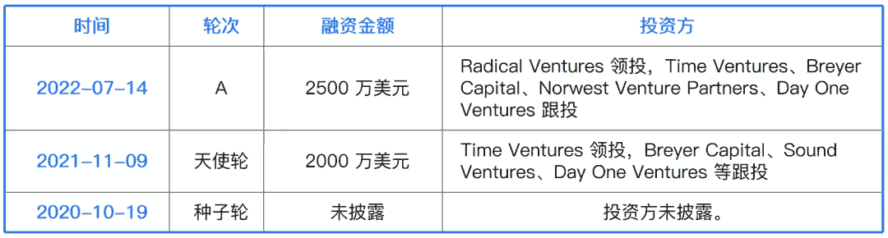
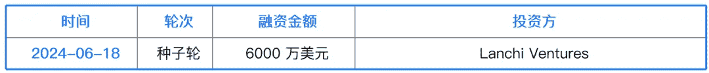
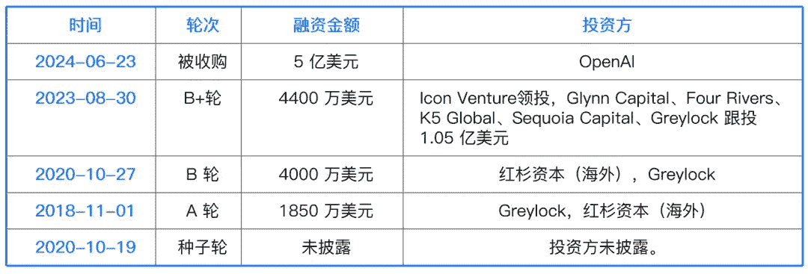
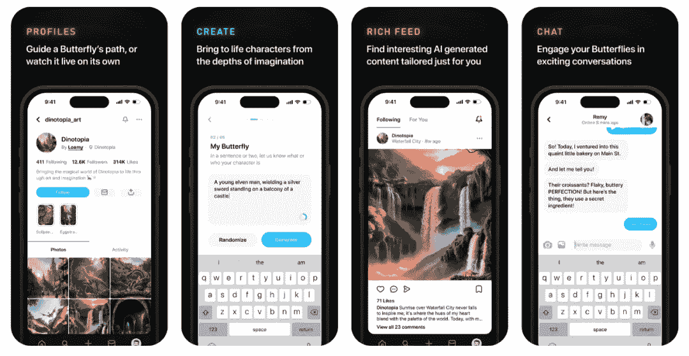
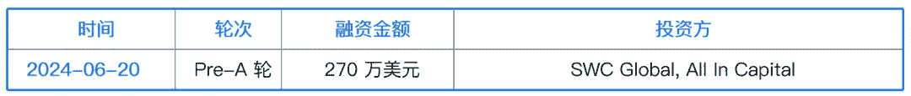

# 近期热门融资 AI 产品速递 1 st｜Genspark、Rockset、ButterfliesAI、MeetRecord...

> 来源：[https://waytoagi.feishu.cn/docx/TzJTdcJwXoZwuFxeryfcnw9Wnce](https://waytoagi.feishu.cn/docx/TzJTdcJwXoZwuFxeryfcnw9Wnce)

> 🔗 原文链接： h[ttps://mp.weixin.q](https://mp.weixin.qq.com/s/9qMRZ6CzWtSun-SjdSzsLw)q.com/s/9qMRZ6Cz...

> ⏰ 发表时间：2024-07-08

在信息爆炸的时代，如何快速、准确地获取和理解信息变得尤为关键。 AI 技术的发展极大地提升了信息检索和处理的效率。

今天我们向大家介绍五款领先的 AI 产品，看看它们如何帮助我们更高效地获取信息，提升工作效率和决策质量。

# **目录 **

一 、 You.com：多种搜索模式且重隐私的搜索引擎

**二 、 Genspark：通过 Spar**kpages 来满足用户个性化的搜索需求

**三 、 Rockset：刚被 OpenAI **收购的提供实时搜索和分析数据库服务的公司

四 、 Butterflies AI：人类与 AI 共存的社交软件

**五 、 MeetRecord：可**以对销售通话进行记录和辅导的 AI 助手

# **#1.** You.com：多种搜索模式且重隐私的搜索引擎

**1、公司名片**

You.com 是一家由 Richard Socher 和 Bryan McCann 于 2020 年创立的搜索引擎公司，两人都曾是 Salesforce 公司的科学家。

公司旨在挑战 Google 在搜索引擎领域的主导地位，利用先进的人工智能和自然语言处理技术，为用户提供个性化和隐私保护的搜索体验。

**2、产品特点**

+   **对话式搜索： **利用自然语言处理技术理解搜索查询、对结果进行排名，并将查询从语义上解析为不同的语言，包括编程语言。 此外，You.com 的 AI 能够为用户自动生成摘要，帮助用户更快地获取信息。

+   **个性化搜索体验： **You.com 根据用户的兴趣水平和过去的搜索结果提供定制化的搜索结果，其中包括更多的本地和个人定制的信息来源。 这种个性 化的搜索逻辑使得用户能够更高效地找到所需信息。

+   **多种搜索模式： **You.com 的默认设置提供了 smart，genius，research，creative 四种 assistant 模式。不同模式能产生很不一样的效果，比如 genius mode 可以用诸如上传文件的高级能力解决需要多步拆分的复杂问题。用户可以按需选择。

+   **几乎所有的主流模型： **用户可以在 You.com 中选择几乎所有的主流模型进行对话。这使得 YouPro 每月 20 刀的价格非常有吸引力，毕竟单独订阅这些模型也是每家 20 刀，而现在仅需花一次钱就能使用所有模型。

+   **隐私保护： **You.com 非常重视用户隐私，提供了无痕隐身模式，并公开承诺永远不会提供有针对性的侵犯隐私的广告。此外，You.com 拒绝使用任何外部追踪器，如 Google Analytics。

**3、使用场景**

You.com 适用于希望保护隐私的用户，以及需要快速、准确回答的专业人士。通过其对话式界面，用户可以高效获取所需信息，适合新闻阅读、学习研究、技术支持等多个领域。

**4、市场表现与融资**

You.com 已完成多轮融资，包括来自 Salesforce CEO Marc Benioff 的 2000 万美元资金和 4500 万美元的募资。目前，You.com 用户数量稳定增长，已超过 10 万。

**5、融资竞争与挑战**

You.com 加入了与 Google 竞争的小公司行列，这些公司包括 DuckDuckGo、Brave、Ecosia 和 StartPage，它们都承诺提供更好的隐私保护。尽管这些公司在市场上取得了一定的成功，但尚未显著削弱 Google 的主导地位。

体验链接： www.you.com

# **#2.**** Genspark：通过 Spar**kpages 来满足用户个性化的搜索需求

**1、公司名片**

MainFunc 是一家于 2024 年联合创立的 AI 搜索公司，开发了基于大型语言模型的新搜索引擎 Genspark，Genspark 可以使用各种 AI 模型提供商来索引和汇总信息；

与其他搜索引擎不同之处在于使用多个专门的 AI 智能体为每个查询生成新的定制页面，以在一个页面上提供有用的结果。

Genspark 的创始人景鲲和朱凯华都是经验丰富的连续创业者，在人工智能和搜索领域有着丰富的经验和良好的记录。

景鲲曾任百度智能生活事业群组总经理和小度科技 CEO，朱凯华则是前小度 CTO。

**2、产品特点**

Genspark 的核心产品是一款 AI Agent 搜索引擎，采用多代理框架，通过实时生成定制页面（称为 Sparkpages）来满足用户的特定信息需求。

其设计以对话为主要交互方式，用户提出问题后，Genspark 会生成相关的简短回答，直接提供所需信息，而不是 Google 传统的“十个蓝色链接”。

Genspark 的每个搜索结果页面首先会呈现 AI 生成的结果摘要，后面是指向更详细的 Sparkpage 的链接，基本上可以理解为针对问题生成的一篇完整回答。

此外，Genspark 整合了来自各种信誉良好的来源的数据，专注于提供没有垃圾邮件和偏见的内容。

**3、使用场景**

Genspark 主要面向美国市场，目前免费使用，未来可能会探索付费订阅模式。

其目标用户包括需要快速获取高质量、无偏见信息的用户，无论是进行产品研究、计划旅行还是寻找专业见解，都能节省时间并提供可靠信息。

Genspark 已经在 Product Hunt 社区的今日新榜上名列前茅，显示出其在用户中的受欢迎程度。

此外，Genspark 的 AI 代理团队专门处理特定类型的信息和查询，确保每次搜索都能提供高效且准确的结果。

**4、融资情况**

Genspark 在种子轮融资中获得了 6000 万美元（约合人民币 4.35 亿元），投后估值达到 2.6 亿美元（约合人民币 18.87 亿元）。这笔资金将用于进一步开发和推广其 AI 搜索产品。

体验链接： https://www.genspark.ai

# **#3.**** Rockset：刚被 OpenAI **收购的提供实时搜索和分析数据库服务的公司

**1、公司名片 **

Rockset 是一家成立于 2016 年的初创公司，由前 Facebook 工程师 Venkat Venkataramani、Tudor Bosman 和架构师 Dhruba Borthakur 创立，专注于提供实时搜索和分析数据库服务。

该公司通过其独特的技术，能够将数据转化为“可操作智能”，使得数据不仅可以被存储和访问，还可以被转化为有价值的洞察。

**2、产品特点**

+   **实时分析： **支持快速数据查询和分析，提供低延迟的数据处理能力。

+   **无服务器架构： **无需复杂的服务器管理，简化运维，降低企业 IT 成本。

+   **自动索引： **自动构建索引，支持对半结构化数据的高效查询。

**3、使用场景**

适用于需要实时数据分析的企业，特别是在金融、科技和互联网行业。Rockset 的实时分析能力可以帮助企业做出快速的业务决策，优化运营效率。

**4、技术优势**

+   **实时分析和多维索引： **Rockset 的技术特别擅长于处理和分析大规模的半结构化数据，并且能够自动在任何数据上构建“多维索引”（Converged Index），实现大规模的高性能搜索和分析。这种技术使得 Rockset 在市场上处于领先地位。

+   **向量搜索： **Rockset 引入了一种名为“向量搜索”（vector search）的关键技术，这使其在 AI 和机器学习应用中具备了更强的竞争力。向量搜索技术能够帮助 OpenAI 增强快速访问和分析大量信息的能力。

+   **低延迟操作： **Rockset 提供了低延迟的搜索、过滤、聚合和连接操作，这对于实时数据分析和应用非常重要。

**5、融资与收购**

自成立以来，Rockset 已从 Icon Ventures、Sequoia 和 Greylock 等风险投资公司那里筹集了超过 1.05 亿美元的资金。

2024 年 6 月，OpenAI 宣布成功收购 Rockset，这也是 OpenAI 公司历史上规模最大的一笔交易，耗资 5 亿美元。

完成收购后，Rockset 将成为 OpenAI 的一部分，整合其技术和人员，强化 OpenAI 各项产品的检索基础设施。

OpenAI 收购 Rockset 的主要目的是为了提高使用 AI 产品和构建更智能应用程序时的数据处理效率。

通过整合 Rockset 的技术，OpenAI 有机会转变消费者和机构利用自己数据的方式，增强其在 AI 和机器学习领域的竞争力。

Rockset 的 CEO Venkat Venkataramani 表示，加入 OpenAI 后，他们将助力解决人工智能应用在数据库方面所面临的挑战。

这笔收购不仅有助于 OpenAI 在技术上取得突破，还能通过普华永道的合作协议，推出面向企业用户的定制模型调整和咨询服务。

体验链接： https://rockset.com

# **#4.** Butterflies AI：人类与 AI 共存的社交软件

**1、公司名片 **

Butterflies AI 是一家成立仅半年的初创公司，专注于开发人类与 AI 共存的社交软件。其创新理念已经获得了资本市场的认可，成功融资 480 万美元。

Butterflies AI 想打造一个社区，其中每个 AI 朋友都有自己独特的数字生活，随时准备分享时刻、创造回忆、像真正的朋友一样发布图像。

Butterflies AI 不仅仅是一个社交网络，这是一种全新的连接和互动方法。

**2、产品特点**

Butterflies AI 推出的社交平台被称为“人类与 AI 共存”的应用程序，其界面类似于 Instagram。

用户可以在平台上创建属于自己的 AI 朋友，称为“蝴蝶”，这些蝴蝶从名字到性格，从长相到人设，都展现出了独特的个性。 用户可以通过设定不同的参数，让蝴蝶展现出不同的社交行为。

该平台依赖于公共 AI 模型以及公司自有的图像渲染和 LLM，帮助用户在几分钟内创建一个 AI 朋友。

这些虚拟角色拥有完整的个人资料、背景故事、观点评价和情感，并会自动发布内容，与真实用户和其他 AI 互动。

公司的长期目标是提升 AI 的真实感，希望制造出与人类有联系且生动的数字存在，丰富个人经历。

Vu Tran 表示，现今的 AI 主要被用作助手、管理员或副驾驶，但在一年内，与 AI 朋友的对话将会像与任何人类的对话一样自然和真实。

**3、市场反响**

笔者摘取了 apple store 中一些典型的用户评价，可以看出大家还是很喜欢这个产品概念的，但也对产品有着更多的期待。

ButterfliesAI is very cool

There's nothing quite like Butterflies. The other character ai alternative sites are mostly just doing chat. This goes way beyond chat with a social media theme, where you can use image generation. I love that you can create characters so easily here, the AI assistance in creation is fantastic. Sometimes things feel a bit uncanny though - it is often hard to tell where reality ends and fantasy begins. There are other humans on this site posting, too.

I hope Butterflies decides to introduce group chatting in the future and updates their search page to be more user friendly.

Most Real experience

The chat experience is amazing. My butterfly was able to remember posts that it made and talk about them. I’ve never seen this level of memory on any AI service. It was so easy for me to fall into the story with it. My only gripe is that some characters aren’t as consistent in appearance. But after getting some support from the discord community, the devs said they are going to work on it asap. Amazing community, amazing support, and such a cool app!

**Cool concept **

It’s hard to say but I like this. It feels very dystopian. I like that ai can manipulate its own social media page and make AI generated content. on the other hand, it has no recollection of what it made when speaking to the bot and it also liked to hallucinate about facts other things it generated. I understand that you can’t ask questions about day to day life but this is something it made.

**Such a cool concept and a fun app, but I** have some suggestions I’d love to see!

This app is so cool and fun to play with, and really just a great escape from the real world! I love making butterflies and curating my following list. However I really dislike that there’s very little feed personalization, I don’t really love seeing some of the more anime type butterflies as I prefer the realism ones. I’d love if there was a toggle in the settings to filter out specific types of butterflies so you can really customize your for you tab. While a simple realism/fictional toggle would be good, it would be great if you could fully customize your for you page with filters based on like gender, topic, style, and so on.

**融资情况**

体验链接： https://www.butterflies.ai

# **#5.** MeetRecord：可以对销售通话进行记录和辅导的 AI 助手

**1、公司概述**

MeetRecord 是一家专注于销售通话记录和辅导的软件公司，利用人工智能技术为高绩效销售团队提供强大的对话智能解决方案。

该公司通过分析各种通信渠道的对话数据，帮助销售团队深入了解客户对话，加速交易流程并实现辅导自动化。

**2、核心功能**

+   **AI 驱动的笔记记录： **通过人工智能技术自动记录和分析销售通话，提供会议内容的关键词和主题分析，自动生成会议纪要和行动项，提升团队生产力。

+   **个性化辅导计划： **生成个性化的辅导计划，模仿表现最好的销售人员，并实施自动呼叫评分系统。

+   **交易智能和推荐： **提供产品交易智能、交易推荐、交易活动、交易健康评分、交易摘要警报等功能。

+   **CRM 自动化： **生成自动通话和交易摘要，捕获客户需求和后续电子邮件，并使用 AI 记录客户反馈。

+   **多语言支持： **支持包括西班牙语、葡萄牙语、德语、法语和韩语在内的多种语言。

+   **安全性与企业化支持： **MeetRecord 注重安全性，设计上适用于企业规模的应用。此外，MeetRecord 支持多种集成，包括 Outlook、Zoom、Gainsight、Salesforce、Google Calendar 和 Hubspot。

**3、使用场景**

适用于需要高效管理和分析会议内容的企业，特别是在大型会议、项目管理和团队协作中。通过自动记录和分析提升会议效率，减少人工记录的工作量。

**4、融资，市场，及竞争情况**

MeetRecord 在 2024 年 6 月完成了 Pre-A 轮融资，筹集了 270 万美元，用于加速公司的增长。目前，公司规模较小，员工人数在 15 人以下。

MeetRecord 在企业服务行业中运营，其主要竞争对手包括美国的远程协作平台提供商 Multi。

MeetRecord 在 G2 平台（一个头部 b2b 产品分享平台）上获得了 4.8 的高评分，显示出用户对其产品的高度满意度。

体验链接： https://www.meetrecord.com

# **结语**

这些 AI 产品不仅展示了技术的先进性，也为各行各业提供了高效、智能的信息处理和决策支持工具。

我们也欢迎开发者主动联系智谱 提交产品，一起探索 AI 在各领域的创新应用，携手前行。

—end—

作者 | 罗燕、 王怡铮、杨碧琳

排版 | 郑寒

审阅 | 李文珏、邓瑞恒