# 具身智能赛道爆发的前夕，我们应该了解些什么？（上）｜Z研究第 5 期

> 来源：[https://waytoagi.feishu.cn/docx/AN2CdVPhaocgHFxFPEkchO8rnne](https://waytoagi.feishu.cn/docx/AN2CdVPhaocgHFxFPEkchO8rnne)

> 🔗 原文链接： h[ttps://mp.weixin.q](https://mp.weixin.qq.com/s/pAtIhBwXQInIikKBbPkS6Q)q.com/s/pAtIhBwX...

> ⏰ 发表时间：2024-07-10

**「Z计划」 ** **是 智谱 A**I 面向 未上市初创企业与优秀独立开发者/团队，提供 Tokens 赞助、投资支持和技术支持等资源的创新加速计划。 面向全球，持续招募中！🐋（点击报名） 「Z研究」 是围绕该计划的面向大模型领域的投研计划，鼓励自由研究，大胆发言 。🌲同时，本文不为或有提及的智谱公司任何产品做商业推广。如有提及，纯属绕不开。如未提及，也是正常。

编者按：过去一年，大模型技术和具身智能赛道似乎已迈入了加速前进的通道。Tesla 发布的 Optimus 能够实施极其灵巧的柔性操作，并计划通过租用形式开始提供服务；

Stanford 的 Mobile ALOHA 机器人能够独立完成炒虾任务，并在实现一些固定任务的泛化；

宇树科技推出了 9.9 万的机器人标志着人形机器人进入十万以内的售价。OpenAI 重启机器人团队，Figure 计划进行大规模数据采集......

海淀区发布打造全国具身智能创新高地三年行动方案，北京人形机器人创新中心（亦庄）等各地具身智能中心正在引入更多人才和力量。

大厂传组建具身部门，初创公司融资如火如荼，但又因为应用场景不明存在争议。各个产业地方联盟都在希望成立统一的数据集，规范数据采集......

**作为一个系统性的工程，相比原来人们常说的“汽车制造，是现代工业皇**冠上的明珠”我们更愿意称“具身智能机器人是未来计算机科学和工业界皇冠上的明珠”。

由于涉及算法层，不同技术流派，数据，模拟器，传感器，视觉方案，力学结构等多个维度。并整体向着更鲁棒性，各层级之间过渡更加平滑的方向前进。

因此我们做了一些梳理，包括过往的工作，和一些基础知识。希望可以抛砖引玉让大家对这个复杂的系统工程多一些了解。

**我们也注意到许多矛盾，比如力矩控**制、电流控制，究竟做到哪一步才算端到端？

机器人的 foundation model 或者 GPT 时刻会是什么样的？触觉等感知信号究竟以什么样的形式进入模型当中。这些问题我们愿意与更多学者和从业者讨论交流。

同样， [Z 计划 ](http://mp.weixin.qq.com/s?__biz=MzkyMDU5NzQ2Mg==&mid=2247483667&idx=1&sn=b0bf8af76ea56c21ec294ed2a9d316a5&chksm=c19127aaf6e6aebc1d23d1c8f9092818d99ea422c25e1a2eb6d18f4afc1283f7bae40750090d&scene=21#wechat_redirect)一直关注具身创业项目，并坚信未来大语言模型不仅仅像现在这样执行语言交互和上层推理，以及 VLM 能力，而是 Transformer 架构在内存等前提下可以跑更多的上层推理，从而趋近图灵完备。

希望我们可以与更多优秀的具身创业团队同行。了解

**本次分享将拆分为“上”/“下”两篇：本篇（即“上”篇）将关注于具身**智能的核心概念介绍与算法层细节；“下”篇将关注于具身智能相关的模拟器和硬件实现。

# **目录  ****建议结合要点进行针对性阅读 ****。  👇**

**一、具身智能概论**

1、定义

2、历史

3、构成

**二、具身智能算法层**

1、技术层级

2、具身智能组件

3、具身智能方案

4、算法层Summary

# **#1.**** 具身智能概论**

**1、 定义**

具身智能是指一种能够与其环境进行交互并在环境中执行任务的智能体。 它不仅依赖于数据集的静态输入，还能在三维环境中移动、导航、操纵和改变周围的环境。

这种智能体通过与环境的动态交互来学习和理解世界，从而能够执行复杂的任务。 具身智能强调的是智能体与环境的交互/学习/改变 ，而不仅仅是身体本身。

**这种交互性为智能体提供了一种新**的、更好的了解世界的方式， 从而实现更高层次的智慧和能力。

**具身智能不需要必须是人形，只要具备可以感**知环境且与环境进行交互的物理实体就行。 但是，人形机器人在许多方面具备相当的优势：

+   **效仿自然进化的高效设计： **人类的身体结构和功能经过长期进化，具有高效的感知和运动能力。

+   比如，四只手的协作控制相当复杂，且意义不大，两只手的设计足够应对复杂难题；人类的两只眼睛是感知世界性价比最高的选择，一只眼睛没有立体视，三只眼睛又没必要。

+   **适应现有环境： **人类设计的环境和工具都是为人类使用而设计的，人形机器人可以更好地适应和操作这些环境和工具。人形机器人在家居等服务场景具备显著优势。

+   增强人机交互的自然性和接受度： 人形机器人在某些场景中提供更好的伦理和心理舒适度，并且在安全性方面具有优势。

+   **数据的可获得性： **数据的极度匮乏制约了机器人的发展，人形机器人的数据相对更容易获得。可以让人类穿戴传感器进行正常的生活与工作，在这个过程中收集相关数据。

2024 北京智源大会，张亚勤院士认为无人驾驶可能会成为第一个真正实现具身智能或物理智能的 AGI，而时间节点就在明年。他说，“无人驾驶要变成主流、通过新图灵测试，需要是好司机，也需要是老司机。我认为明年会实现。”而这一进展如果实现，将加速人工智能技术在实际场景中的落地应用。

网址：https://mp.weixin.qq.com/s/DwVExFiJTUBNnr6-xmoZCQ

【智谱清言智能 体推荐】了解更多关于具身智能，点击互动👇

达成“具身智能”需具备哪些特征?

+   核心要素在于 **智能体与真实世界进行带有实时闭环反馈的感知-推理-行动交互**（sense-plan-act）的能力。

+   “具身图灵测试（Embodied Turing Test）”由 Yoshua Bengio、Yann LeCun 等科学家提出，作为具身智能的终极挑战，其标准在于高级感觉运动能力。具体包括四种特征：

+   与真实环境互动

+   对不同环境的适应性（多任务、多环境泛化）

+   动物行为的灵活性

+   从稀疏观察中做出一般推断的能力

论文标题：《Catalyzing next-generation Artificial Intelligence through NeuroAI》

论文链接：https://www.nature.com/articles/s41467-023-37180-x

**其他具身智能测试：**

**Coffee test **：一台机器需要进入一个普通的美国家庭，并弄清楚如何煮咖啡：找到咖啡机，找到咖啡，加水，找到一个杯子，然后通过按下适当的按钮来煮咖啡。

网址：https://analyticsindiamag.com/turing-test-is-unreliable-the-winograd-schema-is-obsolete-coffee-is-the-answer/

**具身智能需要具备哪些基础能力?**

+   具身智能需要具备感知、决策和执行三种核心能力。

+   **执行能力是技术难点。 **一**方面，**它不**像前两**者有着海量的互联网数据支持；另一方面，它不仅是一个软件算法问题，还涉及到硬件设计。从执行的角度来说，具身智能体主要分为 移动 和 操作 两大能力。

+   **移动 方面 **，无论是最近爆火的二足机器人、已经取得极大突破的四足机器狗，还是已经商业落地的轮式机器人，它们能否在各种地形下实现鲁棒的移动，依旧是前沿的学术问题。

+   **操作 方面 **，现阶段能够落地的只有吸盘和二指的简单抓取。也正是因此，目前所有大模型驱动的具身智能体能够完成的任务清一色是 pick-and-place 下类的任务。

+   可以说， 可泛化的通用执行能力是三大核心能力中最短的那块木板。

**L**LM 为具身智能热潮来临提供机会：过去机器人的控制优化任务通常都是基于优化的，但是 LLM 为机器人的控制提供了新可能。

+   过去基于优化的机器人控制方案通常有一个目标函数（要让小棍保持平衡），通过建模和数理计算的方式完成这一目标。

+   优点：效率极高，数学解优雅；

+   缺点：泛化性能差，对于每一个新任务都要重新建模（且建模和目标函数的精度会影响性能）和设计目标函数。

+   现在有 LLM，LLM 学习大量数据后存在强泛化能力和 zero-shot 能力，使得我们不再需要为了每个任务来手工调校机器人。

银河通用的首个人形机器人 GALBOT G1，是全球首例可以线下真机展示泛化干活技能的大模型机器人。银河通用机器人在具身大模型的构建上，提出了一个三层架构：底层是硬件层，中间层是三维视觉合成数据驱动的技能层，上层是图文大模型层。

网址：https://mp.weixin.qq.com/s/3wFjI0zwQGhosQWcPPFxMA

**具身智能发展的核心问题：**

+   不是算法，不是硬件； 是在现实物理世界构建数据闭环的问题

+   数据构建 AI，AI 构建产品，产品产生商业价值，在销售和使用的过程中会产生新的数据，从而实现数据飞轮

+   如何实现闭环：

+   **数据获取成本足够低**

+   在具体化场景当中能够持续不断收集数据。

**2、 历史**

之前做机器人的厂商转方向了，波士顿动力（液压转电动）

+   第一代机器人：技术探索阶段（以早稻田大学仿人机器人为代表）

+   1970 年之前，示教再现型机器人，这类机器人没有感知也不会思考，它们根据事先设定好的程序重复动作。

+   目前在汽车制造业和一些工业生产线上仍然常见。1960 年代，美国机床铸造公司（AMF）生产出圆柱坐标的 Versatran 型机器人，可做点位和轨迹控制。

+   美国 Unimation 公司研制出球坐标的 Unimate 型机器人，它可完成近 200 种示教在线动作

+   1970-1997 年，有感觉的机器人，与第一代机器人相比，它们拥有一定的感觉系统，可获取周围环境和相关对象的信息

+   1973 年，日本早稻田大学的加藤一郎带领团队，研发出世界上第一台真人大小的人形智能机器人——WABOT-1。

+   该机器人包含肢体控制系统、视觉系统和对话系统，有两只手、两条腿，胸部装有两个摄像头，手部还装有触觉传感器。

+   到了 1980 年，早稻田大学更新了设计，研制出了 WABOT-2，第二代能够与人沟通，阅读乐谱并演奏电子琴。

+   1986-1993 年，本田公司接连开发了 E0 到 E6 等 7 种行走机器人，只有腿部结构，主要用于研究行走功能。

+   1993 年，公司在研制的 P1 基础上加上了双臂使其初具人形，而后同年完成的 P3 则是 ASIMO 的原型。

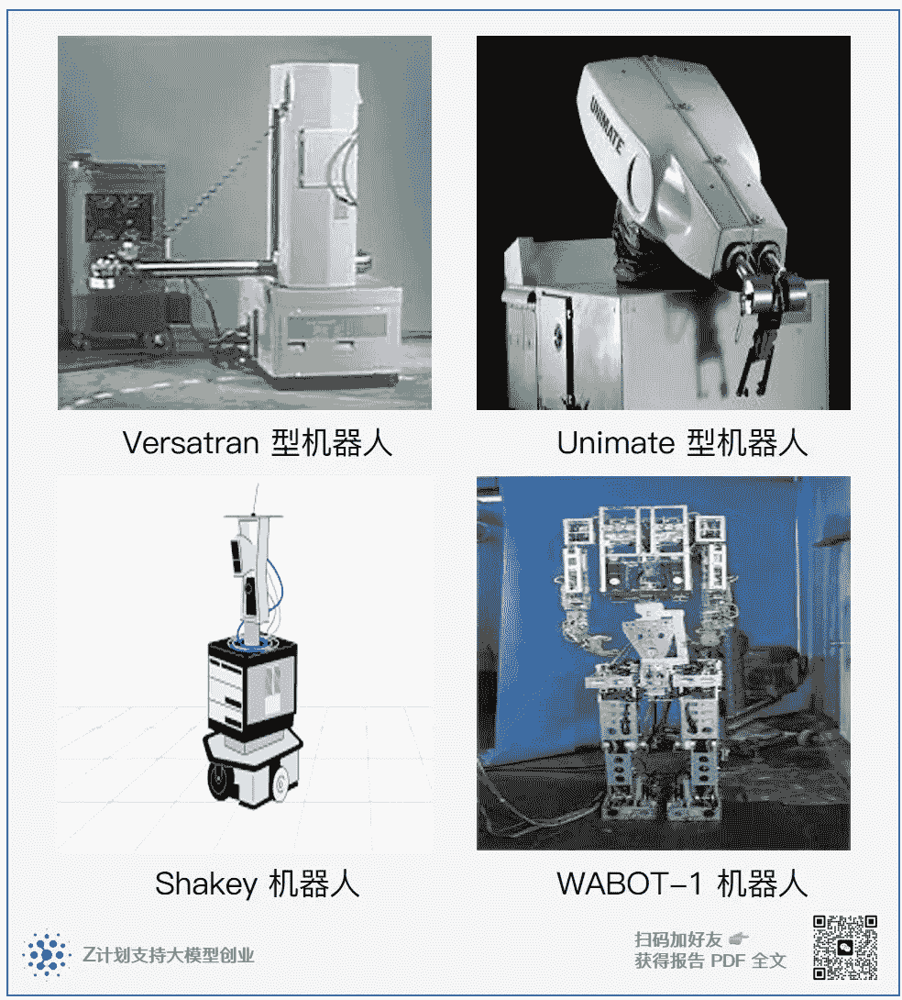

+   第二代机器人：系统高度集成发展阶段（本田仿人机器人为代表）

+   1986 年，日本本田开始进行人形机器人 ASIMO 的研究，并成功于 2000 年发布第一代机型。

+   2011 年，本田推出 All-New ASIMO，具备利用传感器避开障碍物等自动判断并行动的能力，还能用五根手指做手语，或将水壶里的水倒入纸杯。

+   至此人形机器人已具备初步的行动能力，逐步向特定场景应用发展。

+   2003 年，日本工业技术研究院推出 HRP 系列的 4C 和 5P，5P 可以替代人类完成重力作业。

+   2009 年，双足机器人 PETMAN 亮相，PETMAN 设计用于检测化学防护衣的人形机器人。

+   第三代机器人：高动态发展阶段（以波士顿动力仿人机器人为代表）

+   2013～2017 年，波士顿动力 Atlas 运动能力逐步增长， 逐步实现了在碎石堆上行走、跳跃、空翻等复杂运动动作。

+    2024 年，波士顿动力宣布液压人形机器人 Atlas 退役同时推出全电动人形机器人 Atlas。

+   2021 年，特斯拉正式入局人形机器人行业；优必选发布 WalkerX，能上下楼梯、操控家电、端茶倒水、给人按摩、陪人下棋； 2023 年，智元机器人发布远征 A1，接入人工智能大模型

+   2024 年 NVIDIA 于 GTC 大会上发布 Project GR00T，这款多模态人形机器人通用基础模型，能理解自然语言并模仿人类动作，实现快速学习与技能适应

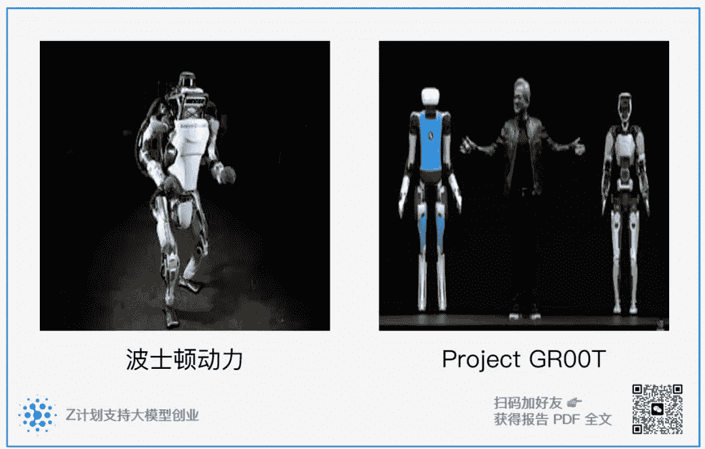

+   **两大发展趋势：**

+   **人形化： **从目前开发的人形机器人进展及对比中我们不难发现，在未来趋势上，人形机器人一致以外形向人类细部特征靠拢，功能具备真实人类运动，灵活、环境判断能力为主。

+   **成本下降显著： **人形机器人成本及售价呈下降趋势。 伴随人形机器人技术发展，为迎合市场应用及商业化需求，售价也从数百万美元降至数万美元，主要原因在于核心零部件成本降低。

【智谱清言智能 体推荐】了解更多关于机器人，点击互动👇

**3、 构成**

**三**类组成元素：大脑（意图理解&环境感知&规划决策）、小脑（运动控制&语义信息理解转化为动作）、整机硬件方案

+   大脑-智能算法：感知/分析层的核心。 通过视觉-语言理解模型感知环境、接收理解任务并进行规划决策，最终输出具体任务指令

+   **小脑-运动控制算法： **动作层的核心。将动作视为类似语言的一种模态，理解交互物品及机器本体的姿态和运动状态，并将语义理解转化为动作。最终将大脑的任务指令拆解、输出为针对各硬件部件的控制指令。

+   **整机硬件方案： **基于下游场景需求设计的运动、感知、计算和通信硬件方案。

+   值得一提的是，具身智能厂商有从软件到硬件全流程自主控制的需求，倾向于自己制作机体，而非简单的向外采购。考虑因素有二：

+   **具身智能的机体和数据模式都没有实现标准统一，厂商用来训练智能体**的数据往往和机体的自身构造存在紧密联系 ，例如眼睛之间的距离、电机的数量等等，都收集到的数据直接相关，也直接影响到智能体的训练过程。

+   同时也要考虑二级供应商是否成熟，做整机的利润是否足够高。 部分足够强大的厂商（如 Tesla）甚至具备绕过二级供应商，制作更底层的电机、传感器的能力，对于这类厂商来说，软硬件一体化制造能带来更高的利润空间。

**两类智能：认知智能和物理智能**

+   认知智能涉及思考、规划和决策能力

+   完全由大脑驱动

+   物理智能指机器人的感知和与环境的运动互动能力

+   其中，感知环节由大脑侧的识别算法实现，行动环节由小脑侧的运动控制算法和硬件配合完成

+   在具身智能的感知-规划-决策-行动循环中，认知智能促使机器进行决策规划，物理智能协助行动；行动结果反馈迭代帮助具身智能更好的决策和行动。

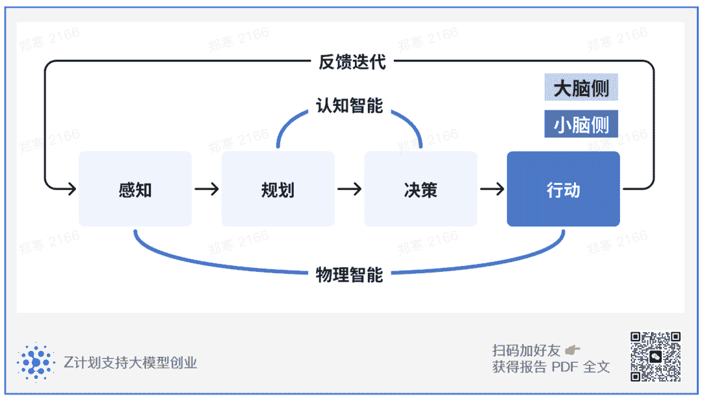

# **#2.**** 具身智能算法层**

**1、 技术层级**

**a. 任务层级**

从具身智能所面临的任务层级来讲，可细分为五个层面， 任务级、技能级、动作级、基元级、伺服级。 通常我们仅关注前四个级别，第五个级别已经在机器人学中得到了完善的处理。

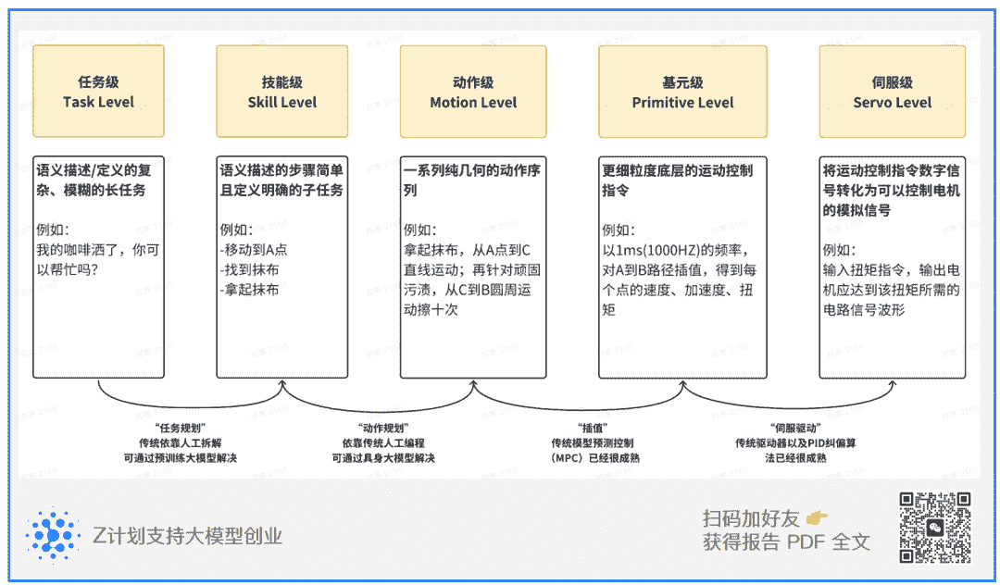

**b. 解决方案层级**

从厂商对于具身智能的具体解决方案来看，通常可拆分为大脑+小脑两个层级

+   **大脑：负责人机交互&规**划决策。 感知-任务级-技能级 -动作级-基元级

+   **小脑：负责运动控制&语义**信息理解转化为动作。感知-任务级 -技能级-动作级-基元级

对于大模型厂商，我们主要赋能具身智能大脑侧，辅助小脑侧进行模型训练

+   **大脑侧**

+   具身智能的大脑负责 **人机交互 **，能通过视觉在语义层面理解场景，理解 long-horizon 任务，对任务进行分解以及规划，负责高层次的决策。

+   近年来大模型的迅速发展对大脑有了长足的促进，大脑的成熟度较高，也不太存在数据的匮乏问题，因为大部分能力可以从已有人类数据中习得（如语言数据）。

+   **对于具身机器人而言，大脑的长期发展高度**依赖于大模型的进展，尤其是多模态大模型。

2024 年 3 月，有鹿机器人发布了基于 LPLM-10B 的软硬件结合产品 Master 2000，一款即插即用的通用具身大脑，以通用大脑+专业设备的积木组合，帮助客户解决在智能化升级研发中投入产出比低的痛点。

网址：https://mp.weixin.qq.com/s/SJ-OJBzbfOgd8SBcxED3ZQ

+   **小脑侧**

+   小脑是具身智能底层控制的核心， 具体任务包括状态分析、全身运动控制及轨迹优化等。

+   此类数据极其匮乏，单任务执行起来都有困难，更不要说任务间的泛化了。目前看来，小脑部分是具身智能在技术层面较大的瓶颈，其发展成熟度尚不及大脑部分。

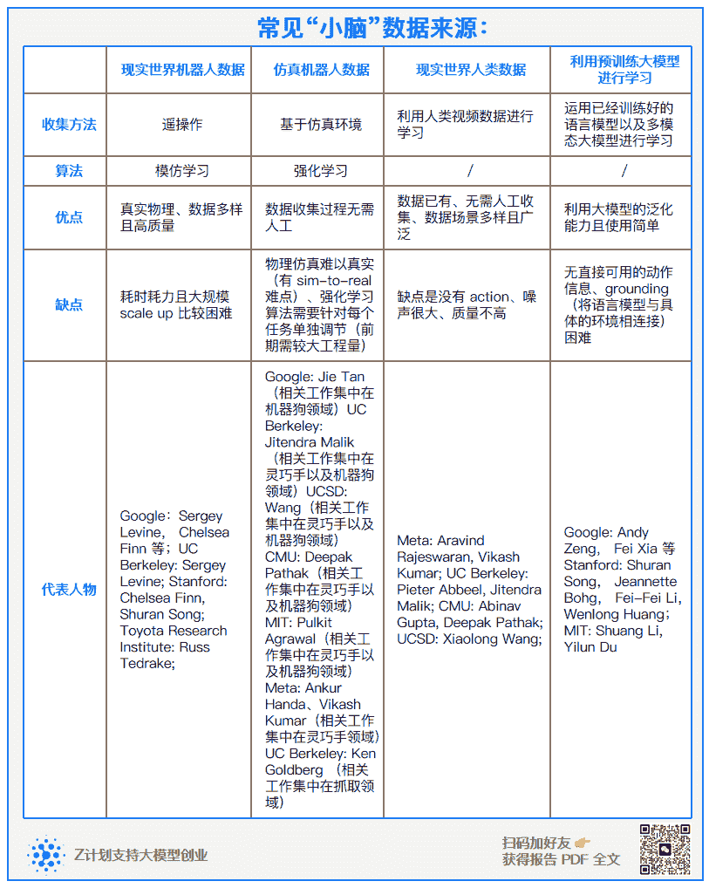

+   端到端：大脑与小脑统一在一个大模型之中

+   除了分别实现大脑层与小脑层的具身分层模型以外，也有统一大脑和小脑的端到端具身大模型解决方案。

+   **对于端到端训练的模型： **类似 RFM-1 的路径，直接将多模态输入映射到输出动作

+   基于现有的 LLM 或 VLM 的具身分层模型： 类似 Figure01 的路径，接入像 GPT4-V 这样的视觉语言模型，然后在此基础上添加机器人动作模型

+   两条路径并非严格分立，事实上，端到端和具身分层模型没有本质区别，在具备无限的数据和计算资源时，二者结果可能会很接近。

+   重要的是回答以下问题：当我们只有有限的机器人数据时，如何充分利用现有的 VLM， 使得用现有的有限机器人数据以最大程度地提高机器人的泛化能力。

+   目前来看，VLM 微调的效果可能会更好，因为 GPT-4V 的训练数据量太大。端到端的训练一个模型很难达到 GPT-4V 这样的数据量。

+   响应速度：大脑测的任务拆解，用 VLM 没有问题，因为就是拆一次，拆完一次就不用再拆了。

+   但是小脑测，用 VLM 就比较慢（比如后文会提到的 Copa），解决方法是蒸馏出一个中等大小的模型，把 VLM 相关的知识蒸馏出来，这个小模型会跑的比较快。

北大 HMI Lab 团队将视觉编码器与高效的状态空间语言模型集成，构建了全新的 RoboMamba 多模态大模型，使其具备视觉常识任务和机器人相关任务的推理能力，并都取得了先进的性能表现。

论文链接：https://arxiv.org/abs/2406.04339

+   **分层架构与端到端对比 **

分层架构的优点：绝大多数人形机器人企业采用传统 X86+AI 芯片的具身智能控制平台。

该平台虽然在一定程度上能够实现机器人的运动控制和智能决策，但仍然存在一些显著的缺点。

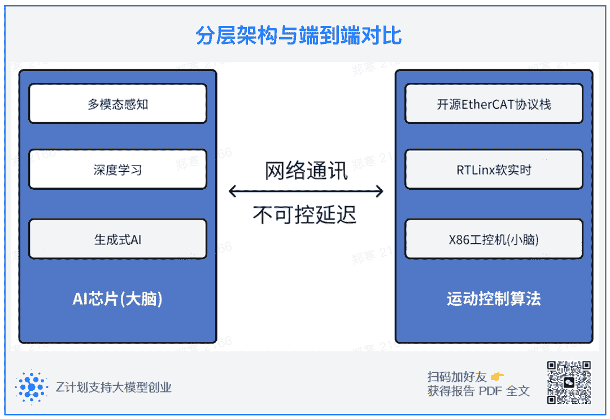

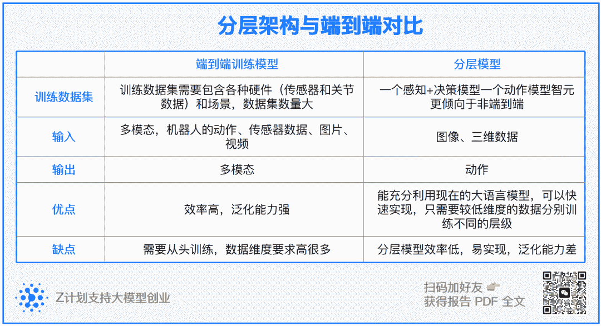

**c. 机器学习技术流派**

那么，上述具身智能解决方案的底层技术是什么呢？

首先，传统机器学习的技术是对一套设计好的神经网络系统输入大量的数据（包括图片/文本/图片-标签对等等），让神经网络自动的进行迭代，这种学习技术，我们可以称之为“静态”机器学习方案，在此不多赘述。

然而，在具身智能的应用中，我们更强调一种“动态”的学习方式（包括强化学习/模拟学习等），即让机器人和环境不断交互和学习，获得新技能以适应环境，从而完成复杂任务，这和人类的学习方式更接近。

传统控制论算法需要对整个系统进行物理建模，但是在某些复杂的场景无法做到精确建模；

而这种动态的 Robot learning 方案通过与环境的交互来学习，并通过奖励机制来优化行为，获得最优的决策策略（policy），摒弃了传统方法物理建模的弊端。

接下来简单介绍一下动态机器学习方案的发展思路。

第一阶段：传统控制算法结合强化学习

+   **传统控制算法：**

+   模型预测控制（Model Predictive Control） ：通过预测未来系统行为来做出决策，在未来的一个给定时间窗口内解决一个最优化问题，以寻找控制输入，最小化成本并满足约束。

+   MPC 需要系统模型、成本函数、预测时间段、约束和反馈来运作，通过预测了未来会发生什么事情，机器人可以产生相应的动作来进行“预判”，在一定程度上加大了机器人的实用性。

+   以足式机器人为例，一种使用方法是将 MPC 用于 全身控制（Whole Body Control） ，由于利用 MPC 预测了未来一个预测时间步长的状态与控制序列，使得机器人可以协调身体的各个部分；

+   可以通过观测到的地面环境提前给出相应的控制量，减缓欠驱动状态下的系统的不稳定性，通过优化得出最佳地面接触力作为控制量，在欠驱动状态下与地面的短时接触中，减少接触模态的干扰，增强四足的稳定性。

+   此类路线的代表为波士顿动力，它的优点是传统算法可靠性高、可解释性强，而缺点是对于 corner case（例如光滑地面）处理不好。

**第二阶段：采用深度强化学习**

+   强化学习（Reinforcement Learning）： 相比于 MPC 依赖于线上优化以及物理模型，强化学习可以让机器人自主学习：

+   智能体能够从环境中获取一种状态，由智能体进行决策，对环境作出一种行为，再由环境反馈奖励信号给智能体，透过多次的上述过程，智能体由过往的经历学习获得的奖励信号最佳的行为。

+   以游戏为例，如果在游戏中采取某种策略可以取得较高的得分，那么就进一步强化这种策略，以期继续取得较好的结果； 通过激励，具身智能体在模拟器中不断试错最终提升能力。

+   **在机**器人领域中，因为学习效率普遍较低，机器人往往要在模拟器中进行学习，而现在的模拟器和真实世界有差距（sim-to-real gap），往往需要大量的努力才能让在模拟器中训练好的机器人迁移到真实世界。

+   此类路线的优点是可适应性强、方法简单易懂，而缺点是需要大规模预训练、不易对行为进行分析（本质是黑盒）。

+   深度强化学习（Deep Reinforcement Learning）和普通强化学习不同。普通强化学习通常使用表格法或简单的函数逼近方法来表示策略和价值函数；

+   深度强化学习则结合了强化学习和深度学习的优势，使用深度神经网络来逼近价值函数、策略或环境模型，从而应对高维度和复杂的状态空间。

+   DeepMind AlphaGo 使用 DRL 取得了巨大的成功，深度强化学习能够处理高维数据和学习复杂的行为模式，特别适合面向决策与控制问题，因此在机器人上使用 DRL 是一种必然的想法。

第三阶段：模仿学习/Sim2Real/线上+线下

+   深度强化学习存在显著弊端：需要通过大量尝试获取数据。 并且机器人训练的过程非常缓慢（现实生活中每分钟的操作数量是十分有限的），数据也很有限。 为了解决这个问题，引出了一些新的方法。

+   模仿学习（Imitation Learning） ：

+   模仿学习专注于从 demo 中进行学习，比如我们可以给机器人展示一次如何打扫桌子，而机器人的目标就是学出其中的要点，并且自主完成这个任务。

+   优点是方法比较直接简单，可以直接在真实世界中收集数据，缺点是需要人去收集 demo，较难规模化。

+   **Sim2Real:**

+   在一个虚拟的仿真环境中完成对 AI 的训练，再迁移到真实机器人上，很显然仿真环境越真实，迁移效果就会越好，但仿真环境也不能百分百等同于现实，所以也会用 Real-to-Sim-to-Real 反复去修正。

+   **线上+线下强化学习： **

+   先采用离线强化学习从静态的、预先收集的大量数据中学习策略，再将其部署到真实环境中，与环境实时交互探索，并根据反馈调整策略

+   大大提高数据利用效率、降低环境交互成本、同时保证安全性

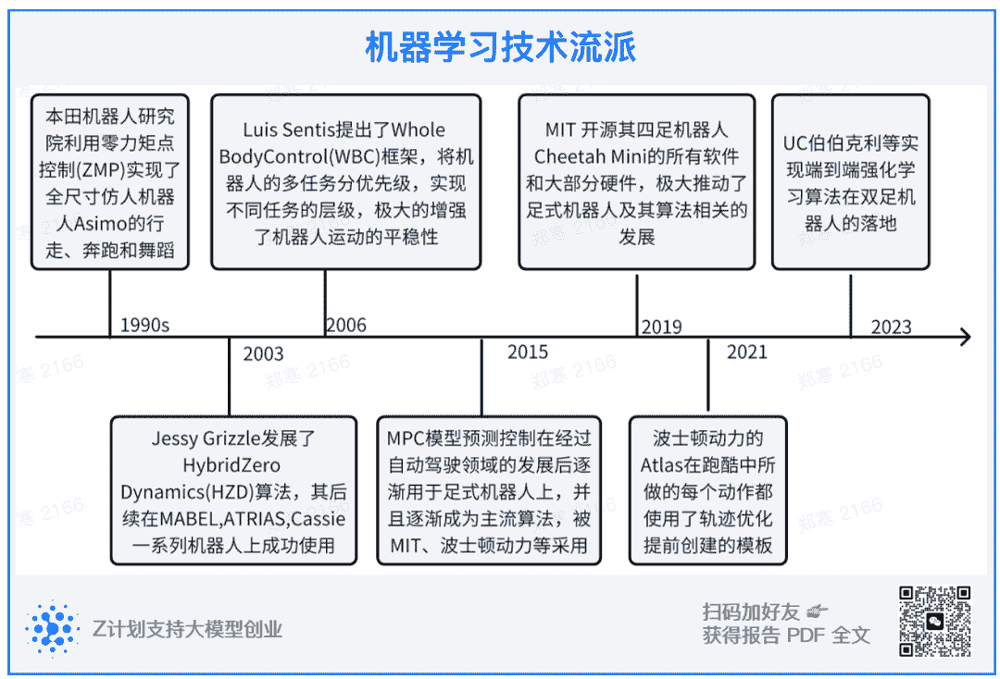

**2、 具身智能组件**

具身智能组件，是指只关注于具身智能层级中的某个细分部分，完成了大脑侧或者小脑侧的优化的那些模型或者机器人。

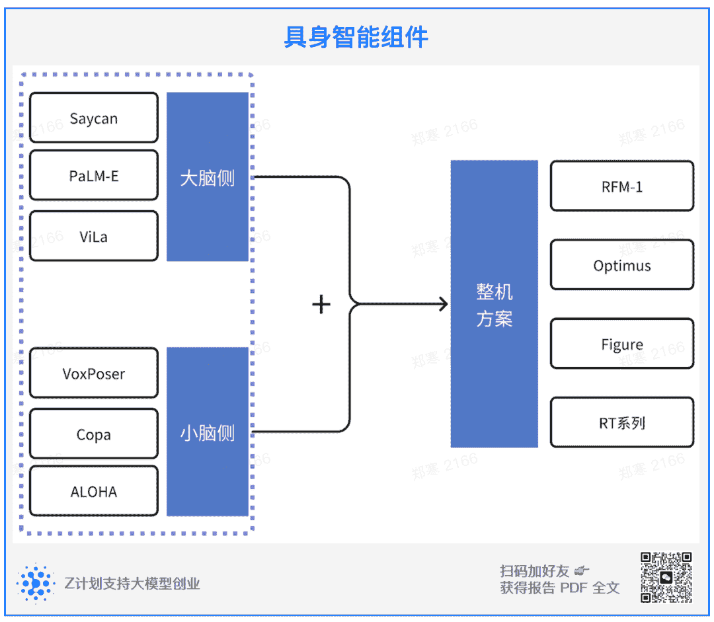

Saycan（2022.08/谷歌/大脑侧）

+   背景：2022.8，谷歌联合 Everyday 机器人开发。

+   层级：

+   **任务级-技能级 **-动作级-基元级， **大脑侧**

+   和感知层完全分离，需要外部功能模型（affordance model）来感知环境信息。

+   技术：

+   Saycan 由两部分组成：Say 和 Can。Say 部分会由 LLM 完成语言含义的理解和拆分，给出相应的有可能解决问题的若干任务序列；

+   因为解决方案的提出完全由预训练的 LLM 完成，缺乏对机器人自身能力的认知，所以还需要 Can 部分的筛选。Can 部分会对这些任务进行评估，判断哪条任务序列最有可能实现并予以采用。

+   数据：

+   纯语言模型，对于机器人面临的场景的描述需要大量的 prompt 来解释。SayCan 通常需要大量的文字提示（text prompt）才能有良好的表现。

PaLM-E（2023.03/谷歌/大脑侧）

+   背景：2023.3，由 Robotics at Google、柏林工业大学和 Google Research 团队推出的一个具身多模态语言模型

+   层级：

+   **任务级-技能级 **-动作级-基元级， **大脑侧**

+   相当于 Saycan 模型和外部功能模型（affordance model）的结合。

+   技术：

+   该模型可以将现实环境中的连续感知信号嵌入到已经训练好的超大语言模型中，从而能够建立语言单词和感知之间的直接联系。

+   因此，除了可以用于常规的语言生成任务，还可以用于连续的机器人控制规划，视觉问答，图像字幕生成等机器人和多模态任务。总参数达 5620 亿。

+   数据：

+   包含视觉、连续状态估计和文本输入编码的多模式语句。

ViLa（2023.12/清华高阳/大脑侧）

+   背景：

+   2023.12，ViLa，即 Vision-language model 的缩写，清华叉院高阳助理教授团队推出。是一个基于 GPT-4v 的高层任务规划模型。

+   GPT4v 直接提供了多模态的输入，将视觉信息整合入模型之中。ViLa 的核心思想是，如果在语言模型的基础上引入视觉信息，是否能够更好地拆解任务。

+   GPT-4V：2023.9，由 OpenAI 推出。GPT-4V（Visual）是一种多模态模型，能够处理和生成文本与图像。

+   这种模型在 GPT-4 的基础上进行了扩展，增加了对图像的理解和生成能力，使其能够处理更广泛的任务。

+   层级：

+   **任务级-技能级 **-动作级-基元级； **大脑侧**

+   能对任务级指令进行拆解，拆解到子任务。

+   技术：

+   和 saycan 类似，但是 saycan 缺乏视觉输入，需要外部功能模型来感知环境信息，这些模型无法与 LLMs 共同推理，基于大语言模型的任务拆解相当于是盲拆，这导致它的任务拆解不够精准。

+   而 ViLa 在语言模型的基础上引入视觉信息，实现了对视觉世界中常识知识的深刻理解，包括空间布局和对象属性。

+   数据：没有通过数据进行额外训练，只是在 GPT-4v 上面进行了模型调整。

VoxPoser（2023.07/Stanford 李飞飞/小脑侧）

+   背景：2023 年 7 月由李飞飞团队提出，实现了六个自由度下的机器人轨迹自动合成。

+   层级：

+   任务级- **技能级-动作级 **-基元级； **小脑侧**

+   技术：

+   通过 LLM+VLM 构建了一个开放指令和开放物体的轨迹规划器，把机器人建图和任务规划推进到了一个崭新的阶段。

+   比如指令“打开抽屉，但是要小心花瓶”，LLM 通过解析指令，知道抽屉应该对于轨迹来说是一个吸引区域（affordance_map），而花瓶对于轨迹来说是一个排斥区域（constraint_map），然后通过 VLM 获取花瓶、抽屉所在的具体位置，通过 LLM 生成代码来构建 3D Value Map，然后 motion planner 就可以 zero-shot 地合成机器人操作任务的轨迹。

+   在这种方案中 VLM 实际上是给底层控制策略（low-level policy）提供了 reward function（cost for MPC，reward for RL）

+   优缺点：

+   优：具备强大的泛化能力和 zero-shot 能力，能解决从未见过的新任务，缓解了机器人动作控制的训练数据稀缺问题。

+   缺：下层的 motion planner 没有突破，底层操作上难以泛化到各种场景、物品和机械臂。万一 value map 的表达能力和精细度不够，底层的 MPC 可能会难以完成预期目标。

Copa（2024.03/清华高阳/小脑侧）

+   背景：2024.3，清华叉院高阳助理教授团队推出，基于 GPT-4v 的底层任务执行系统，能为开放世界的机器人操作生成一系列末端执行器的目标姿势。

+   层级：

+   任务级- **技能级-动作级-基元级； ****小脑侧**

+   技术：

+   Copa 认为，所有机器人操作本质上是对有一定空间约束关系的物体进行位置控制。

+   包括三个模块，grounding 模块，抓取模块和移动模块。Grounding 模块可以理解为对场景的理解和物体的识别，负责找到操作目标与操作部位；而抓取和移动是大部分操作过程的共同需求——先抓取，再移动。

+   CoPa 将操作过程分解为两个阶段：面向任务的抓取（Task-Oriented Grasping）和任务感知的运动规划（Task-Aware Motion Planning）。

+   在面向任务的抓取阶段，CoPa 利用基础视觉语言模型（VLMs）通过一种新颖的粗到细的 grounding 机制选择对象的抓取部位。

+   在任务感知的运动规划阶段，再次利用 VLMs 识别任务相关对象部位的空间几何约束，然后用于导出抓取后的姿势和确定物体的移动轨迹。

+   优缺点：

+   优：不需要 trainning 和额外的机器人数据；具备很强的泛化能力

+   缺：用 GPT4v 来做路径规划很慢。

+   数据

+   Copa 没有用到任何 training，完全是 gpt-4v 的 weights。核心是提出了一个框架，探索如何设计多模态大模型的输出，来指导机器人完成各个子任务。

+   倘若引入了真实的机器人数据，实际机器人的表现可能会更加优越。

**ALOHA（2024.01/De**epmind&Stanford/小脑侧）

+   背景

+   ALOHA 即 A Low-cost Open-source Hardware System for Bimanual Teleoperation， 它不是一个完整的机器人，而是是一个低成本的开源双手遥控操作硬件系统， 即开源机械臂。在人类进行远程操纵下，ALOHA 可以完成类似烹饪「滑蛋虾仁」「打蛋」等复杂任务。但对于一些简单的任务，

+   任务级- **技能级-动作级-基元级 **； **小脑侧**

+   技术

+   通过基于 transformer 的 ACT（Action Chunking with Transformers ）算法，只需要 15 分钟的演示，机械臂就可以学会一个动作 。ALOHA 可以直接从实际演示中执行端到端的模仿学习，然后自主完成相同或类似的任务，并通过自定义远程操作界面收集，也可根据实时反馈调整动作以适应不同的环境和情况。

+   **ALOHA： **通过模仿学习的路径，驱动机器人完成各项复杂操作任务

+   **Mobile ALOHA:**

+   **核心突破 table-top manipulation → m**obile manipulation， 解锁了机器人通过模仿学习实现复杂移动操作任务的能力，例如各类家务、烹饪等

+   **降低成本： **硬件总成本降低至$32k，而之前类似功能的 TR2、TIAGo 机器人价格超$200k

+   **ALOHA 2:**

+   Scale up：通过增加数据集规模和多样性，ALOHA 平台完成了更复杂的操作任务，包括戴眼镜，拉开可乐拉环等精细度要求极高的工作，证明了 具身智能“小脑侧”的模仿学习路径存在 Scale up 的潜力。

+   **进一步降低成本： **硬件总成本降至$27k，有望更快落地

+   ALOHA Unleashed（基于 ALOHA 2 的新进展）：

+   折毛衣：工作人员把自己的毛衣脱下来，让模型折这件衣服。折叠策略从未在任何成人尺寸的衬衫或任何类型的毛衣上进行过训练，但我们发现它能够泛化。

+   插入：为机群中的另一个机器人更换手指；精确的工业齿轮插入任务，需要紧密的摩擦配合和齿轮齿的啮合。

+   系鞋带：高灵活性要求，要求将鞋和鞋带拉直，然后将兔子耳朵系在鞋上

+   ALOHA 系列没有触觉传感器，因为暂时没有既可靠，测得又准，不需要调整校对的触觉 sensor 。

+   数据

+   Mobile Aloha：利用 Mobile ALOHA 收集的动态示范数据（人类示范，机器人学习）+ALOHA 的静态示范数据协同训练，Mobile ALOHA 可自主完成复杂的移动操作任务，减少了模仿学习对新数据量的需求，降低数据成本

+   问题

+   动物能自主学习新技能， **但是目前并没有办法基于模仿学习、通过大规**模预训练涌现出训练集中从未出现过的技能。

+   ALOHA 的泛化能力仅仅体现在能处理新的任务，但是技能系统是固定的（任务是通过若干个基础技能组合解决的）。

UMI（2024.03/Stanford/小脑侧）

+   背**景：Stanford 研究人员提出的通用操**作接口（UMI，Universal Manipulation Interface）—— 一种数据收集和策略学习框架，允许将技能从人类演示直接转移到可部署的机器人上的策略。

+   层级：

+   任务级 **-技能级-动作级-基元级 **； **小脑侧**

+   技术：

+   采用手持式夹具

+   为了促进可部署的策略学习，UMI 结合了精心设计的策略接口、推理时间延迟匹配和相对轨迹动作表示。 由此产生的学习策略与硬件无关，并且可跨多个机器人平台部署。

+   UMI 框架解锁了新的机器人操纵功能，只需更改每个任务的训练数据，即可实现零样本泛化的动态、可双手操作的、精确的和长视野的行为。

+   优点：

+   具有更好的泛化能力和相机视野设计 ，在复现 Aloha 的过程中会出现相机视野不好下机器人无法推理出后续正确的行为，而 UMI 采用了广角镜头，同时也减少了相机数据，采用单相机采集的数据就可以驱动单机械臂完成教复杂的任务

+   直接采集了人类的示教数据，而不是像 Aloha 一样采集机器人端的数据，因此更适合在真实的现场进行快速数据采集；

**3、 具身智能方案**

具身智能解决方案，是指完整覆盖了五个层级的机器人任务，整合大脑测与小脑侧技术并给出一个机器人实例的产品。

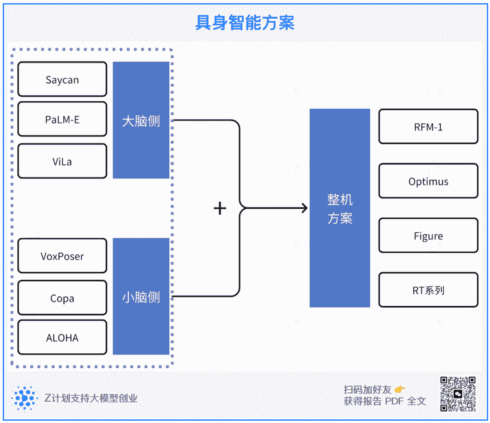

RFM-1（2024.03/Covariant/端到端）

+   背景：

+   2024.3，机器人创业公司 Covariant 推出了首个机器人基础模型 RFM-1，这是世界上首个基于真实任务数据训练的机器人大模型，也是最接近于解决真实世界任务的机器人大模型。

+   共有 80 亿参数，是基于文本、图片、视频、机器人动作、传感器信息等多模态数据进行训练的 any to any 序列模型

+   Covariant：一家人工智能机器人公司，致力于构建一个通用的**人工智能，使机器人能够在现**实世界中学习和操作，以协助人类完成繁重和劳累的任务， 尤其是在仓储和物流行业中。

+   Covariant 现阶段的目标通过 AI 让分拣机器人更好的识别、抓取并放置任何物品，目前产品主要的落地领域为仓储物流、快递分拣自动化。在欧美多个国家落地部署，且稳定持续运行。

+   技术路线：

+   端到端模型（罕见）

+   技术：

+   Any to any：RFM-1 将机器人的实际动作也视作 Token，其 token 包括文本、机器人的动作、传感器数据、图片、视频等多种模态，每个模块都有专门的 tokenizer 进行处理。

+   而 RFM-1 的操作只有一个——预测下一个 token，至于预测的是动作/图像/视频只是取决于 token 的表征罢了。

+   世界模型：RFM-1 对物理世界的理解源自于其学习生成视频的过程： 它通过接受初始图像和机器人动作的输入，预测接下来视频帧的变化。

+   这种基于动作条件的视频预测任务使得 RFM-1 掌握了模拟世界每个瞬间变化的低层次世界模型。

+   该模型不仅能够理解预定的机器人动作，还能通过预测下一个 token 来推断这些动作是否能够成功执行，以及物料箱内容的变化情况。

+   数据：

+   CovariantAI 成立于 2017 年前，具备长期的数据积累，这成为 CovariantAI 最大的壁垒和优势。

+   互联网数据：视频/文本等。有其局限性，如尽管你可以通过观察一个人拿起物体来猜测他正在进行这个动作，但你无法知道他用了多大的力量、手指放在了什么位置、以及具体是如何抓取物体的。这些细节数据在互联网上是无法获取的。

+   CovariantAI 先前在实际生产环境中收集的大量机器人数据：Covariant 已经部署了超过 30 种不同类型的机器人，这意味着其机器人种类已经超过了 OpenX 整个数据集中包含的机器人种类。

Optimus（2023.12/Tesla/端到端）

+   背景：

+   2021.8，Tesla 首次公布人形机器人项目；2023.3，Optimus 的新视频展示其能自由行走/拧螺丝等能力；2023.12，Tesla 发布第二代 Optimus 机器人 Gen2，运动能力大大增强，包括手部精细动作、深蹲动作等，展示了强大的运动和质心控制能力。

+   技术路线：

+   端到端模型

+   技术

+   采用了跟 Tesla 自动驾驶（FSD）一样的 AI 系统，a visual navigation system managed by fully trained， end-to-end neural networks，唯一不同的是增加了动作参考库，他们将人类在真实世界中的自然动作记录下来，并 map 到机器人上。

+   FSD 变迁：

+   **阶段一： **采用深度学习框架的感知系统+基于传统数学模型的运动规划系统；

+   **阶段二： **完全神经网络化，运动规划也通过神经网络求解；

+   **阶段三： **端到端的神经网络系统，不再分层，输入为视频，输出直接为动作规划。

+   和 RFM-1 类似，用一个可微分的模型建立 vision 到 motion 的映射，它也是世界模型的一种形式，通过生成的方式来预测下一帧;

+   用一个可更新状态的神经网络模块来记忆和建模环境，输入当前观测（图像、状态等）和即将采取的动作，根据模型对世界的记忆和理解预测下一个可能得观测（图像、状态）和动作。

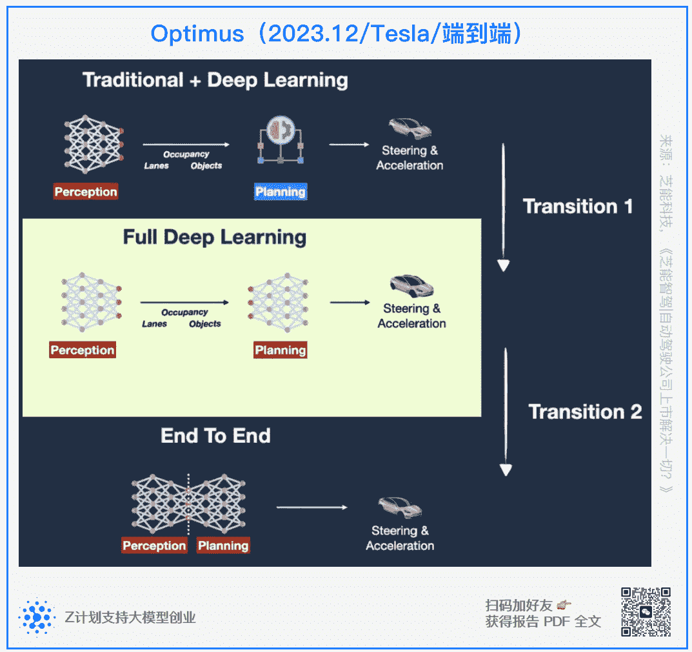

+   数据：

+   因为继承自 Tesla 的自动驾驶系统（FSD），具备大量的视频数据。

Figure-01（2024.03/Figure AI/分层）

+   背景：

+   2024.3，Figure AI 和 OpenAI 宣布合作后 13 天推出 Figure01。，这是世界上首个基于真实任务数据训练的机器人大模型，也是最接近于解决真实世界任务的机器人大模。

+   共有 80 亿参数，是基于文本、图片、视频、机器人动作、传感器信息等多模态数据进行训练的 any to any 序列模型

+   技术路线：

+   具身分层模型

+   技术：

+   Figure01 的智力构建可以拆分为三个层面：

+   第一层，模型层（大脑侧），从图像中获得常识推理，并进行基础的任务拆解。该层主要采用了类似于 ViLA 的技术（详见 2.4.3）

+   第二层，神经策略层（小脑侧），帮助 Figure01 实现快速灵巧操控。输出达 200Hz，能够直接把像素 mapping 到 action，采用的是类似于 ALOHA 的模仿学习技术。

+   第三层，控制层，驱动 Figure01 运动。采用的是全身控制技术（Whole body controller），提供安全且稳定的动力学模型，在机器人进行诸如行走和其他可能影响到自身平衡性的动作时保持平衡。

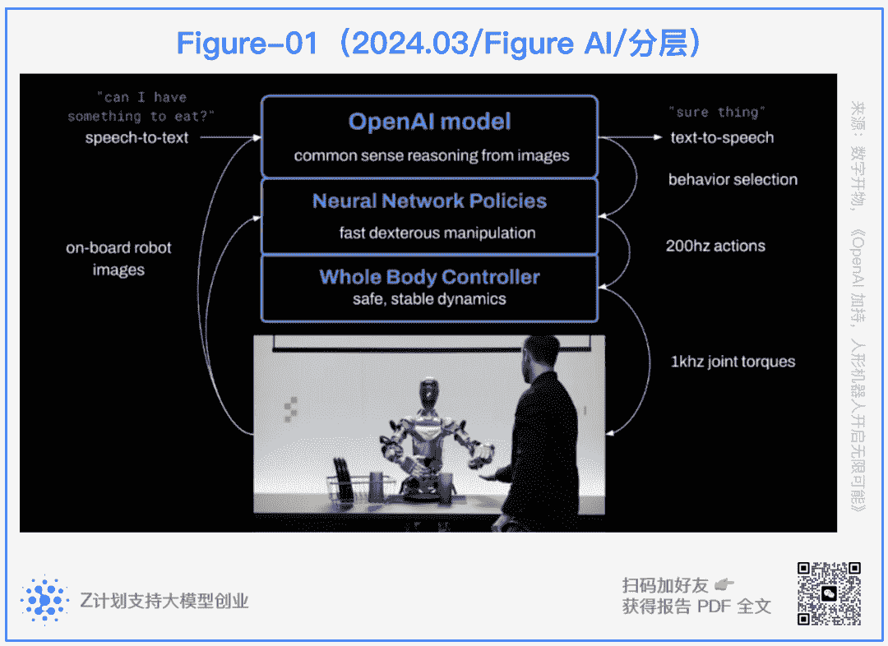

+   Figure01 是工程学派。执行场景中的几个 specific task，每一层分别负责不同的响应速度和输出频率，上层负责规划慢思考，中层负责神经反射快思考，下层负责计算身体的关节力矩， 这样整体反应速度更接近可商用落地的水平。

+   目前这三层中最成熟的是 WBC 机器人运动控制算法，比较成熟的是用大模型做 high-level planning，相对不那么成熟的是 low-level policy，这也是目前研究的热点方向。

+   优劣：

+   优势：

+   劣势： 目前层与层之间属于松耦合，以调用关系为主， 下层模型很难 le**verage 上层模型的泛化能力，上层模型**也很难获得下层模型的即时反馈而调整策略， 在不同场景、不同任务之间的通用性比较弱，适合于特定场景下任务比较容易结构化的需求。

RT 系列（2024.4/Google/分层-端到端）

+   背景-mp.weixin.qq.com

+   Google Deepmind 从大模型入手打造具身智能，其率先提出 Robotics Transformer（即 RT 系列）系列模型。后续又提出 Saycan 和 PALM-E 模型等等，并把这些整合入 RT 系列模型。

+   **2022 年 12 月 **，谷歌基于模仿学习中行为克隆学习范式，把 Transformer 应用到机器人的操纵任务上，提出了 RT-1 模型；

+   **2023 年 7 月 **，基于 **RT-1 **和 **PaLM-E **，升级得到了融合视觉、语言、 **动作 ****能力的端到**端多模态大模型（VLA） RT-2；

+   **2023 年 10 月 **，基于 22 种不同类型机器人真实场景的数据集 Open X-**Embodiment 进一步训练，推出 **能力更强的 RT-X 模型；2024 年 3 月，Google 推出 RT-H。

+   技术路线：

+   RT-1 是分层模型，直到 RT2 成为一个端到端的模型。

+   可以看到 Google 的研究成果有一个聚合的趋势。随着数据量的增加，从分层模型过渡到端到端模型也许是一个自然趋势。

+

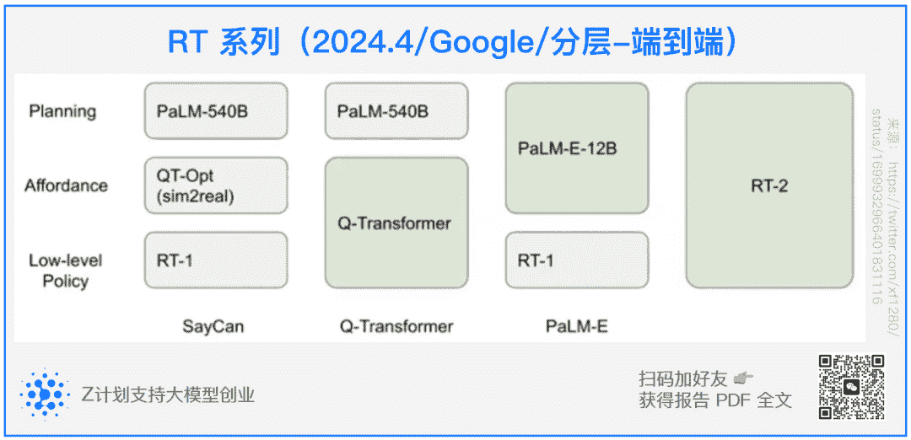

+

+   技术和意义

+   **RT-1:**

+   基于模仿学习中的行为克隆学习范式 ，输入一段短的图像序列和一个指令，输出每个时间步的一个动作，历时 17 个月基于 13 个机器人采集了 130k episodes 以及超过 700 个任务的数据集，使机器人具备了一定的泛化性，能够发现结构相似任务之间的模式，且应用到新任务上。

+   RT-1 的输入由图片序列、自然语言指令构成，输出由机械臂运动的目标位姿（Toll， pitch gaw， gripper stαtus）、基座的运动、模式转换指令构成。

+   **RT-2 :**

+   一个真正的端到端 VLA 模型（Vision-language-Action）。

+   **R**T2 将动作视为一**种新的语**言，结合针对动作**语言的 CoT **技术， 同时实现了机器人基于大模型的语义理解（High level reasoning）和动作理解（Low level action） ，意味着机器人可 端到端 生成动作，从而 执行更复杂的任务

+   例：RT-2 不仅能听懂自然语言指令，还会主动思考，当听到“捡起灭绝的动物”指令，能准确理解其中含义，并完成从恐龙、鲸鱼、狮子三种塑料玩具中抓取恐龙的连续性动作

+   训练分为两步：首先在大规模互联网数据上预训练 VLM，然后在机器人任务上做 co-fine-tuning，可以更好地泛化到新物体、新环境、新形体、新技能上。

+   **RT**-2 与 RT-1 最大的不同是它能够从 Internet-scale pre-training 中获益，为下游任务提供了非常强大的语义推理、problem solving 和视觉解释能力

+   **RT-X :**

+   在 RT-1 和 RT-2 的结构基础上，应用 Open X-Embodiment 数据库进行训练。控制模型 RT-1-X 和视觉模型 RT-2-X 组成，在特定任务（搬运东西、开窗等）的工作效率是同类机器人的 3 倍，同时可执行未训练动作。

+   **RT-H:**

+   引入了 行动层级（action hierarchy） ，通过将复杂任务分解成简单的语言动作（language motion），再转化为机器人行动，从而提高机器人完成任务的准确性和学习效率。

+   language motion：连接高层次任务描述与底层次动作之间的中间层，可以使不同任务之间在语言动作层面上能够更好地共享数据。

+   例如「拿起可乐罐」这一任务可以分解为一系列更细节的 language motion：首先「手臂向前伸」，接着「抓紧罐子」，最后「手臂上举」。

+   **每个 language motion 都不是简单的固定原语，而是具**有灵活性和情境适应性，可以根据当前任务和场景的具体情况通过指令和视觉观察来学习。

+   具备更强的泛化性

+   优劣：

+   优：巧妙实现了底层动作控制模块也能借助海量互联网数据进行训练。 之前的工作如 Saycan 和 Palm-E 都只是解决了机器人的高层规划问题，但是底层的 low-level controller 是独立的，它们在训练期间不会从互联网规模的丰富语义知识中受益。

+   RT-2 是把语言、动作、图像放在一个统一的空间中做 token 化，也可以理解为 action 就是一种特殊的 language，变成 multimodal sequence 放到训练集中，从而发挥 VLM 的能力。

+   **劣：慢。 **实时推理很慢，频率只有 1-3Hz，这本身也是 VLM 模型的问题，现在也有很多方法在尝试解决这个痛点；

+   比如：通过模型的量化和蒸馏将其部署在端侧，采用 MoE 架构在推理过程中只使用一部分参数，使得推理速度快于相同参数的稠密模型。

**总结**

**总结 1：为何是 RFM-1 和 **Optimus 研发出了端到端的大模型？

+   场景优势：

+   **数据丰沛： **Tesla 具备大量的自动驾驶数据，其电动汽车销量在全球断崖式领先；Covariant AI 的物流分拣机器人运行多年，其传感器收集了大量数据。

+   **数据结构化： **RFM-1 应用场景为仓储业务中的物体分拣；而 FSD 系统用于自动驾驶。这两项机器人任务的输入和输出都相对结构化。

+   RFM-1 和 Optimus 这类世界模型与 VLA（Vision-language-action）大模型存在很大的不同，VLA 大模型是先在互联网规模的大数据集上训练使其达到 high-level 能力涌现，再跟真实世界机器人数据做 co-finetune，而世界模型是在物理世界数据上从头训练，随着数据量的增大逐渐涌现出某种高层次的能力。

+   但它仍然是低层次物理世界模型，有点类似人类神经反射系统的机理，比较适合输入输出都相对结构化的场景，如自动驾驶（输入：视觉，输出：油门、刹车、方向盘）、物体分拣（输入：视觉、指令、数值传感器，输出：抓取目标物体，放置到目标位置），不太适合泛化到非结构化的复杂任务。

总结 2：响应速率和搭载 VLM 高度相关

+   figure1 可以拥有 200HZ 的响应，可能更多得益于搭载了更强版本的 GPT4V，对于环境的理解，任务的理拆解和重组能力拥有了质变。

+   Figure 通过神经网络将图像信号扩散到动作信号，以 10hz 的频率接收机器人拍到的图像，并以 200hz 的频率生成 24-DOF 动作。

+   谷歌的 RT 系列最高的也只有 3HZ，有可能就是背后没有非常强的 VLM 带来拆解和重组能力，可能是一个不那么强的 LLM 控制一堆单元 policy，得到的整体 policy 可能也是分模块断层的输出，所有整体的整合时间会极大的延长。

+   在 Text 的成本越来越低的时候，面向于 OpenAI_API 做 Language-driven 的 Embodied AI 的研究，未尝不是一种很合理的路线。

**总结 3：涌现存在局限性**

（尤其是在 RT 系列的进化中可以看到）VLA 模型的涌现能力目前仅体现在与 VLM 相关的 high-level planning 和 affordance 方面；

但是在 low-level 物理交互层面上无法涌现新的技能，仍受限于数据集中的技能类别，同时 physical action 也经常出现抓不稳、放不准等操作笨拙的情况。

总结 4：bottleneck：工业界是否会把仿真应用到数据闭环中？

+   仿真是非常重要的话题

+   自动驾驶是避免接触（防止碰撞）的问题，具身智能是一定要接触（拿取物品）的问题

+   从结果上来看，仿真发挥作用的：

+   回放型仿真，真实数据录下来，不断回放

+   为强化学习做 locomotion。

+   希望能用强化学习解决长尾的 manipulation，但是仿真的真实度不够高

**4、 算法层 Summary**

具身智能的发展历程和技术线路纷繁复杂，我们总结一下需要关注的焦点问题。

**a. 数据：具身智能的制约因素**

+   **困难**

+   **在追溯具身智能的不同技术路线及其历史的**过程中，我们需要抓住一条核心难题：数据。

+   ** **数据是 scaling law 起作用的前提，而 scaling law 又是具身智能具备强大泛化性能的保障。目前在具身智能的数据侧，存在两个显著的问题：

+   **异型数据融合困难： **对于 LLM 来说，语言在本质上都是 token，是同质化的数据。

+   然而对于机器人来说，不同种类和工艺的机器人可能拥有完全不同数量、形态、控制方式的关节、肢体，看待世界的方式不同（有的是点云、有的是视频），对同一个任务的要调用的电机也不同。

+   这意味着每类机器人的数据都有一定的**专属性和异质性，难以在结构上进行统一**。 这个问题不解决，众多机器人的数据不能统一，就不存在 scaling law。

+   **数据维度的匮乏： **单点的低维度数据是足够的，比如互联网上海量的语料库/图片-标签对，但是没有足够量视觉、语言、动作三模态组合配对的多维度数据。

+   而机器人的输入包括了视频信息/音频信息（语音指令）/雷达信息/自身运动系统的触觉反馈和关节反馈等等，输出又包括了每个不同关节的运动/语音等。整体来看是一个多模态输入-多模态输出的复杂模型。

+   **办法**

+   **解决数据匮乏问题有两种思路：绕过去（分层模**型）和使用虚拟数据（sim2real）。

+   此处不讨论在 LLM 中运用的常见的数据增强手段。

+   **绕过去：分层模型。 **分层模型本身就是对数据匮乏问题的一种解决方案，它通过对端到端的任务做一个模块化切分，降低每个模块的数据维度需求，从而让每个模块有足够的数据量进行学习。

+   比如视觉和语言可以一起训练，3D 视觉和下游移动操作又一起训练。相当于有若干个子 model，每个子 model 对于数据需求的维度就会显著下降，而我们又具备足够的低维度数据。

+   **当前众多技术路线中，分层模型占据主导地位，**核心原因就是能绕过多维度数据匮乏的问题。

+   使用虚拟数据：sim2real。

1.  让机器在模拟器中学习，然后将学习到的策略部署在真实世界的机器人之中

1.  详见第三大章：模拟器。

+   **数据集**

+   **OpenX： **2023.10，Chelsea Finn 等人在离开 Google 之前创建了一个名为 OpenX 的数据集（对应 RTX 项目的数据集），由 21 家机构合作收集了 22 个不同机器人的数据集，展示了 527 项技能（160266 项任务），包含 1M+机器人轨迹的机器人学习数据集，在 robot manipulation 的背景下探索 generalist X-robot 的训练，堪称机器人领域的 ImageNet 时刻。

+   **MimicGen： **2023.10，由 NVIDIA 和 UT Austin 的研究者提出了一项机器人训练数据生成系统，称为 MimicGen。

+   该系统通过对人类演示进行处理，自动生成不同场景下的大规模数据集，进而用于机器人的模仿学习。

+   MimicGen 会取一小部分人类演示，并将它们划分为以对象为中心的片段，然后在不同物体姿态的新场景选择一个人类演示变换其以对象为中心的片段，然后缝合形成一个新演示。

+   **松灵： **鹏城实验室、松灵机器人、中山大学、南方科技大学等共同倡议—建立具身智能开源数据集 ARIO（All Robots In One）。

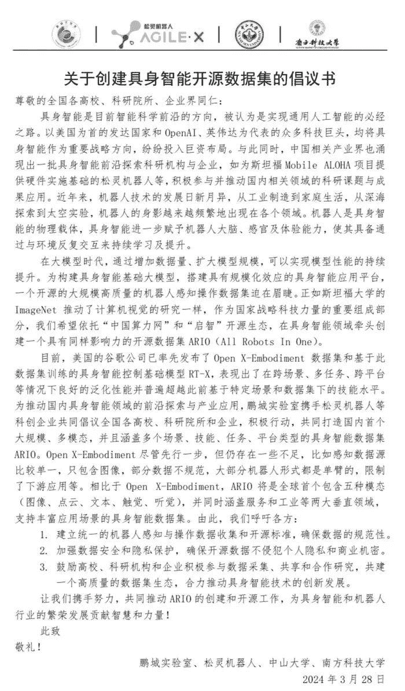

来源：https://mp.weixin.qq.com/s/qBoV15F0JHLyBKkJyWsU0w

b. Foundation Model：具身智能的未来

Foundation model 的定义：

+   会不会产生一个具备通用智能的大脑作为一个开放平台，这个大脑可以适配不同的躯体（类似于 MOE），每个躯体为特殊领域量身定制。

+   各个领域的躯体的实践又都会反哺大脑的成长。比如 RFM 模型可以预测为了完成任务手部需要做出怎样的一个轨迹和曲线，也能知道在某些任务下需要更换我的末端执行器，比如吸盘用不了的时候就可以使用夹爪。

+   一脑多型：各种形态的机器人都由同一个大脑进行统御。大脑会自动感知自己的躯体，并结合躯体、环境和目标给出任务的解决方案。这是具身智能未来的一种理想形态。

Foundation model 的意义

+   可以参照大语言模型或者 SAM（Segment Anything Model），他们本身在大量不同的任务下进行训练，使得相对来说容易解决新问题，这就部分体现了 foundation model 的能力。

+   机器人通常需要解决许多琐碎的 AI 问题，但是使用现有的 Foundation Model 可以大大降低工作量。

+   SAM：Foundation Model 的雏形

+   优点：方便使用

+   缺点：对语义分割和实例分割的能力较差；与其他模态结合的能力较弱

+   并不是一个终极的视觉基础模型

+   困难：

+   **混合训练数据： **目前，Cross-embodiement 还比较困难，还没有有效的方法去解决不同机器人的数据混在一起 pretrain 的办法

+   **泛化： **目前具身智能的底层动作技能还没看到可以泛化的办法

【智谱清言智能 体推荐】了解更多关于硬件，点击互动👇

参考资料：

[1 ]Li, Junnan, et al. "Blip-2: Bootstrapping language-image pre-training with frozen image encoders and large language models." International Conference on Machine Learning. PMLR, 2023.

[2]Sun, Quan, et al. "Generative pretraining in multimodality." arXiv preprint arXiv:2307.05222 (2023).

[3]BAI 资本：万字干货带你入门“具身智能”｜BAI 观点

[4]https://mp.weixin.qq.com/s/IqVLvNHJ3OMdaHpITK57Jw

[5] 中金 | 人形机器人前沿系列：力触觉，牵引感官革命

[6]中金 | 人形机器人前沿 03：运动控制，产业命脉守护者

[7]中金 • 联合研究 | 产业龙头纷至沓来，人形机器人大幕拉开

[8]中金六组共同深度解读全球人形机器人发展历程、零部件产业链、参与者发展历程梳理及终端应用。建议关注各类机器人技术变迁带来的机会，其中重点关注人形机器人产业化落地需拉通的技术与终端应用相关链条机会。

[9]浙商证券《图拆特斯拉 Optimus——走进机器人》

[10]华泰 | 机械：人形机器人再探讨——训练数据的来源

[11]BAI 资本：万字干货带你入门“具身智能”｜BAI 观点

[12]一文读懂具身智能：方法、进展及挑战

[13]具身智能，是机器人的“冷饭热炒”吗？-36 氪

[14]马斯克看中的具身智能，最多走到了 0.1？-36 氪

[15]大模型机器人发展史：从 VoxPoser、RT2 到斯坦福 Mobile ALOHA、Google 机器人-CSDN 博客

[16]PRO | 模仿学习：OpenAI 放弃的路线是否已进入新篇章？

—end—

作者 | 严宽、崔浩、叶行健、梅煜东

特别感谢 | haozhe、yinda

排版 | 郑寒

审核 | 李文珏、邓瑞恒

* 本文不代表智谱认同以上任何观点

* 文中出现的智谱清言智能体，不代表本研究报告的研究成果。以及智能体输出的内容也不是本报告的研究成果，仅供参考。

