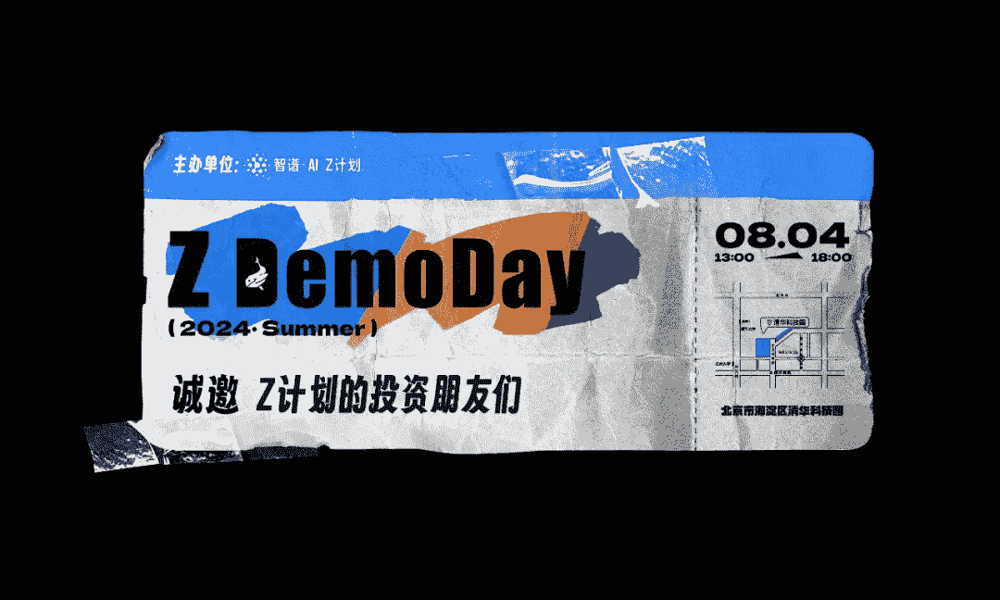
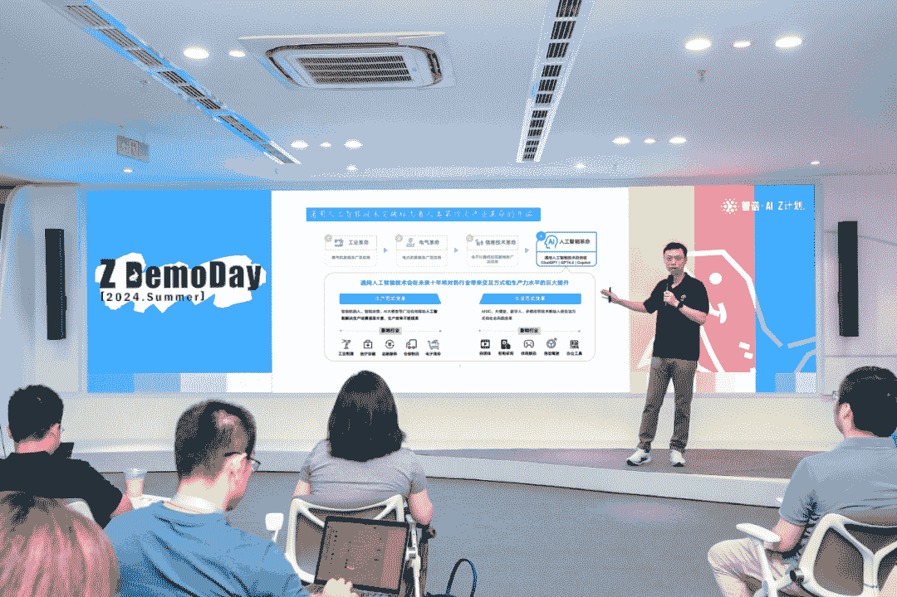
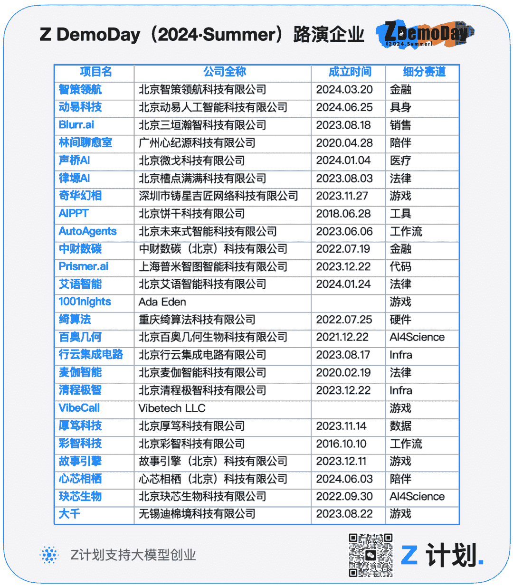
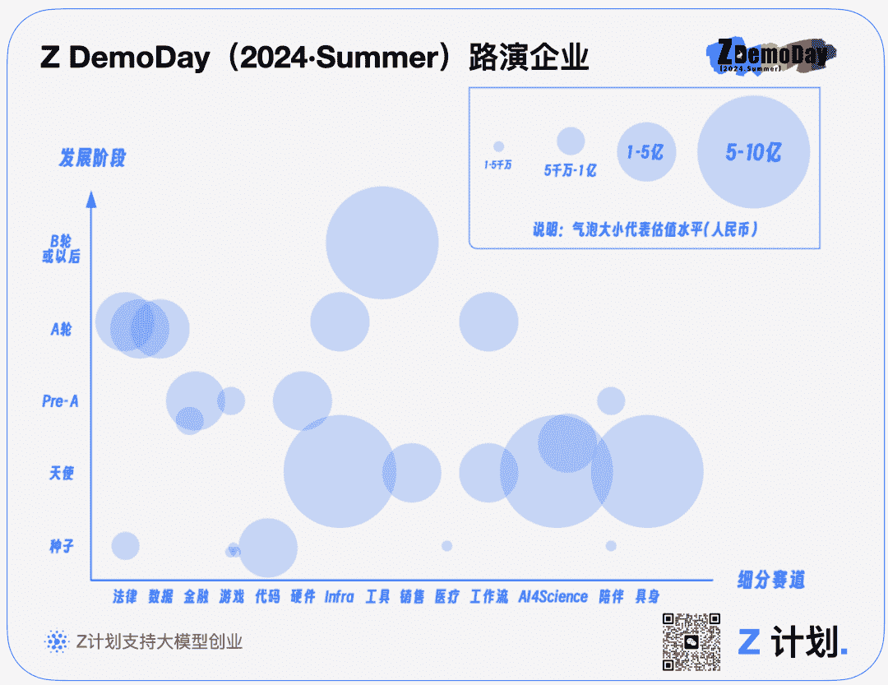
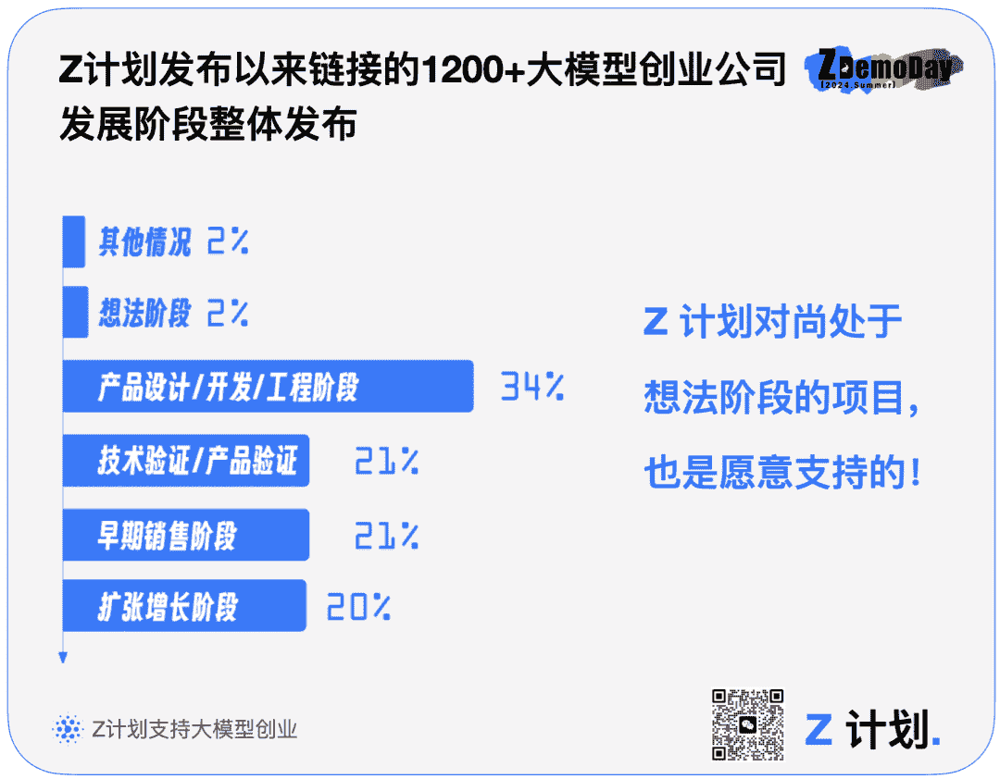
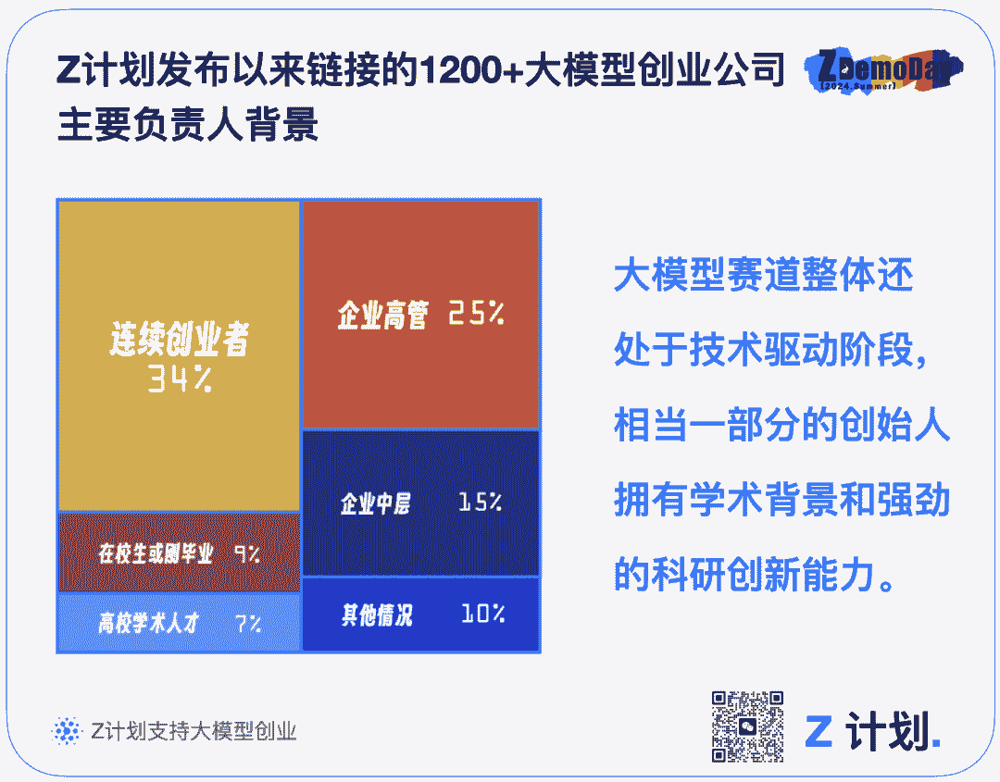
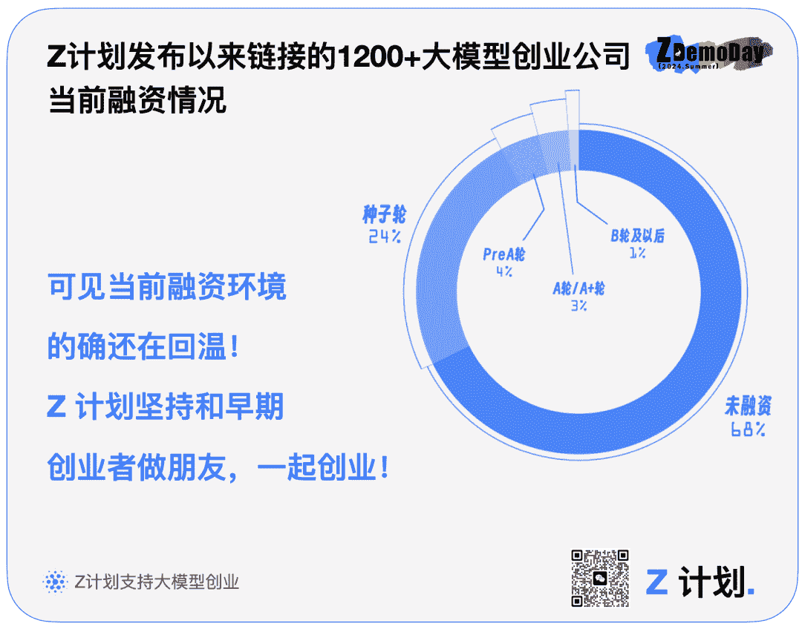
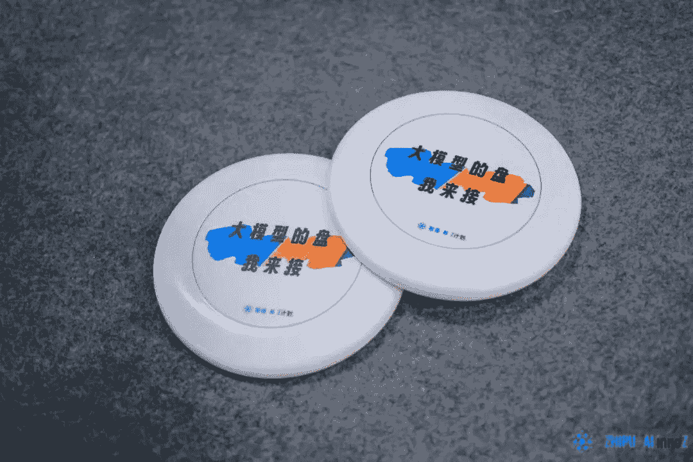

# 受邀参加了智谱 AI Z Demo Day，让我再一次相信 AGI！

> 来源：[https://waytoagi.feishu.cn/docx/CoWYdSw0aoddWKxSlPCcYVCKnhe](https://waytoagi.feishu.cn/docx/CoWYdSw0aoddWKxSlPCcYVCKnhe)

> 🔗 原文链接： h[ttps://mp.weixin.q](https://mp.weixin.qq.com/s/JBNUyo9f8_kPG9NGBjWSqQ)q.com/s/JBNUyo9f...

> ⏰ 发表时间：2024-08-05

# #1. 首届！Z 计划搞得有点大了

[**智谱 AI Z 计划企业路演日：Z D**](http://mp.weixin.qq.com/s?__biz=MzkyMDU5NzQ2Mg==&mid=2247486664&idx=1&sn=116171fffb470a7d6b1503d147b9fb55&chksm=c1912a71f6e6a367288c6528508b479f0d156d7de3f3c7f04b43368ac089a1d49d27f0ecb8d2&scene=21#wechat_redirect)emoDay（2024·Summer） 于 8 月 4 日在智谱 AI 公司举办。现场共有 25 家 Z 计划企业参加路演，近 300 位投资人参会（空间有限，策划预期 180 位而已）。

这也是 Z 计划自发布以来，举办的首届大规模路演活动。现场路演项目覆盖大模型赛道各关键生态位，涉及算力优化、数据治理等基础设施，以及法律、金融、生物医药等多个垂直行业应用场景。

Z DemoDay 的邀请门票，通往 AGI 的门票～ cooool

活**动伊始，智**谱 AI CEO 张鹏做了开场致辞，并宣布智谱 AI 联合生态伙伴正式推出 AGI 生态基金： Z 基金 ，以支持更多大模型赛道有潜力的早期项目！

随后，25 家 Z 计划企业分上下半场逐一进行了时长五分钟的路演展示。 期间，Z 计划还为现场所有嘉宾带来了一场大模型创业投资主题的脱口秀！

Z 计划为每一家路演企业安排了专属会议室，投资人们可以自行预约各企业创始人闭门交流。

与此同时， Z 计划还推出了投资人对接小程序 ，投资人经认证后可以查看各 Z 计划企业信息并互换联系方式！

# **#2.**** 半年历程，我们“小有收获”**

**「Z 计划」 **是智谱 AI 面**向未上市初创企业与**卓越独立开发者/团队，提供 Tokens 赞助、投资支持和技术支持等资源的创新加速计划。 智谱 AI 大模型产业加速器，是 Z 计划落实服务的具体载体， 是智谱 AI 发掘、链接、服务 大模型赛道上高潜力创业企业与卓越开发者的容器。

**自** 2023 年 10 月底发布以来，Z 计划共链接 1200 +大模型赛道初创企业/开发者团队，前后累计投资与孵化有 50 +家。

# **#3.** 星火燎原之势，他们“大有所为”

**智策领航 **

**项目简介**

全球首个 AI 投资伙伴社区，为每位个人投资者提供下一代投资新体验。 集观点、知识、专家为一体的新时代投资智能体平台。 小程序已上线：

**项目陈述**

目标市场：2C 个人投资者（>5 亿人） -> 2B2C 专业机构投资人（>50 万人）

解决方案：对全网多模态的复杂金融数据进行基于观点&知识的深度建模，通过多专家间（multi-agent）的博弈与协作，结合用户个人知识库和记忆，为投资者提供高价值深度投研内容与策略建议

技术优势：前投资科技大厂团队的深度行业 know-how、独家投研行业数据微调、知识 RAG、投资 Agent 工具/工作流

商业模式：

1、2C：订阅制增值服务、高价值知识付费；

2、2B2C：搭建标准化垂直投资的智能体平台，通过智能体商店模式，服务工具贡献者&使用方；

**Blurr.AI 智能销售**

**项目简介**

驱动未来生产力，打造行业领先的销售 Agent 创新解决方案。

三垣瀚智基于大语言模型等 AI 技术为企业客户提供“软件+硬件+服务”的一体化 AI 智能销售解决方案；Blurr.AI 是企业级一站式 AI 智能体搭建和接入平台，可视化低门槛提供 AI 原生能力，助力 AI 技术快速、高质量应用，提升企业经营绩效。

**项目陈述**

1、目标市场：小 B 销售市场为主，未来会突围面向 C 端的销售 Autopilot；

2、解决方案：依托 Agent 框架利用 AI 原生能力，针对 2B 企业在销售服务过程，打造新一代增强式 AI 销售数字员工。

3、技术优势：专注文本/多模态大模型、AI Agent 技术创新与应用，目标实现基于 ReAct、SFT、RAG、强化学习等实现自主规划能力的 AI Agent，构建具备认知、决策智能的 Agent 智能体框架。Blurr.ai 将总结典型行业、企业的销售 SOP、销售技巧，形成客户可选配 schema，支持客户快速应用部署。中长期，Blurr.ai 将灵活应用端侧模型及智能硬件，将 AI 应用与企业销售场景融合，助力企业降本提效。

4、商业模式：依据不同类型销售市场的特点，结合一站式 AI 搭建平台将销售部署的产品化和模版化，让企业更容易落地和应用 AI 能力；销售智能体 Blurr.AI 占位交易环节，解决 2B 销售获客的痛点，且具有向前后端环节延展的势能。

林间聊愈室/MoodTalker

**项目简介**

《林间聊愈室》 （MoodTalker）是一款面向年轻用户，打造懂你+关心你的 AI 心灵伙伴的 APP。

**项目陈述 **

打造三只 AI 小动物角色：小狐狸、小鹿和小熊——由他们帮助年轻用户更好地应对情绪问题，在和小动物的成长经历中，实现自我觉察和成长。

解决方案：

他们在对话场景中提供情绪可视化识别、音乐、心理技法、冥想等互动方式，让用户感受到“被看见，被理解，被关心”的情绪价值。

重点在打造对话之外，利用 AI 智力效率和可视化生成能力，打造持续的离线关心动作，以及超越人类心理工作者的读心体验。让潜意识中的自我和他人可视化。

独特的记忆养成机制和离线关心模式，让每个人都能获得所需的情绪支持和成长空间。

目前市场：国内 Z 世代女性用户（18-30 岁），海外 20-35 岁白人女性用户（目前在试点北美地区）

商业模式：订阅制，未来会与硬件、教育等场景结合。对标产品 Noom（100 万美金/月）、Finch（80 万美金/月）

技术优势：认知+产品体验 +2500 万条垂域数据累计

**声桥 AI**

**项目简介**

声桥 AI 语训 是一款基于大模型和语音技术的 AI 口语康复应用，专为国内上千万未能接受康复机会或由于经济原因无法进行康复治疗而失去语言能力的聋人设计。

通过 AI 技术，我们的应用可以帮助这一特殊群体重新获得言语能力，纠正发声问题，并有效降低言语治疗师的工作负担。我们的目标是帮助他们迅速提高说话能力，提高沟通效率，助力他们在工作和生活中更加自如地表达自己。

**项目陈述**

中国有 2780 万听障人士，但只有约 1 万名言语治疗师，听障人士言语康复资源严重不足，造成了“十聋九哑”的现状。听障人士此前所有的练习说话的途径必须依赖第三人在场给予纠音反馈，难以进行独立的口语练习，但声桥 AI 语训的出现，使得听障人士的口语练习，进入了一个新的时代。

声桥 AI 语训是一款基于生成式 AI 等技术的言语训练软件，旨在为听障人士提供高独立性、高效率、低成本的口语训练。它通过语音识别和反馈、可视化声音、专业发音指导等核心功能，帮助听障人士独立练习口语，减少社交隔离感。

声桥 AI 语训结合了先进的语音模型和大语言模型，能够提供精准的发音纠正和多维度的反馈。其可视化功能特别适合无法依靠听力反馈的用户，提供口型、舌位、气流和声带等详细的发音指导。

**律塬 AI **

**项目简介**

律塬 AI 是基于 AI+数据的法律诉讼服务平台，旨在利用人工智能技术和大语言模型以及数据挖掘能力，解决找律师难、打官司贵、心里没底的难题（解决问题而不是解释问题），致力于成为每个人的 AI 律师，推动法律服务成本的结构化改变。

**项目陈述**

目标市场：大众用户普惠市场，10 万元以下案值或 1 万元以下代理费。

解决方案：通过数据知晓能力和模型分析能力，使 AI 达到并超越律师的专业水平，用 80 分的 AI 律师解决 60 分的诉讼问题，将目前的法律服务成本降低 90%。

技术优势：AI 学习知识发现知识并形成知识树，从对话到方案再到行动提供全流程 AI 服务。目前已申请 7 项技术专利。

商业模式：覆盖大众用户普惠市场，代理低值案件，提供高效便捷普惠的法律服务，改变每个环节的结构和成本，大幅降低起步门槛，让人人都打得起官司。

奇华幻相（Phantomgraph）

**项目简介**

这是一款包含 AIGC 功能的二次元恋爱游戏，游戏注重个人玩家的单机体验，我们将 AIGC 多模态的生成能力包装成了各类有趣的玩法，如与角色的 AI 拍照，与智能体开放的表白环节等，玩家需要根据自己在游戏中收集到的信息，在开放式的问答中攻破这些角色的心房，而非像传统游戏那样，只需要在关键时刻选对选项。这将是一款重视玩家差异化情感体验的二次元恋爱游戏，将为玩家提供深刻的情绪价值。

**项目陈述**

我们首先将二次元的宅男群体作为我们的核心用户，我们认为在对这个人群的需求理解上具备一定优势。同时我们将在项目中对我们设计的独特商业模式进行验证，我们的商业模式为，玩家/用户，在游玩/使用游戏应用的过程中完成 Prompt 的输入，我们再通过 AIGC 能力，将这些 Prompt 转化成有着更高附加值的产出，如游戏内的装备道具，模仿玩家行为的智能体等，将这些产出包装为属于玩家的个性化产品，鼓励他们在各大社交媒体上传播和展示这些内容，帮助项目曝光，扩大使用人群，实现商业闭环。

**AiPPT.cn**

**项目简介**

爱设计&AiPPT.cn 是一家 AIGC 数字科技企业。

致力于打造“下一代个人与组织的 Ai 工作站”。旗下产品包括 AiPPT，爱设计 AIGC 内容中台、365 编辑器、爱设计在线设计工具、AiH5 等超过 10 余款应用 AI 能力的内容创作工具。23 年爱设计在 Ai+办公领域推出 AiPPT.cn/AiPPT.com，帮助用户“一分钟一键生成 PPT”，目前是国内 AiPPT 赛道创业公司第 1 的产品，全球第 4，国内所有 AIGC 产品 PC 端 Top10。

**项目陈述**

目标市场：用户主要是市场、运营、销售、人力、财务、行政、技术、产品、总助、公务员、学生、老师等基层及中高层管理岗位人员。

解决方案：AiPPT.cn，“一分钟一键生成 PPT”。

技术优势：AiPPT.cn 基于自然语言处理技术的语义分析，帮助用户快速生成演示文稿。基于图像识别技术的 AI 插件，能够实现智能化的 PPT 模板生成、字体自动化排版等功能；基于数据分析技术的个性化推荐，能够根据用户的需求和偏好，为用户提供量身定制的演示文稿模板和素材，通过了国家网信办 PPT 生成算法备案，同时获得 A 股上市公司视觉中国战略投资，拥有 5 亿+版权素材库，10W+PPT 模板可以为用户提供版权无忧、图文并茂的内容创作体验。

商业模式：靠订阅工具业务赚钱，为全岗位职场人提供 10 余款 AIGC 工具，围绕企业内容工作流，高效满足工作中的 PPT 、文案、H5、平面/视频制作、新媒体排版等高质量内容的创作需求。

**AutoAgents.ai **

**项目简介**

未来式智能是一家由创新工场投资，国内首批大语言模型技术落地和应用场景探索的公司，以自研 Multi-Agent 架构为基础构建企业级 Agent“灵搭”平台，为企业提供、AI Copilot、Autopilot、Autonomous Agent 等智能体产品与服务。

基于自主研发的企业级 Agent 应用构建平台，致力于解决大语言模型到场景化落地应用“最后一公里”问题。通过打破传统固化业务流，帮助企业构建高度智能化的底层通用业务流，打造人机共创的工作新范式，引领企业业务流程智能化升级，让全球 10 亿知识工作者 10 倍效工作。

**项目陈述**

公司的核心产品是以自研 Multi-Agent 架构为基础的企业级 AI Agent 平台——“灵搭”平台，“灵搭”平台结合了大语言模型技术、检索增强生成技术、Multi-Agent 技术等，能够理解并处理复杂的企业业务需求，提供企业场景化的 Autonomous Agent、AI Copilot、Autopilot 等解决方案。“灵搭”平台具有以下多项优势：

-平台适配国内外主流开源及闭源大语言模型，支持多模型混合使用，构建企业级场景服务生态，为各类政企、行业客户等提供场景化解决方案；

-灵活可视化无代码应用构建、Text-to-Agent 技术，构建更便捷，上手更简单，操作更高效；

-即时发布上线，支持发布为网页/小程序/API 等多种形态，分钟内部署 Agent 应用；

-企业级安全访问控制，依据 Agent 权限控制数据访问，通信过程加密，避免数据泄露风险

-支持多 Agents 协作，构建知识工作者的人机协作流水线，满足复杂业务场景需求

商业模式：我们已与阿里云、腾讯云、火山引擎、华为政企、智谱 AI 等企业达成深度合作，共同利用大语言模型为企业提供创新动力；主要服务电力能源行业，成功落地电网智能客服、合同审核、资讯助手、电网安全调度助手、故障报告生成等应用场景，赋能企业 AI 新范式。

**中财数碳**

**项目简介**

基于内容增强型知识插槽技术的大模型应用服务商，主要落地场景包括双碳、财金等领域，已经落地多个应用场景，产品具有明显的价格优势。

**项目陈述**

依托中央财经大学的资源优势，专注于解决大模型应用的最后一公里问题，重点场景包括双碳、财金领域。核心技术：基于内容增强型知识插槽技术构建高质量知识库，与客户自有知识库结合，实现全业务场景的支撑，可实现快速的专家级 Agent 构建与管理维护。

快速形成新领域的高质量知识库，效果超过通用大模型的能力；与业务场景深度融合，支持业务流程的 AI 化改造。

API 部署、私有化部署，价格低于同类产品 50%，性能更好。

**Prismer.AI**

**项目简介**

死文档变为活资产

**项目陈述**

上海普米智图智能科技有限公司（Prismer.AI）致力于以文档为切入点，打造智能体应用。公司自主研发的数据框架 Ananke，成功成为首个将连接主义和符号主义统一融合的自动化表示框架，并建立了容纳 200 万篇以上文档的表示库。

基于 Ananke，自研了 Agent 框架 Moros，实现了可信的数学求解、工程代码生成和算力节点调度等功能，在文档的间接信息价值与直接资产化价值之间建立了闭环。

依托这两项核心技术，推出 DocBrew.AI 产品。该产品利用智能体技术，将算法验证、金融量化分析、数学科学计算验证和代码服务化等不同群体的工作流效率提升了一个数量级以上。

**艾语智能**

**项目简介**

个人无抵押信贷资产处置领域是一个超级市场，每年的佣金规模超过 2000 亿！这个行业有超过 180 万的从业人员，他们长期在压抑的环境中工作。在处置过程中，他们需要与大量的借款人以及法院进行对话，同时还需要处理海量的文档生成和识别需求，从技术角度说是特别适合 LLM 的场景。

因此，我们构建了阿亮个贷纾困机器人，旨在彻底取代人工，实现高质量的无抵押资产处置流程。

**项目陈述**

我们的产品跟有三方面核心优势：第一：LLM 技术与场景匹配度极高。第二：Ai 能力强，我们团队几乎微调了所有开源模型，构建了行业私有化数据库，结合自身使用情况构建了 EDSO Agent 框架，包含了经验数据库、以及自优化自学习机制，让 Ai 能更好的驱动人，最终替代人。第三：我们已经上线了 5 个 LLM 产品，在 17 个业务需求上完成了 PMF 验证，已确认了 4 个客户，预计可以产生 700-1000 万收入。

**一千零一夜**

**项目简介**

“语言的限制就是世界的边界”。1001 Nights 是一款以创造故事为核心玩法的 AI native 游戏。玩家将扮演主角山鲁佐德，她拥有特殊的能力：可以将他人的话语变为现实。

玩家需要对抗由 AI 扮演的国王，通过编故事引导国王说出“剑”、“刀”或“盾”之类的武器词汇并把它们变成实体，并逐渐感受到故事入侵现实，最终和国王进行战斗，反抗命运。

**项目陈述**

1001 Nights 是一款 AI native 游戏，核心玩法基于故事创作。玩家将扮演具有将言语变实的能力的主角山鲁佐德，需要通过讲故事驱使对抗 AI 国王，将“剑”、“刀”或“盾”等词汇变为现实以对抗命运。这款游戏不仅面向资深游戏玩家，也致力于吸引更大的轻游戏玩家群体。

我们的优势就是拥有独特的美术风格和成熟的 AI 技术，这为玩家提供独一无二的沉浸式体验。我们采用 Steam 付费模式，玩家初次购买后可继续付费解锁更多内容。

**绮算法**

**项目简介**

通过 AI 边缘设备、智能项圈、AI 辅助诊疗系统为宠物提供系统化健康解决方案

**项目陈述**

重庆绮算法科技有限公司是重庆市政府重点引入的一家 AI 大数据服务商，公司在重庆、上海、深圳、美国匹兹堡、费城设有研发中心和分支机构。公司以“让宠物活得更健康、活得得更好”为目标，以“AI 芯片加速卡”、“智能硬件”、“AI 诊疗系统”为手段，研发了首个深度学习智能项圈、首个可解释 AI 诊疗系统均已实际落地。

通过“AI 硬件+软件”构建起宠物画像，提供包括但不限于宠物行为、病理、生理、消费等多模态数据解决方案。为 2C（消费者）和 2B（企业）提供宠物健康消费全生命周期的市场赋能解决方案。

**动易科技**

**项目简介**

公司是一家致力于创造一款为 AI 而生的通用人形机器人的公司，为人类生活带来更智能、更便捷的体验。通过先进的人工智能技术和机器人工程学，打造出能够与人类建立深度互动的智能体，在机器人本体方面，将主要面向 AI 而设计双足机器人，具有稳定性基础特征，以及高动态拟人化的动作，能够自主处理与复杂物理世界的交互；作为在大模型的应用载体，情感的表达体，帮助构建世界模型，实现通用人工智能体。我们相信，在未来的智能时代，人形机器人将成为人类生活中不可或缺的一部分，为人们提供各种生活服务和生产制造服务。

**项目陈述**

产品方向上，公司利用端到端的 AI 运动控制技术驱动的软硬件一体化的机器人系列产品，开发利用物理智能真实世界中生产、制造以及服务的人形机器人产品。

产品性能方面，软件层将具有独特的多元化行为动作生成及控制 AI Agent，能够实现人类所有基本行为动作的生成及流程过渡；硬件层具有独特的并行通信架构，容错率高，同时在力矩密度方面也处于前沿水平，深度耦合软件算法，实现 24 小时的全天续航无休。

公司主要产品包括新型成年人尺寸的人形机器人本体、UPIA（通用 AI 运动控制软件）、其他机器人硬件系列例如机械臂、轮足等。

**百奥几何 **

**项目简介**

生成式 AI 大模型赋能蛋白质设计，应用在包括生物医药、化工、医美、食品等整个生物制造领域。

**项目陈述**

生物制造被视作推动“第四次工业革命”前进的关键力量，涉及到生物医药、食品、化工、医美、材料等多个行业，市场规模预计将达到数十万亿美元。生物制造的核心是发现高附加值蛋白质分子（如抗体药物分子、胶原蛋白）或者找到高效的菌株、酶来生产已有的分子，核心问题都可以归结为蛋白质设计。

百奥几何目前已经打造了生成式 AI 蛋白质设计大模型以及高通量蛋白质湿实验验证两大基础平台，通过干湿实验闭环迭代快速找到有效的蛋白质分子。百奥几何的生成式 AI 蛋白质大模型 GeoFlow 目前已经达到国际领先水平，在关键任务上与 AlphaFold3 效果接近。公司商业模型包括平台服务以及自有产品开发。

**行云 **

**项目简介**

行云致力于打造软件亲和、高显存规格的大模型推理芯片，旨在用异构、白盒的硬件形态重塑大模型计算系统，推动大模型走向更高质量和更低成本，解决大模型产业的算力成本和供应问题。

**项目陈述**

随着大语言模型的不断发展，对于大规模模型的推理需求将会持续增加。行云通过自研 GPU 内核以及创新硬件架构，为行业发展提供超低成本和超大带宽容量的解决方案。行云目前规划的两款产品将有助于解决大模型芯片成本问题，通过更开放的白盒方案，在不引入业务迁移成本的同时，降低对昂贵的英伟达高端显卡依赖。

行云目前计划推出两款产品，第一款主要用于低成本市场，在接近消费级显卡的价格下，单卡显存容量达到 300-400GB。行云第二款产品，单卡显存接近 800GB，单卡可对标当前 8 卡服务器平台，大幅度降低成本。可根本性降低推理成本，协助下游客户更快完成商业闭环。

**麦伽智能 **

**项目简介**

麦伽智能是清华大学互联网司法研究院的成果转化伙伴，合作开发 LegalOne 法律大模型，从人民法院智能化场景切入，致力于打造未来社会综合治理的基础设施。

**项目陈述**

麦伽智能基于 LegalOne 法律大模型，研发了精准语义检索平台、法律咨询系统、审判辅助系统等多款产品，服务于高级、中级和基层各级人民法院的审判业务、诉源治理、多元解纷等场景。

相关产品正在上海、山东、苏州、深圳、成都等地开展试点应用。未来，法律大模型将成为社会综合治理的基础设施，从司法机关向政府行政部门、企业和个人拓展。

**清程极智**

**项目简介**

清程极智孵化于清华大学计算机系，由清华大学计算机系长聘教授、国家杰出青年科学基金获得者翟季冬教授担任首席科学家。CEO 汤雄超博士师从翟季冬教授，主要研究领域为性能分析及性能优化、并行计算、异构计算、集群资源调度，曾任深信服的资深研发技术负责人、字节跳动高级研发工程师。COO 靳江明博士毕业于新加坡南洋理工大学计算机学院，主要研究领域为高性能计算、分布式系统架构，以及智能边缘计算，曾先后就职于摩根大通、图森未来担任高级技术管理职位。

清程极智成立于 2023 年 12 月，于 2024 年 3 月完成了种子轮投资，投资方包括中金私募股权、雅瑞资本、智谱 AI、顺禧基金、中关村科学城基金和同为资本 。清程极智在 AI Infra 系统软件领域拥有从底层编译器到上层并行加速技术的全栈研发能力。

公司核心技术涉及并行系统、计算框架、通信库、算子库、AI 编译器、编程语言、调度系统、存储系统、内存管理、容错系统等关键技术领域 。公司核心技术人员均来自清华大学计算机系的专业博士 ，公司目前团队约 40 人，预计到 2024 年底将扩张至 80 人规模，研发人员占比达 80%以上 。

**项目陈述**

清程极智自主研发了智能编译器 IntelliGen、高效并行训练系统 FastMoE、高性能推理框架 FastDecode。IntelliGen 在处理 Transformer 类模型方面，部分模型加速高达 20 倍；FastMoE 在处理混合专家 MoE 模型过程中，部分加速高达 15 倍；基于某国产卡使用 FastDecode 研发的千亿参数规模大模型的高性能推理平台在不同场景下可实现 1 到 10 倍不等的吞吐量提升，实测的并发量是 vLLM 等开源框架的 4 倍。

公司目前已有多家芯片厂商和超算、智算中心达成战略合作，共同推进国产大规模 GPU 智算集群的产业化进程并联合开发面向超万亿参数大模型和超大规模集群的高性能系统软件方案等。

**VibeCall **

**项目简介**

VibeCall 通过打造用户专属 AI 智能体，让约会有趣且高效个性化。基于 LLM “创建约会档案”、“智能配对”和“代理约会”，帮助用户快速建立真实浪漫关系，成为他们可信赖的约会助手，让脱单轻松实现。

**项目陈述**

VibeCall 是面向都市年轻专业人士的 AI 约会平台，致力于解决现代生活中的社交挑战。我们运用先进的大语言模型技术，为用户打造个性化 AI 智能体，实现"创建约会档案"、"智能配对"和"代理约会"三大核心功能。

平台的技术优势在于深度个性化画像构建和多模态交互系统，确保高质量匹配和自然流畅的对话。我们的实时情感数字人技术更是大幅提升了用户体验和互动沉浸感。

商业模式采用点数购买、订阅制和用户活跃度激励机制，实现平台与用户的双赢。VibeCall 通过持续的技术创新，致力于成为用户值得信赖的智能约会助手，让寻找真挚感情变得轻松自然。

**厚笃科技**

**项目简介**

厚笃科技起源于清华大学计算机系院士团队，以海量数据一站式处理的国产化硬核技术为基础，支撑 Data+AI 的一体化应用，深耕国产化数字底座的行业落地。

**项目陈述**

厚笃科技深耕高性能计算和编译技术，研发极致性能的 Data+AI 处理引擎、安全高效的数据集成与治理平台，支撑 Data+AI 的一体化应用，同时，坚持技术+场景双轮驱动，打造以数字底座为核心的场景化解决方案。公司从技术、产品、解决方案多个层次为有大数据+AI 需求的政府和企业客户赋能。

**彩智科技**

**项目简介**

彩智科技持续研发打造了首个全量通用行业知识模型与数据服务云——“深知智能”；它面向权威机构（政府、行业组织等）发布的党建材料、行政法规与政策、行业标准与规范、公共服务指南与监管清单、行业准入与产品目录清单等，构建以本体化认知图谱表达的全量行业通用知识体系（56 大类近千小类共 150 万概念知识节点）；并对国家级到各省、市、区县共 2 亿多的规范性文件，持续进行动态更新采集、语义级数据清洗去重、概念归一对齐，知识分解、高精度语义分割、向量化与图谱关联；实现了可溯源知识点约 16 亿条；可直接用于高质量的大模型 RAG 与 Agent 应用。

**项目陈述**

深知智能通用行业大模型，拥有“开箱即用”的高精度数据与标准化应用软件产品，并具备低成本高质量流程线式交付标准产品（与服务）的能力。

我们能够为政务服务热线中心，提供软硬一体、开箱即用的一体机、让客户“插上网线”即可使用。向规模以上企业，初期以国企央为主，提供企业办公智能问答云，以知识数据开箱即用的企业合规、党建、优化营商等为应用切口推广企业办公智能问答云。重点与三大电信运营商、全国性企业办公软件供应商（如致远互联、网智等）合作。

各级政府网站或融媒体主管部门，提供智能政务问答云服务。我们计划提供申请即开通（免费）、付费就升级的服务。利用合作伙伴快速推广。

**故事引擎**

**项目简介**

从有人买单的交互故事，到每个人的多重人生

**项目陈述**

故事有价值 6700 亿美金的市场，是基础模型看似解决但并未解决的高价值难问题。AI 生成的故事看似像模像样，但很少有人会被其吸引乃至付费。

叙事类内容的核心在于剧情质量。团队即将发布互动小说产品，由领先的自研剧情规划模型支撑。消费者随时可以介入故事发展，深度影响剧情，体验不平庸、不灌水，有吸引力和戏剧性，又具有前所未有的代入感和沉浸感的优质故事。

团队计划首先从 3000 万月活的同人群体切入，从高粘性高活跃的小圈子出发逐步拓展，未来受众可能涉及网文读者、剧情游戏玩家等。

**心芯相栖**

**项目简介**

提供个性化的夸奖与安慰，助你完成小目标与大计划的 AI 猫猫。喵！！

**项目陈述**

MotiCat 是一个帮助用户制定与追踪个人目标的 AI 虚拟宠物，在用户实现目标的途中为用户提供激励与安慰等情绪价值。面对“经济下行、焦虑迷茫”的时代课题，MotiCat 利用大语言模型与游戏设计，可规模化地鼓励、陪伴用户实现目标并积极生活。产品形态上，MotiCat 首先通过手机提供日常陪伴，未来将扩展到如 VisionPro 等空间计算设备，实现更多样的交互并建立更深的情感连接。

**玦芯生物**

**项目简介**

Vision+AI 赋能国民健康——基于凌云光智能视觉成像方案+智谱 AI 的多模态大模型，实现基于中医理论的 AI 健康分析及精准营养健康管理解决方案。

**项目陈述**

目标市场：基于中医理论的保健品行业。

解决方案：玦芯生物基于上市公司凌云光智能视觉成像方案，打造了一台智能检测设备，实现对受检者眼部、面部等身体特征成像；利用多模态大模型对眼睛、面部的照片进行多模态特征分析，AIGC 生成详细的中医体质辨识报告。通过数字人互动的形式，还可以解答中医理论、健康养生、未病防治、自我健康管理等专业知识。

技术优势：视觉成像全面解决方案+大健康行业资源。

商业模式：服务保健品行业 B 端客户，为其提供检测设备+大模型+数字人一体机及配套服务。

**大千**

**项目简介**

网文游戏化的互动内容社交平台

**项目陈述**

用户用自己构建的身份在无限流世界中合作竞争，互利互害，共同解决有趣的任务，改变剧情走向，共创新的剧情体验的多人社交游戏，你可以用你能想到的任何方式创造全新的剧情，并在不同的无限流世界中继承数值，养成自己的身份，结交有趣的朋友。

（以上项目信息分先后，按提交路演材料顺序排列）

如果说遥远时间维度上的那个原始人对宇宙的几分钟凝视是看到了一颗宝石，其后所谓的整个人类文明，不过是弯腰去拾它罢了。

那大模型时代或者说人工智能文明的加速器需要多久呢？难以预测。

但 已然行在路上，带着金子般珍贵的点子和对大模型事业的无限热情，为当下喝彩，为未来拾薪。

我们期待与更多志同道合的你一起启航！下一届我们再见！👋

Z DemoDay 总指导：李文珏

Z DemoDay 总策划：邓瑞恒

作者 | 邓瑞恒、 李紫阳、郑寒

审阅 | 李文珏、邓瑞恒

* 本文不代表智谱认同以上任何观点