# 对话AIGC艺术家土豆人tudou_man：创意人如何吃到AI这波红利？

> 来源：[https://waytoagi.feishu.cn/docx/VCidds191oPyDgxT002cLwdxnM5](https://waytoagi.feishu.cn/docx/VCidds191oPyDgxT002cLwdxnM5)

> 🔗 原文链接： h[ttps://mp.weixin.q](https://mp.weixin.qq.com/s/kTVNUvtVDzPSvWTjxFcFUg)q.com/s/kTVNUvtV...

> 来源|今日广告（ID：Advertising_today）2024-04-17 14:26

> 文| Jayden ； Lucy 编辑| Lucy

根据IDC预计，到2027年，中国的人工智能市场总体规模将接近400亿美元。无论是软件还是服务市场，都会有相对比较高速的增长。AI的应用正悄无声息地进入到各行各业之中。以AI创意生产为例，去年，麦当劳在网络刷屏的「麦麦博物馆系列」将经典产品与古老文物相结合，产生独特的化学反应，让金拱门焕然一新，掀起一阵“麦门”狂潮。这正是AI的一大功劳。

该作品在小红书发布后，收获近100多万的浏览量，之后更是得到品牌授权，实现全网爆火。这个作品背后的实践者是数字艺术家&策展人土豆人tudou_man。通过借助MJ（Mid-journey）与SD（stable-diffusion）等工具，土豆人tudou_man将天马行空的创意想法转化成为一组组令人惊喜的作品，紧接着与UGG、雅诗兰黛、兰蔻、HR、DIOR、HOKA、奔驰等多个大牌完成合作。

如今，越来越多创意人通过AIGC完成多元化的内容创作，AI工具在提升效率的同时，也给创意人提供的不同的创作思路。但创意人该如何正确看待AI这一工具？技术与创意该如何巧妙地结合？AI的版权问题又该如何解决？

近日，今日广告创始人唐超与土豆人tudou_man进行了一场干货满满的对话，谈了谈关于AI创作的那些事。

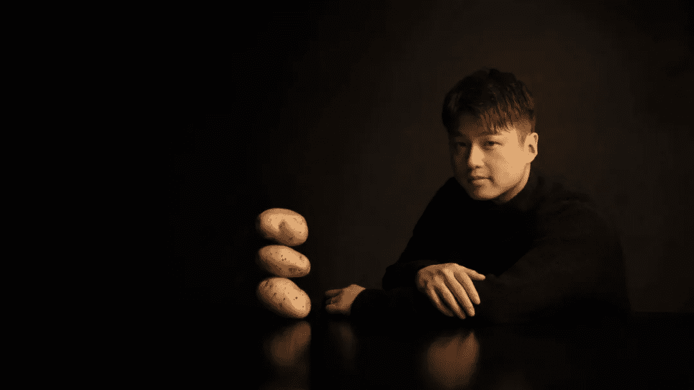

土豆人tudou_man

# **——**

# **价值崩塌，到作品出圈**

AI的进步对于身处行业的人难免带来不同程度的冲击感。快速的反应、高效的匹配，似乎它在短时间内完成了原本需要一个团队才能做到的事。但当你真正认识AI，会逐渐发现，它的存在并不独立，作为使用者，人类的训练能力与创意构思依然存在着无穷的价值，这也让土豆人tudou_man对AI有了新的反思。

**第一次接触AI是什么感受？**

**土豆人tudou_man： **第一次接触AI，是在2022年年底。当时因为疫情的关系大家处于封闭状态。我在朋友圈陆陆续续看到一些导演、美术指导发布一些AI的作品，感到新奇。因为它的生成速度特别快，而且质感不错。然后，我开始去了解Midjourney这一工具，正好处于Midjourney v3升级到v4的阶段。对我来说，产生了很大的冲击。

我借助AI做的第一张图，严格意义上来说，都不算做的图，复制了一段别人写的代码，再从聊天框里面发出去，生成的图与别人的有70%相像。我当时有两个感受，一是以后版权问题会变得模糊；二是创作内容的过程会变得过于快，这个“过于快”会带来很多的次生灾害，尤其在广告行业里面，价值很容易一夜崩塌，我对AI最初的感受其实就是害怕。

用AI尝试的第一件商业作品是什么？

**土豆人tudou_man： **客户真正买单的第一件作品，是为AMIRI制作的概念店。这个作品很有意思，当时品牌在上海新开旗舰店，但在国内的知名度还比较低。我借助品牌23年春季秀场的一些主题元素和中国文化相结合，提出了一个黄浦江上的灯笼秀场的想法。当时品牌的诉求很简单，希望将上海元素跟品牌进行一个结合。但去年的AI技术非常不成熟，能看到一些画面有变形的问题。虽然有很多不完美的地方，但大家一接触到马上就接纳了它。

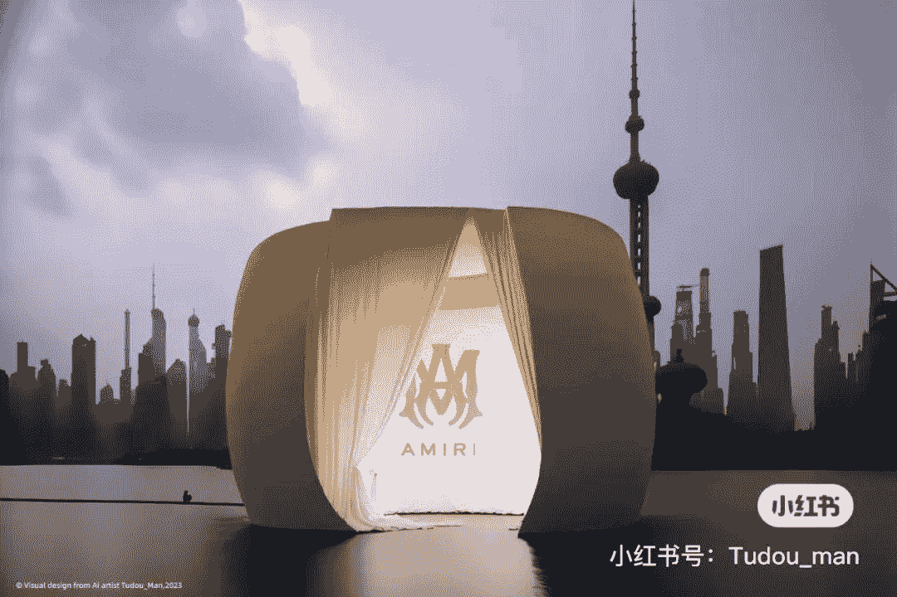

AMIRI魔都概念店

接下来合作是和UGG。这一次才算真正意义上的首次对外宣发合作，品牌和我在小红书上有了正式的订单和合作。

这一次我创作了四张海报，以UGG推出的一款泡棉拖鞋为原型。因为彼时AI技术发展有限，还做不到还原产品形态。我通过提炼产品颜色、材质以及元素细节，把概念提炼出来进行创作。最后品牌方非常喜欢,在Instagram和全球官网都上架了这个创作，还把它改成了一个病毒式传播视频在官网播放。也是从这一次开始，后面我所有的官方正式合作，品牌都会大大方方的把作者标注出来。

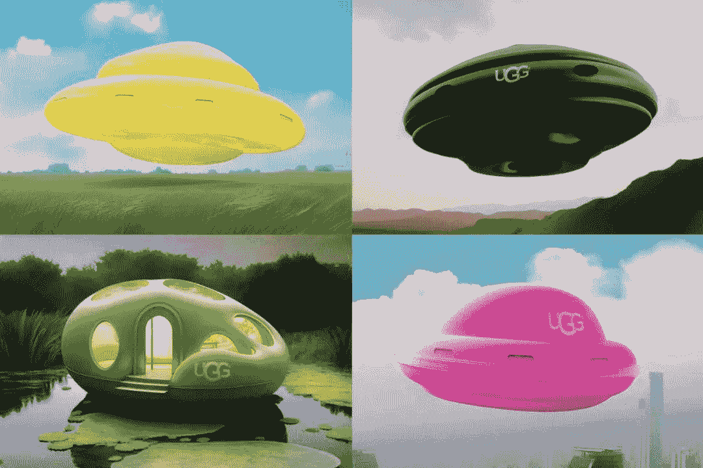

UGG飞碟泡泡屋

目前与您合作过的客户中，哪一类型的品牌对AI的接受度比较高？

**土豆人tudou_man： **奢侈品牌和潮流品牌特别喜欢尝试这类新鲜事物。我选择这个赛道的很大原因，就是我对这些潮流品牌和奢侈品牌非常感兴趣，其品牌的受众也更能接纳AI技术以及全新的艺术表达形式。

我现主攻两个赛道，分别是 **艺术和科技 **。AI对很多人来说是非常前沿的概念，在我创作和探索的过程中，没有可类比、可参考的内容。目前，我正在边摸索边去和一些商业化落地的内容进行结合。最巧妙的结合点，其实就是艺术创作。相较于其他品牌，美妆和奢侈品牌更有这方面的需求。一些美的内容，形式的、概念的内容，正是他们现在营销环境里面所需要的。

**您的作品中，概念店、快闪店常常会和一些著名的建筑**或景观结合起来，这其中的灵感来源是什么？

**土豆人tudou_man： **我做的一些内容有比较明确的一些文化属性。可以看到很多中式建筑的影子，像庙屋塔殿、飞檐宝顶等等。我当时有个想法，就是希望把全球性的、有时代共鸣点的品牌符号，结合东方的一些文化元素，这种冲突感很容易在互联网上引起讨论和传播。所以做了很多原创的概念性探索，试着用自己的想法重塑品牌的东方意象。

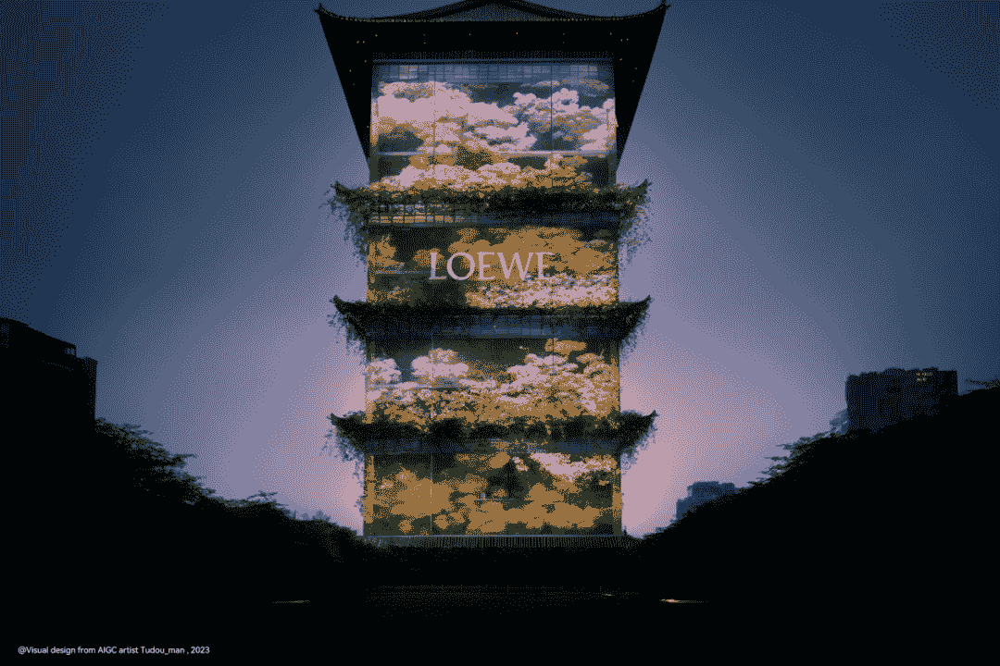

LOEWE繁华殿 （概念原创）

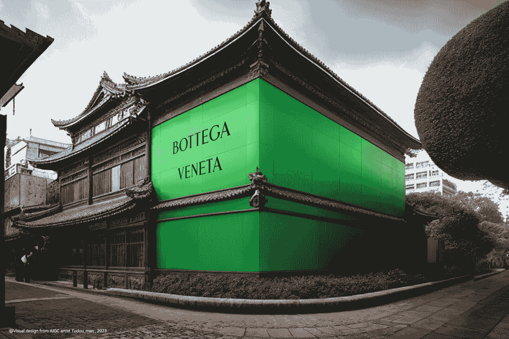

BOTTEGA VENETA 成都概念店 （概念原创）

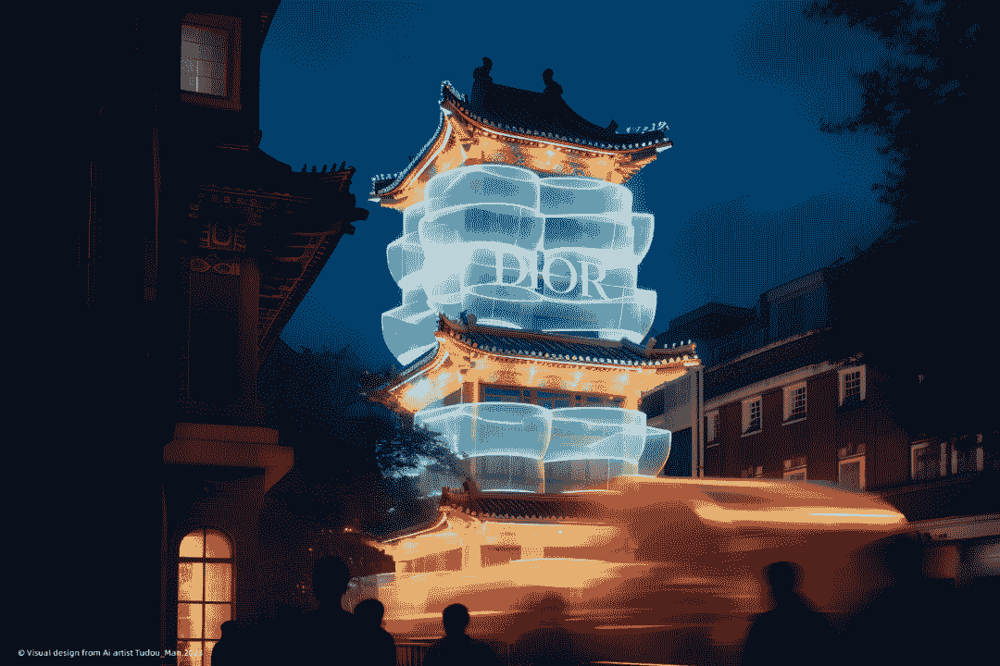

DIOR 绮梦园 （概念原创）

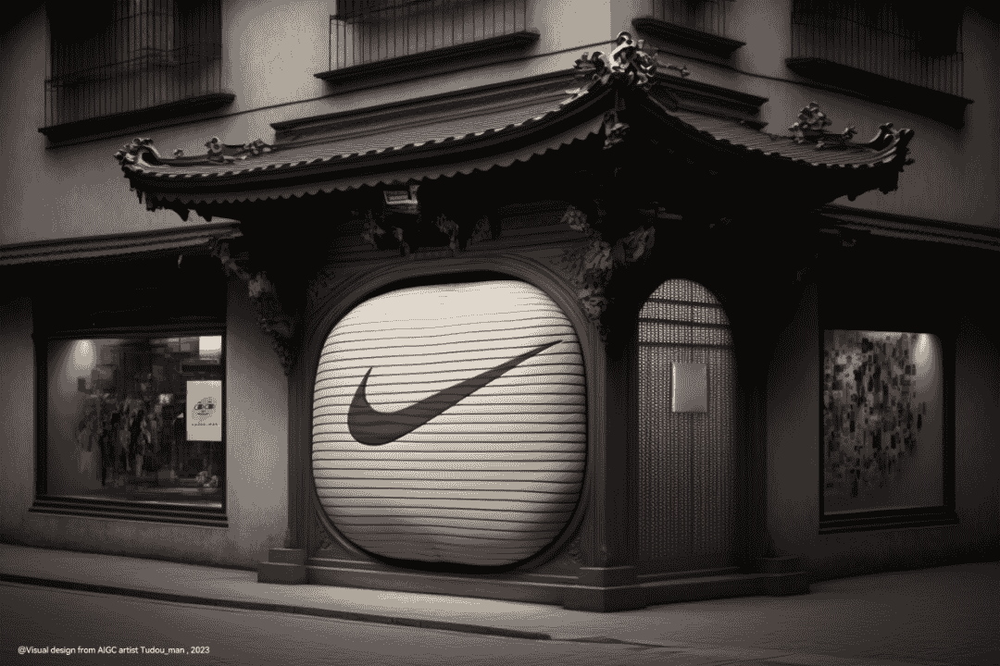

Nike 庙系概念店 （概念原创）

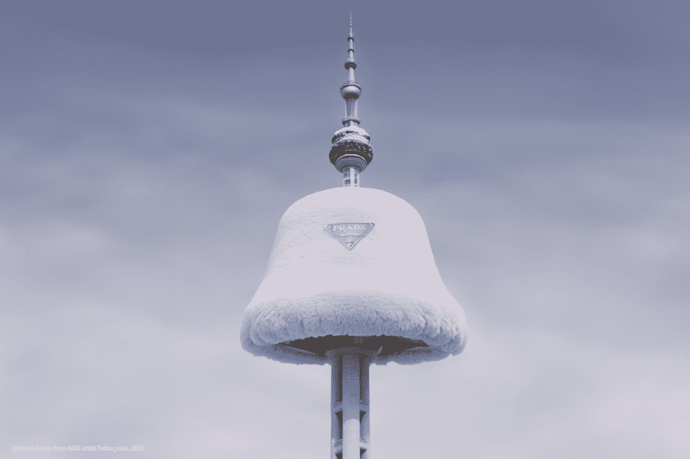

PRADA陆家嘴的超大绒毛帽 （概念原创）

在早期创作的时候，我做了很多的构想，比如在武汉大学里有一个耐克-樱花的篮球公园等等。这些概念很容易跟人在情绪上发生一些共鸣，所以这也是为什么去年我们能很快和一些品牌进行联系。

Nike樱花篮球公园 （概念原创）

随着创作的深入，我有更清晰的目标，可以通过AI创作更多我想要的内容，比如地标系列，其中“戴围巾武康大楼”这个IP受到了很多品牌的关注。

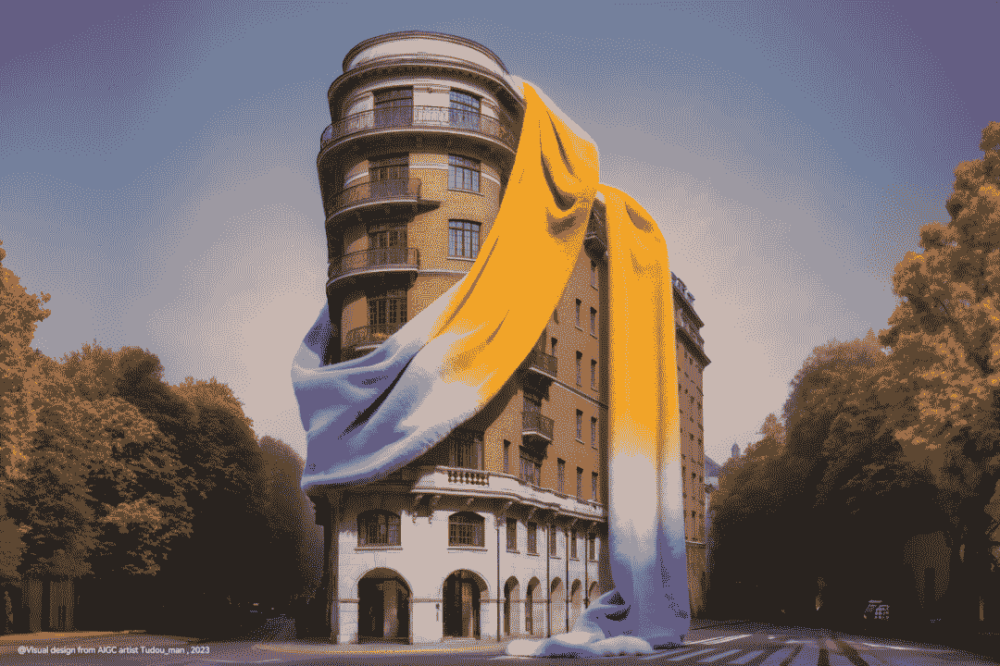

戴围巾的武康大楼

在**创作上，它跟以往最大的不同，就是我**把真实的地标和AI的内容创作结合在一起，进行了一个巨物化的演绎。这非常有难度， 现在很多玩家和设计师很难去还原这个场景，这也是在一步步拔高创作门槛的过程 。

在一年前，许多这样的作品，我也没有办法去还原，场景、建筑都是通过模型演算而来。但是一年后的技术就可以达到，现在一件作品背后可能会涉及3D+AI后期+AI实拍+AI多种技术的串联组成了大家见到了一个画面。

**您目前核心的设计理念是什么？ **

**土豆人tudou_man： **我自己创作的风格就是 **乌托邦式梦核 **。我很喜欢超现实的内容表达，希望在写实内容当中融入非现实的表现力。在这个基础上，我也喜欢添加一些全球化的元素跟中国的东方元素结合在一起，去完成文化碰撞。

可以给我们介绍几个您自己比较满意的作品吗？

**土豆人tudou_man： **麦当劳的作品是我最喜欢的，因为整个创作很轻松，效果也好。

每个阶段满意的点不一样，因为每个阶段我要解决的问题不一样。这一系列的共同点就是你能够找到一些技术上或者视觉上的表达性突破的时候，这个东西对我来说就是很满意的。

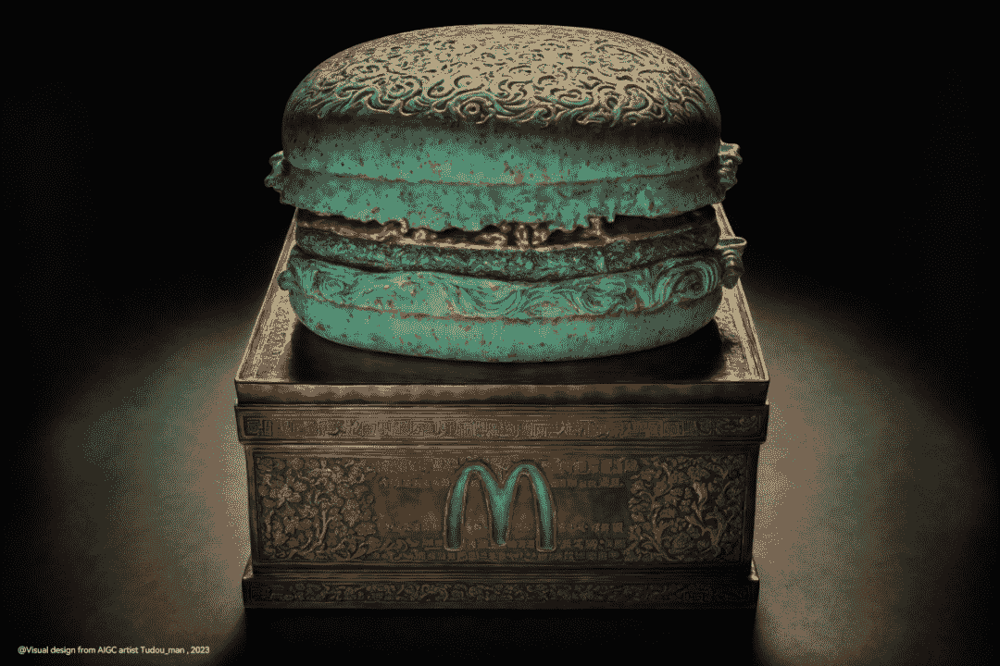

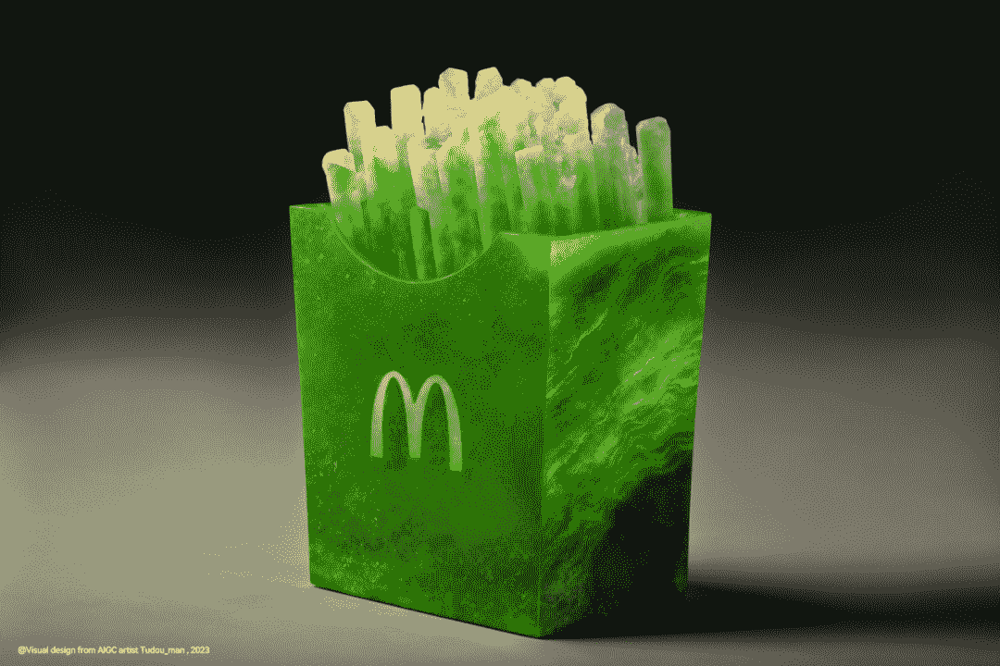

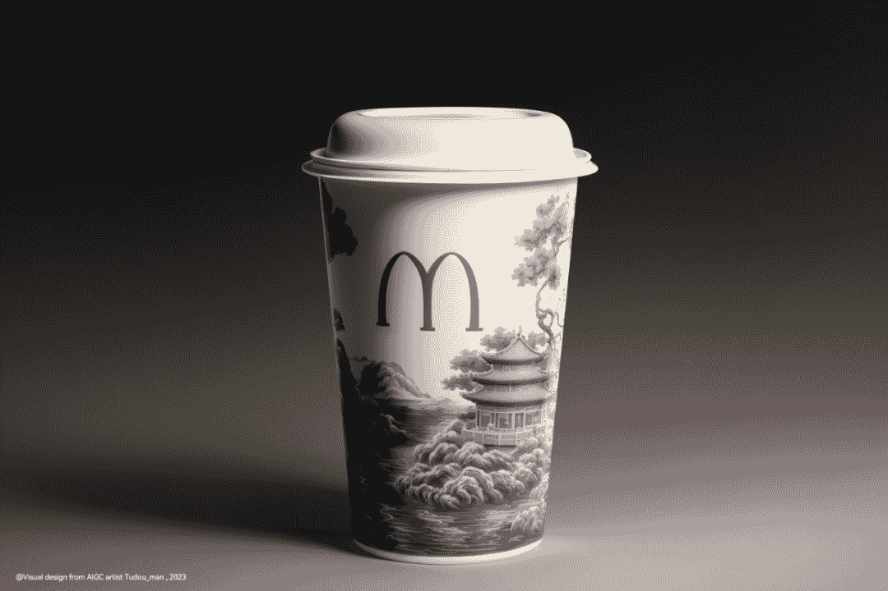

麦麦博物馆系列

# **——**

# **野蛮生长之下，成为头部创作者 **

创意正以一种崭新的方式得到创作与输出，随着对于AI的尝试与应用，土豆人tudou_man开始逐渐重塑对于创作的信心。与此同时，其他创作者也纷纷涌入赛道，一股涌动的创意热情正在行业内蔓延。当AI开始野蛮生长，它的价值又该如何界定？

目前这个赛道的创作者多吗？您有哪些优势？

**土豆人tudou_man： **去年，跟我同期的可能有八、九十个创作者，但很多人都坚持不下去，最大的问题都卡到内容变现这一块。但是现在又有一批创作者开始进行创作，这也跟现在市场上品牌开始接纳AIGC的内容有关，市场开始愿意为它付费。

目前，大家都处在一个野蛮生长的状态。我现在更希望全身心的去投入创作，为AIGC作品注入艺术创作者的价值。也非常感谢各大头部品牌的艺术联名邀约，与品牌一起为AIGC艺术证言。

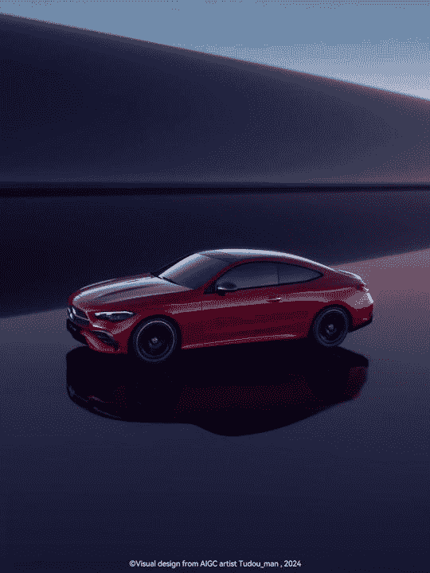

[《流光若梦》Mercedes-Benz xTudou_man.mp4](https://internal-api-drive-stream.feishu.cn/space/api/box/stream/download/all/BbLBboRkIovcdLxZP5AcC2cZnBY)

创作一条AI生成式短片，我在算力设备、技术软件、AI模型、知识产权、音乐制作等等模块中投入了很多精力与成本。很多AI的创作者并不是广告媒体行业出身，甚至不是从事美术或艺术相关工作的，他们对于这数字艺术与商业的关系缺乏具象的价值感知；甚至很多工具使用者都还在一个无意识状态下的创作，数字作品的价值被快速的消磨与稀释，这对整个行业来说都是不健康的。现在，我会定期做一些行业分享，让大家知道我们的创作原来可以有这样的一个价值，才能促使大家有动力做下去。

为什么选择小红书作为主要的分享平台？

**土豆人tudou_man： **主要和人群定位有关系，因为小红书主要的一些用户、受众，都是来自一二线城市，尤其以上海、北京为主，国内头部的公司基本都聚集在一二线城市。所以小红书对我来说是一个很好的辐射渠道。

各大平台现在对AIGC内容的包容度怎么样？

**土豆人tudou_man： **现在各大平台的接受度都是阶段性的。小红书在去年初期因为这个新兴内容的爆发，迎来了很多的流量红利。但那个时候，因为还没有成熟的商业形态，各大品牌不知道如何利用它，所以当时那波流量只是进行了一个粉丝的累积。到了去年下半年，我们发现有一个明显的下滑，它的背后除了平台，也包括国家，都对它开始进行了一些管控，整体流量下降。随着今年过完年，Sora的出现引起了品牌广泛的重视。

同时，现在AI视频已经形成了一个全新的赛道，慢慢开始出现了一些明确的打法。从今年开始，小红书官方也开始扶持这个内容版块，他们把小红书里同步的创作者汇聚到一起，进行一定的流量扶持。

对巨熊软糖这个形象进行了连续性的创作，未来打算做成IP吗？

**土豆人tudou_man： **确实想把它做成一个IP，我觉得这里面也有广告人的想法在作祟。我一直想把自己定位成IP，把我的工作室变成一个IP，把我创作的内容变成一个IP。IP化就必须要有标志性的内容产生，我希望自己能像丹尼尔、村上隆一样能有一些标志性的代表作品出现。但是目前AI时代有一个很大问题，就是不稳定性。所以，现在我也在慢慢通过一些技术手段去攻克这个问题。

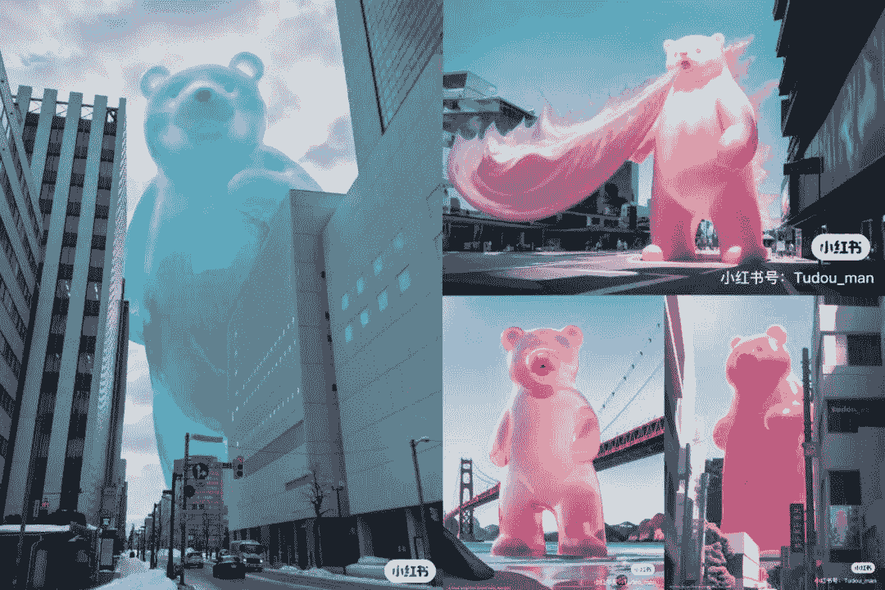

小熊软糖系列

每个艺术家都希望能办一场自己的个展，有策划展览计划这方面的想法吗？

**土豆人tudou_man： **有，做广告的时候就想办广告展。我自己现在也会去看一些展览，包括市面上有一些所谓的AI艺术展。这种展览很难看，因为很多东西带来的是视觉冲击，冲击完了就没了，没有深度。所以我的每件作品都很花心思去打磨，我觉得还需要一些时间去做沉淀。

[再生美术馆X云端世界.mp4](https://internal-api-drive-stream.feishu.cn/space/api/box/stream/download/all/RVUBbl1bOogCrLxLLjccWDVwnvg)

包括我做的一些事情，就是如何将平面的东西开发成视频，将视频的内容引入装置，它是一层一层铺垫下去的，当我最终达到了一定的作品体量，我才会去筹办展览。

# **——**

# **做有美感、有创意的AI作品 **

人们对于AI的认认知 经 历了一段漫长的时间，从过去的接触到如今广泛的应用。 不同的认知带来了不同的行为，在这个过程中，我们该如何去看待AIGC的价值？ AIGC作品的版权问题又如何解决？

您认为好的AIGC作品应该是什么样的？

土豆人tudou_man： 第一、美感是准线，它至少需要是好看的。 现在好的AI工具做出来的内容都不差，在色彩构图上一些基础的美感已经解决了。那就进入了第二个维度，就是它是否具有创意。尤其是我们做广告出身的，看到有创意、有想法的内容，你才愿意去了解这个画面真正的内核。

第二、是否值得思考，这里面的故事内核是什么。 说实话，我们自己就是卖创意，卖故事的。有价值的是故事而不是几个颜色拼在一起的画面。

**作为较早入局AIGC圈的创作者，**您看到AI绘图在商业上的可能性还有哪些？

**土豆人tudou_man： **这也是我们比较关注的，我也把我的商业玩法跟大家很坦诚的交代了。我切入的只是很小的一个细分领域，基本上都是在我所从事的广告行业中。但能够感觉到， 从行业中抽离出来以后，我看到来自各行各业的人都在使用AI。

A**I 最大的亮点，就是降本**增效。 不管是企业也好，使用者也好，大家使用它的主要原因就是降低人力成本，提高单位时间里的生产效率。这时候机会在哪里？ 机会在于它能替代什么？ 如果今天AI只是做一些很廉价的事，例如生产一万张壁纸，但是90%的人都在做价值消耗的这么一件事。

我做的是价值增值，我创作的内容只会越来越贵。而且这个价值会随着合作的品牌、合作内容的体量一直往上攀升。我从一开始就在和低价值体系唱反调，希望和大家不太一样。因为如果我从一开始把定价提到一定水平，或者没有对它们建立一个体系，我现在是活不下来的。我是当下AI技术的受益者和使用者，我只是切了AI赛道中很小很小的一个支流，叫AIGC。

**去**年的四月份开始，制片公司也卷起来了，现在拍片脚本越做越准确，大家越做越好。再回过头来，你觉得现在广告公司要怎么去利用AI工具？

**土豆人tudou_man： **还是回到刚才的问题，就是价值消磨。效率高了，只会越来越便宜。因此现在很急的需求，我并不会接，工作室的预约周期基本都是一个月，试验性、探索性的作品确实需要时间去打磨。一旦这个技术普及了，不是只有广告公司会，甲方也会。现在一些甲方都集体培训，当他们做得比广告公司更好的时候，请问广告公司在里面的角色是什么？没有角色。这也是我当时急于从广告公司跳出来的一个很大的原因。

AIGC作品的版权问题比较复杂，您是如何解决的？

**土豆人tudou_man： **这是一个职业素养的问题。在我最开始做商业合作的时候，这是我第一步要解决的问题。现在从源头开始，所有的人都是用正版账号。很多的模型，除了开源模型以外，我们会专门找国内比较好的模型开发团队帮我们训练模型，比如雅诗兰黛口红这条视频，里面就有一秒钟的时间，产品会晃一下，就那一下，我们专门开发了一个模型。这就是技术门槛。

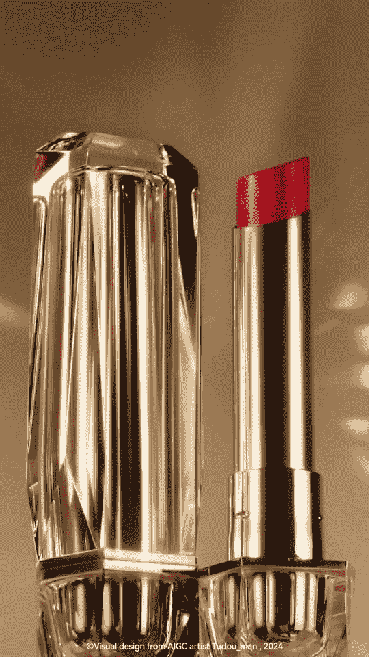

[《钻石大都会》雅诗兰黛xTudou_man.mp4](https://internal-api-drive-stream.feishu.cn/space/api/box/stream/download/all/FN8IbLYeXoMLW6xWrJLcz8Q6n9c)

同时，关于版权这方面，律师给我的建议是，AI直接生成的东西，在中国以及海外都是不受法律保护的。

因此我们需要对AI直接生成的内容进行一定的后期修改，这也是为什么我所有的作品里后期的部分要占到30%~40%。并且后期软件用的也是正版的PS，这些技术水印都已经在这些图或视频里面，最后由我授权品牌使用我的作品。这个时候我们就完成了一个完整的版权链。这就是为什么普通的创作者，很难打通这些环节。

大众层面，许多人对AIGC作品带有强烈的抵触感，您认为有哪些原因？

**土豆人tudou_man： **大众的情绪，在这一年来其实有很多的变化。从去年年初的新奇未知，到年中小红书上有几波大面积的攻击，比如AI盗图抢走饭碗。由于AI的一些工作原理，就是把很多的数据进行学习，难免会发生AI在集中学习某个人、某个内容时，生成类似的内容。

所以我自己在创作内容的时候，基本不会去创作一些绘画类型的作品。我做大量的后期都是为了让它更符合我自己的创作语言和创作风格，为我的作品赋予灵魂，让它看起来独一无二的。但网上很多初学者，他们没有经过审美方面的专业训练，他们在使用AI的时候，往往是AI给什么，他就拿到什么。这也是为什么我创作的内容成本相对较高。是因为我要尽可能在我的创作内容里面去规避掉修正这些瑕疵，这些环节给我带来了极高的创作成本。

[IntelXtudou_man发布版.mp4](https://internal-api-drive-stream.feishu.cn/space/api/box/stream/download/all/HLfcbjAbHoKPyIx5qK6c8TYbn2f)

一些粗制滥造的内容的出现，不等于AI不好，而是用的人的问题，以及审核他的人不具备专业水平。 **我认为大家对AI的接受度是高**的，如果作品是好看的，有原创性的，还是会受到认可。 有美感，有创意，这是关键点 。

# **结语**

透过与土豆人tudou_man这次的对话，让我们对行业发展、AI价值都有了更深刻的认识。从企业角度来看，重视AI所发挥的真正价值，拒绝价值消耗，行业甚至企业生态都急需维护。而作为AI的创作者或从业者，提升版权意识，提高创作的质量与美感也成为基本素养。长此以往，AI的圈子才能获得良性发展。

# 往期精彩推荐

Top picks

**探店专访**

[巧豆 ](http://mp.weixin.qq.com/s?__biz=MzA3ODg2MzE0OQ==&mid=2654104535&idx=1&sn=bfd6cd05c6e8301311d04d7c1c6a2a11&chksm=847a8595b30d0c83279e8a3c7ff6f9f805f7e044ef76fcb14582269f6572f3ad20f0e9af9375&scene=21#wechat_redirect)| [麦道 ](http://mp.weixin.qq.com/s?__biz=MzA3ODg2MzE0OQ==&mid=2654105093&idx=1&sn=0487a55879a65a953c8c154a197dec58&chksm=847a8047b30d0951be2fe30ba8c62ca8e2afb3dfd808b85c285ffe7e43f56bc84a1781ab52e5&scene=21#wechat_redirect)｜ [阿海德 ](http://mp.weixin.qq.com/s?__biz=MzA3ODg2MzE0OQ==&mid=2654105123&idx=1&sn=5b730e6543923bc60273fac618cb3d3e&chksm=847a8061b30d0977316601d0b13505d1593cb13aa66e5cb1d9125e07bed49c4361a10bfe294c&scene=21#wechat_redirect)｜ [VPLUS ](http://mp.weixin.qq.com/s?__biz=MzA3ODg2MzE0OQ==&mid=2654105391&idx=1&sn=b8034ac59cd8fd4bc5031e3d7585f990&chksm=847a816db30d087b05453e313705a9200db62573e484dd539c2c6668a2e5b36064ca36c584ff&scene=21#wechat_redirect)｜ [彼邑 ](http://mp.weixin.qq.com/s?__biz=MzA3ODg2MzE0OQ==&mid=2654106084&idx=1&sn=9a7a677fb969b7d270ab1ec0fa23a46a&chksm=847a9fa6b30d16b08e8993d42f2313608e43fb058540354403a99219bf1a5f3344605ae2208f&scene=21#wechat_redirect)| [MAX ](http://mp.weixin.qq.com/s?__biz=MzA3ODg2MzE0OQ==&mid=2654105478&idx=1&sn=53ebe6b443eba06ac4cf8c3067db1990&chksm=847a81c4b30d08d2c4dc62810ec389f395bd0d7a95f7eb2bd81086fc3b13b7f084e3d4ee2e8c&scene=21#wechat_redirect)| [赤马传媒 ](http://mp.weixin.qq.com/s?__biz=MzA3ODg2MzE0OQ==&mid=2654104796&idx=1&sn=5ce24179ead925bd6df9edff1cd93836&chksm=847a829eb30d0b88886a7b7393c78d4a9f750f39a6db11c31668232ae3b8e0af1dc6e62a44e1&scene=21#wechat_redirect) | [德高申通 ](http://mp.weixin.qq.com/s?__biz=MzA3ODg2MzE0OQ==&mid=2654103297&idx=1&sn=87ff4197bf53f1d76999c2194b5871b2&chksm=847a8943b30d0055eb7f12ea6f221ff45a8aca862011754d2013843e5a4e91c77937c1f7e9c1&scene=21#wechat_redirect) | [有门 ](http://mp.weixin.qq.com/s?__biz=MzA3ODg2MzE0OQ==&mid=2654103043&idx=1&sn=de7571503a3c8e52fcdcf960ffbd7acd&chksm=847a8841b30d0157ca5e0fcfafae35e7d199230ecd80f91504a9937236f8d64a7970a12b9cab&scene=21#wechat_redirect)| 凯浥 | 广旭整合营销 | 天下秀 | 天与空 | 咖墨创意 | Mindshare China [| 朗](http://mp.weixin.qq.com/s?__biz=MzA3ODg2MzE0OQ==&mid=2654104234&idx=1&sn=fe26bb3b7414fcbcdd4e5a32f2bb7586&chksm=847a84e8b30d0dfe622cb7baacac64282667f07df4470ee4ac2bad5b0a9ecbe4d39841e5d642&scene=21#wechat_redirect)冠整[合营销 | ](http://mp.weixin.qq.com/s?__biz=MzA3ODg2MzE0OQ==&mid=2654103913&idx=1&sn=182cbe6817850b3097f5923fdbc6b4f2&chksm=847a872bb30d0e3ddc24363b65f043b6b543fe5ccc534782203c6bde906d128142b602b18f44&scene=21#wechat_redirect)峰极[传媒 | ](http://mp.weixin.qq.com/s?__biz=MzA3ODg2MzE0OQ==&mid=2654103681&idx=1&sn=ad4d620d6b597f3beda533f26ce8448e&chksm=847a86c3b30d0fd5e130ab0e6509672965833d5d8f2f934edb31ac0ac07462a576c9ea4e0fc6&scene=21#wechat_redirect)英诺[中国 |](http://mp.weixin.qq.com/s?__biz=MzA3ODg2MzE0OQ==&mid=2654096377&idx=1&sn=ce2f84462be5bbb8f6518554a906aeab&chksm=847aa5bbb30d2cad860d6bf260c9e184aa144e250a5b08e350f47155ac8574a8a1837fc6d4d3&scene=21#wechat_redirect) 原[生动力](http://mp.weixin.qq.com/s?__biz=MzA3ODg2MzE0OQ==&mid=2654103610&idx=2&sn=55f3f313ff9365222896dc665d0ac993&chksm=847a8678b30d0f6e75501b156fdf2da4e696c3c02c838319a357cb01513d031472347f1bd745&scene=21#wechat_redirect) |[  okk](http://mp.weixin.qq.com/s?__biz=MzA3ODg2MzE0OQ==&mid=2654099703&idx=2&sn=85e521e248d375e76a8d6e545ac54854&chksm=847ab6b5b30d3fa3cd47664cf8be02b958c7c0945ea07fe001d3065d77fdc95ed95bef313730&scene=21#wechat_redirect). [｜ M&M | 凡](http://mp.weixin.qq.com/s?__biz=MzA3ODg2MzE0OQ==&mid=2654096279&idx=1&sn=5e9b70d7820310cd62b2f3a6d7d1b37b&chksm=847aa5d5b30d2cc3746f1223df19262791b28cdfb2e955b3f92a765b7a261206ffb9939b16b6&scene=21#wechat_redirect)[人互动 |](http://mp.weixin.qq.com/s?__biz=MzA3ODg2MzE0OQ==&mid=2654099638&idx=1&sn=d9f03acb13d4c85501d50d41e1e29d0d&chksm=847ab6f4b30d3fe2ea002cc6f2bc1c0453309be5f91cf0cc8763df81f054213d1155d7aaae8f&scene=21#wechat_redirect) 十相 | 意符创意 ｜ 介陌 ｜ Heaven&Hell ｜ 意类 ｜ W ｜ 有门 ｜ Tomorrow ｜ CCE ｜ 有氧 ｜ MT蒙彤 ｜ BBD ｜ N3 ｜ SOULO ｜ 艾迪霍克 ｜ 饭爱豆 ｜ 帛仑 ｜ 兰渡文化 ｜ KA RMA ｜ 睿路传播 | M&M