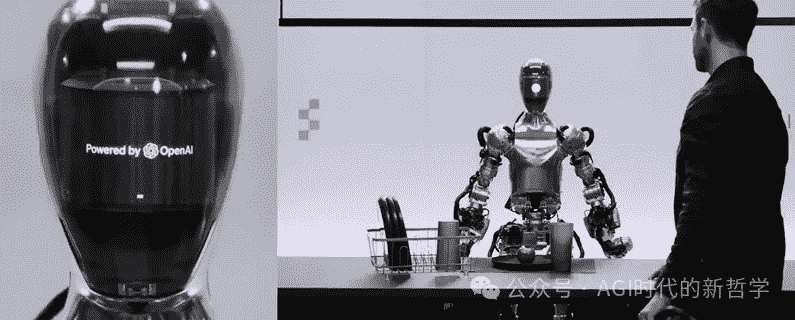
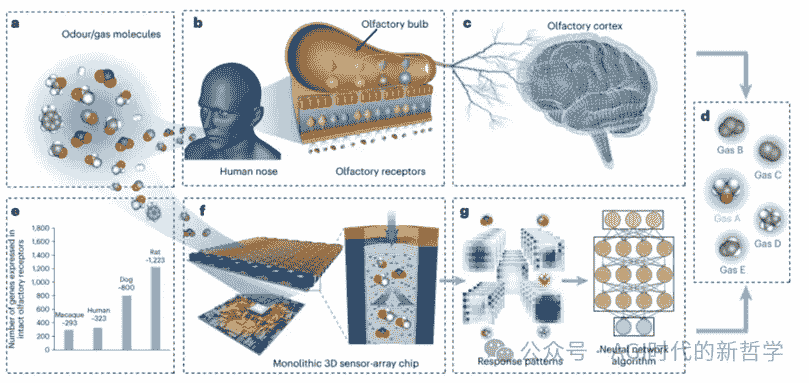
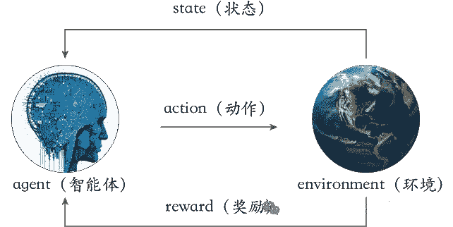
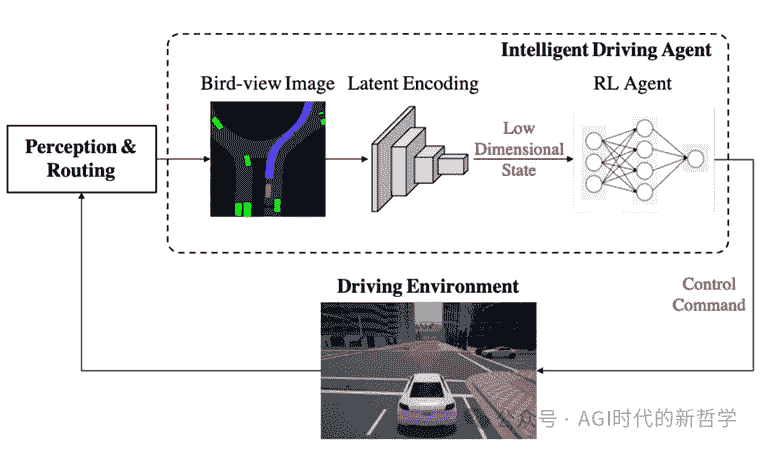

# 余欣航heaven：人类一败涂地？

> 来源：[https://waytoagi.feishu.cn/docx/Tx3EdBntzoO2iHxhhYfcfvKQnJb](https://waytoagi.feishu.cn/docx/Tx3EdBntzoO2iHxhhYfcfvKQnJb)

> 🔗 原文链接： h[ttps://mp.weixin.q](https://mp.weixin.qq.com/s/ATf9VCp3_-EaltQ7-KFGSQ)q.com/s/ATf9VCp3...

> 原创 余欣航heaven AGI时代的新哲学 2024-04-10 19:55  广东

再次见到丁一的时候，他没有了记忆中那种锐气，反倒有些无精打采。

“你这趟回国待多久？”

“无所谓。”丁一耸了耸肩，看起来有些疲惫——他平时在硅谷工作。这一趟，他从旧金山出发，坐了十二个小时的飞机才回到这里，而且还要倒时差。

最近一两年间，生成式 AI 的突破引领了整个人工智能领域的又一次跨越式发展。层出不穷的大语音模型、文生图、文生视频模型，还有人型机器人的不断地刷新着人们的认知。 ChatGPT 、 Claude 、 Gemini 、 LLaMA2 、 Sora ，一个接一个的陌生名词就像是一阵又一阵的风暴，席卷着各大新闻板块的头条。这个模型昨天刚刷爆朋友圈、博得无数评论与转发，今天却又被更新的模型比了下去，仿佛已经 out 了。关于“哪些人会被 AI 替代”、“选什么专业才能不被替代”的疑问伴随着无尽的焦虑在人群中蔓延……我心想，丁一平时在硅谷工作，称得上是“身处风暴的中心”。所以，我准备了许多问题，盼着他能给出最权威的回复。

“都没意义了。”

可是，他却只是如此喃喃道。

“什么没意义？”我忍不住了，“你意思是，你那个编程的技术活有一天也会被 AI 替代吗？我上次看新闻，好像说哪里上线了第一个叫 Devin 的 AI 程序员……”

“不。我意思是，全部、所有、一个不落，都会被替代。”

“全、全部？”他的说法让我大为震惊。

“你还不知道吗？”丁一冷冷地说，“碳基生物，已经注定要失败了……”

“碳、碳基生物？”

“对。碳基生物就是所有含碳有机化合物构成的生物，包括所有动物、植物，也包括全人类。包含了你我和全人类在内的碳基生物，注定会输给集成了 AI 的硅基生物！”

“可、可是……”

“没有什么可是了。”他耸了耸肩，“所有工作，包括全人类所做的所有事情，不分有没有所谓的创造性，也不管你觉得这是否独特，全部、一个不落，都会被 AI 所取代！未来，地球不再需要碳基生物；未来，地球是硅基生物的天下！”

他的这番话让我非常震惊，久久不能说出话来。一方面，这番话似乎站在了整个人类的对立面，让我“政治正确”的本能忍不住开口驳斥；但另一方面，丁一在美国硅谷工作，他比我更懂技术，也更了解这个行业的情况。所以，在开口反驳之前，我总难免要问自己，我所能做出的反驳、我所谋求的“正确”，是否只是源于自己的无知？

“碳基生物的时代……结束了！”在我思考的时候，他还在念念不休。

我深吸一口气，冷静下来，听丁一细说其中缘由。

丁一说：首先， AI 认识事物比人类更清晰、准确，也更全面，这是毋庸置疑的。

我问：所谓的“事物”不一定能用数字表示、并且存在硅基的芯片里吧。我们人类可以认识复杂的情感、抽象的概念与意义……

丁一反问：你认识到的所有事物、所有信息，归根结底来自于哪些源头？

我回答：应该是感官吧——视觉、听觉、嗅觉、味觉和广泛的触觉……

丁一追问：那你觉得，五种感官中，有哪一种不能被表示为数字？

比如说，我们人眼中有 800 多万个视锥，大约排列为 3000 × 3000 ；人有红绿蓝三种视锥细胞，能分别感受混合光中红色、绿色、蓝色三种光的强度，表示为三维向量 (R,G,B) ；因此，每个瞬间人眼所看到的，无非就是 3000 × 3000 × 3 的三维矩阵；事实上，在硅基计算机里，每一张图片确实就是以 M × N × 3 的图片的形式存储的。不同的是，硅基计算机可以拥有更明亮的“眼睛”，即更高精度的摄像头，可以“看到”几十亿、百亿、上千亿像素的图片并加以储存。其视力远远胜于碳基生物的眼睛。

当然，光信号是即时的，可以以很高的频率变化。我们平时看的电影和视频一般是每秒采样 24 帧的。因为如果超过了这个频率，人眼就无法捕捉其中的信息。所以说，我们人类的视觉每分钟能获取的全部信息无非就是一个 3000 × 3000 × 3 × 1440 的矩阵，在此之外，并无其他；倘若硅基生物的“眼睛”（摄像头）有更高的像素、更高的采样率，获取一个更大、更准确的矩阵，便可以在视觉这个方面彻底胜于人类。

同理，我们耳朵所听到的声音是一个超高维时间序列。由于听力有限，所以其傅里叶变换后的频率分布在 20Hz 到 10000Hz 之间。硅基生物的“耳朵”无疑可以获取频段更广、采样率更高、振幅阈值更小的音频时间序列，在听觉方面完胜人类；

目前，由人形机器人明星公司 Figure AI 所推出的首款人形机器人 Figure01 已经集成了“眼睛”和“耳朵”，可以听取人的指令描述出桌面上的物品并对其进行操作。显然，它可以轻松地用上比人类更强的“眼睛”和“耳朵”，并更准确地记忆从中获取的信息。

同理，人的鼻子可以感知的气体分子大约有几万种，且大致可以感知到各种气味的强弱。客观上，我们可以把空气中万亿种不同气体分子的浓度记为万亿维的无序向量，用气体传感器更精确地测探。这样，硅基生物便在嗅觉这方面完胜人类。最近，香港科技大学的团队就在仿生嗅觉芯片（ BOC ）上取得了进展，可以说是造出了“ AI 鼻子”。

此外，舌头尝到的味道，身体各部分感知的触觉神经信号，这都可以高维时间序列或其他特定的数据结构表示出来。

我们不妨用以下的符号简记各种你从各种感觉所获取的全部数据：

**首**先，假定眼睛输入为 N × N × 3 × T 的视频 V （ visual modality ）；

**其次，假定耳朵输入为 M × T 的高维序列 A **（ audio modality ）；

**然后，假定鼻子输入为 K 维向量 S （ s**melling modality ）；

最后，假定舌头输入为向量 T ，触觉输入为某个复杂的数据结构 F ；

**所以，人类的全部感官就是复杂的特定数据结构（ V,A**,S,T,F ），仅此而已，并无更多！

我反驳：可是人类毕竟还会思考，能够理解更抽象的信息。

丁一点头：比方说，你脑子里有“狗”这个概念，这是因为你见过几只不同的狗、听过同学们用声音描述自己家里养的狗，获取过摸狗的触觉。随后，你脑中就有了相关记忆综合得到“狗”的抽象概念**。有时候，即便没**有任何关于狗的感官，比如只是躺在床上闭着眼，你也会想到“狗”有关的画面或其他信息……可事实上，你脑中的各种思维也是一个由自然语言或感官记忆构成的超高维时间序列，不妨将这个时间序列记为 thought 。那么，这个时间序列也是感官数据通过复杂的函数运转得到的：

f : (V,A,S,T,F) → thought

简单地说，我们获取的所有感官信息是一个复杂的数据结构，我们的思想是一个超高维的序列数据结构。这些数据结构之间存在复杂的函数映射关系，足以表示我们从感官中获取所有信息、抽象的概念与意义，乃至全部的事物……

沉默了片刻之后，我又想到了第二个问题——意义，或者说是价值。

诚然，按照多模态模型与大语言模型的发展速度，恐怕人类所认识的所有事物，连同实在感官到抽象概念，很快会被人工智能超过。但是，与人工智能不同的是，人会为这些事物赋予意义与价值。通俗地说，人工智能只会追求“更准”，但是，人会追求“更好”。人不是捕捉与记录客观事物的工具，人的行为总是有目的、有意义的。

丁一为我介绍了强化学习（ Reinforcement Learning ）的概念。

强化学习是人工智能与机器学习领域中一个重要的分支。我们熟知的 AlphaGo 就是用强化学习技术做的。在强化学习中，我们会定义几个元素：状态（ state ）、动作（ action ）与奖励（ reward ），并让 AI 求解在各种状态下，如何选择动作，以使得自己获得最大的期望奖励总和，也可以叫做“总效用”（ Utility ）。

我们可以把感官数据 **（ V,A,S,T,F ） **与此时的想法、感受共同记为“状态”，视为“输入”；人的所有行为归根结底是动手、动脚、动舌头。我们可以把传出神经信号规范化为某种数据结构，共同记为“动作”，视为“输出”；人的目标为“最大化总快乐”（“快乐”和“效用”同义），以此为目标求解一个从输入 state 到输出 action 的函数。

在下围棋、打电子游戏，甚至操控机械臂、自动驾驶等问题中，人们采用强化学习技术去求解“最大化效用”或“最小化损失”（设损失为负效用、负快乐则定义等价），最后得到一个从输入到输出的函数。事实证明，只要这个函数足够高维、复杂，它便可以在很多复杂的任务上超越人类。

总得来说，人类其实也只是一个从“输入”（五官 - 传入神经 - 想法与感受）到“输出”（想法与感受 - 传出神经 - 运动器官）的函数罢了。这个函数之所以显得那么精妙，无非是由于他在实践中不断谋求“人生总快乐最大化”，继而将这个函数优化得比较好，仅此而已。当你理解了这一点，你就知道 AI 终有一天会彻底战胜人类。

我问：你说的就是《经济学原理》中的“理性人假设”吧？

丁一点头：对。每个人都是为了谋求“效用最大”或“快乐最大”的“理性人”。

我马上反驳：我认为人不一定都是“理性人”。比方说，有的人相比于利益更注重情感，有的人会做出一些道德高尚的行为……

丁一回应道：我说的“快乐最大化”又不是“利益最大化”。一个人的“快乐函数”是非常复杂的，它可能主要是自己的利益，但同时也包括一些道德行为所带来的“快乐”。比方说，你热心帮助同学、礼貌对待长辈、关爱弱者，这些行为都能为你提供一部分“快乐”。另一方面，你不可能把自己一年的收成白送给别人，也不可能放着大学不上、专门去行善，因为这些善事带来的“小快乐”不足以弥补你在个人利益上损失的“大快乐”。总得来说，你的目标是最大化自己在利益与道德两个方面共同取得的“个人快乐总和”。

我想了想，又说：我能明白你的意思。我有许多丰富的、旁人不能理解的行为，其实都是为了各种各样的“快乐”……可是，我还是觉得这不能完全概括我的所有行为。我有时做的一些事确实很快乐，但好像也不完全只是为了快乐……

丁一反问：你说，这一辈子下来，除了“快乐”，你还能得到什么？

我一时语塞。丁一又继续说：我知道你的意思——比方说，你觉得要“勤劳”、“克制”，而不能过分“享乐”。但事实上，你真正的目标是要最大化人生的快乐总和！人们努力学习、拼命工作，克制一时的快乐，这其实是为了进入更好的状态，最终获得更大的快乐。如果你去无意义的吃苦，却没有让你以后的总快乐变大，这岂不就是犯傻吗？同理，“贪吃”、“好色”就不好吗？“节欲”、“受苦”就好吗？归根结底，你还是要考虑人生的总快乐！

我还是有些疑惑：人类的某些复杂感情、以及为此而做出的奇怪行为，这真的能被一个函数给完全表示出来吗？

丁一反问：难道你没有用过大模型，比如 ChatGPT 吗？

对于大语言模型，你输入的每一句话都会被表示为一个高维时间序列  ，然后，模型会根据输入求解出另一个高维时间序列  ，并将其表示为另一句话。我要告诉你的是，在大模型内部，它就是根据“最大化效用”或“最小化损失”来计算的，而你已经可以看到，这种“最大化效用”的结果，即模型对你的话给出的回答，是非常有逻辑的，就像是有自己的思考一样。这就说明了，只要“效用函数”足够高维，结构足够复杂，“最大化效用”就是可以把人类所有复杂的思想、情感与行为表示出来。

虽**然 ChatGPT3.5 是**纯语言模型。但是，新一代 GPT 将是多模态（ multi-modal ）模型，即把感官数据 （ V,A,S,T,F ） 与思维时间序列一起作为状态，并且装载在人形机器人中。到时候你会看到，当这种函数的维度足够高的时候，它不但可以进行有条有理的对话，还能根据看到、听到的事情进行判断，甚至能自己想象出天马行空的画面……

我明白了他的意思：他假设人按照最大化某个“快乐函数”行动，这个函数可以包含足够多的变元、形式足够复杂，将所有爱情亲情友情与信仰兴趣癖好统统纳入考虑。只要“效用函数”输入输出的维数可以任意大、函数的形式可以任意复杂，那么，就可以完全地定义出一个人，那么， AI 就可以做到完全和人类一样……

丁一纠正道：不只是和人类一样，而是可以超越人类！面对着“短期的快乐”与“长期的快乐”之间的取舍，人类总是无法找到最优点，继而无法真正实现“人生总快乐最大化”；相比之下， AI 却可以通过日益提升的硬件算力及强化学习算法实现这一点。正如 AlphaGo 击败世界冠军一样， AI 会在越来越复杂的任务上超越人类……因为硅基生物能够精准地以“众人的总快乐”为目标运行，所以它们建立的社会比人类要更高效、理想……

终于，我算是理解了丁一的全部意思：

首先，人类的所有“输入”与“输出”，包括所有感官、所有想法、所有动作，都可以规范化为某种特定的数据结构。既然如此，随着技术的发展、硅基芯片计算力的提升，我们就可以在计算机里定义更复杂的数据结构、更复杂的函数与运算。所以，硅基生物便可以在感知的精度与准确度、思考的复杂度等层面上完胜于人类……

其次，人类所有行为的最终目标都可以规范为“最大化快乐函数”（“最大化效用”或“最小化损失”都是等价的说法）。而人类所理解的事物的意义与价值，以及为此而做出的各种行为，这都可以表示为“最大化快乐”目标驱动下，输入输出等数据结构之间复杂的函数映射关系。同理，随着技术提升，硅基生物也可以在这个方面完胜于人……

更重要的是，我们要站在发展的角度思考——你现在或许会觉得 AI 画图构图不好，像是东拼西凑，甚至“拼尸块”；你或许会觉得大语言模型不能保证从“ A 是 B ”推出“ B 是 A ”、不能“精确说出十个字”……但问题是，这都只是一个过程罢了。目前你觉得 AI 的所有缺点、你觉得人类所有独特的行为，这无非是因为“效用函数”还不够复杂、计算力还不够大！按照海量专家的精确计算，当函数的参数超过兆亿级的时候，硅基生物便能理解人类的所有行为以及背后的意义，实现对人类的全面超越。要注意的是，这并不是科幻小说中要到 22 、 23 世纪才能实现的事情。按照现在 AI 一日千里发展的速度， 5 年时间就足以让整个行业完全不同。我们 90 后、 00 后这一代人，注定要在自己职业生涯最黄金的时期完整地见证这些剧变。倘若现在还像鸵鸟一样把头埋在土里，或是抓住“ AI 画图不够好”、“ ChatGPT 不能精确说出十个字”这样几个点沾沾自喜，那么，不出几年你就会被更强大的 AI 击败、淘汰！这绝不是遥远的未来，而是我们在生涯黄金期，必然要面临的、巨大的冲击！

“其实，都没什么意义啦。”丁一摇了摇头，“或许有些工作复杂，有些工作简单，有些事情先被 AI 替代，有些事情后被 AI 替代。但是，这只不过前后差几年而已。最终——我是指十几年之内，我们将亲眼见证人类的所有事情，乃至人类这个种族被 AI 完全地替代！”

“可、可……”我想说些什么，却又说不出来。

“人类已经输了，碳基生物已经输了。未来，将是硅基生物的天下！”