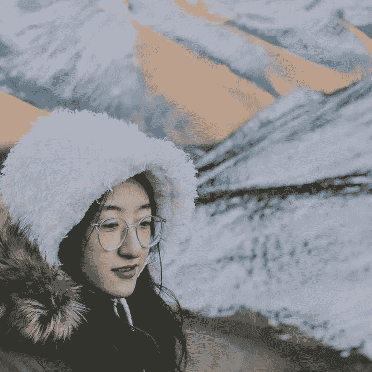
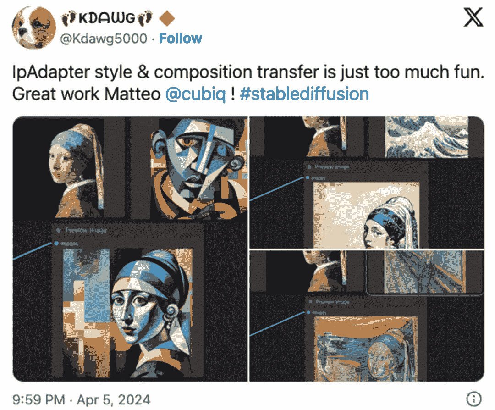
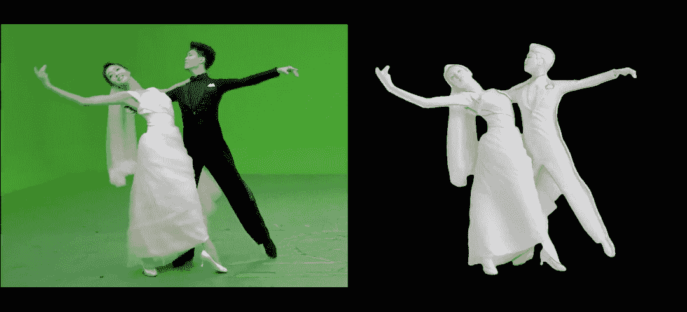
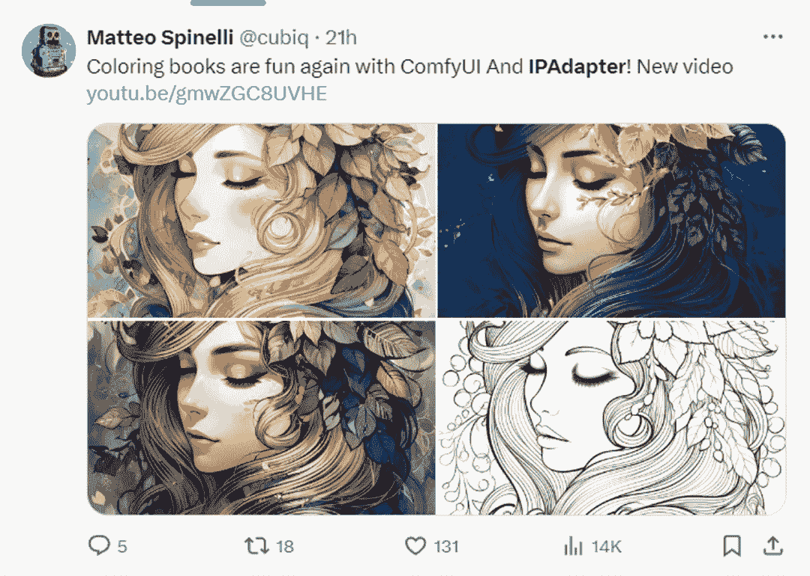
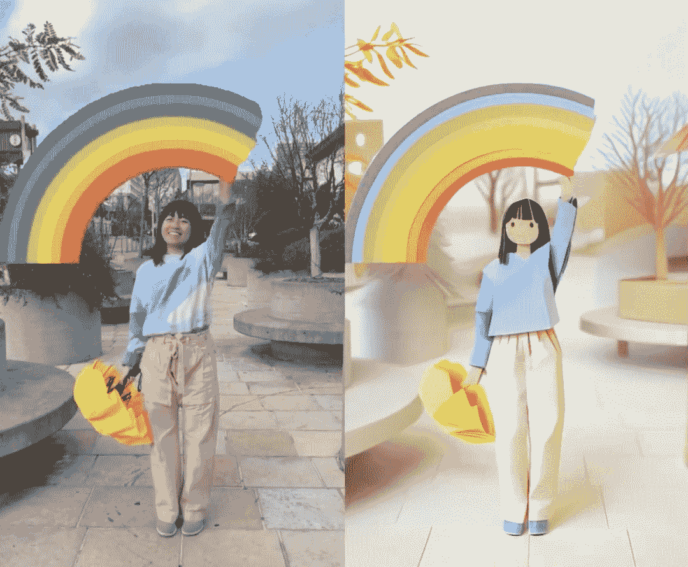
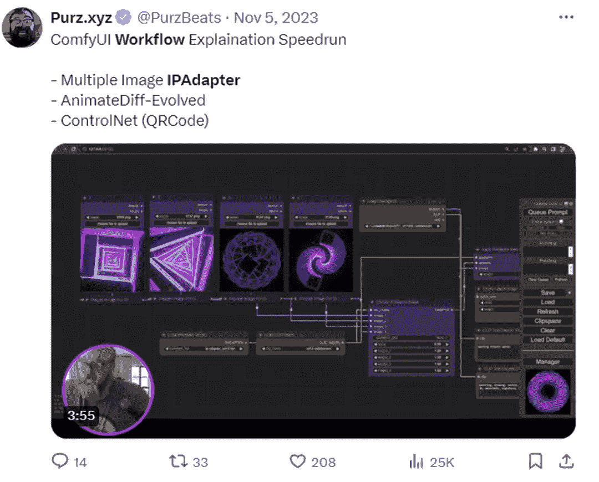

# EP.3 - IP Adapter 对话阿文：一图定风格，我和 AI 的契约

> 来源：[https://waytoagi.feishu.cn/docx/QnzldDWtcovE6vxUlNhcsrsJnwe](https://waytoagi.feishu.cn/docx/QnzldDWtcovE6vxUlNhcsrsJnwe)

栏目介绍 & 联系方式：[Diffuseum 播客-生成式模型研究](https://waytoagi.feishu.cn/wiki/OuY4wry2wiuEhuk9UHWcKXZ7nHH)

公众号链接：https://mp.weixin.qq.com/s/2mW69M8p8aorRuPDeYwS6Q

小宇宙播客链接：https://www.xiaoyuzhoufm.com/episodes/661f67fe5dae7932c609a0da

这是一期录完就打脸的播客？！

IP Adatper 是一份送给 AI 造梦者的礼物——一张参考图让 AI 听懂”我想要的风格“。

IP Adapter 也是开源社区带着爱的礼物——全球贡献者太活跃，连作者想沉寂都被打脸，总被社区的更新折服。刚在播客里讨论完开源组件不明朗的未来，我们就在这个月迎来了又一次意料之外的社区更新。

IP Adapter 真的是一个人肝出来的吗？它为什么是艺术家阿文的心头好，甚至带它上了春晚？本期继续延续技术 + 创作的双视角对话，讲述了这个开源走向全世界的故事。

### **本期人物**

**叶虎**

IP Adapter 作者，腾讯 AI 算法工程师

**阿文**

AbleSlide 创始人、PPT 设计师，

AIGC/Blender 知名 KOL

**宙宙 Jo**

美元基金 AI 投资，热爱开源和视觉生成，

Diffuseum 社区及播客主理人

#### **访谈内容的分论点总结如下:**

>

1.  个人背景与研究兴趣：

+   叶虎：拥有计算机视觉背景的算法工程师，对 diffusion 模型在图像生成领域的潜力充满兴趣。

+   阿文：专注于设计领域的 PPT 设计师，对将 diffusion 模型应用于设计工作充满热情。

1.  IP Adapter 的作用与意义：

+   IPA 是一个工具，能够复刻图像的风格和语义，为设计师提供风格一致性的解决方案。

+   IPA 的开发经历了从基础功能实现到完全兼容其他模型的多个阶段。

1.  开源社区的贡献与互动：

+   开源社区对 IPA 的成功起到了关键作用，社区成员的贡献促进了技术的广泛应用。

+   社区中的教程和案例分享对于非技术背景用户的学习和应用至关重要。

1.  技术发展的趋势与挑战：

+   叶虎认为，尽管组件化工具目前受欢迎，未来将出现更强大的端到端模型。

+   阿文期待看到更多基于新模型的工具和应用，以及它们在设计领域的潜力。

1.  对未来的期待与展望：

+   两位嘉宾都对未来的技术发展表示期待，尤其是对开源模型的进一步发展和社区的创新。

+   叶虎特别关注 Sora 模型的开源版本，而阿文则希望看到基于 SD 3.0 的生态系统的发展。

1.  开源与商业的平衡：

+   访谈中讨论了开源社区在面对商业化压力时的挑战，以及如何维持开源精神的同时实现可持续发展。

+   叶虎和阿文都认为，社区的开源精神对于推动技术进步至关重要，但也面临着资源消耗和商用许可的挑战。

1.  社区交流的重要性：

+   两位嘉宾强调了社区交流的价值，期待听到更多实践者的经验分享和对未来技术趋势的见解。

+   叶虎希望听到 ControlNet 作者的观点，阿文则对开发者群体追踪新技术的热情表示好奇。

IP Adapter 的最新社区创作：风格混合

### **两位嘉宾的自我介绍**

**Jojo：**首先请两位嘉宾给我们做个自我介绍。从叶老师开始，讲讲你的学术背景、个人经历、研究兴趣，还有你为什么对 diffusion 这个方向感兴趣？

**叶虎：**好的，我来介绍一下。我叫叶虎，目前在腾讯担任算法工程师。我是 2018 年硕士毕业后加入的腾讯，一直从事计算机视觉，也就是大家说的 CV 领域的应用研究。最开始，我主要研究的是医疗领域，涉及到图像分类、分割和检测等比较传统的技术。但到了 2022 年，我开始涉足图像的 AI 处理，包括生成模型及其下游应用等。

**Jojo：**你为什么会进入 diffusion 这个领域呢？

**叶虎：**其实我是从 2021 年底开始关注这个领域的。那时 OpenAI 发布了一个新的生成模型，叫 GLIDE，基于扩散模型的架构，我觉得很新鲜。你知道，之前 OpenAI 在 2021 年初发布了一个叫 Dall-E 1 的模型，采用的是自回归架构。但他们一直在尝试改进，用 diffusion 的方法。到了 2021 年 5 月，他们发布了一项工作，证明了扩散模型在图像生成领域的效果可以超过之前的模型。这也是我对这个方向感兴趣的原因之一。

**叶虎：**自从那之后，像 Dall-E 2、Google 的 Imagen 还有 Stable Diffusion 这些模型都是基于扩散模型架构的，让这个领域真正火了起来。

**Jojo：**所以你觉得这个技术的潜力，它的上限超过了之前 GAN 方法，所以值得进入？

**叶虎：**没错。就拿 SD 来说，它的前身是大家都知道的 Latent Diffusion。我对比了一下，发现它和 OpenAI 的 Glide 同一天发布，都是基于扩散模型架构的新生代模型。他们各有特点，比如 Glide 是先生成小尺寸图像再通过超分辨率模型放大，而 SD 等模型则是直接生成高质量的大图像，效率更高，所以后来这种架构逐渐占了上风。

**Jojo：**好的。也请阿文老师介绍一下自己，你是怎么开始对 diffusion 这个领域感兴趣的？

**阿文：**大家好，我是阿文，我的工作是做发布会 PPT 设计师，经常给各大互联网公司和大企业做超宽屏 PPT。我也爱好设计工具，我平时会在微博上经常分享一些设计类相关的工具，因为它们真的很能帮到我。2022 年 4 月，我注意到网上开始流行 Disco Diffusion，一种通过输入文字就能生成图像的神奇工具 m 这对我这样的设计师来说太震撼了。从那以后，我就开始关注这个领域，然后做了一些测评，反响都很好，然后我就坚持关注 diffusion 领域的工具更新。我我早期的时候跟了很多工具的发布以及测评，比如 Dall-E 和 Stable Diffusion，后来 Stable Diffusion 在取名字之前，我就看到它在这个 Twitter 上面的一些试用，当时也非常的震惊，一直到现在一直尝试把 AI 工具用到我的平面工作流当中。

**Jojo：**你们都比较谦虚。从我的角度看，叶老师的 IP adapter 是现在整个领域里最广泛使用的 Stable Diffusion 插件之一，我看到的很多作品里都能找到它的痕迹。阿文的工作室也是国内最顶尖的 PPT 设计工作室之一了，不论是对客户的服务例证，还是对社区通过工具和模板的贡献，再到结合 AI 的行动力，都是这个领域里最前沿、最有影响力的品牌之一。

### **什么是 IP Adapter**

**Jojo：**接下来的话题是，咱们怎么向听众解释什么是 IP Adapter？两位如果用一句话来描述这个工作，它是什么，有什么用？对 SD 意味着什么？

**叶虎：**如果用一句话说，IPA 就是“复刻图像”。我稍微展开一下，IP Adapter 的全名是“图像提示词适配器”。图像提示词和文本提示词是类似的概念。对于文本提示词，用户输入文本生成图像；而对于图像提示词，用户输入图像，就可以直接生成内容或风格相似的图像。以前的插件，比如 ControlNet，主要关注结构的可控性，但 IP Adapter 更注重图像风格和语义的复刻，IPA 的兼容性很强，可以和结构控制插件一起使用，既控制结构，也控制图像的语义和风格。

**阿文：**对我来说，IP Adapter 是解决角色和风格一致性的优雅方法。一句话来说，它能够非常精准地提取风格参考图中的角色和风格特征，这在过去可能需要训练专门的模型来完成，但现在一张图就能解决许多问题。我觉得这个方法非常优雅，也非常方便。

**Jojo：**作为一个用户，我确实觉得图像提示词的重点在于，很多风格用文字说不清楚，不如直接用图片参考方便，这是我当时的一个主要痛点。叶老师，你们是怎么注意到这个需求的？为什么想要解决这个问题？

**叶虎：**大约两年前，大概是年底的时候，Midjourney 推出了它的一个革命性版本 V4，相比之前版本有了很大的提升，还提供了图像提示词的功能。图像提示词的概念其实是从这里发现的。我们当时就想，能不能在 SD 开源的生态里实现类似的功能？这是一个直接的原因。间接原因是，我在 2022 年下半年开始研究图像 AI 时，尝试过进行一些个性化生成，但训练成本是个问题，所以一直想找到一种快速的，在研究界被称为 zero shot 或 training-free 的方法，结合 OpenAI 已经实现的类似图像提示词功能。所以，大约在 2022 年底，我们开始尝试这个方向。

### **项目开发的几个阶段**

**Jojo：**IPA 开发的整个过程中，有哪些重要的时间节点或里程碑？

**叶虎：**我觉得主要是三个阶段。第一阶段，我们采用了比较基础的方法，直接利用 SD 微调适配图像提示词的模型。对于 SD，它通过一个文本输入，使用图文本编码提取特征，然后输入到 SD 的 U-Net 里，实现条件驱动的生成。我们想通过类似的方式，用图像特征提取器提取图像特征，再插入到 U-Net 里进行训练。虽然社区里有类似的方法，但我们发现当时开源的模型效果并不好。我们收集了更多高质量数据，进行了快速训练，做出了第一个版本。

第二个阶段，ControlNet 的出现成了一个直接的导火索。它给大家带来了很大启示，特别是在可控生成和可迁移性方面。ControlNet 没有改变原始的 SD 模型，只是加入了额外的模块来控制生成。这启示我们，我们的第一个版本图像提示词模型也存在局限性，因为它不够通用，不能兼容其他模型。所以，我们采用了类似的策略，改进我们的模型，使其可以输入图像提示词进行训练，但发现与其他插件兼容性不强。

第三个阶段，我们最终的版本更多关注结构的可控性和语义特征。我们考虑是否能在插入图像特征的环节做文章，引入了新的注意力模块。结果发现，虽然参数量更小，但生成效果可与 ControlNet 相媲美，并且更重要的是，它可以兼容所有 SD 模型。

**Jojo：**概括来说，第一阶段是实现基本功能，第二阶段尝试降低成本和使用门槛，但存在与 ControlNet 互相影响的问题。第三阶段则实现了完全兼容。整个工作是从什么时间开始到完成的？

**叶虎：**第一阶段是在 ControlNet 发布前，大概 23 年初一两个月的时间。第二个版本大约用了两三个月。然后 23 年六七月份，我们开始着手第三个方案。虽然最终的方法看起来简单，但我们实际上经历了漫长的探索。半年的时间按照以往 AI 研究的标准来说不算长，但按当前 AIGC 技术发展速度，这已经是相当长的时间了。

**Jojo：**你在这个过程中遇到的困难和最开心的时刻是什么？

**叶虎**实际上，最大的挑战和成就感都是如何做到更通用，真正对社区和设计师有用。这意味着要兼容不同的风格化模型，甚至包括兼容 ControlNet 和 Lora 这样的插件，我认为这是最大的挑战。

**Jojo：**为什么当时决定选择开源？

**叶虎：**我们当时认为，虽然从核心技术上来说可能没什么特别的，但我们感觉这个功能对社区里的人会有帮助。我们的工作本身也是基于 SD 进行的，基于开源设计去做的。我们觉得开源可能会更好一些。就像之前提到的图像提示词的概念，其实最初是由 media 杰森提出的。我们也是想通过我们的工作来弥补 SD 的某些缺口，并希望社区和研究界的人能进一步开发和改进图像提示词。大概就是这样的想法。

### **阿文作为设计师的体验**

**Jojo：**那我们就按时间线来到这个项目发布之后，请问阿文是什么时候了解到这个项目？在那之前，你是否已经有了这个痛点？

**阿文：**实际上，提取角色特征和图片风格一直是设计师使用 SD 模型的一个大痛点。ControlNet 的出现让我们意识到原来 SD 的生成还能这样控制。但它主要控制的是构图或姿态，而风格等还得用关键词描述，或者硬加一个 Lora。设计师私下用 Lora 时经常吐槽，因为我们很依赖 C 站（Civitai）上的资源，很少有人会去主动训练 Lora。有时候会碰到一个大痛点，那就是社区里没有你想要的风格，那时你唯一的选择就是自己去学习如何使用 Lora，这对设计师来说很难。

我们一直在想，如果有一种轻量的方式能提取图像风格就好了。然后 IP Adapter 出现了，我看到那些 demo 时非常惊艳。但我没立即使用，直到我开始学习 ComfyUI 时才开始用 IP Adapter，那时它已经非常成熟，插件也很好用。甚至昨天发布了 V2 版本，引起了一些小争议，因为旧的工作流中的版本不能用了。我看了新版插件和教程，发现它变得更好用了，只是不兼容老版本而已。

**Jojo：**阿文你第一次自己使用它是在什么情况下？你当时的心得是怎样的？

**阿文：**我的使用非常基础，就是跟着教程一步步来。记得我用得比较晚，我一直在关注社区案例，但没有亲手尝试。去年年底和海辛合作做春晚项目时，背景是需要将一段真人跳舞视频转成两个陶瓷小人风格，需要一个简单的方法来直接转换风格，涉及到大量的风格测试。我觉得找 Lora 太麻烦，质量参差不齐，就想到了 IP Adapter。直接用网上找的材质图片通过 IP Adapter 赋予到我们的舞者身上，效果非常好。只不过有个小问题，SDXL 的版本还有些兼容的问题。

阿文和海辛为春晚制作的视频截图，应用了 IP Adapter 技术

视频来源：公众号-全民熊猫计划，舞者：高贾雪、王圣哲

### **和开源社区的互动**

**Jojo：**那你现在怎么衡量这个项目的影响力呢？你会关注下载量，有多少用户在用这个东西吗？

**叶虎：**我觉得对于任何开源项目的开发者来说，大家都会关注这些东西。

**叶虎：**确实，我也相对兼容 ControlNet 插件作者表示特别的感谢。最初是我们发布后大约两三天一个日本人主动开发的，后来好像是一个法国人接手，做了一些改进，比如减少了推理时间。然后日本人就暂时停止了开发，由这位法国人继续维护。IPA 能够火起来，很大程度上要感谢他们，包括他们引入的新思想，如图像提示词的负向和 attention mask，这些都是我们在开发 IPA 时没想到的。IP Adapter 的成功部分原因是它利用了社区的一部分才华，使得大家觉得他的插件做得非常好。

**Jojo：**噢，原来如此。

**叶虎：**对，正是这样。

**阿文：**顺便提一下那位法国开发者，他的插件非常好用，教程也写得很清晰。我一开始甚至误以为 IP Adapter 的作者是他。但后来我了解到不是这样。

**叶虎：**是的，他可以被认为是一个非常核心的开发者之一，甚至称为作者也不为过。那位日本开发中最早做出来的效果很好，特别是动漫方面。至于法国开发者，他非常热心，我们发布新的人脸模型时，他都会第一时间适配更新。所以，IP Adapter 新版本发布时，很快就集成到了 ControlNet 插件里。非常感谢他的热心。实际上，很多外部 UI 插件的适配代码都是从他的代码里改的。

我们都爱的开发者 Cubiq

**阿文：**我最开始学习时，所有教程都是他制作的。他在 YouTube 上有频道，详细讲解各个参数，并且每个小教程都带有案例。他不仅讲解了提取角色特征和图像风格，还加入了很多新玩法，如结合两张图片的风格，并通过比例调配影响最终图像的生成。还有，正如叶老师提到的，他通过影响噪声生成类似 GIF 的转场效果，从一种风格过渡到另一种风格，非常有创意。

**Jojo：**的确，插件对社区特别重要。很多使用者并不会编程，如果一开始发布版本需要在 GitHub 上配置，可能需要花上三天。作为个人用户，很多项目我最终能用起来也是因为他已经在 ComfyUI 里集成了，而那些没有集成的项目，有些我至今没有安装成功。

**叶虎：**对，包括 ControlNet 在内，这些插件极大地推动了社区的发展。我们非常感谢社区，不仅是 ControlNet，还有 IPA 甚至后来的插件，都是社区成员努力把它们做得很好，让更多用户受益。社区是 AIGC，图像 AI 种子项目的一个非常重要部分，包括使用者和开发者。

**阿文：**同时也要感谢，让我们这些创作者能接触到这样的技术。有了这群大神，我们能第一时间尝鲜，做出自己的作品。

### **社区用户和案例**

**Jojo：**在社区里，现在看到的用户主要是哪些类型的？有没有什么特别印象深刻的人或他们制作的应用案例？

**叶虎：**有一个很有意思的案例，就是有人用我们的人脸模型实现了真实人物到卡通 3D 人物的转换。此外，我个人觉得震惊的一点是，虽然我们做的是 2D 图像的引导，后来发现社区里有人将其与 MMD 集成，或做视频生成，这真的让我感到很惊讶。

**阿文：**我最惊艳的案例是最近 Karen 发布的剪纸风视频。一开始我以为他只用了剪纸风的 Lora 或其他工具。但后来发现他的合作者使用了 IP Adapter，这让我非常震惊。我就去搜了一下相关教程，找到了一个可能也是开发者的创作者，名叫 Inner-Reflections。他的工作流开源在 C 站上，这也是为什么社区里有那么多剪纸类视频的原因。核心就是使用了 IP Adapter。

Karen 的剪纸风格转换视频截图，社区经典复刻案例

https://twitter.com/i/status/1760353191538172133

### **开发团队和训练成本**

**Jojo：**那我想追问下，这个项目开发以及后续的更新，IPA 开发团队有多大呢？

**叶虎：**前期也会和公司的合作者讨论，前期主要是设计方案和收集数据，这些可能会有其他人参与。但一旦开始训练，实际上是交给机器去做的。所以跑实验，一两个人就够了，但最终训练可能就我自己负责。

**Jojo：**牛！那你们有多少张卡？大概需要什么样的资源？

**叶虎：**训练 IPA 并不特别耗资源，和 ControlNet 类似。我们当时用了 8 张 V100 卡训练 SD1.5 版本，大概一周时间就有初步结果。最终版本训练得更久一些。SDXL 版本大概也需要 A100 机器，也是一周左右。实验还需要很多机器去跑并行实验和选择参数。

**阿文：**我想问下，SDXL 效果不太好，是不是因为资源问题？

**叶虎：**对，资源和效果都有影响，SDXL 确实比较难训练。另外我们的资源有限，所有模型都是先在 SD 1.5 上测试成功后，才会尝试在 XL 上进行。因为资源问题，我自己也没特别多在 SDXL 上投入精力。我们注意到，包括 ControlNet 在内，SDXL 版本的稳定性没有 SD 1.5 那么好。

**阿文：**我很好奇为什么 ControlNet 的作者没有发布 SDXL 版本。

**叶虎：**所有 Adapter 的训练结果有时候不稳定，可能是因为底层模型越来越强大，训练可控的 Adapter 难度越大。

### AIGC 的组件化 vs. 端到端

**Jojo：**还有一个话题，就是随着 IPA 的使用范围越来越广，我发现社区目前的共识是，直接从文本到视频的转换其实能做的不多，这种组件式的、可控的工作流现在应用范围更广。我认为像 ControlNet 这样的东西会越来越受欢迎，IPA 也会水涨船高。不知道你们同不同意，或者觉得会有更多端到端的工具出现？

**叶虎：**我来说说我的看法。作为一个 AI 工程师，我认为这种组件式的方案只是临时的解决方案。像 ControlNet 和 IPA 提高了模型的可控性，但本质上是因为原始的生成模型不够可控。未来的模型能力会更强，能够更好地理解和区分布局，甚至处理不同类型的输入。

我已经听说 2024 年可能会有一些令人惊艳的工作，它们能够将图像和文本同时作为输入，融合得很好，实现风格转换和场景一致性。未来的模型不仅生成能力更强，而且支持的输入类型更多。

**Jojo：**所以你更支持端到端的模型。

**叶虎：**对，但目前端到端的方案做得不是很好。因此，社区里会有复杂的工作流，将各种组件打包在一起。但从研究者角度，我们不太认可这种大杂烩的方法。就是感觉有些取巧。我认为 IPA 的影响力会逐渐减弱，因为会有新的东西出现。开源就是希望后人能改进和超越。虽然被超越时会有点小伤心，但这是必然趋势。

**阿文：**我觉得短期内 IPA 的使用会增加。像 Karen 的案例展示了 IPA 与 SDXL 结合的潜力。我之前也试过类似的连接方法，但他的工作流添加了一个步骤，利用 ControlNet 插件的一个功能，将视频分解成关键帧，对每个关键帧进行风格控制。我完全没想到还能这么用，发现 IPA 还有很大的潜力。

**Jojo：**所以有可能这种多模态输入和输出的模型，要达到既成本效益又好用，效果又好的状态，还需要时间。

**叶虎：**需要时间。关键是训练数据的质量决定了结果的质量。例如，风格转换最好的方式是有成对的数据，即相同风格但内容不同的图像。有了这样的数据，训练出来的模型能做到很好的风格迁移。多模态数据较少，是因为这类数据不易收集。所以，谁能收集到好的训练数据，谁就能做出好的模型。

**Jojo：**所以数据收集是一个大挑战，但这也意味着不会很快有人能轻易替代你们的工作，因为好的数据不易来。

### 过去一年 Diffusion 领域的重点

**Jojo：**好，接下来想跟大家讨论一下，过去一年你们觉得这个领域最大的事件是什么？你们自己在这个生态里面觉得最重要的问题是什么？

**叶虎：**个人而言，作为一个算法工程师的角度来看，2023 年确实有很多重要的工作，如果要说真正里程碑式的影响，我会选 Dall-E 3。它对图像生成领域，甚至视频生成领域都非常重要。

**Jojo：**有点出乎意料，为什么？

**叶虎：**Dall-E 3 之所以重要，是因为它通过对训练集图像大量重新标注，标注到一个变态的量级，大幅提高了图像生成与文本一致性的问题，这是 SD 的一个大痛点，包括 Midjourney 在内，其实他的 V4 版本虽然说图像质量非常好，但是我们发现其实他有也不是那么听话。这改变了研究的风向，从图像质量的提升转向了 Scaling，文本可控性的增强。这种思路也被 Sora 采用。

我觉得当它证明了文本可控性问题可以通过 Scaling 解决，加上图像质量的提高，生成模型基本就很完美了。未来可能是多模态输入的模型，甚至和大语言模型直接融合，这将是真正的大一统，很可能是把图像也变成 token 离散化后自回归架构生成，一个模型直接可以输入图像、输入文本，生成图像、生成文本。但我觉得这条路可能还挺长的，因为目前图像生成领域基本上是由扩散模型所主导的。

**Jojo：**对，有迁移成本。

**叶虎：**对，可能需要一些像 OpenAI 这样的创新型公司，他们能够承担起这个重担，引领一些新的变革。我真的认为 OpenAI，尽管有人说它变成了"CloseAI"，但实际上，AI 生成方向的大进步，无论是图像还是文本最终都是由 OpenAI 推动的。没有他们最初的 Dall-E 和 GPT 系列工作，现在的 AI 生成技术可能不会这么发达。他们追求的不仅仅是学术成就，而是要将技术推向极致。

**Jojo：**那对于阿文，从使用者和创作者的角度来看，过去一年你认为这个领域最大的事件是什么？你最关心的问题是什么？

**阿文：**实际上，当我第一次看到这个问题时，我还以为 ControlNet 是好几年前的事了。我会说 ControlNet 对我影响最大，它是第一次让我觉得扩散模型可以这样来控制，对于平面设计师来说非常友好。以前，我们使用 Stable Diffusion 或更早的 Disco Diffusion 生成图片，但需要额外的步骤来整合和编辑。ControlNet 的出现大大简化了这个过程，再加上它在视频生成上的表现，我觉得它的潜力巨大。ControlNet 加上 SVD 激发了我学习 AI 视频的兴趣，加之社区中像海辛这样有经验的人的帮助，我学到了很多。

**叶虎：**啊，我忘了 ControlNet 是在 23 年发布的（笑）。

### 对未来 6-12 个月的期待

**Jojo：**未来的 6 到 12 个月内，你们最期待看到什么？

**叶虎：**我第一个想到的可能还是希望能看到开源版的 Sora。因为我是算法工程师，我对直接能接触到的模型更感兴趣。

**Jojo：**所以，你更感兴趣于能拆开研究的东西？

**叶虎：**对，我对 Sora 的结果确实很震撼。尽管社区里，像阿文提到的使用 Diffusion 加上 ControlNet 做一些炫酷的视频，虽然工作流复杂，效果也不错。但 Sora 提供了端到端直接生成顺滑视频的能力，这让我很期待。我觉得 Sora 的技术基本上已经公开了。按我的预测，六个月内可能会有类似效果的复现版本出现，最迟一年。

我之所以这么判断，是因为我把 Sora 看作是一个工程问题。从工程角度来看，只要证明了某事是可行的，后续步骤相对容易一些，这在技术上是一种暴力求解的问题。

**阿文：**6 到 12 个月内，我本来也想说希望看到开源的 Sora（笑），除此之外我想看到基于 SD 3.0 的生态系统，SD 1.5 的生态尽管还有潜力未开发，但我们需要向前看，当前社区的组件继续向 SDXL 的过渡似乎有点困难，所以是否可以直接跳到 3.0？我们创作者的需求很简单，就是需要更好用的工具。

**Jojo：**我认为比较乐观的一点是，很多组件我们已经知道是谁在开发，中国团队的开源精神其实很强。在大家对基础模型有足够信心的情况下，会有更多力量帮助推动向这个方向发展。

### **开源社区的后续发展**

**Jojo：**不过，话说回来，你们觉得 SD/Stability AI 团队的变动对社区有影响吗？尤其当你知道这个系列可能已经结束时，这会影响积极性吗？我目前个人认为，直到 SD 3 发布为止，整个生态还是会在 SD 基础模型上发展的。因为目前其他的基础模型，尤其是就社区的上下游组件的完善度来说，可以和它相比。

社区常见的工作流分享

**叶虎：**我觉得大家确实还是会期待 SD 3，因为 SD 3 带来的提升会更上一个台阶。现有我们看到的其他系列模型，我觉得还是在 SDXL 的能力范围之内，走的没那么远。不过 SD 3 的挑战在于，社区真的能有效利用它吗？8B 模型对于资源和难度可能还行，但商用 license 也会渐渐成为大问题。

**Jojo：**你们会继续适配吗？

**叶虎：**我们可能会适配 SD 3，但考虑到它不能商用，我们公司内部可能不会基于它进行开发。

**Jojo：**所以，大家的意愿还在，但取决于资源消耗和商用许可。在大公司里面，违反协议的风险和资源消耗会影响投入。

**叶虎：**对，大公司一定不会违反协议。所以可能会选择自研，但自研的模型达不到 SD 或其他顶级模型的效果，很难形成闭环的生态。

**Jojo：**了解，我们也在关心，如果 SD 不能继续领头，会不会有其他公司，无论是中国的还是其他国家的，能承担起这个角色。

**叶虎：**这是个矛盾的话题。开源对于企业来说最大的问题是如何盈利。SD 几乎把所有核心部分开源了。对于互联网和 AI 发展来说，开源是必要的，但这对大公司而言是个巨大问题。如果 SD 3 不开源，人们真的愿意为它付费吗？社区里可能愿意为类似 Midjourney 的服务付费，但对于 SD 3，不一定。

**Jojo：**这是个有趣的实验。社区可能会捐款，但这不符合传统的商业逻辑。我曾建议 Stability AI 采取投资路线，支持下游公司，而不是直接通过开源模型赚钱。但他们最后没有走这个路线。

**叶虎：**在国内，通过 license 销售模型很难成功，尽管国外可能稍微容易一些。

### **希望听到社区什么样的交流**

> 以下是调整后的逐字稿，旨在使内容语义通顺且保留原意

**Jojo：**最后一个问题，关于我们这种播客节目，你们有没有想推荐的嘉宾人选？或者你们想听到的某些话题？

**叶虎：**我最期待的嘉宾肯定是 ControlNet 的作者。这个人的能力非常强，不仅学术研究做得好，而且他还开发了很多工程化项目，比如 fooocus。我想听听他对图像 AIGC 领域的看法，包括他可能设想的一些场景，我认为这很重要。

算法工程师的视角有其局限性。我们算法工程师可能不一定能展现得那么好，差距在于社区里那些既懂 AI 又有审美、懂艺术的人。邀请社区里做得非常好的一些人来讲述他们有意思的事情，可能会吸引更多受众。即使我是 IPA 的作者，我可能使用起来也不如阿文那么好。大家听我讲可能更多的只是从技术上的一些东西，但实际使用上的东西无法给大家太多的见解。

**Jojo：**不用担心，我们的听众中有很多是美术背景，他们不懂技术，但希望了解技术人员的意见，技术发展的方向和哪些工作流即将被突破，是他们非常关心的。对于现有的新产品，他们想知道什么工具很快会被颠覆，什么是量变到质变的变化，进而理解现在应该学习哪些技能。而且源头的开发者的观点，对他们来说是比较有说服力的。

**叶虎：**我理解了。而且有时候学术界的不良风气，有些项目是假开源，或者 demo 图非常惊艳，但实际上可能达不到相同的效果，让人怀疑模型是否有问题，会让创作者不知道如何辨别。

**阿文：**实际上，像我们这样的设计师是最不焦虑的，因为我们总是跟随技术的最新发展。但在这个过程中，确实有时候会对某些模型或技术感到失望。我们期待的是灵活性和兼容性。我对 ControlNet 的作者也很好奇，想知道他是怎样的人，就像粉丝对偶像的憧憬一样。此外，我也对写插件的开发者群体感兴趣，想了解他们为何如此热衷于追踪新技术。

### **相关链接**

+   IP Adapter
https://github.com/tencent-ailab/IP-Adapter

+   Simon 阿文
https://weibo.com/n/Simon_阿文

+   Disco Diffusion
https://github.com/alembics/disco-diffusion

+   MidJourney Image Prompts
https://docs.midjourney.com/docs/image-prompts

+   IP Adapter ComfyUI 插件和新节点的知名开发者 Matteo Spinellie（cubiq）
https://github.com/cubiq

+   创作者 Karen 用 IP Adapter 制作的折纸动画
https://twitter.com/karenxcheng/status/1760353191538172133

+   社区大神 Inner Reflections
https://twitter.com/InnerRefle11312

+   阿文和海辛的春晚视频案例
https://mp.weixin.qq.com/s/uU3W8wA0AtoazJTgxmcNmg

+   X 上最新的 IP Adapter 案例
https://twitter.com/search?q=IPadapter