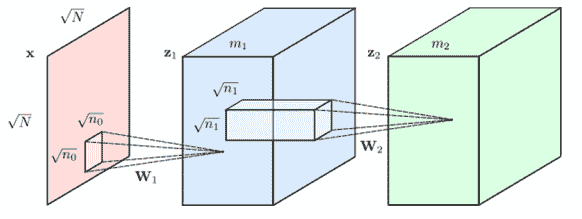
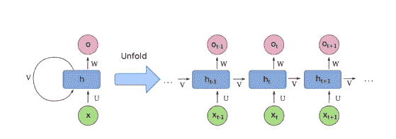
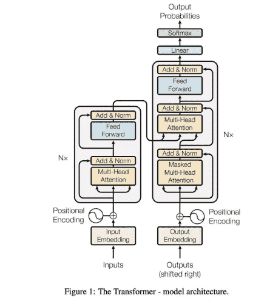
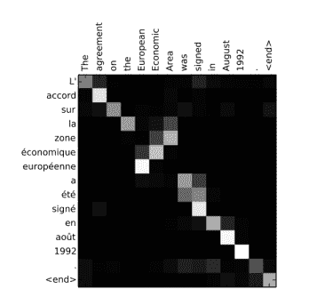

# 解析 Transformer 模型：理解 GPT-3、BERT 和 T5 背后的模型

> 来源：[https://waytoagi.feishu.cn/docx/IWGmdfuOGohtidxjhmaczsi0ned](https://waytoagi.feishu.cn/docx/IWGmdfuOGohtidxjhmaczsi0ned)

> 原文链接：https://daleonai.com/transformers-explained

> 作者：Dale Markowitz（@Google Labs，领导生成式 AI 的宣传和教育）

> 发表时间：2021 年 5 月 6 日

> 翻译： 数据派 THU （译者：王可汗，校对：和中华），略有修改

> 中文翻译原地址：https://mp.weixin.qq.com/s/kfsW7ccYUAGp1AHWWF6c1w

> 《[A16Z 整理的 AI 典藏](https://ywh1bkansf.feishu.cn/wiki/F8OMwrI3TisTPokQAJHcMG2knBh)》入门第四篇

你知道这句话吗，当你有一把锤子的时候，所有东西看起来都像钉子？ 在机器学习中，我们似乎真的发现了一种神奇的锤子。实际上，在这个模型面前所有东西都是钉子，这就是 Transformer 模型。Transformer 模型可以用来翻译文本、写诗、写文章，甚至生成计算机代码。事实上，我在 daleonai.com 上写的很多惊人的研究都是建立在 Transformer 基础之上，比如 AlphaFold 2，它是一种从基因序列中预测蛋白质结构的模型，以及 GPT-3、BERT、T5、Switch、Meena 等功能强大的自然语言处理（NLP）模型。你可能会说，他们不仅仅是遇到了……呃，先往下说吧。

如果你想在机器学习，特别是自然语言处理方面与时俱进，你至少要对 Transformer 有一点了解。所以在这篇文章中，我们将讨论它们是什么，它们是如何工作的以及为什么它们如此有影响力。

Transformer 是一种神经网络结构。简单地说**，神经网**络是分析图像、视频、音频和文本等复杂数据类型的一种非常有效的模型。针对不同类型的数据有专门优化过的的神经网络。例如，在分析图像时，我们通常会使用卷积神经网络。大体来说，它们模仿了人脑处理视觉信息的方式。



卷积神经网络，图片来自 Renanar2，wikiccommons

大约从 2012 年开始，我们已经用 CNN 相当成功地解决了视觉问题，比如识别照片中的物体，识别人脸，手写数字识别。但在很长一段时间里，语言任务（翻译、文本摘要、文本生成、命名实体识别等）都没有较好的方法。这很不幸，因为语言是我们人类交流的主要方式。

在 2017 年推出 Transformer 之前，我们使用深度学习来理解文本的方法是使用一种称为循环神经网络（RNN）的模型，它看起来像这样：



循环神经网络，图片来自 fdeloche，Wikimedia

假设你想把一个句子从英语翻译成法语。RNN 将一个英语句子作为输入，一次处理一个单词，然后按顺序吐出对应的法语单词。这里的关键词是“顺序”。在语言中，单词的顺序很重要，你不能随意打乱它们。比如下面的句子：

“Jane went looking for trouble。（简到处找麻烦。）”意思与句子非常不同： “Trouble went looking for Jane” （麻烦到处找简。)

因此，任何能够理解语言的模型都必须捕捉词序，而循环神经网络是通过在一个序列中，一次处理一个单词来做到的。

但是 RNN 有问题。首先，他们很难处理冗长的文本序列，比如长段落或文章。当他们读到一段的结尾时，他们会忘记开头发生了什么。例如，基于 RNN 的翻译模型可能很难记住长段落主语的性别。

更糟糕的是，RNN 很难训练。它们很容易受到所谓的消失/爆炸梯度问题的影响（有时候你只能重新开始训练并祈祷）。更有问题的是，因为 RNN 是按顺序处理单词的，所以很难并行化。这意味着你不能通过添加更多 GPU 来加快训练速度，这也意味着你不能用那么多数据来训练它们。

## **进入 Transformer**

这就是 Transformer 大显身手的地方。它们是谷歌和多伦多大学的研究人员在 2017 年开发的，最初设计用于翻译。但与循环神经网络不同，Transformer 可以非常有效地并行化。这就意味着，只要有合适的硬件，你就可以训练出一些非常大的模型。

有多大呢？非常之巨大！

GPT-3 是一种特别令人印象深刻的文本生成模型，它的写作能力几乎与人类相当，它是在 45TB 的文本数据上训练而成，包括几乎所有的公共网络数据。

所以**，**用一句话总结 Transformer，一定是这样的：当一个扩展性极佳的模型和一个巨大的数据集邂逅，结果可能会让你大吃一惊。

## Transformer 是如何工作的？



Transformer，图片出自原稿：https://arxiv.org/abs/1706.03762

虽然原稿中的图表有点吓人，但 Transformer 背后的创新可以归结为三个主要概念：

1.  位置编码（Positional Encodings）

1.  **注意力机制****（Attention）**

1.  **自****注意力机制**（Self-Attention）

### **位置编码**

让我们从第一个开始，位置编码。假设我们要把文本从英语翻译成法语。回忆 RNN，即之前的翻译方法，是通过按顺序处理单词来理解单词顺序。但这也是让它们难以并行化的原因。

**

****Transformer 通过一种称为位置编码的创新方法绕过了这一障碍。其思路是将输入序列**中的所有单词——在本例中是一个英语句子，在每个单词后面加上一个数字，表明它的顺序。所以，你为你的网络提供如下序列：

+

```
[(&quot;Dale&quot;, 1), (&quot;says&quot;, 2), (&quot;hello&quot;, 3), (&quot;world&quot;, 4)]
```

从概念上讲，你可以把理解语序的重担从神经网络的结构转移到数据本身。

起初，在对 Transformer 进行任何数据训练之前，它并不知道如何解释这些位置编码。但是随着这个模型看到越来越多的句子和它们的编码，它学会了如何有效地使用它们。

**我在这里****做了一点过度简化**——最初的作者使用正弦函数来进行位置编码，而不是简单的整数 1、2、3、4——但要点是相同的。将语序存储为数据，而不是靠网络结构，这样你的神经网络就更容易训练了。

### **注意力机制**

Transformer 的下一个重要部分叫做注意力机制。

嗨！

注意力是一种神经网络结构，在机器学习中随处可见。事实上，2017 年介绍 Transformer 的那篇论文标题并不是《我们向你介绍 Transformer》（We Present You the Transformer）。相反，它被称为《注意力就是你需要的一切》（Attention is All You Need）。

在 2015 年文本翻译中引入了注意力机制。要理解它，请参考原文中的例句：

> 关于欧洲经济区的协定是 1992 年 8 月签署的。

> ( The agreement on the European Economic Area was signed in August 1992.)

现在想象一下把这句话翻译成法语：

> L’accord sur la zone économique européenne a été signé en août 1992.

对于翻译这个句子，一个不好的方法是对照着英语句子中的每个单词，然后试着把法语中的对应单词一次翻译出来。出于几个原因，这并不奏效，但其中一个原因是，法语翻译中的一些词颠倒过来了：英语中是“欧洲经济区”（European Economic Area），法语中是“la zone économique européenne”。此外，法语是一种有阴阳性词汇的语言。形容词“économique”和“européenne”必须是阴性形式，以匹配阴性宾语“la zone”。

**

注意力是一种机制，它允许文本模型在决定如何翻译输出句**子中的单词时“查看”原始句子中的每一个单词。下图是最初的注意力论文中的一个很好的可视化：



图片来自论文，“Neural Machine Translation by joint Learning to Align and Translate（2015）”，https://arxiv.org/abs/1409.0473

这是一种热力图，显示出当模型输出法语句子中的每个单词时，它“注意”的位置。如你所料，当模型输出“européenne”时，它会重点关注输入词“European”和“Economic”。

**

模型如****何知道在每个时间步长中应该“注意”哪些单词呢？**** **这就是从训练数据中学到的东西。通过观察成千上万的法语和英语句子，该模型学会了什么类型的单词是相互依赖的。学会了如何遵守词语阴阳性、复数和其他语法规则。

自 2015 年被发现以来，注意力机制一直是自然语言处理一个非常有用的工具，但在其原始形式中，它是与循环神经网络一起使用的。因此，2017 年《Transformer》论文的创新之处在于，在一定程度上完全抛弃了 RNN。这就是为什么 2017 年的论文被称为《注意力就是你需要的一切》。

### **自****注意力机制**

Transformer 的最后一点（也许是最具影响力的一点）是对注意力的变式，即自注意力。

我们刚刚讨论的“原味”注意力帮助对齐英文和法文句子中的单词，这对于翻译非常重要。但是，如果你不是试图翻译单词，而是试图建立一个理解语言中的基本含义和模式的模型—— 一种可以用来做任何数量的语言任务的模型，那该怎么办？

**

一般来说，****让神经网****络强大的是，它们通常会自动建立****起训练数****据有意义的内部表示**。例如，当你检查视觉神经网络的不同层时，你会发现不同神经元负责“识别”不同的模式，比如边缘、形状，甚至像眼睛和嘴巴这样的高级结构。在文本数据上训练的模型可能自动学习了词性、语法规则以及单词是否同义。

神经网络学习语言的内部表示越好，它在任何语言任务中的表现就越好。事实证明，如果注意力机制应用于输入文本本身，它同样是一种非常有效的方式。

例如，下面这两个句子：

> “服务员，能给我账单吗？”(  “Server, can I have the check?”)

> "我好像让服务器崩溃了"（“Looks like I just crashed the server。”)

在这里，单词“server”意味着两种非常不同的意思，我们人类可以通过查看周围的单词轻松地消除歧义。自注意力使神经网络能够在单词周围的语境中理解单词。因此，当模型处理第一句话中的“服务员”（“Server”）时，它可能是“注意”单词“账单”（“check”），这有助于消除该单词代表不同意思——服务员和服务器之间的歧义。

在第二个句子中，模型可能会注意单词“崩溃”（“crash”），以确定这个“服务器”（“server”）指的是一台机器。

**

自注意力帮****助神经网****络消除单词歧义，做词性标注****，命名实体识****别，学习语义角色等等**。

我们在这里高度概括和总结了一下 Transformer。

如果你想要更深入的技术解释，我强烈推荐你去看看 Jay Alammar 的博客文章 The Illustrated Transformer。

## Transformer 能做什么？

最流行的基于 Transformer 的模型之一 BERT，它是“来自 Transformer 的双向编码器表示”（ “Bidirectional Encoder Representations from Transformers”）的缩写。它是谷歌的研究人员在我 2018 年加入公司前后引入的，很快就进入了几乎所有的 NLP 项目，包括谷歌搜索。

BERT[ 不仅指模型体系结构](https://github.com/google-research/bert)，还指经过训练的模型本身，您可以在这里免费下载和使用。

谷歌的研究人员在一个庞大的文本语料库上对它进行了训练，它已经成为一种用于自然语言处理的通用模型。它可以扩展来解决一系列不同的任务，比如：

+   文本摘要

+   问答

+   分类

+   命名实体识别

+   文本相似度

+   攻击性信息/脏话检测

+   理解用户的查询

+   等等

BERT 证明，您可以在未标记的数据上建立非常好的语言模型，比如从 Wikipedia 和 Reddit 中提取的文本，并且这些大型的“基础”模型可以与特定领域的数据相适应，适用于许多不同的用例。

最近，OpenAI 创建的模型 GPT-3 生成真实文本的能力让人们大吃一惊。谷歌搜索去年推出的 Meena 是一个基于 transformer 的聊天机器人（akhem，对话代理），几乎可以就任何话题进行引人入胜的对话（其作者曾花了 20 分钟与 Meena 争论作为人类意味着什么）。

Tansformer 也在自然语言处理之外掀起了一股浪潮，例如作曲、根据文本描述生成图像以及预测蛋白质结构。

## 如何使用 Transformer？

现在你已经被 Transformer 的力量所吸引，你可能想知道如何在自己的应用中使用它们。没问题。

你可以从 TensorFlow Hub 下载常见的基于 Transformer 的模型，比如 BERT。关于代码教程，请查看我写的关于构建基于语义语言应用程序的文章。

但是如果你想要真正的跟随潮流，并且你写 Python，我强烈推荐由 HuggingFace 公司维护的 Transformer 库。该平台允许您以一种非常开发人员友好的方式训练和使用当今大多数流行的 NLP 模型，如 BERT、Roberta、T5、GPT-2。

今天的文章就到此结束吧！