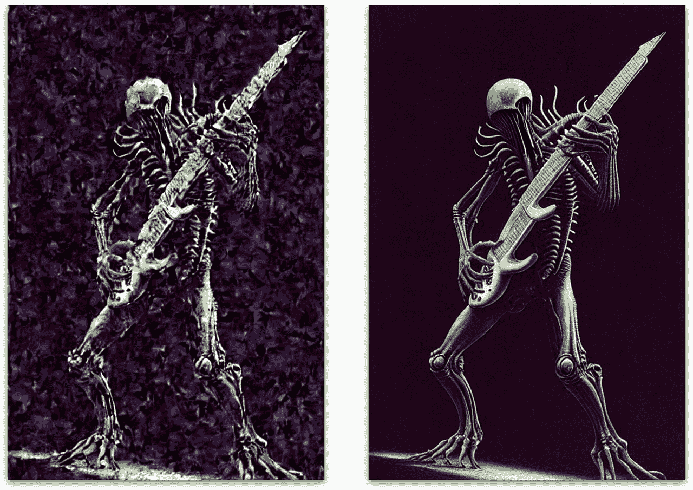
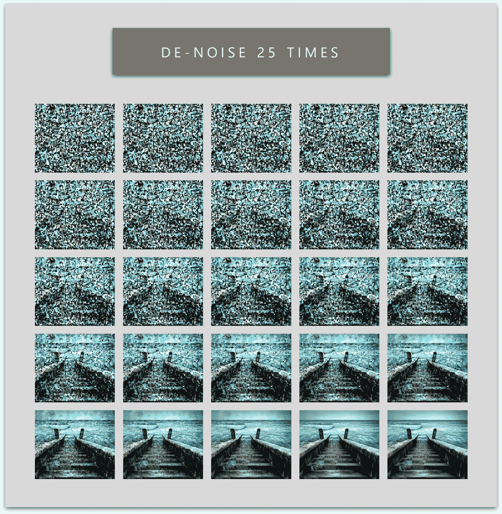
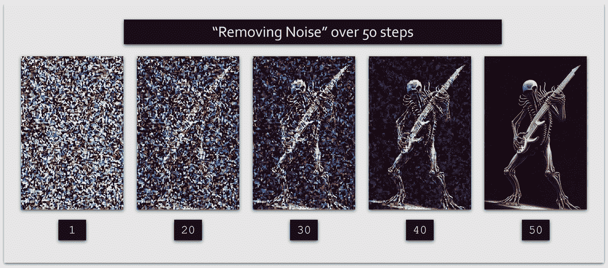
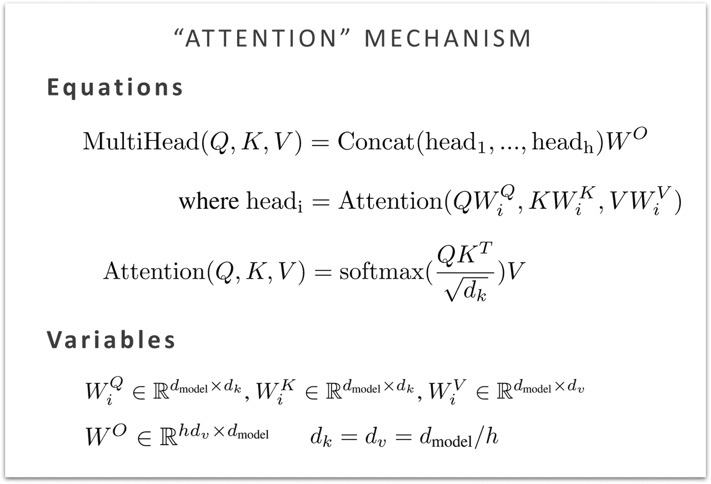
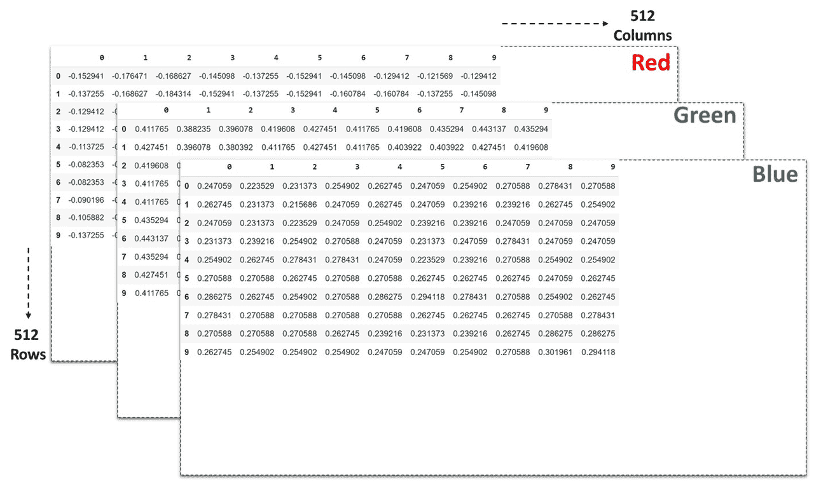
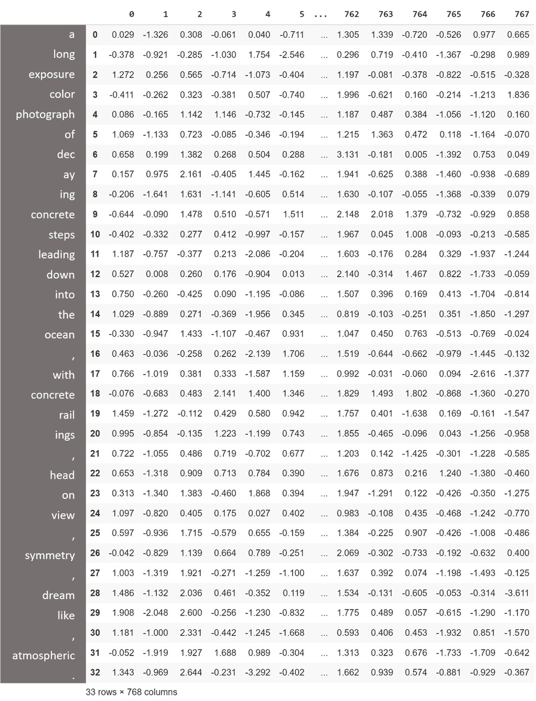
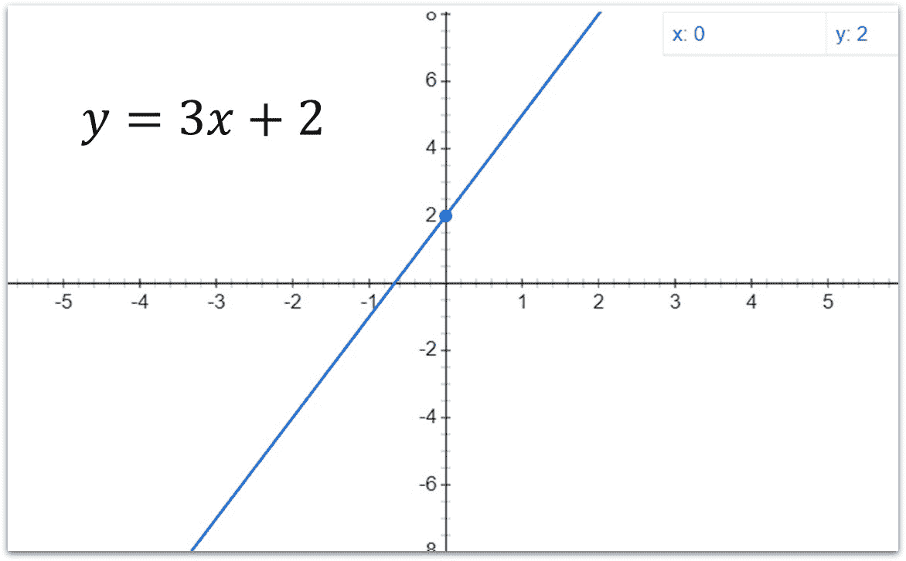

# 稳定扩散（Stable Diffusion）是如何运作的

> 来源：[https://waytoagi.feishu.cn/docx/NQp2d7dGkoAc6Sx0yiQcGXi8nSb](https://waytoagi.feishu.cn/docx/NQp2d7dGkoAc6Sx0yiQcGXi8nSb)

> 原文地址：https://mccormickml.com/2022/12/21/how-stable-diffusion-works/

> 作者：Chris McCormick（斯坦福大学毕业，一直从事计算机视觉、机器学习和 NLP 领域工作）

> 发表时间：2022 年 12 月 21 日

> 译者：通往 AGI 之路

> 《[A16Z 整理的 AI 典藏](https://ywh1bkansf.feishu.cn/wiki/F8OMwrI3TisTPokQAJHcMG2knBh)》入门第五篇

一台计算机仅凭一段文字描述就能创作出艺术，这真是令人难以置信！我自己也非常好奇，“引**擎盖下”到底发**生了什么，使这种事情成为可能。因此我想在这里尽我所能，即使对于那些不熟悉人工智能概念的人，也能提供一个较为深入的解释。

# 概述

在第一部分，我会给你一个高层次的解释（你可能已经熟悉了）。这是一个好的开始，但我知道这无法满足我的好奇心。😉 我会问，“好的，很棒，但是它是怎么做到的？”

为了解答这个问题，我将展示一些稳定扩散的内部运作方式。内部的复杂程度可能超出了你的预期，但我至少想要更具体地向你展示其运作过程，这样它就不再是一个完全的谜了。

更具体地说：

+   稳定扩散是一个巨大的**神经网络**。

+   神经网络是**纯粹的数学**。

+   事实上，我们**并不完全知道**它在做什么！

+   **最终**，稳定扩散之所以能工作，是因为我们训练了它。

但让我们从全局视角开始吧！

# 稳定扩散消除了图像中的噪点

如果您曾尝试在太暗的情况下拍照，而拍出的照**片全是颗粒状，那么**这种颗粒状就是图像中“噪点”的一个例子。

我们使用 Stable Diffusion 来生成艺术作品，但它实际上在幕后所做的是“清理”图像！

不过，它比手机图像编辑器中的噪点消除滑块复杂得多。它实际上了解世界的样子、了解书面语言，并利用这些来指导（噪点消除）过程。

例如，想象一下，如果我给了下面左边的图像给一位熟练的平面艺术家，并告诉他们这是一幅以 H.R。 Giger（瑞士画家、雕塑家与布景师，《异形》中的外星生物就是他的作品）的风格描绘的外星人弹吉他的画。我打赌他们可以精心清理它，创造出像右图那样的东西。



（这些是稳定扩散的实际图像！)

艺术家会利用他们对 Giger 的艺术作品的了解，以及对世界的了解（例如吉他应该是什么样子以及如何弹奏）来做到这一点。稳定扩散本质上是在做同样的事情！

## “推理步骤”

你熟悉大多数艺术生成工具中的“推理步骤”滑块吗？稳定扩散是逐步去除噪点的。

这是一个运行 25 步的例子：



外星吉他手的例子更有意义，因为你可以更清楚地看出它应该是什么**样子的…**…但在上图中，起始图像看起来完全无法辨认！

实际上，这个充满噪点的外星人例子其实是从过程的大约一半开始取的——它（最开始的图像）实际上也是从完全的噪点开始的！



## 它是如何开始的？

为了生成艺术，我们给稳定扩散提供了一个实际上只是纯噪点的初始图像。但是，相当残忍地😏，我们撒谎说：“这是一幅超级充满噪点的 H.R。 Giger 风格的外星人弹吉他的画——你能帮我清理一下吗？”

如果你把这个任务交给一个平面艺术家，他们会束手无策——“我帮不了你，这个图像完全无法辨认！”

那么稳定扩散是如何做到的呢？

在最简单的层面上，答案是它是一个计算机程序，它别无选择，只能做它的事情并为我们生产一些东西。

更深层次的答案与这样一个事实有关，即稳定扩散等 AI 模型（从技术上讲，“机器学习”模型）在很大程度上基于统计数据。它们估计所有选项的概率，即使所有选项的正确概率都极低，它们仍然只会选择概率最高的路径。

例如，它对吉他可能出现在图像中的位置有一些理解，并且它可以寻找哪部分噪点最可能像是吉他边缘的部分（即使实际上没有“正确”的选择），然后开始填充物体。

因为没有正确的答案，每次你给它一个不同的纯噪点图像，它都会创作出不同的艺术作品！

# 你如何编写稳定扩散程序？

如果我对机器学习不熟悉，而且我正在尝试猜测如何实际实现这个，我可能会开始考虑如何编程实现它。换句话说，它遵循的步骤顺序是什么？

也许它从描述中匹配关键词，搜索与描述匹配的图像数据库，然后将它们与噪声进行比较？而从那个家伙的解释来看，它听起来可能首先计算图像中最明显的边缘在哪里？🤷

事实并非如此——它没有参考的图像数据库，也不使用任何图像处理算法... 它是纯粹的数学。

我并不是说“嗯，当然，计算机最终只是大型计算器，它们所做的一切都归结为数学”。我说的是“黑板上令人眼花缭乱的方程式”之类的数学，如下所示：



（这是我写的关于稳定扩散的众多构建块之一的技术教程，称为“注意力”。)

定义每个不同构建模块的全部方程式至少会填满几页。

## 图像和文本作为数字

为了应用这些方程式，我们需要将初始噪点图像和我们的文本描述表示为大量的数字表格。

您可能已经熟悉图像的表示方式，但让我们看一个示例。这是我在涨潮时拍摄的长曝光照片：


这就是它在数学上的表示方法。它是 512 x 512 像素，所以我们将其表示为有 512 行和 512 列的表格。但实际上我们需要三个表格来表示一张图像，因为每个像素由红、绿、蓝（RGB）的混合组成。以下是上述图像的实际值。



在稳定扩散中，我们也处理文本。这是我可能为图像写的描述：

```
A long exposure color photograph of decaying concrete steps leading down into the ocean, with concrete railings, head on view, symmetry, dream like, atmospheric.
一张长曝光彩色照片，描绘了朽迹斑斑的混凝土台阶伸向海洋，混凝土栏杆两旁，正面视角，对称美感，如梦如幻，充满艺术气氛。
```

这就是它如何被表示为一个数字表格。每个词有一行，每个词由 768 个数字表示。这些是在稳定扩散 v1.5 中用来表示这些词的实际数字：



我们如何选择数字来表示一个词是一个引人入胜的话题，但也相当技术性。你可以粗略地把这些数字看作是每一个代表单词含义的不同方面。

在机器学习中，我们实际上并不称这些为“表格”——我们使用“矩阵”或“向量”这样的术语。这些来自线性代数领域。

**然而**，所有这一切中最重要和最令人困惑的部分是参数的概念。

## 10 亿个参数

**初始**噪声和我们的文本描述是我们称之为稳定扩散的输入，不同的输入在这些表格中会有不同的值。

我们也将一组大得多**的数**字插入到这些方程式中，但每次都是相同的——这些被称为稳定扩散的参数。

还记得高中时用方程式绘制线条吗y = 3x + 2？



如果这是稳定扩散，那么“x”是我们的输入，“y”是最终图像，数字 3 和 2 是我们的参数。（当然，方程式要复杂得多😝）。

输入图像由大约 79 万 个值表示，提示中的 33 个“tokens”由大约 2.5 万 个值表示。

但在 Stable Diffusion 中大约有 10 亿个参数。🤯

（你能想象用手算所有这些数字吗？! ? )

这 10 亿个数字被分布在大约 1100 个不同大小的矩阵中。每个矩阵在数学运算的不同阶段被使用。

如果你感到好奇，我在这里打印出了这些矩阵的完整列表！

再次强调，这些参数不会改变——每次生成图像时都是相同的数字。

稳定扩散之所以有效，是因为我们找到了每 10 亿个数字的正确值。这难道不是非常荒谬吗？

## 选择 10 亿个参数

显然，作者不可能坐下来决定尝试什么数字。尤其是当你考虑到它们不是像 1、2、3 这样的“整数”，而是我们计算机迷所说的“浮点”值时——你在表格中看到的小的、非常精确的分数。

我们不仅没有选择这些数字——我们甚至无法解释其中的任何一个！这就是为什么我们无法完全解释稳定扩散的工作原理。我们对这些方程式的作用有一些直观的理解，但是很多事情都隐藏在那些数字的值中，我们不能完全理解。

很疯狂，对吧？

那么我们是如何找出这些数字的呢？

我们首先选择十亿个随机数字来使用。有了这些初始的随机参数值，模型完全无用——在我们找出更好的参数值来使用之前，它无法做出任何有价值的事情。

因此，我们应用了一个我们称之为**训练的**数学过程，该过程逐渐将值调整为有效的值。

训练的工作方式是我们完全理解的东西——它是一些基本的微积分（尽管应用于一个非常大的方程），基本上保证有效，并且我们对为什么有效有清晰的理解。

训练涉及到一个巨大的**训练样本集****。一个单独**的训练样本由一个输入和一个期望的输出组成。（我会在另一篇文章中解释对于稳定扩散来说，一个训练样本看起来是什么样子）。

当我们运行第一个训练输入（参数值完全随机）时，模型吐出的东西将完全不像期望的输出。

但是，利用**实际**输出和**期望**输出之间的**差异**，我们可以对这些方程应用一些非常基本的微积分，这些方程将告诉我们，对于这十亿个数字中的每一个，我们应该加上或减去特定的数量。（每个单独的参数都进行了不同的少量调整！)

在我们做了那些调整之后，模型在数学上保证会生成一个我们更期望的输出图像。

所以我们用许多不同的训练样本做了很多次（数亿次），模型越来越好。然而，随着我们训练的进行，收益逐渐减少，最终我们会到达一个模型无法从进一步训练中受益的点。

一旦作者们完成了模型的训练，他们就发布了参数值供所有人免费使用！

## 训练稳定扩散

有很多关于稳定扩散训练过程的内容很容易理解，学习起来也很有趣，但我决定将把它留到另一篇博文中！

# 结论

如果您对这里的解释感到有点失望，感觉这并不容易理解，我不会感觉被冒犯，但希望你至少觉得面纱已经被揭开，你所看到的是令人难以置信和鼓舞人心的！