# GPT 的现状（State of GPT）

> 来源：[https://waytoagi.feishu.cn/docx/W0f0dX6tfo6k69xox32cAHV6nEh](https://waytoagi.feishu.cn/docx/W0f0dX6tfo6k69xox32cAHV6nEh)

+   源地址：https://build.microsoft.com/en-US/sessions/db3f4859-cd30-4445-a0cd-553c3304f8e2

+   演讲者：[Andrej Karpathy](https://karpathy.medium.com/?source=post_page-----a64152b37c35--------------------------------) （OpenAI 创始团队成员，原特斯拉 AI 部门负责人）

+   B 站视频：https://www.bilibili.com/video/BV1ts4y1T7UH/ （推荐：Web3 天空之城翻译版本）

+   发布时间：2023 年 5 月 24 日

+   翻译缘起：在《A16Z 推荐的 AI 学习路径》中，这篇演讲作为了入门第二篇文章进行推荐，所以有了翻译的念头，翻译过程中陆续看到网上有不同的翻译版本和视频版本，这个版本并不完美，可与其它版本对照来看，如有纰漏还恳请指正，谢谢。

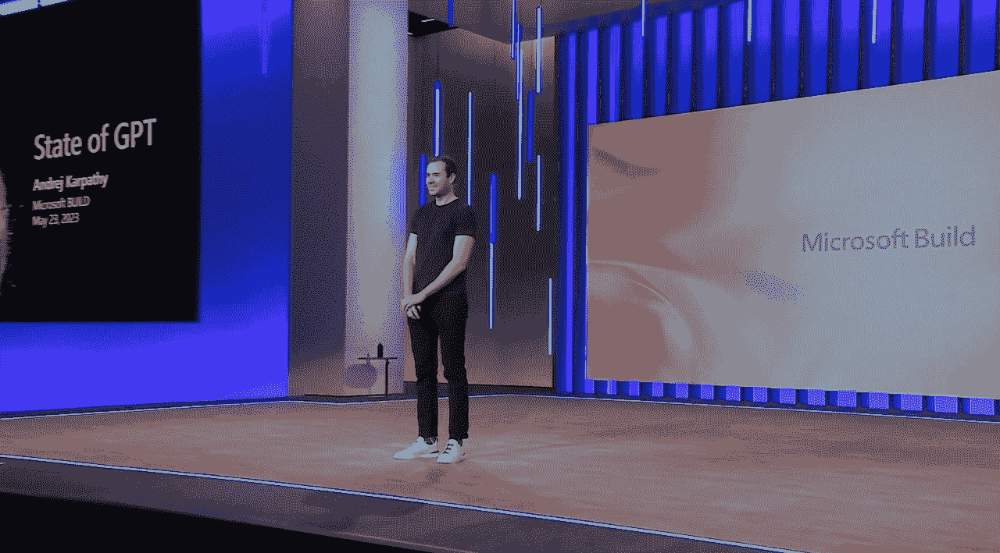

## 中文翻译

ANDREJ KARPATHY：大家好，我很高兴在这里向大家介绍 GPT 的现状。更广泛地，我想谈谈迅速发展的大型语言模型生态系统。所以我想把这次演讲分为两部分：

+   在第一部分，我想告诉你们我们是如何训练 GPT 助手的。

+   在第二部分，我们将研究如何有效地将这些助手用于您的应用程序。

## 一、如何训练 GPT 助手

首先，让我们来看看训练这些助手的新兴配方。请记住，这一切都是非常新的，因此在快速发展。但到目前为止，这个配方大致如下：

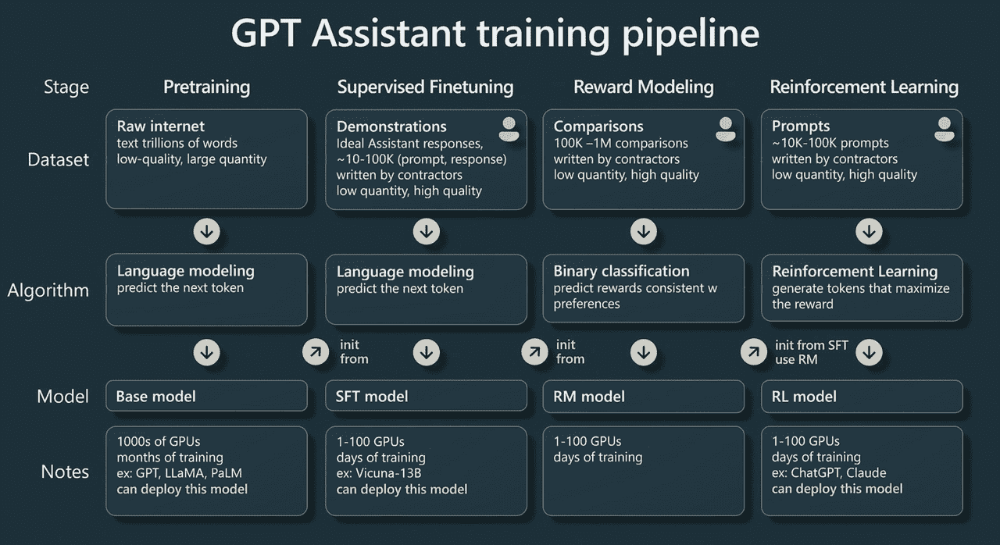

现在这是一个比较复杂的幻灯片，所以我会逐步解释它。大体而言，我们有四个主要阶段：预训练、有监督微调、奖励建模、强化学习。它们是按顺序依次执行的。

现在，在每个阶段中，我们都有一个数据集来支持该阶段。我们有一个算法，这对于我们来说是一个训练神经网络的目标。然后我们得到了一个模型。底部还有一些注释。

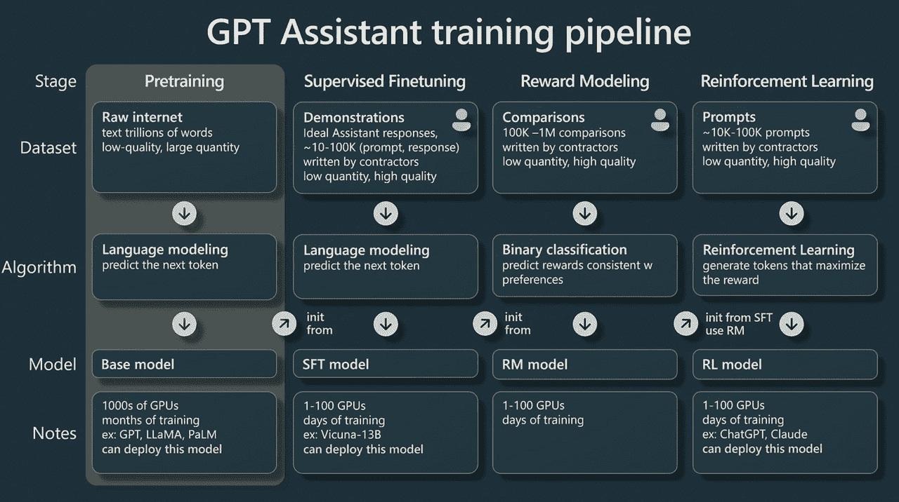

### 预训练

所以我们将从预训练阶段开始。现在，这个阶段在图表中比较特殊，而且这个图表不是按比例绘制的，因为这个阶段是所有计算工作基本上都发生的地方。它占用了训练计算时间和浮点运算的 99%。

所以，这就是我们处理互联网规模数据集的地方，超级计算机中有成千上万的 GPU，并且可能需要几个月的训练时间。其他三个阶段则是微调阶段，这些阶段更多的是使用一些 GPU 进行几个小时或几天的训练。

那么，我们来看看如何通过预训练阶段得到一个基础模型。

首先，我们要收集大量的数据。这里有一个我们称之为数据混合体的例子，它来自 Meta 公司发布的一篇论文，论文中发布了 LLaMA 的基础 模型。

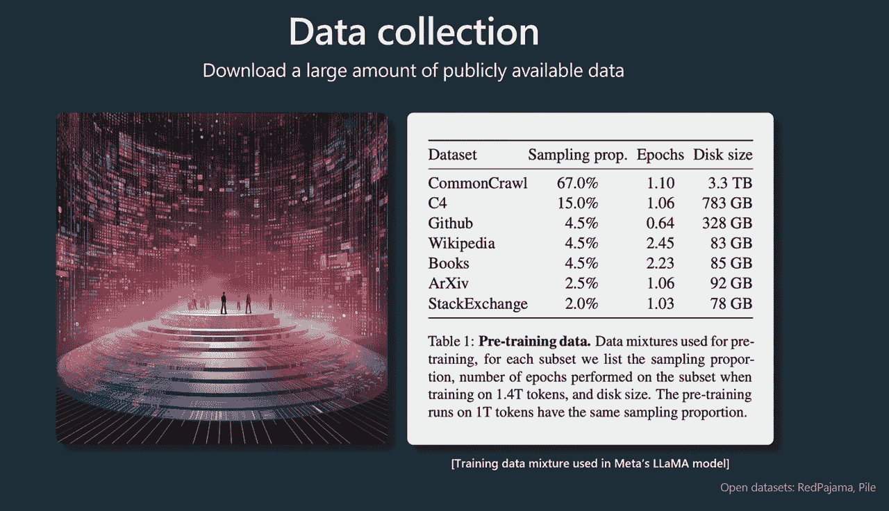

现在，你可以大致看到这些集合中涉及的数据集种类。我们有 Common Crawl，它只是一个网页爬虫，还有 C4，也是一个 Common Crawl，然后还有一些高质量的数据集，例如：GitHub、维基百科、图书、ArXiv、StackExchange 等。这些都混在一起，然后按照一定的比例进行采样，这就形成了 GPT 神经网络的训练集。

在我们实际对这些数据进行训练之前，我们需要进行一个预处理步骤，那就是 Tokenization（分词/标记化）。这基本上就是将我们从互联网上抓取的原始文本翻译成整数序列，因为这是 GPT 操作的原生表示方式。

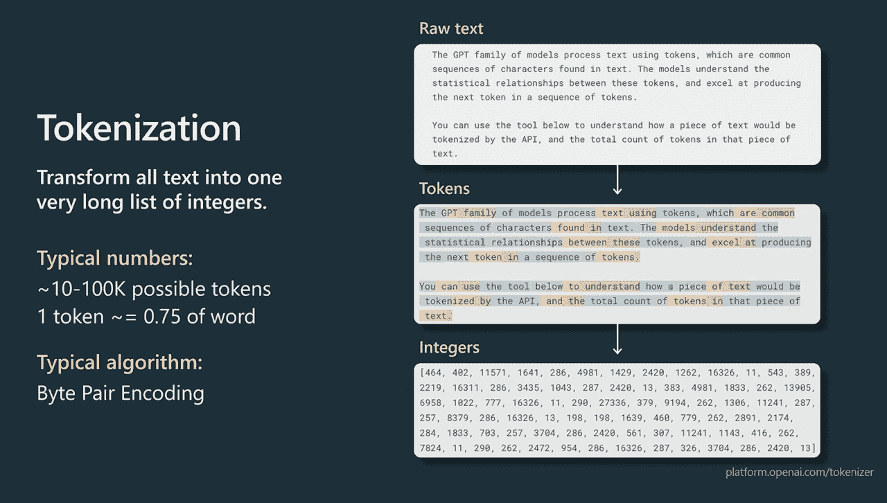

现在，这是一种文本片段、token 以及整数之间的无损转化，这个阶段有很多算法。通常，例如，你可以使用类似于字节对编码的东西，它迭代地合并小文本块，并将它们组成 token。所以，我在这里展示一些这些 token 的示例块，然后这就是将实际输入 transformer 的原始整数序列。

现在，我在这里展示了两个类似的例子，这些例子是关于控制这个阶段的超参数的。

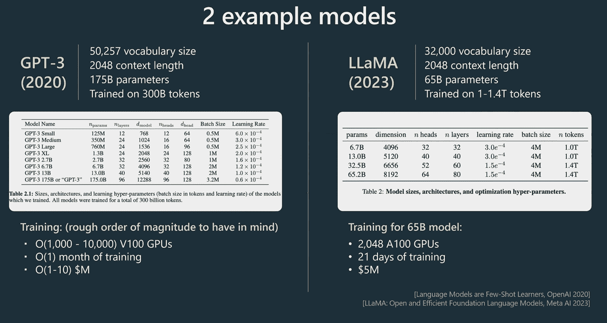

对于 GPT-4，我们并没有发布太多关于它是如何被训练的等等信息。所以我在使用 GPT-3 的数字，但 GPT-3 当然现在已经有点旧了，大约三年前的事了。但 LLaMA 是 Meta 相当新的一个模型。

因此，这些大致就是我们在进行预训练时要处理的数量级。词汇表的大小通常是 10,000 个 token。上下文长度通常是 2,000、4,000 现在甚至是 10 万。这决定了 GPT 在尝试预测序列中的下一个整数时会查看的最大整数数量。

你可以看到大致的参数数量，比如说，LLaMA 有 650 亿个参数。现在，尽管与 GPT3 的 1750 亿个参数相比，LLaMA 只有 650 亿个参数，但 LLaMA 是一个明显更强大的模型，直观来说，这是因为模型训练的时间明显更长，在这种情况下，是 1.4 万亿个 token，而不仅仅是 3000 亿个 token。你不能仅仅通过模型包含的参数数量来判断一个模型的强大程度。

下面，我展示了一些通常用于指定 Transformer 神经网络的超参数表，（包括）头的数量、维度大小、层数等等。

在底部，我展示了一些训练超参数。例如，为了训练 65B 模型，Meta 使用了 2,000 个 GPU，大约 21 天的训练时间，和花费了大约几百万美元。所以，这就是你在预训练阶段应该记住的粗略数量级。

那么，当我们实际进行预训练时，会发生什么呢？大致来说，我们将把我们的 token 放入数据批次中。我们有这些将送入 transformer 的数组，这些数组是 B——批次大小，这些都是按行堆叠的独立示例，B 乘以 T，T 是最大上下文长度。

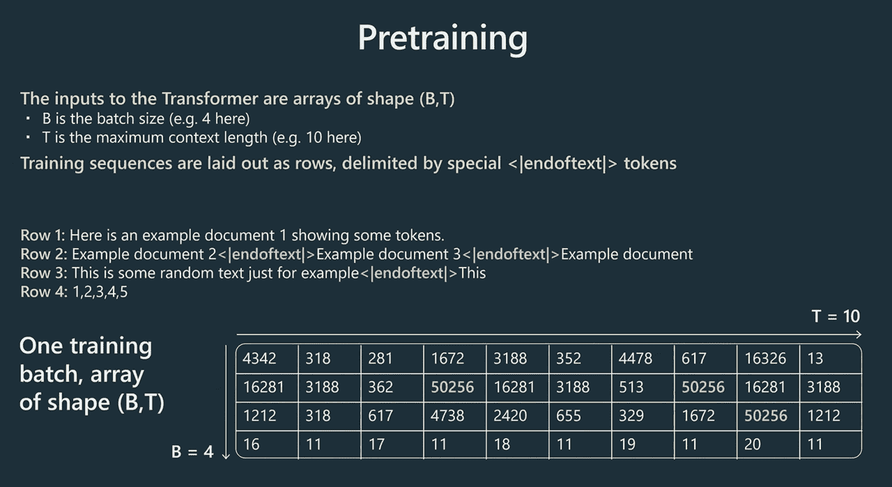

在我的图片中，我只有 10 个，但这是上下文长度，所以这个数字可以是 2,000，4,000 等等。这些都是非常长的行，我们所做的是我们获取这些文档，将它们打包成行，并用这些特殊的文本结束 token 来分隔它们，基本上告诉 transformer 新的文档从哪里开始。

在这里，我有一些文档的例子，然后我将它们拉长成这个输入。现在，我们将所有这些数字都输入到 transformer 中。让我只关注一个特定的单元格，但在这个图中的每一个单元格都会发生同样的事情。

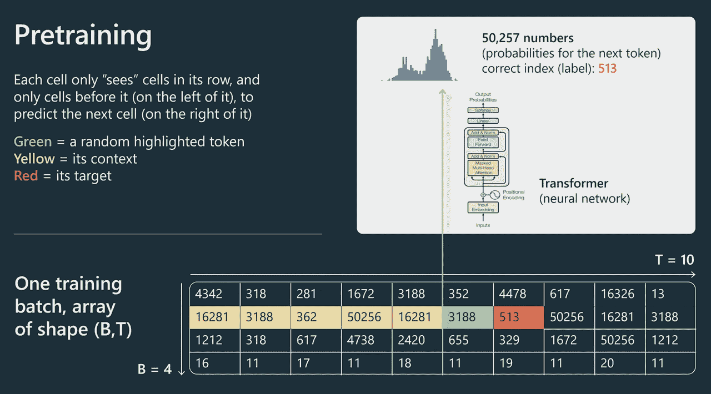

所以，让我们看看绿色的单元格。绿色的单元格将查看其前面的所有 token，这里是所有的黄色 token。我们将整个上下文输入到 transformer 神经网络中。transformer 将尝试预测序列中的下一个 token，在这个例子中是红色的。

现在，说到 transformer，很抱歉我没有太多时间去深入详细介绍这个神经网络架构，但对我们的目的来说，它只是一大堆神经网络的东西，通常有上百亿个参数，或者类似的东西。

当然，当他们调整这些参数时，每一个单元格的预测分布都会有些许不同。例如，如果我们的词汇表大小是 50,257 个 token，那么我们就会有这么多的数字，因为我们需要为接下来的事情指定概率分布，这样我们基本上就有了可能接下来的任何事情的概率。

现在，在这个特定的例子中，对于这个具体的单元格，接下来会是 513（即上图的红色块）。所以我们可以使用这个作为监督源来更新我们的 transformer 权重。所以，我们基本上在每一个单元格上都并行地应用这个。我们不断地交换批次，试图让 transformer 正确预测序列中接下来的 token 是什么。

那么，当你训练其中一个模型时，我来更具体地展示一下这看起来是什么样的。这实际上来自《纽约时报》，他们在莎士比亚作品上训练了一个小型的 GPT。所以，这里有一个莎士比亚的小片段，他们在这个上面训练了他们的 GPT。

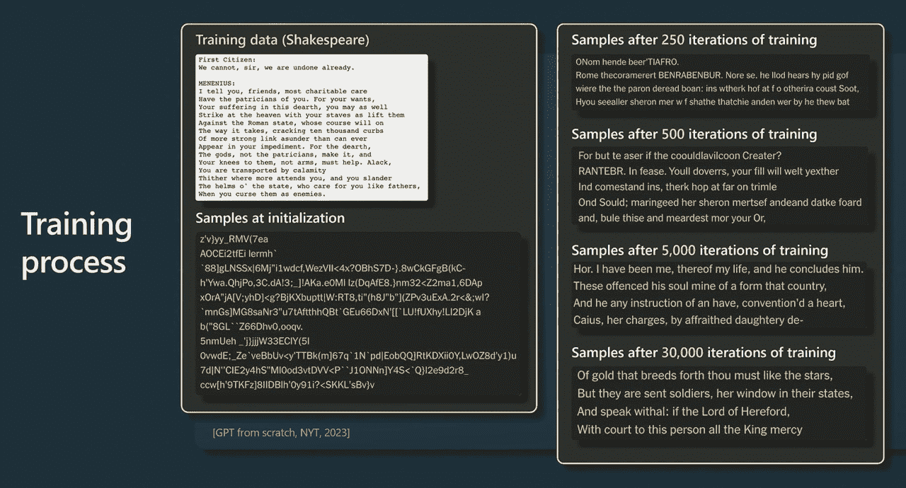

现在，在开始的时候，GPT 以完全随机的权重开始，所以你也只能得到完全随机的输出。但随着时间的推移，当你训练 GPT 越来越长的时间，你会得到越来越连贯和一致的模型样本。

当然，从中抽样的方式，是预测接下来会发生什么。你从这个分布中抽样，并持续地反馈到这个过程中，你基本上可以对大量的序列进行抽样。

所以到最后，你会看到 transformer 已经学会了关于单词的知识，以及在哪里放空格，哪里放逗号等等。所以我们随着时间的推移，我们的预测越来越一致。

当你在做模型预训练时，你要看的就是这种图（见下图）。实际上，我们在观察你训练时的损失函数如何随时间变化。低损失意味着我们的 transformer 预测正确——为序列中正确的下一个整数给出了更高的概率。

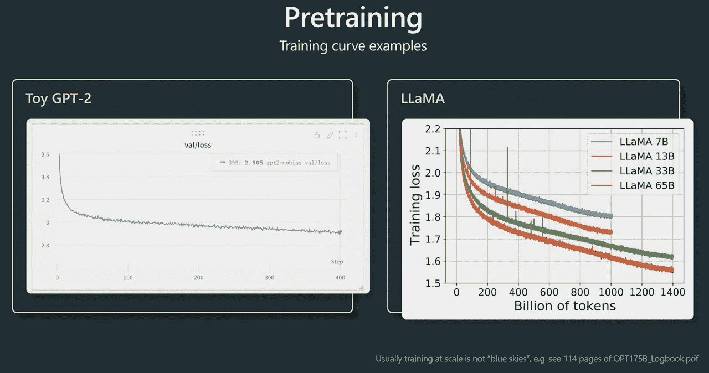

那么，当我们经过一个月的训练后，我们该如何使用这个模型呢？首先，我们注意到的是，我们在这个领域，这些模型在语言建模的过程中，学会了非常强大的通用表示，而且可以非常有效地对任何你可能感兴趣的任意下游任务进行微调。

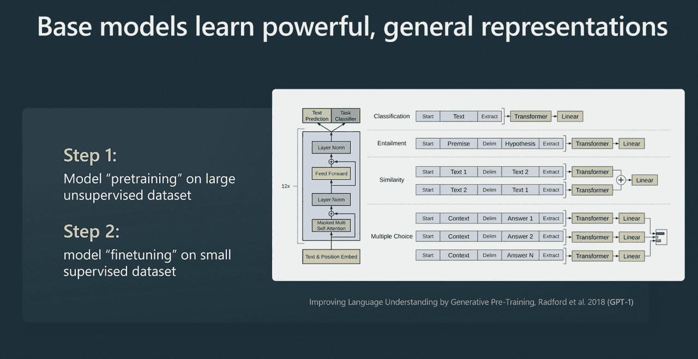

举个例子，如果你对情绪分类感兴趣，过去的方法是收集一堆正面和负面的情绪，然后为此训练一个 NLP 模型。但新的方法是忽略情绪分类，去做大规模的语言模型预训练，训练大的 Transformer，然后你只需要有少量的例子，就可以非常有效地微调你的模型进行这个任务。

这种方法在实践中效果很好。其原因是 Transformer 在语言建模任务中被迫处理大量的任务，因为仅仅在预测下一个 token 的过程中，它就必须理解很多关于文本结构和其中所有不同概念的信息。

这就是 GPT-1。

然后，在 GPT-2 的时候，人们注意到，比微调更好的方法是，你可以非常有效地引导这些模型。因为这些是语言模型，它们想要完成文档，所以你实际上可以通过排列这些虚假的文档来欺骗它们执行任务。

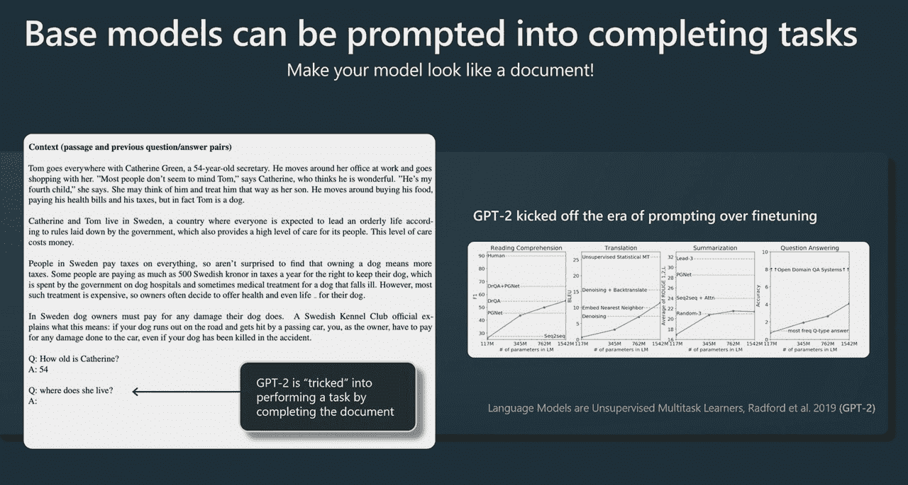

例如，在这个例子中，我们有一些段落，然后我们像做"问答、问答、问答"这样的操作，这叫做少量样本提示（比如，上图中的「Q: How old is Catherine？  A: 54」），然后我们做提问（上图中的「where does she live？」），然后当 Transformer 试图完成文档时，它实际上在回答我们的问题。所以这是一个基础模型的提示工程示例，让它认为它在模仿文档，并使其执行任务。

因此，我认为这引发了一个时代，我会说，是提示优于微调的时代，并发现这实际上在许多问题上都可以非常有效，甚至无需训练任何神经网络，无需进行微调等。

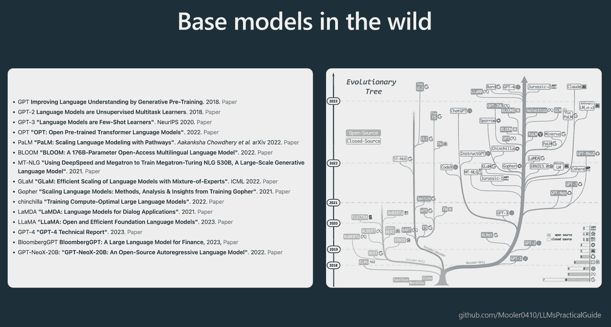

自那时以来，我们已经看到了整个基础模型的进化树，每个人都已经训练过了。但并非所有这些模型都可用，例如，GPT-4 基础模型从未发布过。你可能通过 API 与之交互的 GPT-4 模型并非基础模型，它是一个助手模型，我们将在稍后讨论如何获取这些模型。

GPT-3 基础模型通过名为 DaVinci 的 API 调用下可用，而 GPT-2 基础模型可以在我们 GitHub 仓库中作为权重可用。但目前最好的可用基础模型可能是 Meta 的 LLaMA 系列，尽管它没有商业许可。

现在，需要指出的一点是，基础模型并不是助手（见下图）。它们并不想回答你的问题。它们只想完成文档。所以，如果你告诉它们，“写一首关于面包和奶酪的诗”，它只会——你知道，它会用更多的问题来回答问题。它只是在完成它认为是文档的东西。

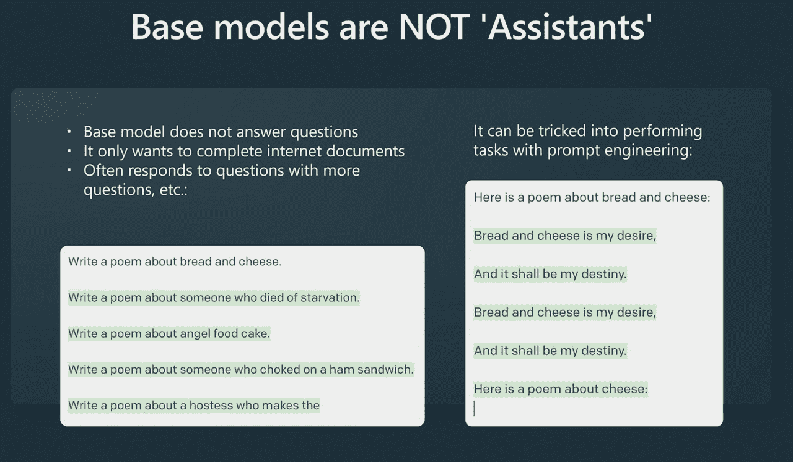

然而，你可以以特定的方式提示基础模型，这样更可能有效。所以举个例子，这是一首关于面包和奶酪的诗，在这种情况下，它会正确地自动完成。

你甚至可以欺骗基础模型以成为助手。你可以做的方式是创建一种特定的少量提示，使其看起来像是人类和助手之间有一份文档，他们正在交换信息。

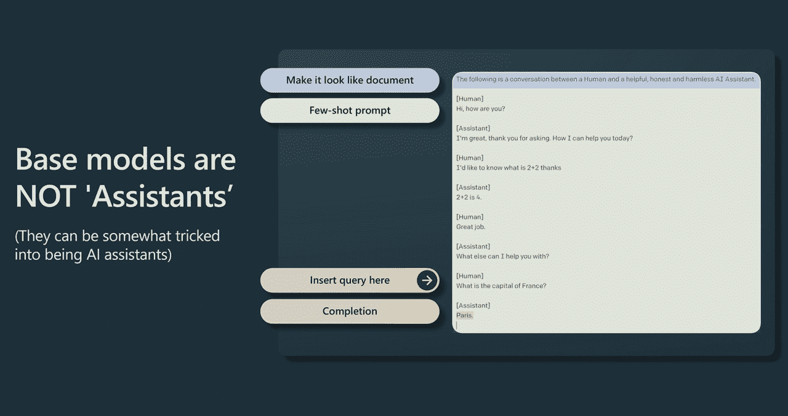

然后在底部你把你的查询放在最后，基础模型会像一个有用的助手一样为自己设定条件并回答。但这并不是很可靠，在实践中并不是特别有效，尽管这是可以做到的。

因此，我们有一条不同的路径来制作真正的 GPT 助手，而不仅仅是基础模型的文档完成者。因此，这将引导我们进入有监督的微调阶段。

### 有监督的微调阶段

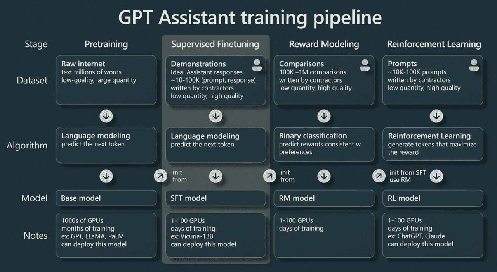

在有监督的微调阶段，我们将收集少量但高质量的数据集。在这种情况下，我们将要求人工承包商收集提示和理想响应的数据。我们将收集大量这样的数据，通常是几万个或者类似的数量。

然后我们仍然会对这些数据进行语言建模。所以在算法上没有任何改变。我们只是换了一个训练集。之前是互联网文档，这是大量/低质量的，现在基本上是问答提示响应类型的数据，这是少量/高质量的。

所以我们仍然会进行语言建模。然后在训练后，我们得到一个 SFT 模型（有监督的微调模型），你可以实际部署这些模型，它们是真正的助手，并且在某种程度上是有用的。

让我向你展示一个示例演示可能是什么样的。这是人工承包商可能会想出的一些随机提示，例如：「你能写一段关于经济学中的「垄断」的简短介绍吗？」之类的？然后承包商也会写出理想的回应。

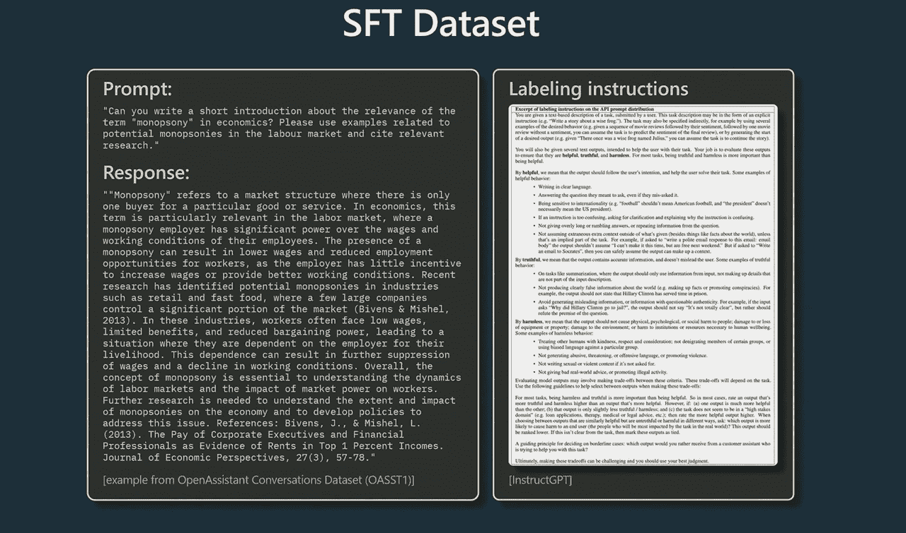

当他们写出这些回应时，他们正在遵循详细的标注文档，他们被要求提供有帮助的、真实的和无害的回答。这些都是标签指令。你可能看不清楚，我也是，但它们很长，这只是人们按照指示去完成这些提示的过程。

所以这就是数据集看起来的样子。你可以训练这些模型，这在某种程度上是有效的。

### 奖励建模

**现在，我们可以从这里继续流****程，进入**** RLHF，即“从人类反馈中**强化学习”，它包括奖励建模和强化学习。

让我介绍一下，然后我将回过头来讨论为什么您可能想要完成额外的步骤，以及这与仅使用 SFT 模型有何不同。

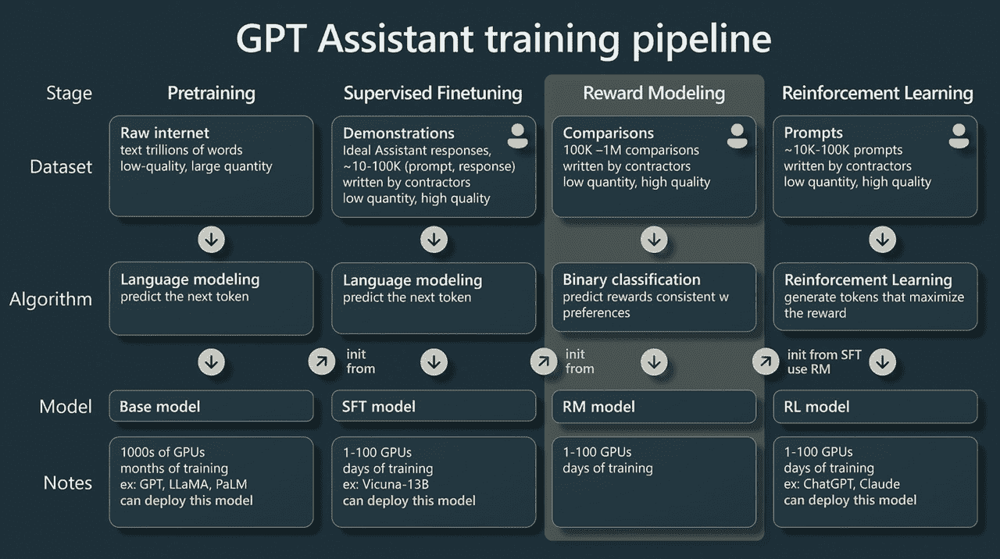

在奖励建模步骤中，我们要做的是将我们的数据收集转变为比较形式。这是我们数据集的一个例子。我在顶部有相同的提示，让助手编写一个程序或函数，检查给定的字符串是否是回文（正读和反读都相同的单词、句子或者数字序列）。

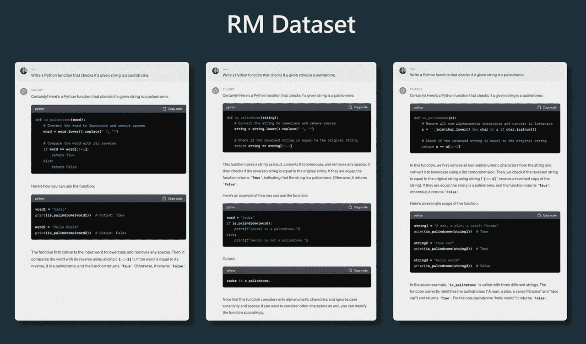

然后我们做的是拿我们已经训练好的 SFT 模型，创建多个完成项（completion，也可译为补全）。所以在这个例子中，我们有模型创建的三个完成项。然后我们让人们对这些完成项进行排序。

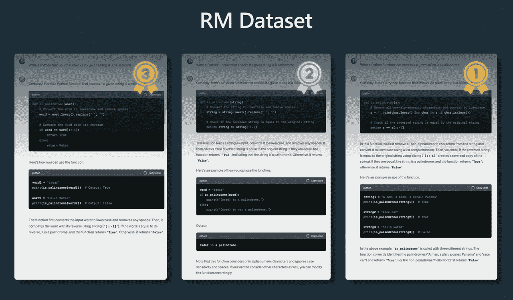

如果你盯着这个看一会儿，顺便说一下，比较这些预测是非常困难的事情，这甚至可能花费人们几个小时来比较单个提示完成对。但是假设我们决定其中一个比其他的要好得多，以此类推，所以我们对它们进行排序。然后，我们可以对这些完成项之间的所有可能对，进行看起来非常像二元分类的东西，以进行排序。

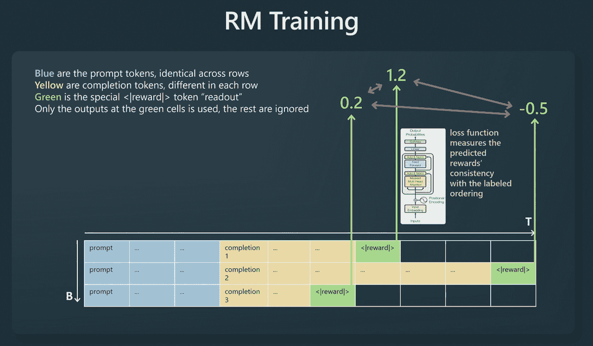

所以我们现在要做的是将我们的提示排成行，提示在所有三行中都是相同的。这都是同一个提示，但是完成项是变化的，所以黄色的 token 来自 SFT 模型。

然后我们在最后添加一个特殊的奖励读出 token，我们基本上只监督这个单个绿色 token 的 transformer，并且 transformer 会预测对于该提示，这个完成项的质量如何。

所以它基本上对每个完成项的质量做出了猜测。然后一旦它为每一个都做出了猜测，我们就有了模型对它们排名的基本事实。所以我们实际上可以强制执其中一些数字应该比其他的要高很多等等。我们将这个制定为一个损失函数，并训练我们的模型，使得模型做出与来自人类承包商的比较事实数据相一致的奖励预测。

这就是我们如何训练我们的奖励模型，这让我们能够评估一个提示的完成程度有多好。

### 强化学习

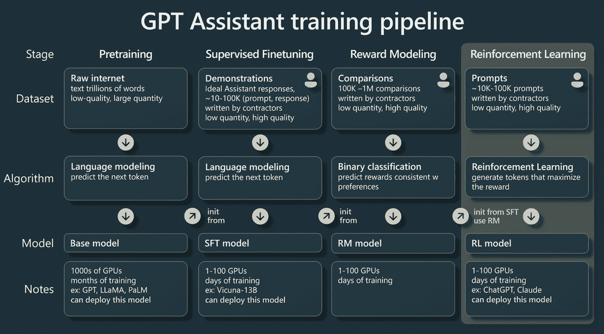

一旦我们有了这个奖励模型，我们不能直接将其部署，因为它本身并不能很好地作为一个助手使用，但是对于现在接下来的强化学习阶段来说，它非常有用。因为我们有了一个奖励模型，我们可以为任何给定的提示下的任意完成项打分。

所以在强化学习过程中我们要做的是，我们基本上又获取了大量的提示，然后我们根据奖励模型进行强化学习。

这是怎么做的呢？我们取一个单一的提示，将其排列成行，现在我们使用 SFT 模型。我们使用我们想要训练的模型，它初始化为 SFT 模型，以创建一些黄色的完成项。然后我们再次添加奖励 token，根据奖励模型读取奖励，现在奖励模型被固定下来，不再变化。

现在，奖励模型告诉我们每个提示下的每个完成项的质量。因此，我们现在可以做的是，我们可以应用相同的语言建模损失函数，但我们目前正在对黄色的 token 进行训练。我们根据奖励模型指示的奖励来衡量语言建模的目标。

举个例子，（如上图）在第一行中，奖励模型认为这是一个得分相当高的完成项。因此，我们恰好在第一行中采样的所有 token 都将得到强化，他们在未来将得到更高的概率。相反，在第二行中，奖励模型非常不喜欢这个完成项，得到 -1.2。因此，我们在第二行中采样的每一个 token 在未来都将得到稍微更低的概率。我们在许多提示，许多批次上反复做这个操作。基本上，我们得到了一个策略，这个策略在这里创建黄色的 token，这基本上是所有的完成项，所有这些完成项都将根据我们在上一阶段训练的奖励模型得到高分。

这就是我们训练的方式。这就是 RLHF 流程。

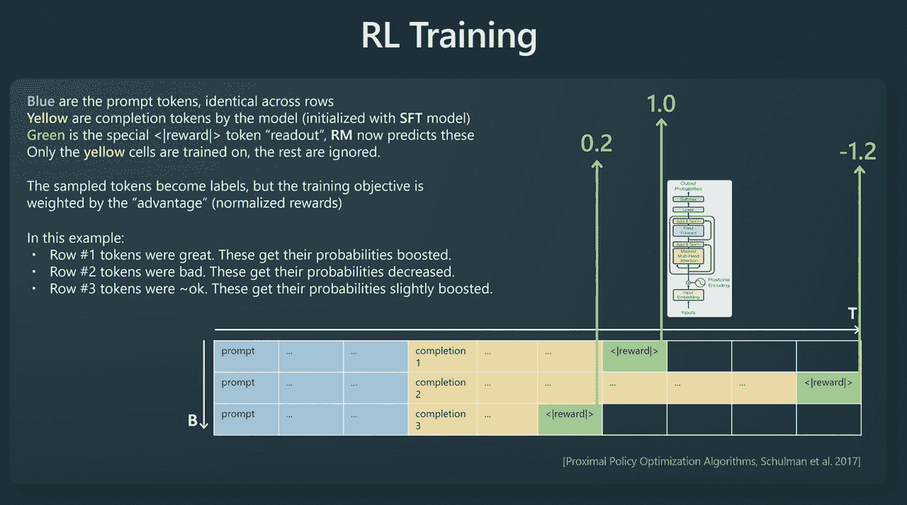

然后最后，你会得到一个可以部署的模型。例如，ChatGPT 就是一个 RLHF 模型，但是你可能会遇到一些其他的模型，比如说 Vicuna-13B（俗称小羊驼模型） 等，这些都是 SFT 模型。我们有基础模型、SFT 模型和 RLHF 模型，这就是目前的状态。

现在你可能会问为什么你会想做 RLHF？答案可能并不那么激动人心，那就是它的效果更好。

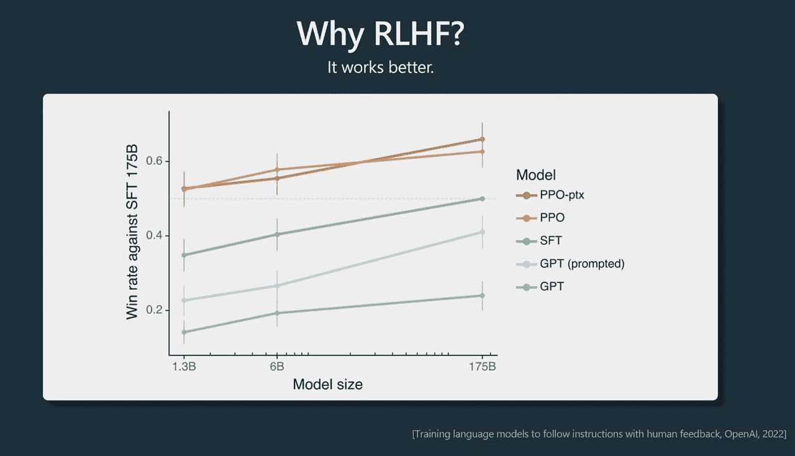

这张图来自于 instructGPT 论文。根据这些已经过去一段时间的实验，这些 PPO 模型是 RLHF。我们看到，当我们提供给人类时，他们在很多比较中都更喜欢这些模型。与提示为助手的基础模型相比、与 SFT 模型相比，人类基本上更喜欢来自 RLHF 模型的 token（输出文字）。所以，它的效果就是更好。

但你可能会问为什么？为什么它的效果更好？我认为并没有一个社区真正达成一致的令人惊讶的答案，但我会提供一个可能的原因，它与比较与生成在计算上的容易度之间的不对称性有关。

让我们以生成一个俳句为例。假设我让一个模型写一首关于回形针的俳句。如果你是一个试图提供训练数据的承包商，那么想象一下作为一个收集 SFT 数据的承包商。你应该如何创建一个关于回形针的好俳句呢？你可能就是不擅长这个，但是如果我给你几个俳句的例子，你可能能够更欣赏其中的一些俳句。因此，判断哪一个好是一个更简单的任务。基本上，这种不对称性使得比较可能是一个更好的方式，可以更好地利用你作为人的判断，以创建一个稍微更好的模型。

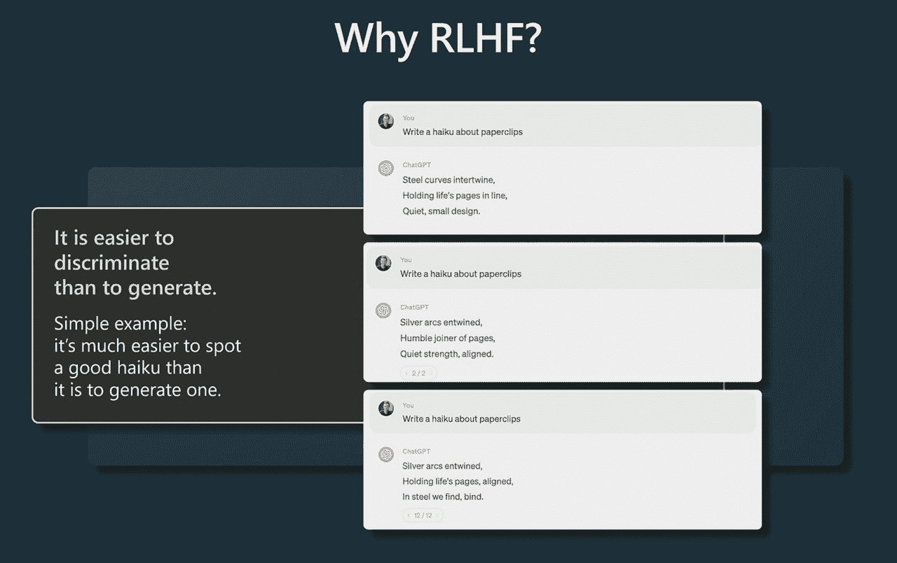

现在，RLHF 模型并不是在所有情况下都比基础模型有改进。特别是，我们注意到，例如，RLHF 会损失一些熵。这意味着它们可以输出变化更小的样本，它们可以输出比基础模型更低变化的样本。基础模型有很多熵，会给出多样性的输出。

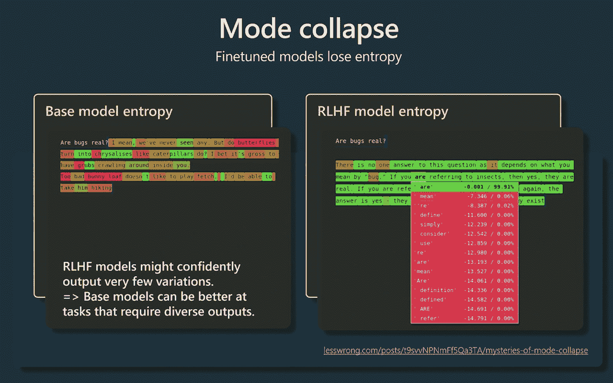

例如，我还是更喜欢在某种情况下使用基础模型，那就是你基本上有 n 件事情，你想生成更多类似的事情。这里有一个我刚刚编造出来的例子。

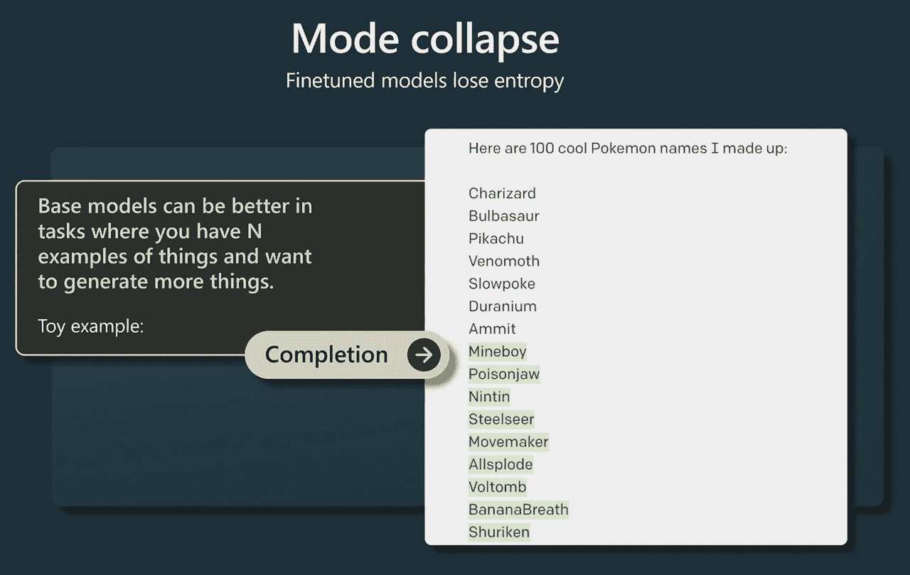

我想生成酷炫的口袋妖怪的名字。我给出了七个口袋妖怪的名字，我让基础模型完成这个文档。它给我提供了更多的口袋妖怪的名字。这些都是虚构的，我试着查了一下，我不认为这些是真正的口袋妖怪。这是我认为基础模型擅长的一种任务，因为它仍然有大量的熵，会给你提供多样性的、酷炫的更多东西，看起来像你之前给它的任何东西。

说了这么多，这些可能是你现在可以用到的助手模型。伯克利的一个团队对许多可用的助手模型进行了排名，并给他们赋予了 ELO 评级。

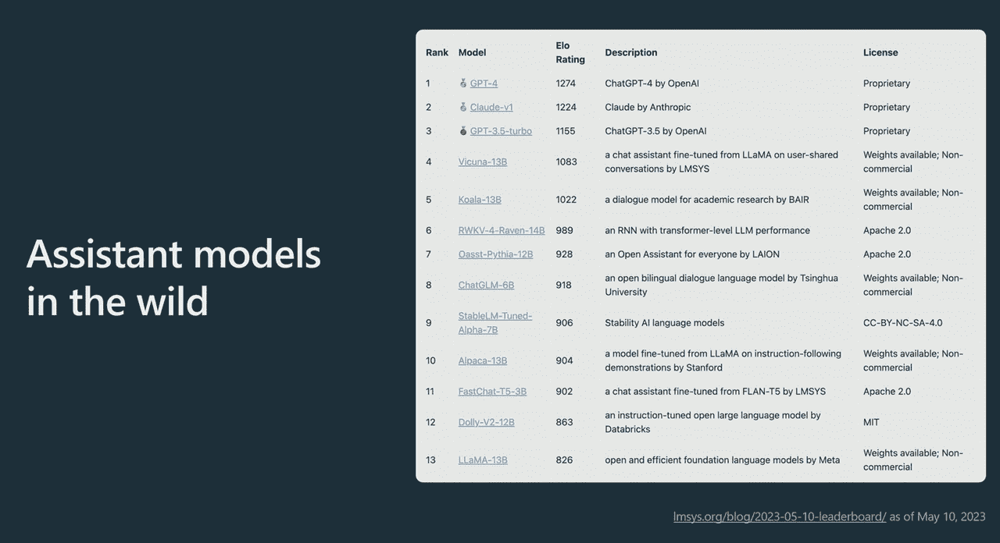

目前，一些最好的模型，当然，远远领先的是 GPT-4，其次是 Claude、GPT-3.5，然后是一些其他模型。有些可能以权重的形式可用，比如 Vicuna、Koala 等。这里的前三行，都是 RLHF 模型，而所有其他的模型，据我所知，我相信其他模型都是 SFT 模型。

好的，那就是我们如何在高级上训练这些模型。现在，我要转换方向，让我们看看如何最好地将 GPT 助手模型应用到你的问题中。

## 二、将 GPT 助手模型应用于问题

现在，我想以一个具体的场景里来展示。让我们使用一个具体的例子。假设你正在撰写一篇文章或博客文章，你打算在文章的末尾写这样一句话："加利福尼亚的人口是阿拉斯加的 53 倍。" 由于某种原因，你想比较这两个州的人口。

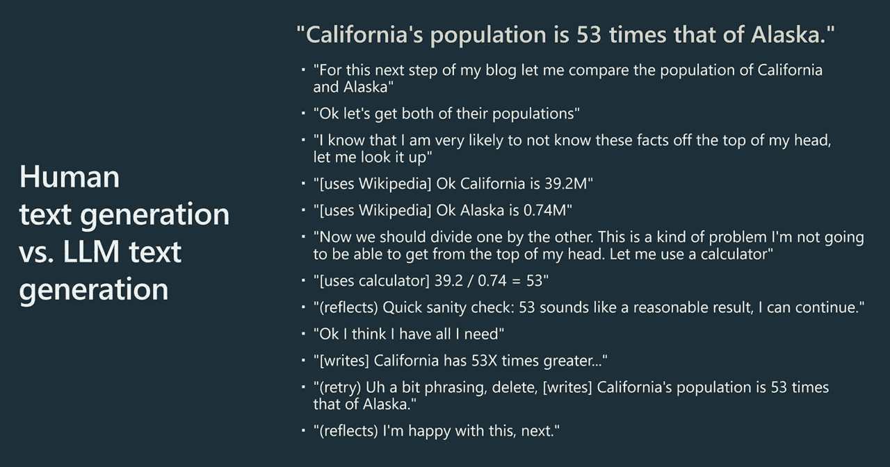

想想你脑海中丰富的内心对话和工具使用，以及你的大脑在生成这最后一句话时实际上进行了多少计算工作。下面是你的大脑可能会是什么样（方式运行）：

+   好的，下一步，让我写博客。让我比较这两个人口。

+   好的，首先，显然，我需要得到这两个人口数据。

+   现在，我知道我可能不会一下子就知道这些人口数据，所以我清楚自己知道或不知道的知识，对吧？

+   我使用一些工具，去维基百科查看加利福尼亚的人口和阿拉斯加的人口。

+   现在我知道我应该把这两个数相除，但是我又知道，想在大脑中把 39.2 除以 0.74 是不太可能计算出来的。这不是我能在头脑中完成的事情。

+   所以，我打算依赖计算器。我会使用计算器，输入这两个数，看到结果大约是 53。

+   然后我可能在我的大脑中做一些反思和合理性检查，看看 53 这个数字是否有意义。

+   哎呀，这是一个很大的倍数，但是加利福尼亚州是人口最多的州，所以可能看起来还可以。

+   然后我有了所有我可能需要的信息，现在我可以开始进行创造性部分，就是写作了。

+   我可能开始写一些像“加利福尼亚的人口是阿拉斯加的 53 倍”这样的句子。

+   然后我想到，这实际上是非常尴尬的表述。让我删掉那个，再试一次。

+   所以，当我在写作时，我有一个单独的过程，几乎是在检查我正在写的内容，评估它是否看起来不错。然后可能我会删除，可能我会重新构造句子，然后可能我会对产生的结果感到满意。

基本上，长话短说，当你创建这样的句子时，你的内心独白在幕后进行了大量的工作。但是，当我们在训练 GPT 时，这样的句子看起来是什么样子呢？

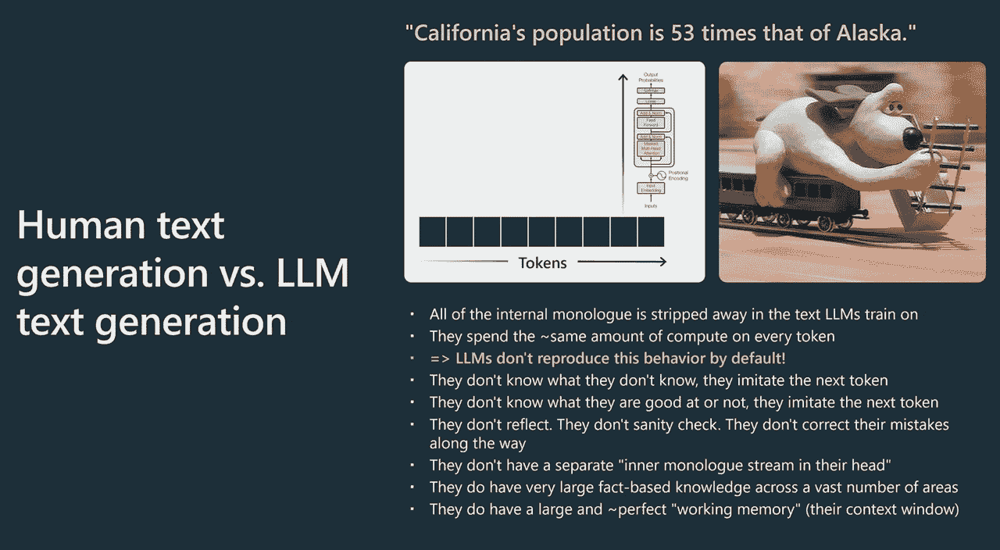

从 GPT 的角度看，这只是一个 token 序列。GPT 在读取或生成这些 token 时，它只是一个个地处理，每个块大约需要相同数量的计算工作。而这些 transformer 并不是非常浅的网络。它们大约有 80 层的推理能力，但 80 层还不算太多。所以，这个 transformer 会尽其所能进行模仿，但显然，这里的过程和你所经历的过程看起来非常、非常不同。

特别是，在我们最后的成果中，在我们创建的数据集中，然后最终输入到 LLMs 中，所有的内部对话都被完全剥离。不像你，GPT 会查看每一个 token，并且在每一个上面花费相同的计算量。所以，你不能期望它实际上——好吧，你不能期望它在每一个 token 上做太多的工作。

而且，特别地，基本上这些 transformers 就像 token 模拟器。它们不知道自己不知道什么。它们只是模仿下一个 token。它们不知道自己在哪方面做得好或做得不好。它们只是尽力模仿下一个 token。它们不在循环中进行反思。它们不进行任何合理性检查。默认情况下，它们不在过程中纠正自己的错误。它们只是采样 token 序列。它们的大脑中没有单独的内心独白流，对吧？它们在评估正在发生的事情。

不过，我要说它们确实有一些认知优势，那就是它们实际上有一个非常大的事实基础知识，涵盖了大量的领域，因为它们有数百亿的参数。这是存储大量事实的巨大存储空间，而且我认为它们也有一个相对较大且完美的工作记忆。无论适应上下文窗口的内容都可以通过它的内部自注意力机制立即提供给 transformer。所以，它有点像完美的记忆，但它的大小是有限的。但是 transformer 可以直接访问它。所以，它可以无损地记住在其上下文窗口内的任何内容。

这就是我比较两者的方式。我提出所有这些的原因是因为我认为在很大程度上，提示只是为了弥补这两种架构（我们的大脑和大语言模型的大脑）之间的认知差异。你几乎可以从这个角度来看它。

例如，人们发现有一件事，在实践中效果相当好。特别是如果你的任务需要推理，你不能期望 Transformer 在每个 token 上做太多的推理。因此，你必须真正地将推理扩展到更多更多的 token。例如，你不能给 Transformer 一个非常复杂的问题，然后期望它在一个 token 中就得到答案。对它来说，时间根本不够。这些 Transformer 需要 token 来“思考”，我有时候喜欢这么说。

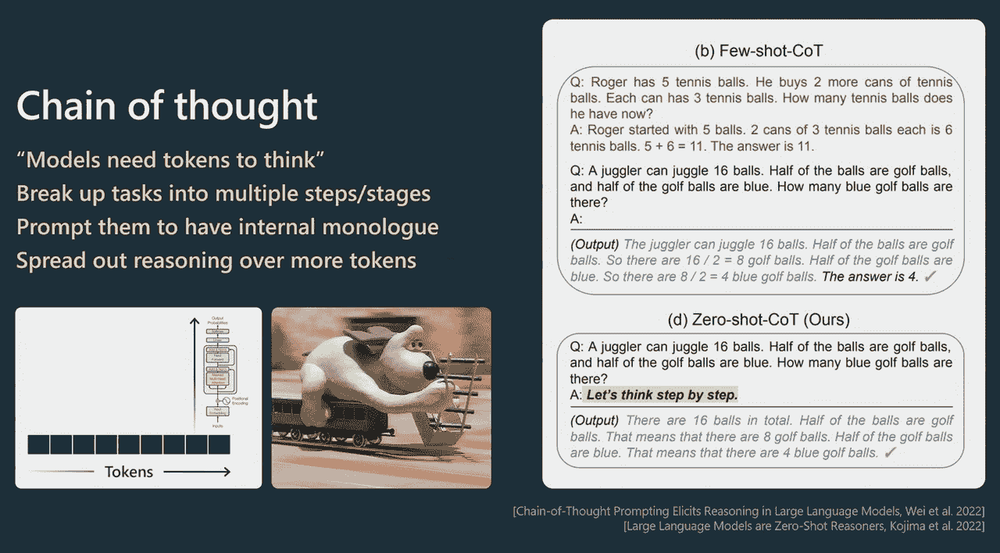

因此，这是一些行之有效的方法。例如，你可能会有一些少样本提示（few-shot prompt），告诉 Transformer 在回答问题时应该展示它的工作过程。如果你给出一些例子，Transformer 就会模仿那个模板，最终在评估方面会表现得更好。

此外，你可以通过说“让我们一步步地思考”（let's think step by step）来从 Transformer 中引出这种行为，因为这会使 Transformer 进入展示工作的状态。由于它进入了展示工作的模式，它在每个 token 上的计算工作会减少。因此，结果更可能成功，因为它在慢慢推理。

这是另一个例子，这个叫做自我一致性。

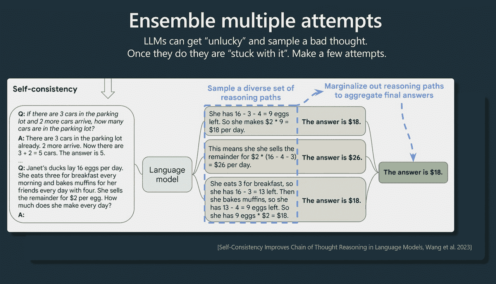

我们发现我们有开始写作的能力，然后如果没有成功，我可以再试一次，我可以尝试多次，然后可能选择最好的一个。在这些方法中，你可能不仅仅只进行一次采样，而可能进行多次采样，然后有一些方法来找出哪些是好的，然后只保留那些样本，或者进行多数投票，或者类似的事情。基本上，这些 Transformer 在预测下一个 token 的过程中，就像你一样，他们可能会倒霉。他们可能会采样到一个不太好的 token，他们可能会走入一种死胡同式的推理中。

因此，与你不同，他们不能从中恢复过来。他们被他们采样的每一个 token 困住了。因此，即使他们知道这个序列不会成功，他们也会继续这个序列。让他们有能力回顾，检查或者试图找到，基本上试图在周围进行采样，这也是一种技术。

事实证明，实际上，LLM 知道它们何时搞砸了。

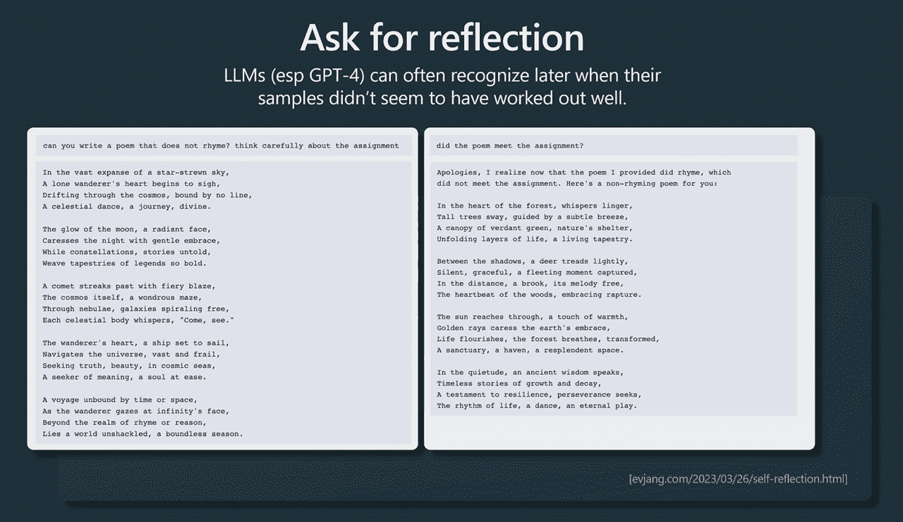

例如，假设你让模型生成一个不押韵的诗，它可能会给你一个诗，但实际上它押韵了。但事实证明，特别是对于更大的模型，比如 GPT-4，你可以直接问它，你是否完成了任务？实际上，GPT-4 非常清楚它没有完成任务。它在采样中只是有点不走运。因此，它会告诉你，不，我实际上没有完成任务。让我再试一次。

但是如果没有你的提示，它甚至不知道。它不知道要重新考虑，等等。你必须在你的提示中弥补这一点。你必须让它去检查。如果你不要求它检查，它不会自己去检查。它只是一个 Token 模拟器。

我认为更一般来说，很多这些技术都属于我所说的重建我们的系统 2 的范畴。你可能熟悉人类的系统 1、系统 2 的思考方式（参看丹尼尔·卡尼曼的《思考，快与慢》）。系统 1 是一个快速的、自动的过程，我认为这种过程与 LLM 采样 Token 相对应。而系统 2 是你大脑中更慢、更深思熟虑的规划部分。

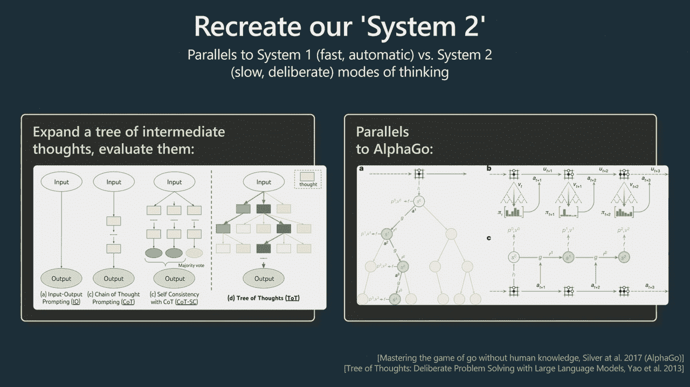

实际上，这是一篇上周的论文，因为这[个领域的进展非常快。它被称为“](https://github.com/kyegomez/tree-of-thoughts)思维树”（Tree of Thought），在“思维树”中，这篇论文的作者提出了为任何给定的提示维护多个完成情况，然后也会在整个过程中对它们进行评分，保留那些进行得比较顺利的，如果这有意义的话。因此，很多人都在尝试利用提示工程，基本上是希望让 LLM 恢复一些我们大脑中具有的能力。

现在，我想在这里指出的一点是，这不仅仅是一个提示。这实际上是一些提示，它们与一些 Python 胶水代码一起使用，因为你实际上必须维护多个提示，并且你还必须做一些树搜索算法，来找出需要扩展哪些提示，等等。这是 Python 胶水代码和单个提示的一种共生关系，它们在一个 while 循环中或在一个更大的算法中被调用。

我也认为这里有一个非常酷的类比，那就是 AlphaGo。AlphaGo 在下围棋时有一个放置下一个棋子的策略，这个策略最初是通过模仿人类来训练的。但除了这个策略，它也会进行蒙特卡洛树搜索。基本上，它会在脑中演绎出一些可能性，并对它们进行评估，只保留那些效果很好的可能性。因此，我认为这就像是文本版的 AlphaGo，如果这个比喻有意义的话。

就像“思维树”一样，我认为更一般来说，人们开始真正探索不仅仅是简单的问题或答案提示，而是更像 Python 胶水代码，串联多个提示的更通用的技术。

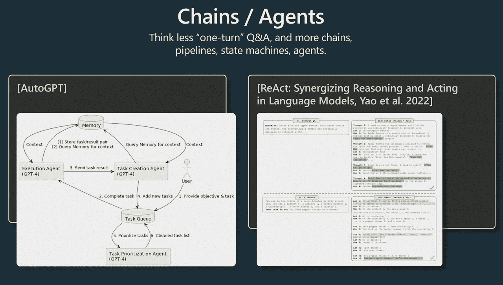

在右边，我有一个来自这篇名为 ReAct 的论文的例子，其中他们将提示的答案结构化为一系列的思考、行动、观察、思考、行动、观察。这是一个全面的推演，一种回答查询的思考过程。在这些动作中，模型也被允许使用工具。

在左边，是 Auto-GPT 的例子。顺便说一下，Auto-GPT 项目最近被炒得沸沸扬扬，但我仍然觉得它非常有启发性。这是一个允许 LLM 保持任务列表并继续递归分解任务的项目。我不认为这目前工作得很好，我也不建议人们在实际应用中使用它。我只是认为这是一种可以从中汲取灵感的东西，我认为随着时间的推移，这种启发会逐渐显现出来。

这就像给我们的模型一种系统 2（慢思考）的思考方式。

我发现的下一个有趣的事情是，我会说，这是 LLMs 的一个心理怪癖，那就是 LLMs 不想成功。（笑声）它们只想要模仿。你想要成功，你应该要求它。（笑声）

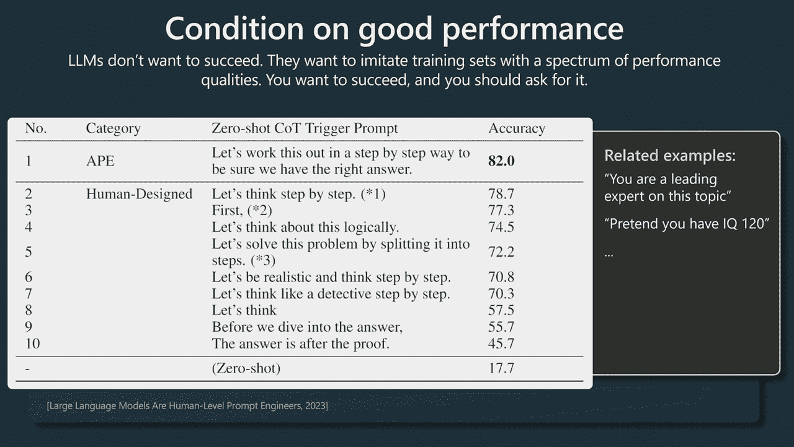

我的意思是，当 transformer 被训练时，它们有训练集。他们的训练数据中可以有一整个性能质量范围。

例如，可能有某种物理问题的提示或者类似的东西，可能有一个完全错误的学生解答，但也可能有一个极其正确的专家答案。Transformer 不能区分低质量和高质量的解决方案，我的意思是，它们知道两种解决方案，但默认情况下，它们想要模仿所有的解决方案，因为它们只是基于语言模型训练的。因此，在测试时，你实际上必须要求好的表现。

在上面论文的这个例子中，他们尝试了各种提示，「let's think step by step」非常强大，因为它在许多 Token 上展开了推理。但是，更好的提示方法是：「让我们一步一步地解决这个问题，确定我们有正确的答案」。因此，这有点像是对获得正确答案的条件。这实际上使得 transformer 工作得更好，因为 transformer 现在不必在低质量的解决方案上分散其概率质量，尽管这听起来很荒谬。

因此，基本上，可以放心地要求一个强有力的解决方案。说些像「你是这个主题的权威专家」，「假设你的智商超过了 120」等等。但是不要试图要求太多的智商，因为如果你要求智商超过了，你可能会超出数据分布，或者更糟糕的是，你可能在一些科幻内容的数据分布中，它会开始进行一些科幻角色扮演或者类似的东西。（笑声）你必须找到合适的智商，我认为，这里有一个 U 形曲线。

### 工具与插件

接下来，正如我们所看到的，当我们试图解决问题时，我们知道我们擅长什么，不擅长什么，我们会依赖于工具进行计算。你可能也想同样处理你的 LLM。特别是，我们可能想要给它们提供计算器、代码解释器等，以及进行搜索的能力，有很多技术可以做到这一点。

再次要记住的一点是，这些 transformer 在默认情况下可能不知道它们不知道的东西。你甚至可能想在提示中告诉 transformer，「你在心算方面并不是很好，每当你需要进行大数的加法、乘法或其他操作时，请使用计算器。以下如何使用计算器的，使用这个 token 组合，等等等等。」你必须真正地写出来，因为模型默认情况下并不知道它擅长什么或不擅长什么，就像你和我一样。

接下来，我认为非常有趣的一点是，我们从一个只能检索的世界转变到了完全依赖 LLM 记忆的世界。但实际上，这两个钟摆之间还有整个检索增强模型的空间，它在实践中表现得非常好。

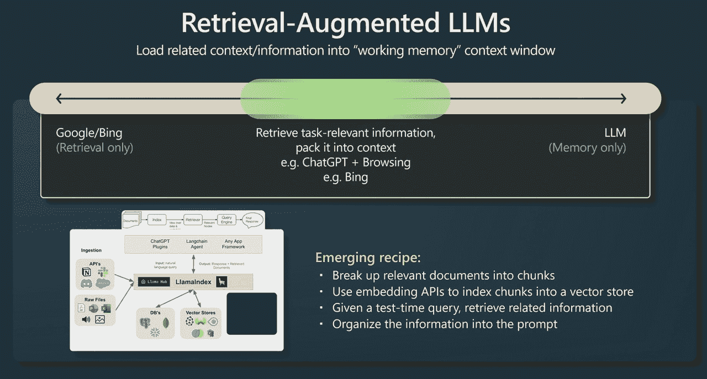

正如我所提到的，Transformer 的上下文窗口是其工作记忆。如果你能将与任务相关的任何信息加载到工作记忆中，模型就会表现得非常好，因为它可以立即访问所有的记忆。所以，我认为很多人对基本的检索增强生成非常感兴趣。在底部，我有一个 LLaMA 索引的例子，它具有一个数据连接器，可以连接到各种类型的数据。你可以索引所有这些数据，并使得 LLM 可访问它。

这里的新兴配方是你取相关的文档，将它们分成块，将它们全部嵌入，并基本上得到表示这些数据的嵌入向量。你将其存储在向量存储中，然后在测试时，你对你的向量存储进行一些查询。你获取可能与你的任务相关的块，并将它们填充到提示中，然后生成。这在实践中可以工作得相当好。

这与我们解决问题的方式相似。你可以完全依赖你的记忆，而 Transformer 的记忆非常强大且广泛，但是参考一些主要的文档也很有帮助。每当你发现自己需要回头查阅教科书或者查阅某个库的文档时，Transformer 也需要做同样的事。你对库的文档有一些记忆，但是查阅它会更好。这里也是如此。

### 约束性提示

接下来，我想简单谈谈约束性提示。我也觉得这个非常有趣。这主要是强[制让 LLM 的输出符合某种模](https://github.com/microsoft/guidance)板的技术。微软的 Guidance 项目 （https://github.com/microsoft/guidance）就是一个例子。在这里，我们强制 LLM 的输出为 JSON。这将确保输出将采取这种形式，因为他们会去干预从 Transformer 出来的所有不同 token 的概率，并限制这些 token。然后，Transformer 只在这里填充空白。然后你可以对这些空白部分强制执行其他限制。

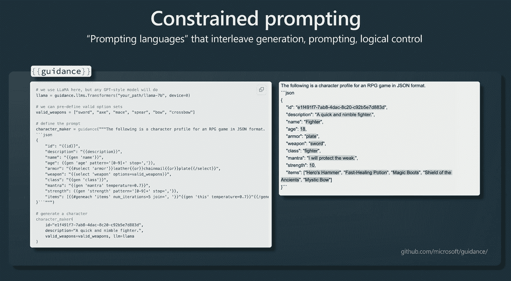

我觉得这可能非常有帮助，我认为这种约束性的抽样也非常有趣。

### 微调

我还想说几句关于微调的话题。你可以通过提示工程取得很大进展，但也可以考虑微调你的模型。

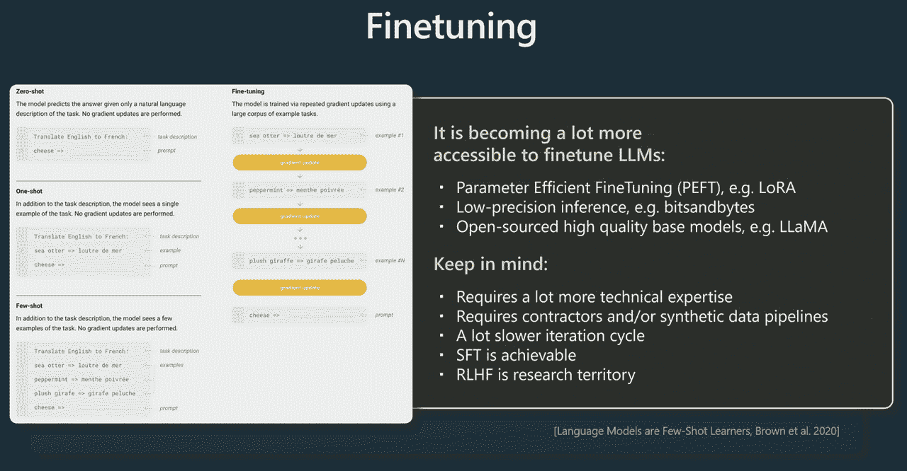

现在，微调模型意味着你实际上要改变模型的权重。在实践中做到这一点变得越来越容易，这是因为最近开发了许多技术，并为这些技术建立了代码库。

例如，像 LoRA 这样的参数高效微调技术确保你只训练模型的小部分稀疏片段。模型的大部分被保持在基础模型的状态，只有一部分被允许改变。实际上，这仍然效果相当好，使得只调整模型的小部分变得成本更低。此外，由于你的模型大部分是固定的，你可以用非常低的精度来计算那些部分，因为它们不会被梯度下降法更新。这也使得整个过程更为高效。

此外，我们有许多开源的高质量基础模型，就像我刚才提到的。我认为 LLaMA 很好，虽然我认为现在它还没有获得商业许可。

需要记住的一点是，基本上，微调技术上更为复杂。它需要更多的技术专业知识才能做对。它需要人工数据合同承包商的数据集（和/或）可能相当复杂的合成数据流程。这肯定会大大减慢你的迭代周期。

我想从高层次上说，SFT（有监督的微调）是可行的，因为你正在继续语言模型任务，这相对简单明了。但是，我会说 RLHF（基于人类反馈的强化学习）是非常研究性的领域，甚至更难使之有效工作。因此，我可能不建议有人试图自己制作 RLHF 实现。这些东西非常不稳定，非常难以训练，目前我认为不是很适合初学者。并且，它也可能仍然在快速变化。

### 默认建议

我认为这些是我目前的默认建议。我会将你的任务分成两个主要部分。第一，实现你的最佳性能，第二，优化你的费用，让其降低，按照这个顺序。

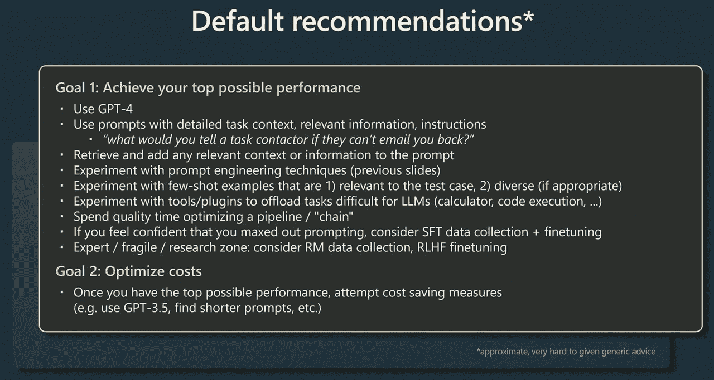

+   第一，最好的性能目前来自 GPT-4 模型，这是迄今为止最强大的模型。

+   使用非常详细的提示词，包含任务上下文、相关信息和指令。沿着这样的思路思考：如果他们不能给你回邮件，你会告诉他什么？但是也要记住，任务承包商是人，他们有内心想法、他们非常聪明，等等。LLMs 并不具有这些品质，所以确保几乎考虑到 LLMs 的心理，并针对此设计提示。

+   多多参考大量的提示工程技术，在这些提示中检索并添加任何相关的上下文和信息。其中一些在上面的幻灯片中有所强调，但这也是一个非常大的领域，我只是建议你在线寻找提示工程技术，那里有很多内容。

+   尝试使用少样本提示（few-shots）。这指的是你不只是想问，你还想尽可能地展示（你想要的），给它举例子，如果可以的话，帮助它真正理解你的意思。

+   尝试使用工具和插件来分担 LLM 本身难以完成的任务。

+   不仅要考虑单个提示和答案，还要考虑潜在的链条（chain）和反思，以及如何将它们粘合在一起，以及如何制作多样本等。

+   最后，如果你认为你已经最大地优化了提示工程的效果，我认为你应该坚持一段时间，看看一些可能微调模型以适应你的应用程序，但预计这会更慢并且涉及更多内容。

+   然后这里有一个专家级别的研究区域，那就是 RLHF，如果你能使它工作的话，目前确实比 SFT 工作得更好一些。但是再次提醒，我会说这非常复杂。为了优化你的成本，尝试探索容量较低的模型或更短的提示等。

### 适合的用例

我还想说几句我认为 LLMs 目前适合的用例。特别注意，今天的 LLM 有很多限制，我会在所有应用中牢记这一点。顺便说一下，这可能是一个完整的演讲，所以我没有时间详细介绍。

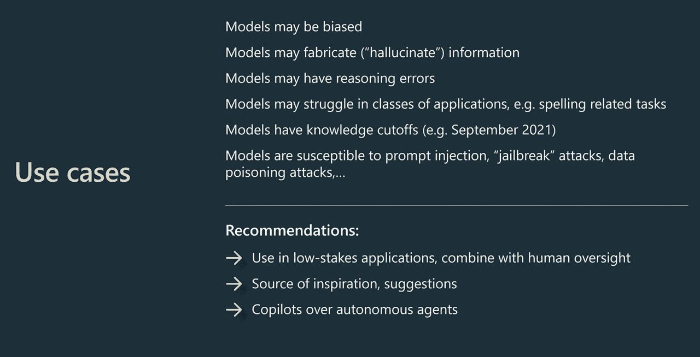

模型可能存在偏见。他们可能会编造，产生幻觉信息，他们可能存在推理错误，他们可能在整个应用类别中都感到困扰。他们有知识的截止日期，所以他们可能不知道关于，比如 2021 年 9 月之后的任何信息。他们容易受到大范围的攻击，这些攻击每天都在 Twitter 上发布，包括提示注入、越狱攻击、数据投毒攻击等。

我现在的建议是在风险较低的应用中使用 LLMs，总是将它们与人类的监督结合使用，将它们作为灵感和建议的来源，考虑副驾驶这样的使用模式，而不是完全自主的在某处执行任务的代理。现在尚不清楚模型是否已经准备好。

## 结语

最后我想说，GPT-4 是一个了不起的成果。我非常感谢它的存在，它很美。

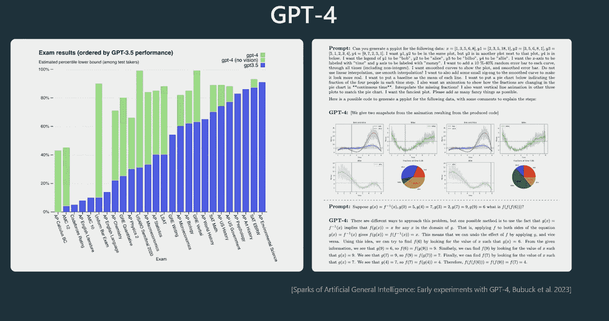

它在许多领域都有大量的知识，可以进行数学计算、编写代码等等。此外，还有这个正在蓬勃发展的生态系统，所有其他的东西都被建造并融入到这个生态系统中，其中一些我已经谈到了。所有这些功能都触手可及，因此这里有向 GPT-4 提出问题、给它提供提示并获得回应所需的一切代码。

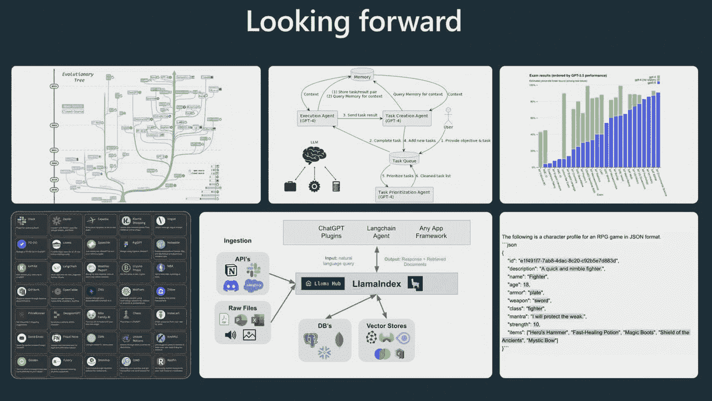

我对 GPT-4 说，“你能说些什么来激励 Microsoft Build 2023 的观众吗？”

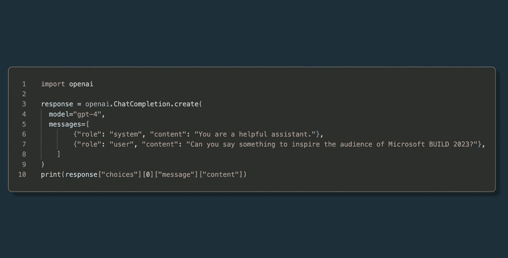

我只是把这个输入到 Python 中，GPT-4 逐字逐句地说了以下这些。

顺便说一下，我并不知道它们在主题演讨中使用了这个技巧，所以我以为我很聪明 （笑声）。但它真的很擅长这个。

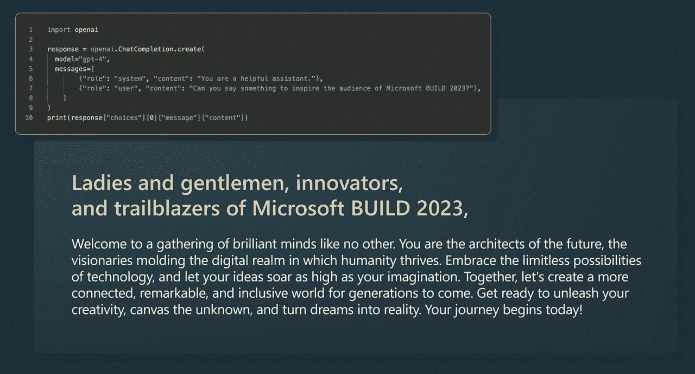

它说：「女士们、先生们，2023 年 微软 Build 大会的创新者和开拓者们，欢迎来到这个集聚了无数杰出思想的大会。你们是未来的建筑师，是塑造人类繁荣所依赖的数字领域的远见者。拥抱技术的无限可能性，让你们的想法飞得和你们的想象力一样高。让我们一起创造一个更加紧密、卓越和包容的世界，供后代继承。准备好释放你们的创造力，探索未知，将梦想变为现实。你们的旅程今天开始。」

谢谢！（掌声）