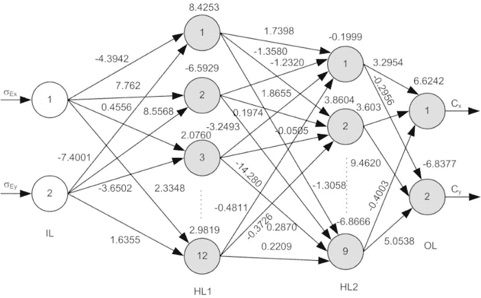
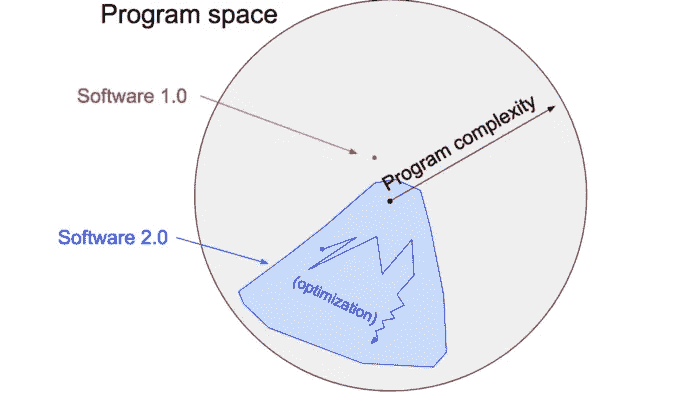

# 软件 2.0（Software 2.0）

> 来源：[https://waytoagi.feishu.cn/docx/IetRd0LFsocN8IxfEptcT7qMnGg](https://waytoagi.feishu.cn/docx/IetRd0LFsocN8IxfEptcT7qMnGg)

> 源地址：https://karpathy.medium.com/software-2-0-a64152b37c35

> 作者：[Andrej Karpathy](https://karpathy.medium.com/?source=post_page-----a64152b37c35--------------------------------) （OpenAI 创始团队成员，原特斯拉 AI 部门负责人）

> 发布时间：2017 年 11 月 12 日

> 翻译：在[ OneFlow 社区](https://www.oneflow.org/index.html)翻译基础上略作修改

我发现，有时候人们会把神经网络当作“不过是机器学习工具箱中的工具之一而已”。它有优点也有缺点，在某些领域有用，并且可以帮助你打赢 Kaggle 比赛。很不幸，这种观点完全是只见树木、不见森林。神经网络可不只是又一种分类器而已，它代表着一种根本性转变的开始，这种转变与我们如何开发软件有关。它就是软件 2.0。

我们对**软件 1.0 **已经比较熟悉——它们由计算机语言（如 Python、C++ 等）所开发。 它由程序员写的给计算机的明确指令组成。通过编写每一行代码，程序员确定了程序空间中具有一些理想行为的特定点。

与之对比的，**软件 2.0 **由更抽象、人类更难理解的语言（比如说，神经网络中的权重）开发。没人可以直接参与这种代码的编写，因为它涉及到大量的权重（往往上百万数量级），并且（我试过）直接编写权重某种意义上是很困难的。

取而代之，我们为程序的行为指定目标（比如，“符合数据集中样本的输入输出对”，又或者“赢得围棋比赛”），并写好程序的骨架（比如神经网络的结构），这样就在整个程序空间中确定了一个可以用于搜索的子集，然后就可以使用我们所有的计算资源在这个空间中搜索可用的程序。

对于神经网络而言，我们将搜索限制在程序空间的一个连续的子集上，并且，使用反向传播和随机梯度下降方法进行搜索，（出人意料地）这种搜索方式挺有效。

更具体地对比，软件 1.0 是将人工设计的源码（比如 cpp 文件）编译为可以有效工作的二进制文件。而软件 2.0 的源码通常由两部分组成：1）定义了目标行为的数据集；2）给定代码大致结构，但是需要填充细节的神经网络结构。训练神经网络的过程，就是将数据集编译成二进制文件的过程——得到最终的神经网络。时至今日，大多数实际应用中，神经网络的结构及训练系统已经日益标准化为一种商品，所以，大部分活跃的“软件开发”工作某种形式上变成了组织、增加、调整和清理带标签的数据集。这从根本上改变了我们迭代软件的编程范式，将开发团队分成了两拨：软件 2.0 的程序员（数据标记员）负责编辑和扩大数据集，而另一小撮人，维护着与训练有关的基础设施以及分析、可视化和标注等接口。

事实证明，对于真实世界中的很多问题，采集数据（更泛化地说，确定期待的行为）比显式地写程序要容易得多。 由于以上以及以下我将要介绍的软件 2.0 的诸多好处，我们正在见证工业界大量代码从软件 1.0 迁移至软件 2.0 的重大转变。软件 1.0 吞噬着整个世界，软件 2.0（AI）在吞噬软件 1.0。

## 转变进行时

让我们来看看这场转变中的具体领域的例子。我们会发现，在过去几年，对于这些领域，我们放弃了尝试通过显式写代码的方式去解决复杂问题，取而代之的，是转向了软件 2.0。

+   **图像识别**：图像识别之前常常是由特征工程组成的，只是在最后加入一点点机器学习（比如：SVM）。 之后，通过使用更大的数据集（比如 ImageNet）和在卷积神经网络结构[空间中进行](https://arxiv.org/abs/1703.01041)[搜索](https://arxiv.org/abs/1703.01041)，我们发现了更强大的视觉特征。最近，我们甚至不再相信自己手写的网络结构，而开始用类似的方法搜索（最优网络结构）。

+   **语音识别**：以前的语音识别工作，涉及到大量的预处理工作、高斯混合模型和隐式马尔科夫模型，但是现在，几乎只需要神经网络。还有一句与之非常相关的搞笑名言，是 1985 年 Fred Jelinek 所说：“每当我开除一个语言学家，我的语音识别系统的性能就会提高一点”。

+   **语音合成**：历史上，语音合成一直采用各[种拼接技术，但](https://deepmind.com/blog/wavenet-launches-google-assistant/)是现在，SOTA（State Of The Art） 类型的大型卷积网络（比如 WaveNet）可以直接产生原始音频信号输出。

+   **机器翻译**：机器翻[译的实](https://arxiv.org/abs/1611.04558)[现之](https://arxiv.org/abs/1611.04558)前常常采用基于短语的统计方法，但是神经网[络正迅速占领](https://arxiv.org/abs/1710.11041)了统治地位。我最喜欢的网络结构就与多语言训练有关：一个模型就可以把任意源语言翻译成任意目标语言，并且只需要很弱的监督（甚至是完全的无监督）。

+   **游戏**[：很长一段时间里，人们通](https://deepmind.com/blog/alphago-zero-learning-scratch/)过手写围棋程序来进行游戏对战，但如今，AlphaGo Zero（一种观察棋盘原始状态并对战的卷积网络）成为了围棋领域最强玩家。我预测在其它领域，如 DOTA 2、星际争霸，也会有类似的结果。

+   **数据库**：更多的本处于 AI[ 领域之外的传统](https://arxiv.org/abs/1712.01208)系统，也显露出向软件 2.0 转变的早期迹象。比如，“索引结构学习案例”里，使用神经网络替代了原有的数据管理核心组件，其速度最高比做了缓存优化的 B 树快 70%，同时还省了一个数量级的内存。

你[可能注意到了上](https://arxiv.org/abs/1706.05137)面很多链接的工作是 Google 做的。这是因为目前 Google 就是将大量自己的代码转变为软件 2.0 的排头兵。“一个万能的模型”所描绘的草图是：将原本散落在各个领域的基于统计的效果，融合成一个整体来理解世界。

## 软件 2.0 的好处

为什么我们更倾向于把复杂程序移植到软件 2.0？显然，一个简单的答案是实践证明它的效果更好。然而，还有很多其它的理由值得我们选择软件 2.0。让我们看看软件 2.0（卷积神经网络为代表）与软件 1.0（生产级别的 C++代码库为代表）相比的好处，对于软件 2.0：

+   **同质化计算**：一个典型的神经网络仅由两种操作组合而成：矩阵乘法和线性整流函数（ReLu）。传统软件里的指令与之相比，明显会更加复杂和异构。由于只要用软件 1.0 的方法实现非常少部分的核心代码（比如矩阵乘法），正确性/性能验证都会容易很多。

+   **对芯片更友好**： 因为神经网络所需要的指令集相对更小，作为推论，在芯片[上实现它们将会](https://www.forbes.com/sites/moorinsights/2017/08/04/will-asic-chips-become-the-next-big-thing-in-ai/#7d6d7c0511d9)更容易，比如，使用自定义 ASIC 芯片 、neuromorphic chips 等等。当低能耗的智能设备充斥在我们周围时，这个世界也将为此改变。比如，把预训练卷积网络、语音识别、WaveNet 语音合成网络装载到便宜又小巧的设备中，这样你可以用它连接其它东西。

+   **常量级的运行时间**：一个典型的神经网络的每次前向迭代，需要的计算量（FLOPs）是高度一致的。在你手写的复杂 C++ 代码中会出现的各种执行分支，在软件 2.0 中是不存在的。当然，你也许会有动态图的需求，但是执行流通常也是被严格限制了。即使在这种情况下，我们几乎也能保证，不会陷入未预料的无限循环之中。

+   **常量级的内存消耗**：和上面一点相关，因为没有动态分配内存的需要，所以几乎没有可能需要与硬盘进行 swap，代码中也没内存泄漏的可能。

+   **高度可移植**：同传统的二进制文件或脚本相比，一连串的矩阵乘法操作要更容易运行在各种计算机环境下。

+   **敏捷开发**：如果你在写 C++，并且有人希望你开发速度提高 2 倍（可以牺牲性能的前提下），那么为适配新要求而调整系统可不是一件小事。然而，在软件 2.0 中，我们只需要移除掉（计算图中）一半的路径，然后重新训练，就能得到精确度差一点点，但训练快两倍的结果。这很神奇。反过来说，只要你得到了更多的数据和算力，你可以马上通过扩大计算图和重训练的方法，得到更好的实际效果。

+   **融合模块以求最优**：普通软件通常被分解成多个模块，各个模块中间通过共有函数、API 或者端到端的方式通信。然而，对于软件 2.0，如果一开始 2 个相交互的模块是独立训练的，我们之后也很容易在整个系统中进行反向传播。想想看，如果你的浏览器可以自动设计底层指令，从而提高加载页面的速度；或者说你导入的计算机视觉库（比如 OpenCV）可以根据你的特定数据，自动调整行为；这将多么美妙。在软件 2.0 中，这些都是基本操作。

+   **比你更优秀**：最后，也是最重要的一点，在很多垂直领域中，神经网络产生的代码要比你或者我写的代码好。就目前而言，起码在图像、视频、语音这些领域中是这样的。

## 软件 2.0 的缺点

软件 2.0 也有一些缺点。当优化完成后，我们可以得到实践中很有效的巨大网络，但是很难解释它为什么有效。在许多领域，我们可以选择比较好理解但是只有 90%精度的模型；或者选择不理解，但是有 99%精度的模型。

软件 2.0 会出现[不直观的、尴尬的](https://motherboard.vice.com/en_us/article/nz7798/weve-already-taught-artificial-intelligence-to-be-racist-sexist)错误，甚至更糟糕的，还可能“默默出错”。比如，如果在训练时默默地采纳了具有偏差的数据，当数据数量大到百万级别时，再想分析和检查原因，就变得非常困难了。

[最后，软](https://blog.openai.com/adversarial-example-research/)件[ 2.0](https://github.com/yenchenlin/awesome-adversarial-machine-learning) 的奇怪特性也在不断出现。比如，对抗样本和攻击样本的存在，使得软件 2.0 的不可解释性问题变得更加突出。

## 软件 2.0 编程

软件 1.0 的代码，是我们手写的代码。软件 2.0 的代码，是基于评估准则（比如“把训练数据正确分类”）优化得来的。对于那些原理不明显，但是可以反复评估表现的程序，都适用于这种转变，因为与人写的代码相比，优化方法找到的代码要好得多。

我们观察趋势的视角很重要。当你意识到神经网络不仅仅是机器学习工具集中一种好用的分类器，而把软件 2.0 当作崭露头角的全新编程范式时，那么推断就会变得更为明显，而且很明显还有更多的工作要做。

具体而言，我们已经发明了大量辅助程序员做软件 1.0 开发的工具，比如强大的 IDE，它可以具备很多功能，像语法高亮、调试器、分析器、符号跳转、集成 git 等等。软件 2.0 中，编程是通过累积，整理和清洗数据集来完成的。比如，当某些极端情况下，神经网络失效了，我们并不会去通过写代码来修复问题，而是导入更多这种情况下的数据就可以了。

谁将开发第一款软件 2.0 的 IDE？它应该可以在数据集相关的所有工作流中都发挥作用，包括积累数据、可视化、清洗数据、标记数据、生产数据。也许这种 IDE，会根据每个样本的损失，把网络怀疑被错误标注的图像给拎出来，或者通过预测提示应该选用的标签的方式辅助标注数据，再或者依据网络预测的不确定性，推荐适合标注的样本。

类似的，Github 是软件 1.0 时代非常成功的网站。是否有可能出现软件 2.0 时代的 Github？软件 2.0 时代，仓库将是数据集，而 commit 是由增加和编辑数据标签组成的。

传统的包管理工具和部署手段，比如 pip、conda、docker 等帮助我们更轻松地部署和安装软件。在软件 2.0 时代，如何更有效地部署、分享、导入和运行软件呢？在神经网络中，与 conda 对等的东西又会是什么呢？

简而言之，在可以低成本反复评估、并且算法难以显式设计的领域，软件 2.0 都将日益流行起来。当我们考虑整个开发生态以及如何适配这种新的编程范式时，会发现很多令人兴奋的机会。长远来看，这种编程范式拥有光明的未来，因为越来越明显：当我们某天要开发通用人工智能（AGI）时，一定是使用软件 2.0。

## **索引链接**

[1] 搜索： https://arxiv.org/abs/1703.01041

[2] 网络结构： https://arxiv.org/abs/1703.01041

[3] 现在： https://github.com/syhw/wer_are_we

[4] WaveNet: https://deepmind.com/blog/wavenet-launches-google-assistant/

[5] 多语言： https://arxiv.org/abs/1611.04558

[6] 无监督学习： https://arxiv.org/abs/1710.11041

[7] AlphaGo Zero: https://deepmind.com/blog/alphago-zero-learning-scratch/

[8] DOTA 2: https://blog.openai.com/more-on-dota-2/

[9] 星际争霸： https://deepmind.com/blog/deepmind-and-blizzard-open-starcraft-ii-ai-research-environment/

[10] 索引结构学习案例： https://arxiv.org/abs/1712.01208

[11] ASIC 芯片： https://www.forbes.com/sites/moorinsights/2017/08/04/will-asic-chips-become-the-next-big-thing-in-ai/#7d6d7c0511d9

[12] neuromorphic chips: https://spectrum.ieee.org/semiconductors/design/neuromorphic-chips-are-destined-for-deep-learningor-obscurity

[13] 不直观的、尴尬的： https://motherboard.vice.com/en_us/article/nz7798/weve-already-taught-artificial-intelligence-to-be-racist-sexist

[14] 对抗样本： https://blog.openai.com/adversarial-example-research/

[15] 攻击样本： https://github.com/yenchenlin/awesome-adversarial-machine-learning