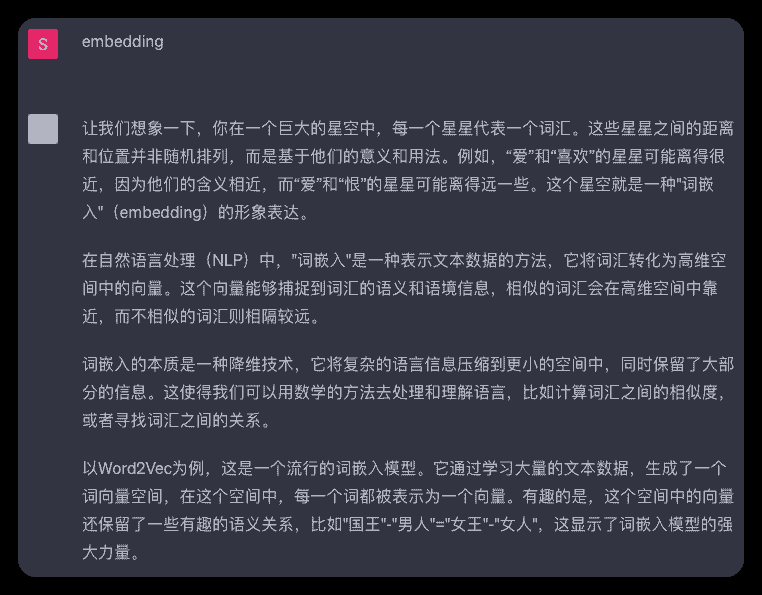

# 什么是Embedding

> 来源：[https://waytoagi.feishu.cn/docx/D11bdHtpToeyvsxB8Y3cSEAmnBh](https://waytoagi.feishu.cn/docx/D11bdHtpToeyvsxB8Y3cSEAmnBh)

感谢Arthur 提供建议

> Stephen的书, 他在里面强调Embedding本质上是在将文本转换为数值表示.在这个过程中, 用到了向量空间映射

答：在深度学习和自然语言处理（NLP）中，Embedding是一种特征工程方法，用于将高维度的数据（如单词，短语，句子等）转换为低维度的向量。Embedding的主要目的是将数据的抽象和复杂性降低，使得机器学习模型能够更有效地理解和处理数据。Embedding可以帮助模型理解语义关系，例如单词之间的相似性，句子的情感，等等。

下面是两个例子，可以帮助你更好地理解Embedding：

**例子1：电影推荐系统**

假设我们有一个电影推荐系统，用户可以给电影打分，我们的目标是预测用户未看过的电影的评分。在这个情况下，每个用户和每个电影都可以被视为一个独特的分类标签。直接处理这些标签将会非常困难，因为它们是高维度和稀疏的。

这时，我们可以使用Embedding。对于每个用户和每个电影，我们可以创建一个Embedding，这是一个低维度的向量，可以捕捉用户的兴趣和电影的特性。然后，我们可以通过比较用户和电影的Embedding来预测用户可能会给电影的评分。

**例子2：文本分类**

假设我们正在构建一个文本分类模型，比如垃圾邮件检测器。我们的输入是邮件文本，我们的目标是预测邮件是否是垃圾邮件。在这个情况下，我们可以使用词嵌入（word embedding）。

词嵌入是一种将单词转换为向量的技术。这个向量可以捕捉单词的语义：相似的单词有相似的向量。例如，"good"和"great"可能有相似的向量，因为它们具有相似的意思。

在我们的垃圾邮件检测器中，我们可以首先使用词嵌入将邮件中的每个单词转换为向量，然后基于这些向量来预测邮件是否是垃圾邮件。

这两个例子都显示了Embedding如何帮助我们处理高维度和复杂的数据，并使机器学习模型能够从中捕捉到有用的信息。

---

## GPT4 给出的答案：

让我们想象一下，你正在玩一个叫做"猜词"的游戏。你的目标是描述一个词，而你的朋友们要根据你的描述猜出这个词。你不能直接说出这个词，而是要用其他相关的词来描述它。例如，你可以用"热"、"喝"、"早餐"来描述"咖啡"。这种将一个词转化为其他相关词的过程，就很像计算机科学中的"embedding"。

在计算机科学中，"embedding"是一种将对象（如词语、用户或商品）映射到数值向量的技术。这些向量捕捉了对象之间的相似性和关系，就像你在"猜词"游戏中使用相关词描述一个词一样。

Embedding 的核心属性是把高维的，可能是非结构化的数据，转化为低维的，结构化的向量。这样做的目的是让机器可以理解和处理这些数据，从而进行有效的学习和预测。

以推荐系统为例，如果我们想要推荐相似的商品给用户，我们可以用 embedding 技术把每个商品转化为一个向量。在这个向量空间中，相似的商品会有相似的向量。当一个用户喜欢某个商品时，我们就可以找到向量空间中最接近这个商品的其他商品，推荐给用户。这就是 embedding 在现实生活中的一个应用。