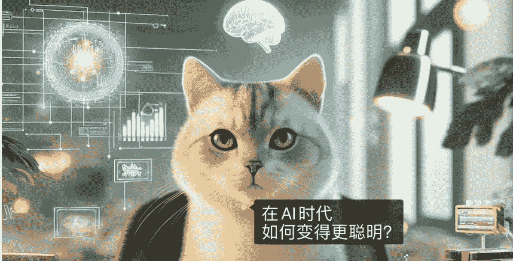
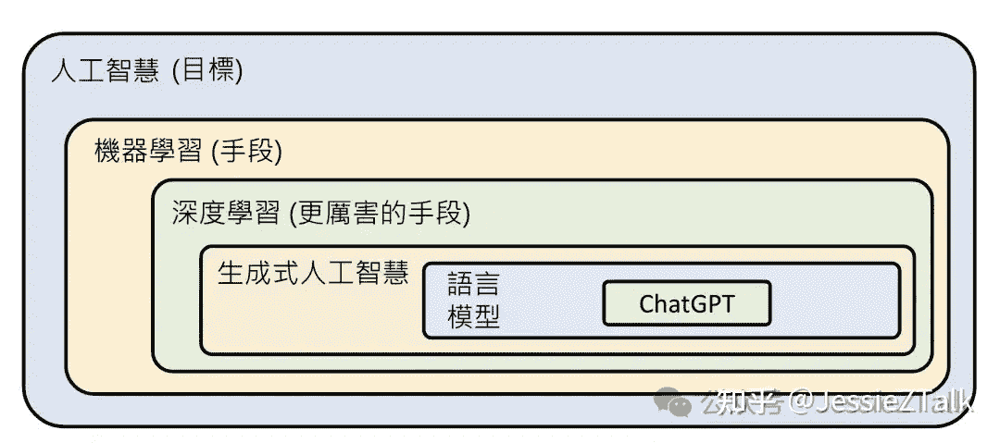
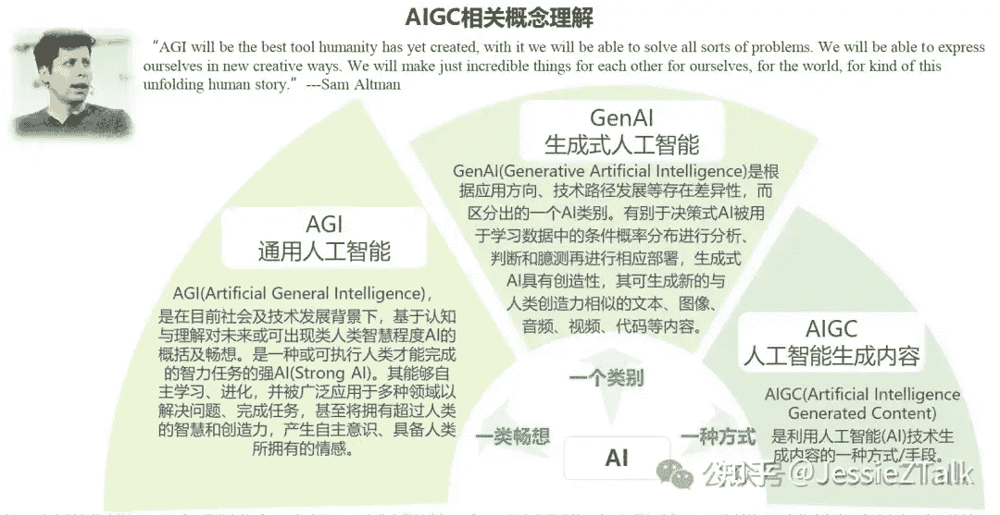
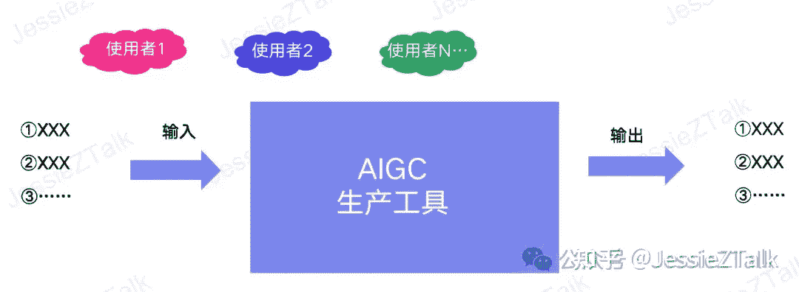
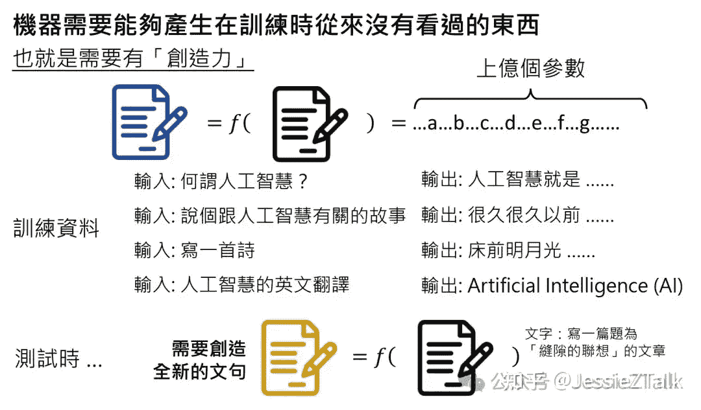
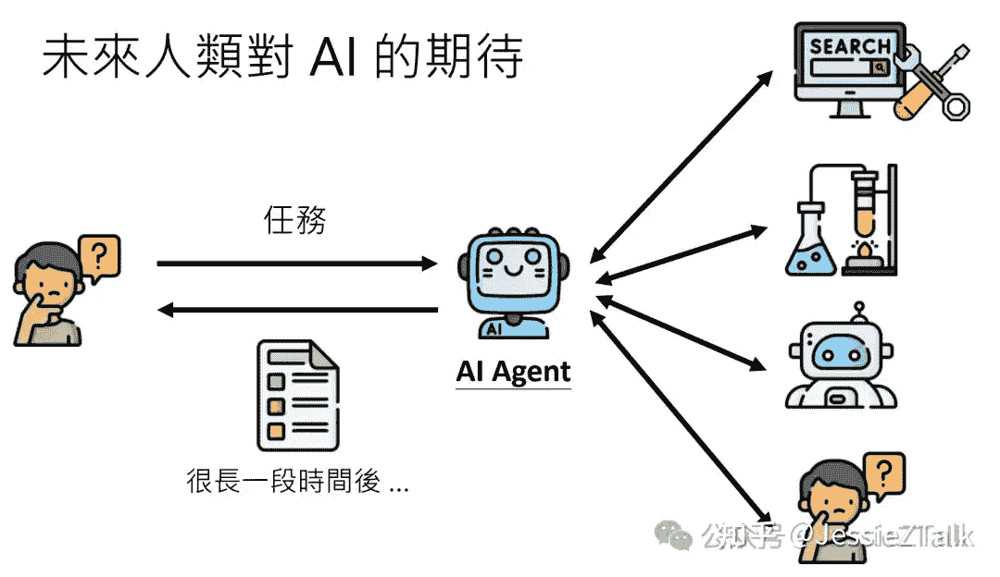
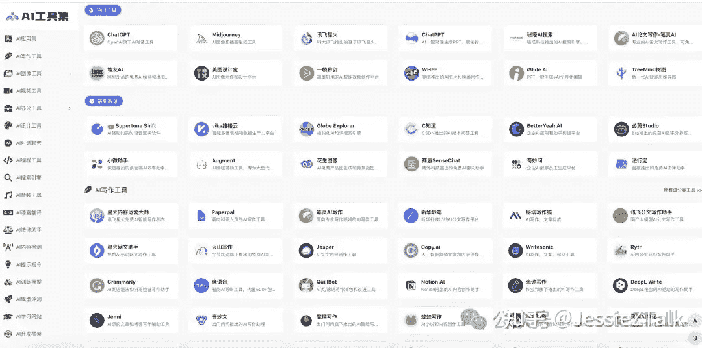

# 快速学习 AIGC，有料通俗易懂版！

> 来源：[https://waytoagi.feishu.cn/docx/N6p9dwHZaoBaWIxGpaXcA158ntd](https://waytoagi.feishu.cn/docx/N6p9dwHZaoBaWIxGpaXcA158ntd)

> 作者：JessieZTalk，大厂产品出身，理工科+商科背景，关注商业、AI 科技、互联网营销。

> 原文链接：快速学习 AIGC，有料通俗易懂版！

# 最近感悟

半个月没更新文章了，最近对 AIGC 做了一些更系统、更深入的学习和调研，以期给大家带来更有料的 AI 相关内容。

最近我参加了「3 场 AI 线下活动」，一场 AI 出海的、一场 AI 营销应用的、一场数字经济与 AI 沙龙。同时在 AI 社群中浪迹了一个多月。最近很兴奋、很热血，感觉回到了 2014 年。AIGC 在 2024 年的发展，犹如 2014 年移动互联网时代大量新兴 APP 的涌现。

**谈谈最近的几点感悟先：**

1、AI 领域新出了太多的新名词、新概念、新想法、新产品，真是丰富多彩（眼花缭乱）；

**2、AI 知识付费领域“鱼龙混杂**”，新事物很考验人的学习能力和动手能力。

个人观点：如果从网上的免费知识（比如 WaytoAGI）中，你不能清楚的得到“AIGC 能干什么？”这个问题的答案，那付费内容对你来说大概率是“割韭菜”。

**3、AI 的发展欣欣向荣，互联网上的 AI 的信息**大爆炸，怎么学习 AI 知识变的很重要。

我从去年 3 月开始使用 Chatgpt 的，第一个使用场景就是用 Chatgpt 写我的 MBA 硕士论文，在这一年时间里每天都有接触各种各样的 AIGC 信息，信息很零散，感觉 AIGC 新东西好多哦，学都学不完。自从我计划“All in AI”后，特地花了些时间梳理 AIGC 知识脉络，为了让关注我的朋友们少走弯路，我总结了“AIGC 学习三步法”，本期免费分享给大家。

---

## AIGC 学习三步法

## 01 原理&概念

在这个快速变化的时代，尤其是 AI 技术更迭周期非常快，我们被海量信息所包围，但真正宝贵的是“知其所以然”。这不仅仅是对概念的记忆，而是对事物本质的洞察。理解原理，我们才能在信息快速变化的环境中游刃有余。

### 概念：

+   **人工智能：**一种目标，让机器展现智慧， Artificial Intelligence，简称 AI

+   **生成式人工智能 GenAI**：一种目标，让机器产生复杂有结构的内容，Generative AI 简称 GenAI

+   **机器学习：**一种手段，让机器自动从资料中找到公式

+   **深度学习**：一种更厉害的手段，类神经网络-非常大量参数的函数

+   **大语言模型：**是一类具有大量参数的“深度学习”模型，Large Language Models，简称 LLMs

+   **ChatGPT：**一个应用实例，形象比喻：通过投喂大量资料预训练后，ChatGPT 会通过聊天玩“文字接龙游戏”了。英文解释：Chat 聊天，G: Generative 生成 ，P: Pre-trained 预训练，T: Transformer 类神经网络模型

以上概念之间的关系如下图：

+   **A**IGC（Artificial Intelligence Generated Content，人工智能生成内容）是利用人工智能技术生成内容的新型生产方式，包括文本、图像、音频和视频等内容。AIGC 技术可以用于多种应用，如自动撰写新闻文章、生成艺术画作、创作音乐、制作视频游戏内容等。

+   ChatGPT 是 AIGC 技术的一个应用实例，它代表了 AIGC 在文本生成领域的进展。ChatGPT 是美国 OpenAI 公司开发的一款基于大型语言模型（Large Language Model，简称 LLM）的对话机器人，它能够根据用户的输入生成连贯且相关的文本回复。用户界面如下：

+   AGI、GenAI、AIGC 几个概念的区别与理解可参考下图：

更多概念可问 Kimi、通义千问、文心一言等大模型，也可以继续往下看，会逐步讲解更多概念。

国内主要模型公司及地址如下：

+   文心一言-百度 （https://yiyan.baidu.com/)

+   moonshoot Al - 月之暗面 （https://www.moonshot.cn/)

+   通义千问- 阿里巴巴 （https://tongyi.aliyun.com/)

+   Yi - 零一万物 （https:/http://lingyiwanwu.com/)

+   ChatGLM - 智谱 （https://www.chatglm.cn/)

+   Minimax abab - Minimax 名之梦（https://api.minimax.chat/)

+   InternLM 书生·浦语 - 上海人工智能实验室 （http://internlm.org/)

+   讯飞星火 - 科大讯飞 （https://xinghuo.xfyun.cn/)

+   Baichuan -百川智能（https://www.baichuan-ai.com/chat)

+   豆包 云雀大模型 - 字节跳动 （https://www.doubao.com/chat/)

+   商量-商汤 （https://chat.sensetime.com/)

+   Deepseek - 幻方量化 （https://chat.deepseek.com/)

### 原理：

在之前的文章 为什么说科技是第一生产力？AIGC 如何提升生产力？中，可以看到 AIGC 这类新科技，影响的是以生产工具为代表的劳动资料，进而影响生产力。

**所以 AIGC 就是一种“生产工具”，工具有**输入、有输出，输入的内容影响输出的质量。

**以 Chatgpt 为例，在训练这个工具的**时候，输入了“海量的文字训练资料”，通过深度学习模型的一系列运算，输出了“一系列答案”。

在我们使的时候，**通过输入【指令要求】，chatgpt 通过自己的海量信息检索，输出了【合适的答案】，**随着训练的数据集足够大，chatgpt 就会足够聪明，输出的答案就会更符合预期。

更多 AIGC 原理，推荐易懂生动有趣的大咖课程如下！

原课程地址：（需要科学上网）

[h](https://link.zhihu.com/?target=https%3A//speech.ee.ntu.edu.tw/~hylee/genai/2024-spring.php)ttps://speech.ee.ntu.edu.tw/~hylee/genai/2024-spring.php

B 站搬运链接：

李宏毅 2024 春《生成式人工智能导论》_哔哩哔哩_bilibili

课程讲义“打包 PDF 文件”，可后台私信作者领取，关键词：AIGC 课件

## 02 体验&应用

那我们日常在使用 AIGC 这个“生产工具”的时候，就需要关注：场景、问题、需求、目标 这几个因素。

+   场景：在什么时候你需要用这个工具？

+   问题：你希望工具解决什么问题？满足你什么需求？

+   需求：你或你的客户，有什么提升生产力的需求？

+   目标：使用这个工具，你希望达成什么目标？

AIGC 是人工智能生成内容的工具，最直接的就是需要在创作内容的时候使用。常见的内容创作场景：

+   产生文字：写作文、文字翻译、写微信公众号、写视频脚本、写论文、写公文、写会议总结、写产品说明书、写需求文档等等；

+   产生图片：做设计图、做个人二次元形象、做海报、做 PPT 等；

+   产生视频：做短视频、制作电影、制作纪录片等；

+   产生声音：创作音乐、克隆声音；

+   产生虚拟人物：制作数字人、制作动漫形象等；

除了常见的内容创作，还能做其他事情吗？

可以！

+   大模型可以将文字转换成 code，辅助写代码；

+   大模型可以将文字转换为 SQL，辅助数据分析；

+   大模型可以学习企业知识资料，理解用户意图，做机器人客服；

+   大模型可以学习自己的知识资料，做自己的小助手；

+   大模型懂多国语言，可以做英语陪练；

还可以做其他事情吗？

可以！

不要问大模型能为你做什么？要问你想要大模型**帮你做什么？简单任务已经满**足不了需求了，AI Agent 出现了！

## 原理和应用场景既然都懂了，下一步：去吧！体验实践吧！

推荐 AI 工具集网站：https://ai-bot.cn/，Waytoagi 也有很多推荐，多多体验下各个产品

## 03 创造

### 案例如下：

[「三步法之创造」一个人为什么聪明？在 AI](https://link.zhihu.com/?target=https%3A//mp.weixin.qq.com/s%3F__biz%3DMzU4MjY5OTU1MQ%3D%3D%26mid%3D2247483844%26idx%3D1%26sn%3D9235de75899103c376f219e22db63c98%26chksm%3Dfdb51eb4cac297a28e7af4a31f138a2cc0f45b3656530217ce1551870b597a4665876dfb835c%26token%3D1489057180%26lang%3Dzh_CN%23rd) 时代如何变得更聪明（附 prompt）

[「AI 学习三步法：实践」用 C](https://link.zhihu.com/?target=https%3A//mp.weixin.qq.com/s%3F__biz%3DMzU4MjY5OTU1MQ%3D%3D%26mid%3D2247483893%26idx%3D1%26sn%3D291c40dccb13e9091dd67e6d46748598%26chksm%3Dfdb51e85cac297938abc782311c950e680b6b1e961dad71d0a40cc8711619881dfc95bd3666a%26token%3D1489057180%26lang%3Dzh_CN%23rd)oze 免费打造自己的微信 AI 机器人

「AI学习三步法：实践」干货！AI教你“行业调研报告”怎么写？

### 立刻行动，让我们都变成「会使用 AI」的人！