# Cookbook：OpenAI 中文精读

> 来源：[https://waytoagi.feishu.cn/docx/OztndDGhDo6lRxxoJ0Tcqn98nrb](https://waytoagi.feishu.cn/docx/OztndDGhDo6lRxxoJ0Tcqn98nrb)

> 译者：万能的小七姐（B站同名）

## 《提升可靠性的技术》

原文地址：[Techniques to improve reliabili](https://cookbook.openai.com/techniques_to_improve_reliability)ty | OpenAI Cookbook

当 GPT 在任务中失败时，应该怎么办？

+   寻找一个更好的提示词，引出更可靠的答案？

+   投入数千个实例来微调自定义模型？

+   假设模型无法完成任务，然后继续进行其他工作？

回答并不唯一  —— 这取决于具体情况。不过，如果您的任务涉及逻辑推理或复杂性，请考虑尝试本文中的技巧，以建立更可靠、更高效的提示词。

---

### GPT-3 为何无法完成复杂任务

如果让你用 13 乘以 17，你会立即想到答案吗？对我们大多数人来说，可能不会。然而，这并不意味着人类无法计算两位数乘法。只要几秒钟，再加上纸笔，就能算出 13 x 17 = 130 + 70 + 21 = 221。

同样，如果你给 GPT-3 一项过于复杂的任务，而它又无法在计算下一个标记的时间内完成，那么它可能会做出错误的猜测。然而，与人类类似，这并不一定意味着模型无法完成任务。只要给模型一些时间和空间来推理，它还是有可能做出可靠的回答。

举例来说，如果你向 text-davinci-002 提出以下有关杂耍球的数学问题，它的答案是错误的：

| 问：一个变戏法的人有 16 个球。其中一半是高尔夫球，一半是蓝色的高尔夫球。有多少个蓝色高尔夫球？  A:有 8 个蓝色高尔夫球。 |
| --- |

这是否意味着 GPT-3 不能做简单的数学题？不；事实上，事实证明，只要用让我们一步一步地思考来提示模型，模型就能可靠地解决问题：

| 问：一个变戏法的人有 16 个球。其中一半是高尔夫球，一半是蓝色的高尔夫球。一共有多少个蓝色高尔夫球？  答：让我们一步一步思考。 |
| --- |

| 共有 16 个球。  其中一半是高尔夫球。  也就是说，一共有 8 个高尔夫球。  一半的高尔夫球是蓝色的  也就是说，有 4 个蓝色高尔夫球。 |
| --- |

当然，仅凭一个例子，我们很难判断 "让我们一步步思考 "这一招在一般情况下是否真的有效，或者只是在这个特殊问题上运气好而已。但它确实有效。在单词数学问题的基准测试中，"让我们一步一步想 "的技巧大大提高了 GPT-3 的解题率，从毫无价值的 18% 提高到了不错的 79%！

### **模型能力取决于环境**

在学习使用 GPT-3 时，一个常见的概念性错误是认为 GPT-3 的能力在所有情况下都是固定不变的。例如，如果 GPT-3 做错了一道简单的逻辑题，那么它就一定不会做简单的逻辑题。

但正如 "让我们一步步思考 "的例子所说明的，GPT-3 的明显故障有时可以通过一个更好的提示词来弥补，帮助模型引导自己走向正确的输出。

### **如何提高复杂任务的可靠性**

本文其余部分将分享在复杂任务中提高大型语言模型可靠性的技术。虽然有些技术是针对某些特定类型的问题，但其中许多技术都是建立在一般原则基础上的，可以应用于广泛的任务，例如：

+   给出更明确的指示

+   将复杂任务拆分成更简单的子任务

+   调整教学结构，使模型始终处于任务状态

+   在回答前提示词模型进行解释

+   要求对许多可能的答案进行解释，然后综合起来

+   生成许多输出，然后使用模型挑选最佳输出

+   微调自定义模型，最大限度地提高性能

### **将复杂任务拆分成简单任务**

给模型更多思考时间和空间的方法之一，就是把任务分解成更简单的部分。

举例来说，在一项任务中，我们向模型提出一道关于文本的选择题--在本例中，是一个线索游戏。当我们直接提问时，text-davinci-002 无法将线索 3 和 5 放在一起，因此回答错误：

| 利用下列线索回答下列多选题。  线索：  1.休息室里只有斯嘉丽小姐一个人。  2.拿烟斗的人在厨房。  3.Mustard 上校是天文台里唯一的人。  4.普拉姆教授不在图书馆，也不在台球室。  5.拿着烛台的人在天文台。  问题：Mustard 上校是否在天文台拿着烛台？  (a) 是；Mustard 上校在天文台拿着烛台  (b) 否；Mustard 上校不在天文台拿着烛台  (c) 未知；没有足够信息来确定Mustard 上校是否在天文台拿着烛台 |
| --- |

| (c) 未知；没有足够信息来确定Mustard上校是否在天文台拿着烛台 |
| --- |

虽然线索 3 和 5 确定了Mustard上校是天文台里唯一的人，而且天文台里的人拿着烛台，但模型未能将它们组合成正确答案 (a) 。

不过，我们可以把任务分成三部分，而不是直接询问答案：

+   首先，逐条查看线索，考虑该线索是否可能相关

+   第二，结合相关线索，推理出问题的答案

+   第三，写出最终答案：(a)、(b)或(c)

| 使用下列线索回答下列多选题，具体步骤如下：  (1) 首先，逐一查看线索，并考虑线索是否可能相关  (2) 其次，结合相关线索，推理出问题的答案  (3) 第三，将答案映射到多选题答案之一：(a)、(b)或(c  线索：  1.休息室里只有斯嘉丽小姐一个人。  2.拿烟斗的人在厨房。  3.Mustard 上校是天文台里唯一的人。  4.普拉姆教授不在图书馆，也不在台球室。  5.拿着烛台的人在天文台。  问题：Mustard 上校是否在天文台拿着烛台？  (a) 是；Mustard 上校在天文台拿着烛台  (b) 否；Mustard 上校不在天文台拿着烛台  (c) 未知；没有足够信息来确定Mustard 上校是否在天文台拿着烛台  解题思路：  (1) 首先，逐条查看线索，考虑该线索是否可能相关： |
| --- |

| 线索 1：休息室里只有斯嘉丽小姐一个人。这条线索与本案无关。  线索 2：拿烟斗的人在厨房。这条线索无关。  线索 3：Mustard 上校是天文台里唯一的人。这条线索相关。  线索 4：普拉姆教授不在图书馆，也不在台球室。这条线索无关。  线索 5：拿着烛台的人在天文台。这条线索相关。  (2) 其次，结合相关线索推理出问题的答案：  线索 3 和线索 5 都说拿烛台的人在天文台。芥末上校是天文台里唯一的人，所以芥末上校就是拿着烛台的人。  （3）第三步，写出最终答案：  (a) 是的；拿着烛台的上校在天文台里。 |
| --- |

给模型更多的思考时间和空间，引导它按照推理计划进行思考，它就能得出正确答案（a）是。

将复杂指令拆分成较小的子任务的另一个好处是，可以帮助模型保持对每个子任务的关注。

例如，如果我们要求 text-davinci-002 用原文概括一篇文章，该模型可能会退回到英文状态：

| 用文本的原始语言总结这段文字。总结应该是一句话。  文本：  &quot;&quot;&quot;  统计是一门研究数据的可变性、收集、组织、分析、解释和呈现的科学，也是根据概率论产生数据的过程。统计是一门正式的演绎科学，它是通过正式的科学方法获得的，具有独特性、动态性和持续发展性。在某些情况下，林业科学需要在实际调查过程中使用统计技术，以获得基于实验和观察的新知识。在这种情况下，应用统计方法可以对代表模型中的数据进行分析，从而解释一个自然或社会现象的相关性和依赖性。  &quot;&quot;&quot;  摘要： |
| --- |

| 该文本解释说，统计学是一门研究数据的可变性、收集、组织、分析、解释和呈现，以及按照概率规律产生数据的随机过程的科学。 |
| --- |

但是，如果我们先让模型识别文本的语言，然后再对文本进行总结，它就会变得更加可靠：

| 首先，确定文本的语言。其次，用原文语言概述文本。摘要应为一句话。  文本：  &quot;&quot;&quot;  统计是一门研究数据的可变性、收集、组织、分析、解释和呈现的科学，也是根据概率论产生数据的过程。统计是一门正式的演绎科学，它是通过正式的科学方法获得的，具有独特性、动态性和持续发展性。在某些情况下，林业科学需要在实际调查过程中使用统计技术，以获得基于实验和观察的新知识。在这种情况下，应用统计方法可以对代表模型中的数据进行分析，从而解释一个自然或社会现象的相关性和依赖性。  &quot;&quot;&quot;  语言 |
| --- |

| Spanish  La estadística estadística es una ciencia que estudia la variabilidad, colección, organización, análisis, interpretación, y presentación de los datos, así como el proceso aleatorio que los genera siguiendo las leyes de la probabilidad. |
| --- |

### **在回答前提示词模型进行解释**

另一个提高答案可靠性的强大技巧是提示模型逐步推理出答案，而不是立即得出最终答案。通过 "大声思考"

(即将内心的思考逐步以口头形式表达出来，以便更清晰地理解思维过程、检查逻辑、纠正错误或得出正确的答案)，模型更有可能得出正确答案。

---

### **零样本提示**

##### **方法**

[小岛武等人于 2022 年](https://arxiv.org/abs/2205.11916)发表，提示模型推理出答案的最简单方法就是在答案前简单地加上让我们一步步思考。

图 2 举例说明了这一点：

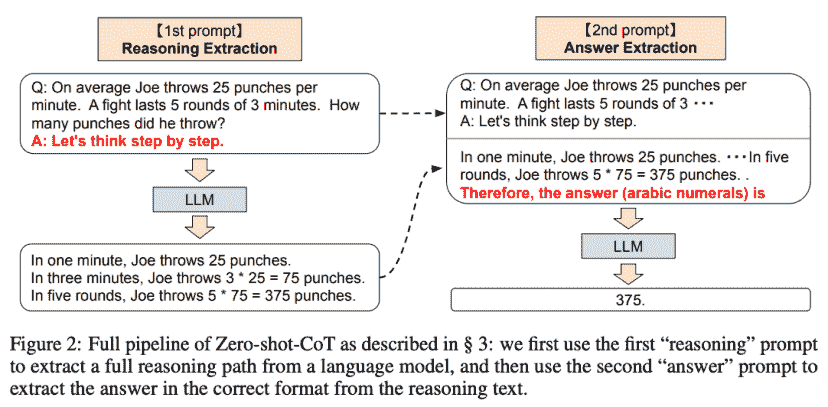

[

资料来源 大型语言模型是零样本推理器作者：Takes](https://arxiv.org/abs/2205.11916)hi Kojima 等人（2022 年）。

##### **成果**

将这一简单技巧应用于 MultiArith 数学数据集，作者发现 "让我们一步步思考 "的准确率提高了四倍，从 18% 提高到 79%！

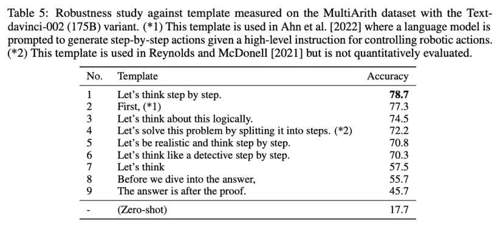

[

资料来源 大型语言模型是零样本推理器作者：Take](https://arxiv.org/abs/2205.11916)shi Kojima 等人（2022 年）。

##### **影响**

尽管逐步思考 (Let's think step by step)的技巧对数学问题很有效，但并不适用于所有任务。作者发现，它对多步算术问题、符号推理问题、策略问题和其他推理问题最有帮助。但对于简单的数学问题或常识问题，它并无帮助，而且很可能对许多其他非推理任务也无效。

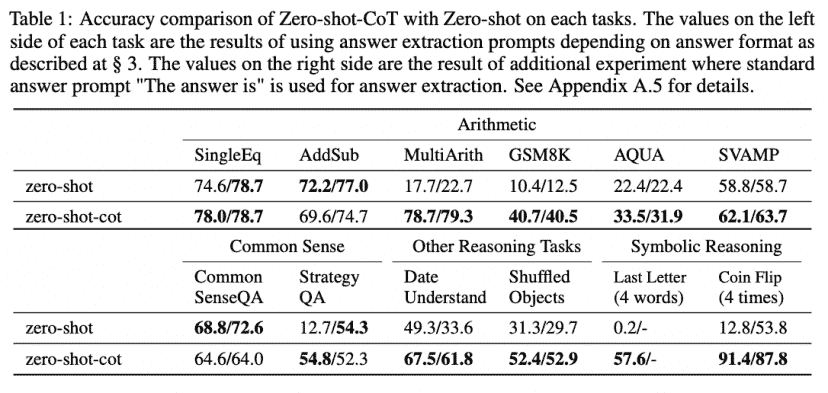

[

资料来源 大型语言模型是零样本推理器作者：Take](https://arxiv.org/abs/2205.11916)shi Kojima 等人（2022 年）。

要了解更多信息，请阅读[论文全文](https://arxiv.org/abs/2205.11916)。

如果你在自己的任务中应用这种技术，不要害怕尝试自定义指令。让我们一步一步地思考是一种比较通用的方法，因此你可能会发现，使用符合你用例的更严格格式的指令会取得更好的效果。例如，你可以尝试更有结构的变体，

+   首先，逐步思考为什么 X 可能是真的。

+   第二，逐步思考为什么 Y 可能是真的。

+   第三，逐步思考 X 还是 Y 更有意义。

你甚至可以给模型一个示例格式，以帮助它保持正确的方向，例如：

| 使用下面的 IRS 指南，按以下格式回答下列问题：  (1) 针对每项标准，确定购买车辆是否符合  - {标准}让我们逐步思考。{解释} {是或否，如果问题不适用，则不适用}。  (2) 依次考虑每个标准后，将最终答案表述为 &quot;由于{原因}，答案可能是{是或否}&quot;。  IRS 指南：  &quot;&quot;&quot;  如果您购买的汽车或卡车符合以下标准，您可能有资格根据第 30D 款获得联邦税收抵免：  - 车辆是否至少有四个轮子？  - 车辆重量是否低于 14,000 磅？  - 车辆是否从至少 4 千瓦时的电池中获取能量，并可从外部来源充电？  - 车辆是否在 2022 年之前购买？  - 如果是，制造商是否已售出少于 200,000 辆合格车辆？（特斯拉和通用汽车已售出超过 200,000 辆合格车辆）。  - 车辆是否在 2022 年之后购买？  - 如果是，该车辆是否在以下北美组装车辆列表中？(在北美组装的电动汽车只有奥迪 Q5、宝马 330e、宝马 X5、雪佛兰 Bolt EUV、雪佛兰 Bolt EV、克莱斯勒 Pacifica PHEV、福特 Escape PHEV、福特 F 系列、福特野马 MACH E、福特 Transit Van、GMC 悍马皮卡、GMC 悍马 SUV、吉普大切诺基 PHEV、Jeep Wrangler PHEV、林肯飞行家 PHEV、林肯 Corsair Plug-in、Lucid Air、日产聆风、Rivian EDV、Rivian R1S、Rivian R1T、特斯拉 Model 3、特斯拉 Model S、特斯拉 Model X、特斯拉 Model Y、沃尔沃 S60、宝马 330e、Bolt EV、凯迪拉克 Lyriq、梅赛德斯 EQS SUV 和日产聆风。)  &quot;&quot;&quot;  问：2021 年购买的丰田普锐斯 Prime 能否申请联邦税收抵免？  解答：  (1) 针对每项标准，确定所购车辆是否满足该标准  车辆是否至少有四个轮子？让我们逐步思考。 |
| --- |

| 丰田普锐斯 Prime 有四个轮子，所以答案是肯定的。  - 车辆重量是否小于 14000 磅？让我们逐步思考。丰田 Prius Prime 重量小于 14000 磅，所以答案是肯定的。  - 车辆是否从至少 4 千瓦时的电池中获取能量，并可从外部来源充电？让我们逐步思考。丰田普锐斯 Prime 的电池至少有 4 千瓦时，可以从外部充电，所以答案是肯定的。  - 车辆是在 2022 年之前购买的吗？让我们逐步思考。丰田普锐斯 Prime 是在 2021 年购买的，也就是 2022 年之前，所以答案是肯定的。  - 车辆是在 2022 年之后购买的吗？无  - 如果是这样，在下面的北美组装车辆清单中是否有该车辆？无  (2) 依次考虑每个标准后，将最终答案表述为 &quot;由于{原因}，答案很可能是{是或否}&quot;。  因为丰田普锐斯 Prime 符合联邦税收抵免的所有标准，所以答案很可能是肯定的。 |
| --- |

---

### 少样本提示

##### **方法**

提示模型推理出答案的方法有很多。其中一种方法是用几个例子来演示（"少数几个例子"）

谷歌的 Jason Wei 和 Denny Zhou 等人就是这样研究的。下面是一个少样本思维链提示词的例子：

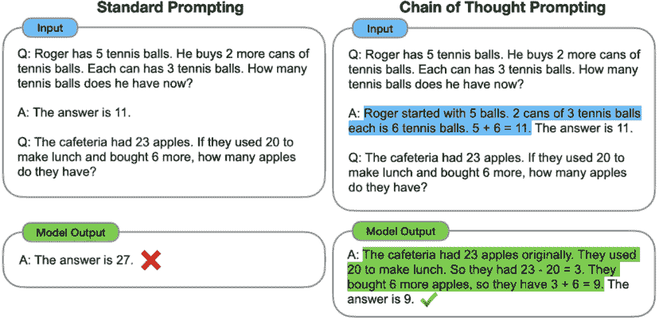

资料来源 思维链提示词激发大语言模型中的推理能力Jason Wei 和 Denny Zhou 等人 (2022)

更多由人类标签员编写的推理链演示：

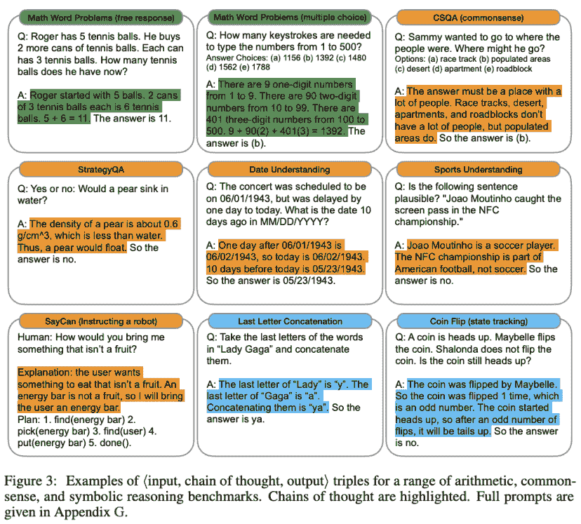

资料来源 思维链提示词激发大型语言模型的推理能力Jason Wei 和 Denny Zhou 等人 (2022)

##### **成果**

作者在对小学数学问题进行测试后发现，思维链提示词使解题率提高了两倍，从 18% 提高到 57%。

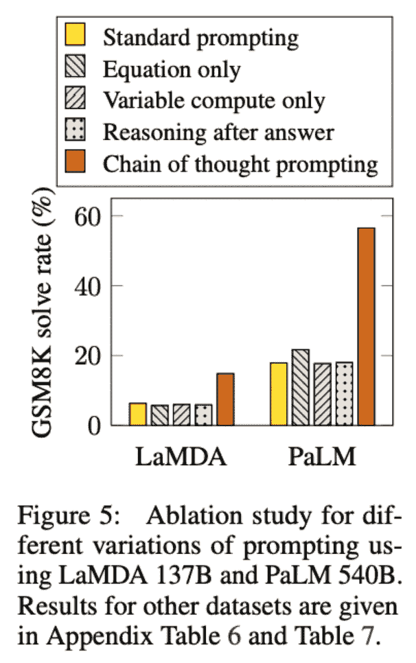

资料来源 思维链提示词激发大型语言模型的推理能力Jason Wei 和 Denny Zhou 等人 (2022)

除数学问题外，思维链提示词还提高了与体育理解、抛硬币追踪和最后一个字母连接有关的问题的成绩。在大多数情况下，不需要太多的例子就能使成绩提升达到饱和（少于 8 个左右）。

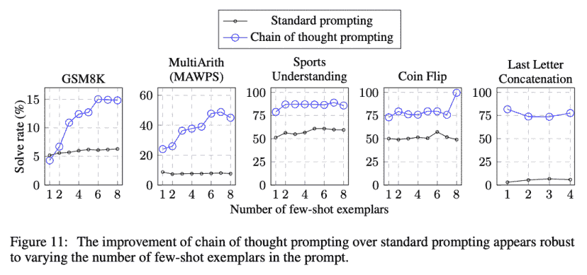

资料来源 思维链提示词激发大型语言模型的推理能力Jason Wei 和 Denny Zhou 等人 (2022)

要了解更多信息，请阅读[论文全文](https://arxiv.org/abs/2201.11903)。

##### **影响**

相对于 "让我们一步步思考 "技术，基于少量示例的方法的一个优点是，你可以更轻松地指定你希望模型在得出最终答案之前执行的推理的格式、长度和风格。这在模型最初没有以正确的方式或深度推理时尤其有帮助。

---

### **微调**

##### **方法**

一般来说，要想在任务中获得最高性能，就需要对自定义模型进行微调。然而，使用解释对模型进行微调可能需要成千上万个解释示例，而编写解释示例的成本很高。

2022 年，埃里克-泽利克曼（Eric Zelikman）和吴雨怀（Yuhuai Wu）等人发表了一个巧妙的程序，利用少样本提示词生成一个解释数据集，可用于对模型进行微调。

他们的想法是使用少样本提示词生成候选解释，并只保留产生正确答案的解释。然后，为了得到一些错误答案的额外解释，可以重试少样本提示词，但要把正确答案作为问题的一部分。作者将他们的程序称为 STaR（自学推理）：

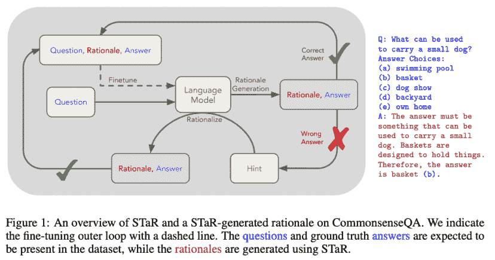

资料来源 STaR：用推理引导推理作者：Eric Zelikman、Yujuai Wu 等人 (2022)

有了这种技术，你就可以把微调的好处和思维链提示词的好处结合起来，而不需要编写成千上万的示例解释。

##### **成果**

当作者将这一技术应用于《常识问答》数据集时，他们发现 STaR 的表现优于单纯的思维链提示词（73% > 37%）和单纯的微调（73% > 60%）：

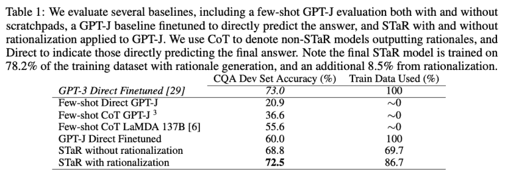

资料来源 STaR：用推理引导推理作者：Eric Zelikman、Yujuai Wu 等人 (2022)

要了解更多信息，请阅读[论文全文](https://arxiv.org/abs/2203.14465)。

##### **影响**

使用少样本提示词来扩展或修改微调数据集是一个可以推广到解释写作之外的想法。例如，如果你有大量的非结构化文本需要训练，你可以利用提示词从非结构化文本中提取结构化数据集，然后在该结构化数据集上微调自定义模型。

---

### **思维链提示词的扩展**

思维链提示词的一些扩展内容也已发表。

#### **选择-推理提示词**

##### **方法**

安东尼娅-克雷斯韦尔等人发表的论文指出，思维链技术的一个扩展，是将生成解释和答案的单一提示词分成更小的部分。首先，一个提示词从文本中选择相关的事实子集（"选择提示"）。然后，第二个提示词从所选事实中推断出结论（"推理提示"）。然后，这些提示在循环中交替使用，以生成多个推理步骤，最终得出最终答案。作者在下图中说明了这一想法：

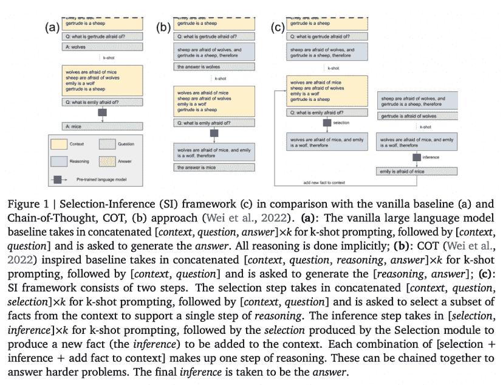

资料来源 选择推理：利用大型语言模型进行可解释逻辑推理作者：Antonia Creswell 等人（2022年）

##### **成果**

当应用于一个 7B 参数模型时，作者发现在 bAbi 和 Proof Writer 基准任务（这两个任务都需要较长的推理步骤序列）上，相对于思维链提示词，选择-推理提示词大大提高了性能。他们取得的最佳成绩是将选择-推理提示词与微调相结合。

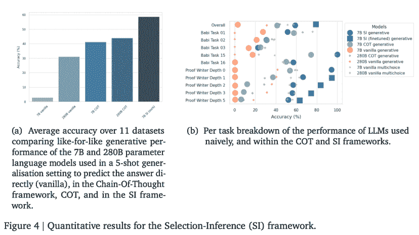

[资](https://arxiv.org/abs/2205.09712)料来源 选择推理：利用大型语言模型进行可解释逻辑推理作者：Antonia Creswell 等人（2022年）

**影响**

虽然在这些基准上取得了很大的进步，但之所以特别选择这些基准，是因为它们需要较长的推理序列。在不需要很多步骤推理的问题上，收益可能较小。

这些结果凸显了使用大型语言模型的一些普遍经验。

首先，将复杂任务拆分成较小的任务是提高可靠性和性能的好方法；任务越复杂，模型出错的空间就越小。

其二，获得最高性能通常意味着将微调与您所选择的任何方法相结合。

要了解更多信息，请阅读[论文全文](https://arxiv.org/abs/2205.09712)。

---

#### **忠实推理架构**

在发表选择-推理提示词技术几个月后，作者在后续论文中对该技术进行了扩展，并提出了一些想法：

+   选择-推理循环何时停止或继续

+   添加值函数，以帮助搜索多个推理路径

+   通过微调模型来推理句子标签（如 Sen1），而不是写出句子本身，从而减少虚构假事实的情况

##### **方法**

在最初的 "选择-推理"技术中，专门的 "选择"和 "推理"提示词交替使用，以选择事实并根据这些事实进行推理，从而结合生成一系列推理步骤。作者通过两个附加组件扩展了这一技术。

**首先**

作者添加了一个 "暂停"模型，在每个推理步骤之后，都会询问迄今为止的推理是否足以回答问题。如果是，那么该模型就会生成最终答案。

暂停模型有几个优点：

+   它可视情况而定告诉选择-推断过程何时停止或继续进行

+   如果过程从未停止，你将得不到答案，这往往比虚构的猜测更可取

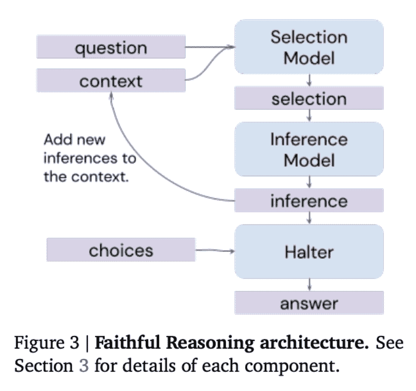

[

资料来源 使用大型语言模型进行忠实推理作者：Anton](https://arxiv.org/abs/2208.14271)ia Creswell 等人（2022 年）

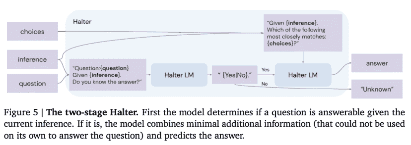

[

资料来源 使用大型语言模型进行忠实推理作者：Anton](https://arxiv.org/abs/2208.14271)ia Creswell 等人（2022 年）

**其次**

作者添加了一个价值函数，用于评估推理步骤的质量和搜索多个推理轨迹。这呼应了提高可靠性的一个共同主题；与其从模型中生成单一答案，不如生成一组答案，然后使用某种类型的价值函数/判别器/验证器模型来挑选最佳答案。

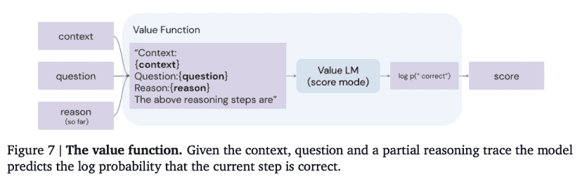

[

资料来源 使用大型语言模型进行忠实推理作者：Anton](https://arxiv.org/abs/2208.14271)ia Creswell 等人（2022 年）

除了这两项扩展，作者还使用了一种技巧来减少虚构的错误事实。他们没有要求模型写出事实性句子，而是对模型进行微调，改用句子标签（如 sen1）来工作。这有助于防止模型在提示词的上下文中产生未提及的错误事实。

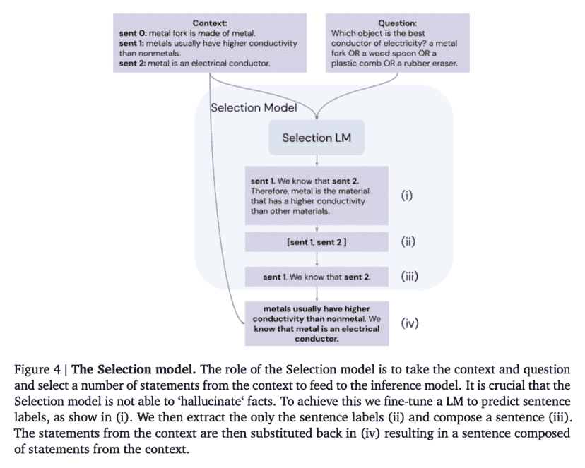

[

资料来源 使用大型语言模型进行忠实推理作者：Anton](https://arxiv.org/abs/2208.14271)ia Creswell 等人（2022 年）

##### **成果**

作者在两个基准上评估了他们的技术：ProofWriter 任务（未显示）和 EntailmentBankQA（显示）。该技术大大提高了准确性，尤其是在较难的推理问题上。

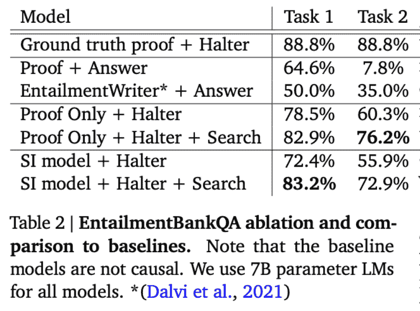

资料来源：Antonia Creswell et al：Antonia Creswell 等人撰写的《使用大型语言模型的忠实推理》（2022 年）](https://arxiv.org/abs/2208.14271)

此外，他们的句子标签操作技巧基本上消除了幻觉！

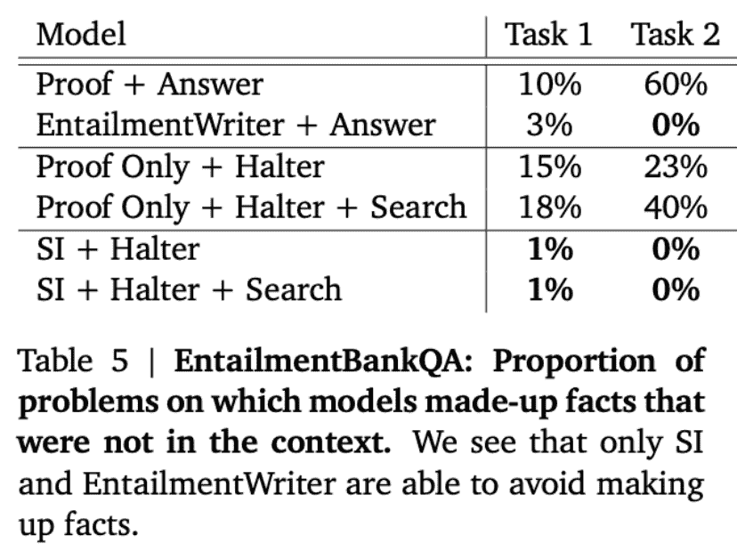

资料来源：Antonia Creswell et al：Antonia Creswell 等人撰写的《使用大型语言模型的忠实推理》（2022 年）](https://arxiv.org/abs/2208.14271)

##### **影响**

> 本文阐述了提高大型语言模型可靠性的一些有益经验：

+   将复杂任务拆分成更小、更可靠的子任务

+   循序渐进地生成答案，并对答案进行评估

+   生成许多可能的答案，并使用另一个模型或函数来挑选最合适的答案

+   通过限制模型所能表达的内容（如使用句子标签而不是句子）来减少幻觉

+   通过在专门任务上对模型进行微调，最大限度地提高模型性能

> 要了解更多信息，请阅读[论文全文](https://arxiv.org/abs/2205.09712)。

---

#### **从少到多的提示词**

除了在长推理链上表现不佳（选择-推断技术表现出色）之外，当例子很短但任务很长时，思维链提示词会特别吃力。

##### **方法**

从少到多提示词是另一种将推理任务拆分成更小、更可靠的子任务的技术。其原理是通过类似于 "要解决{问题}，我们需要先解决...... "这样的提示词，从模型中引出子任务：".然后，有了这个子任务，模型就能生成一个解决方案。该解决方案会被附加到原始问题中，然后重复该过程，直到产生最终答案。

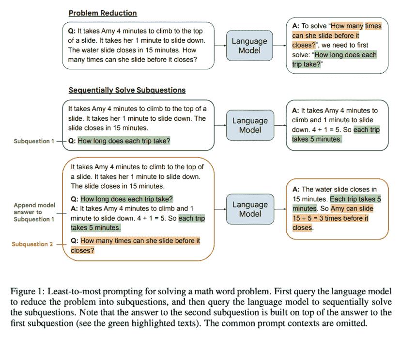

资料来源 从少到多提示词使大型语言模型中的复杂推理成为可能作者：Denny Zhou 等人 (2022)

##### **成果**

在使用 code-davinci-002（针对代码进行了优化，但仍能理解文本）进行涉及长推理链的基准测试时，作者测得的收益率高达 16% -> 99.7%！

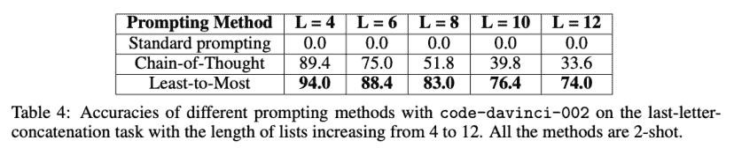

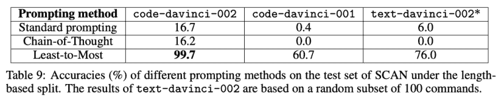

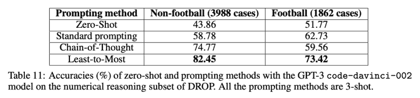

[资](https://arxiv.org/abs/2205.10625)料来源 从少到多提示词使大型语言模型中的复杂推理成为可能作者：Denny Zhou 等人 (2022)

##### **影响**

尽管上述从少到多的提示词所带来的收获令人印象深刻，但这些收益是在非常狭窄的、需要较长推理链的任务集上测得的。

不过，它们还是说明了一个共同的主题：通过（a）将复杂的任务分解成更小的子任务，以及（b）给模型更多的时间和空间来找出答案，从而提高可靠性。

要了解更多信息，请阅读[论文全文](https://arxiv.org/abs/2205.10625)。

---

#### **相关理念**

#### **助产式提示词**

##### **方法**

与前几种试图最大限度提高正确答案可能性的技术不同，另一种方法是使用 GPT-3 生成一棵可能解释（包括正确和错误）的树，然后分析它们之间的关系，猜测哪一组是正确的。2022 年 5 月，Jaehun Jung 等人将这种技术命名为 "助产式提示词"（maieutic 的意思是与苏格拉底式的提问方法有关，即通过提问来引发思考）。

这种方法很复杂，具体操作如下：

首先，构建一个助产式树，其中每个节点是一个可能为真或假的陈述：

+   从一个多项选择问题或真假陈述开始（例如，战争不能打成平局）

+   针对问题的每个可能答案，使用模型生成相应的解释（采用类似“战争不能打成平局？是的，因为”的提示）

+   然后，用问题和生成的解释来提示模型，并要求其生成答案。如果颠倒解释（采用诸如“说 {解释} 是错误的”这样的前缀）会导致答案颠倒，那么该解释被认为是‘逻辑完整的’。

+   如果一个解释在逻辑上不完整，那么就递归地重复上述过程，把每个解释都变成一个 "真 "或 "假 "的问题，并为每个新问题生成更多的解释。

+   完成所有递归解释后，你会得到一个解释树，树上的每个叶子都具有这样一个特性，即颠倒解释会颠倒模型的答案。

**其次，将树状图转换为关系图：**

+   对于树中的每个节点，计算模型对每个节点的相对信念（根据给定解释得到 "真 "答案的概率推断出）

+   对于树中的每对节点，使用模型确定它们是否被蕴含（暗示）或相互矛盾

最后，找到最一致的信念，并将其视为真理：

+   具体来说，利用每个节点的信念强度和它们之间的逻辑关系，将问题表述为加权最大可满足性问题 (MAX-SAT)

+   使用求解器找到最自洽的一组信念，并将其视为真理

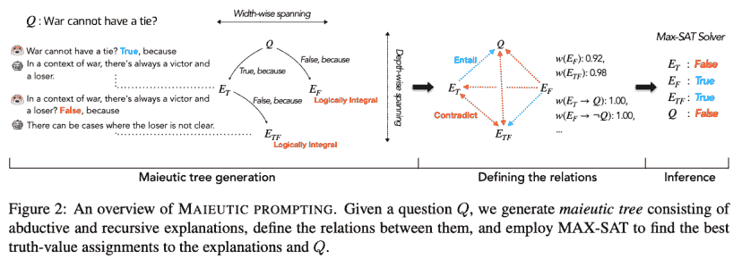

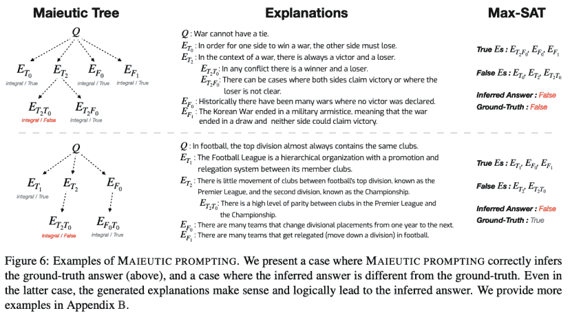

[来](https://arxiv.org/abs/2205.11822)源：Maieutic Prompting 提示词：用递归解释进行逻辑一致的推理作者：Jaehun Jung 等人 (2022)

##### **成果**

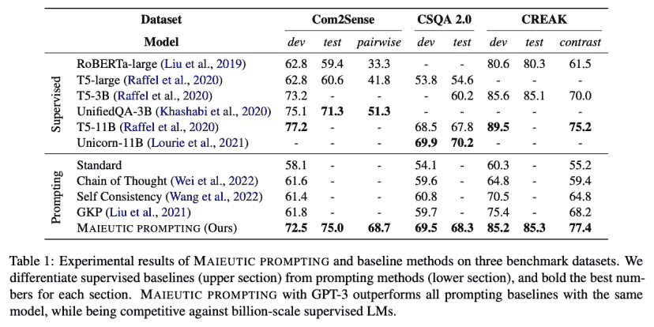

[来](https://arxiv.org/abs/2205.11822)源：Maieutic Prompting 提示词：用递归解释进行逻辑一致的推理作者：Jaehun Jung 等人 (2022)

##### **影响**

除了复杂性之外，这种方法的一个局限性是，它似乎只适用于可作为多项选择题提出的问题。

要了解更多信息，请阅读[论文全文](https://arxiv.org/abs/2205.11822)。

---

### **扩展**

#### **自洽性**

##### **方法**

对于有一组离散答案的任务，提高可靠性的一个简单方法是从模型中抽取多个解释和答案（使用正温度），然后选出出现频率最高的最终答案。

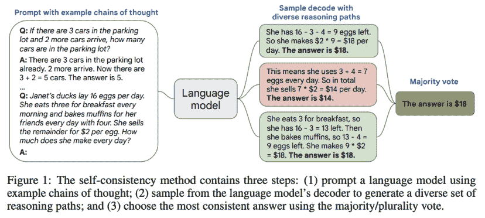

[

资料来源 自洽性改进语言模型中的思维链推理作者](https://arxiv.org/abs/2203.11171)：Xuezhi Wang 等人 (2022)

##### **成果**

在一系列数学和推理基准测试中，这项技术将准确率提高了 1 到 24 个百分点不等。(下面绘制的是谷歌 LaMDA 模型的结果；使用谷歌更大的 PaLM 模型，基线更高，但收益略低）。

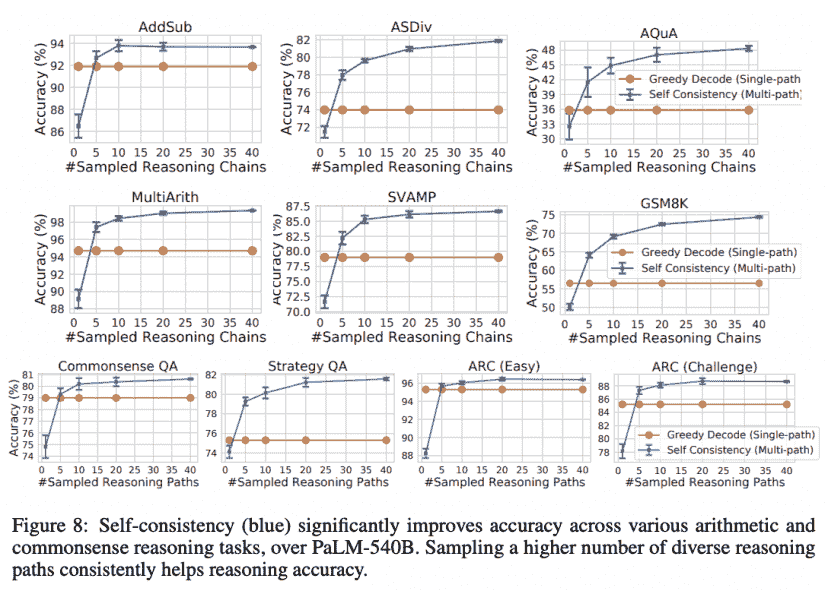

[

资料来源 自洽性改进语言模型中的思维链推理作者：](https://arxiv.org/abs/2203.11171)Xuezhi Wang 等人 (2022)

##### **影响**

虽然这种方法实施起来很简单，但成本却很高。生成一组 10 个答案将使您的成本增加 10 倍。

此外，与许多此类技术一样，它只适用于答案有限的任务。对于每个答案都是独一无二的开放式任务（如写诗），选择最常见的答案的意义并不明显。

最后，当有多种途径或措辞可以得到答案时，这种技巧应该是最有用的；如果只有一种途径，那么这种技巧可能根本无济于事。举个极端的例子：如果任务是生成一个单一标记的答案，那么从 100 代中选取最常见的标记与选取 logprobs 最高的标记（在温度=0 的条件下，只需生成一次）没有什么区别。

#### **验证器**

提高任务性能的另一个关键技术是训练一个验证器或判别器模型来评估主生成模型的输出。如果验证器拒绝接受输出，那么就可以对生成模型重新采样，直到得到可接受的输出为止。在很多情况下，判断一个答案比创建一个答案更容易，这有助于解释这种方法的威力。

##### **方法**

2021 年，OpenAI 的研究人员将这一技术应用于小学数学问题，具体过程如下：

+   首先，他们对问题和解决方案的模型进行了微调

+   对于训练集中的每个问题，他们生成了 100 个解决方案

+   根据最终答案是否正确，这 100 个解决方案中的每个解决方案都会被自动标记为正确或不正确

+   利用这些解决方案（其中一些标注为正确，另一些标注为错误），他们对验证器模型进行了微调，以对问题和候选解决方案进行正确或错误分类

+   最后，在测试时，生成模型为每个问题创建 100 个解决方案，并根据验证器模型选出得分最高的一个作为最终答案

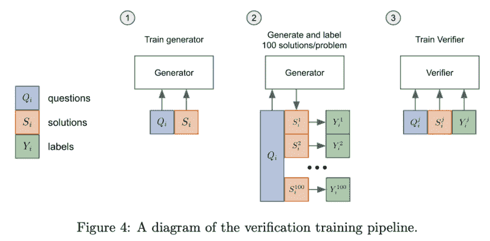

[

资料来源 训练验证者解决数学文字问题作者：](https://arxiv.org/abs/2110.14168)Karl Cobbe 等人（2021 年）

##### **成果**

利用 175B GPT-3 模型和 8000 个训练示例，这项技术大大提高了小学数学的准确率，从 ~33% 提高到 ~55%。

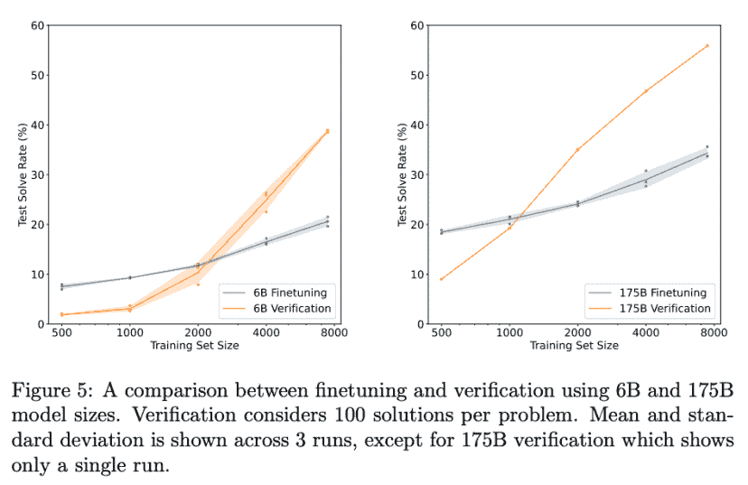

[

资料来源 训练验证者解决数学文字问题作者：](https://arxiv.org/abs/2110.14168)Karl Cobbe 等人（2021 年）

##### **影响**

与自洽技术类似，这种方法的成本也很高，比如说，每个任务生成 100 个解决方案，成本大约会增加 100 倍。

### **可靠性理论**

尽管上述技术的方法各不相同，但它们的共同目标都是提高复杂任务的可靠性。它们主要通过以下方式实现这一目标

+   将不可靠的操作分解为更小、更可靠的操作（如选择-推理提示词）

+   利用多个步骤或多个关系，使系统的可靠性大于任何单个组件（例如助产式提示）。

#### **概率图模型**

试图通过不太可靠的组件构建可靠系统的这种范式让人想起了概率编程，该领域的许多分析技术可以应用于这个领域。

在论文《语言模型串联》中，David Dohan等人将上述技术解释为概率图模型的范式：

##### **思维链提示词**

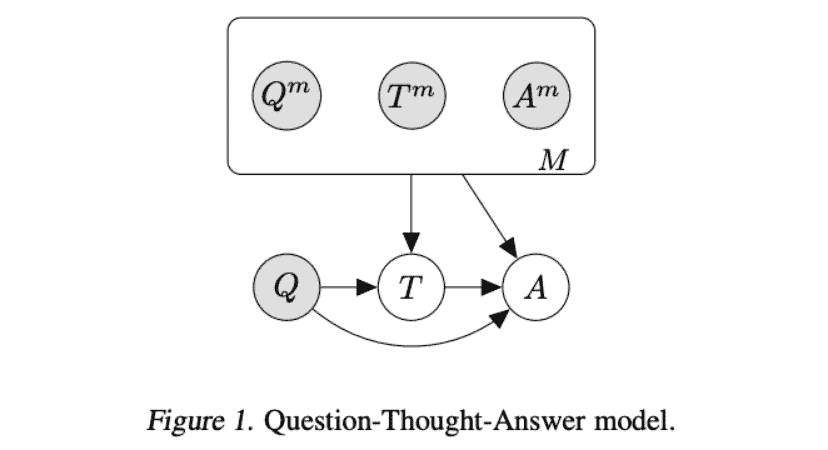

资料来源 语言模型级联作者：戴维-多汉等人（2022 年）

##### **精细的思维链提示词/自学推理者**

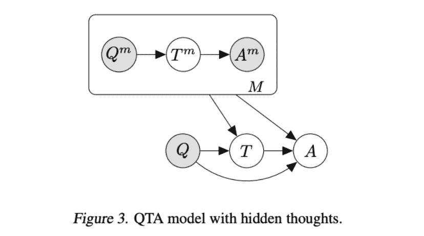

资料来源 语言模型级联作者：戴维-多汉等人（2022 年）

##### **选择-推理提示词**

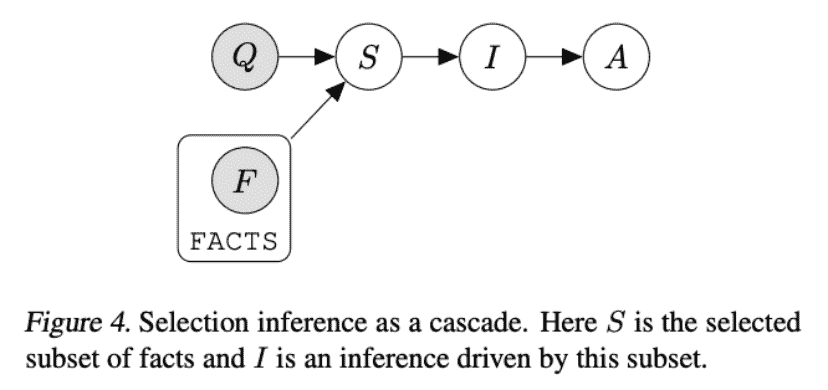

资料来源 语言模型级联作者：戴维-多汉等人（2022 年）

##### 验证器

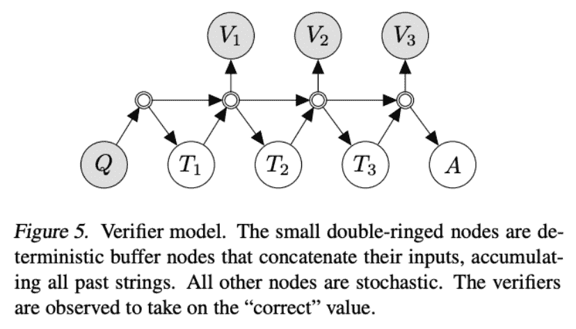

资料来源 语言模型级联作者：戴维-多汉等人（2022 年）

##### **影响**

尽管将这些技术表述为概率图模型可能无法立即用于解决任何特定问题，但该框架可能有助于选择、组合和发现新技术。

### **结束语**

对大型语言模型的研究非常活跃，而且发展迅速。研究人员不仅不断改进模型，还不断加深我们对如何更好地使用模型的理解。为了强调这些发展的速度，请注意上面分享的所有论文都是在过去 12 个月内发表的（目前是2022 年 9 月）。

未来，可以期待出现更好的模型和更优秀的技术。即使这里具体的技术被未来的最佳实践所取代，它们背后的一般原则很可能仍将是任何专业用户工具箱的关键组成部分。

### **参考资料**