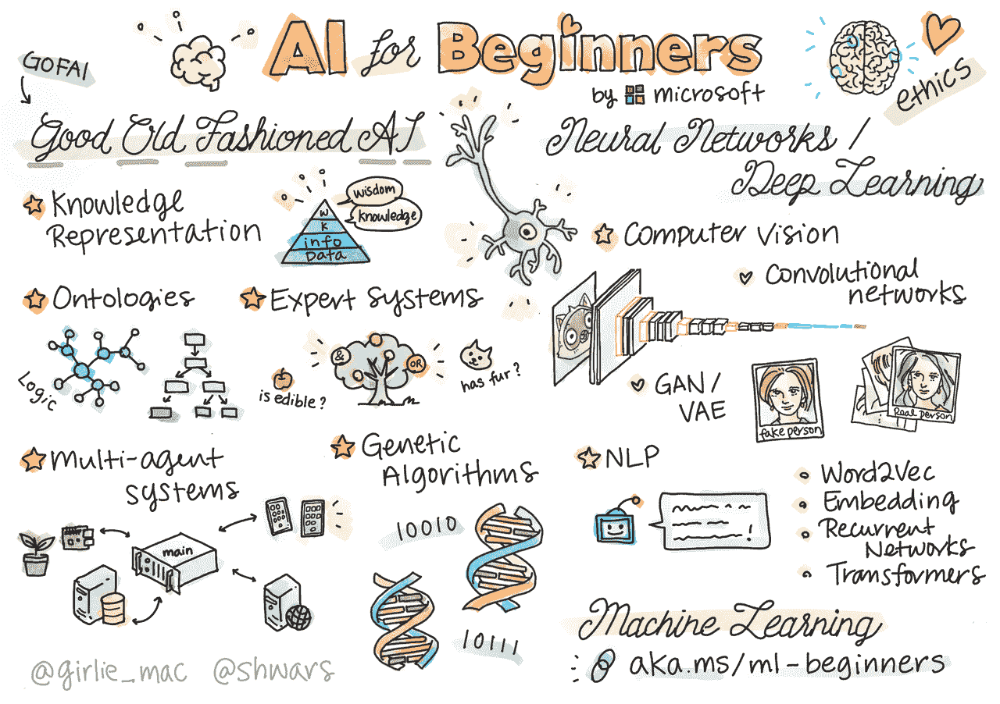

# 微软AI初学者入门课程

> 来源：[https://waytoagi.feishu.cn/docx/Lopydsg7jodVuaxDyJKcDI3Gnhe](https://waytoagi.feishu.cn/docx/Lopydsg7jodVuaxDyJKcDI3Gnhe)

> 译者：Miranda，课程原网址 https://microsoft.github.io/AI-For-Beginners/

通过微软为期12周、共24课时的课程，一起来探索人工智能（AI）的世界！在本课程中，你将深入学习符号人工智能（Symbolic AI）、神经网络（Neural Networks）、计算机视觉（Computer Vision）、自然语言处理（Natural Language Processing）等内容。如果想提升学习效果，可以亲身实践课程内容、做随堂小测试或根据课程内容开展实验。这套课程是由专家设计的人工智能综合指南，它非常适合初学者，覆盖了TensorFlow、PyTorch及人工智能伦理原则。今天就开始你的人工智能之旅吧！

**在本课程中，你将学到：**

+   **实现人工智能的不同方法**，包括使用了知识表示和推理的符号人[工智能，它](https://en.wikipedia.org/wiki/Symbolic_artificial_intelligence)是一种“有效的老式人工智能”（GOFAI）。

+   **神经网络和深度学习**[，它们是现代人工智能](https://www.tensorflow.org/)的核心[，我们将使用两](https://pytorch.org/)个最流行的框架（TensorFlow 和 PyTorch）中的代码来说明这两个主题背后的重要概念。

+   **处理图像和文本的神经架构**，我们将介绍最新的模型，但在最前沿的信息上可能会有所欠缺。

+   **不太流行的人工智能方法**，如遗传算法（Genetic Algorithms）和多智能体系统（Multi-Agent Systems）。

本课程不包括以下内容：

+   人工智能的商业应用案例。如需要了解这方面的[信息，可以考虑学习以下两个](https://learn.microsoft.com/en-us/training/paths/introduction-ai-for-business-users/?WT.mc_id=academic-77998-cacaste)微软的[课程：《面向商](https://learn.microsoft.com/en-us/training/paths/transform-your-business-with-microsoft-ai/)业用户的人工智能学习》、《人工智能商学院》（和欧洲工商管理学院INSEAD共同开发）。

+   经典机器学习。这在我们的《[机器学习入门课程](https://github.com/Microsoft/ML-for-Beginners)》中有详细介绍。

+   使用Azure认知服务（Azure Cognitive Servi[ce](https://learn.microsoft.com/en-us/training/paths/create-computer-vision-solutions-azure-ai/?WT.mc_id=academic-77998-cacaste)s）来[创建实用的人](https://learn.microsoft.com/en-us/training/paths/explore-natural-language-processing/?WT.mc_id=academic-77998-cacaste)工智能应用。如有需要，我们建议你从以下微软课程开始学习：《视觉》、《自然语言处理》、《使用 Azure OpenAI 服务的生成式人工智能》等。

+   特定的机器学习云框架。例如 Azure Machine Lear[ning，Microsoft Fabr](https://learn.microsoft.com/en-us/training/paths/explore-azure-machine-learning-workspace/?WT.mc_id=academic-77998-cacaste)ic，或 Azure Databricks。如有需要，考虑以下课程：《使用 Azure Machine Learning 构建和运行机器学习解决方案》、《使用 Azure Databricks 构建和运行机器学习解决方案》。

+   [对话式人工智能和聊天机器人](https://learn.microsoft.com/en-us/training/paths/create-conversational-ai-solutions/?WT.mc_id=academic-77998-cacaste)。这方面有一个单[独的课程](https://soshnikov.com/azure/hello-bot-conversational-ai-on-microsoft-platform/)《创建对话式人工智能解决方案》，你也可以参考这篇博文了解更多详情。

+   深度学习背后的深层数学（Deep Mathematics）。关于这一点，我们推荐 Ian Goodfellow、Yoshua Bengio 和 Aaron Courville 合著的《深度学习》（Deep Learning）一书，该书可在 https://www.deeplearningbook.org/ 上获取。

如需了解云计算中的人工智能主题，可以考虑参加《在 Azure 上开始使用人工智能》课程。

# 课程列表

| 编号 | 课程 | 介绍 | PyTorch | Keras/ | 实验 |
| --- | --- | --- | --- | --- | --- |
| **I** | **人工智能导论** |  |  |  |  |
| 1 | 人工智能简介和历史 | [讲义](https://waytoagi.feishu.cn/wiki/HbhhwapFoiVgs1kk1TIcV3a7nzd) |  |  |  |
| **II** | **符号人工智能** |  |  |  |  |
| 2 | 知识表示和专家系统 | [讲义](https://waytoagi.feishu.cn/wiki/SBH5wXRnPi6ZRYkjplVcRTRPnJh) | [专家系统](https://github.com/microsoft/AI-For-Beginners/blob/main/lessons/2-Symbolic/Animals.ipynb) |  |  |
| （待更新） |  |  |  |  |  |